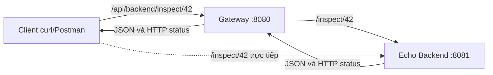

# Dựng dịch vụ phía sau để quan sát yêu cầu được chuyển tiếp

**Chương:** Khởi tạo  
**Module:** Spring Cloud Gateway (`SPRING_CLOUD_GATEWAY`)

Spring Cloud Gateway nhận HTTP request, lựa chọn route theo predicate, áp dụng filter chain rồi chuyển tiếp đến dịch vụ phía sau (*downstream service*). Trong quá trình triển khai cổng vào microservices, cần một backend thử nghiệm để **thấy chính xác path, method, query string, header, body và trạng thái trả về** khi request đã đi qua gateway.

Bài học này xây dựng **Echo Backend** với Spring Boot. Dịch vụ nhận request và trả thông tin vừa nhận dưới dạng JSON, đồng thời có endpoint mô phỏng lỗi và độ trễ. Sau đó, ta cấu hình route đơn giản trên **Spring Cloud Gateway Server WebFlux**, gửi cùng một request theo hai cách (trực tiếp/qua gateway) và so sánh. Kết quả sẽ là nền tảng để thực hành biến đổi đường dẫn/header, xác thực, rate limiting, circuit breaker, retry, TLS, service discovery và quan sát request ở các bài tiếp theo.

## 1. Mục tiêu và mô hình thực hành

Khi hoàn thành, bạn có thể:

1. Dựng backend Spring Boot ở cổng `8081` với endpoint kiểm tra sức khỏe và phản chiếu HTTP request.
2. Phân biệt URL client gọi với URI thực sự đến backend sau filter `StripPrefix`.
3. Dùng một header được Gateway thêm vào để nhận biết luồng chuyển tiếp trong môi trường lab.
4. Đọc log backend để kiểm tra số lần request, mã HTTP và thời gian xử lý.
5. Gọi endpoint lỗi `503` và endpoint trễ có kiểm soát để chuẩn bị cho bài thử resilience.



| Thành phần | Cổng | Vai trò |
|---|---|---|
| Client | — | Gửi và kiểm tra request/response |
| Spring Cloud Gateway | `8080` | Khớp route `/api/backend/**`, bỏ prefix, thêm header và forward |
| Echo Backend | `8081` | Nhận request thật, trả JSON và log quan sát |

Backend trong ví dụ dùng **Spring MVC/Servlet**, còn gateway dùng **Server WebFlux**. Điều này hợp lệ: hai tiến trình nói chuyện với nhau qua HTTP, không phải dùng chung web stack. Ta dùng địa chỉ `http://localhost:8081` trước để dễ cô lập lỗi; service discovery và `lb://` là bước mở rộng sau.

> Chỉ triển khai Echo Backend trong môi trường học tập hoặc nội bộ có kiểm soát. Endpoint quan sát có thể làm lộ dữ liệu HTTP; tuyệt đối không thử với token, cookie hoặc thông tin cá nhân thật.

## 2. Khởi tạo dự án Echo Backend

### 2.1. Công cụ và dependency

Chuẩn bị JDK và Maven/Maven Wrapper tương thích Spring Boot đang dùng, hai cổng `8080`/`8081` còn trống, và `curl` hoặc Postman. Với Spring Boot 3.x, Java 17 trở lên là lựa chọn phù hợp.

Trên [Spring Initializr](https://start.spring.io/), chọn:

| Trường | Giá trị gợi ý |
|---|---|
| Project | Maven |
| Language | Java |
| Group | `com.example` |
| Artifact | `echo-backend` |
| Package | `com.example.echobackend` |
| Packaging | Jar |
| Dependencies | **Spring Web**, thêm **Spring Boot Actuator** nếu muốn health actuator |

Với một ứng dụng Spring Boot 3.x, phần dependency cơ bản trong `pom.xml` gồm:

```xml
<dependencies>
    <dependency>
        <groupId>org.springframework.boot</groupId>
        <artifactId>spring-boot-starter-web</artifactId>
    </dependency>
    <!-- Tùy chọn: /actuator/health -->
    <dependency>
        <groupId>org.springframework.boot</groupId>
        <artifactId>spring-boot-starter-actuator</artifactId>
    </dependency>
</dependencies>
```

Parent và dependency management đã được Initializr tạo. Nếu dùng Spring Boot 4.x, hãy chọn đúng tên starter do Initializr cung cấp cho bản đó. **Echo Backend không cần thêm dependency Spring Cloud Gateway**: ứng dụng Gateway là tiến trình riêng.

### 2.2. Cấu trúc dự án

```text
echo-backend/
├── pom.xml
└── src/main/
    ├── java/com/example/echobackend/
    │   ├── EchoBackendApplication.java
    │   ├── EchoController.java
    │   └── RequestTraceFilter.java
    └── resources/application.yml
```

Đặt các lớp cùng package hoặc package con của lớp khởi động để `@SpringBootApplication` quét được các component.

### 2.3. Cấu hình ứng dụng

Tạo `src/main/resources/application.yml`:

```yaml
spring:
  application:
    name: echo-backend

server:
  port: 8081

management:
  endpoints:
    web:
      exposure:
        include: health,info
```

Tên `spring.application.name` giúp định danh ứng dụng trong log, **không đồng nghĩa tự đăng ký vào service registry**. Mục `management` chỉ có tác dụng với Actuator; ví dụ chỉ mở `health`/`info`, không bật toàn bộ endpoint quản trị.

Tạo `EchoBackendApplication.java`:

```java
package com.example.echobackend;

import org.springframework.boot.SpringApplication;
import org.springframework.boot.autoconfigure.SpringBootApplication;

@SpringBootApplication
public class EchoBackendApplication {
    public static void main(String[] args) {
        SpringApplication.run(EchoBackendApplication.class, args);
    }
}
```

## 3. Tạo controller phản chiếu request

Tạo `EchoController.java`:

```java
package com.example.echobackend;

import jakarta.servlet.http.HttpServletRequest;
import org.springframework.http.HttpStatus;
import org.springframework.http.ResponseEntity;
import org.springframework.web.bind.annotation.*;

import java.util.Collections;
import java.util.LinkedHashMap;
import java.util.List;
import java.util.Locale;
import java.util.Map;
import java.util.Set;

@RestController
public class EchoController {

    private static final Set<String> SENSITIVE_HEADERS =
            Set.of("authorization", "proxy-authorization",
                   "cookie", "set-cookie");

    @GetMapping("/healthz")
    public Map<String, String> healthz() {
        return Map.of("service", "echo-backend", "status", "UP");
    }

    @GetMapping("/inspect/{id}")
    public Map<String, Object> inspectGet(
            @PathVariable String id, HttpServletRequest request) {
        return snapshot(request, Map.of("pathVariableId", id), null);
    }

    @PostMapping("/inspect")
    public Map<String, Object> inspectPost(
            @RequestBody(required = false) String body,
            HttpServletRequest request) {
        return snapshot(request, Map.of(), body);
    }

    @GetMapping("/simulate-error")
    public ResponseEntity<Map<String, String>> simulateError() {
        return ResponseEntity.status(HttpStatus.SERVICE_UNAVAILABLE)
                .body(Map.of(
                        "service", "echo-backend",
                        "message", "Simulated backend failure"));
    }

    @GetMapping("/simulate-delay")
    public Map<String, Object> simulateDelay(
            @RequestParam(defaultValue = "300") long ms,
            HttpServletRequest request) throws InterruptedException {
        long boundedMs = Math.max(0, Math.min(ms, 2_000));
        Thread.sleep(boundedMs);
        return snapshot(request, Map.of("delayMs", boundedMs), null);
    }

    private Map<String, Object> snapshot(
            HttpServletRequest request,
            Map<String, ?> details,
            String body) {
        Map<String, Object> result = new LinkedHashMap<>();
        result.put("service", "echo-backend");
        result.put("method", request.getMethod());
        result.put("requestUri", request.getRequestURI());
        result.put("queryString", request.getQueryString());
        result.put("scheme", request.getScheme());
        result.put("remoteAddress", request.getRemoteAddr());
        result.put("headers", safeHeaders(request));
        result.put("details", details);
        if (body != null) {
            result.put("body", body);
        }
        return result;
    }

    private Map<String, List<String>> safeHeaders(HttpServletRequest request) {
        Map<String, List<String>> result = new LinkedHashMap<>();
        if (request.getHeaderNames() == null) {
            return result;
        }
        for (String name : Collections.list(request.getHeaderNames())) {
            if (SENSITIVE_HEADERS.contains(name.toLowerCase(Locale.ROOT))) {
                result.put(name, List.of("[REDACTED]"));
            } else {
                result.put(name, Collections.list(request.getHeaders(name)));
            }
        }
        return result;
    }
}
```

### 3.1. Những endpoint đã có

| Endpoint backend | Kết quả | Mục đích |
|---|---|---|
| `GET /healthz` | `200` và JSON `status=UP` | Kiểm tra backend trước khi chạy Gateway |
| `GET /inspect/{id}` | JSON method, URI, query, header, path variable | Kiểm tra path và header được forward |
| `POST /inspect` | JSON chứa cả body chuỗi | Kiểm tra POST qua gateway |
| `GET /simulate-error` | `503 Service Unavailable` | Tạo lỗi HTTP có kiểm soát |
| `GET /simulate-delay?ms=600` | Chờ gần `600 ms` rồi trả JSON | Quan sát timeout và thời gian xử lý |

`HttpServletRequest` phản ánh request **backend đã nhận**, do đó `requestUri` rất quan trọng để kiểm chứng biến đổi path. `queryString` có thể là `null`, còn `remoteAddress` có thể là địa chỉ gateway/container, không nhất thiết là IP người dùng gốc.

Controller ẩn bốn loại header nhạy cảm phổ biến. Tuy nhiên, query string, body và các header khác vẫn có thể chứa dữ liệu nhạy cảm; không truy cập endpoint này từ môi trường public và không gửi thông tin thật. `@RequestBody String` dùng được với payload thử nhỏ; không nên dùng demo này để nhận multipart, file lớn hoặc stream production.

Endpoint tạo trễ dùng `Thread.sleep` trong servlet thread và giới hạn tối đa 2 giây. Đây là **công cụ mô phỏng**, không phải cách xử lý chờ trong ứng dụng thật.

## 4. Ghi log để xác định backend đã xử lý request

JSON cho thấy một request đơn lẻ, còn log cho phép đếm các lượt nhận request. Điều này đặc biệt hữu ích khi sau này bật `Retry` hoặc circuit breaker: **một request từ client có thể khiến backend nhận nhiều lần**.

Tạo `RequestTraceFilter.java`:

```java
package com.example.echobackend;

import jakarta.servlet.FilterChain;
import jakarta.servlet.ServletException;
import jakarta.servlet.http.HttpServletRequest;
import jakarta.servlet.http.HttpServletResponse;
import org.slf4j.Logger;
import org.slf4j.LoggerFactory;
import org.springframework.stereotype.Component;
import org.springframework.web.filter.OncePerRequestFilter;

import java.io.IOException;
import java.util.concurrent.TimeUnit;

@Component
public class RequestTraceFilter extends OncePerRequestFilter {

    private static final Logger log =
            LoggerFactory.getLogger(RequestTraceFilter.class);

    @Override
    protected void doFilterInternal(
            HttpServletRequest request,
            HttpServletResponse response,
            FilterChain filterChain)
            throws ServletException, IOException {
        long start = System.nanoTime();
        try {
            filterChain.doFilter(request, response);
        } finally {
            long elapsedMs = TimeUnit.NANOSECONDS.toMillis(
                    System.nanoTime() - start);
            log.info(
                    "method={} uri={} status={} elapsedMs={} "
                            + "gatewaySource={} labRequestId={}",
                    request.getMethod(), request.getRequestURI(),
                    response.getStatus(), elapsedMs,
                    request.getHeader("X-Gateway-Source"),
                    request.getHeader("X-Lab-Request-Id"));
        }
    }
}
```

Một dòng log ví dụ:

```text
method=GET uri=/inspect/42 status=200 elapsedMs=6
gatewaySource=spring-cloud-gateway labRequestId=gw-001
```

Thời gian là minh họa; không kỳ vọng mọi máy đều cho kết quả `6 ms`. Filter chỉ log metadata, **không đọc body** nên không làm tiêu thụ request stream trước controller. Trong các luồng phát sinh exception, status ở filter có thể chưa phải trạng thái cuối cùng sau khi container xử lý lỗi; hãy đối chiếu mã HTTP ở client.

## 5. Chạy backend độc lập và kiểm tra

Trong thư mục dự án `echo-backend`:

```bash
./mvnw spring-boot:run
```

Windows PowerShell hoặc Command Prompt:

```powershell
.\mvnw.cmd spring-boot:run
```

Khi server đã lắng nghe tại `8081`, mở terminal khác:

```bash
curl -i http://localhost:8081/healthz
curl -i "http://localhost:8081/inspect/42?source=direct&tag=a&tag=b"
```

Health response kỳ vọng:

```http
HTTP/1.1 200
Content-Type: application/json

{"service":"echo-backend","status":"UP"}
```

Response inspect rút gọn (header và địa chỉ peer thay đổi theo môi trường):

```json
{
  "service": "echo-backend",
  "method": "GET",
  "requestUri": "/inspect/42",
  "queryString": "source=direct&tag=a&tag=b",
  "scheme": "http",
  "remoteAddress": "<peer IP>",
  "headers": {"host": ["localhost:8081"]},
  "details": {"pathVariableId": "42"}
}
```

JSON thật có thể chứa nhiều header hơn. Nếu dùng Actuator, thử `GET http://localhost:8081/actuator/health`; endpoint này chỉ xác nhận tình trạng ứng dụng, **chưa chứng minh Gateway đã chuyển tiếp request**.

Nếu gọi `8081` không thành công, kiểm tra backend đã khởi động chưa, `server.port` có đúng không, và cổng có bị chương trình khác chiếm không. Chỉ chuyển sang bước Gateway sau khi gọi trực tiếp thành công; như vậy khi gateway trả 5xx, bạn sẽ biết chắc lỗi mới xuất hiện ở đâu.

## 6. Tạo route thử trên Spring Cloud Gateway

Ví dụ tiếp theo dành cho **một ứng dụng Gateway Server WebFlux riêng** chạy ở `8080`. Không thêm cấu hình route dưới đây vào dự án `echo-backend`; backend chỉ cần controller ở `8081`.

Nếu tạo dự án Gateway mới, chọn bộ Spring Boot/Spring Cloud release train tương thích. Với Spring Cloud 2025.0 trở lên, starter Gateway Server WebFlux có tên:

```xml
<dependency>
    <groupId>org.springframework.cloud</groupId>
    <artifactId>spring-cloud-starter-gateway-server-webflux</artifactId>
</dependency>
```

Trong `application.yml` **của Gateway**:

```yaml
server:
  port: 8080

spring:
  cloud:
    gateway:
      server:
        webflux:
          routes:
            - id: echo-backend
              uri: http://localhost:8081
              predicates:
                - Path=/api/backend/**
              filters:
                - StripPrefix=2
                - AddRequestHeader=X-Gateway-Source, spring-cloud-gateway
```

**Lưu ý phiên bản:** ví dụ dùng prefix `spring.cloud.gateway.server.webflux.routes` (dòng Spring Cloud 2025.0+/Gateway 4.3+). Các ứng dụng trước đó thường dùng `spring.cloud.gateway.routes` và starter `spring-cloud-starter-gateway`. Khi cấu hình route, đối chiếu chính xác tài liệu của release train đang dùng để tránh gateway khởi động mà không thấy route.

### 6.1. Phân tích từng thành phần

| Thành phần | Ý nghĩa đối với request thử |
|---|---|
| `id: echo-backend` | Tên route để tìm kiếm trong log/metric |
| `uri: http://localhost:8081` | Downstream HTTP server sẽ nhận request |
| `Path=/api/backend/**` | Request client phải khớp prefix `/api/backend/` |
| `StripPrefix=2` | Loại bỏ hai phân đoạn `api` và `backend` |
| `AddRequestHeader=...` | Bổ sung header `X-Gateway-Source` vào request downstream |

Ví dụ cụ thể:

```text
Client gửi:
  GET http://localhost:8080/api/backend/inspect/42?source=gateway

Route predicate:
  Path=/api/backend/** -> khớp

Sau StripPrefix=2:
  /api/backend/inspect/42 -> /inspect/42

Filter thêm:
  X-Gateway-Source: spring-cloud-gateway

Backend thực nhận:
  GET http://localhost:8081/inspect/42?source=gateway
```

Vì backend đã có `@GetMapping("/inspect/{id}")`, request đến đúng handler. Nếu đổi nhầm `StripPrefix=2` thành `StripPrefix=1`, backend nhận `/backend/inspect/42` và thường trả `404` do không có mapping tương ứng. Tình huống này giúp phân biệt lỗi **route không khớp ở Gateway** và lỗi **handler không khớp ở backend**.

**Không dùng `X-Gateway-Source` để xác thực danh tính gateway.** Đây chỉ là dấu quan sát: client cũng có thể tự gửi header này. Việc tin tưởng nguồn gốc request phải dựa trên bảo vệ mạng, TLS, xác thực, proxy trust và chính sách bảo mật thực tế.

## 7. Thử request end-to-end

Giữ backend hoạt động ở `8081`, đồng thời chạy Gateway ở `8080` trong terminal khác. Thực hiện các lệnh thử trong một terminal thứ ba.

### 7.1. Gọi trực tiếp so với gọi qua gateway

```bash
# Request trực tiếp tới backend
curl -i \
  -H "X-Lab-Request-Id: direct-001" \
  "http://localhost:8081/inspect/42?source=direct"

# Request tới gateway, để gateway chuyển tiếp
curl -i \
  -H "X-Lab-Request-Id: gw-001" \
  "http://localhost:8080/api/backend/inspect/42?source=gateway"
```

Đối chiếu JSON ở cả hai:

| Trường | Trực tiếp `8081` | Qua Gateway `8080` |
|---|---|---|
| `method` | `GET` | `GET` |
| `requestUri` ở backend | `/inspect/42` | `/inspect/42` sau filter |
| `queryString` | `source=direct` | `source=gateway` |
| `pathVariableId` | `42` | `42` |
| Header `X-Lab-Request-Id` | `direct-001` | `gw-001` |
| Header `X-Gateway-Source` | Không có nếu client không tự gửi | `spring-cloud-gateway` |

Kiểm tra thêm terminal backend. Với request `gw-001`, log có thể giống:

```text
method=GET uri=/inspect/42 status=200 elapsedMs=8
gatewaySource=spring-cloud-gateway labRequestId=gw-001
```

Tổ hợp bằng chứng **URL client / path ở backend / header do gateway gắn / log backend** xác nhận filter chain đã biến đổi và chuyển tiếp request.

Tên header HTTP không phân biệt hoa/thường; JSON có thể hiển thị `x-gateway-source` thay vì `X-Gateway-Source`. Header `Host`, `Forwarded` hoặc `X-Forwarded-*` có thể được Gateway tạo mới hoặc điều chỉnh theo cấu hình, vì vậy không nên đòi hỏi chúng giống byte-by-byte với header client gửi.

### 7.2. Kiểm tra query string và header tự chọn

```bash
curl -i \
  -H "X-Demo-Client: terminal" \
  -H "X-Lab-Request-Id: gw-headers-002" \
  "http://localhost:8080/api/backend/inspect/99?color=blue&tag=a&tag=b"
```

Ở backend, kiểm tra:

- `requestUri` là `/inspect/99`;
- `queryString` chứa `color=blue&tag=a&tag=b`;
- `details.pathVariableId` là `99`;
- `headers` có `X-Demo-Client`, `X-Lab-Request-Id` và `X-Gateway-Source` với cách viết hoa/thường có thể khác;
- log backend ghi một lượt xử lý tương ứng.

Một số header có thể bị hệ thống hoặc HTTP client xử lý đặc biệt, đặc biệt các header hop-by-hop, `Host` và forward headers. Kết quả thực nhận tại backend là nguồn kiểm chứng của bài lab; **đừng suy đoán rằng mọi header được sao chép nguyên trạng**.

### 7.3. Kiểm tra POST và body

```bash
curl -i -X POST \
  "http://localhost:8080/api/backend/inspect" \
  -H "Content-Type: application/json" \
  -H "X-Lab-Request-Id: gw-post-003" \
  --data '{"sku":"A1","quantity":2}'
```

Trong response JSON rút gọn, các trường quan trọng là:

```json
{
  "service": "echo-backend",
  "method": "POST",
  "requestUri": "/inspect",
  "queryString": null,
  "details": {},
  "body": "{\"sku\":\"A1\",\"quantity\":2}"
}
```

`body` ở đây là **chuỗi raw JSON** được controller nhận bằng `@RequestBody String`, sau đó Jackson đưa chuỗi đó vào JSON response. Những dấu escape bên trong `body` là bình thường.

Trong **Windows PowerShell**, `curl` có thể là alias của `Invoke-WebRequest`; hãy dùng `curl.exe` nếu muốn chạy chương trình cURL. Với POST chứa JSON, có thể dùng cú pháp PowerShell đáng tin cậy:

```powershell
Invoke-RestMethod -Method Post `
  -Uri 'http://localhost:8080/api/backend/inspect' `
  -ContentType 'application/json' `
  -Headers @{ 'X-Lab-Request-Id' = 'gw-post-003' } `
  -Body '{"sku":"A1","quantity":2}'
```

Trong đoạn PowerShell trên, ký tự ở cuối các dòng đầu là **dấu backtick nối dòng** của PowerShell. Nếu chạy trên Command Prompt, Bash hoặc terminal khác, hãy dùng cú pháp phù hợp với shell đó.

### 7.4. Mô phỏng lỗi HTTP và kiểm tra đường đi

```bash
curl -i http://localhost:8081/simulate-error
curl -i http://localhost:8080/api/backend/simulate-error
```

Echo Backend chủ động trả `503 Service Unavailable` và thông báo `Simulated backend failure`. Với route đơn giản chưa có filter đặc biệt, Gateway sẽ chuyển tiếp status/body của backend đến client. Khi thêm retry/circuit breaker/fallback về sau, trạng thái cuối cùng hoặc số lần gọi backend có thể thay đổi; khi đó phải quan sát **cả HTTP response của client và số dòng log backend**.

**Phân biệt hai loại lỗi:** backend còn chạy nhưng cố tình trả `503` khác với backend ngừng hoạt động khiến Gateway gặp lỗi TCP/kết nối hoặc timeout. Chính sách retry/circuit breaker có thể xử lý hai loại lỗi này khác nhau tùy cấu hình.

### 7.5. Mô phỏng chậm để kiểm tra timeout

```bash
curl -i "http://localhost:8080/api/backend/simulate-delay?ms=600"
```

Phản hồi chứa `details.delayMs=600` và log backend cho thấy thời gian xử lý tăng. Khi truyền `ms=20000`, endpoint vẫn giới hạn chờ ở `2000 ms`, tránh chiếm servlet thread vô hạn. Tổng thời gian từ phía client có thể cao hơn thời gian log backend vì còn gateway, network và serialisation.

## 8. Cách diễn giải kết quả ở ba lớp

Mỗi lớp nhìn thấy một phần khác nhau của request:

| Lớp quan sát | Dữ liệu đáng tin cho mục đích gì | Tránh suy luận sai |
|---|---|---|
| **Client** | URL đã gọi; headers đã gửi; status và body cuối cùng | Backend chắc chắn nhận nguyên URL/path của client |
| **Gateway** | Route khớp, filter được cấu hình, URI downstream dự kiến | Backend đã xử lý thành công chỉ vì route được chọn |
| **Backend** | Method/URI/query/body/header thực nhận; số lượt gọi trong log; thời gian xử lý tại backend | `remoteAddress` chắc chắn là IP gốc của client |

### 8.1. Vai trò của các trường Echo Backend

- `method`: xác nhận request dùng `GET`/`POST` như mong muốn.
- `requestUri`: chứng minh `StripPrefix`, `RewritePath` hoặc `PrefixPath` tạo đúng đường dẫn downstream.
- `queryString`: cho biết query raw có được giữ lại, gồm tham số trùng lặp và ký tự percent-encoded.
- `headers`: hỗ trợ kiểm tra header do Gateway thêm/bỏ/đổi; lưu ý header HTTP case-insensitive.
- `body`: phù hợp để xem payload nhỏ; không dùng ví dụ này để đo streaming/binary/multipart.
- `status` và `elapsedMs` trong log: phân biệt request thành công, request thất bại và độ trễ backend.
- `X-Lab-Request-Id`: nhận diện request thử khi xem log. Nhiều dòng cùng ID có thể gợi ý retry hoặc việc client gửi lại.

Header lab request ID **không thay thế** distributed tracing chuyên nghiệp. Khi mở rộng sang observability thực tế, tích hợp Micrometer Observation, tracing và chuẩn W3C Trace Context theo runtime đang dùng.

### 8.2. Service discovery và môi trường container

Ví dụ dùng `uri: http://localhost:8081` để loại bỏ biến số service registry. Nếu chuyển sang `lb://echo-backend`, Gateway cần cơ chế load balancing và nguồn service instances tương ứng (ví dụ Spring Cloud LoadBalancer + DiscoveryClient hoặc danh sách instance tĩnh). Chỉ đặt `spring.application.name: echo-backend` **không đủ** để `lb://echo-backend` tự hoạt động.

Trong Docker, `localhost` bên trong container Gateway là chính container đó, không phải container backend. Với Docker Compose, các dịch vụ trong cùng mạng có thể gọi nhau bằng tên service, chẳng hạn `http://echo-backend:8081`, sau khi đảm bảo backend lắng nghe đúng interface/cổng.

Nếu client HTTPS nhưng Gateway gọi backend HTTP, `request.getScheme()` tại backend có thể là `http`. Điều đó không chứng minh kết nối client → Gateway cũng là HTTP. Kiểm tra TLS ở **từng hop**, chính sách truststore/hostname verification và các forward headers tin cậy khi triển khai thực tế.

## 9. Lỗi thường gặp và cách xử lý

| Dấu hiệu | Nguyên nhân có thể | Cách kiểm tra |
|---|---|---|
| `Connection refused` khi gọi `8081` | Backend chưa chạy, sai cổng hoặc port bị chiếm | Kiểm tra startup log, `server.port` và `GET /healthz` |
| Gọi `8080` trả `404` | Route predicate không khớp hoặc prefix cấu hình sai phiên bản | Xác nhận `Path=/api/backend/**` và đúng `spring.cloud.gateway...routes` |
| JSON backend có `requestUri=/backend/inspect/42` | `StripPrefix` bỏ thiếu segment | Chuyển `StripPrefix=1` thành `2` |
| Backend nhận đúng request nhưng `404` | Không có controller mapping cho path sau filter | Đối chiếu `requestUri` với `@GetMapping`/`@PostMapping` |
| Client nhận `405` | Method không được endpoint hỗ trợ | `GET /inspect/{id}` khác `POST /inspect` |
| Không có `X-Gateway-Source` | Gọi trực tiếp hoặc filter không chạy | Gọi `8080/api/backend/...`; xem YAML của Gateway |
| Header trong JSON viết toàn chữ thường | Servlet container/HTTP client chuẩn hóa tên | So sánh tên header không phân biệt hoa/thường |
| `remoteAddress` không giống IP người dùng | Có gateway/proxy/container đứng trước | Xem topology và trusted proxy config |
| Gateway báo `5xx` sau khi tắt backend | Lỗi kết nối đến downstream | Kiểm tra direct `8081/healthz` và log Gateway |
| Nhiều log backend cho một request client | Retry, redirect hoặc client gửi lặp | So sánh `X-Lab-Request-Id` và chính sách retry |
| `lb://echo-backend` không tìm ra instance | Chưa cấu hình LoadBalancer/DiscoveryClient | Hoàn tất route HTTP tĩnh trước khi thử `lb://` |

**Quy trình chẩn đoán đề xuất:** gọi `8081/healthz` → gọi trực tiếp `8081/inspect/42` → kiểm tra Gateway có route đúng phiên bản → gọi `8080/api/backend/inspect/42` → so sánh JSON path/header → kiểm tra log backend và HTTP status tại client.

## 10. Bài tập thực hành và tiêu chí hoàn thành

Thực hiện lần lượt:

1. Đổi `StripPrefix=2` thành `StripPrefix=1`, ghi lại `requestUri` và mã HTTP, sau đó khôi phục `2`. Giải thích vì sao đường dẫn không còn khớp controller.
2. Thêm `AddRequestHeader=X-Lab-Environment, development` vào route, xác nhận Echo JSON có header này và không cần sửa backend.
3. Gửi POST với JSON đơn giản; kiểm tra body, Content-Type và `method` tại backend. Thử gửi nhầm GET tới `/inspect` để thấy ảnh hưởng của mapping theo HTTP method.
4. Gọi `/simulate-error` ba lần, đếm log ở backend. Trong bài Retry sau này, quan sát sự khác biệt về số lượt gọi thực.
5. Gọi `/simulate-delay` với `ms=0`, `250` và `1000`, so sánh `elapsedMs` tại backend với thời gian mà client đo.
6. Xem trường `remoteAddress` khi gọi trực tiếp và gọi qua gateway; giải thích sự khác biệt và vì sao không thể tin một header forward bất kỳ để xác thực người dùng.

Đánh giá kết quả:

| Kiểm tra | Tiêu chí đạt |
|---|---|
| Backend sẵn sàng | `GET localhost:8081/healthz` trả `200` với `status=UP` |
| Endpoint inspect hoạt động | `GET /inspect/42` trả `method=GET` và `details.pathVariableId=42` |
| Gateway chọn route | `GET localhost:8080/api/backend/inspect/42` có phản hồi Echo Backend |
| Biến đổi đường dẫn | Gateway nhận `/api/backend/inspect/42` nhưng backend ghi `/inspect/42` |
| Header filter | Backend thấy `X-Gateway-Source: spring-cloud-gateway` khi gọi qua gateway |
| Chuyển tiếp body | `POST /api/backend/inspect` trả lại đúng chuỗi body đã gửi |
| Phản hồi lỗi | `/simulate-error` có HTTP `503` và có log backend |
| Quan sát độ trễ | `/simulate-delay?ms=600` tạo độ trễ và log thời gian tương ứng |
| An toàn thử nghiệm | Không dùng thông tin nhạy cảm thật, endpoint chẩn đoán không mở public |

Sau khi hoàn thành, bạn đã có một backend kiểm thử đủ đơn giản để cô lập lỗi và đủ thông tin để quan sát route predicate, filter chain, biến đổi path/header và chuyển tiếp request của Spring Cloud Gateway. Hãy giữ nguyên mô hình này làm điểm chuẩn khi bổ sung xác thực, giới hạn lưu lượng, circuit breaker, retry, TLS, quan sát phân tán hoặc khám phá dịch vụ.

## Tài liệu chính thức

- [Spring Boot — Building a RESTful Web Service](https://spring.io/guides/gs/rest-service).
- [Spring Cloud Gateway — Reference Documentation](https://docs.spring.io/spring-cloud-gateway/reference/).
- [Spring Cloud Gateway Server WebFlux — Route Predicate Factories](https://docs.spring.io/spring-cloud-gateway/reference/spring-cloud-gateway-server-webflux/request-predicates-factories.html).
- [Spring Cloud Gateway Server WebFlux — GatewayFilter Factories](https://docs.spring.io/spring-cloud-gateway/reference/spring-cloud-gateway-server-webflux/gatewayfilter-factories.html).
- [Spring Boot Actuator — Production-ready Features](https://docs.spring.io/spring-boot/reference/actuator/).

> **Tương thích phiên bản:** Dependency Gateway, các prefix cấu hình và tập filter hỗ trợ có thể khác giữa release trains. Khi chuyển bài lab sang dự án thật, luôn kiểm tra tài liệu khớp với phiên bản Spring Boot/Spring Cloud đang chạy.
