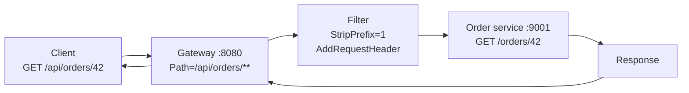

# Khai báo tuyến đầu tiên bằng `application.yml` trong Spring Cloud Gateway

Trong kiến trúc microservices, client thường gọi một địa chỉ chung thay vì biết địa chỉ từng dịch vụ. **Spring Cloud Gateway** đảm nhận vai trò cổng vào: đọc request, chọn tuyến (**route**) bằng **predicate**, chạy các **filter** cần thiết rồi gửi request đến backend. Bài này hướng dẫn khai báo tuyến đầu tiên trong `application.yml`, kiểm tra đường dẫn và header khi request thực sự đi qua gateway, đồng thời giới thiệu cách mở rộng sang nhiều service.

> **Phạm vi phiên bản:** Ví dụ chính dùng **Spring Cloud Gateway Server WebFlux 5.0.x**, tương ứng Spring Cloud **2025.1.x** và Spring Boot **4.x** theo ma trận tương thích. Cấu trúc YAML cần dùng là `spring.cloud.gateway.server.webflux.routes`. Các dòng Gateway cũ (chẳng hạn 4.2 trở về trước) có thể dùng `spring.cloud.gateway.routes`; không chép lẫn hai cấu trúc giữa các phiên bản. Spring Cloud Gateway còn có biến thể **Server Web MVC** với tiền tố `spring.cloud.gateway.server.webmvc.routes`; bài này tập trung vào WebFlux.

## 1. Kết quả cần đạt

Sau bài này, bạn có thể:

1. Giải thích ý nghĩa của `id`, `uri`, `predicates`, `filters` trong một route.
2. Khai báo route nhận `/api/orders/**` tại gateway và chuyển tới một order service.
3. Dùng `StripPrefix` để đổi path, `AddRequestHeader` và `AddResponseHeader` để thấy filter hoạt động.
4. Gửi request thử, đọc phản hồi và phân biệt lỗi **không khớp route** với lỗi **backend không truy cập được**.
5. Biết điểm cần sửa khi nâng cấp Gateway, triển khai bằng container hoặc chuyển sang khám phá dịch vụ.

Giả sử cổng API chạy ở `localhost:8080`, còn dịch vụ đơn hàng chạy ở `localhost:9001`. Ta muốn client gọi:

`GET http://localhost:8080/api/orders/42`

và order service nhận:

`GET http://localhost:9001/orders/42`

Chữ `api` trong đường dẫn công khai chỉ dành cho gateway, không phải đường dẫn mà order service bắt buộc phải biết.



## 2. Chuẩn bị ứng dụng Gateway

Tạo một ứng dụng Spring Boot có starter **Spring Cloud Gateway Server WebFlux**, dùng Spring Cloud BOM tương thích với phiên bản Boot đang chọn. Cách thuận tiện là tạo dự án trên [Spring Initializr](https://start.spring.io/) và chọn dependency Spring Cloud Gateway. Nếu chỉnh Maven thủ công, dependency Gateway Server WebFlux là:

```xml
<dependency>
    <groupId>org.springframework.cloud</groupId>
    <artifactId>spring-cloud-starter-gateway-server-webflux</artifactId>
</dependency>
```

Để Spring quản lý phiên bản nhất quán, dự án Maven cần **Spring Cloud BOM** tương thích với Spring Boot (hoặc cấu hình do Initializr tạo sẵn). Đừng tự đặt một phiên bản Gateway bất kỳ rồi giả định tương thích với Boot hiện có. Với biến thể WebFlux, Gateway dùng WebFlux và Reactor Netty; tránh thêm `spring-boot-starter-web` vào ứng dụng gateway nếu không chủ ý thay đổi web stack.

Bài thực hành dùng **Java 17+**, Maven wrapper hoặc Maven đã cài, và một HTTP backend chạy tại cổng `9001`. Chỉ cần một class Spring Boot khởi động ứng dụng:

```java
import org.springframework.boot.SpringApplication;
import org.springframework.boot.autoconfigure.SpringBootApplication;

@SpringBootApplication
public class GatewayApplication {
    public static void main(String[] args) {
        SpringApplication.run(GatewayApplication.class, args);
    }
}
```

Không phải viết controller để proxy request: Gateway sẽ đọc route từ cấu hình.

## 3. Khai báo route đầu tiên

Tạo hoặc mở `src/main/resources/application.yml` trong **ứng dụng gateway** và điền:

```yaml
server:
  port: 8080

spring:
  application:
    name: gateway-demo
  cloud:
    gateway:
      server:
        webflux:
          routes:
            - id: orders-local
              uri: http://localhost:9001
              predicates:
                - Path=/api/orders/**
              filters:
                - StripPrefix=1
                - AddRequestHeader=X-Gateway-Lab, from-gateway
                - AddResponseHeader=X-Gateway-Route, orders-local
```

Chú ý `routes` là **danh sách YAML**. Dấu `-` trước `id` mở đầu một route mới; dấu `-` trước từng predicate/filter tạo danh sách điều kiện và thao tác. Các trường của cùng một route phải cùng mức thụt đầu dòng. Dùng khoảng trắng thay vì tab.

### 3.1. Ý nghĩa từng thành phần

| Thuộc tính | Ý nghĩa | Trong ví dụ |
|---|---|---|
| `server.port` | Cổng HTTP mà client gọi tới Gateway | `8080` |
| `id` | Mã định danh route để quan sát, quản lý, phân biệt các tuyến | `orders-local` |
| `uri` | URI đích mà gateway chuyển tiếp sau khi route khớp | `http://localhost:9001` |
| `predicates` | Điều kiện nhận request vào route | `Path=/api/orders/**` |
| `filters` | Các bước xử lý request/response của route | Bỏ tiền tố path, thêm header |
| `StripPrefix=1` | Xóa **một segment** đầu tiên trong path | `/api/orders/42` → `/orders/42` |
| `AddRequestHeader` | Bổ sung header trên request gửi tới backend | `X-Gateway-Lab: from-gateway` |
| `AddResponseHeader` | Bổ sung header trên response trả cho client | `X-Gateway-Route: orders-local` |

**Route predicate** quyết định *request có đi vào route này hay không*. Nếu không khớp `Path=/api/orders/**`, gateway sẽ xét những route khác; khi không có route nào khớp, kết quả thông thường là HTTP `404`.

**Filter** chỉ áp dụng sau khi đã chọn được route. `StripPrefix=1` không xóa chuỗi ký tự `api` ở mọi nơi mà bỏ segment đầu tiên. Ví dụ:

| Path client gửi | Path chuyển tới backend |
|---|---|
| `/api/orders/42` | `/orders/42` |
| `/api/orders/42/items` | `/orders/42/items` |
| `/api/orders/42?expand=items` | `/orders/42?expand=items` |

Query string được giữ lại trong ví dụ; filter thay đổi path không đồng nghĩa xóa query. Nếu backend vốn xử lý `/api/orders/42`, hãy **bỏ `StripPrefix`** hoặc chọn phép viết lại đường dẫn phù hợp, tránh làm lệch API.

`AddRequestHeader` rất hữu ích để quan sát luồng demo. Nó không có tác dụng xác thực hay chứng thực danh tính client; header cùng tên từ client có thể tồn tại và filter có thể thêm giá trị nữa. Trong hệ thống thật, header định danh đáng tin cậy phải được kiểm soát bằng cơ chế bảo mật thích hợp.

### 3.2. Cú pháp rút gọn và cú pháp đầy đủ

`Path=/api/orders/**` và `StripPrefix=1` là cú pháp **shortcut**: tên factory, dấu `=` và các tham số theo vị trí. Gateway cũng cho phép cấu hình đầy đủ theo `name`/`args`, hữu ích khi cần tham số có tên rõ ràng.

Chẳng hạn, chỉ riêng predicate và filter viết theo dạng đầy đủ như sau:

```yaml
predicates:
  - name: Path
    args:
      patterns.0: /api/orders/**
filters:
  - name: StripPrefix
    args:
      parts: 1
```

Đoạn trên là **một phần của route**, không phải tệp `application.yml` độc lập. Nó thay cho `predicates` và `filters` tương ứng trong ví dụ chính, không đặt cả hai kiểu trùng nhau trong cùng route.

## 4. Tạo backend tối giản để thử tuyến

Nếu đã có order service nhận `GET /orders/42` ở cổng `9001`, dùng trực tiếp service đó và bỏ qua bước tạo mock. Nếu chưa có, ta có thể dùng HTTP server đi kèm JDK, không cần thêm dependency.

Tạo file `LocalOrderBackend.java` trong một thư mục thực hành bất kỳ:

```java
import com.sun.net.httpserver.HttpServer;
import java.net.InetSocketAddress;
import java.nio.charset.StandardCharsets;

public class LocalOrderBackend {
    public static void main(String[] args) throws Exception {
        HttpServer server = HttpServer.create(
                new InetSocketAddress("127.0.0.1", 9001), 0);

        server.createContext("/", exchange -> {
            String response =
                    "method=" + exchange.getRequestMethod() + "\n" +
                    "path=" + exchange.getRequestURI().getRawPath() + "\n" +
                    "query=" + exchange.getRequestURI().getRawQuery() + "\n" +
                    "X-Gateway-Lab=" +
                    exchange.getRequestHeaders().getFirst("X-Gateway-Lab") + "\n";

            byte[] bytes = response.getBytes(StandardCharsets.UTF_8);
            exchange.getResponseHeaders().set(
                    "Content-Type", "text/plain; charset=utf-8");
            exchange.sendResponseHeaders(200, bytes.length);
            try (var output = exchange.getResponseBody()) {
                output.write(bytes);
            }
        });

        server.start();
        System.out.println("Local order backend listening at http://localhost:9001");
    }
}
```

Chạy trong terminal thứ nhất (JDK 17 hoặc mới hơn):

```bash
java --add-modules jdk.httpserver LocalOrderBackend.java
```

Ở terminal thứ hai, kiểm tra backend **trực tiếp**:

```bash
curl -i "http://localhost:9001/orders/42?expand=items"
```

Phần body sẽ gần như sau:

```text
method=GET
path=/orders/42
query=expand=items
X-Gateway-Lab=null
```

Giá trị `null` cho thấy request gọi thẳng backend chưa nhận header do gateway thêm. Server demo này cố ý trả `200` cho mọi path để giúp nhìn rõ path thực tế; nó **không mô phỏng logic nghiệp vụ hay phân quyền** của order service.

## 5. Khởi động gateway và gửi request kiểm tra

Chạy ứng dụng Spring Boot gateway ở terminal thứ ba:

```bash
# Linux/macOS
./mvnw spring-boot:run

# Windows PowerShell
.\mvnw.cmd spring-boot:run
```

Trong các lệnh sau, trên Windows PowerShell truyền thống có thể dùng `curl.exe` thay cho `curl` để tránh alias của PowerShell.

Gửi request qua cổng `8080`:

```bash
curl -i "http://localhost:8080/api/orders/42?expand=items"
```

Nếu cả hai tiến trình đang hoạt động, phản hồi sẽ có header do gateway thêm:

```http
HTTP/1.1 200 OK
X-Gateway-Route: orders-local
Content-Type: text/plain; charset=utf-8

method=GET
path=/orders/42
query=expand=items
X-Gateway-Lab=from-gateway
```

Thứ tự header và một số header khác có thể thay đổi theo runtime. Các điểm cần xác minh là **HTTP 200**, header `X-Gateway-Route`, path backend đã bỏ `/api` và header `X-Gateway-Lab` đã đến backend.

Thử các tình huống sau để phân biệt request có khớp route hay không:

| Request gửi tới gateway | Dự kiến |
|---|---|
| `GET /api/orders/42` | Khớp `orders-local`; backend thấy `/orders/42` |
| `GET /api/orders/42/items` | Khớp; backend thấy `/orders/42/items` |
| `GET /api/orders/42?expand=items` | Khớp; giữ query `expand=items` |
| `GET /api/customers/42` | Không khớp route `orders-local`; nhận `404` nếu không có route khác |
| `GET /orders/42` | Không khớp route `orders-local`; nhận `404` nếu không có route khác |

Khi gọi `http://localhost:8080/api/customers/42` và nhận `404`, đừng vội kết luận order service hỏng: request đó chưa hề được route `orders-local` tiếp nhận.

## 6. Mở rộng route: thêm điều kiện và thêm dịch vụ

### 6.1. Kết hợp nhiều predicate

Nếu chỉ muốn chuyển tiếp request `GET` tới order service, thêm `Method=GET`:

```yaml
predicates:
  - Path=/api/orders/**
  - Method=GET
```

Hai predicate đặt trong cùng route cần **đồng thời** khớp: `GET /api/orders/42` đi qua, còn `POST /api/orders/42` không vào route này. Đây là điều kiện ở tầng gateway, không thay thế kiểm tra phương thức và quyền trong backend.

### 6.2. Khai báo thêm một route độc lập

Khi hệ thống có catalog service chạy tại `localhost:9002` với API `/products/**`, có thể khai báo hai route dưới cùng khóa `routes`:

```yaml
spring:
  cloud:
    gateway:
      server:
        webflux:
          routes:
            - id: orders-local
              uri: http://localhost:9001
              predicates:
                - Path=/api/orders/**
              filters:
                - StripPrefix=1

            - id: catalog-local
              uri: http://localhost:9002
              predicates:
                - Path=/api/products/**
              filters:
                - StripPrefix=1
```

Bảng tương ứng:

| Client gọi | Route | Backend nhận |
|---|---|---|
| `GET /api/orders/42` | `orders-local` | `http://localhost:9001/orders/42` |
| `GET /api/products/7` | `catalog-local` | `http://localhost:9002/products/7` |

Ví dụ hai route là **cấu hình thay thế** cho cấu hình một route ở mục 3. Không dán thêm nguyên một khóa `spring:` thứ hai vào cùng tài liệu YAML.

Nếu nhiều route có predicate giao nhau, cần thiết kế mức ưu tiên rõ ràng bằng `order` (số nhỏ được ưu tiên hơn) và kiểm thử tình huống cùng khớp, thay vì dựa vào thứ tự xuất hiện trong tệp.

### 6.3. Từ địa chỉ cố định sang khám phá dịch vụ

URI `http://localhost:9001` chỉ hợp cho thực hành hoặc khi backend có địa chỉ tĩnh. Trong microservices, các instance có thể tăng giảm hoặc đổi địa chỉ. Khi đã cấu hình cơ chế service discovery và **Spring Cloud LoadBalancer**, route có thể dùng:

```yaml
uri: lb://order-service
```

`lb://` yêu cầu hạ tầng cung cấp instance của `order-service`; viết chuỗi đó một mình **không tự tạo service registry**. Đây là bước nâng cấp về discovery/load balancing, không bắt buộc cho tuyến đầu tiên.

## 7. Quan sát route và chẩn đoán lỗi

### 7.1. Xem danh sách route bằng Actuator

Nếu dự án đã thêm dependency `spring-boot-starter-actuator`, với Gateway 5.0 có thể bật endpoint chỉ đọc trong `application.yml`:

```yaml
management:
  endpoint:
    gateway:
      access: read-only
  endpoints:
    web:
      exposure:
        include: health,info,gateway
```

Sau khi khởi động lại, kiểm tra:

```bash
curl -i http://localhost:8080/actuator/gateway/routes
```

Khi đã nạp cấu hình đúng, danh sách sẽ có route ID `orders-local` và đích `http://localhost:9001`. Tùy phiên bản, response còn hiển thị predicates, filters và `order`. Endpoint quản trị có thể tiết lộ định tuyến nội bộ, vì vậy chỉ bật và giới hạn truy cập phù hợp trong môi trường học tập; production cần cấu hình xác thực/phân quyền và mạng riêng.

### 7.2. Bảng xử lý sự cố nhanh

| Triệu chứng | Khả năng thường gặp | Cách kiểm tra |
|---|---|---|
| Gateway không khởi động | Thiếu starter, BOM không tương thích, nhầm WebFlux/Servlet hoặc YAML sai thụt dòng | Đọc stacktrace đầu tiên; kiểm tra dependency và đường dẫn cấu hình |
| `GET /api/orders/42` trả `404` | Route chưa được nạp, predicate không khớp, sai cổng hoặc backend trả 404 | Xem `/actuator/gateway/routes`, thử backend trực tiếp và so sánh path |
| Route khớp nhưng request trả `5xx` | Backend tắt hoặc không thể kết nối, DNS/port sai, lỗi xử lý upstream | `curl` trực tiếp vào `localhost:9001`, xem log Gateway và backend |
| Backend nhận `/api/orders/42` thay vì `/orders/42` | Quên `StripPrefix=1` hoặc filter không nằm trong route | Đọc lại `filters` và quan sát body echo |
| Không thấy `X-Gateway-Lab` tại backend | Đang gọi thẳng backend, viết sai filter, hoặc route khác nhận request | Gọi qua `8080`, kiểm tra route ID và cú pháp header |
| Cấu hình copy từ bài cũ không có tác dụng | Dùng sai property prefix theo phiên bản Gateway | Với Server WebFlux 5.0 kiểm tra `spring.cloud.gateway.server.webflux.routes` |
| Chạy gateway trong Docker mà không gọi được `localhost:9001` | `localhost` bên trong container trỏ về container gateway | Dùng hostname/service name có thể truy cập từ mạng của container |

**Một quy trình tìm lỗi hiệu quả:** (1) xác nhận gateway nghe ở `8080`, (2) gọi backend `9001` trực tiếp, (3) xem route đã nạp, (4) thử path chắc chắn khớp, (5) kiểm tra path/header tới backend. Khi sửa `application.yml` trong ứng dụng thông thường, hãy **khởi động lại gateway** để chắc chắn cấu hình mới đã được nạp; không mặc định rằng mọi thay đổi đều được hot reload.

## 8. Những lưu ý khi đưa route vào hệ thống thật

Tuyến đầu tiên chỉ giải quyết bài toán chọn backend và biến đổi request. Để vận hành Spring Cloud Gateway làm cổng vào microservices an toàn và ổn định, còn cần:

- **Xác thực và phân quyền:** bảo vệ route bằng Spring Security thích hợp với WebFlux, xác thực token theo issuer/audience/quy tắc thực tế; backend vẫn kiểm tra quyền trên tài nguyên của mình.
- **Rate limiting:** đặt giới hạn theo khóa đáng tin cậy (user, tenant, client) để tránh abuse; không coi một header tự khai báo từ client là danh tính đã xác minh.
- **Timeout, retry, circuit breaker:** xác định giới hạn chờ backend, tránh retry bừa bãi với POST không idempotent và có chiến lược khi upstream lỗi.
- **TLS và header:** dùng HTTPS và xác thực chứng chỉ phù hợp; hạn chế lộ token, cookie, dữ liệu cá nhân trong header/log; kiểm soát forwarded headers từ proxy tin cậy.
- **Observability:** theo dõi request theo route, mã phản hồi, độ trễ, lỗi kết nối và tracing/correlation ID trước khi mở rộng số lượng route.

Các cơ chế này được xây trên cùng nền tảng **route + predicate + filter** đã thực hành, nhưng cần cấu hình và kiểm thử riêng. Đừng xem việc một request đã đi qua gateway là bằng chứng rằng backend không cần bảo vệ.

## 9. Tự kiểm tra

1. **`uri` là địa chỉ client gọi hay địa chỉ backend?** — Là địa chỉ **backend** mà route gửi request đến.
2. **Vì sao `GET /api/orders/42` đến backend thành `GET /orders/42`?** — `Path` chọn route, sau đó `StripPrefix=1` bỏ segment `api`.
3. **Có thể đặt `Path` và `Method` trong cùng `predicates` không?** — Có. Các điều kiện trong một route phải cùng thỏa mãn.
4. **Vì sao gọi thẳng `localhost:9001` không thấy `X-Gateway-Lab`?** — Header này do filter của gateway bổ sung, chỉ có khi request đi qua gateway.
5. **Dùng `lb://order-service` có đủ để tìm service không?** — Chưa. Cần cơ chế cung cấp instance và Spring Cloud LoadBalancer tương ứng.
6. **Tại sao đã thấy `404` vẫn phải kiểm tra cả gateway lẫn backend?** — `404` có thể do route không khớp hoặc do route khớp nhưng backend trả về `404`.

## 10. Tài liệu chính thức

- [Spring Cloud — ma trận tương thích release train và Spring Boot](https://spring.io/projects/spring-cloud/).
- [Spring Cloud Gateway Server WebFlux 5.0 — cách thêm starter](https://docs.spring.io/spring-cloud-gateway/reference/5.0/spring-cloud-gateway-server-webflux/starter.html).
- [Cấu hình route predicate và filter bằng shortcut/`name`-`args`](https://docs.spring.io/spring-cloud-gateway/reference/5.0/spring-cloud-gateway-server-webflux/configuring-route-predicate-factories-and-filter-factories.html).
- [Path Route Predicate Factory](https://docs.spring.io/spring-cloud-gateway/reference/5.0/spring-cloud-gateway-server-webflux/request-predicates-factories.html).
- [StripPrefix GatewayFilter Factory](https://docs.spring.io/spring-cloud-gateway/reference/5.0/spring-cloud-gateway-server-webflux/gatewayfilter-factories/stripprefix-factory.html).
- [Spring Cloud Gateway Actuator API](https://docs.spring.io/spring-cloud-gateway/reference/5.0/spring-cloud-gateway-server-webflux/actuator-api.html).

Khi nâng cấp phiên bản, đối chiếu lại starter, property prefix và hành vi của filter trong đúng nhánh tài liệu. Bài thực hành này cung cấp một tuyến có thể kiểm chứng độc lập, làm nền cho các bài tiếp theo về service discovery, bảo mật, resilience và quan sát lưu lượng.
