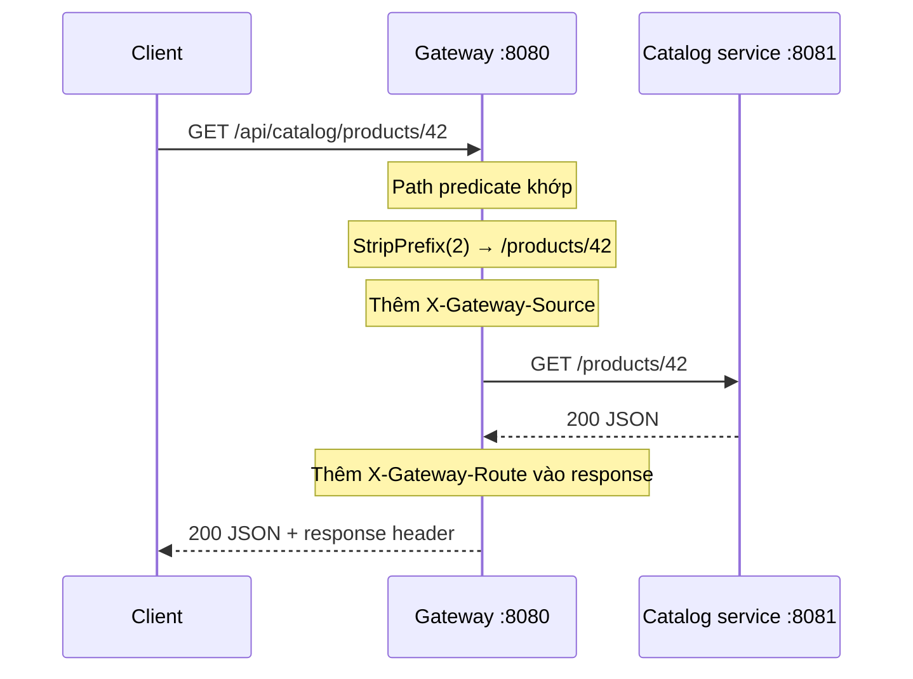

# Khai báo tuyến đầu tiên bằng Java RouteLocatorBuilder

## 1. Mục tiêu và bối cảnh

Trong hệ thống microservices, client không nhất thiết gọi trực tiếp từng dịch vụ. **Spring Cloud Gateway** có thể đóng vai trò API Gateway: nhận request, chọn route theo predicate, chạy filter chain để biến đổi request/response rồi chuyển tiếp đến dịch vụ đích. Sau đó, hệ thống có thể mở rộng thêm khám phá dịch vụ, xác thực, giới hạn lưu lượng, circuit breaker, retry, TLS và quan sát request.

Bài này tập trung vào bước khởi tạo căn bản: **khai báo một route bằng Java DSL `RouteLocatorBuilder`**. Sau khi hoàn thành, bạn có thể:

1. Tạo một ứng dụng **Gateway Server WebFlux** và khai báo bean `RouteLocator`.
2. Dùng `route(id, ...)`, `path(...)`, `filters(...)`, `uri(...)`, `build()`.
3. Chuyển `GET /api/catalog/products/42` ở cổng `8080` thành `GET /products/42` ở dịch vụ `8081`.
4. Chứng minh filter thêm header vào request đi xuống backend và response trả về client.
5. Kiểm tra route, xác định nguyên nhân 404/5xx và nhận biết khi nào cần `lb://` thay cho URL cố định.

**Giới hạn của bài thực hành:** minh họa trên **Spring Cloud Gateway Server WebFlux 5.0.x** (Spring Boot 4.0.x, Spring Cloud release train 2025.1.x); chọn các bản vá tương thích theo [bảng Spring Cloud compatibility](https://spring.io/projects/spring-cloud/) hoặc [Spring Initializr](https://start.spring.io/). API `RouteLocatorBuilder` cũng tồn tại ở các dòng 4.x, nhưng tên starter và một số cấu hình khác nhau theo phiên bản. **Gateway Server Web MVC có Java Routes API riêng dựa trên `RouterFunction<ServerResponse>`; không dùng `RouteLocatorBuilder` của WebFlux cho biến thể MVC.**

## 2. Một route gồm những phần nào?

Route là một quy tắc để gateway quyết định có chuyển tiếp request hay không và phải xử lý request ấy thế nào.

| Thành phần | Ý nghĩa trong ví dụ | Tác động |
|---|---|---|
| **Route ID** | `catalog-route` | Tên định danh để log, theo dõi và tra Actuator |
| **Predicate** | `path("/api/catalog/**")` | Chỉ request có đường dẫn phù hợp mới đi vào route |
| **Filter** | `stripPrefix(2)` | Bỏ hai phần đầu của path trước khi gọi backend |
| **Filter** | `addRequestHeader(...)` | Thêm header vào request gửi **đến backend** |
| **Filter** | `addResponseHeader(...)` | Thêm header vào response trả **cho client** |
| **URI đích** | `http://localhost:8081` | Địa chỉ backend được kết nối qua HTTP |

Luồng xử lý:



> **Phân biệt:** Predicate chỉ **chọn route**; filter mới **biến đổi** path/header. Khai báo `path("/api/catalog/**")` một mình không tự xóa `/api/catalog`. Ngoài ra, trong Gateway Server WebFlux, thành phần được `@Bean` trả về là `RouteLocator`, còn `RouteLocatorBuilder` là công cụ xây dựng danh sách route.

## 3. Chuẩn bị môi trường

### 3.1. Tạo hai ứng dụng Spring Boot

Để không phụ thuộc một API trên Internet, ví dụ dùng hai ứng dụng độc lập:

| Ứng dụng | Port | Dependency chính | Vai trò |
|---|---:|---|---|
| `gateway-demo` | 8080 | **Reactive Gateway** / `spring-cloud-starter-gateway-server-webflux` | Nhận request và tạo route bằng Java |
| `catalog-demo` | 8081 | **Spring Web** | Backend trả JSON kiểm tra path và header |

Tạo từng dự án tại [start.spring.io](https://start.spring.io/), chọn **Java 17 trở lên**, Maven (hoặc Gradle) và một cặp Spring Boot/Spring Cloud đã được xác nhận tương thích. Với ứng dụng gateway, dependency Maven quan trọng là:

```xml
<!-- Đoạn trích trong <dependencies> của dự án gateway-demo.
     Spring Initializr / Spring Cloud BOM quản lý version. -->
<dependency>
    <groupId>org.springframework.cloud</groupId>
    <artifactId>spring-cloud-starter-gateway-server-webflux</artifactId>
</dependency>
```

Thêm `spring-boot-starter-actuator` nếu muốn xem danh sách route qua HTTP ở mục 7. Đừng tự gắn version riêng lẻ cho Gateway starter trong một dự án đã import **Spring Cloud BOM**. Với ứng dụng gateway WebFlux, không bổ sung `spring-boot-starter-web` kiểu Servlet nếu không có chủ đích kiến trúc rõ ràng: Gateway Server WebFlux chạy trên Reactor Netty và không triển khai như WAR Servlet truyền thống.

### 3.2. Tạo backend để có kết quả kiểm chứng

Trong dự án **`catalog-demo`** (đã chọn dependency *Spring Web*), tạo lớp `CatalogApplication.java`:

```java
package com.example.catalog;

import java.util.Map;
import org.springframework.boot.SpringApplication;
import org.springframework.boot.autoconfigure.SpringBootApplication;
import org.springframework.web.bind.annotation.GetMapping;
import org.springframework.web.bind.annotation.PathVariable;
import org.springframework.web.bind.annotation.RequestHeader;
import org.springframework.web.bind.annotation.RestController;

@SpringBootApplication
@RestController
public class CatalogApplication {

    public static void main(String[] args) {
        SpringApplication.run(CatalogApplication.class, args);
    }

    @GetMapping("/products/{id}")
    public Map<String, String> product(
            @PathVariable String id,
            @RequestHeader(name = "X-Gateway-Source",
                           defaultValue = "direct", required = false) String source) {
        return Map.of("id", id, "receivedHeader", source);
    }
}
```

Đặt `src/main/resources/application.yml` của **backend**:

```yaml
spring:
  application:
    name: catalog-demo
server:
  port: 8081
```

Chạy backend ở terminal thứ nhất, trong thư mục dự án `catalog-demo`:

```bash
./mvnw spring-boot:run
# Windows PowerShell/CMD: .\mvnw.cmd spring-boot:run
```

Kiểm chứng **trước khi thêm gateway**:

```bash
curl -i http://localhost:8081/products/42
```

Khi chạy đúng, backend trả `200 OK` với JSON có nội dung tương đương `{"id":"42","receivedHeader":"direct"}`. Thứ tự các trường JSON không quan trọng. Nếu lệnh này thất bại, hãy sửa backend trước khi thử gateway.

## 4. Khai báo route đầu tiên bằng Java

### 4.1. Tạo ứng dụng gateway và bean `RouteLocator`

Trong dự án **`gateway-demo`**, tạo `src/main/java/com/example/gateway/GatewayApplication.java`:

```java
package com.example.gateway;

import org.springframework.boot.SpringApplication;
import org.springframework.boot.autoconfigure.SpringBootApplication;
import org.springframework.cloud.gateway.route.RouteLocator;
import org.springframework.cloud.gateway.route.builder.RouteLocatorBuilder;
import org.springframework.context.annotation.Bean;

@SpringBootApplication
public class GatewayApplication {

    public static void main(String[] args) {
        SpringApplication.run(GatewayApplication.class, args);
    }

    @Bean
    public RouteLocator catalogRoutes(RouteLocatorBuilder builder) {
        return builder.routes()
            .route("catalog-route", r -> r
                .path("/api/catalog/**")
                .filters(f -> f
                    .stripPrefix(2)
                    .addRequestHeader("X-Gateway-Source", "scg-java")
                    .addResponseHeader("X-Gateway-Route", "catalog-route"))
                .uri("http://localhost:8081"))
            .build();
    }
}
```

Đây là mã đầy đủ cho phía gateway của bài thực hành. Spring Boot quét `@SpringBootApplication` và đăng ký `@Bean` `catalogRoutes`; Spring Cloud Gateway tự cung cấp `RouteLocatorBuilder` thông qua starter WebFlux.

Phân tích theo thứ tự:

1. **`builder.routes()`**: bắt đầu bộ dựng `RouteLocator` chứa các tuyến.
2. **`.route("catalog-route", r -> ...)`**: tạo một tuyến có ID tường minh; tránh dựa vào ID phát sinh ngẫu nhiên khi theo dõi lỗi.
3. **`.path("/api/catalog/**")`**: predicate so khớp path của HTTP request đi vào gateway. Dấu `**` biểu thị những đoạn path tiếp theo.
4. **`.filters(f -> ...)`**: nối nhiều `GatewayFilter` áp dụng cho route này; không mặc định áp dụng cho route khác.
5. **`.stripPrefix(2)`**: xóa hai segment đầu (`api`, `catalog`) của path trước khi chuyển tiếp. Query string như `?lang=vi` được giữ nếu filter không thay đổi nó.
6. **`.addRequestHeader(...)`**: thêm header `X-Gateway-Source: scg-java` vào request downstream để backend chứng minh request đã qua gateway.
7. **`.addResponseHeader(...)`**: thêm header `X-Gateway-Route: catalog-route` ở response đưa về client, tiện quan sát trong bài demo.
8. **`.uri("http://localhost:8081")`**: đặt scheme, hostname và port đích. **Path nằm trong URI route không được dùng để gắn thêm prefix**; thay đổi path bằng filter như `stripPrefix`, `prefixPath`, `setPath` hoặc `rewritePath`.
9. **`.build()`**: hoàn tất và trả về `RouteLocator` để gateway sử dụng.

### 4.2. Cấu hình cổng vào

Đặt `src/main/resources/application.yml` của **gateway**:

```yaml
spring:
  application:
    name: gateway-demo
server:
  port: 8080
```

Không cần thêm route YAML trong ví dụ này: route đã được xây từ **Java `@Bean`**. Từ bản Gateway 5.x, nếu muốn khai báo route cấu hình thay vì Java, namespace WebFlux là `spring.cloud.gateway.server.webflux.routes`; các bài viết cũ dùng `spring.cloud.gateway.routes` thuộc dòng phiên bản trước. Không khai báo thêm một route YAML trùng đường dẫn khi đang học ví dụ một route.

Chạy gateway tại terminal thứ hai, trong dự án `gateway-demo`:

```bash
./mvnw spring-boot:run
# Windows PowerShell/CMD: .\mvnw.cmd spring-boot:run
```

Cả hai tiến trình phải còn hoạt động: gateway `:8080`, catalog backend `:8081`.

## 5. Gửi request và quan sát kết quả

### 5.1. Request đi qua gateway

```bash
curl -i 'http://localhost:8080/api/catalog/products/42'
```

Kết quả mong đợi (rút gọn, thứ tự/cách viết hoa header có thể khác):

```http
HTTP/1.1 200 OK
X-Gateway-Route: catalog-route
Content-Type: application/json

{"id":"42","receivedHeader":"scg-java"}
```

Sự khác biệt so với gọi trực tiếp `http://localhost:8081/products/42` là backend đọc được header `X-Gateway-Source` do gateway thêm; phía client thấy `X-Gateway-Route` trong response. Client **không nhất thiết** nhìn thấy request header `X-Gateway-Source` trong response: đó là hai chiều header khác nhau.

### 5.2. Đường dẫn và query string thay đổi ra sao?

| Request đến `:8080` | Predicate khớp? | Request downstream sau filter | Kỳ vọng |
|---|---|---|---|
| `GET /api/catalog/products/42` | Có | `GET /products/42` | Backend trả thông tin sản phẩm 42 |
| `GET /api/catalog/products/7?lang=vi` | Có | `GET /products/7?lang=vi` | Backend trả sản phẩm 7; query được gửi tiếp |
| `GET /api/orders/42` | Không | Không chuyển tiếp theo route này | Thường 404 nếu ứng dụng không có route/handler khác |
| `GET /products/42` | Không | Không chuyển tiếp theo route này | Thường 404 nếu ứng dụng không có route/handler khác |
| `GET /api/catalog/missing` | Có | `GET /missing` | Backend quyết định status; backend demo không có mapping nên 404 |

Hai trường hợp **404** cuối cần phân biệt: **404 vì không có route khớp** và **404 do backend trả về sau khi route đã khớp**. Chỉ nhìn mã HTTP chưa đủ để biết lỗi nằm ở đâu.

### 5.3. Kiểm thử thêm request không hợp lệ

```bash
# Không match route:
curl -i http://localhost:8080/api/orders/42

# Match route nhưng backend ví dụ không có endpoint:
curl -i http://localhost:8080/api/catalog/not-found

# Nếu cần thấy rõ header phía downstream, so sánh:
curl -i http://localhost:8081/products/42
curl -i http://localhost:8080/api/catalog/products/42
```

> Các lệnh là **hướng dẫn tự chạy**, không phải kết quả đã được thực thi trong tài liệu. Nếu backend không chạy, một route vẫn có thể khớp nhưng gateway trả lỗi kết nối (thường nhóm 5xx); cần kiểm tra log và tình trạng backend.

## 6. Bổ sung predicate bằng Java DSL

Khi chỉ định `path(...)`, route mặc định không giới hạn ở riêng HTTP GET. Muốn route chỉ nhận GET, phối hợp thêm `method(HttpMethod.GET)` với toán tử **`and()`**:

```java
import org.springframework.http.HttpMethod;

// Thay thế phần .route(...) trong bean ở mục 4, không khai báo
// đồng thời hai route có cùng ID.
.route("catalog-route", r -> r
    .path("/api/catalog/**")
    .and()
    .method(HttpMethod.GET)
    .filters(f -> f
        .stripPrefix(2)
        .addRequestHeader("X-Gateway-Source", "scg-java"))
    .uri("http://localhost:8081"))
```

Ở cấu hình này, hai điều kiện phải **cùng đúng**: path bắt đầu bằng `/api/catalog/` theo mẫu và method là `GET`. `POST` tới cùng URL không vào route này; nếu không có route/handler khác, ứng dụng thường trả 404. Đây là khác biệt giữa *không có route phù hợp* và HTTP `405 Method Not Allowed` do một handler cụ thể trả về.

Java DSL còn hỗ trợ phối hợp `host(...)`, `header(...)`, `query(...)`, `cookie(...)` và các toán tử:

| Toán tử | Ý nghĩa | Ví dụ tình huống |
|---|---|---|
| `.and()` | Đồng thời thỏa hai điều kiện | `Host=api.example.test` **và** `Path=/v1/**` |
| `.or()` | Một trong hai điều kiện đúng | Route phục vụ hai loại path khác nhau |
| `.negate()` | Đảo điều kiện | Loại trừ các path nhất định |

Đặt dấu ngoặc/nhóm điều kiện rõ ràng khi ghép nhiều toán tử để tránh mở rộng nhầm phạm vi route. **Predicate header không phải xác thực:** client có thể tự thêm `X-User-Role: admin`; xác minh JWT, phân quyền, bảo vệ endpoint phải thực hiện bằng Spring Security hoặc cơ chế bảo mật đáng tin cậy, không dựa riêng vào so khớp một header.

## 7. Quan sát route bằng Actuator

Để xác minh gateway **đã đăng ký Java route**, thêm dependency `spring-boot-starter-actuator` vào dự án gateway (nếu chưa chọn từ Initializr), sau đó trong **`application.yml` của gateway** bổ sung:

```yaml
management:
  endpoint:
    gateway:
      access: read-only
  endpoints:
    web:
      exposure:
        include: health,gateway
```

Với Gateway 5.0.x, endpoint `gateway` mặc định bị khóa; cấu hình trên cho phép **đọc route** qua HTTP. Khởi động lại gateway rồi gọi:

```bash
curl -i http://localhost:8080/actuator/gateway/routes
curl -i http://localhost:8080/actuator/gateway/routes/catalog-route
```

Kết quả route (minh họa cấu trúc, chuỗi predicate/filter có thể khác giữa bản vá):

```json
{
  "route_id": "catalog-route",
  "uri": "http://localhost:8081",
  "predicate": "...",
  "filters": ["..."],
  "order": 0
}
```

Endpoint này trả lời ba câu hỏi trước khi điều tra backend: **ID có đúng không? URI có đúng không? Predicate/filter đã xuất hiện chưa?** Route tạo bằng `@Bean` là cấu hình code; không giả định có thể sửa/xóa route ấy bằng các API quản trị `POST/DELETE` của Actuator.

**Bảo vệ Actuator:** trên môi trường production, không công khai endpoint Gateway quản trị ra Internet; chỉ bật quyền đọc và giới hạn truy cập qua security/network policy. Bật `unrestricted` chỉ khi thực sự cần quản trị động và đã có kiểm soát truy cập phù hợp.

## 8. Hai hướng mở rộng sau route đầu tiên

### 8.1. Đưa URI backend ra cấu hình

URL `http://localhost:8081` rất hữu ích cho thực hành nhưng khó dùng khi chuyển từ máy lập trình sang staging/production. Có thể truyền URL từ cấu hình vào `@Bean`:

```java
import org.springframework.beans.factory.annotation.Value;

@Bean
public RouteLocator catalogRoutes(
        RouteLocatorBuilder builder,
        @Value("${services.catalog.url}") String catalogUrl) {
    return builder.routes()
        .route("catalog-route", r -> r
            .path("/api/catalog/**")
            .filters(f -> f.stripPrefix(2))
            .uri(catalogUrl))
        .build();
}
```

```yaml
services:
  catalog:
    url: http://localhost:8081
```

Đây là **phương án thay thế** bean ở mục 4, không dán thêm một bean thứ hai cùng ID vào ứng dụng. Khi deploy, có thể cung cấp giá trị `services.catalog.url` qua cấu hình theo môi trường. Với URI lấy từ nguồn bên ngoài, chỉ chấp nhận giá trị **được vận hành kiểm soát**, tránh để người dùng cuối tự đưa URL bất kỳ vì có nguy cơ SSRF.

### 8.2. Dùng `lb://` khi có service discovery

Khi hệ thống microservices chạy nhiều instance, thay vì `http://localhost:8081`, có thể cấu hình:

```java
.uri("lb://catalog-service")
```

`lb://catalog-service` **không phải một HTTP URL thông thường** và không tự khám phá dịch vụ. Gateway cần Spring Cloud LoadBalancer cùng cơ chế cung cấp service instance, chẳng hạn DiscoveryClient (Eureka/Consul/Kubernetes tích hợp phù hợp) hoặc cấu hình service instance tĩnh để thử nghiệm. Khi đó gateway chọn instance, rồi mới proxy qua HTTP/HTTPS. Chỉ thay `uri` thành `lb://...` trong bản demo chưa có LoadBalancer/discovery sẽ **không chạy đúng**.

### 8.3. Đặt nền tảng cho filter chain production

Sau route đầu tiên, có thể bổ sung `rewritePath`, `setRequestHeader`, timeout, `Retry`, `CircuitBreaker`, `RequestRateLimiter` và `TokenRelay` nếu phiên bản, dependency và cấu hình bảo mật hỗ trợ. Không bật tất cả ngay cho một tuyến đơn giản:

- **Retry:** giới hạn số lần retry; thận trọng với `POST` thay đổi trạng thái, cần đảm bảo idempotency.
- **Rate limiting:** cần chọn khóa chính xác theo người dùng, API key hoặc nguồn được tin cậy, và cân nhắc nhiều instance gateway.
- **Circuit breaker:** cần dependency và chính sách timeout/fallback hợp lý; fallback không tự làm cho dữ liệu lỗi trở thành dữ liệu đúng.
- **TLS và xác thực:** URL `https://...` bảo vệ kết nối gateway → backend khi trust/cert hợp lệ; HTTPS phía client là kết nối riêng. Việc thêm header dấu vết không thay cho xác thực hoặc phân quyền.
- **Observability:** dùng route ID cho log, metric và tracing; không log Authorization token, cookie hay body nhạy cảm.

## 9. Lỗi thường gặp và cách xử lý

| Hiện tượng | Nguyên nhân có thể xảy ra | Cách kiểm tra |
|---|---|---|
| Ứng dụng không tìm thấy bean `RouteLocatorBuilder` | Chọn nhầm starter MVC, thiếu starter Gateway Server WebFlux hoặc xung đột auto-configuration | Kiểm tra dependency tree, version Boot/Cloud và import package `org.springframework.cloud.gateway.route.builder.RouteLocatorBuilder` |
| Gateway không khởi động | Cổng `8080` đã bị chiếm, phiên bản Boot/Cloud không tương thích, dependency Web MVC lẫn vào gateway reactive | Đọc log khởi động; kiểm tra cổng và BOM |
| `404` ngay tại Gateway | `path(...)` không khớp, mã `@Bean` không được quét, trùng/cạnh tranh route | Gọi `/actuator/gateway/routes`, kiểm tra route ID/predicate và URL chính xác |
| `404` từ backend | Route khớp nhưng `stripPrefix` xóa sai số segment hoặc backend không có mapping | Gọi thẳng `:8081`, so sánh request downstream dự kiến |
| Lỗi `5xx` khi route khớp | Backend tắt, sai host/port, DNS, TLS hoặc timeout | Gọi trực tiếp backend từ môi trường đang chạy gateway, kiểm tra log và kết nối |
| Header mong đợi không có | Nhầm chiều request/response; route không khớp; header bị filter khác thay đổi | Kiểm tra JSON `receivedHeader` ở backend và `X-Gateway-Route` trong response |
| Có hai route cùng match | Trùng điều kiện hoặc thứ tự ưu tiên route chưa rõ | Dùng ID rõ ràng, điều kiện cụ thể; khi cần dùng `order` và kiểm tra Actuator |
| Gọi `lb://...` bị lỗi | Chưa có LoadBalancer hoặc không có instance được discovery cung cấp | Kiểm tra dependency, danh sách instance và cấu hình discovery |

**Mẹo chẩn đoán:** tạm bật log `logging.level.org.springframework.cloud.gateway: DEBUG` trong môi trường phát triển, gửi một request duy nhất và đối chiếu route ID. Tắt log chi tiết khi không cần, nhất là nơi có dữ liệu thật.

## 10. Bài tập thực hành

1. Đổi route ID thành `catalog-v1`, kiểm tra ID mới trong `/actuator/gateway/routes` và header trả về.
2. Chuyển path public thành `/edge/catalog/**`. Nếu vẫn `stripPrefix(2)`, hãy dự đoán backend sẽ nhận path nào.
3. Thêm predicate `method(HttpMethod.GET)` và kiểm tra `POST /edge/catalog/products/42` không match route.
4. Thay filter `stripPrefix(2)` thành `stripPrefix(1)`. Giải thích vì sao backend `/products/42` không còn được gọi đúng.
5. Tắt backend trong khi gateway còn chạy; so sánh **route đã match nhưng backend lỗi** với **không có route match**.
6. Đưa URI ra `application.yml` qua `@Value`, sau đó thử đổi `services.catalog.url` từ `:8081` sang cổng của một backend khác.

### Câu hỏi tự kiểm tra

- Vì sao một `@Bean RouteLocator` có thể chứa nhiều `.route(...)`?
- `RouteLocatorBuilder` thuộc Server WebFlux hay Server Web MVC?
- `path("/api/catalog/**")` có tự chuyển path xuống backend thành `/products/**` không?
- Filter `addRequestHeader` và `addResponseHeader` khác nhau ở đầu nhận nào?
- Vì sao `lb://catalog-service` cần thêm hệ thống cung cấp instance?
- Khi nhận `404`, bạn cần quan sát gì để phân biệt lỗi predicate với lỗi controller downstream?

## Tài liệu tham khảo

- [Spring Cloud Gateway Server WebFlux 5.0 — Fluent Java Routes API](https://docs.spring.io/spring-cloud-gateway/reference/5.0/spring-cloud-gateway-server-webflux/fluent-java-routes-api.html) — cú pháp `RouteLocatorBuilder`, `route`, predicate/filter và `build`.
- [Spring — Building a Gateway](https://spring.io/guides/gs/gateway/) — hướng dẫn tạo `@Bean RouteLocator` và thử bằng curl.
- [Gateway Server WebFlux — How It Works](https://docs.spring.io/spring-cloud-gateway/reference/5.0/spring-cloud-gateway-server-webflux/how-it-works.html) — quá trình match route, thực thi filter chain và lưu ý về URI.
- [Gateway Server WebFlux — Actuator API](https://docs.spring.io/spring-cloud-gateway/reference/5.0/spring-cloud-gateway-server-webflux/actuator-api.html) — kiểm tra route ID, predicate và filter.
- [Gateway Server WebFlux — GatewayFilter Factories](https://docs.spring.io/spring-cloud-gateway/reference/5.0/spring-cloud-gateway-server-webflux/gatewayfilter-factories.html) — các filter được cung cấp.
- [Gateway Server Web MVC 5.0 — Java Routes API](https://docs.spring.io/spring-cloud-gateway/reference/5.0/spring-cloud-gateway-server-webmvc/java-routes-api.html) — đối chiếu khác biệt API với Server WebFlux.
- [Spring Cloud — Spring Boot Compatibility](https://spring.io/projects/spring-cloud/) — chọn release train tương thích khi khởi tạo.
