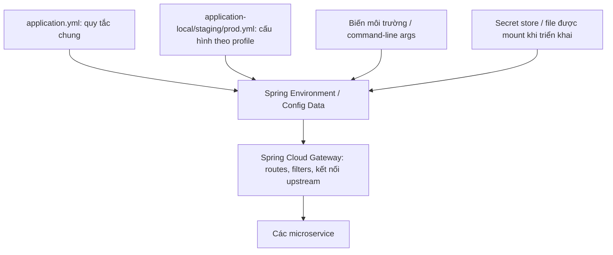

# Tách cấu hình theo môi trường và sử dụng biến môi trường

## 1. Vì sao Spring Cloud Gateway cần cấu hình theo môi trường?

Khi xây dựng **SPRING_CLOUD_GATEWAY**, ứng dụng thường chạy trong nhiều môi trường: máy cá nhân của lập trình viên (`local`), môi trường thử nghiệm (`staging`) và môi trường phục vụ người dùng thật (`prod`). Cùng một mã nguồn Gateway phải định tuyến request, áp dụng filter chain, quản lý kết nối đến microservices và phối hợp các chính sách xác thực, giới hạn lưu lượng, circuit breaker, retry, TLS, quan sát request.

Nhưng **giá trị cấu hình** giữa các môi trường rất khác nhau:

- Địa chỉ upstream: `http://localhost:8081` khi phát triển, tên dịch vụ nội bộ hoặc endpoint HTTPS khi triển khai.
- Cổng Gateway, timeout, mức ghi log và địa chỉ hệ thống quan sát.
- Địa chỉ issuer của JWT, Redis dùng cho rate limiting, discovery server và chứng chỉ TLS.
- Thông tin nhạy cảm như mật khẩu Redis, khóa, token truy cập, mật khẩu keystore.

Nếu ghi cứng những giá trị này trong Java hoặc sửa tay một file cấu hình trước mỗi lần triển khai, nhóm dễ đưa nhầm cấu hình thử nghiệm lên production, làm lộ bí mật, hoặc mất khả năng tái sử dụng cùng một bản build.

**Mục tiêu** là giữ nguyên artifact đã build, phân tách cấu hình thông thường theo môi trường và cung cấp các giá trị phụ thuộc vào hạ tầng thông qua **biến môi trường** hoặc cơ chế quản lý cấu hình/bí mật phù hợp.

Sau bài này, bạn có thể:

1. Phân biệt **Spring Profiles**, file cấu hình chung, file cấu hình riêng và biến môi trường.
2. Tổ chức `application.yml`, `application-local.yml`, `application-staging.yml`, `application-prod.yml`.
3. Sử dụng placeholder `${...}`, giá trị mặc định, biến bắt buộc và cách kích hoạt profile.
4. Áp dụng cấu hình vào route predicate/filter của Spring Cloud Gateway.
5. Kiểm tra cấu hình hiệu lực, tránh lộ secret và chẩn đoán các lỗi cấu hình thường gặp.

> Các ví dụ route bên dưới dùng kiểu khai báo `spring.cloud.gateway.routes` thường gặp ở **Spring Cloud Gateway Server WebFlux 4.x**. Một số phiên bản mới có namespace cấu hình hoặc starter khác; khi triển khai, hãy kiểm tra tài liệu đúng với phiên bản Spring Cloud Gateway và biến thể WebFlux/MVC đang dùng. **Nguyên tắc Spring Boot Config Data, Profiles và biến môi trường** vẫn là trọng tâm của bài.

## 2. Ba lớp cấu hình cần phân biệt

| Lớp | Chứa thông tin gì? | Ví dụ |
| --- | --- | --- |
| **Cấu hình chung** | Những quy tắc giống nhau ở mọi môi trường: tên ứng dụng, route ID, predicate, filter biến đổi đường dẫn | `application.yml` |
| **Cấu hình theo profile** | Những lựa chọn có ý nghĩa với một môi trường: mức log local, giá trị upstream local, tùy chọn vận hành staging/prod | `application-local.yml`, `application-prod.yml` |
| **Giá trị do môi trường triển khai cung cấp** | Địa chỉ hạ tầng thực tế, cấu hình thay đổi giữa các cụm, secret, giá trị mỗi deployment | `CATALOG_SERVICE_URI`, `JWT_ISSUER_URI`, secret store |

**Spring Profile** là một hoặc nhiều nhãn cấu hình đang hoạt động, ví dụ `local`, `staging`, `prod`. Spring Boot sẽ nạp các file `application-{profile}.yml` tương ứng và áp dụng chúng lên cấu hình chung.

**Biến môi trường** là giá trị mà tiến trình ứng dụng nhận từ hệ điều hành hoặc nền tảng triển khai. Chúng không đồng nghĩa với profile: `SPRING_PROFILES_ACTIVE=prod` chọn bộ cấu hình production; `CATALOG_SERVICE_URI=https://catalog.internal.example` cung cấp một giá trị cụ thể cho bộ cấu hình ấy.



Sơ đồ thể hiện những **nguồn cấu hình** có thể được Spring sử dụng; không có nghĩa secret store tự động được đọc nếu chưa có cơ chế tích hợp hoặc mount secret thích hợp.

## 3. Thiết kế ví dụ: một Gateway, nhiều môi trường

Giả sử Gateway công khai endpoint:

```text
GET http://localhost:8080/api/catalog/products/42
```

Gateway cần bỏ tiền tố `/api` rồi chuyển đến `GET /catalog/products/42` trên `catalog-service`.

Ta muốn giữ nguyên **quy tắc route** ở mọi môi trường, chỉ thay URI của upstream:

| Môi trường | Profile | URI upstream | Nguồn giá trị |
| --- | --- | --- | --- |
| Máy lập trình viên | `local` | `http://localhost:8081` | File `application-local.yml` |
| Thử nghiệm | `staging` | `http://catalog.staging.internal:8081` | Biến `CATALOG_SERVICE_URI` do deployment staging cấp |
| Production | `prod` | `https://catalog.prod.internal` | Biến `CATALOG_SERVICE_URI` do deployment production cấp |

Các domain trên là **giả định để minh họa**; hãy thay bằng endpoint thực tế của hạ tầng.

### 3.1. Cấu trúc file

```text
src/main/resources/
├── application.yml
├── application-local.yml
├── application-staging.yml
└── application-prod.yml
```

Tên file theo quy ước `application-{profile}.yml` giúp Spring Boot tự tìm thấy khi profile tương ứng được kích hoạt. Không cần viết Java để đọc từng file.

### 3.2. application.yml: giữ quy tắc route chung

```yaml
spring:
  application:
    name: api-gateway
  cloud:
    gateway:
      routes:
        - id: catalog-route
          uri: ${app.upstream.catalog-uri}
          predicates:
            - Path=/api/catalog/**
          filters:
            - StripPrefix=1

server:
  port: ${GATEWAY_PORT:8080}
```

Phân tích:

- `spring.application.name` giúp định danh ứng dụng trong log, metrics và hệ thống quản lý.
- `catalog-route` là ID route; `Path=/api/catalog/**` là **route predicate**.
- `StripPrefix=1` là **GatewayFilter** loại bỏ segment đầu tiên (`api`) của path trước khi gửi sang upstream.
- `uri: ${app.upstream.catalog-uri}` tham chiếu một thuộc tính mà profile hoặc nguồn cấu hình khác sẽ cung cấp. Đây là **thuộc tính ví dụ của ứng dụng**, không phải khóa tích hợp sẵn của Spring Cloud Gateway.
- `${GATEWAY_PORT:8080}` lấy `GATEWAY_PORT` khi có; nếu không có thì dùng mặc định `8080`.

Ví dụ: khi `app.upstream.catalog-uri=http://localhost:8081`, request `GET /api/catalog/products/42` sẽ đi tới `http://localhost:8081/catalog/products/42`. URI upstream phải bao gồm scheme phù hợp (`http://`, `https://` hoặc `lb://` khi đã tích hợp load balancing).

> Đây là route tối giản, **chưa tự cấu hình** xác thực JWT, rate limiter, circuit breaker, retry hay TLS. Những tính năng đó yêu cầu dependency và chính sách riêng dù các giá trị của chúng cũng có thể lấy từ biến môi trường.

### 3.3. application-local.yml: thuận tiện khi phát triển

```yaml
app:
  upstream:
    catalog-uri: http://localhost:8081

logging:
  level:
    org.springframework.cloud.gateway: DEBUG
```

Ở local, sử dụng service chạy trên máy tính và bật log chi tiết hơn để dễ tìm nguyên nhân route không khớp. Mức `DEBUG` không nên được áp dụng mặc định cho production vì có thể tạo quá nhiều log và làm tăng nguy cơ lộ dữ liệu trong các thành phần ghi log thiếu kiểm soát.

### 3.4. application-staging.yml: nhận URI từ deployment

```yaml
app:
  upstream:
    catalog-uri: ${CATALOG_SERVICE_URI}

logging:
  level:
    org.springframework.cloud.gateway: INFO
```

Khi profile `staging` hoạt động, Spring Boot cần tìm thấy `CATALOG_SERVICE_URI`. Do placeholder **không có giá trị mặc định**, một deployment thiếu cấu hình sẽ bị phát hiện khi Spring cố gắng phân giải thuộc tính này để tạo route, thường trong giai đoạn khởi tạo ứng dụng.

Cách này giúp tránh tình huống Gateway staging âm thầm gọi sang `localhost:8081` hoặc sang một service ở sai môi trường.

### 3.5. application-prod.yml: không ghi cứng địa chỉ hạ tầng

```yaml
app:
  upstream:
    catalog-uri: ${CATALOG_SERVICE_URI}

logging:
  level:
    org.springframework.cloud.gateway: INFO
```

File staging và prod có thể gần giống nhau; điều quan trọng là **giá trị thực** đến từ deployment khác nhau. Cùng một file JAR/image có thể được chạy ở hai môi trường mà không chỉnh sửa và build lại.

Không đặt `spring.profiles.active: prod` bên trong `application-prod.yml`. Profile nên được **chọn từ bên ngoài**, như biến `SPRING_PROFILES_ACTIVE` hoặc tham số khởi động. Với profile-specific file, Spring Boot có các quy định về vị trí hợp lệ của những thuộc tính kích hoạt profile.

## 4. Kích hoạt profile và truyền biến môi trường

### 4.1. Chạy local trên Linux/macOS

Với dự án có Maven Wrapper:

```bash
SPRING_PROFILES_ACTIVE=local ./mvnw spring-boot:run
```

Nếu chạy bản JAR đã build:

```bash
SPRING_PROFILES_ACTIVE=local java -jar target/api-gateway.jar
```

Tên JAR ở đây chỉ là ví dụ. Với Gradle Wrapper, dùng lệnh chạy phù hợp của dự án thay vì Maven.

### 4.2. Chạy local trong Windows PowerShell

```powershell
$env:SPRING_PROFILES_ACTIVE = "local"
$env:GATEWAY_PORT = "9090"

.\mvnw.cmd spring-boot:run
```

Gateway sẽ lắng nghe cổng `9090`, còn URI upstream lấy từ `application-local.yml`. Các giá trị đặt qua `$env:` có hiệu lực đối với tiến trình PowerShell hiện tại và tiến trình con được khởi chạy từ đó.

### 4.3. Chạy staging/prod với cùng artifact

Ví dụ trên Linux, với các endpoint giả định:

```bash
export SPRING_PROFILES_ACTIVE=staging
export CATALOG_SERVICE_URI=http://catalog.staging.internal:8081
export GATEWAY_PORT=8080

java -jar target/api-gateway.jar
```

Để chạy production, deployment cung cấp **giá trị khác**:

```bash
export SPRING_PROFILES_ACTIVE=prod
export CATALOG_SERVICE_URI=https://catalog.prod.internal
export GATEWAY_PORT=8080

java -jar target/api-gateway.jar
```

Cả hai trường hợp dùng chung file JAR; khác nhau ở các nguồn cấu hình. Đây là lợi ích chính của việc tách cấu hình khỏi mã và artifact.

Có thể chọn profile bằng tham số khởi động:

```bash
java -jar target/api-gateway.jar --spring.profiles.active=prod
```

Nhưng lệnh trên **chỉ chọn profile**; nếu `CATALOG_SERVICE_URI` chưa được cung cấp thì route vẫn thiếu cấu hình. Không đặt secret trực tiếp trong tham số command line vì chúng có thể xuất hiện trong lịch sử lệnh hoặc thông tin tiến trình.

### 4.4. Lưu ý về file .env

Một file `.env` chỉ chứa dạng:

```dotenv
SPRING_PROFILES_ACTIVE=local
CATALOG_SERVICE_URI=http://localhost:8081
```

**không tự động được Spring Boot nạp theo quy ước chung**. Docker Compose, IDE, công cụ như `direnv` hoặc script khởi chạy có thể đọc file này rồi truyền giá trị vào tiến trình, nhưng việc đó phải được cấu hình rõ.

Không commit `.env` chứa password/token vào Git. Nếu cần chia sẻ tên biến, tạo tài liệu mẫu không có secret thật và cấu hình file chứa secret ngoài nguồn mã.

## 5. Cách Spring Boot đọc biến môi trường và placeholder

### 5.1. Đọc biến trực tiếp theo relaxed binding

Spring Boot hỗ trợ **relaxed binding** khi ánh xạ tên cấu hình chuẩn sang biến môi trường. Quy tắc thường dùng: thay dấu chấm bằng dấu gạch dưới, bỏ dấu gạch ngang, rồi chuyển sang chữ hoa.

| Thuộc tính Spring Boot | Biến môi trường tương ứng |
| --- | --- |
| `server.port` | `SERVER_PORT` |
| `spring.profiles.active` | `SPRING_PROFILES_ACTIVE` |
| `spring.application.name` | `SPRING_APPLICATION_NAME` |
| `app.upstream.catalog-uri` | `APP_UPSTREAM_CATALOGURI` |
| `spring.security.oauth2.resourceserver.jwt.issuer-uri` | `SPRING_SECURITY_OAUTH2_RESOURCESERVER_JWT_ISSUERURI` |

**Không nhầm** ánh xạ tự động theo relaxed binding với placeholder tự đặt tên. Trong ví dụ, `${CATALOG_SERVICE_URI}` đọc trực tiếp biến có tên `CATALOG_SERVICE_URI`; còn biến `APP_UPSTREAM_CATALOGURI` là một cách khác để ghi đè thuộc tính `app.upstream.catalog-uri` qua cơ chế binding.

Đối với những thuộc tính khó nhớ, cách viết placeholder có tên ngắn, rõ nghĩa (`CATALOG_SERVICE_URI`, `JWT_ISSUER_URI`, `REDIS_HOST`) giúp deployment dễ quản lý. Khi dùng tên thuộc tính trong placeholder, nên ưu tiên dạng chuẩn kebab-case như `${app.upstream.catalog-uri}`.

### 5.2. Giá trị mặc định và biến bắt buộc

```yaml
server:
  port: ${GATEWAY_PORT:8080}

app:
  upstream:
    catalog-uri: ${CATALOG_SERVICE_URI}
```

- `${GATEWAY_PORT:8080}`: có thể dùng cổng mặc định khi chạy local.
- `${CATALOG_SERVICE_URI}`: bắt buộc có giá trị khi thuộc tính được phân giải.
- `${CATALOG_SERVICE_URI:http://localhost:8081}`: có fallback, **không phù hợp làm đường thoát mặc định cho production** vì dễ vô tình trỏ sai đích.

Đối với giá trị ảnh hưởng bảo mật hoặc định tuyến production, ưu tiên **fail fast** (thiếu cấu hình thì khởi động thất bại) và kiểm tra đầu vào. Một URI có giá trị nhưng sai scheme/host vẫn có thể làm Gateway lỗi lúc chạy; placeholder không thay thế việc kiểm tra URI hoặc kết nối.

### 5.3. Độ ưu tiên nguồn cấu hình

Spring Boot hợp nhất các **PropertySource** thành một `Environment`. Nguồn cấu hình có độ ưu tiên cao hơn có thể ghi đè cùng một khóa từ nguồn ưu tiên thấp hơn.

Với các nguồn thường gặp trong ứng dụng Spring Boot:

- Tham số dạng `--server.port=9090` trên command line thường ưu tiên hơn biến môi trường.
- Biến `SERVER_PORT=9090` thường ưu tiên hơn `server.port` trong `application.yml`.
- File cấu hình theo profile hoạt động (ví dụ `application-prod.yml`) có thể ghi đè cùng khóa trong `application.yml` ở cùng vị trí cấu hình.

Đây là **quy tắc thực hành**, không phải danh sách thứ tự đầy đủ: `SPRING_APPLICATION_JSON`, system properties, file ngoài JAR, thứ tự nhiều profile hoặc `spring.config.import` cũng ảnh hưởng giá trị cuối cùng. Khi một khóa bị ghi đè bất ngờ, cần kiểm tra nguồn thực sự đã cung cấp nó.

Ví dụ nếu `application.yml` khai báo `server.port: ${GATEWAY_PORT:8080}`, nhưng deployment cung cấp cả `GATEWAY_PORT=8081` và `SERVER_PORT=9090`, thuộc tính `server.port` lấy trực tiếp từ biến `SERVER_PORT` có độ ưu tiên cao hơn giá trị trong file, nên kết quả thông thường là **9090**.

### 5.4. Cẩn thận với danh sách route

Các route trong `spring.cloud.gateway.routes` là **một danh sách**. Spring Boot thường **thay thế toàn bộ danh sách** bằng danh sách từ nguồn có ưu tiên cao hơn, thay vì gộp hai danh sách theo `id`.

Ví dụ không an toàn nếu chỉ muốn sửa một URI:

```yaml
# application-prod.yml (tránh kiểu này nếu base có nhiều route)
spring:
  cloud:
    gateway:
      routes:
        - id: catalog-route
          uri: https://catalog.prod.internal
```

Đoạn trên có thể khiến các route khác trong `application.yml` bị mất khỏi danh sách hiệu lực; route thay thế cũng thiếu predicate/filter nếu không khai báo lại.

**Cách đề xuất:** giữ định nghĩa route ổn định trong `application.yml`, tách các giá trị biến thiên như URI sang `app.upstream.*` hoặc placeholder. Nếu thật sự cần số lượng/định nghĩa route khác nhau, hãy khai báo **danh sách đầy đủ** cho từng môi trường và kiểm tra route thực tế sau khi chạy.

## 6. Đưa cấu hình của các chức năng Gateway vào môi trường

Tương tự URI upstream, những phần của Gateway liên quan bảo mật, kết nối và khả năng chịu lỗi cũng cần tách giá trị theo môi trường.

| Chức năng | Ví dụ giá trị thay đổi | Nguyên tắc |
| --- | --- | --- |
| Route và discovery | `CATALOG_SERVICE_URI`, địa chỉ registry | Endpoint phải thuộc đúng môi trường và có scheme hợp lệ |
| Xác thực | `JWT_ISSUER_URI`, audience và khóa/cấu hình liên quan | Không dùng issuer thử nghiệm cho production; validate token đúng chuẩn |
| Rate limiting | `REDIS_HOST`, `REDIS_PASSWORD`, quota | Giữ mật khẩu ngoài Git; Redis là hạ tầng tùy cách triển khai |
| Circuit breaker / retry | Ngưỡng lỗi, timeout, số lần retry | Cân nhắc tải upstream và idempotency, nhất là với request ghi dữ liệu |
| TLS | Đường dẫn keystore/chứng chỉ, mật khẩu, truststore | Quản lý và xoay vòng chứng chỉ/secret; xác định nơi kết thúc TLS |
| Observability | OTLP endpoint, sampling, log level | Không đẩy dữ liệu nhạy cảm vào log/trace |

### 6.1. Ví dụ timeout có thể cấu hình

Với kiểu cấu hình HTTP client của **Gateway Server WebFlux 4.x**:

```yaml
spring:
  cloud:
    gateway:
      httpclient:
        connect-timeout: ${UPSTREAM_CONNECT_TIMEOUT_MS:2000}
        response-timeout: ${UPSTREAM_RESPONSE_TIMEOUT:5s}
```

Thông thường `connect-timeout` dùng **mili giây**, `response-timeout` dùng kiểu **Duration** (`5s`). Chọn ngân sách thời gian theo SLO và hành vi service đích. Không nên tăng timeout vô hạn chỉ để che giấu upstream bị chậm.

Đây là ví dụ cấu hình **tùy chọn**, cần đối chiếu namespace HTTP client ở phiên bản Gateway đang dùng. Các timeout này không tự tạo circuit breaker hay retry.

### 6.2. Ví dụ JWT issuer và Redis (chỉ cấu hình giá trị)

```yaml
spring:
  security:
    oauth2:
      resourceserver:
        jwt:
          issuer-uri: ${JWT_ISSUER_URI}
  data:
    redis:
      host: ${REDIS_HOST}
      port: ${REDIS_PORT:6379}
      password: ${REDIS_PASSWORD}
```

Đoạn ví dụ trên **chỉ minh họa cách đưa các thuộc tính ra biến môi trường**. Để xác thực JWT phải có Spring Security Resource Server và chính sách SecurityWebFilterChain phù hợp; để giới hạn request phải có cơ chế rate limiter và `KeyResolver` được cấu hình. Chỉ thêm biến `REDIS_HOST` hoặc `JWT_ISSUER_URI` không mặc nhiên bật toàn bộ bảo mật.

Trong thực tế, chỉ khai báo nhóm thuộc tính nào đang thực sự sử dụng. Đừng thêm cấu hình Redis vào ứng dụng chưa tích hợp Redis, hoặc thêm yêu cầu issuer vào môi trường chưa cấu hình cơ chế xác thực.

### 6.3. Ví dụ TLS khi Gateway tự kết thúc HTTPS

```yaml
server:
  ssl:
    enabled: true
    key-store: ${TLS_KEYSTORE_PATH}
    key-store-type: PKCS12
    key-store-password: ${TLS_KEYSTORE_PASSWORD}
```

Khi sử dụng cấu hình dạng này, keystore phải tồn tại tại đường dẫn phù hợp và chứa chứng chỉ/khóa tương ứng. Ví dụ `TLS_KEYSTORE_PATH=file:/run/secrets/gateway.p12` chỉ có tác dụng nếu deployment đã mount file đó vào container.

Nếu HTTPS được kết thúc ở ingress/load balancer phía trước, cấu hình TLS tại gateway có thể khác. Cần hiểu rõ chặng nào được mã hóa, chính sách TLS nội bộ và những header `Forwarded`/`X-Forwarded-*` nào được phép tin cậy.

## 7. Truyền biến môi trường khi dùng Docker Compose và Kubernetes

### 7.1. Docker Compose

Ví dụ chạy cùng image Gateway với cấu hình deployment:

```yaml
services:
  gateway:
    image: example/api-gateway:1.0.0
    ports:
      - "8080:8080"
    environment:
      SPRING_PROFILES_ACTIVE: prod
      GATEWAY_PORT: "8080"
      CATALOG_SERVICE_URI: http://catalog:8081
```

`catalog` phải là hostname phân giải được từ network của container (ví dụ service Compose cùng network). `localhost` bên trong container Gateway **trỏ về chính container Gateway**, không phải máy host hay một container khác.

Nếu dùng file `.env` để Compose thay giá trị biểu thức `${...}` hoặc sử dụng `env_file`, hãy phân biệt **Compose đọc file cấu hình** với **container thực sự nhận biến nào**. Không tự giả định mọi biến trong file `.env` của Compose đều được đưa vào môi trường tiến trình Gateway.

### 7.2. Kubernetes

Các giá trị không bí mật có thể truyền bằng `env` hoặc ConfigMap; bí mật nên được cấp từ Secret/secret manager hoặc file mount, tùy chính sách vận hành. Đoạn sau chỉ trích phần `containers` của Deployment:

```yaml
containers:
  - name: gateway
    image: example/api-gateway:1.0.0
    env:
      - name: SPRING_PROFILES_ACTIVE
        value: "prod"
      - name: CATALOG_SERVICE_URI
        value: "http://catalog-service.default.svc.cluster.local:8081"
      - name: REDIS_PASSWORD
        valueFrom:
          secretKeyRef:
            name: gateway-redis
            key: password
```

Giá trị `REDIS_PASSWORD` chỉ có khi Kubernetes Secret `gateway-redis` và key `password` đã tồn tại. Việc lưu Secret dạng Kubernetes không tự bảo đảm mọi rủi ro an toàn được xử lý: vẫn cần RBAC, kiểm soát quyền đọc secret, mã hóa phù hợp và quy trình xoay vòng.

Nếu cấu hình thay đổi trong ConfigMap/Secret hoặc biến môi trường của Pod, ứng dụng **không tự động thay toàn bộ cấu hình runtime**. Với giá trị cấp qua environment variables, tiến trình đã chạy thường cần rollout/restart để nhận giá trị mới. Các giải pháp external config có cơ chế refresh riêng; phải xác minh tính năng hỗ trợ của phiên bản và thành phần đang dùng.

## 8. Quản lý secret và ranh giới an toàn

Một nguyên tắc hữu ích là **cấu hình không nhạy cảm có thể được version-control**, còn secret thực phải được quản lý qua kênh được bảo vệ phù hợp:

1. **Không commit** password, client secret, private key, token thật hoặc keystore chứa private key vào Git.
2. Ưu tiên secret manager, volume mount, secret reference của nền tảng triển khai; có thể dùng environment variable nếu kiểm soát được quyền truy cập và cách hiển thị biến.
3. Không ghi secret vào log, message lỗi, trace, dump hoặc endpoint Actuator mở công khai. Biến môi trường có thể bị lộ qua công cụ quản trị, dump tiến trình hoặc quyền quan sát host/container.
4. Phân quyền theo môi trường: secret production không được cấp cho workstation hoặc job staging không có nhu cầu.
5. Thiết kế rotation cho JWT keys, mật khẩu Redis, chứng chỉ TLS và credentials; xem có cần restart/reload khi thay đổi hay không.
6. Với Gateway đứng ở biên hệ thống, không lấy danh tính người dùng hoặc quyền từ header do client tự đặt mà không có bước xác thực/chuẩn hóa và ranh giới tin cậy.

Chọn biến môi trường làm nguồn giá trị **không đồng nghĩa giá trị đã an toàn**. An toàn còn phụ thuộc cách cấp, lưu, đọc, ghi log, phân quyền và thu hồi secret.

## 9. Kiểm tra cấu hình hiệu lực trước khi đưa vào vận hành

Cần kiểm tra **profile đang hoạt động**, **giá trị route đã được phân giải** và **request có thực sự đi đúng upstream**.

### 9.1. Kiểm tra bằng request thực tế

Giả sử local `catalog-service` có endpoint `GET /catalog/products/42`, sau khi bật `local` và chạy Gateway:

```bash
curl -i http://localhost:8080/api/catalog/products/42
```

Kết quả mong đợi tùy service có thể là `200 OK` và JSON sản phẩm. Nếu upstream trả `404`, cần phân biệt route Gateway đã khớp nhưng service không có path được chuyển tiếp, hay Gateway không tìm được route.

Chạy cổng `9090` thì thay URL tương ứng; nếu upstream local chưa khởi chạy, phép thử không thể chứng minh route đã hoạt động trọn vẹn.

### 9.2. Những dấu hiệu có thể quan sát

- Log khởi động thường cho biết **active profiles** (đảm bảo không chạy nhầm profile).
- Một request thử có thể cho biết URL công khai đã tới đúng upstream hay chưa.
- Spring Boot Actuator cung cấp một số endpoint chẩn đoán, nhưng chỉ dùng khi đã thêm dependency và cấu hình chính sách truy cập phù hợp.
- Nếu dùng các endpoint như `/actuator/env`, `/actuator/configprops` hoặc các endpoint Gateway liên quan, **không công khai** chúng cho người dùng bên ngoài. Chúng có thể tiết lộ cấu trúc hệ thống hoặc thông tin vận hành dù nhiều giá trị được che một phần.

Đừng dựa vào `System.out.println(System.getenv())` hay log toàn bộ `Environment` để debug: cách đó dễ làm lộ secret. Chỉ log khóa/giá trị đã được chọn lọc và làm sạch, hoặc sử dụng công cụ quan sát có phân quyền.

### 9.3. Các lỗi thường gặp và cách sửa

| Triệu chứng | Nguyên nhân có thể | Cách kiểm tra hoặc khắc phục |
| --- | --- | --- |
| Ứng dụng báo không phân giải được `${CATALOG_SERVICE_URI}` | Biến chưa được cấp cho **tiến trình** đang chạy; profile không đúng | Kiểm tra cấu hình deployment, environment của IDE/container, active profile |
| Gateway gọi `localhost` dù đã deploy | Chạy nhầm `local`, dùng fallback localhost, hoặc `localhost` ở sai network namespace | Kiểm tra profile và URI; dùng DNS service nội bộ |
| Profile `prod` không có tác dụng | Chưa đặt `SPRING_PROFILES_ACTIVE`, đặt tên file sai hoặc giá trị bị ghi đè | Kiểm tra log active profiles, command-line args, Config Data |
| Một số route biến mất | Ghi đè **toàn bộ danh sách** `spring.cloud.gateway.routes` trong file profile | Tách URI bằng placeholder hoặc khai báo đầy đủ route list |
| Route khớp nhưng upstream trả 404 | `StripPrefix`/rewrite path sai hoặc service không có endpoint | So sánh path trước/sau filter và endpoint upstream |
| `503` khi dùng `lb://SERVICE` | Chưa có instance, service discovery/LoadBalancer chưa tích hợp hoặc service sai tên | Kiểm tra dependency, registry, danh sách instance và health |
| HTTPS upstream lỗi TLS | Truststore/CA, hostname verification, protocol hoặc chứng chỉ sai | Kiểm tra chứng chỉ và cấu hình TLS đúng môi trường |
| Timeout cao ở prod | Giá trị timeout bị override, upstream chậm hoặc giới hạn kết nối | Kiểm tra nguồn thuộc tính, metrics per-route và trace |
| Secret xuất hiện trong log | Ghi toàn bộ config/header/dump | Ngừng ghi giá trị nhạy cảm, lọc log và thay secret đã lộ |
| Sửa biến môi trường nhưng Gateway vẫn dùng giá trị cũ | Tiến trình đã chạy chưa nhận environment mới | Rollout/restart hoặc dùng cơ chế refresh được hỗ trợ |

## 10. Những nguyên tắc áp dụng trong dự án thực tế

**Giữ cùng artifact qua các môi trường.** Nếu thay đổi JAR/image khi chỉ muốn đổi URI hoặc mật khẩu, khó biết lỗi do mã nguồn hay cấu hình. Build một artifact, triển khai với giá trị khác nhau là cách dễ kiểm soát hơn.

**Chọn tên biến nhất quán.** Ví dụ `CATALOG_SERVICE_URI` là URI đầy đủ, khác với `CATALOG_SERVICE_HOST` chỉ chứa host. Cần thống nhất có hay không scheme, port, path prefix và quy tắc TLS.

**Ưu tiên biến bắt buộc cho hạ tầng production.** Không đặt fallback về localhost hoặc staging cho issuer JWT, Redis, payment gateway hay upstream nhạy cảm. Giá trị mặc định chỉ phù hợp với thông số an toàn, không gây trỏ nhầm.

**Không đặt quy tắc nghiệp vụ vào biến môi trường.** Môi trường nên quyết định host, timeout, quota và các tham số vận hành được phép thay đổi; quyền sở hữu đơn hàng, logic thanh toán và trạng thái nghiệp vụ phải được service kiểm soát.

**Kiểm soát các thay đổi danh sách.** Danh sách route/filter/listener không được kỳ vọng tự gộp theo khóa `id` giữa nhiều file. Khi cần thay đổi chính sách route theo môi trường, kiểm tra cấu hình hiệu lực và kiểm thử request cụ thể.

**Dùng cấu hình theo phiên bản.** Namespace các thuộc tính của Spring Cloud Gateway, Spring Security và actuator có thể thay đổi theo phiên bản. Đặc biệt, không sao chép lẫn cấu hình **Gateway Server WebFlux** và **Gateway Server MVC**.

**Không hy sinh observability.** Dù giảm mức log ở production, vẫn cần metrics, trace và khả năng kiểm tra trạng thái upstream; cấu hình các endpoint quan sát phải phù hợp yêu cầu bảo mật.

### Checklist trước khi triển khai

- [ ] Profile được chọn từ deployment; log khởi động thể hiện đúng profile.
- [ ] Cùng một JAR/image chạy được với cấu hình `staging` và `prod` phù hợp.
- [ ] URI upstream có scheme, hostname và port đúng mạng triển khai.
- [ ] Không có fallback nguy hiểm về `localhost` hoặc hệ thống thử nghiệm ở production.
- [ ] Secret lấy từ nguồn được bảo vệ và không bị log/commit.
- [ ] Route predicates, filter path/header, xác thực, rate limiting và chính sách retry được kiểm tra riêng.
- [ ] Timeout, TLS và khả năng kết nối tới discovery/Redis/identity provider đã được xác minh nếu sử dụng.
- [ ] Chỉ số latency/error và log chẩn đoán đủ để phân biệt lỗi Gateway với lỗi upstream.
- [ ] Có quy trình restart/rollout hoặc refresh đúng cách khi cấu hình thay đổi.

## 11. Tổng kết

**Spring Profiles** chọn các nhóm cấu hình như `local`, `staging`, `prod`; **biến môi trường** truyền giá trị tại thời điểm chạy; **placeholder** `${...}` nối chúng với thuộc tính trong Spring Boot. Với **Spring Cloud Gateway**, nên giữ định nghĩa route, predicate và filter ổn định ở cấu hình chung, còn URI upstream, tham số kết nối, chính sách hạ tầng và secret được cung cấp theo từng môi trường.

Khi tách cấu hình theo cách này, một Gateway có thể tiếp nhận và chuyển request đến các microservices khác nhau một cách có kiểm soát, hỗ trợ xác thực, giới hạn lưu lượng, circuit breaker, retry, TLS và quan sát request mà không cần sửa mã nguồn mỗi khi chuyển môi trường. Điều cần luôn kiểm chứng là **giá trị cấu hình thực sự có hiệu lực trong tiến trình đang chạy**, không chỉ giá trị được viết trong một file YAML.
