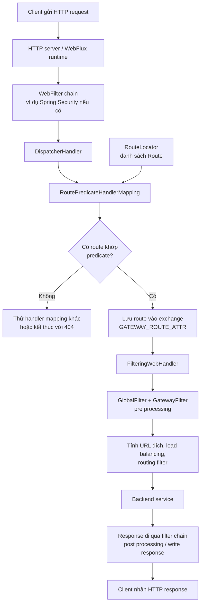
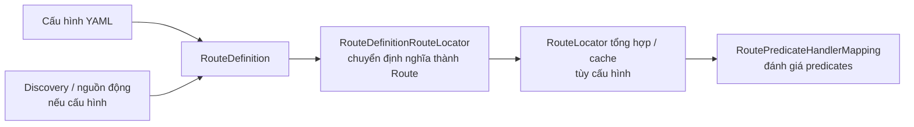
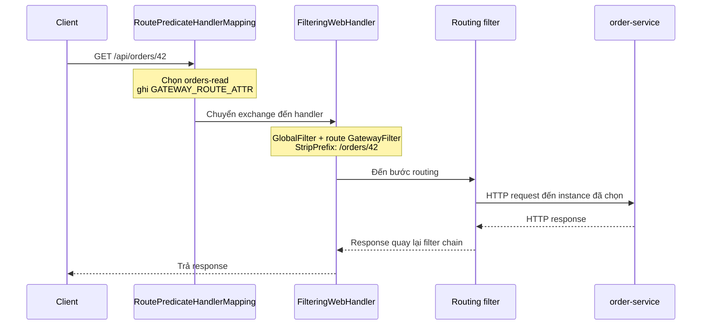

# Gateway Handler Mapping và quá trình chọn tuyến

Trong một hệ thống microservices, client thường gọi một địa chỉ chung như `https://api.example.test` mà không biết từng dịch vụ đang chạy ở đâu. Khi request `GET /api/orders/42` đến **Spring Cloud Gateway**, gateway cần trả lời câu hỏi quan trọng trước khi áp dụng các filter chuyển tiếp: **request này thuộc route nào?**

Bộ phận chịu trách nhiệm chính cho câu hỏi đó ở **Spring Cloud Gateway Server WebFlux** là **`RoutePredicateHandlerMapping`**. Thành phần này kết hợp danh sách route từ `RouteLocator` với các **route predicate** để tìm route phù hợp, rồi chuyển request sang `FilteringWebHandler` để chạy filter chain. Hiểu ranh giới giữa các bước giúp tránh nhầm lỗi chọn tuyến với lỗi rewrite path, discovery, load balancing hay gọi backend.

Đây là nội dung thuộc chương **Kiến trúc xử lý** của module **SPRING_CLOUD_GATEWAY**. Nắm được handler mapping là tiền đề để xây API gateway bằng route predicates, filter chain, biến đổi path/header và khám phá dịch vụ; đồng thời xác định chính xác nơi xác thực, giới hạn lưu lượng, circuit breaker, retry, TLS và quan sát request diễn ra trong hành trình của một lời gọi.

> **Phạm vi:** Bài mô tả kiến trúc **Spring Cloud Gateway Server WebFlux** (reactive). Biến thể **Server MVC** có cơ chế dựa trên Spring MVC và những kiểu handler/filter khác. Tên thuộc tính YAML, starter và chi tiết nội bộ có thể thay đổi theo phiên bản Spring Cloud Gateway; ví dụ cấu hình bên dưới dùng dạng phổ biến của nhánh Server WebFlux 4.x.

## 1. Route là gì và handler mapping làm việc gì?

Một **route** là quy tắc có định danh riêng, mô tả khi nào gateway tiếp nhận request và sẽ chuyển tiếp đến đâu. Các thành phần thường gặp:

| Thành phần | Ý nghĩa | Ví dụ |
| --- | --- | --- |
| **ID** | Định danh của route, hữu ích khi ghi log và quan sát. | `orders-read` |
| **URI đích** | Backend hoặc đích logic nhận request sau khi gateway xử lý. | `lb://order-service` |
| **Predicates** | Các điều kiện để route khớp request hiện tại. | `Path=/api/orders/**`, `Method=GET` |
| **Filters** | Các biến đổi/chính sách thực hiện **sau khi route được chọn**. | `StripPrefix=1`, `AddResponseHeader=...` |
| **Order** | Thứ tự ưu tiên giữa các route có khả năng khớp. | `-20` ưu tiên hơn `0` |
| **Metadata** | Thông tin bổ sung có thể được framework hoặc filter sử dụng. | Cấu hình timeout theo route, nếu được hỗ trợ |

**`RoutePredicateHandlerMapping`** là một triển khai `HandlerMapping` trong hệ sinh thái Spring WebFlux. Công việc cốt lõi của nó là:

1. Lấy các route khả dụng từ một `RouteLocator`.
2. Xem request có đáp ứng predicate của từng route hay không.
3. Chọn **route khớp đầu tiên theo thứ tự route được cung cấp/ưu tiên**.
4. Ghi route được chọn vào `ServerWebExchange` (thường thông qua thuộc tính `GATEWAY_ROUTE_ATTR`).
5. Trả về handler xử lý tiếp, trong Gateway Server WebFlux thường là **`FilteringWebHandler`**.

Handler mapping **không tự gọi HTTP đến backend**, cũng không đồng nghĩa nó đã xác thực token, rewrite path hay cân bằng tải. Những việc đó thuộc các tầng khác trong luồng xử lý.

### 1.1. Phân biệt các tên dễ nhầm

| Tên | Vai trò |
| --- | --- |
| **`DispatcherHandler`** | Bộ điều phối trong Spring WebFlux; tìm handler qua các `HandlerMapping` theo thứ tự rồi đưa đến `HandlerAdapter` thích hợp. |
| **`RoutePredicateHandlerMapping`** | Handler mapping chuyên biệt của Spring Cloud Gateway Server WebFlux; chọn route bằng predicate. |
| **`RouteDefinitionLocator`** | Cung cấp **định nghĩa route** từ cấu hình, discovery hoặc nguồn được tích hợp. |
| **`RouteLocator`** | Cung cấp các đối tượng **`Route`** có predicate đã xây dựng, URI, filters và order để gateway đánh giá. |
| **`FilteringWebHandler`** | Tập hợp và thực thi các `GlobalFilter` cùng `GatewayFilter` của route đã chọn. |
| **Routing filter** | Thành phần trong filter chain thực sự chuẩn bị/chuyển tiếp đến backend, chẳng hạn routing qua Netty hoặc `forward:`. |

Trong một ứng dụng WebFlux, có thể tồn tại nhiều `HandlerMapping`: dành cho controller, static resources, actuator hoặc gateway. `DispatcherHandler` xét chúng theo thứ tự do Spring cấu hình. Vì vậy, không phải **mọi** request đến ứng dụng đều nhất thiết được xử lý bởi `RoutePredicateHandlerMapping`.

## 2. Toàn cảnh đường đi của request

Giả sử client gọi:

```http
GET /api/orders/42 HTTP/1.1
Host: api.example.test
Accept: application/json
```

Một hành trình phổ biến trong Spring Cloud Gateway Server WebFlux:



Sơ đồ thể hiện **các trách nhiệm logic**, không phải mỗi hộp là một server hoặc thread riêng. Việc xử lý diễn ra theo reactive pipeline; thực tế có thể có nhiều lớp proxy/TLS termination ở trước gateway và các thành phần observability hoặc mesh ở các chặng phía sau.

### Giai đoạn A: WebFlux nhận request

HTTP server tạo các đối tượng WebFlux, trong đó có `ServerHttpRequest`, `ServerHttpResponse` và `ServerWebExchange`. Các `WebFilter` của ứng dụng có thể chạy trước giai đoạn tìm handler; ví dụ, Spring Security có thể từ chối một request không đủ quyền ngay tại đây.

Nếu gateway đặt sau một reverse proxy hoặc load balancer, các thông tin như `Host`, địa chỉ IP client hay scheme HTTPS có thể đã được proxy xử lý trước đó. Cấu hình trusted proxies và forwarded headers ảnh hưởng đến những predicate dựa trên các thông tin này.

### Giai đoạn B: Tìm handler và route

`DispatcherHandler` tìm handler phù hợp từ các `HandlerMapping`. Khi xét đến `RoutePredicateHandlerMapping`, nó đánh giá route predicates dựa trên **request/exchange đang được nhận**. Route đã chọn được lưu vào exchange để filters tiếp theo sử dụng.

Đây là thời điểm trả lời **“route nào?”**. Chưa nhất thiết có câu trả lời cuối cùng cho **“instance backend nào?”** vì đích `lb://` còn cần load balancer phân giải.

### Giai đoạn C: Chạy Gateway filter chain

`FilteringWebHandler` ghép `GlobalFilter` với các `GatewayFilter` của route, áp dụng thứ tự và gọi chain. Các filter có thể sửa request path/header, kiểm tra chính sách ở tầng Gateway, tính URL đích, chọn instance, thực hiện retry hoặc circuit breaker khi được cấu hình.

Một filter thay đổi path như `StripPrefix` chạy **sau khi chọn route**, vì vậy việc rewrite không tự kích hoạt chọn lại route.

### Giai đoạn D: Gọi backend và trả response

Routing filter chuyển request đến backend phù hợp; filter xử lý response và thành phần ghi dữ liệu trả response về client. Lỗi có thể phát sinh tại từng chặng, nên cần xem **request có khớp route chưa**, **route nào được chọn**, **đã chọn được instance chưa**, rồi mới điều tra kết nối downstream.

## 3. `RouteLocator` cung cấp danh sách route như thế nào?

Gateway có thể lấy định nghĩa route từ nhiều nguồn:

- **Cấu hình tĩnh**: `application.yml` hoặc `application.properties` khai báo id, uri, predicates và filters.
- **Nguồn discovery**: một integration có thể tạo route definitions từ những dịch vụ được phát hiện, nếu đã cấu hình.
- **Nguồn động tùy biến**: lưu route ở repository hoặc nguồn cấu hình khác, rồi chuyển thành các `Route` có thể đánh giá.

Các lớp thường xuất hiện trong kiến trúc:



`RouteDefinition` là dữ liệu cấu hình ở dạng khai báo. `Route` là đối tượng runtime có các predicate/filter đã được tạo từ các factory tương ứng. `RouteLocator` trả về chuỗi route cho handler mapping sử dụng; một số triển khai dùng cache để tránh chuyển đổi lặp lại mỗi request.

**Có route trong file YAML không đủ chứng minh route đang hoạt động.** Ứng dụng phải nạp được cấu hình, resolve được predicate/filter factories, đưa route vào danh sách runtime và áp dụng cấu hình mới. Với nguồn route động có cache, thường cần phát sự kiện refresh hoặc sử dụng cơ chế cập nhật do hệ thống triển khai cung cấp.

**Service discovery khác route matching.** Discovery xác định những service/instance có thể gọi. Predicate xác định request thuộc route nào. Khi route dùng `lb://order-service`, việc chọn instance xảy ra ở bước sau chọn route, thông qua tích hợp load balancing và nguồn instance phù hợp.

## 4. Quy tắc chọn tuyến: điều kiện và thứ tự

### 4.1. Nhiều predicate trong một route thường kết hợp AND

Ví dụ:

```yaml
predicates:
  - Path=/api/orders/**
  - Method=GET
```

Route này chỉ khớp nếu **cả hai** điều kiện đều đúng: đường dẫn thuộc `/api/orders/**` và HTTP method là `GET`. Một request `POST /api/orders/42` có path phù hợp nhưng **không** khớp route trên vì method khác.

Một số predicate factory có thể nhận **nhiều giá trị trong chính một predicate**, như nhiều path patterns; cách kết hợp các giá trị nội bộ phụ thuộc factory. Đừng đánh đồng logic nội bộ của một factory với quy tắc kết hợp các dòng predicate khác nhau.

### 4.2. Nhiều route là nhiều lựa chọn cạnh tranh

Khi một request có thể khớp nhiều route, Gateway thường lấy **route khớp đầu tiên theo danh sách route đã được sắp thứ tự**. Thuộc tính `order` cho phép kiểm soát mức ưu tiên: **giá trị thấp hơn được ưu tiên hơn**.

Ví dụ, nếu cả hai route sau đều khớp:

- Route `orders-read`: `Path=/api/orders/**`, `Method=GET`, `order: -20`.
- Route `api-fallback`: `Path=/api/**`, `order: 100`.

Request `GET /api/orders/42` được chọn theo `orders-read`; route fallback không chạy filter của nó cho request này.

Không nên dựa vào nhận định **“path cụ thể hơn luôn tự thắng”**. Predicate match và **thứ tự route** quyết định lựa chọn; route tổng quát có độ ưu tiên cao có thể che khuất route cụ thể. Cũng không nên phụ thuộc vào thứ tự ngẫu nhiên của các route cùng `order` khi chúng có điều kiện trùng nhau: hãy cho chúng mức ưu tiên rõ ràng hoặc thiết kế điều kiện loại trừ nhau.

> **Ngoại lệ cần nhận biết:** Các cơ chế như weighted routing hoặc predicate tùy biến có thể có logic chọn tuyến riêng. Khi dùng chúng, phải hiểu quy tắc của predicate factory tương ứng thay vì suy diễn từ ví dụ các predicate cơ bản.

### 4.3. Các predicate được đánh giá ở thời điểm nào?

`Path`, `Host`, `Method`, `Header`, `Query`, `Cookie` hoặc `RemoteAddr` giúp kiểm tra thông tin request ở giai đoạn **trước Gateway filter chain của route**.

Ví dụ, route yêu cầu `Header=X-Mode, demo` sẽ **không** khớp chỉ vì một `AddRequestHeader=X-Mode, demo` nằm trong filters của chính route đó. Filter chưa được chạy vào thời điểm handler mapping kiểm tra predicate.

Tuy nhiên, một **WebFilter** chạy trước `DispatcherHandler` có thể thay request mà handler mapping nhìn thấy. Vì vậy, khi phân tích kết quả match, cần phân biệt `WebFilter` ở tầng WebFlux với `GlobalFilter`/`GatewayFilter` ở tầng Spring Cloud Gateway.

## 5. Ví dụ cấu hình ba route và cách Gateway quyết định

Ví dụ dưới đây sử dụng các route có phần đường dẫn chồng nhau. Các backend và service discovery chỉ là môi trường minh họa; để chạy thực tế cần cấu hình instance, dependency và kết nối phù hợp.

```yaml
spring:
  cloud:
    gateway:
      routes:
        - id: orders-read
          order: -20
          uri: lb://order-service
          predicates:
            - Path=/api/orders/**
            - Method=GET
          filters:
            - StripPrefix=1
            - AddResponseHeader=X-Demo-Route, orders-read

        - id: orders-general
          order: 0
          uri: lb://order-service
          predicates:
            - Path=/api/orders/**
          filters:
            - StripPrefix=1
            - AddResponseHeader=X-Demo-Route, orders-general

        - id: api-fallback
          order: 100
          uri: http://fallback-service:8080
          predicates:
            - Path=/api/**
          filters:
            - StripPrefix=1
            - AddResponseHeader=X-Demo-Route, api-fallback
```

Hai route đầu chuyển đến cùng dịch vụ logic nhưng có điều kiện khác nhau; route cuối là fallback cho các đường dẫn `/api/**` còn lại. `AddResponseHeader` chỉ để **dễ quan sát route đã chọn trong ví dụ học tập**; trong môi trường thực tế cần cân nhắc có nên công khai thông tin route nội bộ hay không.

| Request đầu vào | Route được chọn | Vì sao? | Path chuyển xuống backend sau `StripPrefix=1` |
| --- | --- | --- | --- |
| `GET /api/orders/42` | `orders-read` | Path và method đều khớp, `order: -20`. | `/orders/42` |
| `POST /api/orders/42` | `orders-general` | `orders-read` không khớp method; route general khớp path. | `/orders/42` |
| `GET /api/users/7` | `api-fallback` | Hai route orders không khớp; `/api/**` khớp. | `/users/7` |
| `GET /public/health` | Không route nào trong ví dụ | Không có path phù hợp; có thể do mapping khác xử lý hoặc trả 404. | Không có chuyển tiếp qua các route này. |

Nhìn vào request đầu tiên:

1. `RoutePredicateHandlerMapping` nhận danh sách route đã sắp theo ưu tiên.
2. Predicate `Path=/api/orders/**` của `orders-read` khớp `/api/orders/42`.
3. Predicate `Method=GET` cũng khớp nên route này được chọn.
4. Gateway lưu route và chuyển sang `FilteringWebHandler`.
5. `StripPrefix=1` bỏ đoạn `api` khỏi path; các routing filters sau đó sử dụng path/URL đã được chuẩn bị để đến backend.
6. `lb://order-service` được phân giải qua load balancer; `AddResponseHeader` có thể giúp client quan sát route `orders-read` trong response của hệ thống demo.

Với request `POST`, route `orders-read` bị loại tại điều kiện method; handler mapping tiếp tục xét các route còn lại. Với request ngoài `/api/**`, bộ route khai báo ở đây không có match; **không có nghĩa WebFlux chắc chắn trả 404 nếu ứng dụng có handler mapping khác**.

### 5.1. Tự thử với curl

Giả sử gateway khởi động ở `localhost:8080`, backend có thể được phân giải và các route được nạp thành công:

```bash
curl -i http://localhost:8080/api/orders/42
curl -i -X POST http://localhost:8080/api/orders/42
curl -i http://localhost:8080/api/users/7
```

Kiểm tra header `X-Demo-Route` để nhận biết route nào đã áp dụng filter. Nếu backend không sẵn sàng, response có thể là lỗi upstream; cần đọc logs và route metadata để phân biệt **khớp route nhưng không gọi được backend** với **không khớp route**. Các header minh họa không phải cam kết về mã HTTP status của backend.

## 6. Sau khi chọn route, filter chain mới bắt đầu

`FilteringWebHandler` kết hợp hai nguồn filter:

- **`GlobalFilter`**: áp dụng cho các request được Spring Cloud Gateway định tuyến qua handler này, không phụ thuộc route cụ thể.
- **`GatewayFilter`**: được gắn vào từng route, trực tiếp hoặc thông qua các `GatewayFilterFactory` cấu hình sẵn.

Các filter được sắp theo thứ tự ưu tiên và thực thi qua `GatewayFilterChain`. Filter trước có thể xử lý request, gọi `chain.filter(exchange)` và tiếp tục xử lý kết quả ở chiều response. Thứ tự pre-processing và post-processing có thể khác nhau: filter chạy sớm ở chiều đi thường bao quanh các filter chạy muộn, nên callback sau chain có thể diễn ra theo chiều ngược lại.



Đây là khác biệt cốt lõi:

| Câu hỏi | Thành phần chịu trách nhiệm |
| --- | --- |
| Request khớp route nào? | `RoutePredicateHandlerMapping` + predicates từ `RouteLocator`. |
| Filter nào được áp dụng? | `FilteringWebHandler` dựa trên route đã chọn và global filters. |
| Request gửi xuống backend dùng path/header nào? | Các gateway filters biến đổi request trước bước routing. |
| Backend cụ thể nào nhận request với `lb://`? | Load balancer và nguồn instance/discovery được tích hợp. |
| Kết nối mạng đến backend diễn ra thế nào? | Routing filter/HTTP client tương ứng (hoặc cơ chế `forward:`). |
| Client nhận status/header/body gì? | Backend và các bước xử lý response/error trong gateway. |

### 6.1. Những thuộc tính exchange liên quan đến route

Trong Spring Cloud Gateway Server WebFlux, `ServerWebExchange` thường chứa các thuộc tính nội bộ được định nghĩa trong `ServerWebExchangeUtils`, ví dụ:

| Thuộc tính | Thời điểm/ý nghĩa thường gặp |
| --- | --- |
| `GATEWAY_ROUTE_ATTR` | Route đã chọn; handler mapping đặt để filter chain biết đang phục vụ route nào. |
| `GATEWAY_REQUEST_URL_ATTR` | URL downstream được chuẩn bị hoặc cập nhật trong các bước routing/load balancing sau chọn route. |
| `GATEWAY_ORIGINAL_REQUEST_URL_ATTR` | Dùng để lưu các URI gốc/URI trước biến đổi trong quá trình routing. |
| `GATEWAY_ALREADY_ROUTED_ATTR` | Đánh dấu request đã được một routing filter xử lý để hạn chế xử lý routing lặp ngoài ý muốn. |

**Không nhầm `GATEWAY_ROUTE_ATTR` với `GATEWAY_REQUEST_URL_ATTR`.** Có route được chọn chưa có nghĩa URI cuối cùng đã được phân giải thành host/port thực tế. Ví dụ, `lb://order-service` là đích logic, còn URI HTTP tới một instance cụ thể được tính ở những bước kế tiếp.

Các thuộc tính này là chi tiết tích hợp của Spring Cloud Gateway và có thể được thay đổi bởi filters; khi viết filter tùy biến, chỉ dùng các API đúng phiên bản và tránh tự ghi đè giá trị framework quản lý nếu không nắm rõ vòng đời của chúng.

## 7. Đọc route đã chọn trong custom GlobalFilter

Nếu muốn ghi lại route ID phục vụ điều tra request, có thể đọc `GATEWAY_ROUTE_ATTR` từ exchange **trong gateway filter chain**:

```java
package com.example.gateway.filter;

import org.slf4j.Logger;
import org.slf4j.LoggerFactory;
import org.springframework.cloud.gateway.filter.GatewayFilterChain;
import org.springframework.cloud.gateway.filter.GlobalFilter;
import org.springframework.cloud.gateway.route.Route;
import org.springframework.cloud.gateway.support.ServerWebExchangeUtils;
import org.springframework.core.Ordered;
import org.springframework.stereotype.Component;
import org.springframework.web.server.ServerWebExchange;
import reactor.core.publisher.Mono;

@Component
public class SelectedRouteLogFilter implements GlobalFilter, Ordered {

    private static final Logger log =
        LoggerFactory.getLogger(SelectedRouteLogFilter.class);

    @Override
    public Mono<Void> filter(ServerWebExchange exchange,
                             GatewayFilterChain chain) {
        Route route = exchange.getAttribute(
            ServerWebExchangeUtils.GATEWAY_ROUTE_ATTR
        );
        String routeId = route != null ? route.getId() : "unknown";
        long startedNanos = System.nanoTime();

        return chain.filter(exchange)
            .doFinally(signal -> {
                long elapsedMillis =
                    (System.nanoTime() - startedNanos) / 1_000_000;
                log.info("gateway route={} status={} durationMs={}",
                    routeId,
                    exchange.getResponse().getStatusCode(),
                    elapsedMillis);
            });
    }

    @Override
    public int getOrder() {
        return 0;
    }
}
```

Ví dụ này minh họa việc **đọc route đã chọn**, không tìm route từ đầu. `doFinally` quan sát kết thúc hoặc hủy reactive chain; status có thể chưa có giá trị rõ ràng trong một số trường hợp lỗi/hủy. Để thu thập metric/tracing trong môi trường vận hành, ưu tiên các cơ chế observability được hỗ trợ và cấu hình đúng thay vì chỉ phụ thuộc dòng log tự viết.

Không ghi nguyên token `Authorization`, cookie, query chứa dữ liệu cá nhân hoặc body nhạy cảm vào log. Nên liên kết route ID với trace/correlation ID đã được kiểm soát để điều tra request an toàn.

**Giới hạn của ví dụ:** `GlobalFilter` chỉ chạy khi request đã được ánh xạ tới gateway handler. Nó không phải nơi đáng tin cậy để đếm **mọi** request HTTP bị từ chối trước giai đoạn route mapping, ví dụ khi `WebFilter` bảo mật chặn request ngay từ đầu.

## 8. Vì sao route không được chọn như mong đợi?

### 8.1. Predicate không khớp

Các nguyên nhân thường gặp:

- `Path` sai tiền tố, sai pattern hoặc khác chữ hoa/chữ thường so với request thực tế.
- `Method` chỉ cho phép `GET`, nhưng client gọi `POST`, `HEAD` hoặc `OPTIONS`.
- `Host` khác giá trị gateway thực sự nhận, đặc biệt khi phía trước có reverse proxy.
- `Header` hoặc `Query` yêu cầu regex/giá trị cụ thể không khớp.
- `RemoteAddr` dựa trên địa chỉ kết nối/proxy không như dự kiến.

Đừng sửa filter của route khi chính route **chưa bao giờ được chọn**; filter đó chưa có cơ hội chạy.

### 8.2. Route tổng quát che khuất route cụ thể

Nếu `Path=/api/**` có mức ưu tiên cao hơn `Path=/api/orders/**`, nó có thể nhận cả request đơn hàng. Cần chỉnh `order` hoặc điều kiện predicates. Nên dùng các mức `order` rõ ràng và tránh điều kiện chồng nhau ngoài chủ đích.

### 8.3. Chỉ đổi path trong filter mà nghĩ Gateway sẽ chọn lại tuyến

Ví dụ một filter của route `/api/orders/**` biến đường dẫn thành `/orders/**`. Route đã được chọn **trước đó** theo path ban đầu; handler mapping không tự chạy lần hai. Nếu muốn phân loại request theo path mới, hãy thiết kế predicate phù hợp với path đầu vào, hoặc đặt một biến đổi có chủ đích ở tầng xử lý trước handler mapping.

### 8.4. Route khớp nhưng backend vẫn trả lỗi

Các trường hợp cần phân biệt:

| Hiện tượng | Chỗ cần kiểm tra |
| --- | --- |
| Không có route khớp | Predicate, `order`, route đã được nạp hay chưa; handler mapping khác có nhận request không. |
| Route khớp, nhưng không có instance cho `lb://` | Discovery, Spring Cloud LoadBalancer, đăng ký instance, health/state. |
| Route khớp, backend trả `404` | Path sau `StripPrefix`/`RewritePath`, endpoint thật của backend. |
| Route khớp, backend kết nối lỗi hoặc timeout | URI, DNS, network, TLS giữa gateway–backend, timeout và routing filter. |
| `401`/`403` trước hoặc sau mapping | Spring Security WebFilter, authentication/authorization filter, chính sách ở backend. |
| `429` | Rate limiter hoặc tầng proxy khác; xác định nơi phát sinh response. |
| `5xx` sau retry/circuit breaker | Cấu hình resilience, trạng thái backend, giới hạn retry và fallback. |

**Không suy ra duy nhất nguyên nhân từ mã HTTP.** Ví dụ `404` có thể do không khớp gateway route, một handler WebFlux khác, hoặc do backend trả về. Sử dụng route ID, trace và logs ở từng chặng để biết phản hồi đến từ đâu.

### 8.5. HTTP OPTIONS, CORS và preflight

Một route yêu cầu `Method=GET` sẽ không khớp request preflight `OPTIONS` theo cùng logic predicate. WebFlux và Gateway có cơ chế xử lý CORS riêng, có thể can thiệp ở giai đoạn trước route filter hoặc ở các handler mapping khác tùy cấu hình. Khi gặp lỗi preflight, cần kiểm tra chính sách CORS và đường đi của `OPTIONS`, không chỉ thay đổi `GET` handler.

### 8.6. Cấu hình động chưa được refresh

Thay đổi route trong nguồn dữ liệu không bảo đảm `RouteLocator` đang dùng đã nhìn thấy phiên bản mới, đặc biệt khi có cache. Hãy xác định nguồn route, cơ chế refresh, thời điểm áp dụng và cách xác nhận danh sách route runtime. Nếu bật actuator gateway endpoint để kiểm tra, phải bảo vệ quyền truy cập và hạn chế chỉ cho người vận hành được phép.

## 9. Đặt bảo mật, resilience và observability đúng vị trí

Kiến trúc chọn route ảnh hưởng đến nơi đặt các chính sách trong module Spring Cloud Gateway:

| Chính sách | Vị trí thường dùng | Liên hệ với handler mapping |
| --- | --- | --- |
| **TLS phía client** | HTTP server/gateway hoặc reverse proxy phía trước. | Kết nối TLS được xử lý trước khi kiểm tra route; TLS đến backend là chặng riêng. |
| **Xác thực (JWT/OAuth2)** | Spring Security `WebFilter` hoặc một tích hợp tại gateway. | Nếu security chặn sớm, request có thể không tới `RoutePredicateHandlerMapping`. |
| **Phân quyền API theo route** | Chính sách security/filter cấu hình có chủ đích. | Route selection không tự cấp quyền; route ID và path không phải bằng chứng người dùng có quyền truy cập. |
| **Rate limiting** | `GatewayFilter` theo route hoặc tầng proxy tương ứng. | Với limiter nằm trong gateway filter chain, route phải được chọn rồi filter mới áp dụng. |
| **Circuit breaker/retry** | Gateway filter hoặc tầng client/mesh được chỉ định. | Chỉ ảnh hưởng các lời gọi downstream sau routing decision; cần tránh retry lồng nhau quá mức. |
| **Service discovery / load balancing** | Khi phân giải `lb://service-name` sau chọn route. | Predicate xác định **dịch vụ logic**, load balancing xác định **instance**. |
| **Logs/metrics/traces** | WebFlux, gateway filter chain và hệ thống telemetry. | Route ID rất hữu ích cho request đã match; request bị chặn sớm cần quan sát ở lớp trước đó. |

Đặc biệt lưu ý: các predicates `Header`, `Query`, `Cookie`, `Host` phản ánh thông tin đầu vào và có thể chứa giá trị do client kiểm soát. **Không dùng việc khớp predicate làm bằng chứng danh tính hoặc quyền**. Phân quyền theo tài nguyên vẫn phải được thực thi đúng ở backend. Các header định danh từ upstream chỉ nên tin khi đã có cơ chế xác minh và giới hạn ranh giới tin cậy.

Khi sử dụng retry, đặt timeout, số lần thử và ngân sách retry rõ ràng; cân nhắc idempotency với request ghi dữ liệu. Việc handler mapping chọn đúng route không bảo đảm request downstream có thể lặp lại an toàn.

## 10. Quy trình điều tra lỗi chọn tuyến

Để chẩn đoán vì sao một request không đến đúng microservice, làm theo thứ tự:

1. **Xác nhận request thực tế:** method, host, path, query và những header liên quan tại cửa vào gateway; lưu ý proxy và TLS termination trước gateway.
2. **Xác nhận route runtime:** các route được nạp từ `RouteLocator`, ID, predicates, `order`, URI và các filter gắn trên route. Nếu dùng cấu hình động, xác nhận phiên bản đã được refresh.
3. **Đối chiếu predicate:** lần lượt kiểm tra các điều kiện AND và các route có ưu tiên cao hơn. Với request trùng nhiều route, kiểm tra route nào được chọn đầu tiên.
4. **Xác nhận `GATEWAY_ROUTE_ATTR`:** kiểm tra route ID qua logs/observability của gateway hoặc một filter đọc metadata như ví dụ trên.
5. **Xác nhận filters và URL sau biến đổi:** so sánh path/header trước và sau `StripPrefix`, `RewritePath` hoặc filter tự viết; phân biệt route ID với URL cuối cùng.
6. **Xác nhận backend instance và response:** service discovery, load balancer, network, TLS, trạng thái HTTP và traces. Tách riêng lỗi gateway chọn route với lỗi backend xử lý.

Có thể bật mức log chi tiết cho các package gateway thích hợp tại môi trường thử nghiệm để quan sát hoạt động matching/filter, đồng thời dùng endpoint quản trị route khi được bật và phân quyền đúng. Tránh bật debug logs chứa dữ liệu nhạy cảm lâu dài ở production.

### Tình huống tự kiểm tra

**Tình huống 1.** Có hai route: `Path=/api/**, order=-10` và `Path=/api/orders/**, order=0`. Request `GET /api/orders/1` sẽ đi route nào?  
**Phân tích:** Nếu cả hai khớp và danh sách route được sắp như đã nêu, route `/api/**` thắng do `order` nhỏ hơn, dù pattern tổng quát hơn. Cần đổi ưu tiên hoặc thiết kế lại predicate.

**Tình huống 2.** Route `Path=/api/orders/**` có filter `StripPrefix=1`. Request nào được kiểm tra bởi predicate: `/api/orders/1` hay `/orders/1`?  
**Phân tích:** Predicate được đánh giá trước route filter, nên nhìn `/api/orders/1`. Path `/orders/1` là kết quả dùng ở bước xử lý tiếp theo.

**Tình huống 3.** Client gọi `POST /api/orders/1` nhưng chỉ có route `Path=/api/orders/**`, `Method=GET`. Gateway phải chọn route đó vì path khớp không?  
**Phân tích:** Không; hai predicate được kết hợp AND, method `POST` làm route không khớp.

**Tình huống 4.** Logs ghi đã chọn route `orders-read`, nhưng lỗi báo không tìm thấy instance `order-service`. Có phải handler mapping chọn sai route không?  
**Phân tích:** Chưa thể kết luận như vậy. Route matching đã thành công; lỗi nằm ở bước phân giải đích logic, discovery hoặc load balancing.

**Tình huống 5.** Một filter tự thêm `X-Route-Type: premium` vào request, mong route có predicate `Header=X-Route-Type, premium` được chọn. Vì sao không hoạt động?  
**Phân tích:** Nếu filter là `GatewayFilter` của route, nó chạy sau giai đoạn matching. Không thể làm predicate đã được đánh giá trước đó khớp lại chỉ bằng chỉnh header trong filter của route.

## 11. Ghi nhớ về ranh giới trách nhiệm

Để hiểu chính xác kiến trúc xử lý của Spring Cloud Gateway, hãy tự trả lời bốn câu hỏi liên tiếp:

1. **Ai tìm handler?** `DispatcherHandler` phối hợp với các `HandlerMapping`; `RoutePredicateHandlerMapping` là mapping chuyên cho gateway.
2. **Ai chọn route?** `RoutePredicateHandlerMapping` xét predicates của các route từ `RouteLocator`, theo thứ tự ưu tiên.
3. **Ai thực thi chính sách và biến đổi request?** `FilteringWebHandler` cùng `GlobalFilter` và các `GatewayFilter` của route đã chọn.
4. **Ai chọn instance và gửi request?** Các routing/load balancing filters và client phù hợp với URI đích.

**Thông điệp cốt lõi:** *Chọn route*, *biến đổi request* và *định tuyến đến instance backend* là các giai đoạn khác nhau. Phân biệt được `RoutePredicateHandlerMapping`, `RouteLocator` và `FilteringWebHandler` giúp xác định đúng vị trí của route predicates, filter chain, security, rate limiting, circuit breaker, retry, TLS và observability khi vận hành một API gateway an toàn.
