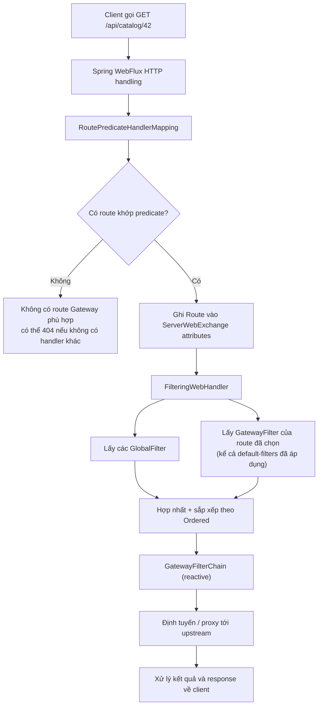
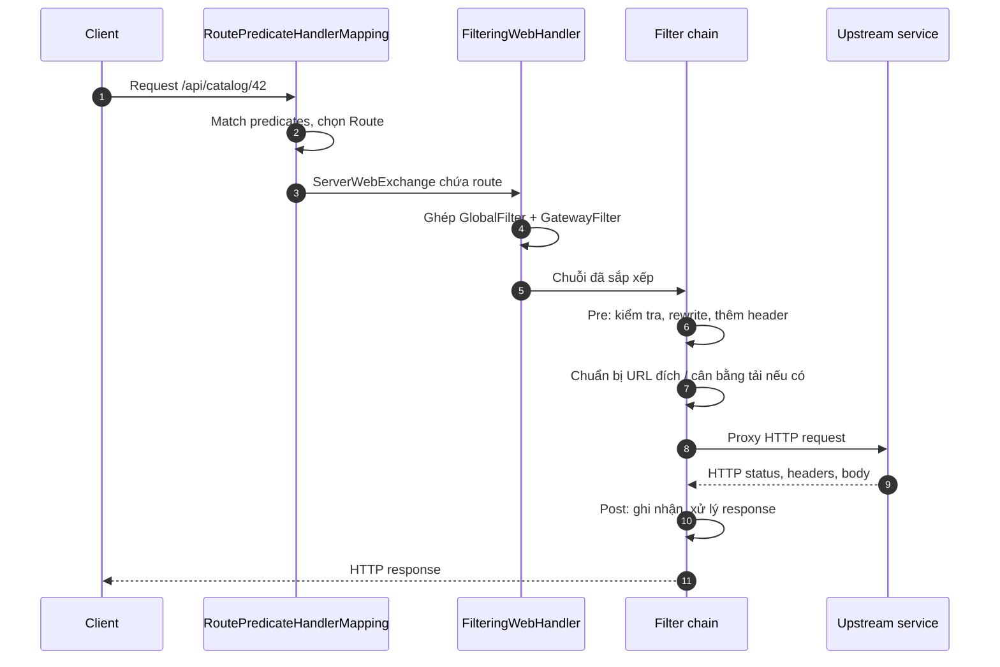

# Filtering Web Handler và chuỗi bộ lọc của tuyến đã chọn

## 1. Vì sao phải hiểu chuỗi filter của Gateway?

**SPRING_CLOUD_GATEWAY** cho phép một API Gateway tiếp nhận request, quyết định dịch vụ đích bằng route predicate, rồi áp dụng các bộ lọc để thay đổi path, header, xác thực, kiểm soát lưu lượng, retry, circuit breaker và quan sát HTTP. Ở biến thể **Spring Cloud Gateway Server WebFlux**, thành phần quan trọng nối việc **chọn route** với việc **thực thi filter** là lớp **`FilteringWebHandler`**.

Hiểu rõ lớp này giúp trả lời những câu hỏi dễ gây nhầm lẫn khi xây dựng microservices:

- Tại sao route `/api/catalog/**` đã khớp nhưng một filter của route `/api/orders/**` lại không chạy?
- Vì sao `GlobalFilter` vẫn được thực thi khi thay đổi từ route catalog sang route orders?
- Khi đặt một filter có `order=-10`, đoạn xử lý nào chạy trước và đoạn xử lý nào chạy sau request gửi tới backend?
- Một filter có thể chặn request trước khi proxy không? Khi nào downstream nhận được header mới?
- Thứ tự retry, circuit breaker, xác thực và ghi log tác động thế nào tới kết quả và khả năng quan sát?

Bài học tập trung vào kiến trúc runtime của **Gateway Server WebFlux**: từ `RoutePredicateHandlerMapping` đến `FilteringWebHandler`, danh sách `GatewayFilter`/ `GlobalFilter`, cơ chế sắp xếp `Ordered` và chuỗi reactive quanh thao tác proxy. Chi tiết triển khai filter bảo mật và chịu lỗi sẽ học ở các bài chuyên đề; tại đây chúng đóng vai trò ví dụ giải thích kiến trúc.

> **Phạm vi phiên bản:** những ví dụ `application.yml` dưới đây dùng prefix `spring.cloud.gateway.server.webflux` và starter `spring-cloud-starter-gateway-server-webflux`, phù hợp dòng Spring Cloud Gateway Server WebFlux 4.3.x/nhóm Spring Cloud 2025.0.x. Với release train khác, cần đối chiếu tài liệu đúng phiên bản, đặc biệt khi gặp ví dụ cũ dùng `spring.cloud.gateway.routes`.

## 2. Vị trí của FilteringWebHandler trong luồng xử lý HTTP

Một request tới Gateway trải qua nhiều lớp. Trong Spring WebFlux, HTTP request đi vào cơ chế xử lý WebFlux; Gateway tham gia chọn handler thông qua **`RoutePredicateHandlerMapping`**. Khi một route khớp, handler mapping đặt `Route` đã chọn vào thuộc tính của `ServerWebExchange`, rồi chuyển request tới **`FilteringWebHandler`**.



Một số khái niệm cần phân biệt:

| Thành phần | Trách nhiệm |
| --- | --- |
| `Route` | Đơn vị định tuyến có `id`, `uri`, predicate và danh sách filter riêng. |
| `RoutePredicateHandlerMapping` | Xem xét các route và predicate để tìm route phù hợp với request. |
| `FilteringWebHandler` | Dựa trên route đã chọn để xây dựng và thực thi **một chuỗi filter kết hợp**. |
| `GlobalFilter` | Filter ở mức Gateway có thể được áp dụng cho **mọi route đã match**, không gắn với một route cụ thể. |
| `GatewayFilter` | Filter gắn với route; có thể được tạo từ một `GatewayFilterFactory` như `StripPrefix`, `AddRequestHeader`, `Retry`. |
| `default-filters` | Cấu hình factory filter dùng chung cho các route; khi route được xây dựng, chúng tham gia danh sách filter của route. |
| `GatewayFilterChain` | API cho filter gọi bước kế tiếp trong pipeline reactive; cho phép logic bao quanh phần còn lại của chuỗi. |
| `ServerWebExchange` | Ngữ cảnh của **một request/response**, chứa đối tượng request, response và các thuộc tính dùng khi định tuyến. |

Chú ý rằng **route predicate được đánh giá trước chuỗi Gateway filter**. Các filter như `StripPrefix` không phải tiêu chí để quyết định route nào khớp; chúng biến đổi request **sau khi** route được chọn. Trừ khi có handler khác trong ứng dụng WebFlux xử lý đường dẫn, request không khớp route thường nhận `404 Not Found`.

### Vì sao phải có Handler Mapping và Web Handler riêng?

Nếu mọi request đều chạy tất cả filter của mọi route, các chính sách có thể mâu thuẫn: route public vô tình bị gắn filter của route private, route orders bị áp dụng rewrite path của catalog, hoặc hai backend nhận sai header. Bằng cách đưa việc chọn route **trước** `FilteringWebHandler`, Gateway chỉ đưa vào chuỗi các filter liên quan tới request hiện tại.

Mỗi request có `ServerWebExchange` riêng; việc chọn route và xây dựng chuỗi không có nghĩa gateway tạo một servlet thread cố định để lần lượt chạy filter đồng bộ. Gateway Server WebFlux trả về `Mono<Void>` và dùng cơ chế reactive để nối các tác vụ bất đồng bộ.

## 3. FilteringWebHandler thực hiện những bước nào?

Có thể hình dung cơ chế cốt lõi bằng **mã giả minh họa**, không phải bản chép mã nguồn thư viện:

```java
// Pseudocode: bỏ qua chi tiết wrapper, cache, tối ưu nội bộ và lỗi.
Mono<Void> handle(ServerWebExchange exchange) {
    Route selectedRoute =
        exchange.getRequiredAttribute(GATEWAY_ROUTE_ATTR);

    List<GatewayFilter> combined = new ArrayList<>();

    // GlobalFilter có giao diện tương tự GatewayFilter;
    // implementation nội bộ thích ứng chúng vào cùng chuỗi.
    combined.addAll(adaptGlobalFilters(globalFilters));

    // Filters của route được chọn, gồm các default-filters đã áp dụng.
    combined.addAll(selectedRoute.getFilters());

    combined.sort(AnnotationAwareOrderComparator.INSTANCE);

    return new DefaultGatewayFilterChain(combined).filter(exchange);
}
```

Các bước chính:

1. **Lấy route từ exchange.** Nếu không có route phù hợp, luồng xử lý không nên đi vào nhánh Gateway đã chọn route theo cách bình thường.
2. **Gom filter toàn cục.** Các bean `GlobalFilter` đăng ký trong ứng dụng tham gia vào chuỗi khi route khớp. GlobalFilter không có nghĩa chạy cho mọi HTTP request ngoài hệ thống route.
3. **Gom filter của chính route đó.** Đây là nơi filter `StripPrefix`, `AddRequestHeader`, `CircuitBreaker`, `Retry`... của route được dùng. Các route không được chọn không đưa filter của chúng vào chuỗi này.
4. **Sắp xếp toàn bộ danh sách.** Việc sắp xếp dùng metadata thứ tự (thông qua `Ordered` và các cơ chế adapter của framework). Không có quy tắc mặc định rằng *mọi* global filter chạy trước *mọi* route filter.
5. **Khởi chạy chuỗi reactive.** Mỗi filter quyết định có gọi `chain.filter(exchange)` hay dừng sớm và tạo phản hồi.

Thành phần này **không tự** quyết định URI backend hay tự thực hiện mọi thao tác HTTP. Các global filter định tuyến có chuyên môn riêng như `RouteToRequestUrlFilter`, `ReactiveLoadBalancerClientFilter`, `NettyRoutingFilter`, `NettyWriteResponseFilter` phối hợp thực hiện các bước đó.

## 4. Ba nhóm filter và phạm vi áp dụng

| Loại | Cách khai báo | Với route catalog | Với route orders | Khi request không match route |
| --- | --- | --- | --- | --- |
| `GlobalFilter` | Bean Java trong Gateway | Tham gia | Tham gia | Không được `FilteringWebHandler` chạy theo route |
| `GatewayFilter` riêng | `filters:` dưới `catalog-route` | Tham gia | Không | Không |
| `GatewayFilter` mặc định | `default-filters:` dùng chung | Tham gia | Tham gia | Không |
| Spring WebFlux `WebFilter` | Hạ tầng WebFlux, ngoài cơ chế Gateway filter | Có thể áp dụng | Có thể áp dụng | Có thể áp dụng theo chuỗi WebFlux |

Điểm cuối cùng đặc biệt quan trọng: **`GlobalFilter` của Spring Cloud Gateway khác `WebFilter` của Spring WebFlux**. Ví dụ, Spring Security ở WebFlux thường tham gia qua một chuỗi `WebFilter` riêng; không thể suy diễn phạm vi của một `GlobalFilter` bằng tên "global" và cũng không nên coi nó là cách thay thế mọi cơ chế bảo vệ endpoint trong ứng dụng.

`default-filters` cũng **khác `GlobalFilter`**: đó vẫn là các filter được tạo bằng GatewayFilter factory và áp dụng cho từng route. Sự khác biệt quan trọng khi kiểm tra thứ tự, lập trình filter tùy biến hoặc xem endpoint quản trị route.

### Ví dụ: hai route dùng chung một backend nhưng có filter khác nhau

Giả sử có một backend HTTP thử nghiệm ở `http://127.0.0.1:9001`. Cấu hình minh họa:

```yaml
server:
  port: 8080

spring:
  application:
    name: edge-gateway
  cloud:
    gateway:
      server:
        webflux:
          default-filters:
            - AddRequestHeader=X-Edge, webflux
          routes:
            - id: catalog-route
              uri: http://127.0.0.1:9001
              predicates:
                - Path=/api/catalog/**
              filters:
                - StripPrefix=2
                - AddRequestHeader=X-Selected-Route, catalog
                - AddResponseHeader=X-Route-Response, catalog

            - id: orders-route
              uri: http://127.0.0.1:9001
              predicates:
                - Path=/api/orders/**
              filters:
                - StripPrefix=2
                - AddRequestHeader=X-Selected-Route, orders
                - AddResponseHeader=X-Route-Response, orders
```

Cùng một backend chỉ để dễ quan sát cách chọn filter. Với `GET /api/catalog/42`, route catalog khớp, và backend nhận path `/42`, header `X-Edge: webflux` cùng `X-Selected-Route: catalog`. Response tới client có `X-Route-Response: catalog`. Route orders không tham gia request đó.

Với `GET /api/orders/42`, route orders khớp và backend nhận `X-Selected-Route: orders`, response có `X-Route-Response: orders`. **Cùng một global filter** nếu có trong ứng dụng sẽ chạy trên cả hai request đã match.

Ví dụ này chỉ minh họa phạm vi áp dụng và kết quả cuối; **không khẳng định thứ tự chạy chính xác của mọi built-in filter**. Danh sách sau khi hợp nhất được sắp xếp theo order, và điều đó quan trọng khi có các filter thay đổi cùng một header hoặc path.

## 5. `Ordered`: một danh sách kết hợp, hai chiều thực thi

Trong Spring, `Ordered` quy định mức ưu tiên của một filter: **số order càng nhỏ thì ưu tiên càng cao**. Với logic filter có đoạn trước và đoạn sau `chain.filter(exchange)`, bộ lọc ưu tiên cao bước vào pha **pre** trước và quay ra pha **post** sau cùng.

Ví dụ *giả định* ba filter đã được sắp xếp với các order riêng như sau:

| Filter | Order | Pre | Post |
| --- | ---: | --- | --- |
| A – Ghi dấu request | `-20` | Chạy đầu tiên | Chạy cuối cùng |
| B – Kiểm tra quy tắc | `-10` | Chạy thứ hai | Chạy thứ hai |
| C – Biến đổi dữ liệu | `10` | Chạy thứ ba | Chạy đầu tiên |

```text
Client
  |
  v
A.pre (-20)
  |
  v
B.pre (-10)
  |
  v
C.pre (10)
  |
  v
... các filter còn lại và thao tác proxy ...
  |
  v
C.post (10)
  |
  v
B.post (-10)
  |
  v
A.post (-20)
  |
  v
Client
```

Về mặt tư duy, đây là cấu trúc **lồng nhau**:

```text
A.pre
  B.pre
    C.pre
      proxy / phần còn lại của chain
    C.post
  B.post
A.post
```

Tuy nhiên, **không phải filter nào cũng có cả pre và post**. Có filter chỉ thay đổi request trước khi chuyển tiếp; có filter tập trung vào ghi response; có filter trả kết quả sớm không gọi bước tiếp. Thứ tự thực tế còn phụ thuộc order của các global filter nền tảng (routing, load-balancing, viết response) và các filter cấu hình bởi ứng dụng.

### Điều gì xảy ra khi hai filter cùng order?

Khi hai filter có mức order bằng nhau, đừng dựa vào một thứ tự ngầm trong toàn bộ hệ thống để giải quyết xung đột về auth/header/URL. Một số nhóm filter giữ thứ tự khai báo khi được sắp xếp ổn định, nhưng các loại filter có nguồn khác nhau (global, default, route) có thể được ghép theo cơ chế riêng của từng phiên bản. **Nếu phụ thuộc logic vào thứ tự, hãy đặt order tường minh cho filter tùy biến và kiểm tra chuỗi đã phân giải.**

Ví dụ, không nên dựa vào may rủi để một filter `RemoveRequestHeader=Authorization` chạy trước hay sau filter tự định nghĩa cần đọc `Authorization`. Cần đặt trách nhiệm rõ ràng và kiểm tra chính sách bảo mật ở nơi phù hợp.

## 6. Một filter reactive thực sự trông như thế nào?

Hai giao diện quan trọng có dạng tương tự:

```java
Mono<Void> filter(ServerWebExchange exchange, GatewayFilterChain chain);
```

Trong đó:

- `exchange` mang request/response và các thuộc tính gắn với request hiện tại.
- `chain.filter(exchange)` cho phép chuyển sang filter tiếp theo; giá trị trả về là **`Mono<Void>`** đại diện cho công việc sẽ hoàn tất hoặc thất bại.
- Gọi `chain.filter(...)` **không phải** một lời gọi đồng bộ chờ backend trả xong. Có thể dùng các toán tử Reactor để nối hành vi trước, sau, khi có lỗi hoặc khi hủy subscription.

Một ví dụ có thể đưa vào Gateway WebFlux để quan sát pre/post là `RouteTraceGlobalFilter`:

```java
package com.example.gateway;

import org.slf4j.Logger;
import org.slf4j.LoggerFactory;
import org.springframework.cloud.gateway.filter.GatewayFilterChain;
import org.springframework.cloud.gateway.filter.GlobalFilter;
import org.springframework.cloud.gateway.route.Route;
import org.springframework.cloud.gateway.support.ServerWebExchangeUtils;
import org.springframework.core.Ordered;
import org.springframework.stereotype.Component;
import org.springframework.web.server.ServerWebExchange;
import reactor.core.publisher.Mono;

@Component
public class RouteTraceGlobalFilter implements GlobalFilter, Ordered {

    private static final Logger log =
            LoggerFactory.getLogger(RouteTraceGlobalFilter.class);

    @Override
    public int getOrder() {
        return -20; // Chọn cho ví dụ; kiểm tra toàn bộ order thực tế.
    }

    @Override
    public Mono<Void> filter(
            ServerWebExchange exchange, GatewayFilterChain chain) {

        Route route = exchange.getAttribute(
                ServerWebExchangeUtils.GATEWAY_ROUTE_ATTR);
        String routeId = route != null ? route.getId() : "unknown";
        long startNanos = System.nanoTime();

        log.info("PRE route={} method={} path={}",
                routeId,
                exchange.getRequest().getMethod(),
                exchange.getRequest().getPath().value());

        return chain.filter(exchange)
                .doOnError(error ->
                        log.warn("ERROR route={} type={}",
                                routeId, error.getClass().getSimpleName()))
                .doFinally(signal ->
                        log.info("END route={} signal={} elapsedMs={}",
                                routeId,
                                signal,
                                (System.nanoTime() - startNanos) / 1_000_000));
    }
}
```

Điểm cần nhớ:

1. `@Component` đăng ký filter toàn cục với Spring; nó không cần xuất hiện trong `application.yml`.
2. `Ordered` đặt mức ưu tiên; `-20` chỉ là lựa chọn để học, không phải bảo đảm filter luôn đứng đầu mọi global filter nền tảng.
3. `doOnError` giúp quan sát lỗi phát sinh trong nhánh reactive, không tự động biến lỗi thành một HTTP response hợp lệ.
4. `doFinally` ghi log khi phần Mono kết thúc bằng complete/error/cancel; tên **END** chính xác hơn cách gọi "response đã gửi thành công", vì subscription có thể bị hủy hoặc kết thúc lỗi.
5. Dữ liệu `routeId` là thông tin từ route đã được chọn. Không lưu `ServerWebExchange` vào singleton field và không đưa header chứa token, cookie hay dữ liệu cá nhân vào log.

Trên một request catalog thành công, log minh họa:

```text
PRE route=catalog-route method=GET path=/api/catalog/42
END route=catalog-route signal=onComplete elapsedMs=18
```

Các số thời gian chỉ là minh họa; độ trễ thực tế tùy backend và môi trường.

### Khi muốn sửa request: mutate đối tượng request

Request trong WebFlux mang tính bất biến theo cách dùng thông thường. Filter nên tạo bản request thay đổi thông qua builder rồi chuyển `exchange` được mutate cho phần còn lại:

```java
ServerWebExchange changed = exchange.mutate()
        .request(builder -> builder.header("X-Edge-Trace", "enabled"))
        .build();

return chain.filter(changed);
```

Đó là cách thay đổi header trước khi routing filter gửi request đi. Với các thao tác đơn giản, ưu tiên built-in factory như `AddRequestHeader`/ `RemoveRequestHeader` để giảm mã tùy biến.

### Khi muốn sửa response header: quan tâm thời điểm commit

Không phải lúc nào cũng có thể gọi `exchange.getResponse().getHeaders().add(...)` **sau** `chain.filter(...)`; response có thể đã được commit hoặc body đã được phát ra. Với logic cần ghi header trước commit, đăng ký callback `beforeCommit` trước khi gọi chain:

```java
exchange.getResponse().beforeCommit(() -> {
    exchange.getResponse().getHeaders()
            .add("X-Edge-Processed", "true");
    return Mono.empty();
});

return chain.filter(exchange);
```

Ví dụ trên thuộc thân phương thức `filter(...)` của một filter tùy biến. Nó có ý nghĩa khi response được commit và callback chạy; không nên coi callback này là cơ chế luôn chạy khi request bị hủy trước khi gửi response. Với header đơn giản, dùng `AddResponseHeader` sẽ thuận tiện hơn.

## 7. Vai trò của các GlobalFilter định tuyến nằm trong cùng chain

Trong chuỗi filter của Gateway còn có các bộ lọc hạ tầng. Sơ đồ khái quát đối với route HTTP:



Các thành phần định tuyến tiêu biểu:

| Global filter hạ tầng | Chức năng chính | Thuộc tính/điều kiện liên quan |
| --- | --- | --- |
| `RouteToRequestUrlFilter` | Tạo URI để gửi tới đích dựa trên route đã match và request đã được biến đổi. | Đọc `GATEWAY_ROUTE_ATTR`, đặt `GATEWAY_REQUEST_URL_ATTR`. |
| `ReactiveLoadBalancerClientFilter` | Với URI `lb://service-id`, lấy một service instance phù hợp rồi thay URI bằng host/port thực. | Cần `lb` scheme, Spring Cloud LoadBalancer và nguồn instance. |
| `NettyRoutingFilter` | Khi URI đích là `http` hoặc `https`, dùng Netty `HttpClient` gửi request xuống upstream. | Đọc `GATEWAY_REQUEST_URL_ATTR`; kết quả HTTP client được giữ qua `CLIENT_RESPONSE_ATTR`. |
| `NettyWriteResponseFilter` | Ghi phản hồi do HTTP client nhận được về response phía client. | Dùng phản hồi Netty đã lưu trong exchange; diễn ra ở giai đoạn kết thúc phù hợp. |
| `ForwardRoutingFilter` | Chuyển đến handler nội bộ WebFlux khi route URI có scheme `forward:`. | Dành cho route forward, không phải proxy HTTP ra ngoài. |

Danh sách này mô tả **vai trò**, không phải thứ tự `getOrder()` đầy đủ. Nhiều global filter hạ tầng cùng xuất hiện trong danh sách kết hợp và chỉ thực hiện hành động khi điều kiện của chúng đúng.

Ví dụ:

- `uri: http://inventory:8081`: dùng URL HTTP đã chuẩn bị rồi proxy bằng HTTP client.
- `uri: lb://inventory`: phải giải quyết `inventory` thành một `ServiceInstance` hợp lệ trước khi proxy; nếu không tìm thấy instance, Gateway thường trả `503` theo cấu hình mặc định.
- `uri: forward:///fallback`: dùng cơ chế forward nội bộ tới endpoint WebFlux thích hợp, không tạo cùng một kiểu request HTTP đến một service ngoài ứng dụng.

Sau khi một yêu cầu đã được định tuyến, exchange được đánh dấu trạng thái "đã route" để các routing filter khác không chuyển tiếp lần thứ hai. Đây là một phần quan trọng nhằm tránh nhiều đường proxy cùng xử lý một request.

### Các thuộc tính exchange giúp các filter phối hợp

```text
GATEWAY_ROUTE_ATTR
    -> Route đã match

GATEWAY_REQUEST_URL_ATTR
    -> URI dùng cho routing (có thể thay đổi sau load balancing)

GATEWAY_ORIGINAL_REQUEST_URL_ATTR
    -> Lưu thông tin URI gốc khi có bước thay đổi URL

CLIENT_RESPONSE_ATTR
    -> Phản hồi nhận từ HTTP client Netty, nếu dùng Netty routing
```

Đây là các khóa thuộc `ServerWebExchangeUtils`, không phải HTTP headers tự động trả về client. Khi viết custom filter, hãy phân biệt **`exchange.getAttributes()`** (dữ liệu nội bộ giữa filter) và **`exchange.getRequest().getHeaders()`** (HTTP headers) để tránh làm lộ thông tin định tuyến hoặc nhầm lẫn dữ liệu.

## 8. Short-circuit: khi filter không gọi phần còn lại của chain

Một filter có quyền **không gọi `chain.filter(exchange)`**. Khi đó các filter nằm phía sau trong chuỗi không được thực thi, downstream có thể không nhận request, và response sẽ được hoàn tất bởi filter dừng sớm hoặc tầng xử lý lỗi thích hợp.

Ví dụ dễ hiểu trong kiến trúc:

- Request thiếu điều kiện truy cập: một thành phần bảo vệ có thể trả `401` hoặc `403` mà không proxy tới upstream. Trong ứng dụng thực tế, nên cấu hình Spring Security WebFlux/OAuth2 và chính sách ủy quyền phù hợp, không triển khai xác thực bằng một ví dụ đơn giản bỏ qua kiểm chứng token.
- Yêu cầu bị giới hạn lưu lượng: filter rate limiter có thể trả `429 Too Many Requests`.
- Circuit breaker đang mở: phần xử lý có thể trả fallback hoặc lỗi đã định nghĩa, không gọi backend theo nhánh thông thường.
- Retry có thể tái đăng ký các thao tác phía sau; do đó một số bước của pipeline downstream có thể được thực hiện lại theo cấu hình và vị trí filter.

**Đặc biệt:** nếu filter dừng sớm, phần `post` của những filter đã bước vào **trước đó** có thể vẫn được kích hoạt theo cách chúng nối chuỗi; các filter **chưa bước vào** sẽ không tự chạy. Không thể giả định "mọi filter luôn chạy một lần, theo danh sách, từ đầu đến cuối".

Khi kết hợp auth, retry và circuit breaker, hãy xác định rõ phạm vi retry, trạng thái idempotent của HTTP method và vị trí của filter đo metrics để tránh đếm thiếu hoặc đếm trùng attempt.

## 9. Thực hành: nhìn thấy route đã chọn qua filter và request backend

Có thể thêm `RouteTraceGlobalFilter` ở mục 6 vào ứng dụng Gateway Server WebFlux đã có starter và cấu hình hai route ở mục 4. Để test không cần dịch vụ ngoài, chạy một backend Java rất nhỏ ở `127.0.0.1:9001`.

Tạo `EchoBackend.java`:

```java
import com.sun.net.httpserver.HttpServer;
import java.net.InetSocketAddress;
import java.nio.charset.StandardCharsets;

public class EchoBackend {
    public static void main(String[] args) throws Exception {
        HttpServer server = HttpServer.create(
                new InetSocketAddress("127.0.0.1", 9001), 0);

        server.createContext("/", exchange -> {
            String path = exchange.getRequestURI().getPath();
            String selected = exchange.getRequestHeaders()
                    .getFirst("X-Selected-Route");
            String edge = exchange.getRequestHeaders()
                    .getFirst("X-Edge");

            String body = "path=" + path
                    + "\nselected=" + selected
                    + "\nedge=" + edge + "\n";
            byte[] data = body.getBytes(StandardCharsets.UTF_8);

            exchange.getResponseHeaders().set(
                    "Content-Type", "text/plain; charset=UTF-8");
            exchange.sendResponseHeaders(200, data.length);
            try (var output = exchange.getResponseBody()) {
                output.write(data);
            }
        });

        server.start();
        System.out.println("Echo backend ready on :9001");
    }
}
```

Mở terminal thứ nhất:

```bash
java EchoBackend.java
```

Chạy Gateway bằng `./mvnw spring-boot:run` hoặc `mvn spring-boot:run` ở terminal thứ hai; dùng cặp Spring Boot/Spring Cloud BOM tương thích với starter WebFlux và cấu hình YAML đang học.

Tại terminal thứ ba, thử:

```bash
curl -i http://localhost:8080/api/catalog/42
curl -i http://localhost:8080/api/orders/17
curl -i http://localhost:8080/no-such-route
```

Kỳ vọng đối với catalog:

```http
HTTP/1.1 200 OK
X-Route-Response: catalog
Content-Type: text/plain; charset=UTF-8

path=/42
selected=catalog
edge=webflux
```

Đối với orders, các giá trị tương ứng là `X-Route-Response: orders`, `path=/17` và `selected=orders`, còn `edge=webflux` vẫn có mặt do `default-filters`.

Trong log Gateway, `RouteTraceGlobalFilter` ghi route ID tương ứng với **cả hai** request đã match. Request `/no-such-route` thường có `404` và **không xuất hiện log từ `RouteTraceGlobalFilter`**, vì không qua `FilteringWebHandler` của một route đã chọn. Một `WebFilter` của Spring WebFlux, nếu ứng dụng có đăng ký, có thể có phạm vi khác.

**Thử lỗi:** dừng backend `9001` rồi gọi lại `/api/catalog/42`. Route vẫn match và GlobalFilter vẫn có thể ghi PRE, nhưng lỗi kết nối phát sinh trong bước routing. Log `END` có thể ghi tín hiệu `onError`, hoặc `onComplete` nếu một tầng xử lý lỗi phía dưới đã biến đổi lỗi thành phản hồi hợp lệ; không suy trạng thái HTTP chỉ từ một dòng log này.

### Kiểm tra thứ tự khi filter phát triển phức tạp

Trên môi trường phát triển có kiểm soát, có thể sử dụng Spring Boot Actuator và các endpoint quản trị Gateway (nếu bản đang dùng hỗ trợ, đã bật và được bảo vệ) để kiểm tra danh sách route, global filter và order. Việc bật endpoint quản trị phụ thuộc **version của Spring Boot/Gateway**; không sao chép nguyên cấu hình actuator từ tài liệu bản khác. Không công khai endpoint điều khiển route ra Internet.

Nếu không dùng Actuator, tạo test cho request đi qua Gateway, quan sát log riêng của từng custom filter và xem kết quả backend nhận được. Kiểm chứng **thứ tự hành vi**, thay vì chỉ nhìn thứ tự dòng cấu hình YAML.

## 10. Những lỗi tư duy phổ biến

| Nhận định sai | Cách hiểu đúng |
| --- | --- |
| "Tất cả `GlobalFilter` đều chạy trước mọi `GatewayFilter`." | Chúng được hợp nhất rồi sắp xếp theo order, nên có thể xen kẽ. |
| "Khai báo filter đầu danh sách YAML nghĩa là chạy đầu tất cả filter." | Global filter nền tảng và filter có order tường minh vẫn ảnh hưởng thứ tự. |
| "GlobalFilter nghĩa là mọi HTTP request vào port Gateway đều phải chạy." | GlobalFilter nằm trong chuỗi Gateway của một route đã chọn; request không match có thể được xử lý bởi handler khác. |
| "`default-filters` là bean GlobalFilter." | Chúng là những filter tạo từ GatewayFilter factories và gắn vào các route. |
| "Post-phase luôn sửa được response header." | Sau khi response commit, việc sửa header có thể không còn hiệu lực; dùng factory phù hợp hoặc `beforeCommit`. |
| "Mỗi filter chỉ gọi một lần." | Retry/resubscription, short-circuit và hủy subscription làm phạm vi thực thi khác đi. |
| "Chuyển URI thành `lb://` là Gateway tự có service discovery." | Cần LoadBalancer và nguồn service instance; URI là tín hiệu cho nhánh resolve. |
| "Custom filter có thể gọi API blocking vô tư." | WebFlux/Netty dùng event loop; blocking không được kiểm soát có thể làm chậm nhiều request. |

## 11. Liên hệ với bảo mật, tính sẵn sàng và quan sát

Trong kiến trúc production, chuỗi filter là nơi giao nhau của nhiều mối quan tâm:

**Xác thực và phân quyền.** Quyết định bảo mật phải được áp dụng trước khi chuyển tiếp tới upstream. Nếu dùng Spring Security WebFlux, hãy hiểu chuỗi `WebFilter` của Security và cách nó tương tác với các route Gateway; tránh dựa vào một route filter thiếu cơ chế bảo mật chuẩn để bảo vệ toàn bộ API.

**Rate limiting.** Filter có thể từ chối request sớm hoặc dùng bộ đếm theo khóa client. Cần kiểm thử trường hợp không có khóa, backend timeout và nhiều instance Gateway để tránh giới hạn không đồng nhất.

**Retry và circuit breaker.** Các filter bao quanh routing; vị trí trong chuỗi quyết định thao tác nào được lặp lại, metric nào được ghi theo từng attempt và liệu lỗi được chuyển thành fallback ở đâu. Với HTTP `POST`/ `PATCH`, không cấu hình retry bừa bãi khi thao tác upstream có side effect.

**TLS và header.** TLS giữa client–Gateway có thể tách biệt TLS giữa Gateway–upstream; cơ chế routing chọn `http`/`https` dựa trên URI đích, cấu hình HttpClient và LoadBalancer. Khi biến đổi `Host`, `Forwarded` hoặc `X-Forwarded-*`, phải xác định ranh giới proxy tin cậy, tránh tin các header do client không đáng tin cậy tự cung cấp.

**Quan sát.** Nên ghi route ID, method, status, latency, trace ID với mức chi tiết hợp lý; ưu tiên metrics/tracing tích hợp thay vì log body hay token. Log ở pre và post giúp nhìn thấy đường đi, nhưng cần phân biệt response đã commit, lỗi được xử lý và subscription bị hủy.

Sự kết hợp này lý giải vì sao **FilteringWebHandler và filter ordering** là kiến thức nền trước khi triển khai những tính năng Gateway nâng cao.

## 12. Câu hỏi tự kiểm tra

1. Khi request `/api/catalog/42` khớp catalog route, `GatewayFilter` của orders route có tham gia chuỗi không? **Không.** Chỉ filter của route đã chọn, các default-filters áp dụng và global filters liên quan được kết hợp.
2. `GlobalFilter` khác `WebFilter` ở điểm nào? **Phạm vi xử lý.** GlobalFilter là phần của pipeline Spring Cloud Gateway cho các route đã match; WebFilter thuộc pipeline chung của Spring WebFlux.
3. Với ba filter có order `-20`, `-10`, `10`, logic pre và post diễn ra thế nào nếu cả ba đều tiếp tục chain? **Pre:** `-20` → `-10` → `10`; **post:** `10` → `-10` → `-20`.
4. Nếu filter không gọi `chain.filter(exchange)`, backend có luôn được gọi không? **Không.** Phần còn lại của chuỗi không tiếp tục qua nhánh đó.
5. Vì sao thêm response header trong `doFinally` không đáng tin? **Response có thể đã commit.** Cần đăng ký xử lý trước commit hoặc dùng GatewayFilterFactory phù hợp.
6. Bộ lọc nào có thể giải quyết `lb://inventory` thành host và port thực? **`ReactiveLoadBalancerClientFilter`**, khi đã có LoadBalancer và service instance phù hợp.
7. Đâu là nơi nhận biết route đã chọn ở runtime? **`GATEWAY_ROUTE_ATTR` trong `ServerWebExchange`**.
8. Nếu cùng route có `Retry` và custom logging filter, chỉ có thể dựa vào thứ tự YAML để chắc chắn log một lần? **Không.** Cần xem order thực tế và phạm vi retry/resubscription.

## Tổng kết

`FilteringWebHandler` là điểm thực thi chuỗi filter của **route đã được chọn** trong Spring Cloud Gateway Server WebFlux. Nó lấy các `GlobalFilter`, ghép với `GatewayFilter` thuộc route (bao gồm filter mặc định nếu được cấu hình), sắp xếp theo thứ tự ưu tiên rồi đưa request qua `GatewayFilterChain`. Một filter có thể làm việc ở pha pre, bao quanh phần còn lại bằng `Mono<Void>`, xử lý ở pha post hoặc dừng sớm request. Các filter hạ tầng tiếp tục đảm nhận chuyển URI, LoadBalancer, proxy Netty và ghi response.

Khi hiểu rõ điểm ghép filter, phạm vi của từng loại và quy luật **pre thuận chiều ưu tiên – post ngược chiều**, bạn sẽ thiết kế route, header/path transforms, security, retry, circuit breaker và observability một cách chủ động hơn.

### Tài liệu tham khảo

- [Spring Cloud Gateway Server WebFlux — How It Works (4.3)](https://docs.spring.io/spring-cloud-gateway/reference/4.3/spring-cloud-gateway-server-webflux/how-it-works.html)
- [Spring Cloud Gateway Server WebFlux — Global Filters (4.3)](https://docs.spring.io/spring-cloud-gateway/reference/4.3/spring-cloud-gateway-server-webflux/global-filters.html)
- [Spring Cloud Gateway Server WebFlux — GatewayFilter Factories (4.3)](https://docs.spring.io/spring-cloud-gateway/reference/4.3/spring-cloud-gateway-server-webflux/gatewayfilter-factories.html)
- [Spring Cloud Gateway Server WebFlux — Configuration Properties](https://docs.spring.io/spring-cloud-gateway/reference/configprops.html)
- [Spring WebFlux — WebHandler API](https://docs.spring.io/spring-framework/reference/web/webflux/dispatcher-handler.html)
