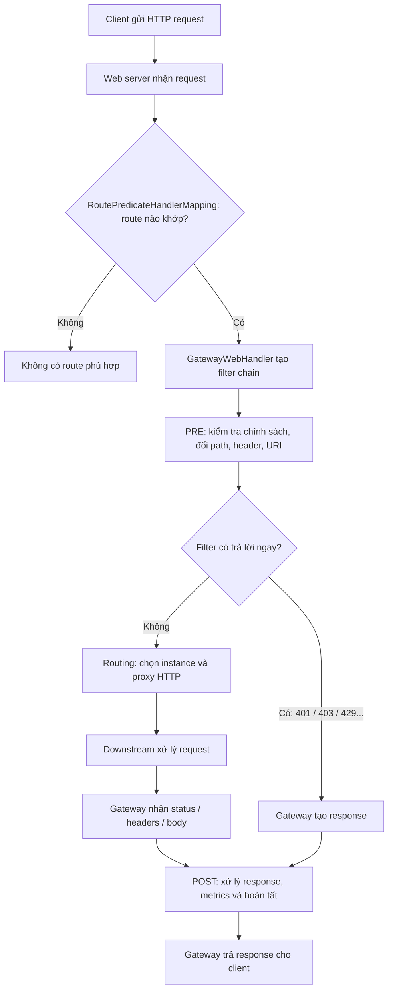

# Các giai đoạn trước và sau khi gọi dịch vụ phía sau trong Spring Cloud Gateway

## 1. Vị trí của hai pha trong kiến trúc xử lý request

Khi xây dựng **API Gateway với Spring Cloud Gateway**, một HTTP request không đi thẳng từ client tới microservice. Gateway phải xác định **route** phù hợp, chạy các **predicate và filter**, chuẩn bị địa chỉ dịch vụ phía sau (**downstream**), chuyển tiếp request, xử lý response rồi trả về client. Tùy cấu hình, các bước này có thể bao gồm xác thực, giới hạn lưu lượng, biến đổi đường dẫn/header, service discovery, load balancing, circuit breaker, retry, TLS và ghi nhận metrics/traces.

Trong kiến trúc **Spring Cloud Gateway Server WebFlux**, filter thường tham gia vào hai pha có quan hệ với nhau:

- **Pha trước khi gọi downstream (*pre-phase*)**: kiểm tra hoặc thay đổi request trước khi nó được gửi tới backend; có thể chặn request ngay tại Gateway.
- **Pha sau khi gọi downstream (*post-phase*)**: xử lý kết quả, header/status, tài nguyên, đo thời gian và các công việc hoàn tất sau khi lời gọi downstream được thực hiện hoặc kết thúc.

Điểm quan trọng là **pre/post mô tả thời điểm thực thi logic**, không nhất thiết là hai danh sách filter độc lập. Một `GlobalFilter` hoặc `GatewayFilter` có thể vừa thực hiện công việc trước `chain.filter(exchange)`, vừa đăng ký xử lý sau khi chuỗi bên trong hoàn tất.

> **Phạm vi ví dụ:** bài này minh họa pipeline của **Gateway Server WebFlux** (reactive, thường dùng Reactor Netty). Gateway Server Web MVC cũng có các bước khớp route, xử lý trước/sau và proxy, nhưng dùng Servlet stack cùng API và bộ filter tương ứng. Không nên sao chép trực tiếp `GlobalFilter` WebFlux sang ứng dụng Gateway Server Web MVC.

## 2. Toàn cảnh vòng đời một request



Sơ đồ trên là **mô hình logic**, không phải lời cam kết rằng mỗi filter đều chạy trong mọi nhánh. Khi một filter trả response sớm và không gọi `chain.filter(...)`, các filter **nằm sau nó** không được gọi. Các phần hậu xử lý đã được đăng ký trong các filter **bao ngoài nó** có thể vẫn chạy. Khi request không khớp route, chuỗi `GlobalFilter`/`GatewayFilter` của route chưa được tạo.

### 2.1. Đối chiếu từng giai đoạn

| Giai đoạn | Thành phần nổi bật trong Server WebFlux | Việc chính | Dữ liệu tác động |
|---|---|---|---|
| 1. Tiếp nhận | Spring WebFlux, web server | Tạo `ServerWebExchange` từ HTTP request | Method, URI, headers, body, thông tin kết nối |
| 2. Tìm route | `RoutePredicateHandlerMapping` | Kiểm tra route predicates (`Path`, `Host`, `Method`...) và chọn route | Route ID, URI đích, filters đã cấu hình |
| 3. Tạo chain | `FilteringWebHandler` / `GatewayWebHandler` | Ghép các `GlobalFilter` với `GatewayFilter` của route, sắp xếp theo order | Một chain cho route đã khớp |
| 4. Pre-phase | Các filter trong chain | Thực thi chính sách, thay request/path/header, có thể short-circuit | Request đang được gửi đi, trạng thái trao đổi |
| 5. Routing | `RouteToRequestUrlFilter`, load-balancer filter, `NettyRoutingFilter`... | Xác định URI đích, chọn instance nếu dùng `lb://`, proxy tới backend | URI đích, request downstream |
| 6. Nhận kết quả | HTTP client của Gateway | Nhận status, headers và body/stream từ downstream | Downstream response |
| 7. Post-phase và ghi phản hồi | Filter hậu xử lý, `NettyWriteResponseFilter` | Thao tác hợp lệ trên response, ghi/stream về client, hoàn tất đo lường | Response HTTP gửi client |

**Ghi chú:** theo tài liệu, `Gateway Handler Mapping` chọn route trước khi đưa request tới `Gateway Web Handler`; phần pre thực thi trước lời gọi proxy, còn post được thực hiện khi luồng xử lý quay trở lại từ bên trong chain. `ServerWebExchange` giữ cả request/response và các **attributes nội bộ** của lần xử lý hiện tại.

## 3. Trước khi gọi downstream: pre-phase làm gì?

### 3.1. Chọn route bằng predicate trước khi chạy route filters

Giả sử có route:

```yaml
predicates:
  - Path=/api/orders/**
  - Method=GET
```

`GET /api/orders/42` có thể khớp route; `POST /api/orders/42` không khớp route này. Trong cùng một route, các predicate thông thường phải cùng thỏa mãn. Việc chọn route là bước **trước** chain filters của route; một filter không nên được xem là nơi quyết định route có khớp hay không.

Khi route đã được chọn, Gateway thu thập hai nhóm filter:

- **`GlobalFilter`**: bean áp dụng cho các request đã khớp route trong Gateway Server WebFlux, ví dụ filter phục vụ routing, logging hoặc tính năng dùng chung.
- **`GatewayFilter`**: filter của route cụ thể, thường được khai báo trong danh sách `filters` của YAML hoặc bằng Java DSL, ví dụ `StripPrefix`, `AddRequestHeader`, `RequestRateLimiter`, `Retry`.

Các filter được ghép thành **một chain và sắp xếp theo order**; không nên suy rằng mọi `GlobalFilter` luôn chạy xong rồi mới tới toàn bộ filter của route.

### 3.2. Những việc thường đặt ở pre-phase

| Nhu cầu | Ví dụ | Ý nghĩa trước khi proxy |
|---|---|---|
| Xác thực/phân quyền | Spring Security `SecurityWebFilterChain`, chính sách JWT | Chặn người dùng không hợp lệ trước khi tiêu tốn tài nguyên backend; Spring Security WebFilter thường nằm ở tầng WebFlux trước handler route, không nhất thiết là một `GatewayFilter` |
| Giới hạn lưu lượng | `RequestRateLimiter` và `KeyResolver` | Từ chối request vượt quota, thường trả `429 Too Many Requests` khi cấu hình phù hợp |
| Xử lý path | `StripPrefix=1`, `RewritePath` | Biến `/api/orders/42` thành đường dẫn backend mong muốn |
| Biến đổi header | `AddRequestHeader`, `RemoveRequestHeader`, `SetRequestHeader` | Bổ sung hoặc điều chỉnh metadata trước khi gửi request |
| Chọn đích | Route URI và load-balancer filter | Giải quyết `lb://orders-service` thành địa chỉ instance được chọn |
| Bảo vệ backend | Circuit breaker/timeout, giới hạn kích thước, chính sách từ chối | Giảm tải backend khi có dấu hiệu lỗi hoặc yêu cầu không hợp lệ |
| Ghi dấu quan sát | Gắn correlation ID, lưu thời điểm bắt đầu | Liên kết log/traces và tính latency sau khi hoàn tất |

Ví dụ với `StripPrefix=1`: request ban đầu `GET /api/orders/42` được gửi xuống backend thành `GET /orders/42`. Với `AddRequestHeader=X-From-Gateway, true`, backend nhận thêm `X-From-Gateway: true`.

**Không đồng nhất “pre” với “một lần duy nhất”.** `Retry` có thể kích hoạt thêm các lần thử xuống backend khi điều kiện retry được thỏa mãn; `CircuitBreaker` có thể từ chối gọi backend và trả fallback. Số lần xuống backend và phần nào của chain được chạy lại phụ thuộc vị trí và cách cấu hình filter.

### 3.3. Short-circuit: trả lời ngay mà không gọi backend

Một bước trong pre-phase có thể kết thúc xử lý, ví dụ:

- Token không hợp lệ → lớp bảo mật có thể trả `401 Unauthorized`.
- Đã xác thực nhưng thiếu quyền → có thể trả `403 Forbidden`.
- Vượt quota → `RequestRateLimiter` có thể trả `429 Too Many Requests`.
- Circuit breaker đang mở → có thể trả fallback hoặc lỗi, tùy cách cấu hình.

Khi đó Gateway **không cần** gửi request đến backend. Không phải mọi nhánh short-circuit đều có response chuẩn giống nhau: status, body và headers phụ thuộc thành phần gây ra việc từ chối. Hệ thống quan sát nên phân biệt **request được xử lý tại Gateway** với **request thật sự đã gọi downstream**.

## 4. Lời gọi xuống backend nằm giữa pre-phase và post-phase

### 4.1. Từ route URI đến kết nối downstream

Với Gateway Server WebFlux, một số filter hạ tầng phối hợp như sau:

1. `RouteToRequestUrlFilter` dựng **URI đích** từ route đã chọn và request hiện tại, ghi vào exchange attribute `GATEWAY_REQUEST_URL_ATTR`.
2. Nếu URI sử dụng scheme `lb://`, `ReactiveLoadBalancerClientFilter` chọn instance từ cơ chế load balancing và tạo URI có scheme/host/port thực tế. Cần có nguồn service instances từ discovery hoặc cấu hình tương đương; `lb://` tự nó không đảm bảo tìm được backend.
3. Với URI đích `http` hoặc `https`, `NettyRoutingFilter` sử dụng Reactor Netty `HttpClient` để gửi downstream request.
4. Response từ backend được lưu dưới dạng client response trong exchange attribute `CLIENT_RESPONSE_ATTR` để các thành phần tiếp theo xử lý; `NettyWriteResponseFilter` tham gia ghi response xuống client.

Các attribute như `GATEWAY_REQUEST_URL_ATTR` và `CLIENT_RESPONSE_ATTR` là **trạng thái nội bộ của `ServerWebExchange`**, không phải HTTP header gửi ra mạng. Các cơ chế routing khác, chẳng hạn `forward:` hay `ws:`/`wss:`, đi qua filter tương ứng và có đường xử lý khác HTTP proxy thông thường.

```mermaid
sequenceDiagram
    participant C as Client
    participant G as Gateway / pre-filters
    participant LB as LoadBalancer (nếu có)
    participant B as orders-service
    C->>G: GET /api/orders/42
    Note over G: Route match; kiểm tra và StripPrefix
    opt URI là lb://orders-service
        G->>LB: Tìm instance backend
        LB-->>G: http://10.0.0.12:8081
    end
    G->>B: GET /orders/42 + X-From-Gateway
    B-->>G: 200 + JSON + headers
    Note over G: Hậu xử lý response, metrics, logging
    G-->>C: 200 + JSON + response headers
```

### 4.2. Gateway không nhất thiết chờ có đủ response body

Ở WebFlux, giao tiếp HTTP sử dụng reactive streams và hỗ trợ **streaming/backpressure**. Đối với body lớn, Gateway có thể chuyển dữ liệu theo dòng, thay vì chờ tải toàn bộ response vào bộ nhớ rồi mới trả client. Vì vậy:

- “Post-phase” không có nghĩa là **toàn bộ body đã được giữ sẵn trong RAM**.
- Filter muốn đọc hoặc sửa body phải dùng cơ chế hỗ trợ phù hợp, chú ý bộ nhớ, streaming và các trường hợp retry.
- Cấu hình timeout, retry và circuit breaker cần phù hợp đặc điểm request; phát lại request có body không idempotent có thể gây tác dụng phụ.

## 5. Sau khi gọi downstream: post-phase xử lý gì?

Khi luồng xử lý downstream kết thúc hoặc trả về publisher đại diện cho response, chain tiến tới phần hậu xử lý của các filter đã tham gia. Công việc điển hình:

| Công việc | Ví dụ | Lưu ý |
|---|---|---|
| Bổ sung/loại bỏ response header | `AddResponseHeader`, `DedupeResponseHeader`, `RemoveResponseHeader` | Phải tác động đúng thời điểm trước khi headers được commit |
| Quan sát kết quả | Ghi status, latency, route ID, outcome | Có thể bao gồm lỗi hoặc hủy request; không ghi thông tin nhạy cảm |
| Đo lường Gateway | Micrometer/Actuator Gateway metrics | Cần bật/cài công cụ quan sát tương ứng |
| Chuyển tiếp status và body | `NettyWriteResponseFilter` | Response được ghi về client; không xem mỗi filter post là một lần gửi HTTP riêng |
| Xử lý lỗi/fallback | Circuit breaker, retry, exception handler | Một số lỗi xảy ra khi chưa có HTTP response từ backend |

**Thời điểm commit rất quan trọng.** Khi response đã được commit, không thể tùy ý sửa status hoặc header như lúc chưa gửi. `ServerHttpResponse.beforeCommit(...)` giúp đăng ký callback sửa header ngay trước lúc commit; với body, cần API biến đổi response chuyên dụng nếu muốn can thiệp. Đặt `response.getHeaders().add(...)` trong callback quá muộn của `doFinally(...)` có thể không còn hiệu lực.

Ngoài ra, khi dùng `Retry`, **post của một số filter** có thể thực hiện quanh từng lần thử hoặc quanh toàn bộ chuỗi retry tùy thứ tự filter; tuyệt đối không dùng số lần gọi một phương thức log để suy ra số downstream requests nếu chưa xét ordering.

## 6. Thứ tự chạy filter: trước đi xuôi, sau đi ngược

Spring Cloud Gateway Server WebFlux sắp xếp chain kết hợp `GlobalFilter` và `GatewayFilter` bằng order (`Ordered`, hoặc cơ chế order do filter factory cung cấp). **Giá trị order nhỏ hơn** thường tương ứng **độ ưu tiên cao hơn**: filter đó chạy **sớm hơn ở pre-phase**, nhưng **muộn hơn ở post-phase** khi có phần xử lý sau `chain.filter(...)`.

Giả sử ba filter có các order sau và đều bao bọc lời gọi `chain.filter(...)`:

| Filter | Order | Pre | Post |
|---|---:|---|---|
| A – kiểm tra request | `-10` | Chạy đầu tiên | Chạy cuối cùng |
| B – ghi log | `0` | Chạy thứ hai | Chạy thứ hai |
| C – xử lý gần routing | `10` | Chạy thứ ba | Chạy đầu tiên |

```text
Request
   |
   v
A.pre  ->  B.pre  ->  C.pre  ->  [Routing / backend]
   ^           ^          ^              |
   |           |          |              |
A.post <-  B.post <-  C.post <-----------+
   |
Response / completion
```

Đây là mô hình **lồng nhau** của reactive chain, thường thể hiện bằng:

```java
// Minh họa ý tưởng của một WebFlux GlobalFilter
log.info("PRE: before downstream chain");

return chain.filter(exchange)
    .then(Mono.fromRunnable(() -> log.info("POST: chain completed")));
```

Đoạn trên là **minh họa bên trong phương thức `filter`**, không phải class Java hoàn chỉnh. `POST` trong ví dụ `.then(...)` chỉ chạy khi publisher hoàn tất thành công; nếu muốn quan sát cả lỗi hoặc hủy request, dùng callback hỗ trợ loại tín hiệu tương ứng, chẳng hạn `doFinally(...)`.

**Cảnh báo về thứ tự:** hai filter có cùng order không nên được thiết kế phụ thuộc chặt chẽ vào một thứ tự thực thi ngầm định. Cần đặt order rõ ràng khi logic đòi hỏi thứ tự. `NettyRoutingFilter` và `NettyWriteResponseFilter` có các order hạ tầng riêng, vì vậy sơ đồ A/B/C chỉ giúp hiểu nguyên lý chứ không đại diện đầy đủ cho toàn bộ các filter có sẵn.

## 7. Ví dụ hoàn chỉnh: route, pre-filter và post-filter

Giả sử client gửi:

```http
GET /api/orders/42 HTTP/1.1
Host: gateway.example.test
Authorization: Bearer <access-token>
```

Gateway chuyển request sang backend `orders-service` chạy tại `http://localhost:8081`, nơi có endpoint `GET /orders/42`. Với **Gateway Server WebFlux 4.3+**, cấu hình trong `application.yml` có thể là:

```yaml
server:
  port: 8080

spring:
  application:
    name: edge-gateway
  cloud:
    gateway:
      server:
        webflux:
          default-filters:
            - AddResponseHeader=X-Served-By, spring-cloud-gateway
          routes:
            - id: orders-route
              uri: http://localhost:8081
              predicates:
                - Path=/api/orders/**
                - Method=GET
              filters:
                - StripPrefix=1
                - AddRequestHeader=X-From-Gateway, true
```

**Dòng xử lý của ví dụ:**

1. `RoutePredicateHandlerMapping` tìm `orders-route` vì method là `GET` và path khớp `/api/orders/**`.
2. Chain của route chạy phần pre. `StripPrefix=1` bỏ `/api`; `AddRequestHeader` gắn `X-From-Gateway: true`. Các filter chung cũng tham gia chain theo order tương ứng.
3. Gateway proxy tới `http://localhost:8081/orders/42`, giữ ngữ nghĩa method `GET`.
4. Backend trả response, ví dụ `200 OK` và JSON của đơn hàng. Gateway áp dụng hậu xử lý response và ghi response cho client, kèm header `X-Served-By: spring-cloud-gateway`.

**Cần có backend mẫu** ở cổng 8081 để kiểm thử end-to-end. Nếu chưa có backend, lỗi kết nối không chứng tỏ `Path` hoặc `StripPrefix` sai. Có thể chạy:

```bash
curl -i http://localhost:8080/api/orders/42
```

Nếu dùng **Gateway 4.2 trở về trước (WebFlux)**, prefix khai báo route thường là `spring.cloud.gateway.routes`; từ **4.3** dùng namespace mới `spring.cloud.gateway.server.webflux.routes`. Nếu dùng **Gateway Server Web MVC**, phải dùng prefix và filter API tương ứng MVC. Prefix cấu hình là một phần của khả năng vận hành, vì đặt route đúng nội dung nhưng sai namespace có thể khiến Gateway không đăng ký route.

**Lưu ý về xác thực:** dòng `Authorization: Bearer ...` trong yêu cầu ví dụ **không tự kích hoạt kiểm tra JWT**. Muốn bảo vệ Gateway, cần cấu hình Spring Security/resource server (và chính sách phân quyền). Cần quyết định có chuyển tiếp token gốc xuống backend hay dùng cơ chế truyền identity khác; không mặc định tin các header tự khai từ client.

## 8. Tự viết GlobalFilter để quan sát trước và sau chain

Ví dụ class dưới đây dành cho **Gateway Server WebFlux**, dùng `GlobalFilter` và `Ordered` để log khi request bắt đầu đi vào filter chain và khi chuỗi kết thúc. Nó không đọc body hay ghi token.

```java
package com.example.gateway.filter;

import java.util.concurrent.TimeUnit;

import org.slf4j.Logger;
import org.slf4j.LoggerFactory;
import org.springframework.cloud.gateway.filter.GatewayFilterChain;
import org.springframework.cloud.gateway.filter.GlobalFilter;
import org.springframework.core.Ordered;
import org.springframework.stereotype.Component;
import org.springframework.web.server.ServerWebExchange;
import reactor.core.publisher.Mono;

@Component
public class RequestPhaseLoggingFilter implements GlobalFilter, Ordered {

    private static final Logger log =
            LoggerFactory.getLogger(RequestPhaseLoggingFilter.class);

    @Override
    public Mono<Void> filter(ServerWebExchange exchange, GatewayFilterChain chain) {
        String requestId = exchange.getRequest().getId();
        long startedAt = System.nanoTime();

        log.info("PRE id={} method={} path={}",
                requestId,
                exchange.getRequest().getMethod(),
                exchange.getRequest().getPath().value());

        return chain.filter(exchange)
                .doFinally(signalType -> {
                    long durationMs = TimeUnit.NANOSECONDS.toMillis(
                            System.nanoTime() - startedAt);
                    log.info("POST id={} status={} durationMs={} signal={}",
                            requestId,
                            exchange.getResponse().getStatusCode(),
                            durationMs,
                            signalType);
                });
    }

    @Override
    public int getOrder() {
        return -100;
    }
}
```

**Cách đọc ví dụ:**

- `PRE` ghi nhận thời điểm filter của chúng ta được gọi, trước khi trao quyền cho chain bên trong.
- `chain.filter(exchange)` trả về `Mono<Void>` đại diện cho quá trình xử lý bất đồng bộ. Việc thực thi phản ứng diễn ra khi publisher được đăng ký thực thi; không dùng `block()` trong filter.
- `doFinally(...)` nhận cả tín hiệu hoàn tất, lỗi và hủy; trường `status` có thể là `null` nếu lỗi xảy ra trước khi response có mã trạng thái. Thông tin `signalType` giúp chẩn đoán khác biệt.
- `getOrder() = -100` thể hiện filter ưu tiên cao trong ví dụ. Đừng suy ra rằng số âm này đảm bảo chạy trước **mọi** security/WebFilter/hạ tầng khác: Spring Security WebFilter có thể ở tầng ngoài Gateway route chain.

Ở hệ thống thực, nên sử dụng tracing/metrics có chuẩn sẵn (Micrometer Observation, Actuator, công cụ distributed tracing) thay vì phụ thuộc hoàn toàn vào log tùy chỉnh. Không log `Authorization`, cookie, mật khẩu hoặc response body nhạy cảm; cân nhắc hạn chế nhãn (tag) có cardinality quá cao.

### 8.1. Nếu thật sự cần thêm header ngay trước khi commit

Không nên ghi header HTTP trong `doFinally()`: lúc đó response có thể đã commit. Hãy đăng ký `beforeCommit()` **trước** khi gọi chain:

```java
exchange.getResponse().beforeCommit(() -> {
    exchange.getResponse().getHeaders()
            .set("X-Gateway-Trace", exchange.getRequest().getId());
    return Mono.empty();
});
return chain.filter(exchange);
```

Đoạn mã là phần thân của một filter, mục đích minh họa thời điểm sửa header. Header chỉ được thêm nếu response đi qua quá trình commit bình thường; đối với lỗi được xử lý ngoài chain hoặc kết nối bị hủy, kết quả có thể khác. `beforeCommit()` không phải công cụ sửa response body tùy ý.

## 9. Những nhánh lỗi ảnh hưởng đến pha pre/post

| Tình huống | Có chọn route? | Có thực sự gọi backend? | Điều cần quan sát |
|---|---|---|---|
| Không khớp `Path`/`Method` | Không | Không | `404` hoặc xử lý bởi handler khác nếu ứng dụng có thêm handler |
| JWT sai, thiếu quyền | Có thể bị chặn ngay ở lớp Security trước route | Không nếu bị chặn | `401`/`403`, xác định nguồn tạo response |
| Quá giới hạn rate limiter | Thường có route | Không nếu filter từ chối | `429`, key/quota và Redis hoặc bộ giới hạn đang dùng |
| URI `lb://` không tìm thấy instance | Có | Không tạo được kết nối backend mong muốn | Discovery/LoadBalancer, thường gặp `503` tùy cấu hình |
| Backend không kết nối được | Có | Gateway đã thử kết nối | DNS/port/TLS/connect-timeout; lỗi được chuyển thành status tùy xử lý |
| Backend trả `500` | Có | Có | Filter có retry/circuit breaker hay trả nguyên response? |
| Client ngắt kết nối | Có thể | Có hoặc chưa | Tín hiệu `CANCEL`, backpressure, tài nguyên và log |

**Phân biệt ba dạng thời gian:**

1. **Thời gian từ client đến Gateway và match route**, gồm bước xử lý ngoài route chain.
2. **Thời gian trong chuỗi Gateway**, gồm pre, routing, chờ downstream, post và gửi response (tùy nơi đo và thời điểm response kết thúc).
3. **Thời gian backend xử lý**, chỉ là một phần của tổng latency Gateway; nó không gồm mọi bước trước/sau backend.

Nếu dùng timeout và retry, một request từ client có thể tạo **nhiều** attempts xuống backend. Với các thao tác tạo đơn hàng/thanh toán, retry thiếu idempotency key có thể tạo giao dịch trùng; phải xác định chính sách theo method, status và khả năng lặp lại body. Circuit breaker cũng có thể short-circuit trước backend hoặc trả fallback, làm thay đổi đường đi so với thành công thông thường.

## 10. Vận hành: quan sát từng pha sao cho đúng

Để phân biệt vấn đề ở pre, routing hay post, có thể thu thập các tín hiệu sau:

| Tín hiệu | Mục đích | Gợi ý |
|---|---|---|
| Route ID đã match | Biết request vào đúng route chưa | Log route ID, xem Actuator Gateway routes với quyền truy cập phù hợp |
| Original path và downstream path | Kiểm tra biến đổi `StripPrefix`/`RewritePath` | Chỉ log path đã làm sạch dữ liệu nhạy cảm |
| Status do ai tạo | Phân biệt Gateway reject và lỗi backend | Đối chiếu security/rate limit logs, trace đến downstream |
| Số lần thử downstream | Nhận ra retry, tránh tính nhầm throughput | Theo dõi per-attempt và per-client-request nếu hệ quan sát hỗ trợ |
| Latency, error, cancellation | Tìm chậm ở routing, backend hay streaming | Dùng metrics và tracing, phân biệt `onComplete`/`onError`/`cancel` |
| Kết quả TLS hai đầu | Xác định lỗi HTTPS client→Gateway hoặc Gateway→service | TLS incoming cấu hình khác TLS HTTP client đi backend |

Có thể bổ sung `spring-boot-starter-actuator` và hệ metrics/tracing tương ứng. Actuator Gateway endpoint giúp kiểm tra routes và filter đang đăng ký, nhưng chỉ nên expose trong mạng/với quyền thích hợp. Tên một endpoint, metric hay tag có thể phụ thuộc phiên bản; luôn đối chiếu tài liệu của đúng release train.

Với **service discovery**, cần phân biệt URI route `lb://orders-service` và địa chỉ instance thực tế đã chọn. Khi backend trả về chậm, đừng vội kết luận pre-filter chậm: dùng trace spans hoặc số liệu tại backend để đối chiếu thời gian proxy, kết nối, xử lý và gửi body.

## 11. Bài tập tư duy và đáp án

**Tình huống 1.** Gateway có `Path=/api/orders/**`, `StripPrefix=1` và backend `http://localhost:8081`. Client gọi `GET /api/orders/42`. Trong hai pha, đường dẫn thay đổi lúc nào và backend nhìn thấy path nào?

**Đáp án:** Gateway chọn route khi predicate khớp; `StripPrefix=1` là xử lý request trong pre-phase trước khi proxy. Backend nhận path `/orders/42`. Phản hồi từ backend tiếp tục đi qua chuỗi hậu xử lý trước khi Gateway gửi về client.

**Tình huống 2.** Có ba filter A/B/C mang order `-10`, `0`, `10`. Mỗi filter đều ghi log trước `chain.filter(...)` và sau khi chuỗi bên trong hoàn tất. Thứ tự log tương ứng là gì?

**Đáp án:** `A.pre → B.pre → C.pre → [routing] → C.post → B.post → A.post`, giả định request không bị short-circuit và các chain hoàn tất bình thường.

**Tình huống 3.** `RequestRateLimiter` từ chối request vì vượt quota. Backend có nhận request không? `GlobalFilter` đo latency có chắc chắn ghi `POST` không?

**Đáp án:** backend không nhận request nếu rate limiter trả response ngay. `GlobalFilter` đặt **bao ngoài** rate limiter và dùng callback hoàn tất phù hợp có thể ghi log hậu xử lý; filter **nằm sau** rate limiter sẽ không được gọi. Nếu request bị chặn ở Spring Security trước khi route được chọn, `GlobalFilter` của Gateway thậm chí không chạy.

**Tình huống 4.** Developer thêm header response trong `doFinally()` nhưng client không nhìn thấy. Vì sao?

**Đáp án:** `doFinally()` có thể chạy khi response đã commit, khi đó header không còn thay đổi được. Nếu cần bổ sung header theo kết quả của Gateway, sử dụng response filter phù hợp hoặc đăng ký `beforeCommit()` trước khi gọi chain; kiểm tra thứ tự so với thành phần ghi response.

**Tình huống 5.** Client gọi một lần nhưng backend nhận ba request giống nhau. Có phải `RoutePredicateHandlerMapping` đã match ba lần?

**Đáp án:** không nhất thiết. Một filter `Retry` có thể phát sinh nhiều attempts cho cùng một client request. Cần xem cấu hình retry, trạng thái upstream và idempotency của nghiệp vụ; đếm lần match route không tương đương đếm số request xuống backend.

## 12. Tài liệu tham khảo chính thức

- [Spring Cloud Gateway Server WebFlux – How It Works](https://docs.spring.io/spring-cloud-gateway/reference/5.1/spring-cloud-gateway-server-webflux/how-it-works.html): sơ đồ Gateway Handler Mapping → Gateway Web Handler → pre/proxy/post.
- [Spring Cloud Gateway Server WebFlux – Global Filters](https://docs.spring.io/spring-cloud-gateway/reference/spring-cloud-gateway-server-webflux/global-filters.html): cách ghép GlobalFilter và GatewayFilter, `Ordered`, routing và ghi response.
- [Spring Cloud Gateway Server WebFlux – Developer Guide](https://docs.spring.io/spring-cloud-gateway/reference/5.0/spring-cloud-gateway-server-webflux/developer-guide.html): viết filter tùy chỉnh.
- [Spring Cloud Gateway – Configuration Properties](https://docs.spring.io/spring-cloud-gateway/reference/5.1/configprops.html): namespace và thuộc tính cấu hình WebFlux cho Gateway 5.1.
- [Spring Framework – WebFlux reference](https://docs.spring.io/spring-framework/reference/web/webflux.html): mô hình reactive xử lý HTTP và response lifecycle.

**Ghi nhớ:** Gateway **match route trước**, thực thi **pre** khi đi vào filter chain, **proxy** request tới backend, rồi thực thi **post** khi luồng xử lý quay ra. Hiểu đúng **thứ tự filter**, **short-circuit** và **response commit** là nền tảng để cấu hình bảo mật, rate limit, retry, circuit breaker và quan sát request một cách an toàn.
