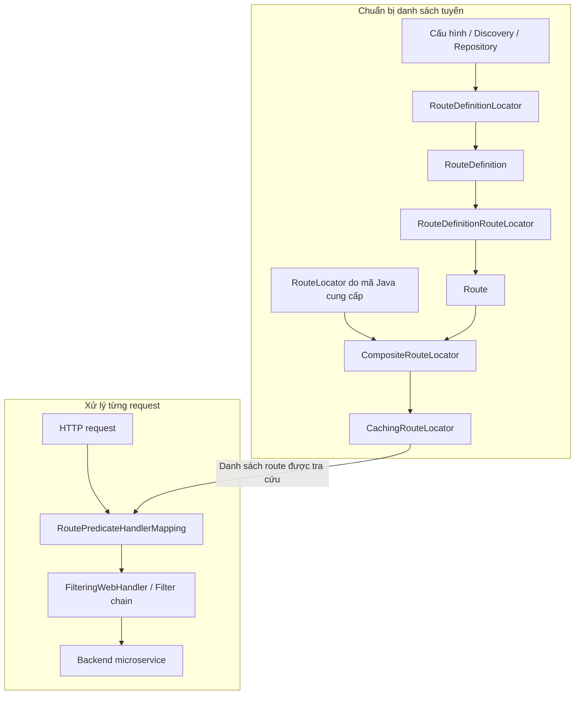
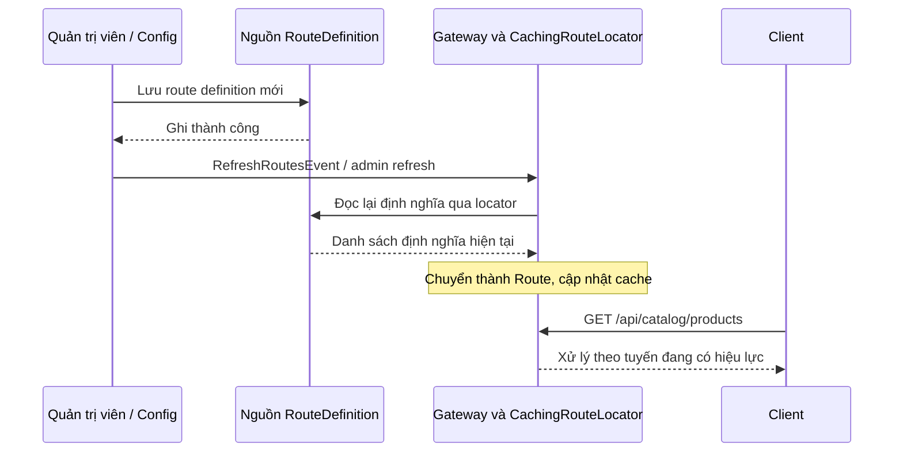
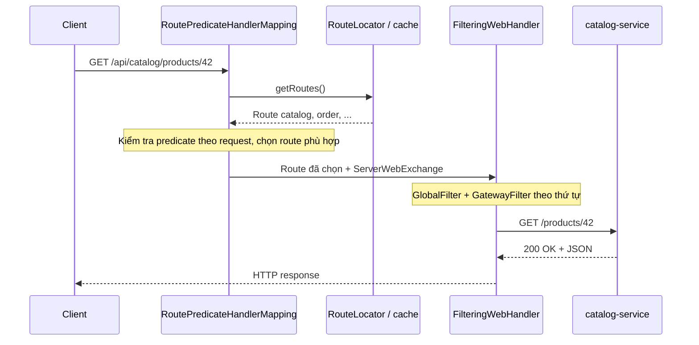
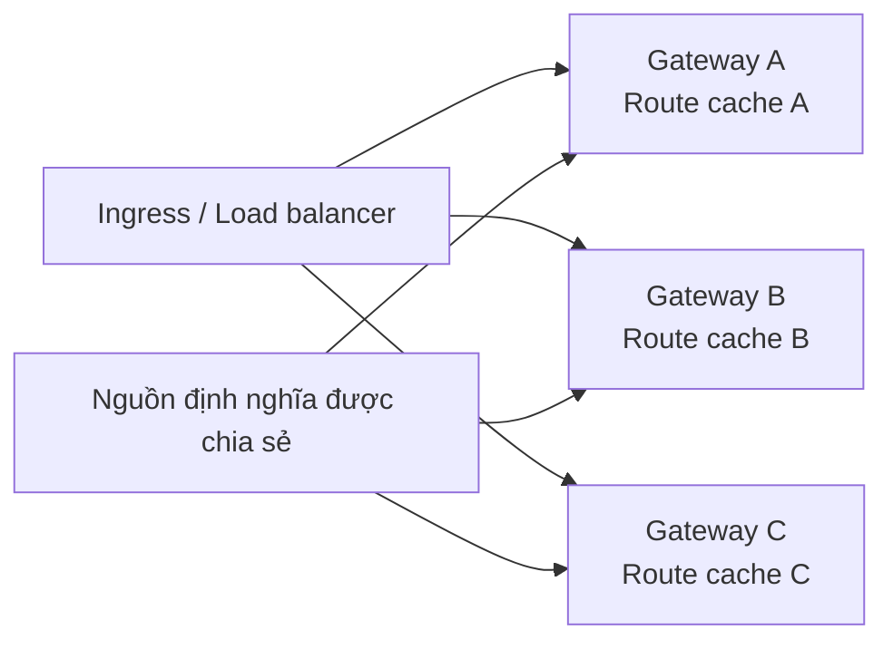

# RouteDefinitionLocator, RouteLocator và bộ nhớ đệm tuyến

Trong **Spring Cloud Gateway**, một request như `GET /api/catalog/products/42` chỉ được chuyển đến `catalog-service` khi gateway đã biết **các tuyến hiện có**, xác định tuyến nào khớp và xử lý các filter gắn với tuyến đó. Phần lớn ví dụ nhập môn chỉ trình bày cấu hình `Path` và `StripPrefix`, nhưng khi vận hành nhiều microservice, câu hỏi quan trọng hơn là:

- Gateway **đọc các định nghĩa tuyến từ đâu**: file cấu hình, service discovery, kho lưu trữ hay mã Java?
- **Ai chuyển định nghĩa cấu hình thành đối tượng tuyến** có predicate và filter thực thi được?
- Tại sao đã sửa một định nghĩa nhưng request vẫn có thể chạy theo tuyến cũ?
- **Bộ nhớ đệm tuyến** hoạt động ở bước nào, và cần làm gì khi muốn thay đổi route đang chạy?
- Làm sao phân biệt lỗi **không tìm thấy route**, lỗi **không tìm thấy instance backend** và lỗi do filter/bảo mật?

Bài thuộc chương **Kiến trúc xử lý**, tập trung vào ba khái niệm cốt lõi của biến thể **Spring Cloud Gateway Server WebFlux**: `RouteDefinitionLocator`, `RouteLocator` và `CachingRouteLocator`. Hiểu ba thành phần này giúp bạn phát triển API Gateway với route predicate, filter chain, biến đổi path/header, service discovery, đồng thời kiểm soát tốt những thay đổi ảnh hưởng đến xác thực, rate limiting, circuit breaker, retry, TLS và quan sát request.

> **Phạm vi phiên bản:** Tên lớp và chuỗi xử lý trình bày trong bài là mô hình của **Gateway Server WebFlux**, phổ biến trong các dòng Spring Cloud Gateway 4.x. Gateway Server Web MVC có cách tổ chức định tuyến dựa trên ngăn xếp MVC và những API tương ứng; không tự động áp dụng nguyên các lớp nội bộ WebFlux cho MVC. Starter, property prefix, chi tiết actuator và hành vi refresh phải được kiểm tra theo phiên bản Spring Boot/Spring Cloud/Gateway thực tế.

## 1. Hai thời điểm khác nhau: chuẩn bị tuyến và xử lý request

Cần phân biệt hai quá trình:

**Quá trình chuẩn bị danh sách tuyến:** gateway nạp các nguồn khai báo, chuyển định nghĩa dạng cấu hình thành đối tượng có thể thực thi, hợp nhất danh sách tuyến và lưu lại danh sách được sử dụng khi ghép route.

**Quá trình xử lý từng request:** gateway duyệt các route hiện có, kiểm tra predicate của request, chọn route phù hợp rồi đưa request qua filter chain và chuyển tiếp đến upstream.



Sơ đồ biểu diễn **luồng logic** của kiến trúc WebFlux; tên và thứ tự những bean cụ thể có thể thay đổi theo phiên bản và cách ứng dụng cấu hình thêm `RouteLocator`. Điểm quan trọng là `RouteDefinitionLocator` phục vụ **định nghĩa tuyến**, còn `RouteLocator` cung cấp **các tuyến runtime** cho quá trình chọn đường.

Ví dụ nghiệp vụ:

| Thời điểm | Hành động | Thành phần quan trọng |
| --- | --- | --- |
| Khi ứng dụng khởi động hoặc cần nạp lại tuyến | Đọc định nghĩa `catalog-route`: path `/api/catalog/**`, URI `lb://catalog-service`, filter `StripPrefix=2`. | `RouteDefinitionLocator` |
| Khi tạo đối tượng tuyến | Biên dịch/khởi tạo predicate và filter từ định nghĩa, gắn ID, URI, thứ tự. | `RouteDefinitionRouteLocator` |
| Khi giữ danh sách tuyến để dùng lại | Tránh tạo lại toàn bộ danh sách route cho mỗi request. | `CachingRouteLocator` |
| Khi client gọi API | Kiểm tra request với các predicate; chọn tuyến phù hợp. | `RoutePredicateHandlerMapping` + `RouteLocator` |
| Sau khi chọn tuyến | Chạy filter, tìm instance cho `lb://` và chuyển tiếp HTTP. | `FilteringWebHandler` và các filter liên quan |

## 2. RouteDefinition: bản mô tả một tuyến

`RouteDefinition` là mô hình dữ liệu mô tả **tuyến được khai báo** trước khi đưa vào xử lý request. Các thông tin điển hình:

| Trường | Ý nghĩa | Ví dụ |
| --- | --- | --- |
| `id` | Định danh tuyến, phục vụ quản lý và quan sát. | `catalog-route` |
| `uri` | Đích chuyển tiếp; có thể là URL trực tiếp hoặc URI logic. | `lb://catalog-service` |
| `predicates` | Các điều kiện để request khớp. | `Path=/api/catalog/**`, `Method=GET` |
| `filters` | Những filter áp dụng trên tuyến. | `StripPrefix=2` |
| `order` | Độ ưu tiên tương đối khi nhiều route cùng có thể khớp. | `-10` |
| `metadata` | Thông tin bổ sung cho cấu hình/quan sát theo khả năng được hỗ trợ. | Nhãn, thông số dành riêng cho route |

Ví dụ dạng khái niệm, không phụ thuộc vào tiền tố property của một phiên bản cụ thể:

```yaml
id: catalog-route
uri: lb://catalog-service
predicates:
  - Path=/api/catalog/**
  - Method=GET
filters:
  - StripPrefix=2
order: 0
```

Ý nghĩa là **GET** vào `/api/catalog/**` sẽ được chuyển tiếp đến `catalog-service`, sau khi xóa hai phân đoạn đầu của path. Với `GET /api/catalog/products/42`, backend nhận `GET /products/42`. Query string vẫn cần được xử lý và kiểm tra đúng hợp đồng API.

`RouteDefinition` là **mô tả**, không phải một hàm xử lý request. Một đối tượng chứa chuỗi `Path=/api/catalog/**` chưa tự biết cách kiểm tra `ServerWebExchange`; hệ thống phải chuyển nó thành predicate runtime thích hợp.

### RouteDefinition khác Route ở đâu?

| `RouteDefinition` | `Route` |
| --- | --- |
| Tập trung vào cấu hình, có thể đến từ file, discovery hoặc repository. | Tập trung vào đối tượng runtime dùng để ghép tuyến với request. |
| Lưu cấu trúc định nghĩa predicate/filter. | Chứa predicate có thể thực thi và danh sách gateway filter đã được xây dựng. |
| Được cung cấp qua `RouteDefinitionLocator`. | Được cung cấp qua `RouteLocator`. |
| Phù hợp cho lưu, sửa, quản lý một định nghĩa tuyến. | Phù hợp cho `RoutePredicateHandlerMapping` tìm route thực thi. |

Nhiều bug xuất phát từ việc coi hai đối tượng là một: **thay đổi dữ liệu định nghĩa không có nghĩa danh sách route runtime đã thay đổi ngay**.

## 3. RouteDefinitionLocator: cổng đọc định nghĩa tuyến

`RouteDefinitionLocator` là interface cung cấp các `RouteDefinition` qua luồng reactive. Về ý tưởng, hợp đồng của nó tương đương:

```java
public interface RouteDefinitionLocator {
    Flux<RouteDefinition> getRouteDefinitions();
}
```

Khi cần thu thập các định nghĩa tuyến, gateway gọi `getRouteDefinitions()` trên nguồn thích hợp. Mỗi phần tử trả về mô tả một route; interface này **không trực tiếp chọn route cho HTTP request**.

### Những nguồn định nghĩa thường gặp

| Nguồn | Thành phần/kiểu tích hợp thường gặp | Trường hợp sử dụng |
| --- | --- | --- |
| Cấu hình ứng dụng | `PropertiesRouteDefinitionLocator` | Route tương đối tĩnh, khai báo từ properties/YAML được ánh xạ vào cấu hình Gateway. |
| Service discovery | `DiscoveryClientRouteDefinitionLocator` khi bật tính năng tương ứng | Tạo định nghĩa tuyến từ thông tin dịch vụ đăng ký trong discovery. |
| Repository tuyến động | Một implementation của `RouteDefinitionRepository`, nếu được cấu hình | Ứng dụng quản lý thêm/sửa/xóa định nghĩa qua một nguồn có thể ghi. |
| Nhiều nguồn cùng lúc | `CompositeRouteDefinitionLocator` | Hợp nhất định nghĩa từ nhiều locator. |
| Tự xây dựng | Bean tự triển khai `RouteDefinitionLocator` | Đọc route từ hệ thống quản trị hoặc policy nội bộ. |

Tên triển khai, cơ chế hỗ trợ và cách enable có thể khác nhau giữa các release; hãy đối chiếu tài liệu đúng bản khi triển khai.

### Ví dụ: định nghĩa tuyến đến từ discovery

Giả sử registry biết ba instance của `catalog-service`. Một locator dựa trên discovery có thể cung cấp route definition ứng với tên dịch vụ logic. Tuy nhiên, cần phân biệt:

- **DiscoveryClientRouteDefinitionLocator** có thể sinh ra **định nghĩa tuyến** dựa trên danh sách tên dịch vụ và quy tắc tạo route.
- **Spring Cloud LoadBalancer** (hoặc cơ chế chọn instance phù hợp) giải quyết `lb://catalog-service` thành **một instance backend** khi chuyển tiếp.

Đây là **hai bước khác nhau**. Registry cập nhật danh sách instance không nhất thiết đồng nghĩa định nghĩa tuyến phải thay đổi; nhưng khi có **dịch vụ mới** xuất hiện và route được sinh dựa trên registry, gateway có thể cần refresh danh sách route theo cơ chế của phiên bản/triển khai.

Ví dụ, nếu URI route đã tồn tại là `lb://catalog-service`, việc tăng từ 2 lên 3 instance thường là bài toán **cập nhật danh sách instance của load balancer**, không phải tạo lại `RouteDefinition` có ID khác cho từng instance.

### Các lưu ý về nhiều nguồn

Khi có nhiều locator, hãy kiểm soát:

1. **ID trùng nhau:** cấu hình tĩnh và nguồn động cùng định nghĩa `catalog-route` có thể gây khó hiểu khi quan sát, cập nhật hoặc ghi đè tuyến. Đặt ID duy nhất và có quy ước đặt tên.
2. **Tuyến chồng lấn:** hai route cùng khớp `/api/catalog/**` có thể dẫn đến kết quả phụ thuộc `order`. Không coi thứ tự đăng ký ngẫu nhiên là hợp đồng ổn định.
3. **Nguồn thay đổi bất đồng bộ:** discovery, config server, repository và cache có thể cập nhật ở những thời điểm khác nhau; cần biết tuyến nào đang được sử dụng thực tế.
4. **Kiểm soát quyền sửa:** nếu cho phép cập nhật route qua API quản trị, thao tác này có thể chuyển request sang upstream khác. Nó cần xác thực, phân quyền, kiểm tra URI và audit chặt chẽ.

## 4. RouteDefinitionRouteLocator: chuyển định nghĩa thành route runtime

Khi `RouteDefinitionLocator` cung cấp các mô tả, `RouteDefinitionRouteLocator` đảm nhiệm vai trò **chuyển `RouteDefinition` thành `Route`**.

Với ví dụ `catalog-route`, quá trình xử lý về mặt khái niệm gồm:

1. Nhận thông tin ID, URI, order và metadata.
2. Tìm **RoutePredicateFactory** tương ứng với từng predicate đã khai báo, như `Path` và `Method`.
3. Chuyển cấu hình predicate thành điều kiện thực thi trên request; kết hợp nhiều điều kiện của cùng route theo quy tắc tương ứng.
4. Tìm **GatewayFilterFactory** tương ứng với từng filter, như `StripPrefix` hoặc `RewritePath`, rồi tạo gateway filter cụ thể.
5. Tạo đối tượng `Route` có các thành phần cần thiết cho việc ghép tuyến và chuyển tiếp.

Ví dụ:

```text
RouteDefinition:
  id: catalog-route
  predicates: ["Path=/api/catalog/**", "Method=GET"]
  filters: ["StripPrefix=2"]
  uri: lb://catalog-service

                |
                v

Route:
  id: catalog-route
  predicate: (ServerWebExchange) -> điều kiện khớp
  filters: [GatewayFilter đã được tạo]
  uri: lb://catalog-service
```

Không nên coi đoạn trên là `toString()` hoặc format API chính thức; đây là mô tả để thấy sự khác biệt giữa **cấu hình** và **cấu trúc thực thi**.

Nếu khai báo predicate/filter có tên không tồn tại hoặc tham số sai, gateway có thể gặp lỗi lúc chuyển đổi/nạp route. Chẳng hạn `StripPrefix=abc` không phải số phân đoạn hợp lệ. Cần xem log cấu hình tuyến và kết quả refresh, thay vì chỉ chờ request đầu tiên để phát hiện lỗi.

### Filter chain chưa chạy ở giai đoạn chuyển đổi

Tạo đối tượng filter và **thực thi filter** là hai việc khác nhau. `RouteDefinitionRouteLocator` tạo danh sách filter runtime, nhưng chỉ khi request đã khớp route thì chuỗi xử lý của `FilteringWebHandler` mới chạy. Các `GlobalFilter` và `GatewayFilter` được kết hợp và sắp xếp theo thứ tự áp dụng tương ứng.

Nhờ sự phân tách đó, hệ thống không cần phân tích lại chuỗi filter từ YAML trên mỗi request; tuy nhiên, sửa cấu hình filter cũng yêu cầu tuyến runtime được nạp lại theo cơ chế refresh thích hợp.

## 5. RouteLocator: nguồn tuyến runtime

`RouteLocator` là interface trả về các `Route` mà gateway có thể dùng để tìm đường cho request. Ở mức khái niệm:

```java
public interface RouteLocator {
    Flux<Route> getRoutes();
}
```

`RouteDefinitionRouteLocator` **là một cách tạo ra `RouteLocator`** từ các định nghĩa tuyến. Ngoài nó, ứng dụng có thể cung cấp thêm `RouteLocator` **trực tiếp bằng Java DSL** hoặc bean tùy biến.

### Ví dụ tạo RouteLocator bằng Java DSL

Mẫu sau minh họa một bean `RouteLocator` cho Gateway Server WebFlux:

```java
import org.springframework.cloud.gateway.route.RouteLocator;
import org.springframework.cloud.gateway.route.builder.RouteLocatorBuilder;
import org.springframework.context.annotation.Bean;
import org.springframework.context.annotation.Configuration;

@Configuration
public class GatewayRoutes {

    @Bean
    RouteLocator catalogRoutes(RouteLocatorBuilder builder) {
        return builder.routes()
            .route("catalog-route", route -> route
                .path("/api/catalog/**")
                .filters(filters -> filters
                    .stripPrefix(2)
                    .setRequestHeader("X-Gateway-Origin", "api-edge"))
                .uri("lb://catalog-service"))
            .build();
    }
}
```

Khi chạy, `GET /api/catalog/products/42` được route đến URI logic `lb://catalog-service` sau khi đổi path thành `/products/42`. Cần có backend thật, cấu hình Spring Cloud LoadBalancer và nguồn thông tin instance tương thích để URI `lb://` hoạt động.

**Điểm kiến trúc cần nhớ:** route tạo bằng Java DSL là một `RouteLocator` trực tiếp; không nhất thiết phải đi qua một `RouteDefinition` từ `RouteDefinitionLocator`. Do đó, **đổi dữ liệu của một repository RouteDefinition** sẽ không tự sửa bean `RouteLocator` do mã Java tạo.

Nếu nhiều bean `RouteLocator` cùng được đăng ký, thành phần hợp nhất như `CompositeRouteLocator` có thể lấy route của các nguồn ấy để gateway cùng sử dụng. Trước khi thêm bean tùy chỉnh, cần kiểm tra ID và thứ tự route tránh xung đột với các tuyến từ cấu hình.

## 6. CachingRouteLocator: bộ nhớ đệm tuyến

`CachingRouteLocator` giữ danh sách `Route` đã được tính toán/nạp để gateway **tái sử dụng trong quá trình ghép route**. Mục tiêu chính là giảm chi phí tập hợp nhiều nguồn và chuyển đổi định nghĩa trên từng request.

Hình dung hai request đến liên tiếp:

```text
Request A                             Request B
    |                                     |
    v                                     v
RoutePredicateHandlerMapping          RoutePredicateHandlerMapping
    |                                     |
    +--------> CachingRouteLocator <------+
                     |
          Danh sách Route runtime
          [catalog-route, order-route, ...]
                     |
          Chọn tuyến bằng predicate
```

Nếu nguồn route chưa thay đổi, cả hai request có thể sử dụng cùng một **bộ route runtime**. Tuy nhiên, predicate vẫn được kiểm tra với **request hiện tại**: method, path, host, headers và các thông tin cần thiết khác. Cache route **không có nghĩa cache kết quả lựa chọn route cho mọi request**.

### 6.1. Cache gì và không cache gì?

| Đối tượng | Có phải bộ nhớ đệm tuyến? | Giải thích |
| --- | --- | --- |
| Danh sách các đối tượng `Route` | **Có** | Đây là mục đích chính của `CachingRouteLocator`. |
| Dữ liệu cấu hình nguồn hoặc repository | **Không đồng nghĩa** | Nguồn định nghĩa có vòng đời và nơi lưu riêng. |
| Kết quả khớp route của một HTTP request | **Không** | Request mới vẫn phải được đánh giá predicate. |
| Response JSON của `GET /products` | **Không** | Muốn cache HTTP response cần cơ chế khác, chẳng hạn response-cache filter phù hợp. |
| Danh sách IP/instance của `catalog-service` | **Không đồng nghĩa** | Đây là phần chọn instance/discovery/load balancer, có thể có bộ nhớ đệm riêng. |
| JWT đã xác thực hoặc quota rate limit | **Không** | Bảo mật và giới hạn lưu lượng là những cơ chế/nguồn trạng thái khác. |

Một sai lầm thường gặp là thấy tuyến đã được cache rồi kỳ vọng khi discovery mất một instance, route cache tự loại IP cũ. Với route `lb://catalog-service`, phần chọn instance cần được xem xét ở **service discovery/load balancer**. Ngược lại, khi **tên route, predicate, filter hoặc đích URI** thay đổi, vấn đề mới nằm ở danh sách tuyến runtime.

### 6.2. Tại sao thay đổi cấu hình có thể chưa có hiệu lực?

Giả sử lúc 09:00 gateway đã nạp:

```text
catalog-route -> lb://catalog-v1
Path=/api/catalog/**
StripPrefix=2
```

Lúc 09:10 quản trị viên cập nhật nguồn định nghĩa thành:

```text
catalog-route -> lb://catalog-v2
Path=/api/catalog/**
StripPrefix=2
```

Nếu gateway **chưa nạp lại danh sách Route runtime**, request mới vẫn có thể được khớp với `Route` cũ. Đây là **sự khác biệt giữa trạng thái của nguồn cấu hình và trạng thái được gateway sử dụng**, chứ chưa chắc là lỗi của service discovery.

Trường hợp khác: sửa file cấu hình đóng gói trong artifact hoặc sửa biến môi trường của một process đang chạy **không tự làm thay đổi giá trị đã bind trong process**. Chỉ phát sự kiện refresh cache route sẽ không biến file cấu hình đóng gói thành bản mới. Cần bảo đảm **nguồn định nghĩa đã thật sự được cập nhật**; đôi khi phải tái triển khai hoặc khởi động lại ứng dụng, tùy cách phân phối cấu hình.

## 7. Làm mới route: RefreshRoutesEvent và thứ tự cập nhật

Trong Gateway Server WebFlux, `CachingRouteLocator` có cơ chế phản ứng với `RefreshRoutesEvent` để nạp lại danh sách tuyến theo khả năng của phiên bản. Cần tách rõ:

1. **Cập nhật nguồn:** lưu định nghĩa mới vào đúng repository/config source hoặc thay đổi nguồn discovery.
2. **Yêu cầu refresh tuyến:** kích hoạt cơ chế làm mới của gateway, ví dụ `RefreshRoutesEvent` hoặc endpoint quản trị được hỗ trợ.
3. **Kiểm tra kết quả:** xác nhận gateway đã có danh sách `Route` mới và request được định tuyến đúng.



### 7.1. Minh họa phát sự kiện sau khi lưu

Với ứng dụng có `RouteDefinitionWriter` được cấu hình phù hợp, phần quản trị có thể tổ chức luồng cập nhật như sau:

```java
import org.springframework.cloud.gateway.event.RefreshRoutesEvent;
import org.springframework.cloud.gateway.route.RouteDefinition;
import org.springframework.cloud.gateway.route.RouteDefinitionWriter;
import org.springframework.context.ApplicationEventPublisher;
import org.springframework.stereotype.Service;
import reactor.core.publisher.Mono;

@Service
public class RouteAdminService {
    private final RouteDefinitionWriter writer;
    private final ApplicationEventPublisher events;

    public RouteAdminService(
            RouteDefinitionWriter writer,
            ApplicationEventPublisher events) {
        this.writer = writer;
        this.events = events;
    }

    public Mono<Void> saveAndRequestRefresh(RouteDefinition definition) {
        // Chỉ nhận definition đã được kiểm tra ở tầng quản trị.
        return writer.save(Mono.just(definition))
            .doOnSuccess(ignored ->
                events.publishEvent(new RefreshRoutesEvent(this)));
    }
}
```

Đây là **minh họa trình tự ghi thành công rồi yêu cầu làm mới** trong ứng dụng WebFlux. `Mono<Void>` phải được subscriber ở tầng gọi (chẳng hạn WebFlux controller), nếu không thao tác sẽ không chạy. Cần bảo đảm `RouteDefinitionWriter` ghi đúng nguồn mà `RouteDefinitionLocator` đọc; không phải mọi source đều hỗ trợ thao tác ghi.

Với API quản trị tuyến thực tế, cần bổ sung ít nhất: xác thực/phân quyền quản trị, kiểm tra URI đích và host được phép, chuẩn hóa/kiểm tra predicate-filter, xử lý ID trùng, audit, giới hạn thay đổi và cơ chế rollback. Không công khai API cập nhật route cho người dùng thông thường, vì thay đổi đích chuyển tiếp có thể tạo SSRF hoặc làm lộ dữ liệu backend.

**Phát sự kiện không có nghĩa mọi request sau lệnh gọi lập tức sử dụng bản mới.** Việc refresh và nạp route có thể bất đồng bộ; phương án triển khai cần có bước xác minh trạng thái, timeout và báo lỗi rõ ràng. Không dùng thời gian hoàn tất lời gọi phát sự kiện làm bằng chứng đã cập nhật toàn bộ gateway instance.

### 7.2. Làm mới qua actuator

Trong các phiên bản có hỗ trợ và đã cấu hình Spring Boot Actuator/Gateway actuator endpoint, thường có endpoint quản trị:

```http
POST /actuator/gateway/refresh
```

Và có thể quan sát các tuyến qua endpoint như:

```http
GET /actuator/gateway/routes
```

Các endpoint này chỉ hoạt động khi dependency và cấu hình **exposure/enablement/security** tương ứng đã có. Chi tiết tên endpoint, nội dung trả về và cách cấu hình thay đổi theo phiên bản. **Không đưa gateway actuator ra Internet công khai**, đặc biệt các endpoint có khả năng sửa hoặc làm mới route. Hãy đặt trên mạng quản trị hoặc bảo vệ bằng cơ chế xác thực/phân quyền riêng.

Actuator refresh giúp yêu cầu **nạp lại những định nghĩa mà nguồn hiện tại cung cấp**; nó không tự tải một file mới chưa xuất hiện trong process, không tự sửa nguồn discovery, và không đồng bộ tất cả gateway replica nếu hệ thống chưa xây cơ chế phối hợp.

### 7.3. Nếu refresh lỗi thì sao?

Về vận hành, cần hiểu các tình huống:

- **Nguồn không truy cập được:** gateway có thể không nạp được route mới. Cần biết bản đang chạy và chiến lược giữ tuyến cũ/khôi phục.
- **Định nghĩa sai cú pháp hoặc filter không hợp lệ:** việc chuyển sang `Route` có thể thất bại; không nên mặc định yêu cầu refresh đã thành công chỉ vì đã nhận HTTP 2xx từ API quản trị.
- **Nguồn dữ liệu thay đổi dở dang:** nếu nạp nhiều tuyến trong lúc các tuyến đang được ghi từng phần, gateway có thể nhìn thấy tập cấu hình trung gian. Cần thiết kế cập nhật theo lô hoặc publish phiên bản cấu hình nguyên tử ở tầng nguồn.
- **Nhiều instance gateway:** mỗi instance có cache tuyến trong tiến trình riêng; phải bảo đảm mỗi instance được cập nhật hoặc tái triển khai theo cùng phiên bản và xác minh kết quả.
- **Request đang xử lý:** các request đã chọn tuyến trước thời điểm refresh có thể tiếp tục dùng route/filter đã chọn. Không coi refresh là thao tác hủy lập tức tất cả request đang bay.

Những bảo đảm cụ thể khi refresh lỗi — giữ cache cũ, thay toàn bộ hay cập nhật một phần — phải kiểm tra theo mã nguồn/tài liệu **đúng phiên bản** và đo bằng tình huống POC. Không nên dựa vào giả định chung để thiết kế rollback quan trọng.

## 8. Từ RouteLocator đến RoutePredicateHandlerMapping

Sau khi có các `Route`, luồng xử lý của một request qua WebFlux có thể khái quát:



`RoutePredicateHandlerMapping` tra cứu danh sách route và chọn route có predicate khớp với request. Khi chọn được route, thông tin route được gắn vào exchange để phần sau của pipeline sử dụng. `FilteringWebHandler` phối hợp filter toàn cục và filter của route.

Với URI `lb://catalog-service`, một filter load-balancing tương ứng giải quyết tên logic sang instance backend. Các thành phần chuyển tiếp HTTP sau đó dùng URI đã được xác định theo ngăn xếp runtime. **Không mặc định mọi `Route` có `lb://` đều chạy được** nếu thiếu dependency và nguồn instance.

### 8.1. Thứ tự route và thứ tự filter là hai khái niệm khác nhau

**Route order** xác định ưu tiên tương đối trong quá trình xem xét các route có thể khớp. Giá trị order thấp hơn thường có ưu tiên cao hơn, tùy trình tự sắp xếp của hệ thống. Ví dụ:

| Route | Predicate | Order minh họa | Điều cần kiểm soát |
| --- | --- | ---: | --- |
| `catalog-special` | `Path=/api/catalog/special/**` | `-10` | Tuyến chuyên biệt được xét trước tuyến tổng quát. |
| `catalog-general` | `Path=/api/catalog/**` | `0` | Tuyến tổng quát không “nuốt” tuyến chuyên biệt. |

**Filter order** lại quyết định thứ tự chạy các bước xử lý **sau khi route đã được chọn**. Nó ảnh hưởng đến bảo mật, biến đổi path/header, retry, circuit breaker, tracing và response. Đổi `order` của route không tự thay đổi thứ tự chạy các filter đã gắn với route.

### 8.2. Không có route và có route nhưng upstream lỗi

| Tình huống | Bước gặp vấn đề | Dấu hiệu thường thấy |
| --- | --- | --- |
| `GET /api/unknown` không khớp route | Predicate matching | Thường trả `404` nếu không có handler khác nhận request. |
| `POST` vào route chỉ cho `GET` | Predicate matching | Không khớp route đó, có thể rơi sang handler/route khác. |
| Đã khớp route `lb://catalog-service` nhưng không có instance | Discovery/load balancing | Có thể gặp lỗi không tìm được instance/response upstream không khả dụng, tùy cấu hình. |
| Header JWT sai | Security chain hoặc filter xác thực | Có thể bị từ chối `401` hoặc theo chính sách xác thực đã cấu hình. |
| User không có quyền xem đơn hàng cụ thể | Authorization tại service nghiệp vụ | Thường trả `403` nếu đã xác thực nhưng thiếu quyền. |
| Filter `Retry` lặp request nhiều lần | Filter chain/policy phục hồi | Tăng số lần gọi upstream, có thể gây tác dụng phụ nếu endpoint không idempotent. |
| Filter khai báo sai trong định nghĩa | Giai đoạn chuyển định nghĩa thành route | Lỗi nạp/refresh tuyến, có thể thấy trong log quản trị. |

Khi chẩn đoán, xác định **request dừng ở tầng nào** trước khi chỉnh route cache. Refresh route không sửa được JWT không hợp lệ, lỗi chứng chỉ TLS, instance backend chết hay chính sách rate limit.

## 9. Bài thực hành: quan sát vòng đời tuyến

Thực hành trên một dự án **Spring Cloud Gateway Server WebFlux** có phiên bản Spring Boot/Spring Cloud tương thích. Giả sử môi trường local có một backend `catalog-service` công bố endpoint:

```http
GET /products/42
```

Backend phản hồi JSON minh họa:

```json
{"id":42,"name":"Gateway Handbook"}
```

### Bước 1 — Khai báo route

Có thể dùng Java DSL đã giới thiệu hoặc đặt định nghĩa route tương đương trong cấu hình **đúng tiền tố của phiên bản Gateway đang dùng**. Với Java DSL, ứng dụng nhận request `/api/catalog/**`, áp dụng `StripPrefix(2)` và forward đến `catalog-service`.

Nếu chưa có service discovery, dùng URI trực tiếp đến backend local thay cho `lb://catalog-service`, ví dụ `http://localhost:8081` khi backend chạy trên cổng 8081. Khi chuyển sang `lb://`, bổ sung Spring Cloud LoadBalancer và nguồn instance.

### Bước 2 — Gửi request để kiểm tra predicate và filter

```bash
curl -i "http://localhost:8080/api/catalog/products/42"
```

Ghi nhận:

- Route ID nào đã được chọn, dựa vào log/observability được bật.
- Backend có thật sự nhận `GET /products/42` không.
- Response code/body có giống kết quả từ backend không.
- Khi gọi path không thuộc `/api/catalog/**`, gateway phản hồi thế nào.

Nếu dùng YAML route definitions, đường đi tới runtime là **RouteDefinitionLocator → RouteDefinitionRouteLocator → RouteLocator/cache**. Nếu dùng Java DSL tạo trực tiếp `RouteLocator`, bước chuyển định nghĩa bằng `RouteDefinitionRouteLocator` không bắt buộc cho route đó.

### Bước 3 — Quan sát route runtime

Nếu actuator đã được bật, có thể dùng endpoint quản trị để kiểm tra danh sách tuyến:

```bash
# Chỉ gọi trên cổng/mạng quản trị đã bảo vệ
curl -i "http://localhost:8080/actuator/gateway/routes"
```

Trường dữ liệu trả về có thể khác giữa các phiên bản; hãy tìm route ID, URI, predicate, filter và order mà phiên bản đang hỗ trợ. Nếu endpoint không tồn tại, kiểm tra dependency và exposure thay vì suy luận rằng gateway không có route.

### Bước 4 — Thay đổi một định nghĩa có thể ghi

Trong POC có `RouteDefinitionRepository` hoặc nguồn hỗ trợ quản trị tuyến:

1. Ghi lại route cũ, route ID và phiên bản cấu hình hiện tại.
2. Thay đích tuyến từ `lb://catalog-v1` thành `lb://catalog-v2` trong **nguồn định nghĩa có thể ghi**.
3. Kiểm tra nguồn đã thật sự lưu giá trị mới.
4. Yêu cầu refresh tuyến bằng cơ chế mà phiên bản hỗ trợ.
5. Đọc lại các tuyến runtime và gửi request để xác nhận chuyển tiếp.
6. Khôi phục nguồn và refresh lần nữa để thực hành rollback.

**Không thực hiện bước này bằng cách chỉ sửa mã Java DSL rồi mong event refresh cập nhật bean đã tạo từ bản build cũ.** Thay mã Java cần build/deploy thích hợp. Tương tự, sửa biến môi trường hoặc file cấu hình của bản đóng gói có thể yêu cầu khởi động lại để process nhận giá trị mới.

### Bước 5 — Mô phỏng một lỗi ở từng tầng

| Phép thử | Cách tạo lỗi | Mong đợi khi phân tích |
| --- | --- | --- |
| Route không khớp | Dùng path/method không nằm trong predicate | Tra cấu hình predicate/order, không vội chỉnh load balancer. |
| Definition không hợp lệ | Đưa tham số filter sai vào nguồn thử nghiệm | Phát hiện lỗi khi nạp/chuyển route; khôi phục định nghĩa trước khi kiểm tra request tiếp. |
| Upstream không sẵn sàng | Dừng backend hoặc rút instance khỏi discovery | Xem lỗi load balancing/HTTP, timeout và circuit breaker nếu có. |
| Cache chưa cập nhật | Đổi một nguồn định nghĩa động nhưng chưa refresh | Phân biệt bản ở nguồn và bản route runtime. |
| Replica không đồng nhất | Refresh chỉ một gateway trong nhóm nhiều instance | Quan sát cùng request đi qua các instance cho kết quả khác nhau; lập quy trình đồng bộ. |

Thực hành ở môi trường thử nghiệm; không cố ý chèn định nghĩa sai hoặc mở endpoint quản trị trên hệ thống đang phục vụ người dùng.

## 10. Vận hành nhiều instance gateway và cập nhật an toàn

Khi có ba replica gateway:



Mỗi process có thể giữ **route cache riêng**. Để rollout một thay đổi tuyến có thể kiểm soát:

1. **Version hóa nguồn tuyến**: mỗi lần thay đổi có ID/revision rõ ràng để các replica biết bản nào đang hoạt động.
2. **Kiểm tra trước khi áp dụng**: validate route ID, URI đích, thứ tự predicate, filter và chính sách bảo mật; test xung đột tuyến.
3. **Phân phối thay đổi**: dùng cơ chế refresh/rollout tới các replica, hoặc tái triển khai đồng bộ khi nguồn là cấu hình tĩnh.
4. **Xác minh riêng từng replica**: so revision/config, route ID/URI, test route mẫu và quan sát error rate.
5. **Theo dõi trong lúc chuyển đổi**: ghi nhận request có thể đi qua các replica đang ở hai phiên bản trong giai đoạn rollout.
6. **Rollback có thể lặp lại**: giữ revision cũ và quy trình chuyển về, kiểm tra lại cả nguồn lẫn runtime.

Khi cần đảm bảo chuyển đổi nguyên tử ở mức hệ thống, một event local không đủ để cung cấp tính nhất quán phân tán. Phải thiết kế phối hợp cập nhật (ví dụ rollout theo revision, versioned config, health/readiness và chuyển lưu lượng) phù hợp yêu cầu sẵn sàng.

### Quan hệ với xác thực, rate limit và circuit breaker

- **Đổi predicate hoặc order** có thể khiến một endpoint chuyển sang route có filter bảo mật khác. Cần test không tạo đường truy cập bỏ qua xác thực.
- **Đổi route filter** có thể thay quota rate limit, quy tắc path/header, retry hoặc circuit breaker. Các thay đổi này ảnh hưởng trực tiếp đến an toàn và độ ổn định backend.
- **Đổi URI đích** có thể chuyển lưu lượng sang dịch vụ/namespace khác. Phải kiểm tra trust boundary, TLS, quy tắc service discovery và khả năng xử lý dữ liệu của đích mới.
- **Refresh route** không tự xóa hoặc đồng bộ state của bộ giới hạn lưu lượng, không reset trạng thái breaker theo một quy luật chung; những hệ thống này có vòng đời riêng.
- **Thay path/header** có thể làm thay đổi tên metric, route labels hoặc ngữ cảnh trace. Dashboard và cảnh báo cần theo dõi route ID ổn định và có kế hoạch cập nhật khi đổi contract.

## 11. Cách điều tra khi tuyến không hoạt động như mong muốn

Đừng bắt đầu bằng cách refresh bừa. Hãy đi từ nguồn cấu hình đến nơi request thất bại:

| Triệu chứng | Câu hỏi chẩn đoán | Hướng kiểm tra |
| --- | --- | --- |
| Route mới không xuất hiện | Nguồn `RouteDefinitionLocator` có phát ra định nghĩa mới không? | Xem trạng thái config/repository/discovery; kiểm tra thay đổi đã được process nhìn thấy. |
| Có route trong nguồn nhưng không thấy runtime | Định nghĩa có được chuyển thành `Route` thành công? | Kiểm tra predicate/filter factory, tham số hợp lệ, log lỗi nạp/refresh. |
| Route runtime vẫn cũ | Cache đã được yêu cầu làm mới và đã hoàn tất chưa? | Kiểm tra refresh event/actuator, version và từng replica. |
| Route đúng nhưng trả 404 | Predicate path/method/host/header có đúng không? Có handler khác nhận request không? | Xem route order, rewrite path và log upstream nếu request đã chuyển tiếp. |
| Route đúng nhưng 503 hoặc không kết nối được | `lb://` có giải quyết được instance? Backend/port/TLS có sẵn sàng? | Kiểm tra discovery, LoadBalancer, health, DNS, network và TLS. |
| Một số request đi nhầm backend | Có route chồng lấn hoặc nhiều replica khác revision? | So ID, order, cấu hình và route runtime trên từng instance. |
| Có response 401/403 | Yêu cầu đã qua security chain chưa? Đối tượng có quyền truy cập tài nguyên không? | Kiểm tra chính sách token và authorization ở gateway/backend. |
| Tăng lỗi sau khi thay filter | Filter mới thay đổi gì về path, header, rate limit, retry, timeout? | So snapshot route cũ/mới, metrics theo route, trace và log an toàn. |

### Log và metrics nên có

Khi phát triển và debug, ưu tiên khả năng quan sát:

- **Route ID** đã chọn, nguồn và revision cấu hình (nếu hệ thống quản lý revision).
- Thời điểm **refresh request** và kết quả refresh.
- Số request, tỷ lệ lỗi và latency theo route; tránh nhãn có cardinality quá cao.
- Mã trace/correlation đi qua gateway và upstream, để phân biệt lỗi trước/sau chuyển tiếp.
- Lỗi resolve URI `lb://` và kết quả gọi upstream, nhằm phân biệt lỗi route và lỗi backend.
- Cảnh báo khi replica không cùng revision hoặc một route trọng yếu biến mất khỏi runtime.

Không log `Authorization` token, cookie phiên, mật khẩu, toàn bộ request body nhạy cảm hoặc nội dung header có dữ liệu bí mật. Khi bật log chi tiết lúc xử lý sự cố, cần giới hạn quyền truy cập và thời gian bật.

## 12. Những hiểu nhầm cần tránh

**“RouteDefinitionLocator xử lý từng request.”** Không. Nó cung cấp **định nghĩa tuyến**. Request được ghép với các **Route** runtime mà `RouteLocator` trả về.

**“Mọi Route đều phải đến từ YAML.”** Không. Route có thể đến từ file cấu hình, discovery, repository hoặc một `RouteLocator` lập trình trực tiếp bằng Java DSL.

**“Sửa repository là route đổi ngay.”** Không nhất thiết. Việc sửa nguồn và việc nạp lại danh sách route runtime là hai bước; phải kiểm tra refresh, cache và nhiều replica.

**“CachingRouteLocator cache response để API nhanh hơn.”** Không. Nó cache **danh sách route**; bộ nhớ đệm response HTTP là một cơ chế khác.

**“Refresh routes cập nhật luôn instance của service discovery.”** Không đúng một cách tổng quát. Cache tuyến và nguồn danh sách backend instance có vòng đời riêng, dù chúng có thể phối hợp trong quá trình chuyển tiếp.

**“Nếu không thấy route, cứ restart gateway.”** Restart có thể tạm khắc phục một số lỗi nhận cấu hình, nhưng làm mất dấu nguyên nhân như nguồn chưa cập nhật, cấu hình không hợp lệ, thiếu factory, replica không đồng nhất hoặc route order sai.

**“Đã có route thì chắc chắn đã an toàn.”** Route chỉ quyết định nơi chuyển tiếp. Xác thực, phân quyền nghiệp vụ, rate limiting, TLS, proxy trust, circuit breaker và retry cần được thiết kế và kiểm chứng riêng.

## 13. Tóm tắt luồng cần ghi nhớ

| Khối | Câu hỏi nó giải quyết | Dấu hiệu cần kiểm tra khi có lỗi |
| --- | --- | --- |
| **RouteDefinitionLocator** | “Có những **định nghĩa tuyến** nào từ nguồn cấu hình?” | Nguồn có dữ liệu mới, đúng ID/URI/predicate/filter chưa? |
| **RouteDefinitionRouteLocator** | “Làm thế nào biến định nghĩa thành **Route có thể thực thi**?” | Có lỗi factory, tham số hoặc chuyển đổi không? |
| **RouteLocator** | “Gateway có những **Route runtime** nào để xét?” | Danh sách tuyến, thứ tự, điều kiện khớp có đúng không? |
| **CachingRouteLocator** | “Làm thế nào **tái sử dụng danh sách Route** và cập nhật khi cần?” | Cache đã refresh chưa, mỗi replica có cùng phiên bản chưa? |
| **RoutePredicateHandlerMapping** | “Request này **khớp Route nào**?” | Path/method/host/header, thứ tự route và request cụ thể. |
| **FilteringWebHandler + filters** | “Sau khi khớp, request/response được **xử lý và chuyển tiếp ra sao**?” | Filter chain, URI upstream, discovery, bảo mật, timeout, retry, tracing. |

### Câu hỏi tự kiểm tra

1. Tại sao `RouteDefinitionLocator` và `RouteLocator` không thể được coi là cùng một interface?
2. Một tuyến khai báo bằng Java DSL có bắt buộc được tạo thông qua `RouteDefinitionRouteLocator` không? Vì sao?
3. Khi đã lưu `catalog-route` sang `catalog-v2` nhưng gateway vẫn chuyển request tới `catalog-v1`, cần xác minh những bước nào trước khi đổ lỗi cho cache?
4. Tại sao `CachingRouteLocator` không giải quyết vấn đề một instance backend chết?
5. Với ba replica gateway, vì sao phát `RefreshRoutesEvent` trên một replica có thể chưa đủ để triển khai thay đổi đồng nhất?
6. Route order khác filter order thế nào, và nhầm lẫn hai thứ có thể gây hệ quả gì với xác thực hoặc rewrite path?

**Kết luận:** Trong Gateway Server WebFlux, **`RouteDefinitionLocator` đọc mô tả, `RouteDefinitionRouteLocator` chuyển thành tuyến runtime, `RouteLocator` cung cấp tuyến, còn `CachingRouteLocator` giữ danh sách tuyến để dùng lại và làm mới khi được yêu cầu**. Nắm rõ ranh giới này giúp bạn sửa lỗi định tuyến có phương pháp và vận hành gateway an toàn khi route, filter và hạ tầng microservices thay đổi.
