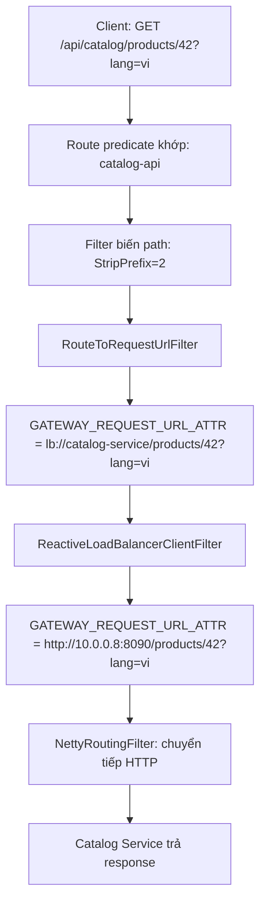

# Vai trò của RouteToRequestUrlFilter trong Spring Cloud Gateway

Trong **Spring Cloud Gateway Server WebFlux**, route predicate giúp xác định request thuộc tuyến nào, còn route đã chọn chỉ mới cung cấp **URI đích được khai báo**. Để các thành phần tiếp theo biết phải chuyển tiếp request hiện tại về đâu, Gateway cần dựng một **URL chuyển tiếp** từ URI route và thông tin request sau các bước biến đổi cần thiết. `RouteToRequestUrlFilter` là thành phần thực hiện nhiệm vụ đó.

Đây là một bước quan trọng trong kiến trúc xử lý của `SPRING_CLOUD_GATEWAY`: nó kết nối **route matching**, **filter chain**, thao tác đổi path và **khám phá dịch vụ** với bước định tuyến HTTP thực tế. Phân biệt rõ vai trò của filter này giúp cấu hình xác thực, rate limiting, circuit breaker, retry, TLS và quan sát request đúng lớp, tránh nhầm một URI logic như `lb://catalog-service` với địa chỉ mạng đã có thể kết nối ngay.

> **Phạm vi:** Bài viết trình bày `RouteToRequestUrlFilter` của biến thể **Spring Cloud Gateway Server WebFlux**. Các ví dụ cấu hình và Java cần sử dụng starter, namespace cấu hình tương ứng với phiên bản Spring Boot/Spring Cloud đang triển khai; biến thể Server MVC có pipeline riêng.

## 1. Route đã khớp chưa có nghĩa request đã được gửi đến backend

Giả sử client gọi:

```http
GET /api/catalog/products/42?lang=vi HTTP/1.1
Host: gateway.example.com
```

Gateway có thể khai báo route `catalog-api` với URI `lb://catalog-service`, predicate `Path=/api/catalog/**` và filter `StripPrefix=2`. Khi request tới, các công việc diễn ra ở những bước khác nhau:

1. **Predicate** kiểm tra request và xác định route `catalog-api` khớp.
2. **GatewayFilter** có thể biến path công khai `/api/catalog/products/42` thành `/products/42`.
3. **RouteToRequestUrlFilter** kết hợp thông tin route và URI request để tạo URL cần định tuyến, ví dụ `lb://catalog-service/products/42?lang=vi`.
4. **ReactiveLoadBalancerClientFilter** tìm instance của `catalog-service` và thay URI logic bằng URI tới instance đã chọn, ví dụ `http://10.0.0.8:8090/products/42?lang=vi`.
5. **Routing filter** phù hợp thực hiện gửi request đến backend và xử lý response.



Địa chỉ `10.0.0.8:8090` chỉ là ví dụ minh họa. Việc tìm instance, giao thức kết nối và khả năng chuyển tiếp phụ thuộc vào discovery/load balancer và cấu hình runtime thực tế.

**Điều cần ghi nhớ:** `RouteToRequestUrlFilter` **không tự gọi backend** và **không tự chọn một instance**. Nó chuẩn bị URI để các filter chuyên trách ở phía sau tiếp tục xử lý.

## 2. RouteToRequestUrlFilter là gì?

`RouteToRequestUrlFilter` là một **`GlobalFilter`** thuộc hạ tầng định tuyến của Spring Cloud Gateway Server WebFlux. Nó cũng tham gia cơ chế sắp thứ tự `Ordered` và được thực thi trong filter chain sau khi Gateway đã chọn được route.

Vai trò chính gồm:

- Đọc route hiện tại từ thuộc tính `ServerWebExchange`.
- Đọc URI của request đang được xử lý, bao gồm path và query sau các biến đổi đã chạy trước đó.
- Kết hợp URI đích của route với URI request để tạo **URL dùng cho việc chuyển tiếp**.
- Ghi URL đã tính vào thuộc tính `GATEWAY_REQUEST_URL_ATTR` để những filter về sau có thể sử dụng.
- Với một số kiểu URI mang **tiền tố scheme**, tách và ghi nhận tiền tố đó để bộ lọc tiếp theo diễn giải chính xác cách định tuyến.

Filter này thường có thứ tự `RouteToRequestUrlFilter.ROUTE_TO_URL_FILTER_ORDER`, giá trị **`10000`** trong các phiên bản Spring Cloud Gateway Server WebFlux phổ biến. Giá trị đó giải thích vì sao những filter biến đổi path cần được đặt đúng thứ tự trước bước dựng URL. Khi làm việc với phiên bản cụ thể, nên kiểm tra API tương ứng vì các thành phần nội bộ có thể được điều chỉnh qua các phiên bản.

### 2.1. Đầu vào và đầu ra

| Đầu vào/đầu ra | Vai trò |
| --- | --- |
| `ServerWebExchange` | Ngữ cảnh đại diện cho HTTP request/response và các thuộc tính phục vụ pipeline WebFlux. |
| `GATEWAY_ROUTE_ATTR` | Chứa đối tượng `Route` đã được chọn, bao gồm `id` và `uri` đích. |
| `exchange.getRequest().getURI()` | URI của request hiện tại; có thể đã được thay đổi bởi các filter chạy trước. |
| `route.getUri()` | URI đích trong cấu hình route, ví dụ `https://catalog.internal`, `lb://catalog-service` hoặc `forward:/fallback`. |
| `GATEWAY_REQUEST_URL_ATTR` | **Kết quả quan trọng nhất**: URL được dùng làm đầu vào cho các filter load balancing/routing. |
| `GATEWAY_SCHEME_PREFIX_ATTR` | Thuộc tính có thể xuất hiện khi route URI sử dụng tiền tố scheme như `lb:ws://...`. |

Các tên hằng thuộc `ServerWebExchangeUtils`, chẳng hạn:

```java
ServerWebExchangeUtils.GATEWAY_ROUTE_ATTR
ServerWebExchangeUtils.GATEWAY_REQUEST_URL_ATTR
ServerWebExchangeUtils.GATEWAY_SCHEME_PREFIX_ATTR
```

Chúng là **thuộc tính nội bộ trong exchange**, không phải header gửi từ client. Không nên tự tạo HTTP header mang cùng tên và mong Gateway dựa vào đó để định tuyến.

### 2.2. Vì sao cần một URL riêng với URI request?

Phân biệt ba khái niệm:

| Khái niệm | Ví dụ | Ý nghĩa |
| --- | --- | --- |
| **URI request công khai** | `http://gateway.example.com/api/catalog/products/42?lang=vi` | Client đang gọi API nào của gateway. |
| **URI trong route** | `lb://catalog-service` | Route khai báo đích logic nào. |
| **URL cần chuyển tiếp** | `lb://catalog-service/products/42?lang=vi` | Đích đã kết hợp với path/query hiện tại; có thể vẫn cần phân giải load balancer. |

URI request công khai còn chứa host của gateway, nên dùng nguyên nó để kết nối upstream sẽ sai. Ngược lại, URI route thường chỉ biểu thị **scheme/host/port của đích**, chưa đủ để nói rõ tài nguyên cụ thể trong request. `RouteToRequestUrlFilter` kết hợp hai phần thông tin đó.

## 3. Cơ chế dựng URL và điều filter thực sự thay đổi

Có thể hình dung logic nghiệp vụ ở mức khái niệm như sau; đây **không phải** bản sao triển khai của một phiên bản thư viện:

```text
route = exchange.attributes[GATEWAY_ROUTE_ATTR]

nếu không có route:
    tiếp tục filter chain

requestUri = exchange.request.uri
routeUri   = route.uri

nếu routeUri có tiền tố scheme như "lb:ws://...":
    lưu tiền tố vào GATEWAY_SCHEME_PREFIX_ATTR
    tách URI để lấy scheme chuyển tiếp bên trong

targetUrl = kết hợp scheme/host/port từ routeUri
            với path/query của requestUri hiện tại

exchange.attributes[GATEWAY_REQUEST_URL_ATTR] = targetUrl
tiếp tục filter chain
```

Từ đó rút ra một số nguyên tắc:

**Thứ nhất, URL được lưu vào exchange.** Thao tác này không đồng nghĩa đã mở socket, gửi HTTP request, xử lý response hay thay đổi toàn bộ đối tượng request gốc. Các bộ lọc routing tiếp theo mới quan sát URL này để quyết định hành động.

**Thứ hai, path và query phụ thuộc trạng thái request khi filter chạy.** Nếu `StripPrefix` hoặc `RewritePath` đã biến đường dẫn trước thời điểm dựng URL, kết quả sẽ dùng đường dẫn đã biến đổi. Các biến đổi thực hiện sau bước này cần được kiểm soát đặc biệt để tránh lệch giữa request và URL routing.

**Thứ ba, URI trong route không phải cơ chế tự động nối path.** Ví dụ route khai báo `https://backend.internal/base` không nên được hiểu mặc định rằng Gateway sẽ tự ghép thêm `/base` vào đầu mọi request. Nếu backend cần prefix `/base`, hãy dùng filter biến đổi đường dẫn có mục đích như `PrefixPath`, `SetPath` hoặc `RewritePath` và kiểm thử kết quả.

**Thứ tư, query string thường được duy trì khi URI đích được dựng.** Nếu bộ lọc trước đó chủ động thay đổi query parameter thì kết quả cần phản ánh thay đổi ấy. Tuy nhiên, không nên giả định mọi custom filter sửa URI/request đều tự đồng bộ với `GATEWAY_REQUEST_URL_ATTR` nếu chạy sai thứ tự.

### 3.1. Ví dụ URI tĩnh qua HTTPS

Giả sử route đích là `https://catalog.internal.example:8443`, request sau `StripPrefix=2` có URI path `/products/42` và query `lang=vi`:

```text
route.uri                     = https://catalog.internal.example:8443
request.path (đã biến đổi)   = /products/42
request.query                 = lang=vi

GATEWAY_REQUEST_URL_ATTR      = https://catalog.internal.example:8443/products/42?lang=vi
```

Ở ví dụ này, routing filter HTTP có thể dùng URL vừa tạo để kết nối thẳng tới host/port đã khai báo, nếu DNS, mạng và cấu hình TLS đều cho phép. `RouteToRequestUrlFilter` không đảm nhận xác minh chứng chỉ, handshake TLS hay timeout mạng.

### 3.2. Ví dụ URI logic qua load balancer

Giả sử route có `uri: lb://catalog-service`. Kết quả ngay sau `RouteToRequestUrlFilter` thường vẫn có dạng logic:

```text
lb://catalog-service/products/42?lang=vi
```

Đây **chưa phải** địa chỉ của instance. `ReactiveLoadBalancerClientFilter` dùng tên dịch vụ `catalog-service` để chọn `ServiceInstance` từ danh sách được cung cấp bởi cơ chế load balancing/discovery. Sau khi chọn instance, filter đó cập nhật URL định tuyến, ví dụ:

```text
http://10.0.0.8:8090/products/42?lang=vi
```

Nếu không tìm được instance, request có thể thất bại trước khi được gửi đến một backend cụ thể; mã phản hồi tùy cấu hình và cách xử lý lỗi của Gateway. Không thể sửa vấn đề thiếu instance chỉ bằng đổi `RouteToRequestUrlFilter`.

## 4. Vị trí trong filter chain và ý nghĩa của `order`

Với Spring Cloud Gateway Server WebFlux, các `GlobalFilter` và `GatewayFilter` của route đã khớp được kết hợp và sắp xếp theo thứ tự. Filter có giá trị `order` thấp hơn thường chạy sớm hơn trong **pre-phase** và muộn hơn trong **post-phase**.

`RouteToRequestUrlFilter` chạy ở giai đoạn chuẩn bị chuyển tiếp. Nó cần được xem trong mối quan hệ với các nhóm filter sau:

| Giai đoạn | Thành phần tiêu biểu | Tác dụng |
| --- | --- | --- |
| 1. Match route | `RoutePredicateHandlerMapping` | Chọn `Route` phù hợp; ghi route vào `GATEWAY_ROUTE_ATTR`. |
| 2. Chỉnh request | Các gateway filters như `StripPrefix`, `RewritePath`, `SetPath` | Điều chỉnh path trước khi dựng URL nếu thứ tự filter phù hợp. |
| 3. Dựng URL | **`RouteToRequestUrlFilter`** | Ghi URI đích vào `GATEWAY_REQUEST_URL_ATTR`. |
| 4. Phân giải dịch vụ | `ReactiveLoadBalancerClientFilter` (nếu dùng `lb://`) | Biến tên dịch vụ thành instance cụ thể. |
| 5. Chuyển tiếp | `NettyRoutingFilter`, `WebsocketRoutingFilter` hoặc `ForwardRoutingFilter` tùy scheme | Thực hiện hành động định tuyến thích hợp. |
| 6. Ghi response | Các filter ghi response và post-filter có liên quan | Truyền dữ liệu/status/header trả về client. |

Bảng mô tả **luồng logic**, không hàm ý tất cả các filter chạy một lần và theo đúng thứ tự mã nguồn liệt kê: thứ tự `Ordered`, cơ chế pre/post và loại route quyết định luồng thực tế. Với `lb://`, `ReactiveLoadBalancerClientFilter` thông thường chạy **sau** `RouteToRequestUrlFilter`, ở thứ tự `10150` trong các nhánh WebFlux thường gặp.

### 4.1. Lỗi khi đặt custom filter sai vị trí

Một filter tùy biến có thể sửa path:

```java
ServerHttpRequest changed = exchange.getRequest()
    .mutate()
    .path("/internal/products/42")
    .build();

return chain.filter(
    exchange.mutate().request(changed).build()
);
```

Đoạn code trên chỉ minh họa thay path. Nếu filter này chạy **sau khi** `RouteToRequestUrlFilter` đã tính URL, giá trị trong `GATEWAY_REQUEST_URL_ATTR` có thể vẫn là đường dẫn trước đó, dẫn tới backend nhận URI không như dự kiến. Do đó, khi chỉnh path trước routing:

- Ưu tiên filter có sẵn (`StripPrefix`, `PrefixPath`, `RewritePath`, `SetPath`).
- Kiểm tra `order` của custom `GlobalFilter` hoặc `GatewayFilter` so với `RouteToRequestUrlFilter`.
- Kiểm chứng đường dẫn thực tế tới backend thay vì chỉ nhìn `exchange.getRequest().getPath()` trong một log riêng lẻ.

Nếu có lý do chính đáng phải thay `GATEWAY_REQUEST_URL_ATTR`, cần hiểu rõ các thành phần kế tiếp sẽ dùng thuộc tính đó như thế nào; thao tác này tác động trực tiếp đến đích định tuyến và cần được giới hạn chặt.

## 5. Minh họa đầy đủ với route, predicate và StripPrefix

Dưới đây là cấu hình minh họa cho **Spring Cloud Gateway Server WebFlux** trong các phiên bản dùng namespace `spring.cloud.gateway.server.webflux.routes`:

```yaml
spring:
  cloud:
    gateway:
      server:
        webflux:
          routes:
            - id: catalog-api
              uri: lb://catalog-service
              predicates:
                - Path=/api/catalog/**
              filters:
                - StripPrefix=2
```

Một số phiên bản Spring Cloud Gateway cũ sử dụng `spring.cloud.gateway.routes`. Chọn **một namespace đúng theo phiên bản** và đúng starter của dự án; không ghép cấu hình hai phiên bản một cách tùy ý.

Giả sử có một instance tên `catalog-service` ở `http://10.0.0.8:8090` với endpoint `GET /products/{id}`.

| Bước | Trạng thái URL/path | Thành phần chịu trách nhiệm |
| --- | --- | --- |
| Client gọi | `GET /api/catalog/products/42?lang=vi` | Client |
| Chọn tuyến | `catalog-api` | Predicate `Path=/api/catalog/**` |
| Đổi path | `/products/42` | `StripPrefix=2` |
| Dựng URL logic | `lb://catalog-service/products/42?lang=vi` | **`RouteToRequestUrlFilter`** |
| Chọn instance | `http://10.0.0.8:8090/products/42?lang=vi` | `ReactiveLoadBalancerClientFilter` |
| Gửi HTTP | `GET /products/42?lang=vi` tới instance | `NettyRoutingFilter` |
| Trả kết quả | Status/header/body từ backend qua gateway | Các filter liên quan |

Có thể thử gọi gateway đang chạy:

```bash
curl -i "http://localhost:8080/api/catalog/products/42?lang=vi"
```

Lệnh chỉ thành công khi có gateway, route và backend tương ứng; riêng `lb://catalog-service` đòi hỏi Spring Cloud LoadBalancer cùng nguồn instance hợp lệ. Nếu chưa có discovery ở môi trường học tập, có thể thay tạm URI route bằng `http://localhost:8081` và chạy Catalog Service ở cổng 8081 để quan sát phần dựng URL tĩnh.

**Thử đổi một yếu tố tại một thời điểm:**

- Bỏ `StripPrefix=2`: backend nhiều khả năng nhận path `/api/catalog/products/42` và trả 404 nếu không có endpoint tương ứng.
- Thay `lb://catalog-service` bằng `http://localhost:8081`: không cần bước chọn instance qua load balancer cho route này.
- Gửi `GET /api/other/products/42`: predicate `Path` không khớp; route và URL trong ví dụ không được chọn.
- Sửa route để trỏ `https://...`: URL được dựng mang HTTPS, nhưng kết nối thành công còn phụ thuộc cấu hình TLS/trust và khả năng truy cập upstream.

## 6. Các scheme: http, https, lb, ws/wss và forward

`RouteToRequestUrlFilter` chuẩn bị URL từ route. Cách Gateway dùng URL ấy phụ thuộc **scheme** và các thành phần định tuyến hiện diện:

| URI route | Ý nghĩa sau khi dựng URL | Thành phần định tuyến tiếp theo |
| --- | --- | --- |
| `http://inventory.internal:8080` | Đích HTTP cụ thể. | Thường là `NettyRoutingFilter`. |
| `https://inventory.internal` | Đích HTTPS cụ thể; cần TLS hợp lệ. | Thường là `NettyRoutingFilter`. |
| `lb://inventory-service` | Tên dịch vụ logic cần phân giải thành instance. | `ReactiveLoadBalancerClientFilter` trước khi định tuyến HTTP. |
| `ws://chat.internal` hoặc `wss://chat.internal` | Đích WebSocket qua WS/WSS. | `WebsocketRoutingFilter`. |
| `lb:ws://chat-service` | Tiền tố load balancing và scheme WebSocket. | Load balancer chọn instance, sau đó WebSocket routing. |
| `forward:/internal/fallback` | Định tuyến nội bộ trong ứng dụng Gateway đến handler tương ứng. | `ForwardRoutingFilter`, không phải một chuyến HTTP ra backend bên ngoài. |

### 6.1. Tại sao `lb:ws://` có hai scheme?

Với `lb:ws://chat-service`, phần `lb:` là **scheme prefix** thể hiện yêu cầu cân bằng tải; phần bên trong `ws://` thể hiện giao thức WebSocket. `RouteToRequestUrlFilter` có thể lưu tiền tố `lb` trong `GATEWAY_SCHEME_PREFIX_ATTR` và chuẩn bị URL với scheme `ws`. Filter load balancer dựa vào URL và/hoặc thuộc tính tiền tố để biết cần chọn instance trước khi WebSocket routing tiếp tục.

Nếu chỉ nhìn `GATEWAY_REQUEST_URL_ATTR` tại một thời điểm, bạn có thể chưa thấy toàn bộ ý nghĩa của route có tiền tố scheme. Khi debug kiểu URI này cần kiểm tra thêm `GATEWAY_SCHEME_PREFIX_ATTR`.

### 6.2. HTTPS không được quyết định chỉ bởi đuôi hostname

Scheme `http` hoặc `https` trong URI đích xác định kiểu kết nối upstream. Với route `lb://`, địa chỉ thực tế sau chọn instance còn phụ thuộc cấu hình `ServiceInstance` và cách load balancer tái dựng URI; thông tin `secure` của instance hoặc scheme/prefix trong route có thể ảnh hưởng scheme cuối cùng.

**TLS** là trách nhiệm của tầng kết nối HTTP client/server và chính sách chứng chỉ. `RouteToRequestUrlFilter` không xác thực hostname, không phát chứng chỉ và không thay thế mTLS.

## 7. Quan sát thuộc tính URL bằng GlobalFilter

Khi cần hiểu `RouteToRequestUrlFilter` đã tạo URL gì, có thể viết một `GlobalFilter` chỉ **đọc** thuộc tính sau bước dựng URL. Ví dụ sau sử dụng API của Server WebFlux:

```java
import java.net.URI;

import org.slf4j.Logger;
import org.slf4j.LoggerFactory;
import org.springframework.cloud.gateway.filter.GatewayFilterChain;
import org.springframework.cloud.gateway.filter.GlobalFilter;
import org.springframework.cloud.gateway.filter.RouteToRequestUrlFilter;
import org.springframework.cloud.gateway.route.Route;
import org.springframework.core.Ordered;
import org.springframework.stereotype.Component;
import org.springframework.web.server.ServerWebExchange;
import reactor.core.publisher.Mono;

import static org.springframework.cloud.gateway.support.ServerWebExchangeUtils.GATEWAY_REQUEST_URL_ATTR;
import static org.springframework.cloud.gateway.support.ServerWebExchangeUtils.GATEWAY_ROUTE_ATTR;

@Component
public class RouteTargetObservationFilter implements GlobalFilter, Ordered {
    private static final Logger log =
        LoggerFactory.getLogger(RouteTargetObservationFilter.class);

    @Override
    public int getOrder() {
        // Sau RouteToRequestUrlFilter, trước khi route lb:// được phân giải.
        return RouteToRequestUrlFilter.ROUTE_TO_URL_FILTER_ORDER + 1;
    }

    @Override
    public Mono<Void> filter(ServerWebExchange exchange,
                             GatewayFilterChain chain) {
        Route route = exchange.getAttribute(GATEWAY_ROUTE_ATTR);
        URI target = exchange.getAttribute(GATEWAY_REQUEST_URL_ATTR);

        if (route != null && target != null) {
            // Ghi thông tin định tuyến ổn định; không log query/token đầy đủ.
            log.debug("routeId={} targetScheme={} targetHost={}",
                route.getId(), target.getScheme(), target.getHost());
        }

        return chain.filter(exchange);
    }
}
```

Filter trên có các đặc điểm quan trọng:

1. Trả nguyên publisher của `chain.filter(exchange)`, không tự gọi `subscribe()` hoặc `block()`.
2. Dùng `order` lớn hơn `RouteToRequestUrlFilter` để đọc URL **đã được dựng**.
3. Vì chạy ngay sau bước dựng URL, nếu route dùng `lb://`, `targetHost` thường là **tên dịch vụ**, chưa phải host instance thực.
4. Chỉ ghi route ID, scheme và host; không phát tán query string chứa token hay định danh người dùng. Trong production có thể hạn chế thêm hostname và ưu tiên metric/tracing đã được tích hợp.

Nếu muốn đo URL **sau load balancing**, phải đặt phép quan sát ở vị trí phù hợp sau bộ lọc load balancer hoặc dùng tracing/metric của Gateway. Không suy luận rằng mọi log URL đều phản ánh đích cuối cùng: thuộc tính `GATEWAY_REQUEST_URL_ATTR` có thể được cập nhật nhiều lần dọc pipeline.

## 8. Phân biệt ba thuộc tính dễ nhầm

Trong quá trình biến đổi và chuyển tiếp, các thuộc tính trong `ServerWebExchange` phục vụ mục đích khác nhau:

| Thuộc tính | Chứa gì? | Lưu ý |
| --- | --- | --- |
| `GATEWAY_ROUTE_ATTR` | Route logic đã được chọn. | Dùng để biết `id`, predicate/filter thuộc route và URI khai báo; không phải instance thực. |
| `GATEWAY_REQUEST_URL_ATTR` | URL mà bộ lọc định tuyến cần dùng ở thời điểm hiện tại. | Có thể ban đầu là `lb://...` rồi được cập nhật thành `http://host:port/...`. |
| `GATEWAY_ORIGINAL_REQUEST_URL_ATTR` | Tập hợp các URI gốc/trước biến đổi được những filter liên quan ghi lại. | Hữu ích khi truy vết thay đổi URL, nhưng không phải đích routing đang được dùng. |

Có thể hình dung:

```text
Route đã khớp:
  GATEWAY_ROUTE_ATTR       -> catalog-api, uri=lb://catalog-service

Ngay sau RouteToRequestUrlFilter:
  GATEWAY_REQUEST_URL_ATTR -> lb://catalog-service/products/42?lang=vi

Sau ReactiveLoadBalancerClientFilter (ví dụ):
  GATEWAY_REQUEST_URL_ATTR -> http://10.0.0.8:8090/products/42?lang=vi
```

Một log hiển thị `GATEWAY_ROUTE_ATTR` khớp không chứng minh backend đã nhận request. Cũng vậy, có `GATEWAY_REQUEST_URL_ATTR` không chứng minh kết nối mạng tới backend đã thành công.

## 9. Chẩn đoán những lỗi định tuyến thường gặp

Khi route có vẻ đúng nhưng API trả lỗi, hãy kiểm tra theo thứ tự **match route → đường dẫn sau filter → URL routing → chọn instance → kết nối backend → response**.

| Triệu chứng | Cần kiểm tra | Tại sao liên quan `RouteToRequestUrlFilter`? |
| --- | --- | --- |
| Request không vào route mong muốn | Predicate `Path`, `Method`, `Host` và thứ tự route. | Không có route phù hợp thì filter không thể tạo URL cho route đó. |
| Backend trả 404 dù route đã khớp | `StripPrefix`, `RewritePath`, `SetPath`; path mà backend thực sự nhận. | URL có thể đúng host nhưng sai đường dẫn. |
| `lb://` không tìm thấy đích | Tên service, danh sách instance, Spring Cloud LoadBalancer và discovery. | Filter tạo URL logic; phân giải instance là bước sau. |
| Gửi đến sai upstream | `route.uri`, biến đổi URL tùy biến, scheme/host/port sau các filter. | Thuộc tính URL định tuyến có thể bị xây sai hoặc bị ghi đè. |
| HTTPS kết nối lỗi | DNS, cổng, trust store, chứng chỉ, xác minh hostname, cấu hình TLS của HTTP client. | Dựng URL `https://` chưa đủ để thực hiện TLS thành công. |
| Log hiện `lb://` nhưng backend vẫn chạy | Thời điểm quan sát trong filter chain. | Log có thể lấy URL trước khi load balancer thay thế. |
| Filter thay path nhưng upstream vẫn nhận path cũ | `order` và `GATEWAY_REQUEST_URL_ATTR` tại bước routing. | Đổi path sau lúc URL đã dựng không mặc nhiên đồng bộ thuộc tính. |
| WebSocket không kết nối được | Scheme `ws/wss`, tiền tố `lb:`, hỗ trợ upgrade, proxy và routing filter. | Scheme quyết định nhánh routing; target có thể cần giải mã tiền tố. |

### Ví dụ truy vết tình huống 404

Gateway có route `Path=/api/orders/**` tới `http://localhost:8082`, nhưng backend chỉ hỗ trợ `GET /orders/7`. Client gọi:

```text
GET /api/orders/7
```

Nếu không có filter bỏ `/api`, URL đích có thể là:

```text
http://localhost:8082/api/orders/7
```

Backend trả 404 do không có endpoint này. `RouteToRequestUrlFilter` **đã hoàn thành nhiệm vụ dựng URL theo request hiện tại**. Vấn đề ở hợp đồng đường dẫn giữa gateway và backend. Thêm `StripPrefix=1` (đúng vị trí trong chain) có thể biến URL thành `http://localhost:8082/orders/7`.

Nếu **không route nào khớp** từ đầu, request thường bị trả 404 ngay tại gateway và không có bước chuyển tiếp tới backend. Hai trường hợp 404 có nguyên nhân khác nhau.

## 10. Ranh giới trách nhiệm với bảo mật và độ tin cậy

`RouteToRequestUrlFilter` là bước xử lý định tuyến. Nó không thay thế những cơ chế khác của cổng vào:

| Nhu cầu | Thành phần/chính sách liên quan | Vai trò của RouteToRequestUrlFilter |
| --- | --- | --- |
| Xác thực, phân quyền | Spring Security, kiểm tra token và quyền ở gateway/backend. | Chỉ chuẩn bị URL; không xác thực người dùng. |
| Giới hạn lưu lượng | `RequestRateLimiter`, key resolver, kho trạng thái phù hợp. | Không đếm request hay quyết định quota. |
| Circuit breaker | Filter tích hợp circuit breaker và cấu hình fallback. | Cung cấp đích để quá trình routing thực hiện; không tự mở/đóng circuit. |
| Retry | Filter retry theo điều kiện/status/lỗi và tính idempotent. | Không tự gửi lại request hoặc tái tạo body để retry. |
| TLS/mTLS | HTTP server/client TLS, chứng chỉ, trust và quy tắc định tuyến HTTPS. | Đảm bảo URL có scheme/host/port phù hợp; không thực hiện handshake. |
| Observability | Micrometer, tracing, logging an toàn, route ID và latency. | Thuộc tính URL/route là một nguồn ngữ cảnh; không tự bảo đảm tracing end-to-end. |

### 10.1. Đừng để dữ liệu client quyết định URL đích tùy ý

URL định tuyến liên quan trực tiếp đến **upstream mà gateway sẽ kết nối**. Nếu custom filter chấp nhận một URL do client cung cấp rồi ghi thẳng vào `GATEWAY_REQUEST_URL_ATTR`, gateway có nguy cơ bị biến thành proxy truy cập host ngoài ý muốn, kể cả hệ thống nội bộ.

Các nguyên tắc thiết kế nên áp dụng:

- Chỉ định tuyến đến **service/host được phép** theo cấu hình và chính sách ứng dụng.
- Không xem header `Host`, `X-Forwarded-Host` hay một query parameter do client gửi là quyền chỉ định upstream.
- Nếu cần định tuyến động theo tenant hoặc phiên bản API, sử dụng bảng ánh xạ/allowlist tin cậy và xác thực ngữ cảnh trước khi chọn đích.
- Đối với HTTPS, duy trì kiểm tra chứng chỉ, trust store và hostname; tránh vô hiệu hóa kiểm tra TLS chỉ để thử kết nối.
- Ở backend, vẫn phải xác thực và kiểm soát quyền nghiệp vụ thay vì mặc định mọi request đi qua gateway đều hợp lệ.

### 10.2. URL đúng chưa đồng nghĩa hệ thống chịu lỗi tốt

Giả sử URL đã được dựng và load balancer chọn đúng instance, nhưng backend mất 3 giây mới phản hồi. `RouteToRequestUrlFilter` không quyết định timeout hay chính sách retry. Các lớp I/O và reliability cần được cấu hình để bảo vệ tài nguyên gateway.

Đặc biệt, retry `POST` tạo đơn hàng hoặc thanh toán có thể lặp lại tác dụng phụ khi backend đã xử lý nhưng response bị mất. Cần điều kiện retry, idempotency key và hợp đồng nghiệp vụ rõ ràng. Khi các filter biến đổi body, cần chú ý cache/replay dữ liệu và chi phí bộ nhớ trên WebFlux.

## 11. Câu hỏi và bài tập vận dụng

**Bài 1 — Xác định URL logic.** Route có `uri: lb://payment-service`, predicate `Path=/api/payments/**`, filter `StripPrefix=1`. Client gọi `GET /api/payments/25?view=summary`. URL nào thường được ghi vào `GATEWAY_REQUEST_URL_ATTR` ngay sau `RouteToRequestUrlFilter`?

**Đáp án:** `lb://payment-service/payments/25?view=summary`. Đây là URL logic; load balancer chưa chọn instance. Request có `/api` bị xóa bởi `StripPrefix=1`.

**Bài 2 — Phân biệt chọn route và dựng URL.** Nếu predicate `Method=GET` không khớp request `POST /api/payments/25` và không có route khác, `RouteToRequestUrlFilter` có thể gửi request này đến `payment-service` không?

**Đáp án:** Không. Filter không tự chọn route cũng không gửi HTTP. Khi không có route tương ứng, không hình thành URL chuyển tiếp cho `payment-service` từ route đó.

**Bài 3 — Dự đoán lỗi thứ tự filter.** Một custom `GlobalFilter` chạy sau bước dựng URL và mới sửa path sang `/internal/items/3`. Vì sao backend có thể nhận path cũ?

**Đáp án:** `GATEWAY_REQUEST_URL_ATTR` có thể đã chứa path trước khi sửa. Routing filter dùng URL đích trong thuộc tính đó. Cần kiểm tra `order`, dùng filter biến đổi path đúng pha hoặc kiểm soát việc cập nhật URL một cách nhất quán.

**Bài 4 — Hiểu URI có tiền tố scheme.** Với route `lb:ws://chat-service`, tại sao cần chú ý `GATEWAY_SCHEME_PREFIX_ATTR`?

**Đáp án:** `lb` biểu thị yêu cầu chọn instance, còn `ws` biểu thị giao thức WebSocket. Thuộc tính tiền tố giúp load balancer hiểu vai trò của `lb` sau khi URI bên trong được tách ra.

**Bài 5 — Xác định lớp chịu trách nhiệm.** URL đã đổi từ `lb://inventory-service/items/1` thành `http://10.0.0.9:8080/items/1`, nhưng kết nối bị từ chối. Nên sửa `RouteToRequestUrlFilter` trước không?

**Đáp án:** Chưa có căn cứ. Bước dựng URL và phân giải instance đã thực hiện; cần kiểm tra instance còn hoạt động, port, network, health check, chính sách timeout và HTTP routing. Bước dựng URL không tự bảo đảm kết nối thành công.

## 12. Ghi nhớ

Khi đọc pipeline của **Spring Cloud Gateway Server WebFlux**, hãy xem `RouteToRequestUrlFilter` như **cầu nối từ route đã chọn sang URL cần chuyển tiếp**:

- Đọc `GATEWAY_ROUTE_ATTR` cùng URI request hiện tại.
- Kết hợp thông tin đích để ghi `GATEWAY_REQUEST_URL_ATTR`.
- Giữ/diễn giải thông tin scheme cần thiết, bao gồm tiền tố như `lb:`.
- Để bộ lọc load balancer và routing thực hiện **chọn instance** và **chuyển tiếp thực tế** ở các bước sau.

Điểm mấu chốt khi cấu hình hoặc debug là **đúng route, đúng path sau biến đổi, đúng thứ tự filter và đúng URL ở thời điểm routing**. Phân biệt các khâu đó giúp tránh sai đường dẫn, sai upstream và cấu hình bảo mật sai lớp, đồng thời tạo nền tảng vững chắc để triển khai khám phá dịch vụ, TLS, retry, circuit breaker, rate limiting và quan sát request cho API Gateway microservices.
