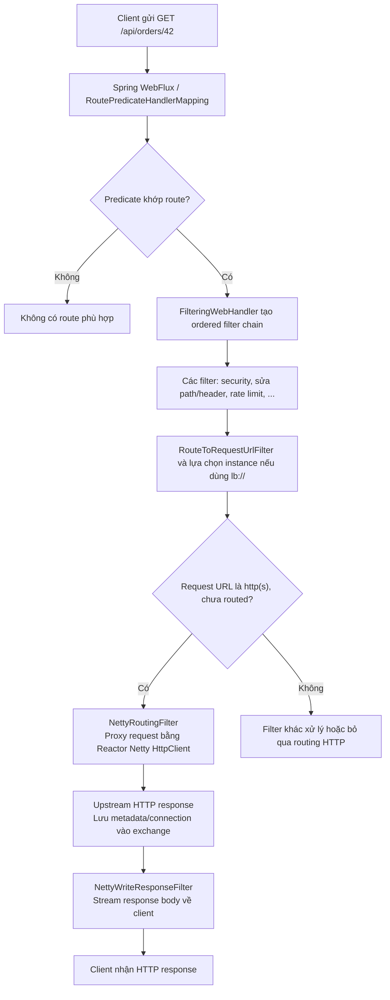
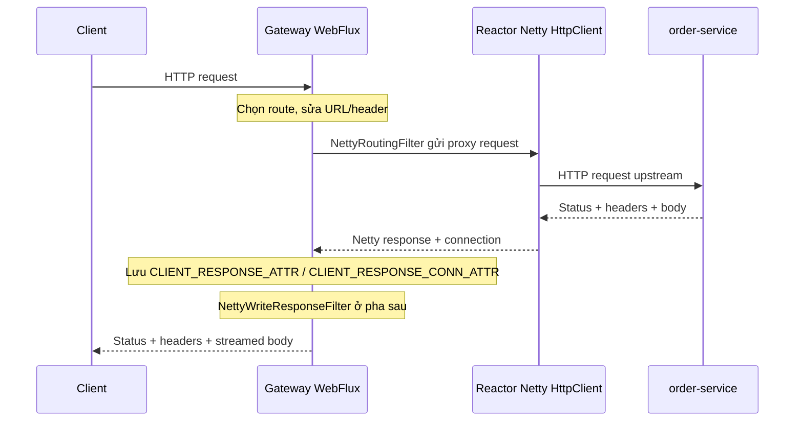
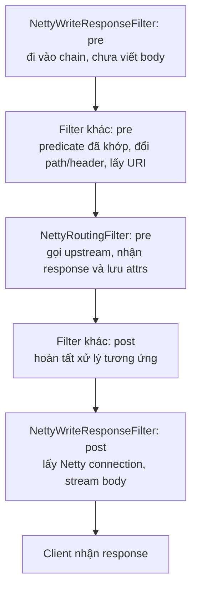
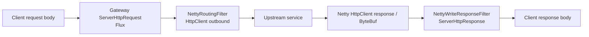

# NettyRoutingFilter và NettyWriteResponseFilter

Trong Spring Cloud Gateway Server WebFlux, việc nhận HTTP request từ client và chuyển request tới microservice phía sau không diễn ra trong một lời gọi Java đơn lẻ. Gateway thực hiện một chuỗi gồm **chọn route → biến đổi request → chọn địa chỉ upstream → gửi request qua HTTP client → nhận response → ghi response về client**. Hai bộ lọc tích hợp có vai trò quan trọng ở chặng cuối của chuỗi này là **`NettyRoutingFilter`** và **`NettyWriteResponseFilter`**.

Bài học thuộc chương **Kiến trúc xử lý** của module **SPRING_CLOUD_GATEWAY**. Để xây dựng và vận hành API Gateway với route predicate, filter chain, biến đổi đường dẫn/header, khám phá dịch vụ, xác thực, giới hạn lưu lượng, circuit breaker, retry, TLS và khả năng quan sát request, người học cần hiểu hai filter này phối hợp với nhau như thế nào, chúng đọc/ghi dữ liệu ở đâu và điều gì xảy ra khi request không được proxy qua HTTP.

> **Phạm vi:** Nội dung nói về **Spring Cloud Gateway Server WebFlux dùng Reactor Netty**. Spring Cloud Gateway Server MVC có mô hình xử lý khác, không nên áp đặt nguyên trạng vòng đời của hai GlobalFilter này cho bản MVC. Tên package, thuộc tính cấu hình và một số chi tiết triển khai có thể thay đổi theo phiên bản Spring Cloud; những tên được nêu dưới đây mô tả cơ chế quen thuộc ở nhánh Gateway Server WebFlux.

## 1. Hai filter nằm ở đâu trong kiến trúc xử lý?

Giả sử client gọi:

```http
GET /api/orders/42 HTTP/1.1
Host: api.example.com
Authorization: Bearer <access-token>
```

Gateway có route chuyển `/api/orders/**` đến `order-service`. Luồng thực hiện ở mức khái niệm:



**`NettyRoutingFilter`** là bộ lọc *routing*: nó sử dụng HTTP client của Reactor Netty để thực hiện request ra ngoài đến upstream khi URL đã được xác định là HTTP/HTTPS.

**`NettyWriteResponseFilter`** là bộ lọc *write response*: nó dùng phản hồi và kết nối do bước routing để lại để chuyển nội dung response cho client, thường theo kiểu streaming không cần gom toàn bộ body vào bộ nhớ.

Cả hai thuộc nhóm **`GlobalFilter` tích hợp của Gateway Server WebFlux**. Chúng không thay vai trò của route predicate, filter sửa path/header, Spring Security hay dịch vụ nghiệp vụ phía sau.

### Phân biệt nhiệm vụ theo từng lớp

| Thành phần | Nhiệm vụ chính | Không chịu trách nhiệm chính về |
| --- | --- | --- |
| `RoutePredicateHandlerMapping` | Tìm route có predicate khớp request; gắn route vào exchange | Gửi HTTP request tới backend |
| `FilteringWebHandler` | Kết hợp `GlobalFilter` và `GatewayFilter`, sắp xếp chúng thành chain | Tự thực hiện network I/O |
| `RouteToRequestUrlFilter` | Xây dựng request URL thực tế từ URI của route và request hiện tại | Chọn chi tiết response body |
| `ReactiveLoadBalancerClientFilter` | Phân giải `lb://service-id` thành endpoint của một instance phù hợp | Viết response về client |
| **`NettyRoutingFilter`** | Proxy request HTTP/HTTPS bằng Reactor Netty HttpClient; lưu response upstream trong exchange | Tìm route từ predicate, làm nghiệp vụ |
| **`NettyWriteResponseFilter`** | Dùng upstream response/connection để ghi body và hoàn tất phản hồi xuống client | Gọi upstream thêm lần nữa, lựa chọn route |
| `ForwardRoutingFilter` / `WebsocketRoutingFilter` | Xử lý những loại URI hoặc giao thức khác phù hợp | Proxy HTTP thông thường qua cặp Netty filter |

Spring Security thường áp dụng ở **WebFlux WebFilter chain**; không nên giả định mọi bước xác thực luôn nằm trong thứ tự của các `GatewayFilter`.

## 2. ServerWebExchange và các thuộc tính dùng để phối hợp

Gateway truyền thông tin qua một đối tượng **`ServerWebExchange`** cho request hiện tại. Ngoài request, response và các thuộc tính HTTP, exchange có một map thuộc tính nội bộ. Các filter đọc và ghi các thuộc tính này để phối hợp mà không phải chuyển trực tiếp đối tượng từ filter nọ sang filter kia bằng đối số riêng.

Những thuộc tính đặc biệt thường được truy cập qua các hằng số trong `ServerWebExchangeUtils`:

| Thuộc tính | Nguồn thiết lập / ý nghĩa | Filter thường quan tâm |
| --- | --- | --- |
| `GATEWAY_ROUTE_ATTR` | Route được chọn sau bước matching | `FilteringWebHandler`, các filter cần route ID |
| `GATEWAY_REQUEST_URL_ATTR` | URI đích đã được dựng/điều chỉnh cho bước routing | `NettyRoutingFilter` và routing filter khác |
| `GATEWAY_ORIGINAL_REQUEST_URL_ATTR` | Các URI ban đầu được lưu khi rewrite/đổi URI | Các filter theo dõi đường dẫn trước/sau biến đổi |
| `GATEWAY_SCHEME_PREFIX_ATTR` | Có thể lưu tiền tố scheme như `lb` khi xử lý `lb://...` | Các bước xử lý URI và load balancing |
| `GATEWAY_ALREADY_ROUTED_ATTR` | Đánh dấu request đã được một routing filter xử lý | Routing filter tránh route trùng |
| `CLIENT_RESPONSE_ATTR` | Metadata về phản hồi upstream do HTTP client Netty nhận được | `NettyWriteResponseFilter` |
| `CLIENT_RESPONSE_CONN_ATTR` | Kết nối Reactor Netty liên quan đến phản hồi upstream | `NettyWriteResponseFilter` dùng để nhận dữ liệu body |

Hình dung map này như một **bảng bàn giao**:

1. Bước route matching điền “route nào đã được chọn?”.
2. Các bước sửa URL và load balancer điền “gửi request đến URI nào?”.
3. `NettyRoutingFilter` gửi HTTP request rồi điền “upstream trả response nào và dữ liệu sẽ được đọc qua kết nối nào?”.
4. `NettyWriteResponseFilter` lấy thông tin đã được điền để ghi response về client.

Đây là **chi tiết triển khai nội bộ**, không phải header từ client. Một request có header `GATEWAY_REQUEST_URL_ATTR` tự khai báo không tạo ra hoặc ghi đè thuộc tính cùng tên trong map của exchange.

## 3. NettyRoutingFilter: điều kiện chạy và công việc thực hiện

### 3.1. Khi nào NettyRoutingFilter thực sự proxy request?

Trong cách triển khai Gateway Server WebFlux quen thuộc, `NettyRoutingFilter` thực hiện routing khi:

- Thuộc tính `GATEWAY_REQUEST_URL_ATTR` đã có URI đích.
- Scheme của URI đích là **`http` hoặc `https`**.
- Request **chưa được một routing filter khác đánh dấu đã routed**.

Nếu các điều kiện không thỏa, nó bỏ qua phần HTTP routing và tiếp tục theo chain. Ví dụ, URI `forward://...` được xử lý bởi cơ chế forward tương ứng; URI `ws://` hoặc `wss://` thuộc nhánh WebSocket. Nếu request đã bị filter trước đó trả `401` hoặc `429` mà không gọi tiếp `chain.filter(exchange)`, Netty routing cũng không xảy ra.

Một điểm quan trọng: **`NettyRoutingFilter` không tự đọc `Path` predicate để quyết định route**. Khi filter này chạy, route và URI đích về cơ bản đã được chuẩn bị ở các bước trước đó.

### 3.2. Trách nhiệm ở chiều request

Các bước thường được thực hiện:

1. Đọc URI đích từ `GATEWAY_REQUEST_URL_ATTR` và kiểm tra trạng thái routed.
2. Đánh dấu exchange đã routed, tránh một routing filter khác vô tình gửi request thêm lần nữa.
3. Dùng **Reactor Netty `HttpClient`** để tạo request tới upstream với HTTP method tương ứng.
4. Chuyển tiếp request header đã qua các quy tắc lọc/chỉnh header liên quan.
5. Chuyển tiếp request body ở dạng luồng dữ liệu khi có body, ví dụ các request `POST` hoặc `PUT`.
6. Khi upstream trả HTTP response, lưu thông tin response và kết nối liên quan trong exchange cho bước ghi phản hồi.

Đây là xử lý **proxy bất đồng bộ**. Khi chờ I/O mạng tới backend, event loop không cần giữ một thread bằng cách gọi `Thread.sleep()` hay `block()` để đợi response.

### 3.3. NettyRoutingFilter không quyết định mọi thứ

Ví dụ, để biến đường dẫn công khai `/api/orders/42` thành đường dẫn service `/orders/42`, sử dụng filter như `StripPrefix=1` hoặc `RewritePath` ở **trước** bước gửi request. `NettyRoutingFilter` nhận URI đích đã được các bước đó tính toán.

Tương tự, khi URI route là `lb://order-service`, bộ lọc load balancer thường chọn một instance rồi thay URI đích thành địa chỉ HTTP/HTTPS cụ thể **trước khi** `NettyRoutingFilter` proxy. Nếu cấu hình discovery/load balancing thiếu, vấn đề không được giải quyết đơn giản bằng cách sửa chính `NettyRoutingFilter`.

Đối với TLS, kết nối **client → gateway** và kết nối **gateway → upstream** là hai chiều kết nối riêng. Route `https://...` có thể yêu cầu cấu hình tin cậy chứng chỉ cho outbound Reactor Netty HTTP client; việc public endpoint đã bật HTTPS không đồng nghĩa hop tới backend cũng được mã hóa.

## 4. NettyWriteResponseFilter: vì sao còn cần bước ghi response?

Khi upstream trả lời, Gateway không thể đơn giản “trả về” đối tượng response của Reactor Netty như một kết quả Java thông thường. Phía client đang chờ một phản hồi HTTP do **server** Gateway gửi, còn response upstream đến từ **HTTP client** mà Gateway đã sử dụng. Hai hướng này khác nhau:



**`NettyWriteResponseFilter`** kiểm tra thông tin response/connection do routing để lại, rồi sử dụng luồng dữ liệu nhận được từ Netty client để ghi body vào `ServerHttpResponse` của gateway.

Những điểm cần hiểu:

- Status code và nhiều header phản hồi được thiết lập trên response Gateway trong quá trình nhận upstream response ở chặng routing và các bước header filter; bước write chủ yếu **ghi nội dung body** và hoàn tất việc gửi xuống client. Không nên hiểu tên “WriteResponse” là toàn bộ việc sao chép status/header chỉ bắt đầu ở filter này.
- Body thường được truyền theo **`Flux<DataBuffer>`**, không đòi hỏi tải hết response vào RAM trước khi gửi.
- Các đối tượng Netty `ByteBuf` và WebFlux `DataBuffer` có vòng đời quản lý bộ nhớ. Khi tự viết filter can thiệp vào body, cần tôn trọng cơ chế retain/release và chỉ tiêu thụ dữ liệu đúng một lần, tránh rò rỉ bộ nhớ hoặc response bị trống.
- Khi **không có** upstream Netty connection phù hợp trong exchange, filter không thể viết body từ nguồn Netty; ví dụ request được trả lời sớm bởi một filter bảo mật/rate limit hoặc đi theo nhánh `forward://`.
- Nếu response đã được commit, filter phía sau không thể tùy ý đổi HTTP status hoặc header. Logic cần sửa header phải chạy ở thời điểm thích hợp, hoặc sử dụng cơ chế trước khi commit của WebFlux khi phù hợp.

Tên của hai filter mô tả **hai pha công việc khác nhau**, không có nghĩa chúng luôn chạy theo thứ tự tuyến tính “routing xong thì mới bắt đầu gọi filter writer”. Thực tế liên quan tới thứ tự và chiều chạy của reactive filter chain.

## 5. Thứ tự GlobalFilter: pha pre và pha post đảo chiều

Spring Cloud Gateway xây dựng một filter chain đã sắp xếp theo `Ordered`. Thông thường:

- **Pha pre:** Filter có giá trị order nhỏ hơn được gọi sớm hơn.
- **Pha post:** Khi các publisher bên trong hoàn tất, phần hậu xử lý của filter nằm bên ngoài chạy muộn hơn.

Trong các phiên bản Gateway Server WebFlux quen thuộc, `NettyWriteResponseFilter` có order **`-1`**, trong khi `NettyRoutingFilter` nằm rất muộn ở pha pre (thường là `Ordered.LOWEST_PRECEDENCE`). Điều này có vẻ trái trực giác, nhưng chính là cách writer có thể đăng ký công việc **ở pha post** sau khi routing đã nhận response upstream.



Sơ đồ trên nhằm giải thích **nguyên lý thứ tự**, không thể hiện chính xác mọi filter hay mọi nhánh lỗi. Khi filter tùy biến được thêm vào chain, thứ tự post và thời điểm response được commit phụ thuộc nơi filter đó nằm trong chain. Mã filter kết hợp `chain.filter(exchange)` với các toán tử Reactor để thiết lập xử lý pre/post; vì vậy phải đọc cả **order** lẫn cách publisher được ghép.

### Ví dụ tư duy về order

Giả sử có các filter:

| Filter | Order minh họa | Công việc tại pre/post |
| --- | ---: | --- |
| `CustomLoggingGlobalFilter` | `-2` | Pre bắt đầu đo thời gian, post ghi kết quả sau chain |
| `NettyWriteResponseFilter` | `-1` | Pre đi vào chain, post ghi body về client |
| `RouteToRequestUrlFilter` | Order dương theo framework | Chuẩn bị URI gửi tới upstream |
| `ReactiveLoadBalancerClientFilter` | Order dương theo framework, khi dùng `lb://` | Chọn instance, tạo URI HTTP/HTTPS |
| `NettyRoutingFilter` | Rất muộn trong pha pre | Gửi request và lấy response upstream |

Các con số order của filter tích hợp nên được **kiểm tra theo version** khi viết custom filter có yêu cầu chen chính xác vào một điểm nhất định. Tránh phụ thuộc order cố định chỉ vì một đoạn code ví dụ trên Internet ghi như vậy.

## 6. Ví dụ đầy đủ: route HTTP và luồng request/response

Một Gateway WebFlux tối giản có thể có route HTTP tĩnh sau:

```yaml
spring:
  cloud:
    gateway:
      routes:
        - id: orders-http
          uri: http://localhost:8081
          predicates:
            - Path=/api/orders/**
          filters:
            - StripPrefix=1
            - RemoveRequestHeader=X-User-Id
```

> Đây là dạng cấu hình `spring.cloud.gateway.routes` thường gặp ở các phiên bản Spring Cloud Gateway Server WebFlux trước đây; các phiên bản mới có thể dùng namespace `spring.cloud.gateway.server.webflux.routes`. Hãy dùng prefix tương ứng với phiên bản và starter của dự án. Ví dụ giả định backend đang nghe tại `localhost:8081`, cùng mạng/host phù hợp với môi trường chạy gateway.

Client gọi gateway:

```bash
curl -i http://localhost:8080/api/orders/42 \
  -H "X-User-Id: someone-else"
```

Backend được giả định hỗ trợ endpoint `GET /orders/42` và trả:

```http
HTTP/1.1 200 OK
Content-Type: application/json
X-Order-Source: order-service

{"id":42,"status":"CREATED"}
```

Luồng dữ liệu:

| Bước | Điều Gateway biết hoặc làm | Kết quả |
| --- | --- | --- |
| 1. Match route | `Path=/api/orders/**` khớp request | `GATEWAY_ROUTE_ATTR` trỏ tới `orders-http` |
| 2. Sửa request | `StripPrefix=1` xóa đoạn `api`; xóa header không tin cậy | Backend sẽ thấy path `/orders/42`, không nhận `X-User-Id` do client gửi |
| 3. Xác định URI | Route URI là `http://localhost:8081` | `GATEWAY_REQUEST_URL_ATTR` biểu diễn URL đích tới backend |
| 4. Routing | `NettyRoutingFilter` gửi `GET /orders/42` qua Reactor Netty HTTP client | Nhận upstream response `200`, headers và connection |
| 5. Lưu response | Thông tin upstream được đưa vào exchange | `CLIENT_RESPONSE_ATTR`, `CLIENT_RESPONSE_CONN_ATTR` có dữ liệu thích hợp |
| 6. Trả về | `NettyWriteResponseFilter` ghi response body từ upstream xuống client | Client nhận JSON, status/header sau các bước xử lý tương ứng |

Ví dụ dùng `RemoveRequestHeader=X-User-Id` để tránh tin tưởng một header danh tính do client tự đặt. Trong hệ thống thật, việc chuyển identity cần dựa trên thông tin đã xác thực bằng Spring Security và áp dụng chính sách tin cậy rõ ràng; service vẫn phải kiểm tra quyền nghiệp vụ đối với đơn hàng số `42`.

### Nếu route dùng discovery thay vì địa chỉ tĩnh

Có thể đổi:

```yaml
uri: lb://order-service
```

Khi đó, sau khi route được chọn, cơ chế load balancer sẽ tìm instance phù hợp và chuẩn bị URL outbound. `NettyRoutingFilter` vẫn đảm nhận HTTP routing khi URL cuối cùng đã có scheme `http` hoặc `https`. Cấu hình này **yêu cầu** các dependency và nguồn instance thực tế (chẳng hạn Spring Cloud LoadBalancer kết hợp discovery client); riêng chuỗi `lb://order-service` không tự tạo ra một service.

## 7. Header, body và backpressure đi qua hai filter như thế nào?

### 7.1. Header request và response

Gateway không nên mù quáng sao chép mọi HTTP header. Một số header là **hop-by-hop** (ví dụ `Connection` và các header được nó liệt kê), chỉ có ý nghĩa cho một kết nối HTTP cụ thể. Spring Cloud Gateway có các `HttpHeadersFilter` và cơ chế liên quan để quản lý header ở chiều request/response. Header bị biến đổi bởi route filter cũng cần được tính đến trước khi gọi Netty client.

Một số vấn đề thực tế:

- **`Host`**: cần quyết định giữ host công khai hay dùng host upstream theo yêu cầu backend; filter như `PreserveHostHeader` chỉ nên bật khi hiểu kết nối và virtual host của upstream.
- **`Forwarded` và `X-Forwarded-*`**: chỉ tin thông tin từ proxy được ủy quyền; không lấy địa chỉ client từ header tùy ý để đưa vào xác thực hoặc rate limiting.
- **`Authorization` / identity headers**: xác minh token và xác định rõ thông tin nào được chuyển tiếp; không đưa token vào log.
- **`Content-Length` / `Transfer-Encoding`**: việc sửa hoặc stream body có thể khiến độ dài ban đầu không còn hợp lệ; để framework/header filter xử lý theo cơ chế HTTP thay vì tự gán bừa.
- **Status và response headers**: khi đã bắt đầu stream body và commit response, việc đổi header/status trong hậu xử lý không còn đáng tin cậy.

### 7.2. Request body đi lên, response body đi xuống

`NettyRoutingFilter` có thể chuyển request body từ `ServerHttpRequest` tới upstream HTTP client ở dạng luồng. `NettyWriteResponseFilter` có thể stream body upstream từ Netty về `ServerHttpResponse`.



Thiết kế streaming giúp giảm nhu cầu gom body hoàn chỉnh vào bộ nhớ. Dù vậy, **non-blocking không đồng nghĩa dùng bộ nhớ vô hạn mà vẫn an toàn**: nếu filter tự buffer body lớn để ghi log, ký số hoặc rewrite, gateway có thể gặp áp lực heap/direct memory. Với Netty `ByteBuf`, sai sót về retain/release còn có thể gây memory leak.

Khi custom filter cần đọc hoặc thay đổi body, hãy dùng API chuyên dụng và xử lý đúng vòng đời `DataBuffer`. Không gọi `.block()`, `.subscribe()` tùy tiện trong filter; hãy trả về `Mono<Void>`/publisher để framework quản lý subscription, cancellation và backpressure.

### 7.3. Đặc điểm của streaming

- Tốc độ đọc/ghi được điều tiết qua pipeline reactive, nhưng vẫn phụ thuộc các giới hạn buffer, transport và nguồn phát.
- Nếu client ngắt kết nối, pipeline có thể nhận tín hiệu cancellation; cần để framework có cơ hội đóng/giải phóng tài nguyên upstream.
- Nếu upstream streaming kéo dài, response có thể đã được commit, nên không thể “đợi đến cuối rồi sửa status”.
- Khi thêm retry, việc gửi lại một request có body **không tự động an toàn**. Cần xét idempotency, khả năng replay/caching body và chính sách retry phù hợp.

## 8. Khi nào hai filter không tạo thành một cặp đầy đủ?

Không phải mọi HTTP response của Gateway đều đến từ upstream thông qua `NettyRoutingFilter`. Các trường hợp khác:

| Tình huống | Điều thường xảy ra | Vì sao cần phân biệt |
| --- | --- | --- |
| Không có route khớp | Handler matching không chọn route; framework trả response theo cơ chế lỗi/không tìm thấy | Không có URL upstream để Netty routing thực hiện |
| Thiếu token hoặc không có quyền | Spring Security có thể trả `401` / `403` trước khi route được proxy | Không có upstream response từ Netty |
| Vượt rate limit | Filter có thể trả `429 Too Many Requests` và không gọi tiếp chain | Không nên tìm nguyên nhân trong backend |
| Route `forward://...` | Routing nội bộ/dispatcher tương ứng xử lý | Không thuộc luồng HTTP client Netty thông thường |
| Route `ws://` / `wss://` | Cơ chế WebSocket routing xử lý giao thức nâng cấp | Response streaming HTTP thông thường không áp dụng nguyên xi |
| Circuit breaker kích hoạt fallback | Có thể chuyển sang nhánh fallback theo cấu hình | Response có thể được tạo nội bộ, không có kết nối Netty upstream như request thành công |
| Kết nối upstream lỗi hoặc timeout | Pipeline có thể kết thúc bằng error, được exception handler/resilience filter xử lý | Không có response upstream hợp lệ để writer stream body theo luồng bình thường |
| Filter custom tạo response trực tiếp | Filter viết response, trả `setComplete()` hoặc `writeWith(...)` rồi không gọi tiếp chain | Tránh để các filter khác cố ghi response lần hai |

Một filter trả response trực tiếp phải **chủ động quyết định dừng chain**. Ví dụ minh họa:

```java
@Override
public Mono<Void> filter(
        ServerWebExchange exchange,
        GatewayFilterChain chain) {

    if (isBlockedByLocalPolicy(exchange)) {
        exchange.getResponse()
            .setStatusCode(HttpStatus.TOO_MANY_REQUESTS);
        return exchange.getResponse().setComplete();
    }

    return chain.filter(exchange);
}
```

Ở nhánh trả `429`, `NettyRoutingFilter` không được gọi và `NettyWriteResponseFilter` không có upstream Netty body để ghi. Đoạn mã giả định `isBlockedByLocalPolicy(...)` là phép kiểm tra nhanh, không blocking; trong thực tế rate limit phân tán nên dùng filter/driver reactive phù hợp.

## 9. Tự viết GlobalFilter mà không phá vòng đời proxy

Ví dụ mục tiêu đơn giản là đo thời gian từ lúc request đi vào chuỗi gateway đến khi chuỗi hoàn thành. Không cần thay thế hai filter Netty mặc định; chỉ cần thêm filter đo đạc nhẹ:

```java
import java.util.concurrent.TimeUnit;

import org.slf4j.Logger;
import org.slf4j.LoggerFactory;
import org.springframework.cloud.gateway.filter.GatewayFilterChain;
import org.springframework.cloud.gateway.filter.GlobalFilter;
import org.springframework.cloud.gateway.route.Route;
import org.springframework.cloud.gateway.support.ServerWebExchangeUtils;
import org.springframework.core.Ordered;
import org.springframework.stereotype.Component;
import org.springframework.web.server.ServerWebExchange;

import reactor.core.publisher.Mono;

@Component
public class GatewayLatencyFilter implements GlobalFilter, Ordered {

    private static final Logger log =
        LoggerFactory.getLogger(GatewayLatencyFilter.class);

    @Override
    public int getOrder() {
        // Ví dụ: pre sớm hơn NettyWriteResponseFilter (-1),
        // doFinally chạy khi phần chain bên trong đã kết thúc.
        return -2;
    }

    @Override
    public Mono<Void> filter(
            ServerWebExchange exchange,
            GatewayFilterChain chain) {

        long start = System.nanoTime();

        return chain.filter(exchange)
            .doFinally(signal -> {
                Route route = exchange.getAttribute(
                    ServerWebExchangeUtils.GATEWAY_ROUTE_ATTR);

                String routeId = route == null
                    ? "unknown"
                    : route.getId();

                long elapsedMs = TimeUnit.NANOSECONDS.toMillis(
                    System.nanoTime() - start);

                log.debug(
                    "route={} status={} signal={} elapsedMs={}",
                    routeId,
                    exchange.getResponse().getStatusCode(),
                    signal,
                    elapsedMs);
            });
    }
}
```

**Ý nghĩa của mẫu:**

1. `getOrder() = -2` đặt phần pre trước writer order `-1` trong cách triển khai đang mô tả; vì thế `doFinally` bên ngoài có cơ hội ghi nhận thời gian của chain bao gồm bước viết response. Với phiên bản khác, phải kiểm tra lại order nếu cần đảm bảo vị trí cụ thể.
2. `chain.filter(exchange)` được **trả về** dưới dạng publisher. Filter không tự gọi `subscribe()` và không đợi bằng `block()`.
3. `doFinally` chạy khi publisher hoàn thành, lỗi hoặc bị hủy; có thể dùng tín hiệu `signal` để phân biệt kết thúc bình thường với cancellation. Log này không tự cung cấp thời gian upstream chính xác; muốn đo từng pha cần tracing/metrics chi tiết.
4. Logging thực tế nên sử dụng backend/appender không chặn event loop hoặc được cấu hình phù hợp; tránh in token, body, cookie hay raw URL chứa dữ liệu nhạy cảm.

Nếu muốn **thay đổi response header**, hãy xử lý trước khi response commit, chẳng hạn đăng ký callback `beforeCommit(...)` ở pha thích hợp và bảo đảm logic chỉ chạy một lần. Việc cố đổi status/header trong `doFinally` của filter trên là quá muộn đối với response đã gửi.

### Những lỗi thường gặp khi viết filter

| Lỗi | Hậu quả | Cách phòng tránh |
| --- | --- | --- |
| Tự thay `NettyRoutingFilter` khi chỉ muốn rewrite URL | Mất cơ chế proxy/HTTP client chuẩn, tăng lỗi khó dự đoán | Dùng route predicate và filter như `RewritePath`, `StripPrefix` |
| Gọi `chain.filter(exchange)` rồi `subscribe()` thủ công | Vòng đời request, lỗi và cancellation bị tách khỏi framework | Trả publisher do filter tạo ra |
| Gọi HTTP client đồng bộ trong `GlobalFilter` | Giữ event-loop thread, làm tăng `p95/p99` nhiều route | Ưu tiên `WebClient`, reactive driver; cô lập blocking legacy nếu bất khả kháng |
| Đọc body rồi không tái tạo request | Upstream nhận body rỗng hoặc lỗi | Dùng cơ chế cache/modify body đúng của Gateway |
| Ghi response body hai lần | Response đã commit, dữ liệu sai hoặc exception | Chọn một đường ghi response, tránh custom writer chồng lên writer tích hợp |
| Tin tưởng `X-User-Id` từ client | Giả mạo identity ở tầng nội bộ | Xóa header không tin cậy, xác thực và áp dụng chính sách ở service |
| Log toàn bộ body/`Authorization` | Lộ dữ liệu nhạy cảm và tốn bộ nhớ | Chỉ log trường được phép, trace ID, route ID và metadata cần thiết |

## 10. Quan sát và xử lý sự cố theo từng chặng

Khi vận hành gateway, cần phân biệt sự cố **trước routing**, **trong routing** và **khi ghi response**.

### 10.1. Cần theo dõi gì?

- **Route ID và URL đích ở mức an toàn:** xác định request đã khớp route nào; tránh đưa raw URL chứa query nhạy cảm vào nhãn metrics.
- **Thời gian tổng và thời gian upstream:** nếu phần lớn thời gian nằm ở HTTP client, kiểm tra DNS, TLS handshake, connection pool, số instance và độ trễ backend.
- **HTTP status:** `401/403` thường liên quan policy bảo mật, `429` là rate limiting, `5xx` có thể đến từ upstream hoặc lỗi gateway; không khẳng định nguyên nhân chỉ từ một status.
- **Pool và transport:** số connection đang dùng/đang chờ, timeout kết nối, timeout response, client cancellation, lỗi TLS và áp lực bộ nhớ trực tiếp (direct memory).
- **Trace ID:** để ghép một request ở gateway với log/traces của backend và các bước retry.
- **Tình trạng circuit breaker/retry:** đếm số lần gọi upstream; một request client có thể tương ứng nhiều lần thử nếu bật retry.

Có thể dùng metrics từ Spring Cloud Gateway, Reactor Netty và Micrometer/observability tùy phiên bản và cấu hình. Tên metric cụ thể thay đổi theo library; hãy kiểm tra registry/Actuator của môi trường đang chạy thay vì giả định một tên luôn tồn tại.

### 10.2. Mẫu suy luận khi gặp lỗi

| Quan sát | Cần kiểm tra trước | Điều chưa thể kết luận |
| --- | --- | --- |
| Client nhận `404` | Route predicate có khớp? Path đã được `StripPrefix`/`RewritePath` đúng chưa? Backend có endpoint đó không? | Không thể nói lỗi chắc chắn ở Gateway hay backend nếu chưa có trace |
| `lb://` báo không có instance | Discovery registry, service ID, health/status instance, LoadBalancer | Không phải do `NettyWriteResponseFilter` không biết nơi gửi |
| Backend trả `200` nhưng client thiếu body | Có filter custom tiêu thụ body? Response đã commit? Sự cố streaming/connection/cancellation? | Không mặc định quy lỗi cho backend |
| Nhiều route chậm dù backend khỏe | Event loop có bị chặn? TLS, CPU, connection pool, logging, memory pressure? | Không chắc mọi backend đều chậm |
| Client ngắt kết nối giữa streaming | Cancellation, lifetime của DataBuffer/Netty connection, socket reset | Không nên xem đó là một response thành công hoàn chỉnh |
| Retry gây nhiều thao tác ghi | Cấu hình Retry, HTTP method, idempotency key, logic service | Không thể dựa vào một status cuối để suy ra số lần ghi phía backend |

Khi cần quan sát các bộ lọc, có thể bật log theo package Spring Cloud Gateway/Reactor Netty ở môi trường thử nghiệm. Tránh bật wiretap/ghi body quá rộng trong production vì có thể ảnh hưởng hiệu năng và lộ dữ liệu. Nếu dùng endpoint Actuator để xem route, phải kiểm soát quyền truy cập endpoint quản trị.

## 11. Bài thực hành: theo dõi request qua Netty routing và response writer

**Mục tiêu:** xác minh đúng ranh giới giữa bước chọn route, bước proxy request và bước ghi response bằng một backend thử nghiệm.

### Chuẩn bị

1. Chạy một Gateway Server WebFlux tại `localhost:8080` với route `orders-http` như mục 6.
2. Chạy backend thử nghiệm tại `localhost:8081`, có endpoint `GET /orders/42` trả JSON và header `X-Order-Source: order-service`.
3. Có thể dùng WebFlux hoặc bất kỳ HTTP server thử nghiệm nào làm backend; nhiệm vụ của nó là cho phép kiểm tra method, path, header và response. Những ví dụ mạng là mô tả môi trường local, không yêu cầu triển khai service discovery.

### Kịch bản A — Proxy thành công

Chạy:

```bash
curl -i http://localhost:8080/api/orders/42
```

Kỳ vọng:

- Route `orders-http` được chọn.
- Backend thấy `/orders/42`.
- `NettyRoutingFilter` gọi upstream HTTP.
- `NettyWriteResponseFilter` chuyển body về client.
- Client thấy status, JSON và những response headers được phép chuyển tiếp.

### Kịch bản B — Route không khớp

Chạy:

```bash
curl -i http://localhost:8080/api/unknown/42
```

Kỳ vọng request không khớp route `orders-http`. Quan sát status và log theo xử lý mặc định của ứng dụng; không suy ra rằng Netty HTTP client đã cố gửi request này đến order-service.

### Kịch bản C — Backend ngắt kết nối

Tắt backend `localhost:8081` và gọi lại `/api/orders/42`.

Quan sát: exception/response status Gateway, thời gian timeout, metric HTTP client và log route. Đây là lỗi ở **giai đoạn kết nối/routing upstream**; có thể không tồn tại response hợp lệ trong `CLIENT_RESPONSE_ATTR` để writer stream. Không nên viết fallback giả báo đơn hàng được xử lý thành công.

### Kịch bản D — Filter dừng chain sớm

Thêm một GatewayFilter thử nghiệm trả `429` cho route trước khi routing. Gọi lại request và đối chiếu:

- Client nhận response do filter tạo.
- Backend không ghi nhận request.
- Không có upstream Netty response body để writer sao chép.

### Kịch bản E — Response dạng streaming

Cho backend trả nhiều chunk nhỏ với độ trễ giữa các chunk, rồi kiểm tra client có nhận dữ liệu dần không. Theo dõi độ trễ tổng, bộ nhớ và trạng thái cancellation khi ngắt client. Tránh bổ sung custom filter gom toàn bộ body vào RAM chỉ để kiểm tra log.

### Câu hỏi kiểm tra

**Câu 1.** Nếu `GATEWAY_REQUEST_URL_ATTR` có scheme `forward`, có phải `NettyRoutingFilter` luôn gửi HTTP request ra ngoài?

> Không. Routing HTTP bằng Netty yêu cầu URI đích phù hợp `http`/`https`; nhánh `forward` được xử lý theo cơ chế khác.

**Câu 2.** Vì sao `NettyWriteResponseFilter` có thể có order `-1` dù việc ghi body diễn ra sau routing?

> Vì order điều khiển thứ tự *đi vào* chain ở pha pre. Writer đăng ký xử lý hậu kỳ; khi các publisher bên trong đã tiến hành routing và trả dữ liệu, phần post mới ghi body.

**Câu 3.** Có thể lấy upstream response body trực tiếp từ `CLIENT_RESPONSE_ATTR` mà không cần biết connection không?

> Thuộc tính response cung cấp metadata của Netty HTTP client response; việc stream body của triển khai Netty tích hợp còn dùng kết nối/luồng inbound được lưu tương ứng. Không nên giả định chỉ có status/header là đã có nguyên toàn bộ body trong bộ nhớ.

**Câu 4.** Nếu client nhận `401` vì thiếu token, `NettyWriteResponseFilter` có còn ghi body từ `order-service` không?

> Không có upstream request thành công trong nhánh bị chặn trước routing. Response `401` được tạo bởi cơ chế bảo mật, không phải response body do order-service trả.

**Câu 5.** Nếu cần thay `/api/orders/42` thành `/orders/42`, nên sửa `NettyRoutingFilter`?

> Không. Dùng filter biến đổi đường dẫn được hỗ trợ như `StripPrefix` hoặc `RewritePath`, để URL đích được chuẩn bị trước khi Netty routing.

## 12. Checklist để vận hành an toàn

- [ ] Xác định rõ ứng dụng là **Gateway Server WebFlux** và đã chọn đúng dependency/starter, phiên bản và prefix cấu hình.
- [ ] Hiểu thứ tự **predicate → route URL → load balancing (nếu có) → Netty routing → ghi response**.
- [ ] Custom filter không tự gọi `subscribe()`/`block()` trong request path; tránh JDBC, HTTP client đồng bộ và thao tác CPU lớn trên event loop.
- [ ] Thống nhất cách dùng `StripPrefix`/`RewritePath`, `Host` và header forwarding với contract nội bộ.
- [ ] Route `lb://` có discovery/LoadBalancer và instance hợp lệ; route HTTPS có outbound TLS/truststore đúng.
- [ ] Header danh tính do client tự gửi không được mặc nhiên tin cậy; token và quyền trên tài nguyên được kiểm tra tại lớp phù hợp.
- [ ] Filter đọc/sửa body xử lý đúng `DataBuffer`, giới hạn kích thước, streaming và vòng đời connection.
- [ ] Không ghi body hai lần; kiểm tra status/header trước response commit.
- [ ] Timeout, circuit breaker và retry không tạo trạng thái “thành công giả” hoặc gửi lại thao tác ghi thiếu idempotency.
- [ ] Quan sát route ID, trace ID, latency, upstream error, pool và cancellation; không log token, cookie hay payload nhạy cảm.
- [ ] Kiểm thử cả proxy thành công, không khớp route, chặn sớm, upstream timeout, streaming lớn và client disconnect.

## Kết luận

`NettyRoutingFilter` và `NettyWriteResponseFilter` phối hợp để hoàn tất chức năng **HTTP reverse proxy** của Spring Cloud Gateway Server WebFlux. Filter thứ nhất gửi request đến upstream bằng Reactor Netty HttpClient và lưu thông tin response/connection vào `ServerWebExchange`; filter thứ hai thực hiện phần hậu xử lý cần thiết để stream body response về client qua `ServerHttpResponse`.

Hiểu sự phối hợp qua **exchange attributes**, thứ tự **pre/post** và nguyên tắc **reactive streaming** giúp triển khai route predicate, biến đổi path/header, load balancing, bảo mật, rate limiting, circuit breaker, retry và observability đúng vị trí. Nó cũng giúp khoanh vùng lỗi: request chưa đến upstream, lỗi trong HTTP client, hay lỗi khi chuyển response về client. Những kiến thức này là cơ sở để giữ Gateway đủ nhẹ, an toàn và dễ quan sát khi phục vụ nhiều microservice.
