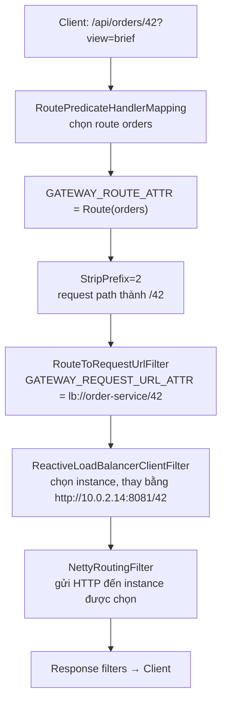

# Exchange attributes cho tuyến, URL gốc và URL đích

## Mục tiêu học tập

Trong chương **Kiến trúc xử lý** của **Spring Cloud Gateway**, một request không chỉ có HTTP method, path và header. Trong suốt quá trình chọn route, biến đổi đường dẫn, khám phá dịch vụ và chuyển tiếp, Gateway còn lưu thông tin điều phối vào **attributes của `ServerWebExchange`**. Nắm rõ chúng giúp giải thích vì sao request được gửi đến một địa chỉ nhất định và tìm nguyên nhân các lỗi định tuyến khó quan sát.

Sau bài học, bạn có thể:

- Phân biệt **`ServerWebExchange` attributes**, HTTP request/response và Reactor Context.
- Đọc đúng ba thuộc tính cốt lõi: `GATEWAY_ROUTE_ATTR`, `GATEWAY_ORIGINAL_REQUEST_URL_ATTR` và `GATEWAY_REQUEST_URL_ATTR`.
- Theo dõi cách URL biến đổi qua route predicate, filter sửa path, `RouteToRequestUrlFilter`, service discovery/load balancing và routing filter.
- Hiểu URL nào là URL client gửi đến, URI cấu hình trên route, URI trung gian `lb://` và URI thật của backend.
- Viết `GlobalFilter` để quan sát trạng thái route/URL mà không làm hỏng quá trình routing hoặc lộ thông tin nhạy cảm.
- Xác định thời điểm attributes đã có dữ liệu, nguyên nhân chúng chưa tồn tại hoặc chứa giá trị khác kỳ vọng, và cách kiểm tra bằng integration test.

## 1. `ServerWebExchange` là gì?

Trong Spring WebFlux, **`ServerWebExchange`** mô tả một lượt trao đổi HTTP ở phía server. Nó cung cấp:

- `exchange.getRequest()`: request hiện tại, gồm method, URI, path, header, body.
- `exchange.getResponse()`: response đang được xây dựng và gửi trả.
- `exchange.getAttributes()`: `Map<String, Object>` dùng chia sẻ metadata **nội bộ của cùng exchange** giữa các thành phần xử lý.

Spring Cloud Gateway Server WebFlux sử dụng exchange để phối hợp **route predicate**, **gateway filter chain**, rewrite URL, **service discovery**, routing và các bước xử lý response. Mỗi request thường có exchange riêng, vì vậy các attributes của nó phù hợp để lưu thông tin theo request.

Ví dụ một filter có thể thêm thuộc tính ứng dụng:

```java
static final String START_TIME_KEY = "app.requestStartedAtNanos";

exchange.getAttributes().put(START_TIME_KEY, System.nanoTime());
Long startedAt = exchange.getAttribute(START_TIME_KEY);
```

Khác với Reactor Context bất biến ở mức API, `exchange.getAttributes()` là **map có thể thay đổi**. Các filter cùng xử lý exchange có thể đọc/ghi map này. Điều đó thuận tiện, nhưng cũng đòi hỏi tránh ghi đè tùy tiện và tránh phụ thuộc vào thứ tự xử lý chưa được bảo đảm.

`exchange.mutate()` có thể tạo decorator của exchange để dùng request/response đã biến đổi; trong mô hình mặc định của WebFlux, các attributes tiếp tục được chia sẻ qua exchange được decorate. Việc mutate HTTP request **không đồng nghĩa** tự động thay đổi toàn bộ các Gateway attributes liên quan đến URL.

> Phạm vi bài này là **Spring Cloud Gateway Server WebFlux**, nơi có `GlobalFilter`, `GatewayFilterChain` và `ServerWebExchange`. Các biến thể khác như Spring Cloud Gateway Server MVC có API và mô hình xử lý riêng. Cú pháp cấu hình route có thể khác theo phiên bản Spring Cloud Gateway đang sử dụng.

## 2. Ba attributes cần nhận diện đầu tiên

Các hằng số dưới đây thuộc:

```java
import static org.springframework.cloud.gateway.support.ServerWebExchangeUtils
    .GATEWAY_ROUTE_ATTR;
import static org.springframework.cloud.gateway.support.ServerWebExchangeUtils
    .GATEWAY_ORIGINAL_REQUEST_URL_ATTR;
import static org.springframework.cloud.gateway.support.ServerWebExchangeUtils
    .GATEWAY_REQUEST_URL_ATTR;
```

| Attribute | Kiểu giá trị | Ý nghĩa | Thời điểm xuất hiện điển hình |
| --- | --- | --- | --- |
| **`GATEWAY_ROUTE_ATTR`** | `org.springframework.cloud.gateway.route.Route` | Route đã được chọn, gồm ID, URI cấu hình và các thông tin route | Sau khi `RoutePredicateHandlerMapping` tìm được route phù hợp, trước khi Gateway filter chain thực thi |
| **`GATEWAY_ORIGINAL_REQUEST_URL_ATTR`** | `Set<URI>` | Tập các URL trước những lần biến đổi mà các filter đã chủ động lưu lại | Khi filter thay path hoặc thay URI đích có gọi cơ chế ghi lịch sử; có thể chưa tồn tại |
| **`GATEWAY_REQUEST_URL_ATTR`** | `java.net.URI` | URI mà pipeline routing hiện **dự định sử dụng**, có thể được viết lại nhiều lần | Sau `RouteToRequestUrlFilter`; có thể chuyển từ `lb://...` thành `http(s)://host:port/...` khi load balancer chọn instance |

Đừng suy luận ba giá trị này luôn có sẵn từ khi request đi vào ứng dụng:

- `GATEWAY_ROUTE_ATTR` xuất hiện khi **route đã match**. Trước route matching, chẳng hạn ở một `WebFilter` chạy sớm, nó có thể chưa có.
- `GATEWAY_REQUEST_URL_ATTR` được thiết lập tại bước dựng URL đích. Một custom filter ở trước bước đó có thể đọc ra `null` dù route đã được chọn.
- `GATEWAY_ORIGINAL_REQUEST_URL_ATTR` là **lịch sử có điều kiện**, được thêm bởi các thành phần có ghi nhận URL cũ. Đừng coi đó là trường bắt buộc hoặc một URI đơn lẻ.

Hai URI rất dễ bị nhầm:

```java
Route route = exchange.getAttribute(GATEWAY_ROUTE_ATTR);
URI configuredUri = route == null ? null : route.getUri();

URI currentTarget = exchange.getAttribute(GATEWAY_REQUEST_URL_ATTR);
```

`route.getUri()` là **URI cấu hình của route** (ví dụ `lb://order-service`), trong khi `currentTarget` là **URI đang được Gateway chuẩn bị chuyển tiếp** (ví dụ `http://10.0.2.14:8081/orders/42`). Hai giá trị không bắt buộc trùng nhau.

## 3. Request đi qua những giai đoạn nào?

Xét một hệ thống bán hàng có API công khai:

```text
GET https://api.example.com/api/orders/42?view=brief
```

Gateway cần chuyển request tới một instance của `order-service`. Giả sử cấu hình kiểu route YAML của Spring Cloud Gateway Server WebFlux:

```yaml
spring:
  cloud:
    gateway:
      routes:
        - id: orders
          uri: lb://order-service
          predicates:
            - Path=/api/orders/**
          filters:
            - StripPrefix=2
```

Đây là **cấu hình minh họa** theo kiểu thuộc tính thường dùng của dòng Spring Cloud Gateway Server WebFlux; hãy đối chiếu namespace cấu hình với phiên bản/framework thực tế. `lb://order-service` yêu cầu có cơ chế load balancing và nguồn danh sách instance dịch vụ được cấu hình. Chỉ có chuỗi `lb://` không tự khởi chạy service registry.

Với `StripPrefix=2`, hai đoạn path đầu tiên là `api` và `orders` bị loại bỏ. Request backend nhận dự kiến là:

```text
GET /42?view=brief
```

Backend nào kỳ vọng `/orders/42` sẽ cần quy tắc rewrite khác. Gateway không thể tự suy đoán contract API của từng dịch vụ.



Sơ đồ giản lược các filter khác và phần query string để dễ nhìn. Query string `?view=brief` thường được giữ lại khi dựng URL mới, trừ khi có filter chủ động thay đổi nó.

### 3.1. Snapshot ở từng thời điểm

Giả sử trong ví dụ này Gateway trực tiếp nhận request HTTPS, filter sửa path đã ghi URL cũ vào lịch sử, và load balancer tìm được instance `10.0.2.14:8081`:

| Giai đoạn | `exchange.getRequest().getURI()` | `GATEWAY_ROUTE_ATTR` | `GATEWAY_REQUEST_URL_ATTR` |
| --- | --- | --- | --- |
| Sau route matching, trước rewrite | `https://api.example.com/api/orders/42?view=brief` | Route `orders` | Chưa chắc có |
| Sau `StripPrefix=2` | `https://api.example.com/42?view=brief` | Route `orders` | Chưa chắc có |
| Sau `RouteToRequestUrlFilter` | `https://api.example.com/42?view=brief` | Route `orders` | `lb://order-service/42?view=brief` |
| Sau reactive load balancing | `https://api.example.com/42?view=brief` | Route `orders` | `http://10.0.2.14:8081/42?view=brief` |
| Khi Netty routing | URI request trên exchange vẫn thể hiện request đã mutate | Route `orders` | URI HTTP đích dùng để định tuyến |

Các dòng thể hiện **thời điểm logic**, không phải cam kết mọi filter ở mọi phiên bản luôn chạy theo cùng một thứ tự tuyệt đối. Các filter tùy chỉnh có thể làm thay đổi flow; hãy kiểm tra `Ordered` và biến thể Gateway đang chạy.

Từ bảng trên có ba kết luận:

1. **URI từ request hiện tại** không nhất thiết còn là URI client gửi lúc đầu vì các filter có thể rewrite path.
2. **URI cấu hình của Route** có thể giữ `lb://order-service` suốt vòng đời request.
3. **URI đích tại `GATEWAY_REQUEST_URL_ATTR`** có thể thay đổi giữa các bước: từ tên service logic sang địa chỉ instance cụ thể.

### 3.2. Lịch sử URL gốc có thể chứa nhiều phần tử

`GATEWAY_ORIGINAL_REQUEST_URL_ATTR` trong trường hợp này có thể chứa:

```text
https://api.example.com/api/orders/42?view=brief
lb://order-service/42?view=brief
```

Phần tử đầu có thể được ghi khi thay đường dẫn; phần tử sau có thể được ghi trước khi load balancer thay URI `lb://` bằng URI instance. Những giá trị này chỉ là **ví dụ về lịch sử được ghi nhận bởi filter tương ứng**. Chúng không bảo đảm luôn có mặt, không nhất thiết đại diện cho toàn bộ mọi lần chuyển đổi, và không nên được xử lý như danh sách có thứ tự.

## 4. `GATEWAY_ROUTE_ATTR`: route nào đã thắng?

Trong Gateway WebFlux, `RoutePredicateHandlerMapping` kiểm tra các route predicate, chẳng hạn `Path`, `Host`, `Method`, header hoặc các điều kiện tùy biến. Khi một route phù hợp được chọn, Gateway lưu **đối tượng `Route`** vào `GATEWAY_ROUTE_ATTR`, sau đó `FilteringWebHandler` vận hành tập GlobalFilter và GatewayFilter của route đó.

Ví dụ đọc dữ liệu:

```java
import org.springframework.cloud.gateway.route.Route;
import org.springframework.web.server.ServerWebExchange;

import static org.springframework.cloud.gateway.support.ServerWebExchangeUtils
    .GATEWAY_ROUTE_ATTR;

public String selectedRouteId(ServerWebExchange exchange) {
    Route route = exchange.getAttribute(GATEWAY_ROUTE_ATTR);
    return route == null ? "no-route-yet" : route.getId();
}
```

Khi kiểm tra route, ưu tiên log **route ID** hơn toàn bộ nội dung đối tượng route. Route ID có tính ổn định và phù hợp cho thống kê lỗi/độ trễ theo route. Log toàn bộ route có thể làm lộ metadata nội bộ hoặc sinh ra lượng log không cần thiết.

Phân biệt ba vai trò:

- **Route predicate:** quyết định route nào phù hợp với request.
- **Route URI:** khai báo backend logic hoặc một đích tĩnh (`lb://order-service`, `https://backend.example.net`...).
- **`GATEWAY_ROUTE_ATTR`:** lưu route đã chọn để các thành phần xử lý kế tiếp tham chiếu.

Một route được chọn **không** có nghĩa request đã hoàn tất xác thực, backend đã sẵn sàng hoặc đã gửi thành công. Sau matching, các filter còn có thể từ chối request vì quyền truy cập, rate limit, timeout hoặc lỗi downstream.

Nếu đọc trong một `WebFilter` chạy trước giai đoạn route matching, không được cho rằng `GATEWAY_ROUTE_ATTR` đã tồn tại. Một request không match route cũng có thể đi đến handler khác hoặc được trả lỗi trước khi có Gateway filter chain.

## 5. `GATEWAY_REQUEST_URL_ATTR`: URI thực sự được routing dùng

Sau khi route được chọn và các filter biến đổi request chạy, **`RouteToRequestUrlFilter`** tạo URI đích dựa trên thông tin request hiện tại và URI cấu hình trên route; URI kết quả được lưu tại `GATEWAY_REQUEST_URL_ATTR`.

Lấy ví dụ:

```text
Request sau StripPrefix:
  https://api.example.com/42?view=brief

Route URI:
  lb://order-service

Request URL attribute sau RouteToRequestUrlFilter:
  lb://order-service/42?view=brief
```

Đây là URI ở dạng **logical destination**: `order-service` chưa phải địa chỉ IP và cổng của instance. Khi `ReactiveLoadBalancerClientFilter` xử lý URI có scheme `lb`, nó tìm một service instance bằng Spring Cloud LoadBalancer và thay `GATEWAY_REQUEST_URL_ATTR` bằng URI khả dụng:

```text
http://10.0.2.14:8081/42?view=brief
```

**`NettyRoutingFilter`** ở bước tiếp theo sử dụng thông tin URL đích để thực hiện outbound HTTP/HTTPS. Thành phần định tuyến thường đánh dấu request đã được route để tránh các routing filter khác xử lý lại cùng exchange.

### 5.1. Những loại URI thường gặp

| URI route | Ý nghĩa thông thường | Điều cần kiểm tra |
| --- | --- | --- |
| `http://host:8080` hoặc `https://host` | Trỏ tới đích HTTP cố định | Host, TLS, trust, path rewrite và timeout |
| `lb://order-service` | Service name phải được giải quyết thành instance cụ thể | Đã cấu hình Spring Cloud LoadBalancer và nguồn instance chưa |
| `ws://...` hoặc `wss://...` | Định tuyến WebSocket | Upgrade handshake, hỗ trợ backend, WebSocket routing filter |
| `lb:ws://order-service` | Dùng load balancing cho WebSocket theo cấu hình tương ứng | Scheme prefix, khả năng hỗ trợ của thành phần routing |
| `forward:/some-path` | Forward nội bộ tới handler trong ứng dụng Gateway | Không coi đó là outbound HTTP tới một backend từ xa |

Một thuộc tính liên quan là **`GATEWAY_SCHEME_PREFIX_ATTR`**, dùng khi route URI có scheme prefix, chẳng hạn tổ hợp `lb:ws://...`. Nó giúp các filter liên quan quyết định cách diễn giải scheme và load balancing. Đừng tự sửa prefix để cố ép một request đi vào nhánh routing khác.

Ngoài ra, nội bộ Gateway có trạng thái nhận biết **request đã được định tuyến** (ví dụ thông qua các tiện ích như `isAlreadyRouted`/`setAlreadyRouted`). Các marker này dành cho điều phối routing, không nên chỉnh sửa trong filter nghiệp vụ thông thường.

### 5.2. Tại sao không lấy luôn `route.getUri()` làm URL đích?

Giả sử route vẫn lưu `lb://order-service` nhưng load balancer đã chọn node `10.0.2.14:8081`. Nếu dashboard chỉ lấy `route.getUri()` rồi ghi “đã kết nối tới lb://order-service”, nhóm vận hành vẫn chưa biết request thực sự được gửi tới instance nào.

Để quan sát theo giai đoạn, đọc:

```java
Route route = exchange.getAttribute(GATEWAY_ROUTE_ATTR);
URI configured = route == null ? null : route.getUri();
URI currentTarget = exchange.getAttribute(GATEWAY_REQUEST_URL_ATTR);
```

`configured` trả lời câu hỏi **“route khai báo đi tới đâu?”**. `currentTarget` trả lời **“ở bước hiện tại Gateway dự định đi tới URI nào?”**. Nếu đọc sớm, `currentTarget` có thể còn `lb://`; nếu đọc sau load balancing, nó thường chứa host/port cụ thể. Nếu request bị chặn trước khi dựng URL, nó có thể vắng mặt.

Không nên giả định `GATEWAY_REQUEST_URL_ATTR` cuối cùng chứng minh backend đã **nhận và xử lý thành công** request. Nó thể hiện quá trình chọn đích; kết quả thực tế còn phụ thuộc kết nối, timeout, circuit breaker, retry và phản hồi từ backend.

## 6. `GATEWAY_ORIGINAL_REQUEST_URL_ATTR`: tập URL đã được ghi lại

Thuộc tính này chứa **tập `URI`**, được bổ sung khi các filter gọi cơ chế lưu URL trước biến đổi. Trong mã nguồn Spring Cloud Gateway, tiện ích liên quan thường là:

```java
ServerWebExchangeUtils.addOriginalRequestUrl(exchange, previousUri);
```

Khi sử dụng:

```java
import java.net.URI;
import java.util.Set;

import org.springframework.web.server.ServerWebExchange;

import static org.springframework.cloud.gateway.support.ServerWebExchangeUtils
    .GATEWAY_ORIGINAL_REQUEST_URL_ATTR;

public int originalUrlCount(ServerWebExchange exchange) {
    Set<URI> previous =
        exchange.getAttribute(GATEWAY_ORIGINAL_REQUEST_URL_ATTR);

    return previous == null ? 0 : previous.size();
}
```

Tên `ORIGINAL` dễ khiến người đọc tưởng nó chỉ có **một URL khởi đầu do client gửi**. Thực chất, các lần biến đổi path hoặc đổi logical URI thành physical URI có thể bổ sung nhiều giá trị khác nhau. Cần nhớ:

1. Thuộc tính có kiểu **`Set<URI>`**, không phải `URI` hoặc `List<URI>`.
2. Set **không có hợp đồng thứ tự theo thời gian**; không lấy phần tử đầu/cuối rồi tuyên bố đó là “URL ban đầu” hay “URL trước bước cuối”.
3. Không phải filter nào cũng ghi lịch sử; số lượng phần tử không phải số lần request được rewrite.
4. Một request có thể không có attribute này nếu chưa có filter lưu lại URL cũ.
5. URI được lưu có thể chứa query string mang dữ liệu riêng tư. Không log trực tiếp toàn bộ collection trong production.

Nếu nghiệp vụ vận hành thực sự yêu cầu một giá trị **“URI lúc client đi vào Gateway”** bất biến, hãy chụp giá trị đó ở một điểm đầu vào được xác định rõ và đặt vào **key riêng** trước khi có filter sửa path:

```java
public static final String CLIENT_ENTRY_URI_ATTR =
    "app.clientEntryUri";

exchange.getAttributes().putIfAbsent(
    CLIENT_ENTRY_URI_ATTR,
    exchange.getRequest().getURI()
);
```

Đoạn này giả định nó chạy **trước** các filter có thể mutate request. Nếu đặt trong một filter chạy muộn, URI thu được đã có thể bị biến đổi. Khi đứng sau reverse proxy, HTTP URI mà Gateway nhìn thấy cũng có thể không trùng URL công khai mà trình duyệt đã dùng; xử lý forwarded headers và ranh giới proxy tin cậy là vấn đề riêng.

Lưu URL khởi đầu ở key ứng dụng giúp tránh lạm dụng `GATEWAY_ORIGINAL_REQUEST_URL_ATTR` như một cấu trúc lịch sử đầy đủ hoặc luôn có thứ tự.

## 7. Đọc attributes trong `GlobalFilter`

Một filter giám sát có thể đọc thuộc tính để ghi **route ID, scheme đích, host đích** và tín hiệu kết thúc mà không làm thay đổi quá trình định tuyến:

```java
import java.net.URI;
import java.util.Set;

import org.slf4j.Logger;
import org.slf4j.LoggerFactory;
import org.springframework.cloud.gateway.filter.GatewayFilterChain;
import org.springframework.cloud.gateway.filter.GlobalFilter;
import org.springframework.cloud.gateway.route.Route;
import org.springframework.core.Ordered;
import org.springframework.stereotype.Component;
import org.springframework.web.server.ServerWebExchange;

import reactor.core.publisher.Mono;

import static org.springframework.cloud.gateway.support.ServerWebExchangeUtils
    .GATEWAY_ORIGINAL_REQUEST_URL_ATTR;
import static org.springframework.cloud.gateway.support.ServerWebExchangeUtils
    .GATEWAY_REQUEST_URL_ATTR;
import static org.springframework.cloud.gateway.support.ServerWebExchangeUtils
    .GATEWAY_ROUTE_ATTR;

@Component
public class RouteAuditFilter implements GlobalFilter, Ordered {

    private static final Logger log =
        LoggerFactory.getLogger(RouteAuditFilter.class);

    @Override
    public int getOrder() {
        // Filter sớm, bao bọc các bước dựng URL và routing.
        return -100;
    }

    @Override
    public Mono<Void> filter(
            ServerWebExchange exchange,
            GatewayFilterChain chain) {

        String method = exchange.getRequest()
            .getMethod().name();

        return chain.filter(exchange)
            .doFinally(terminalSignal -> {
                Route selected =
                    exchange.getAttribute(GATEWAY_ROUTE_ATTR);
                URI target =
                    exchange.getAttribute(GATEWAY_REQUEST_URL_ATTR);
                Set<URI> history = exchange.getAttribute(
                    GATEWAY_ORIGINAL_REQUEST_URL_ATTR
                );

                log.info(
                    "route={} method={} targetScheme={} "
                        + "targetHost={} previousUrlCount={} terminal={}",
                    selected == null ? "unknown" : selected.getId(),
                    method,
                    target == null ? "unknown" : target.getScheme(),
                    target == null ? "unknown" : target.getHost(),
                    history == null ? 0 : history.size(),
                    terminalSignal
                );
            });
    }
}
```

**Vì sao đọc bên trong `doFinally`?** Filter có thứ tự sớm được gọi ở pha *pre* trước nhiều routing filter khác. Nếu đọc target URI ngay đầu phương thức, `GATEWAY_REQUEST_URL_ATTR` có thể chưa được tạo. Ở `doFinally`, chuỗi downstream đã đi tới trạng thái kết thúc, nên có thể thấy các thay đổi đã được thực hiện trên attributes trong suốt quá trình xử lý.

`doFinally` nhận tín hiệu kết thúc như hoàn thành, lỗi hoặc hủy subscription. **`terminalSignal` không phải HTTP status code**. Nếu muốn phân biệt 2xx/4xx/5xx, cần đo thêm status response và trường hợp chưa có status hoặc response chưa hoàn tất.

Ví dụ chỉ log ID route và scheme/host của target để hạn chế nguy cơ lộ dữ liệu. **Không log nguyên URL chứa query string, token, cookie hoặc header xác thực.** Trong môi trường sản xuất còn cần kiểm soát dữ liệu đưa vào log và mức cardinality của metrics, đặc biệt khi hostname/instance thay đổi thường xuyên.

### 7.1. Snapshot sau khi `RouteToRequestUrlFilter` chạy

Khi thực sự cần quan sát **URI trung gian `lb://`**, một filter có thể được sắp thứ tự ngay sau bước dựng URL và trước bước load balancing:

```java
import java.net.URI;

import org.springframework.cloud.gateway.filter.GatewayFilterChain;
import org.springframework.cloud.gateway.filter.GlobalFilter;
import org.springframework.cloud.gateway.filter.RouteToRequestUrlFilter;
import org.springframework.core.Ordered;
import org.springframework.stereotype.Component;
import org.springframework.web.server.ServerWebExchange;
import reactor.core.publisher.Mono;

import static org.springframework.cloud.gateway.support.ServerWebExchangeUtils
    .GATEWAY_REQUEST_URL_ATTR;

@Component
public class LogicalTargetProbe implements GlobalFilter, Ordered {

    @Override
    public int getOrder() {
        return RouteToRequestUrlFilter.ROUTE_TO_URL_FILTER_ORDER + 1;
    }

    @Override
    public Mono<Void> filter(
            ServerWebExchange exchange,
            GatewayFilterChain chain) {

        URI logicalTarget =
            exchange.getAttribute(GATEWAY_REQUEST_URL_ATTR);

        if (logicalTarget != null) {
            // Chỉ quan sát scheme/host; không in query string.
            System.out.println(
                "logicalTarget=" + logicalTarget.getScheme()
                    + "://" + logicalTarget.getHost()
            );
        }

        return chain.filter(exchange);
    }
}
```

Đây là **mã minh họa để học**; trong ứng dụng thực tế hãy dùng logger, telemetry và kiểm soát mức log, không dùng `System.out.println`. Giá trị thứ tự trên nhằm chụp URI ngay sau `RouteToRequestUrlFilter` trong pipeline Server WebFlux có thứ tự filter tương ứng; thứ tự các custom filter khác vẫn có thể ảnh hưởng kết quả. Chỉ dùng hằng số/Filter class có trong phiên bản Gateway đã khai báo dependency.

Để chụp **URI instance sau load balancing**, đặt một bước quan sát ở phía sau `ReactiveLoadBalancerClientFilter` theo thứ tự filter của chính phiên bản đang dùng. Nếu service dùng URI tĩnh `http(s)://...`, không nhất thiết tồn tại pha `lb://`.

### 7.2. Không dùng `subscribe()` bên trong filter để “đợi URL”

Ví dụ **không phù hợp**:

```java
// Tránh tạo subscription tách rời để đọc attributes.
chain.filter(exchange).subscribe();
URI target = exchange.getAttribute(GATEWAY_REQUEST_URL_ATTR);
return Mono.empty();
```

Cách này mở subscription độc lập, làm sai lifecycle của request và khiến lỗi/cancellation không còn do Gateway quản lý đúng cách. Thay vào đó, **return** publisher của `chain.filter(exchange)` và gắn `doOn...`/`doFinally` nếu cần quan sát.

## 8. Khi rewrite path, cái gì thực sự thay đổi?

Đây là điểm hay gây lỗi 404: sửa request URI bằng `exchange.mutate()` và sửa `GATEWAY_REQUEST_URL_ATTR` là **hai hành động khác nhau**.

Khi filter `StripPrefix`, `SetPath` hoặc `RewritePath` thực thi **trước `RouteToRequestUrlFilter`**, bước dựng URL đích thường sử dụng URI của request **đã được mutate**.

```text
Client:             GET /api/orders/42
                       │
StripPrefix=2:         ▼
Request URI:        GET /42
                       │
RouteToRequestUrlFilter
                       ▼
Gateway target:     lb://order-service/42
                       │
Load balancer:         ▼
Backend target:     http://10.0.2.14:8081/42
```

Ngược lại, nếu một filter tự sửa request path **sau khi `GATEWAY_REQUEST_URL_ATTR` đã được tính**, routing filter có thể vẫn dùng URL đích cũ. Vì vậy, khi viết filter tùy chỉnh:

- Xác định nó chạy **trước hay sau** `RouteToRequestUrlFilter`.
- Ưu tiên các `GatewayFilterFactory` chuẩn như `StripPrefix`, `SetPath`, `RewritePath` cho nhu cầu phổ biến.
- Nếu thật sự cần thay routing target bằng code, phải hiểu rõ những filter downstream sử dụng `GATEWAY_REQUEST_URL_ATTR` và cách Gateway đánh dấu trạng thái routing; việc ghi đè thủ công có thể bỏ qua chính sách route/load balancing/TLS.
- Thử nghiệm bằng backend giả lập và kiểm tra **URI mà backend thực nhận**, thay vì chỉ kiểm tra map attributes.

Ngoài path, HTTP headers có thể được thêm, sửa hoặc bỏ theo filter chain. Thay header bằng `SetRequestHeader` **không tự cập nhật** `GATEWAY_ROUTE_ATTR` hay URI đích. Ngược lại, một giá trị trong `exchange.getAttributes()` **không tự trở thành HTTP header** mà client hoặc backend nhìn thấy.

## 9. So sánh exchange attributes, Reactor Context và HTTP header

Các cơ chế dưới đây đều có thể mang thông tin “theo request”, nhưng **khác phạm vi và cách truyền**:

| Cơ chế | Dữ liệu nằm ở đâu? | Cách sử dụng | Có tự truyền ra backend? |
| --- | --- | --- | --- |
| **`ServerWebExchange.getAttributes()`** | Map nội bộ gắn với exchange hiện tại | `exchange.getAttribute(KEY)` / `exchange.getAttributes().put(KEY, value)` | Không |
| **Reactor Context** | Context theo subscription Reactor | `contextWrite`, `deferContextual` | Không |
| **HTTP request headers** | Metadata của HTTP request | `exchange.getRequest().mutate().headers(...)` hoặc Gateway filter thích hợp | Có, nếu được routing chuyển tiếp và không bị loại bỏ |
| **URI route (`Route.getUri()`)** | Cấu hình route | Đọc từ `GATEWAY_ROUTE_ATTR` | Không phải dữ liệu tự động xuất hiện trong header |
| **`GATEWAY_REQUEST_URL_ATTR`** | URI điều phối dùng bởi Gateway routing | Đọc từ `exchange.getAttribute(...)` | Không gửi như header; nhưng routing sử dụng để chọn đích |

Ví dụ:

```java
// Metadata nội bộ, chỉ các thành phần có exchange nhìn thấy:
exchange.getAttributes().put("app.correlationId", "req-123");
```

Đoạn trên **không** khiến Order Service tự nhận `X-Correlation-Id`. Muốn truyền correlation ID qua mạng, phải thêm header vào HTTP request chuyển tiếp bằng cơ chế được thiết kế cho việc đó; đồng thời xác thực nguồn header nếu nó có giá trị bảo mật.

Trường hợp `Reactor Context` phù hợp là khi các thành phần reactive nhận `Mono`/`Flux` nhưng không nhận `ServerWebExchange`. Trường hợp exchange attributes phù hợp là khi nhiều Gateway filters đã có cùng exchange và cần chia sẻ thông tin điều phối, ví dụ route ID, URL lịch sử hoặc metadata tính toán tại gateway.

Spring Security reactive có cơ chế truy cập security context riêng; không nên tự lưu token/đối tượng Authentication vào các key Gateway attributes rồi coi đó là cơ chế xác thực. Quyết định truy cập dữ liệu vẫn phải được kiểm tra ở lớp phù hợp.

## 10. Các tình huống thực tế cần phân tích

### Tình huống A: Đúng route, backend trả 404

Client yêu cầu:

```text
GET /api/orders/42
```

`GATEWAY_ROUTE_ATTR` cho thấy route `orders` đã match, nhưng backend chỉ hỗ trợ `GET /orders/42`. Nếu Gateway dùng `StripPrefix=2`, URL đích trở thành `/42` và backend trả 404.

**Cách xử lý:** kiểm tra `route.getId()`, URI request sau các path filters và `GATEWAY_REQUEST_URL_ATTR` trước routing; so khớp với HTTP path mà backend thực nhận. Đổi quy tắc rewrite cho phù hợp contract backend. Lỗi 404 trong trường hợp này không nhất thiết do route predicate sai.

### Tình huống B: Route dùng `lb://` nhưng request bị 503

`GATEWAY_ROUTE_ATTR` có route `orders`, `GATEWAY_REQUEST_URL_ATTR` từng có `lb://order-service/42`, nhưng không có service instance phù hợp hoặc cơ chế khám phá dịch vụ gặp lỗi.

**Cách xử lý:** kiểm tra cấu hình load balancer/discovery, tên service, trạng thái instance, readiness và lỗi từ bước resolve upstream. Tùy cấu hình, khi không tìm được instance Gateway có thể trả **503** hoặc **404**; không thể kết luận chỉ bằng mã lỗi rằng Gateway chưa match route. Nếu chưa resolve thành công, thuộc tính URL đích có thể vẫn thể hiện URI logic.

### Tình huống C: Log hiển thị URL khác nhau

Một filter đọc `GATEWAY_REQUEST_URL_ATTR` trước load balancing thấy `lb://order-service/...`; một filter khác đọc sau bước đó thấy `http://10.0.2.14:8081/...`.

**Cách xử lý:** ghi rõ **giai đoạn snapshot** trong log và phân biệt URI cấu hình, URI logic và URI instance. Đây có thể là sự thay đổi bình thường, không phải hai filter định tuyến hai đích mâu thuẫn.

### Tình huống D: Original URL set trống

Một custom filter không rewrite URL; bạn thấy `GATEWAY_ORIGINAL_REQUEST_URL_ATTR` là `null` hoặc chưa có phần tử.

**Cách xử lý:** không tự kết luận mất dữ liệu. Attribute là lịch sử chỉ được ghi khi có thành phần sử dụng cơ chế lưu URL cũ. Nếu cần URL ngay tại entry point bất kể có rewrite hay không, hãy chụp nó tại một filter đủ sớm với key ứng dụng riêng.

### Tình huống E: Retry và các lần gọi backend

Gateway có thể áp dụng retry cho một request tùy cấu hình và điều kiện lỗi. Exchange attributes giúp biết route và URI đang được xử lý, nhưng **không phải lịch sử đầy đủ của mọi lần thử kết nối**. Chỉ nhìn `GATEWAY_ORIGINAL_REQUEST_URL_ATTR` không đủ để đếm retry hoặc chứng minh từng instance đã nhận request.

**Cách xử lý:** dùng metrics, log được thiết kế theo từng attempt, distributed tracing và telemetry từ backend; đồng thời bảo đảm retry chỉ áp dụng khi semantics của request cho phép, nhất là đối với các thao tác ghi không idempotent.

## 11. An toàn và quan sát hệ thống khi sử dụng URL attributes

Exchange attributes giúp debug nhanh, nhưng URL có thể mang dữ liệu nhạy cảm:

- Query string có thể chứa session ID, email, mã truy cập hoặc tham số nghiệp vụ; tránh log nguyên `URI.toString()`.
- Host/port của instance có thể tiết lộ topology hạ tầng. Chỉ đưa vào log nội bộ có kiểm soát truy cập.
- Header như `Forwarded`, `X-Forwarded-Host`, `X-Forwarded-Proto` có thể phản ánh proxy phía trước. Chỉ tin cậy những header này khi nguồn proxy được xác định và hạ tầng đã xử lý spoofing; chúng có thể ảnh hưởng URI mà Gateway nhận biết.
- Không nhận URI đích từ header hoặc query param không được kiểm soát rồi ghi thẳng vào `GATEWAY_REQUEST_URL_ATTR`; điều này có nguy cơ dẫn đến **server-side request forgery (SSRF)**, truy cập mạng nội bộ ngoài dự kiến hoặc bỏ qua route policy.
- Không coi route ID hoặc path match là bằng chứng caller đã được xác thực, được cấp quyền hay được phép truy cập tài nguyên của backend.

Một thiết kế observability thực tế nên dùng:

| Tín hiệu | Nên ghi | Nên tránh |
| --- | --- | --- |
| Metric | Route ID, HTTP status, latency, tỷ lệ lỗi, saturation | Nhãn per-user, URI đầy đủ, query string hoặc ID từng request vì cardinality tăng không kiểm soát |
| Log | Route ID, request/correlation ID hợp lệ, mã lỗi, phase, thời gian, target scheme đã kiểm soát | Token, cookie, thông tin cá nhân trong query, payload nhạy cảm |
| Trace | Span cho Gateway và downstream, route ID, trace ID, thời gian theo chặng | Dùng exchange attributes thay hoàn toàn trace propagation qua mạng |
| Sự cố routing | Snapshot URI logic/đích đã được làm sạch, lỗi từ discovery/Netty, response code | Khẳng định backend nhận request chỉ vì một URL attr đã được thiết lập |

Đối với API Gateway có TLS, rate limiting, circuit breaker, retry hoặc xác thực, các attributes này chỉ giúp **quan sát quyết định định tuyến**. Chúng không thay thế cấu hình bảo mật hoặc chính sách phục hồi; telemetry nên liên kết route, filter, backend và mã lỗi theo cùng trace.

## 12. Kiểm thử đúng behavior của route và URL

Trong integration test, hãy chạy Gateway với một HTTP backend giả lập hoặc test service có thể ghi nhận request nhận được. Ví dụ với route `orders` và `StripPrefix=2`, kiểm tra:

1. Client gửi `GET /api/orders/42?view=brief`.
2. Request match route `orders`; nếu có filter audit, nó ghi route ID `orders`.
3. Backend thực nhận **`GET /42?view=brief`**.
4. Khi thay `StripPrefix=1`, backend thực nhận **`GET /orders/42?view=brief`**.
5. Với route `lb://order-service`, nguồn service instances cung cấp một backend test cụ thể; Gateway gửi request tới đúng instance được chọn.
6. Khi không có instance, Gateway trả lỗi theo cấu hình; audit/log thể hiện route đã match nhưng không resolve được upstream.
7. Khi không có rewrite nào ghi lịch sử, code đọc `GATEWAY_ORIGINAL_REQUEST_URL_ATTR` xử lý `null` an toàn.
8. Không có query string, token hoặc cookie nhạy cảm xuất hiện trong log chẩn đoán.

Ví dụ thao tác kiểm tra HTTP từ client:

```bash
curl -i "http://localhost:8080/api/orders/42?view=brief"
```

**Cần quan sát tại backend**, không chỉ so khớp status code. Nếu backend trả 200 ở cả `/42` lẫn `/orders/42`, test chỉ dựa vào status sẽ không phát hiện rewrite sai. Đối với tích hợp TLS, rate limiting, circuit breaker và retry, nên có test riêng cho chính sách tương ứng; các bài test đó cần xác minh cả đường đi và hệ quả thực tế, không chỉ việc tồn tại attribute.

### 12.1. Checklist khi debug request đi sai đích

| Câu hỏi | Dữ liệu cần xem |
| --- | --- |
| Gateway đã chọn route nào? | `GATEWAY_ROUTE_ATTR` → `Route.getId()` |
| Route cấu hình đi đâu? | `Route.getUri()` |
| Request path sau rewrite là gì? | `exchange.getRequest().getURI()` tại giai đoạn thích hợp |
| URL đích trước load balancing là gì? | `GATEWAY_REQUEST_URL_ATTR` ngay sau `RouteToRequestUrlFilter` |
| URL đích sau load balancing là gì? | `GATEWAY_REQUEST_URL_ATTR` sau bước resolve service instance |
| Có những URL nào đã được chủ động lưu lại? | `GATEWAY_ORIGINAL_REQUEST_URL_ATTR` (không giả định thứ tự hoặc độ đầy đủ) |
| Backend đã thật sự nhận URL nào? | Access log/stub HTTP của backend, tracing hoặc network telemetry |
| Vì sao request kết thúc lỗi? | Mã trạng thái, exception, timeout, metrics theo route và trace liên kết |

## 13. Bài thực hành tự đánh giá

Thiết kế hai route:

```text
Route A:
  id = catalog
  predicate = Path=/api/catalog/**
  uri = http://catalog.internal:8081
  filter = StripPrefix=2

Route B:
  id = orders
  predicate = Path=/api/orders/**
  uri = lb://order-service
  filter = StripPrefix=1
```

Với các request:

```text
GET /api/catalog/items/7?lang=vi
GET /api/orders/42
```

Hãy tự xác định:

1. `GATEWAY_ROUTE_ATTR` của từng request trỏ tới route nào?
2. URI của `exchange.getRequest()` sau filter path là gì?
3. `GATEWAY_REQUEST_URL_ATTR` dự kiến là gì sau `RouteToRequestUrlFilter`?
4. Với route B, cần thêm bước nào trước khi biết host/port instance thật?
5. Có thể suy ra “URL client gửi đầu tiên” từ phần tử đầu tiên của `GATEWAY_ORIGINAL_REQUEST_URL_ATTR` không?

**Gợi ý đáp án:**

- Route A chọn `catalog`, sau `StripPrefix=2` còn `/items/7?lang=vi`; URL đích dự kiến `http://catalog.internal:8081/items/7?lang=vi`.
- Route B chọn `orders`, sau `StripPrefix=1` còn `/orders/42`; URL đích logic `lb://order-service/orders/42`, sau đó load balancer mới chọn instance để tạo URI HTTP cụ thể.
- Không được xem tập original URLs là danh sách tuần tự hay bảo đảm chứa URI đầu tiên. Nếu cần lưu URL lúc vào Gateway, đặt một key riêng ở giai đoạn đủ sớm.

## Tổng kết

Trong **Spring Cloud Gateway Server WebFlux**, `ServerWebExchange` attributes là “bảng trạng thái” nội bộ để các thành phần phối hợp xử lý request. **`GATEWAY_ROUTE_ATTR`** trả lời *route nào được chọn*; **`GATEWAY_REQUEST_URL_ATTR`** phản ánh *URI đích tại giai đoạn hiện tại*; **`GATEWAY_ORIGINAL_REQUEST_URL_ATTR`** chứa *tập URI cũ được các filter chủ động lưu lại*. Chúng mang ý nghĩa khác với URI cấu hình, HTTP header và Reactor Context.

Khi phân tích route, path rewrite và khám phá dịch vụ, hãy luôn hỏi **đọc attribute ở thời điểm nào**. Đó là chìa khóa để phân biệt lỗi predicate, lỗi biến đổi path, lỗi service discovery và lỗi kết nối backend. Kết hợp cách đọc attributes với integration test và tracing end-to-end sẽ giúp vận hành cổng vào microservices chính xác, an toàn và dễ chẩn đoán.
