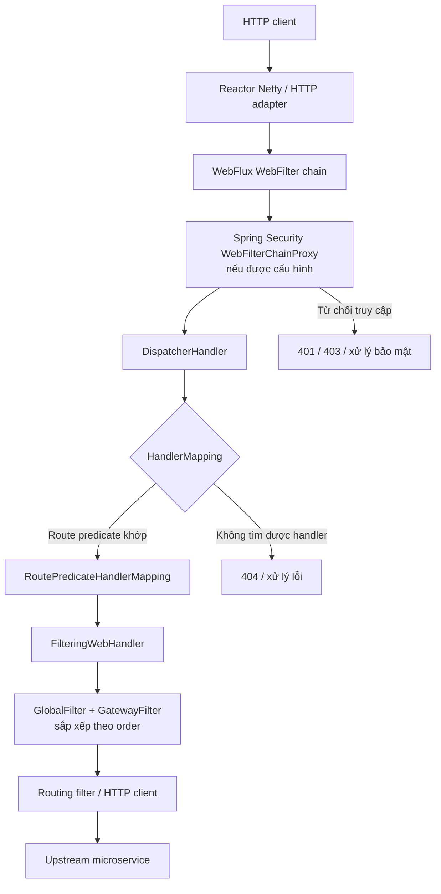
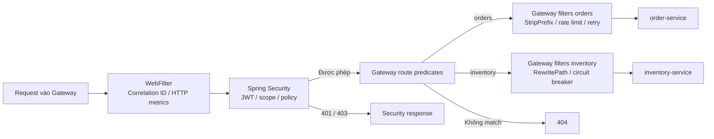

# Ranh giới giữa WebFilter, Spring Security filter và GatewayFilter

Trong Spring Cloud Gateway chạy trên **Spring WebFlux**, request đi qua nhiều lớp xử lý trước khi được chuyển đến microservice phía sau. Ba khái niệm dễ nhầm nhất là `WebFilter` của WebFlux, bộ lọc bảo mật của Spring Security và `GatewayFilter` của Spring Cloud Gateway. Chúng đều có thể đọc `ServerWebExchange` và trả về `Mono<Void>`, nhưng **khác nhau về nơi được gọi, phạm vi áp dụng, thời điểm thực thi và trách nhiệm**.

Bài học thuộc chương **Kiến trúc xử lý**, tập trung vào việc chọn đúng lớp để triển khai xác thực, phân quyền, ghi log, định tuyến, chuyển đổi đường dẫn/header, rate limiting, retry và circuit breaker. Hiểu ranh giới này giúp Gateway bảo vệ cả những request không khớp route, tránh xử lý bảo mật sai thứ tự và không đặt logic ở một filter không bao giờ được chạy.

> **Phạm vi:** Các ví dụ dùng **Spring Cloud Gateway Server WebFlux** (nền tảng Reactor và Spring WebFlux), không áp dụng nguyên xi cho Spring Cloud Gateway Server MVC. Trong ứng dụng MVC/Servlet, `jakarta.servlet.Filter` và cơ chế filter của Gateway MVC thuộc pipeline khác.

## 1. Một HTTP request đi qua những lớp nào?

Ở mức khái niệm, pipeline trên Gateway WebFlux gồm:



Sơ đồ trên cho thấy **ranh giới logic**, không có nghĩa `WebFilterChainProxy` là một bộ xử lý độc lập nằm ngoài chuỗi WebFilter: trong ứng dụng reactive, Spring Security tích hợp vào **chính chuỗi WebFilter** thông qua một `WebFilter` proxy. Các `WebFilter` khác có thể được sắp xếp trước hoặc sau proxy đó bằng cơ chế order.

Trình tự quan trọng:

1. WebFlux tạo `ServerWebExchange` chứa request và response, sau đó chạy các `WebFilter` được đăng ký.
2. Khi có Spring Security, `WebFilterChainProxy` chọn `SecurityWebFilterChain` khớp request rồi chạy các security `WebFilter` bên trong. Bảo mật có thể dừng pipeline ngay tại đây.
3. Nếu request tiếp tục, `DispatcherHandler` và `HandlerMapping` tìm handler phù hợp. Gateway dùng `RoutePredicateHandlerMapping` để đánh giá route predicate (ví dụ `Path`, `Method`, `Header`).
4. Chỉ khi một Gateway route đã được chọn, `FilteringWebHandler` mới ghép **`GlobalFilter` + các `GatewayFilter` của route** thành chuỗi xử lý.
5. Routing filter gọi dịch vụ đích; response quay ngược qua các callback hậu xử lý của filter tương ứng.

Trong cùng ứng dụng có thể tồn tại handler WebFlux khác Gateway, ví dụ controller nội bộ hay endpoint Actuator. Vì vậy **không phải request nào đi vào WebFlux cũng đi qua Gateway filter chain**.

### Bảng so sánh nhanh

| Góc nhìn | WebFlux `WebFilter` | Spring Security reactive filters | Gateway `GlobalFilter` / `GatewayFilter` |
| --- | --- | --- | --- |
| Thuộc framework | Spring WebFlux | Spring Security WebFlux | Spring Cloud Gateway Server WebFlux |
| Thời điểm | Trước khi handler được xử lý, bao quanh luồng WebFlux | Nằm trong chuỗi WebFilter; xử lý trước handler nếu khớp security chain | Sau khi Gateway route đã được chọn |
| Phạm vi | Các request đi qua WebFlux handler chain của ứng dụng | Request khớp `securityMatcher` của một `SecurityWebFilterChain` | `GlobalFilter`: các Gateway route đã chọn; `GatewayFilter`: route cụ thể |
| API chính | `WebFilter.filter(exchange, WebFilterChain)` | `SecurityWebFilterChain`, `ServerHttpSecurity` và các security `WebFilter` | `GlobalFilter.filter(exchange, GatewayFilterChain)`, `GatewayFilter` |
| Order | `@Order`/`Ordered` trong danh sách WebFilter | Order của security chain và `SecurityWebFiltersOrder` bên trong | `Ordered` / thứ tự route filter trong danh sách Gateway |
| Phù hợp | Correlation ID, thao tác kỹ thuật áp dụng rộng, CORS theo thiết kế chung | Authentication, authorization, CSRF, session, security context, exception translation | Route rewrite, header transform, rate limiting, retry, circuit breaker, routing, metric theo route |
| Nếu route không tồn tại | Vẫn có thể chạy | Vẫn có thể kiểm tra quyền theo path | **Không chạy** vì không có Gateway route được chọn |
| Nếu security từ chối | WebFilter chạy **trước** security vẫn có thể thấy kết quả khi chain kết thúc | Trả response/tín hiệu lỗi theo cấu hình bảo mật | Thường **không chạy** |

**Phân biệt tên gọi:** `GlobalFilter` của Gateway không đồng nghĩa “lọc tất cả request HTTP”. Chữ “global” chỉ phạm vi **tất cả Gateway route được chọn**; nó không tự động bao quanh endpoint controller, Actuator, request không khớp route hoặc request bị Security chặn trước đó.

## 2. WebFilter: lớp WebFlux bao quanh việc xử lý request

`WebFilter` có hợp đồng:

```java
public interface WebFilter {
    Mono<Void> filter(
        ServerWebExchange exchange,
        WebFilterChain chain
    );
}
```

Bản thân `WebFilter` không cần biết route ID, `uri` của upstream hay Gateway predicate. Nó phù hợp với tác vụ **xuyên suốt WebFlux**, ví dụ tạo correlation ID, ghi thời gian thực thi của request, thêm response header kỹ thuật hoặc thiết lập context.

Ví dụ tạo ID nội bộ cho mỗi request trước các lớp phía sau:

```java
@Component
@Order(Ordered.HIGHEST_PRECEDENCE)
public class RequestIdWebFilter implements WebFilter {

    public static final String REQUEST_ID_ATTR = "requestId";

    @Override
    public Mono<Void> filter(
            ServerWebExchange exchange,
            WebFilterChain chain) {

        String requestId = UUID.randomUUID().toString();

        exchange.getAttributes().put(REQUEST_ID_ATTR, requestId);
        exchange.getResponse().getHeaders()
            .set("X-Request-Id", requestId);

        return chain.filter(exchange);
    }
}
```

Các kiểu cần import gồm `WebFilter`, `WebFilterChain`, `ServerWebExchange`, `Mono`, `Component`, `Order`, `Ordered` và `UUID`. Ví dụ chủ động sinh ID mới để không tin vào một header có thể do client tự đặt; nếu hệ thống đã có trace ID từ nền tảng observability, nên dùng cơ chế propagation thống nhất thay vì nhân đôi ID.

Điểm đáng chú ý:

- `@Order(Ordered.HIGHEST_PRECEDENCE)` giúp WebFilter này chạy sớm trong **danh sách WebFilter**. Số order đó **không** so sánh trực tiếp với số order của `GlobalFilter`.
- Nó có thể áp dụng cho request bị Security từ chối và cho request không tìm được Gateway route.
- `exchange.getAttributes()` giúp trao đổi dữ liệu trong cùng request giữa các lớp; nếu muốn gửi ID cho upstream, cần thêm header vào **request chuyển tiếp** ở lớp thích hợp.
- Việc gọi `chain.filter(exchange)` trả về một publisher tham gia vào pipeline của request. Tránh gọi `subscribe()` bên trong filter, vì subscription phụ sẽ tách khỏi error/cancellation của request.
- Không giữ state của từng request trong field của singleton `WebFilter`; dùng biến cục bộ, request attributes hoặc Reactor `Context`.

**Ranh giới:** WebFilter có thể thay đổi `ServerHttpRequest` hoặc `ServerHttpResponse`, nhưng **không phải vị trí tốt để áp đặt luật dựa vào Gateway route ID**. Khi WebFilter chạy trước `HandlerMapping`, route chưa được xác định.

## 3. Spring Security reactive: bảo vệ trước khi định tuyến

Trong stack WebFlux, Spring Security sử dụng một `WebFilterChainProxy` thực thi các security `WebFilter` theo cấu hình `SecurityWebFilterChain`. Hai tầng order cần phân biệt:

- **Order giữa các `SecurityWebFilterChain`:** nếu cấu hình nhiều chain với `securityMatcher` khác nhau, Spring Security lựa chọn chain phù hợp theo thứ tự; chain được chọn chịu trách nhiệm cho request.
- **Order giữa các security filter trong chain:** Spring Security tổ chức authentication, authorization, xử lý exception và các bước liên quan theo `SecurityWebFiltersOrder`. Thông thường nên cấu hình bằng DSL `ServerHttpSecurity` thay vì tự xếp thứ tự các filter bảo mật.

Với microservices được bảo vệ bằng Bearer JWT, một cấu hình mẫu:

```java
@Configuration
@EnableWebFluxSecurity
public class GatewaySecurityConfig {

    @Bean
    SecurityWebFilterChain securityWebFilterChain(
            ServerHttpSecurity http) {

        return http
            .csrf(ServerHttpSecurity.CsrfSpec::disable)
            .authorizeExchange(exchanges -> exchanges
                .pathMatchers("/actuator/health").permitAll()
                .pathMatchers("/api/public/**").permitAll()
                .pathMatchers("/api/admin/**").hasAuthority("SCOPE_admin")
                .anyExchange().authenticated())
            .oauth2ResourceServer(oauth2 ->
                oauth2.jwt(Customizer.withDefaults()))
            .build();
    }
}
```

Đây là **ví dụ cho API stateless dùng Bearer token**, có cấu hình JWT resource server và xác thực token tương ứng trong ứng dụng. Việc vô hiệu hóa CSRF chỉ hợp lý khi không sử dụng xác thực dựa trên cookie/session của trình duyệt; nếu có browser session, cần thiết kế CSRF theo luồng thực tế. Cần cấu hình issuer/trust keys và các validator JWT phù hợp, bao gồm audience nếu API có yêu cầu đó. Authority `SCOPE_admin` là minh họa cách ánh xạ scope thường gặp, không đồng nghĩa mọi JWT đều có authority này.

Cấu hình thể hiện ranh giới phân quyền:

- `/actuator/health` và `/api/public/**` được truy cập theo chính sách public, không phụ thuộc vào việc có Gateway route khớp hay không.
- `/api/admin/**` yêu cầu một authority cụ thể **trước khi** áp dụng `StripPrefix`/`RewritePath` cho upstream.
- Mọi request khác phải được xác thực do `anyExchange().authenticated()`. Quy tắc catch-all giúp tránh vô tình bỏ trống endpoint chưa được liệt kê.

Security có thể xử lý request trước khi Gateway route được chọn. Vì thế **đừng giả định rằng một quy tắc `GatewayFilter` luôn chạy để bảo vệ endpoint**. Quy tắc xác thực/phân quyền cốt lõi nên được đặt ở lớp bảo mật, sau đó các Gateway filter có thể bổ sung kiểm tra theo đặc thù route nếu thực sự cần.

### Phân biệt authentication và chuyển tiếp token

**Authentication** là kiểm tra danh tính hoặc thông tin xác thực; **authorization** là quyết định caller có quyền gọi đường dẫn/thao tác hay không. Cả hai thuộc trách nhiệm chính của Spring Security.

Một `GatewayFilter` như `TokenRelay` phục vụ bài toán **chuyển tiếp access token phù hợp** đến upstream khi cấu hình OAuth2 client/security context hỗ trợ. Token relay **không thay thế** xác thực và phân quyền ở Gateway. Cũng không nên mặc định upstream sẽ tin mọi header `X-User` hay `Authorization` đến từ internet. Với kiến trúc zero trust, microservice có thể tự xác minh token hoặc chỉ tin metadata danh tính đã được truyền trong một kênh đáng tin cậy.

## 4. GatewayFilter và GlobalFilter: chỉ có sau khi chọn route

Khi một route thỏa predicate, `RoutePredicateHandlerMapping` chuyển việc xử lý cho `FilteringWebHandler`. Bộ xử lý này lấy danh sách `GlobalFilter` và `GatewayFilter` gắn với route, sắp xếp theo order rồi tạo một chuỗi.

Một route mẫu bằng Java DSL:

```java
@Configuration
public class GatewayRoutes {

    @Bean
    RouteLocator orderRoutes(RouteLocatorBuilder builder) {
        return builder.routes()
            .route("orders", route -> route
                .path("/api/orders/**")
                .filters(filters -> filters
                    .stripPrefix(1)
                    .addRequestHeader("X-Edge", "gateway"))
                .uri("lb://orders-service"))
            .build();
    }
}
```

Request `GET /api/orders/42` khớp route `orders`. Gateway filter `StripPrefix=1` chuyển đường dẫn upstream thành `/orders/42`, đồng thời `AddRequestHeader` bổ sung một header dành riêng cho route. URI `lb://orders-service` minh họa khám phá dịch vụ và cân bằng tải; cần cấu hình service discovery/load balancer phù hợp. Có thể thay bằng URI HTTP cụ thể trong môi trường thử nghiệm.

Một `GlobalFilter` ghi log theo route:

```java
@Component
public class RouteLifecycleFilter implements GlobalFilter, Ordered {

    private static final Logger log =
        LoggerFactory.getLogger(RouteLifecycleFilter.class);

    @Override
    public int getOrder() {
        return 0;
    }

    @Override
    public Mono<Void> filter(
            ServerWebExchange exchange,
            GatewayFilterChain chain) {

        Route route = exchange.getAttribute(
            ServerWebExchangeUtils.GATEWAY_ROUTE_ATTR);

        String routeId = (route != null) ? route.getId() : "unknown";
        long startedAt = System.nanoTime();

        return chain.filter(exchange)
            .doFinally(signal -> log.info(
                "route={} signal={} status={} elapsedMs={}",
                routeId,
                signal,
                exchange.getResponse().getStatusCode(),
                TimeUnit.NANOSECONDS.toMillis(
                    System.nanoTime() - startedAt)));
    }
}
```

Các kiểu Gateway gồm `GlobalFilter`, `GatewayFilterChain`, `Route` và `ServerWebExchangeUtils`; ví dụ còn dùng SLF4J và `TimeUnit`. `ServerWebExchangeUtils.GATEWAY_ROUTE_ATTR` là thuộc tính Gateway đặt sau khi đã chọn route. Bởi vậy, GlobalFilter này có thể lấy route ID nhưng **không bao giờ được gọi chỉ để ghi một request không khớp Gateway route**.

### Pre/post và quy tắc order

Một filter có thể xử lý **trước** và **sau** filter kế tiếp:

```java
@Override
public Mono<Void> filter(
        ServerWebExchange exchange,
        GatewayFilterChain chain) {

    // Pha pre: trước khi gọi phần còn lại của Gateway chain.
    return chain.filter(exchange)
        .then(Mono.fromRunnable(() -> {
            // Pha post: sau khi chain hoàn tất thành công.
        }));
}
```

Sau khi danh sách Gateway filters được sắp xếp, filter có **order nhỏ hơn** thường vào pha pre sớm hơn và ra pha post muộn hơn, như các lớp lồng nhau:

```text
Pre:   Filter A (order -10) → Filter B (order 0) → Filter C (order 10)
              → chuyển request đến upstream
Post:  Filter C             → Filter B           → Filter A
```

Tuy nhiên, `then(...)` chỉ chạy khi publisher phía trước **hoàn tất thành công**; để ghi nhận cả lỗi và hủy, dùng `doFinally` và phân biệt `SignalType`. Đừng kỳ vọng callback post có thể ghi lại một response khác nếu response đã commit.

**Hai trục order khác nhau:** `@Order(-100)` của `WebFilter` và `getOrder() == -100` của `GlobalFilter` không cùng một danh sách sắp xếp. Gateway filter chain nằm sâu hơn trong quá trình dispatch; đặt order âm cực nhỏ cũng không biến `GlobalFilter` thành filter chạy trước Spring Security.

## 5. Ranh giới thực tế qua ba request

Giả sử Gateway có chính sách bảo mật phía trên và route `orders`.

| Request | Security xử lý | Gateway filter xử lý | Kết quả minh họa |
| --- | --- | --- | --- |
| `GET /api/orders/42` không có JWT | Chặn do `authenticated()` | Không | Thường trả `401 Unauthorized` |
| `GET /api/orders/42` với JWT hợp lệ | Cho phép | Có: route `orders`, rewrite path, proxy | Trả kết quả của upstream hoặc lỗi proxy |
| `GET /api/unknown` với JWT hợp lệ, không khớp route nào | Cho phép | Không | Thường trả `404 Not Found` |

Nếu JWT hợp lệ nhưng thiếu scope ở `/api/admin/**`, Spring Security thường trả `403 Forbidden`, cũng trước khi filter định tuyến. Nếu Gateway rate limiter trên một route từ chối yêu cầu, nó có thể chủ động trả `429 Too Many Requests` sau bước Security. Mã HTTP `401`/`403`/`404`/`429` không nhất thiết tương ứng với `onError` của Reactor; chúng có thể là response hoàn tất hợp lệ.

Một `WebFilter` chạy **trước Security** có thể đo cả ba trường hợp. `GlobalFilter` chỉ có số đo trường hợp đã chọn route, nên **metric Gateway route không được dùng thay toàn bộ metric đầu vào HTTP**.

## 6. Đặt yêu cầu ở đúng lớp

### Xác thực JWT, phân quyền scope/role

Đặt ở **Spring Security**. Dùng `ServerHttpSecurity`, OAuth2 resource server, security matcher và authorization rules. Gateway filter có thể dùng kết quả xác thực, nhưng không nên thay thế lớp bảo mật thống nhất bằng một điều kiện tự viết cho từng route.

Đặc biệt, Security thấy **đường dẫn công khai ở phía client**. Nếu route có `StripPrefix` hoặc `RewritePath`, các phép biến đổi này thường diễn ra **sau** authorization. Ví dụ Security cấp quyền cho `/api/admin/reports`, còn backend nhận `/admin/reports`. Phải thiết kế quy tắc dựa trên public API contract, tránh nhầm đường dẫn trước/sau rewrite.

### Chuyển đổi URI, header, định tuyến dịch vụ

Đặt ở **GatewayFilter** nếu phụ thuộc route: `StripPrefix`, `RewritePath`, `AddRequestHeader`, `RemoveRequestHeader`, `SetPath`, `SetRequestHostHeader` và các filter tương ứng. Đặt ở **GlobalFilter** nếu cần logic chung cho mọi Gateway route, ví dụ gắn metadata đã xác thực hoặc đo latency theo route.

Khi thêm header danh tính từ Gateway cho upstream, phải xử lý header trùng tên do client gửi đến: chỉ gửi giá trị do Gateway chủ động tạo hoặc xác minh, tránh spoofing. Cẩn trọng với header `Host`, `Forwarded` và `X-Forwarded-*` vì chúng ảnh hưởng cách upstream nhận biết origin, protocol và địa chỉ caller.

### Rate limiting, retry và circuit breaker

Thông thường đặt ở **Gateway route filter** hoặc chính sách Gateway tương đương:

- `RequestRateLimiter`: áp hạn mức cho request khớp route; nếu key resolver dùng danh tính, phải hiểu security context đã được xác thực như thế nào.
- `Retry`: nên giới hạn tình huống lỗi được phép thử lại, tổng thời gian và thao tác có side effect. Không tự động retry thao tác ghi không idempotent.
- `CircuitBreaker`: bảo vệ upstream và cung cấp fallback hợp lệ khi thiết kế nghiệp vụ cho phép.
- Timeout: phối hợp timeout kết nối/response ở HTTP client với deadline của request và các filter có liên quan.

Không đặt một cơ chế chỉ dành cho upstream route vào WebFilter nếu điều đó khiến cả endpoint nội bộ hay các request không khớp route bị xử lý ngoài ý muốn.

### CORS và HTTP OPTIONS preflight

CORS có thể được xử lý ở tầng WebFlux/Spring Security hoặc cấu hình Gateway CORS tùy kiến trúc. Vì preflight `OPTIONS` **có thể được giải quyết trước khi route được chọn**, cần đảm bảo cấu hình CORS cho phép request hợp lệ đi qua bước bảo mật và không phụ thuộc hoàn toàn vào một `GatewayFilter` vốn có thể không chạy.

Một lựa chọn thường gặp là cấu hình CORS thống nhất ở Gateway và tích hợp phù hợp với Spring Security; tránh đồng thời thêm `Access-Control-Allow-Origin` từ nhiều lớp gây header trùng hoặc mâu thuẫn. Cần quyết định rõ allowed origins, methods, headers và credentials; không dùng wildcard không kiểm soát cho giao diện có thông tin nhạy cảm.

### Log, trace ID, metrics và audit

Có thể chia theo phạm vi:

| Nhu cầu | Lớp phù hợp | Lý do |
| --- | --- | --- |
| ID chung cho cả request bị từ chối và không match route | WebFilter hoặc cơ chế observability chung | Bao phủ entrypoint của WebFlux |
| Authentication success/failure, access denied | Spring Security events/handlers và instrumentation | Phân biệt `401` với `403`, tránh lọt request trước route |
| Route ID, target và thời gian proxy | GlobalFilter/Gateway metrics | Route đã được chọn và có metadata |
| Biến đổi riêng đường dẫn/header cho dịch vụ A | Route GatewayFilter | Chỉ áp dụng cho dịch vụ A |
| Log request body | Ưu tiên cơ chế quan sát được kiểm soát, hạn chế tối đa | Nguy cơ rò PII/token và tiêu thụ `DataBuffer` |

Không ghi token, cookie, thông tin định danh nhạy cảm hoặc toàn bộ request body vào log. Với pipeline Reactor, xử lý có thể đổi thread; không giả định `ThreadLocal`/MDC tự truyền xuyên suốt. Hãy sử dụng cấu hình context propagation/tracing hỗ trợ WebFlux.

## 7. Những lỗi thiết kế thường gặp

### Lỗi 1: “GlobalFilter luôn chạy, kể cả khi không có route”

**Sai phạm vi.** Nếu `RoutePredicateHandlerMapping` không chọn được route, `FilteringWebHandler` không xây dựng Gateway filter chain. Một GlobalFilter không phải nơi duy nhất để đo tất cả request hoặc bắt toàn bộ `404` từ ứng dụng.

**Cách xử lý:** ghi số liệu HTTP entrypoint bằng WebFilter/observability chung và ghi route metrics riêng ở GlobalFilter.

### Lỗi 2: “Để GatewayFilter xác thực vì nó gần upstream”

**Dễ bỏ lọt những nhánh không chạy filter.** Nếu authentication chỉ tồn tại trong route-specific filter, một endpoint khác, route mới hoặc handler nội bộ có thể không có chính sách tương tự.

**Cách xử lý:** sử dụng Spring Security cho quy tắc mặc định và kiểm soát phạm vi bằng `securityMatcher` / `authorizeExchange`; kiểm soát bổ sung theo route chỉ khi có mục đích rõ.

### Lỗi 3: “Đặt order âm lớn cho GatewayFilter để chạy trước Security”

**Sai mô hình order.** Hai hệ thống order không chia sẻ một danh sách chung. Security thuộc WebFilter chain; Gateway filters chỉ tồn tại sau route selection.

**Cách xử lý:** xác định thứ tự cần thay đổi ở tầng WebFilter, security nội bộ hay Gateway chain, rồi cấu hình đúng cơ chế của tầng đó.

### Lỗi 4: “Dùng path của backend để authorize path client”

**Sai ranh giới URL.** `StripPrefix`/`RewritePath` làm đường dẫn phía upstream khác với đường dẫn ban đầu. Security chạy trước việc rewrite này.

**Cách xử lý:** viết authorization rule dựa trên API public phía client và kiểm thử tất cả path nhạy cảm sau khi thêm/sửa route.

### Lỗi 5: “Subscribe thủ công để kiểm tra quyền hoặc gọi dịch vụ”

**Sai vòng đời reactive.** Gọi `subscribe()` trong filter khiến lỗi/cancellation có thể tách khỏi request đang xử lý; side effect tiếp tục chạy dù client đã ngắt kết nối.

**Cách xử lý:** nối publisher vào `chain.filter(exchange)` bằng `flatMap`, `then`, `onErrorResume` hoặc toán tử phù hợp và **trả về** toàn bộ pipeline.

### Lỗi 6: “Bắt mọi exception ở GlobalFilter rồi luôn trả 200”

**Che mất lỗi bảo mật và vận hành.** Lỗi có thể đến từ upstream, network, timeout hoặc filter khác; một số lỗi bảo mật thậm chí đã được xử lý trước Gateway chain. Response có thể đã commit, lúc đó không thể an toàn đổi HTTP status.

**Cách xử lý:** tách trách nhiệm security error handler, lỗi proxy/upstream và quan sát; chỉ fallback khi có hợp đồng nghiệp vụ hợp lệ, giữ lại metric nguyên nhân và kiểm tra trạng thái commit.

## 8. Mô hình áp dụng cho cổng vào microservices

Giả sử hệ thống có `order-service`, `inventory-service` và endpoint public `/actuator/health`. Một cách phân chia đơn giản:



Với thiết kế này, route mới vẫn chịu chính sách mặc định của Spring Security nếu có quy tắc catch-all. Việc thêm route không tự mở quyền truy cập; người triển khai phải cập nhật scope/authorization nếu có yêu cầu khác. Ngược lại, rule của Spring Security cũng không tự thay đổi đường dẫn khi đưa request đến backend; đó là công việc của Gateway filter.

### Bảng kiểm thử tích hợp

| Tình huống | Kỳ vọng cần xác nhận | Lớp chính cần kiểm tra |
| --- | --- | --- |
| Không có Bearer token gọi API bảo vệ | `401`, upstream không được gọi | Spring Security |
| Có token nhưng thiếu scope admin | `403`, upstream không được gọi | Spring Security |
| Token hợp lệ, URL không có route | `404`, không ghi nhận như Gateway route thành công | Handler mapping |
| Gọi route orders hợp lệ | `/api/orders/42` được chuyển thành `/orders/42` ở backend | GatewayFilter |
| Vượt quota | `429` theo policy và metric rate limit | Gateway route filter |
| Backend chậm/timeout | Timeout được giới hạn; response lỗi/fallback đúng hợp đồng | HTTP client + Gateway filter |
| Preflight `OPTIONS` hợp lệ | CORS headers hợp lệ, không bị JWT rule chặn sai | CORS + Security |
| Security từ chối request | Correlation ID vẫn xuất hiện nếu WebFilter chạy trước Security | WebFilter + Security |
| Đóng kết nối sớm | Cancellation được xử lý; không còn subscription phụ chạy vô hạn | Reactive lifecycle |

Dùng `WebTestClient` cho HTTP/security behavior và upstream giả lập như WireMock hoặc MockWebServer để kiểm tra chính xác backend đã nhận path/header nào. Có thể sử dụng `spring-security-test` để tạo JWT giả lập trong kiểm thử xác thực/phân quyền. Với các route dùng `lb://`, môi trường kiểm thử cần có service discovery/load balancer hoặc thay bằng URI HTTP cụ thể.

## 9. Cách chọn lớp filter trong một phút

Khi cần viết một chức năng mới, tự hỏi theo thứ tự:

1. **Chức năng này cần chạy kể cả khi request bị Security từ chối hoặc không khớp Gateway route?** Nếu có, cân nhắc WebFilter hoặc cơ chế HTTP chung. Chú ý order so với Spring Security.
2. **Chức năng kiểm tra danh tính, quyền, session, CSRF hoặc security context?** Nếu có, đặt ở Spring Security và giữ policy mặc định rõ ràng.
3. **Chức năng cần route ID, downstream service, predicate, hay thay đổi đường dẫn/header chỉ cho một route?** Nếu có, đặt ở GatewayFilter; nếu chung cho tất cả Gateway route, cân nhắc GlobalFilter.
4. **Chức năng phụ thuộc retry, circuit breaker, rate limiter hoặc routing?** Hãy hiểu thứ tự Gateway filter và khả năng request được phát lại, timeout hay cancel.
5. **Có post-processing không?** Phân biệt `onComplete`, `onError` và `cancel`; đừng nghĩ mã HTTP lỗi luôn tạo Reactor error.

**Nguyên tắc cốt lõi:** `WebFilter` bao quanh xử lý **WebFlux**, Spring Security quyết định **ai được đi tiếp**, còn `GatewayFilter`/`GlobalFilter` thực hiện chính sách **cho Gateway route đã được chọn**. Khi đặt trách nhiệm đúng ranh giới, Gateway vừa bảo vệ request từ sớm vừa biến đổi và chuyển tiếp traffic theo từng microservice một cách rõ ràng, có thể kiểm thử và quan sát được.

