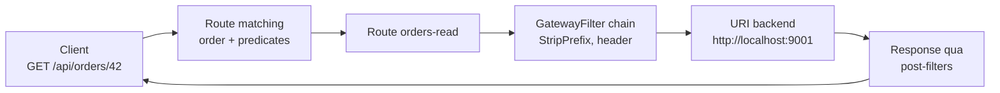
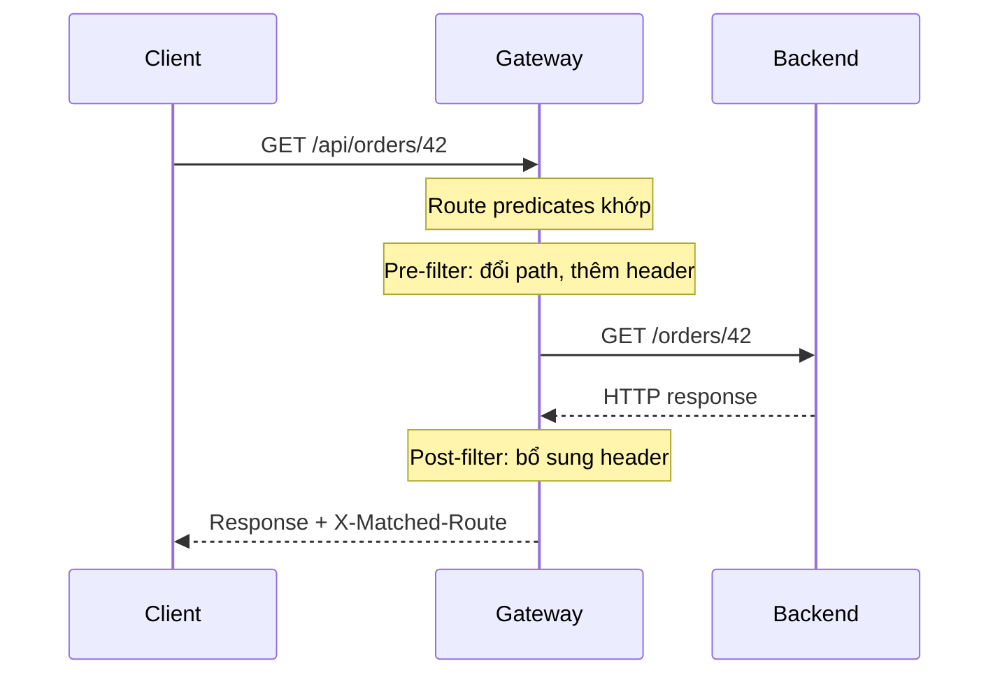

# Các trường `id`, `uri`, `order`, `predicates`, `filters` và `metadata` trong Spring Cloud Gateway

Một **route** là đơn vị cấu hình trung tâm của **Spring Cloud Gateway**: nó xác định request nào được nhận, request đó được chuyển đến backend nào, và những xử lý nào diễn ra trước/sau khi chuyển tiếp. Khi xây dựng API Gateway cho microservices, hiểu chính xác các trường `id`, `uri`, `order`, `predicates`, `filters` và `metadata` giúp bạn thiết kế route dễ kiểm tra, tránh tuyến chồng lấn, đồng thời chuẩn bị cho xác thực, rate limiting, circuit breaker, retry, TLS và quan sát lưu lượng.

Bài thuộc chương **Cấu hình tuyến**, tập trung vào **Spring Cloud Gateway Server WebFlux**. Ví dụ sử dụng cú pháp cấu hình của nhánh **Gateway 5.0.x** (Spring Cloud 2025.1.x/Spring Boot 4.x) với tiền tố `spring.cloud.gateway.server.webflux.routes`. Hệ thống dùng nhánh khác phải đối chiếu starter và property prefix theo đúng tài liệu tương ứng; đặc biệt những ví dụ cũ với `spring.cloud.gateway.routes` không nên sao chép nguyên xi. Server Web MVC có mô hình cấu hình và API mở rộng riêng.

## 1. Kết quả học tập

Sau bài này, bạn có thể:

- Đọc và viết một route YAML hoàn chỉnh với sáu trường.
- Phân biệt **điều kiện chọn route** với **cách xử lý request/response**.
- Biết lý do `order` ảnh hưởng đến route được chọn khi nhiều route cùng khớp, nhưng không điều khiển thứ tự filter bên trong route.
- Dùng `metadata` cho thông tin nghiệp vụ và thuộc tính kỹ thuật đã được Gateway hỗ trợ, đặc biệt timeout theo route.
- Tự kiểm chứng route bằng `curl`/Actuator và chẩn đoán lỗi thường gặp.

Hãy hình dung gateway lắng nghe ở `http://localhost:8080` và dịch vụ đơn hàng ở `http://localhost:9001`. Mục tiêu là đưa request công khai `GET /api/orders/42` tới backend với path `GET /orders/42`.



**Phân biệt hai giai đoạn:** Gateway trước tiên tìm route có predicate khớp; sau đó mới xây filter chain và chuyển tiếp tới URI của route ấy. Không phải mọi filter trong cấu hình đều chạy cho mọi request.

## 2. Một route YAML hoàn chỉnh

Trong ứng dụng đã có dependency `spring-cloud-starter-gateway-server-webflux` và Spring Cloud BOM tương thích, tạo `src/main/resources/application.yml`:

```yaml
server:
  port: 8080

spring:
  application:
    name: gateway-routing-lab
  cloud:
    gateway:
      server:
        webflux:
          routes:
            - id: orders-read
              uri: http://localhost:9001
              order: 0
              predicates:
                - Path=/api/orders/**
                - Method=GET
              filters:
                - StripPrefix=1
                - AddRequestHeader=X-Gateway-Id, gateway-routing-lab
                - AddResponseHeader=X-Matched-Route, orders-read
              metadata:
                domain: commerce
                owner: orders-team
                connect-timeout: 1000
                response-timeout: 3000
```

Đây là **một mục trong danh sách `routes`**. Dấu `-` trước `id` bắt đầu một route; các `-` dưới `predicates` và `filters` biểu diễn các phần tử của hai danh sách tương ứng.

| Trường route | Kiểu dữ liệu | Tác dụng | Giá trị mẫu |
|---|---|---|---|
| `id` | Chuỗi | Định danh route để quản lý, đọc log và kiểm tra | `orders-read` |
| `uri` | URI | Địa chỉ đích để chuyển tiếp request đã khớp | `http://localhost:9001` |
| `order` | Số nguyên | Độ ưu tiên khi xét các route; số nhỏ hơn ưu tiên trước | `0` |
| `predicates` | Danh sách điều kiện | Quyết định request có khớp route hay không | `Path` và `Method` |
| `filters` | Danh sách filter | Thao tác với request/response trong route được chọn | `StripPrefix`, thêm header |
| `metadata` | Map khóa–giá trị | Gắn thông tin phụ trợ hoặc thuộc tính được các thành phần chuyên biệt đọc | `owner`, timeout |

Với cấu hình trên, luồng chính là:

1. Gateway nhận request trên cổng `8080`.
2. `Path=/api/orders/**` và `Method=GET` cùng kiểm tra request.
3. Nếu cả hai đúng, route `orders-read` được chọn theo `order` giữa các route phù hợp.
4. `StripPrefix=1` bỏ segment `api`: backend nhận `/orders/42`.
5. `AddRequestHeader` bổ sung `X-Gateway-Id` vào request chuyển tiếp.
6. Gateway gọi `http://localhost:9001/orders/42` và thêm `X-Matched-Route` vào response.

`metadata` không tự thay đổi path hay thêm header. Riêng `connect-timeout` và `response-timeout` là những khóa metadata được HTTP client của Gateway Server WebFlux nhận biết để cấu hình timeout theo route.

## 3. `id`: tên định danh của route

`id` là chuỗi để xác định một route cụ thể trong cấu hình và công cụ quản trị. Bạn nên dùng ID ổn định, dễ truy vết, chẳng hạn:

```yaml
- id: catalog-read-v1
  uri: http://localhost:9002
  predicates:
    - Path=/api/catalog/v1/**
```

`id` **không phải path** và **không quyết định backend**; hai việc này do `predicates` và `uri` quy định. Vì vậy, đổi `id` từ `catalog-read-v1` sang `catalog-v1` không làm `/api/catalog/v1/**` tự đổi.

Một số quy ước hữu ích:

- Dùng tên thể hiện **dịch vụ + nhóm nghiệp vụ + phạm vi/phiên bản**; ví dụ `orders-read`, `auth-login-v1`.
- Tránh trùng `id` trong toàn bộ tập route, kể cả route nạp từ nguồn khác; ID trùng gây nhầm lẫn khi quan sát, quản lý hoặc cập nhật.
- Khi đổi tên route, rà soát dashboard, metric, tracing, log và công cụ vận hành nếu chúng tham chiếu route ID.

**Ví dụ:** actuator có thể liệt kê `route_id: orders-read`; nhờ đó có thể phân biệt lỗi của route đơn hàng với route danh mục. Nhưng `id` không phải khóa bảo mật: client không được phép truy cập chỉ vì biết ID đó.

## 4. `uri`: backend hoặc cơ chế chuyển tiếp

`uri` trả lời câu hỏi: *Sau khi đã chọn route, Gateway gửi request tới đâu?*

| URI mẫu | Ý nghĩa | Điều kiện / lưu ý |
|---|---|---|
| `http://localhost:9001` | Chuyển tiếp HTTP tới backend cục bộ | Phải có backend hoạt động ở cổng `9001` |
| `https://orders.example.internal` | Chuyển tiếp HTTPS | Cần kết nối TLS và xác thực chứng chỉ upstream phù hợp |
| `lb://order-service` | Phân giải service ID thành instance để cân bằng tải | Cần Spring Cloud LoadBalancer và nguồn cung cấp service instance |
| `ws://socket.example.internal` / `wss://...` | Chuyển tiếp WebSocket | Phải kiểm tra hỗ trợ, cấu hình kết nối và TLS tương ứng |

`lb://order-service` **không tự dựng registry**. Service discovery có thể lấy từ Eureka, Consul, Kubernetes hoặc cấu hình instance khác, nhưng bạn vẫn phải cung cấp dependency và kết nối phù hợp.

### 4.1. URI không phải nơi sửa đường dẫn

Một sai lầm thường gặp:

```yaml
uri: http://localhost:9001/orders
predicates:
  - Path=/api/orders/**
```

Đừng suy luận rằng Gateway sẽ ghép `/orders` vào request theo ý muốn. Trong **Server WebFlux**, tài liệu chính thức nêu rằng **path trong route URI bị bỏ qua** khi tạo request chuyển tiếp. Hãy để URI tập trung vào đích, và sử dụng `StripPrefix`, `RewritePath`, `SetPath` hoặc các filter path thích hợp khi cần biến đổi path.

Ví dụ đúng cho bài thực hành:

```yaml
uri: http://localhost:9001
predicates:
  - Path=/api/orders/**
filters:
  - StripPrefix=1
```

Client gọi `/api/orders/42`, backend nhận `/orders/42`. Query string như `?expand=items` vẫn đi cùng request, trừ khi có filter khác chủ động thay đổi.

### 4.2. Địa chỉ phụ thuộc môi trường triển khai

`localhost` là máy đang chạy tiến trình Gateway. Khi Gateway chạy **trong container**, `localhost:9001` trỏ vào chính container đó; nó không tự trỏ tới máy host hay container backend khác. Khi dùng Docker Compose/Kubernetes, chọn hostname/service DNS thích hợp với mạng triển khai.

Không đưa thông tin nhạy cảm vào `uri`. Để định tuyến ra bên ngoài, phân biệt TLS client → gateway với TLS gateway → backend; cả hai chiều đều cần kiểm soát chứng chỉ và timeout.

## 5. `order`: độ ưu tiên khi có nhiều route

Gateway có thể có nhiều route cùng thỏa một request. Trường `order` giúp quy định route nào được **xét trước**:

- `order: -10` ưu tiên hơn `order: 0`.
- `order: 0` ưu tiên hơn `order: 50`.
- Nếu bỏ `order`, route thường có giá trị mặc định `0`.
- Nếu hai route có cùng `order` và cùng khớp, **không nên dựa vào thứ tự xuất hiện trong YAML** như một quy tắc ưu tiên lâu dài. Đặt `order` rõ ràng hoặc làm các predicate tách biệt.

Ví dụ có một route chuyên xử lý `/api/orders/export/**`, trong khi route còn lại nhận mọi `/api/orders/**`:

```yaml
spring:
  cloud:
    gateway:
      server:
        webflux:
          routes:
            - id: orders-export
              uri: http://localhost:9001
              order: -10
              predicates:
                - Path=/api/orders/export/**
                - Method=GET
              filters:
                - StripPrefix=1
                - AddResponseHeader=X-Matched-Route, orders-export

            - id: orders-general
              uri: http://localhost:9001
              order: 0
              predicates:
                - Path=/api/orders/**
                - Method=GET
              filters:
                - StripPrefix=1
                - AddResponseHeader=X-Matched-Route, orders-general
```

| Request | Route khớp về mặt điều kiện | Route được ưu tiên |
|---|---|---|
| `GET /api/orders/export/2026` | Cả `orders-export` và `orders-general` | `orders-export` vì `-10 < 0` |
| `GET /api/orders/42` | Chỉ `orders-general` | `orders-general` |
| `POST /api/orders/42` | Không route nào trong ví dụ khớp | Không có route phù hợp |

Ví dụ hai route này là **một cấu hình độc lập thay thế** cho cấu hình tại mục 2, không dán thêm nguyên một gốc `spring:` thứ hai vào cùng tài liệu YAML.

**`order` ở cấp route khác với order của filter.** `order` route chỉ chi phối lựa chọn tuyến; thứ tự chạy filter còn chịu tác động của `GatewayFilter`, `GlobalFilter`, thứ tự được sắp xếp và giao diện `Ordered`. Đặt `order: -10` ở một route không có nghĩa mọi filter của nó tự động chạy trước filter của các request khác.

Ngoài ra, **độ ưu tiên không phải phân quyền**: route có tên `orders-admin` và order nhỏ hơn cũng không tự bảo vệ endpoint. Xác thực/phân quyền cần được cấu hình bằng Spring Security hoặc cơ chế tương đương.

## 6. `predicates`: điều kiện chọn route

Predicate là điều kiện kiểm tra các thuộc tính của request, chẳng hạn path, HTTP method, host, header, query parameter hoặc địa chỉ IP. Các predicate được định nghĩa qua các **Route Predicate Factory**.

Những factory thông dụng:

| Predicate | Ví dụ shortcut | Diễn giải |
|---|---|---|
| `Path` | `Path=/api/orders/**` | Path khớp mẫu đã khai báo |
| `Method` | `Method=GET,POST` | Method thuộc tập cho phép |
| `Host` | `Host=api.example.com` | HTTP Host khớp hostname |
| `Header` | `Header=X-Client-Type, mobile` | Có header và giá trị khớp biểu thức |
| `Query` | `Query=version, v[12]` | Query parameter `version` khớp mẫu |
| `RemoteAddr` | `RemoteAddr=192.0.2.0/24` | Địa chỉ remote thuộc dải CIDR đã cho |

### 6.1. Nhiều predicate trong cùng route là phép AND

```yaml
predicates:
  - Path=/api/orders/**
  - Method=GET
  - Header=X-Client-Type, mobile
```

Route chỉ khớp khi **cả ba** điều kiện đúng. Với request:

```http
GET /api/orders/42 HTTP/1.1
Host: localhost:8080
X-Client-Type: mobile
```

cả ba điều kiện đều có thể khớp. Nếu bỏ header hoặc đổi method sang `POST` thì route trên không được chọn.

Nhiều giá trị có thể được một factory hỗ trợ dưới dạng đối số của **cùng predicate** (ví dụ `Method=GET,POST` có ý nghĩa tập method); không nhầm nó với việc viết hai predicate `Method=GET` và `Method=POST` trong một route, vì hai điều kiện đó không thể cùng đúng cho một request thông thường.

### 6.2. Predicate không sửa request

`Path=/api/orders/**` chỉ chọn request theo path; nó **không xóa** `/api`. Để đổi path, dùng `filters`. Tương tự, `Host` kiểm tra hostname đầu vào, không tự thay đổi `Host` của request chuyển tiếp.

Predicate dựa trên header/query do client gửi (ví dụ `X-Client-Type`) hữu ích cho định tuyến theo đặc tính yêu cầu, nhưng **không đủ tin cậy để phân quyền**. Trước khi bảo vệ dữ liệu hoặc truy cập admin, xác thực danh tính và kiểm tra quyền trên thông tin đã được xác minh.

### 6.3. Nếu không có route nào khớp?

Gateway không chuyển tiếp request đến URI của một route bất kỳ. Khi không có route phù hợp, trong cấu hình không có handler khác, phản hồi thường là `404 Not Found`. Khi route đã khớp mà backend không tìm thấy tài nguyên, backend cũng có thể trả `404`; cần kiểm tra log/trace hoặc response header phân biệt các tình huống.

## 7. `filters`: xử lý trước và sau khi proxy

Filter cho phép Gateway biến đổi request/response hoặc áp dụng chính sách trong quá trình xử lý tuyến. Các factory phổ biến:

| Filter | Ví dụ | Tác dụng |
|---|---|---|
| `StripPrefix` | `StripPrefix=1` | Bỏ một segment đầu path |
| `AddRequestHeader` | `AddRequestHeader=X-Gateway, scg` | Thêm header vào request gửi backend |
| `AddResponseHeader` | `AddResponseHeader=X-Route, orders-read` | Thêm header vào response trả client |
| `RemoveRequestHeader` | `RemoveRequestHeader=X-Legacy-Debug` | Loại bỏ header không muốn chuyển tiếp |
| `SetPath` | `SetPath=/orders/{id}` | Đặt path theo template tương ứng |
| `RewritePath` | Theo mẫu regex và replacement | Viết lại path theo quy tắc phức tạp |
| `RequestRateLimiter` | Cần cấu hình resolver và limiter | Giới hạn lưu lượng của client/key |
| `CircuitBreaker` | Cần thư viện resilience phù hợp | Hạn chế lan truyền lỗi backend |
| `Retry` | Chỉ dùng với điều kiện kiểm soát | Gửi lại request khi gặp lỗi phù hợp |

Một route có thể sử dụng nhiều filter:

```yaml
filters:
  - RemoveRequestHeader=X-Legacy-Debug
  - StripPrefix=1
  - AddRequestHeader=X-Gateway-Id, gateway-routing-lab
  - AddResponseHeader=X-Matched-Route, orders-read
```

Cấu hình trên chuẩn bị request cho backend và đánh dấu response cho mục đích debug. Dù ví dụ dùng các filter dễ hiểu, **không phải mọi filter đều đơn giản chạy tuyến tính từ trên xuống theo YAML**: Gateway kết hợp route filters với global filters, sắp xếp theo order của chúng, chạy logic **pre** trước proxy và **post** trên chiều response.



Cần đặc biệt cẩn thận với filter **retry** trên thao tác không idempotent như thanh toán: gửi lại `POST` có thể gây tác động lặp. Với **rate limiting**, khóa giới hạn phải gắn với danh tính/tenant đáng tin cậy; một header do client tự sửa không đủ. Với **circuit breaker**, cần kiểm tra điều kiện lỗi, timeout và fallback của phiên bản đang dùng.

### 7.1. Phân biệt route filter, default filter, global filter

- **Route filter**: khai báo tại `routes[*].filters`, chỉ áp dụng cho route tương ứng.
- **Default filter**: cấu hình dưới `spring.cloud.gateway.server.webflux.default-filters` để áp dụng cho các route, hữu ích cho chính sách chung.
- **GlobalFilter**: thành phần lập trình Java ở tầng Gateway, được hợp nhất vào filter chain khi xử lý một request đã khớp route.

Khi có nhiều nguồn filter, **đừng sử dụng `route.order` để đoán thứ tự xử lý từng filter**. Khi phụ thuộc vào thứ tự, hãy kiểm tra các order thực tế bằng Actuator/log và tài liệu của filter đang triển khai.

## 8. `metadata`: thông tin kèm theo route

`metadata` là map khóa–giá trị. Bạn có thể ghi chuỗi, số và các đối tượng lồng nhau trong map, ví dụ:

```yaml
metadata:
  domain: commerce
  owner: orders-team
  labels:
    audience: internal
    tier: critical
  revision: 3
```

Các khóa như `domain`, `owner`, `labels` và `revision` là **metadata tự định nghĩa**; bản thân Gateway không vì thấy `audience: internal` mà tự chặn người dùng bên ngoài, cũng không tự thêm `owner` vào HTTP header. Chúng chỉ có hiệu lực khi một thành phần nào đó chủ động đọc và áp dụng.

Đối với Server WebFlux, một filter tùy biến có thể truy cập route đã chọn qua exchange:

```java
import org.springframework.cloud.gateway.route.Route;
import static org.springframework.cloud.gateway.support.ServerWebExchangeUtils.GATEWAY_ROUTE_ATTR;

// Bên trong code có sẵn ServerWebExchange exchange:
Route route = exchange.getAttribute(GATEWAY_ROUTE_ATTR);
if (route != null) {
    Object owner = route.getMetadata("owner");
    // Sử dụng owner trong chính sách/logging nội bộ nếu đã thiết kế rõ ràng.
}
```

Không coi metadata trong file cấu hình là giá trị bảo mật đã được hệ thống cưỡng chế. Nếu muốn yêu cầu phân quyền theo `audience`, phải cài đặt policy và kiểm thử rõ ràng.

### 8.1. Metadata có ý nghĩa kỹ thuật: timeout theo route

Server WebFlux nhận biết hai khóa đặc biệt trong metadata:

```yaml
metadata:
  connect-timeout: 1000
  response-timeout: 3000
```

Hai giá trị này được diễn giải theo **mili giây** khi cấu hình **theo route**:

- `connect-timeout: 1000`: đặt khoảng chờ kết nối tối đa khoảng 1 giây đối với request route này.
- `response-timeout: 3000`: đặt giới hạn chờ phản hồi khoảng 3 giây cho route này theo cơ chế HTTP client của Gateway.

Lưu ý sự khác nhau về **đơn vị**: trong cấu hình HTTP client **toàn cục**, `connect-timeout` được khai báo bằng mili giây, còn `response-timeout` là `Duration` như `5s`. Với hai khóa **metadata theo route**, tài liệu yêu cầu giá trị mili giây, chẳng hạn `3000` thay vì `3s`. Giá trị `response-timeout` âm ở metadata có thể vô hiệu hóa timeout phản hồi toàn cục cho route tương ứng; đây là lựa chọn phải cân nhắc kỹ khi vận hành.

Một route timeout 3 giây không đảm bảo mọi request mất dưới 3 giây theo cảm nhận của client: còn có thời gian thực hiện filter, kết nối, hàng đợi, TLS hoặc retry. Cần đo end-to-end latency và thử tình huống backend chậm.

### 8.2. Metadata trong quan sát và vận hành

Metadata tùy biến có thể giúp phân loại route theo nhóm dịch vụ, chủ sở hữu, giai đoạn phát hành hoặc chính sách cần kiểm tra. Với Spring Cloud Gateway, Actuator có thể hiển thị thông tin route và dùng metadata trong một số thao tác quản lý route; tuy nhiên **metadata tùy biến không tự trở thành metric tag**. Nếu muốn đưa `domain` hoặc `owner` vào hệ thống observability, phải thiết kế việc trích xuất và mức độ bảo mật phù hợp.

## 9. Hai cách biểu diễn `predicates` và `filters`

Gateway hỗ trợ **shortcut** và dạng **fully expanded**. Shortcut ngắn gọn, phù hợp cấu hình đơn giản:

```yaml
predicates:
  - Cookie=theme,dark
filters:
  - AddRequestHeader=X-Gateway-Id, gateway-routing-lab
```

Cùng cấu hình với cú pháp mở rộng:

```yaml
predicates:
  - name: Cookie
    args:
      name: theme
      regexp: dark
filters:
  - name: AddRequestHeader
    args:
      name: X-Gateway-Id
      value: gateway-routing-lab
```

Đây là **các mảnh trong cùng một route**, thay thế danh sách tương ứng. Cú pháp mở rộng dùng `name` của factory và map `args`, dễ đọc khi có nhiều tham số. Tên `args` thay đổi theo **factory**, không mặc định filter nào cũng dùng các khóa `name`/`value`.

Cú pháp shortcut có dấu `=` và tham số ngăn bằng dấu phẩy. Nếu giá trị phức tạp hoặc chứa dấu phân tách, cân nhắc dạng mở rộng theo tài liệu factory để tránh lỗi phân tích chuỗi.

## 10. Thực hành: quan sát cả sáu trường

### 10.1. Tạo backend echo đơn giản

Nếu chưa có order service trên `localhost:9001`, dùng JDK dựng backend nhỏ chỉ để nhìn path và header nhận được.

Tạo `OrderEchoBackend.java`:

```java
import com.sun.net.httpserver.HttpServer;
import java.net.InetSocketAddress;
import java.nio.charset.StandardCharsets;

public class OrderEchoBackend {
    public static void main(String[] args) throws Exception {
        HttpServer server = HttpServer.create(
                new InetSocketAddress("127.0.0.1", 9001), 0);

        server.createContext("/", exchange -> {
            String payload =
                    "method=" + exchange.getRequestMethod() + "\n" +
                    "path=" + exchange.getRequestURI().getRawPath() + "\n" +
                    "query=" + exchange.getRequestURI().getRawQuery() + "\n" +
                    "X-Gateway-Id=" +
                    exchange.getRequestHeaders().getFirst("X-Gateway-Id") + "\n";

            byte[] data = payload.getBytes(StandardCharsets.UTF_8);
            exchange.getResponseHeaders().set(
                    "Content-Type", "text/plain; charset=utf-8");
            exchange.sendResponseHeaders(200, data.length);
            try (var out = exchange.getResponseBody()) {
                out.write(data);
            }
        });

        server.start();
        System.out.println("Order echo backend listening on 9001");
    }
}
```

Chạy bằng JDK 17+ trong terminal riêng:

```bash
java --add-modules jdk.httpserver OrderEchoBackend.java
```

Trong ứng dụng Gateway có starter WebFlux và `application.yml` ở **mục 2**, chạy Maven wrapper:

```bash
# Linux/macOS
./mvnw spring-boot:run

# Windows PowerShell
.\mvnw.cmd spring-boot:run
```

### 10.2. Gửi request và giải thích kết quả

```bash
curl -i "http://localhost:8080/api/orders/42?expand=items"
```

Khi cả backend và gateway đã khởi động đúng, phản hồi có nội dung tương tự:

```http
HTTP/1.1 200 OK
X-Matched-Route: orders-read
Content-Type: text/plain; charset=utf-8

method=GET
path=/orders/42
query=expand=items
X-Gateway-Id=gateway-routing-lab
```

Đây là phản hồi **minh họa**; thứ tự header và các header phụ có thể khác theo runtime. Quan sát:

- `id` xuất hiện ở header debug `X-Matched-Route` vì **filter đã ghi rõ giá trị ấy**, không vì Gateway tự động chèn `id`.
- `predicates` đã cho request `GET /api/orders/42` khớp tuyến.
- `uri` đã chọn backend `localhost:9001`.
- `filters` đã bỏ segment `api` và thêm header ở hai chiều.
- `order: 0` không tạo khác biệt khi chỉ có một route khớp; hãy thử ví dụ hai route ở mục 5 để quan sát ưu tiên.
- `metadata` chứa owner và timeout, nhưng không xuất hiện trong body/header nếu không có thành phần tùy biến đọc nó.

Thử thêm:

| Thao tác | Điều cần quan sát |
|---|---|
| `curl -i http://localhost:8080/api/orders/42` | Route khớp, backend nhận `/orders/42` |
| `curl -i -X POST http://localhost:8080/api/orders/42` | Không khớp `Method=GET`, thường nhận `404` nếu không có handler khác |
| `curl -i http://localhost:8080/api/products/42` | Không khớp `Path`, thường nhận `404` |
| Dừng backend rồi gọi route đã khớp | Thấy lỗi kết nối/proxy; mã HTTP cụ thể phụ thuộc tình huống và cấu hình |
| Đổi `response-timeout` và cho backend trả chậm | Quan sát timeout tại Gateway; không giả định mọi loại timeout trả cùng mã |

Trên Windows PowerShell cũ, sử dụng `curl.exe` thay cho `curl` khi cần cú pháp curl chuẩn.

### 10.3. Đọc route đang nạp bằng Actuator

Nếu đã thêm `spring-boot-starter-actuator`, có thể bật endpoint Gateway ở chế độ chỉ đọc:

```yaml
management:
  endpoint:
    gateway:
      access: read-only
  endpoints:
    web:
      exposure:
        include: health,info,gateway
```

Đặt đoạn `management` vào **cùng file** `application.yml` đang dùng, ở cấp gốc của YAML, rồi khởi động lại. Kiểm tra:

```bash
curl -i http://localhost:8080/actuator/gateway/routes
curl -i http://localhost:8080/actuator/gateway/routes/orders-read
```

Các thông tin cần tìm gồm `route_id`, `uri`, `order`, predicate và filter theo định dạng của endpoint. Actuator hiển thị **route đã được nạp**, giúp nhận ra cấu hình YAML sai prefix hoặc route không có hiệu lực. Không dựa vào việc endpoint này luôn trả toàn bộ metadata theo một cấu trúc cố định; định dạng đáp ứng có thể khác giữa các release.

Khi dùng ngoài máy local, endpoint quản trị cần giới hạn truy cập và xác thực thích hợp. Tránh bật quyền chỉnh sửa/refresh route qua HTTP chỉ vì muốn quan sát cấu hình.

## 11. Lỗi thường gặp và cách suy luận

| Triệu chứng | Nguyên nhân cần kiểm tra | Cách khắc phục |
|---|---|---|
| Gateway chạy nhưng không nhận route | Sai prefix hoặc YAML thụt dòng lệch | Kiểm tra `spring.cloud.gateway.server.webflux.routes` trong phiên bản 5.0.x và xem Actuator |
| `GET` chạy, `POST` báo `404` | Predicate `Method=GET` | Đổi điều kiện nếu nghiệp vụ cần `POST`, đồng thời cấu hình xác thực phù hợp |
| Đường dẫn backend còn `/api` | Chỉ khai báo `Path` nhưng thiếu `StripPrefix`/filter path | Thêm filter biến đổi đường dẫn |
| Hai route cùng khớp, tuyến chọn không như dự kiến | `order` trùng nhau hoặc độ ưu tiên sai | Dùng `order` có chủ đích và thử request chồng lấn |
| Tự ghi `/v1` trong `uri` nhưng backend không thấy | Route URI không phải cơ chế rewrite path | Dùng `SetPath`/`RewritePath` tùy trường hợp |
| Gateway không kết nối được `localhost:9001` | Backend tắt, sai cổng hoặc gateway chạy trong container | Kiểm tra backend trực tiếp và DNS/hostname từ môi trường gateway |
| `metadata.owner` không hiện trong header | Metadata không tự chèn vào HTTP | Viết filter đọc metadata nếu thực sự cần |
| Timeout khác kỳ vọng | Lẫn mili giây của route metadata và Duration toàn cục, hoặc retry làm tăng thời gian | Kiểm tra đơn vị, số lần retry và log thời gian |
| Header client tự khai báo bị tin như định danh | Header không được xác thực | Kiểm tra JWT/session/quyền bằng Spring Security trước khi đưa danh tính tới backend |
| Sắp xếp lại route nhưng filter vẫn chạy khác dự kiến | Nhầm `route.order` với filter order | Kiểm tra filter chain, global/default filter và `Ordered` |

Lưu ý: nhận `404` chưa đủ để biết route có khớp hay không; backend cũng có thể trả `404` sau khi Gateway đã proxy thành công. Kết hợp actuator, access log, trace ID và kiểm tra trực tiếp backend để xác định nguyên nhân.

## 12. Vận dụng vào một API Gateway cho microservices

Giả sử hệ thống có `identity-service`, `catalog-service` và `order-service`. Route có thể phân tách theo đường dẫn công khai, trong khi các chính sách về xác thực, rate limit và resilience được thêm theo nhu cầu:

| Route ID | Predicate điển hình | URI | Filters/chính sách cần xem xét |
|---|---|---|---|
| `identity-login` | `Path=/api/auth/login` và `Method=POST` | `lb://identity-service` | Giới hạn login, che thông tin nhạy cảm trong log |
| `catalog-read` | `Path=/api/catalog/**` và `Method=GET` | `lb://catalog-service` | Timeout, retry có kiểm soát cho request đọc |
| `orders-write` | `Path=/api/orders/**` và `Method=POST` | `lb://order-service` | Xác thực, phân quyền, idempotency |
| `orders-read` | `Path=/api/orders/**` và `Method=GET` | `lb://order-service` | Xác thực, tracing, circuit breaker phù hợp |

Đây là **bảng thiết kế**, không phải cấu hình chạy ngay: `lb://` đòi hỏi LoadBalancer và nguồn discovery; các chính sách cần dependency, filter và Spring Security tương ứng. Backend vẫn phải kiểm tra quyền trên dữ liệu của chính nó.

Một nguyên tắc quan trọng: không để route mức ưu tiên cao hơn vô tình bỏ qua chính sách an ninh của route tổng quát. Ví dụ, route chuyên biệt cho `/api/orders/export/**` phải có các chính sách bảo vệ phù hợp, kể cả khi nó được đặt `order: -10` để khớp trước.

## 13. Bài tập tự kiểm tra

**Câu 1.** Với `Path=/api/orders/**` và `Method=GET`, request `POST /api/orders/42` có đi qua route không?

**Đáp án:** Không. Các predicate trong cùng route được kết hợp theo AND.

**Câu 2.** Hai route đều khớp request; route A có `order: 5`, route B có `order: -2`. Route nào được ưu tiên?

**Đáp án:** Route B, vì `-2` nhỏ hơn `5`.

**Câu 3.** `uri: http://localhost:9001/orders` có phải cách chuẩn để thay path công khai `/api/orders/42` thành `/orders/42`?

**Đáp án:** Không. Với Server WebFlux, path trong route URI không phải cơ chế rewrite. Dùng filter path, ví dụ `StripPrefix=1` khi phù hợp.

**Câu 4.** Tại sao `metadata: { owner: orders-team }` không làm response có header `X-Owner`?

**Đáp án:** Metadata chỉ là dữ liệu gắn route; phải có filter hoặc thành phần lập trình khác đọc và sử dụng nó.

**Câu 5.** `metadata.response-timeout: 3000` trên route nghĩa là bao nhiêu giây? Nó có cùng cách ghi với response timeout toàn cục không?

**Đáp án:** 3 giây. Timeout theo route trong metadata tính bằng mili giây; response timeout toàn cục dùng kiểu Duration như `5s`.

**Câu 6.** `order` có sắp xếp filter trong cùng route không?

**Đáp án:** Không. Nó quy định độ ưu tiên route; filter chain có cơ chế sắp xếp riêng.

**Thực hành mở rộng:** Từ ví dụ ở mục 2, thêm một route `orders-export` có `order: -10` và `Path=/api/orders/export/**`. Dùng `AddResponseHeader=X-Matched-Route, orders-export` rồi so sánh phản hồi giữa `/api/orders/export/2026` và `/api/orders/42`. Giải thích vì sao hai request dùng cùng backend nhưng được chọn vào hai route khác nhau.

## 14. Tài liệu chính thức

- [Spring Cloud Gateway Server WebFlux 5.0 — Route Glossary](https://docs.spring.io/spring-cloud-gateway/reference/5.0/spring-cloud-gateway-server-webflux/glossary.html).
- [Configuring Route Predicate Factories and Gateway Filter Factories](https://docs.spring.io/spring-cloud-gateway/reference/5.0/spring-cloud-gateway-server-webflux/configuring-route-predicate-factories-and-filter-factories.html).
- [How It Works — route matching và filter chain](https://docs.spring.io/spring-cloud-gateway/reference/5.0/spring-cloud-gateway-server-webflux/how-it-works.html).
- [Route Metadata Configuration](https://docs.spring.io/spring-cloud-gateway/reference/5.0/spring-cloud-gateway-server-webflux/route-metadata-configuration.html).
- [Http Timeouts Configuration](https://docs.spring.io/spring-cloud-gateway/reference/5.0/spring-cloud-gateway-server-webflux/http-timeouts-configuration.html).
- [Actuator API — kiểm tra route đã được nạp](https://docs.spring.io/spring-cloud-gateway/reference/5.0/spring-cloud-gateway-server-webflux/actuator-api.html).

Nắm chắc vai trò của từng trường giúp cấu hình gateway theo hướng kiểm chứng được: **`predicates` chọn đúng request, `uri` chọn đúng backend, `filters` thực thi biến đổi và chính sách, `order` giải quyết route chồng lấn, `id` phục vụ truy vết, `metadata` mở rộng thông tin theo route**. Từ cấu trúc này, bạn có thể tiếp tục triển khai khám phá dịch vụ, bảo mật, giới hạn lưu lượng, circuit breaker và quan sát request một cách có hệ thống.
