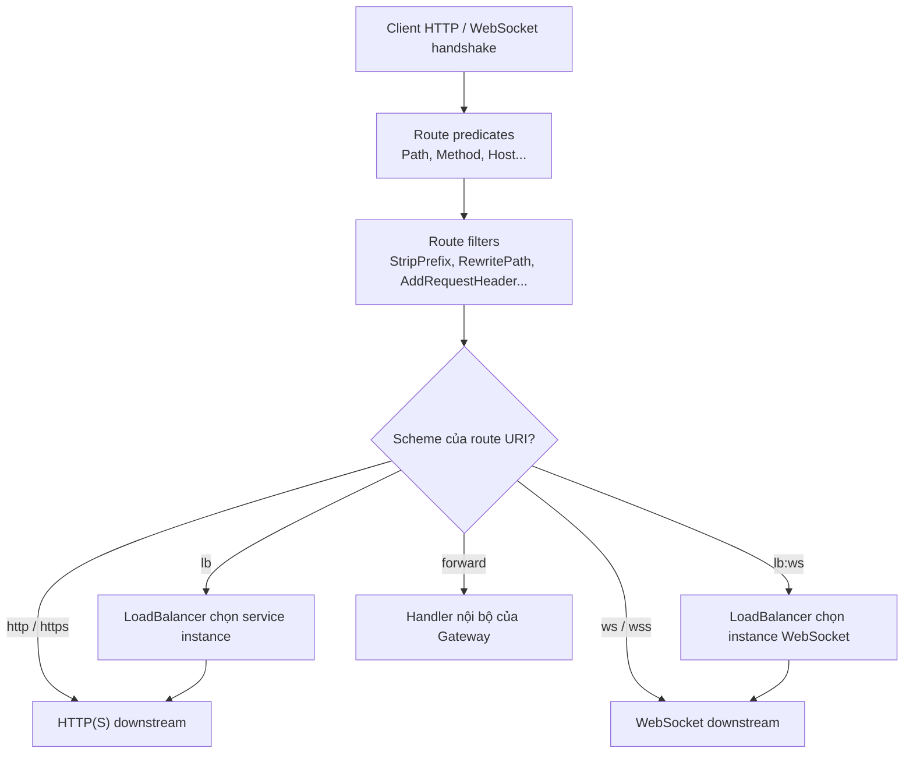

# URI đích với `http:`, `https:`, `lb:`, `ws:`, `wss:` và `forward:` theo khả năng hỗ trợ

**Chương:** Cấu hình tuyến  
**Module:** Spring Cloud Gateway (`SPRING_CLOUD_GATEWAY`)

Một route trong Spring Cloud Gateway thường có ba phần: **predicate** quyết định request nào được chọn, **filter** thay đổi hoặc kiểm soát request/response, và **URI đích** (`uri`) xác định bước tiếp theo sau khi request đã khớp. Chọn đúng URI đích quan trọng không kém cấu hình `Path`, `StripPrefix` hay `RewritePath`: chỉ khác scheme ở đầu URI đã có thể khiến Gateway dùng HTTP, TLS, WebSocket, khám phá dịch vụ hoặc chuyển tiếp vào một handler nội bộ.

Bài này tập trung vào các dạng `http:`, `https:`, `lb:`, `ws:`, `wss:` và `forward:`, cùng cách kết hợp `lb:ws:`. Các ví dụ chính sử dụng **Spring Cloud Gateway Server WebFlux**. Khả năng hỗ trợ và API giữa Server WebFlux, Server Web MVC và Proxy Exchange **không hoàn toàn giống nhau**; khi vận dụng hãy đối chiếu đúng flavor và release train của dự án.

## 1. Mục tiêu học tập

Sau khi học, bạn có thể:

1. Đọc một URI route và giải thích Gateway sẽ liên hệ trực tiếp một HTTP server, tìm instance qua load balancer, thiết lập WebSocket hay dispatch nội bộ.
2. Phân biệt **scheme mà client dùng để gọi Gateway** với **scheme Gateway dùng để gọi downstream**.
3. Viết cấu hình route WebFlux minh họa cho từng dạng đích và nhận diện các dependency bổ sung.
4. Giải thích vì sao `lb://catalog-service` không tự hoạt động nếu chưa có danh sách instance hoặc service discovery.
5. Kiểm tra path/header, TLS, HTTP status, lỗi dịch vụ và WebSocket handshake phù hợp với từng scheme.
6. Nhận diện giới hạn khi sử dụng retry, circuit breaker, rate limiting và observability theo từng kiểu kết nối.

## 2. Đọc cấu trúc URI: phần nào làm gì?

Trong route YAML:

```yaml
- id: orders
  uri: http://orders.internal:8081
  predicates:
    - Path=/api/orders/**
  filters:
    - StripPrefix=2
```

`Path=/api/orders/**` chọn request đến Gateway, `StripPrefix=2` loại bỏ hai phân đoạn đầu của đường dẫn, còn `uri` xác định đích. Ví dụ:

```text
Client -> Gateway:
  GET http://localhost:8080/api/orders/42?expand=items

Sau Path predicate + StripPrefix:
  GET /42?expand=items

Gateway -> backend:
  GET http://orders.internal:8081/42?expand=items
```

Đường dẫn ở phía backend là kết quả kết hợp **request path sau filter** với **scheme/host/port** của URI route. Đừng xem việc viết thêm path vào `uri` như một cách thay thế chắc chắn cho `StripPrefix` hoặc `RewritePath`; các quy tắc xử lý path và URL có thể khác giữa flavor/phiên bản. Đối với bài lab, dùng URI chứa scheme và authority rõ ràng, để filter xử lý path.

### Bảng tra cứu nhanh

| URI mẫu | Bước tiếp theo | Điều kiện để thực sự chạy |
|---|---|---|
| `http://localhost:8081` | HTTP request trực tiếp đến host/cổng đích | Backend phục vụ HTTP và Gateway truy cập được |
| `https://api.internal:8443` | HTTPS request trực tiếp qua TLS | Backend bật TLS, chứng chỉ/tin cậy/hostname hợp lệ |
| `lb://catalog-service` | Tìm instance của service rồi gửi request HTTP(S) | Có Spring Cloud LoadBalancer và nguồn service instances |
| `ws://localhost:9001` | Nâng cấp kết nối WebSocket đến backend | Backend thực sự hỗ trợ WebSocket handshake/endpoint |
| `wss://chat.internal:9443` | WebSocket qua TLS | WebSocket backend bật TLS và chứng chỉ hợp lệ |
| `lb:ws://chat-service` | Giải quyết service instance rồi kết nối WebSocket | WebFlux hỗ trợ phối hợp load balancer/WebSocket, service instances được cung cấp |
| `forward:/internal/status` | Chuyển request tới handler trong **chính ứng dụng Gateway** | Có handler/route nội bộ nhận path đích; flavor hỗ trợ forward |

**Chú ý:** `lb:` là bước **phân giải tên dịch vụ**, không phải giao thức mạng giống HTTP hoặc WebSocket. `forward:` cũng không tạo TCP connection đến một máy bên ngoài; đó là việc dispatch nội bộ.

## 3. Nhìn theo luồng xử lý Gateway Server WebFlux



Ở Gateway Server WebFlux, các thành phần thường được nhắc đến khi đọc mã/tài liệu là `RouteToRequestUrlFilter` (tạo URL chuyển tiếp từ route), `ReactiveLoadBalancerClientFilter` (phân giải `lb:` khi đã tích hợp), `NettyRoutingFilter` (HTTP/HTTPS), `WebsocketRoutingFilter` (WS/WSS) và `ForwardRoutingFilter` (dispatch nội bộ). Chúng cùng các filter khác tham gia vào chuỗi xử lý theo thứ tự. Đây là **cơ chế của Server WebFlux**; không suy ra tên class/filter tương ứng phải tồn tại trong Server Web MVC.

Đặc biệt, **scheme của request từ client không ép Gateway dùng cùng scheme tới backend**. Một Gateway nhận HTTPS ở cổng `443` vẫn có thể gọi backend qua HTTP trong mạng nội bộ nếu `uri: http://...`; ngược lại, Gateway nhận HTTP trong lab vẫn có thể gọi backend qua HTTPS nếu `uri: https://...` và TLS được cấu hình đúng.

## 4. `http://`: HTTP downstream trực tiếp

Đây là dạng đơn giản nhất cho thử nghiệm API REST, health check và các backend nội bộ:

```yaml
- id: echo-http
  uri: http://localhost:8081
  predicates:
    - Path=/direct/**
  filters:
    - StripPrefix=1
    - AddRequestHeader=X-Routed-Via, echo-http
```

Request `GET http://localhost:8080/direct/echo/42` sẽ đi đến `GET http://localhost:8081/echo/42` nếu backend có mapping phù hợp.

Các điểm cần nhớ:

- `http://` yêu cầu backend nói **HTTP thuần** ở host/port tương ứng. Nếu cổng backend chỉ nhận TLS, kết nối sẽ lỗi do không đúng giao thức.
- `localhost` được tính trong môi trường chạy **tiến trình Gateway**. Nếu Gateway ở container Docker, `localhost:8081` là chính container Gateway, không phải máy host hay container backend khác.
- Route predicate vẫn chạy trước; request có path không khớp sẽ không được gửi đi dù backend đang hoạt động.
- Filter `StripPrefix` tác động vào path; filter `AddRequestHeader` gửi header tới downstream. Header tự thêm chỉ phù hợp quan sát, không chứng minh danh tính Gateway.

Với môi trường Docker Compose, thay địa chỉ bằng tên dịch vụ DNS của mạng Compose, ví dụ `http://echo-backend:8081`; với Kubernetes có thể dùng DNS Service tương ứng, hoặc route `lb://` nếu có tích hợp discovery.

## 5. `https://`: HTTP downstream có TLS

Một route trực tiếp có thể trỏ đến backend HTTPS:

```yaml
- id: payment-https
  uri: https://payment.internal.example:8443
  predicates:
    - Path=/secure/**
  filters:
    - StripPrefix=1
```

Đối với request `/secure/invoices/10`, filter đưa path thành `/invoices/10`; Gateway mở một phiên HTTP qua TLS tới `payment.internal.example:8443`.

**TLS được xét riêng trên từng chặng:**

```text
Client --HTTPS--> Gateway --HTTPS--> Payment backend
          (TLS A)              (TLS B)
```

TLS A và TLS B là **hai kết nối khác nhau**, có quá trình bắt tay và chứng chỉ riêng. Gateway có thể terminate TLS từ client rồi khởi tạo TLS mới tới backend. Cấu hình HTTPS cho cổng vào Gateway không tự cấu hình trust của HTTP client outbound, và chọn `https://` không tự tạo chứng chỉ cho backend.

Khi gặp lỗi kết nối `https://`, kiểm tra:

1. DNS, firewall và cổng downstream có truy cập được không.
2. Backend có thật sự phục vụ TLS trên cổng đó không.
3. Chứng chỉ có còn hạn, có chuỗi CA được tin cậy và khớp hostname/SNI không.
4. Trust material, mTLS client certificate (nếu backend yêu cầu) và cấu hình HTTP client của **Gateway flavor đang dùng**.
5. Timeout kết nối và handshake có phù hợp môi trường mạng không.

Trong phát triển có thể có máy chủ tự ký chứng chỉ, nhưng **không dùng chế độ bỏ qua certificate/hostname validation trong production**. Nếu thử nghiệm dùng CA nội bộ, cấu hình Gateway tin CA đó đúng cách.

## 6. `lb://`: tìm service instance rồi định tuyến

Thay vì gắn host/cổng cố định, dùng tên logic của backend:

```yaml
- id: catalog-lb
  uri: lb://catalog-service
  predicates:
    - Path=/catalog/**
  filters:
    - StripPrefix=1
```

Với cấu hình này, Gateway cố tìm một instance của `catalog-service`. Nếu chọn được `http://10.0.2.15:8082`, request `GET /catalog/products/42` sẽ được gửi đến `GET http://10.0.2.15:8082/products/42`. Nếu lần sau load balancer chọn instance khác, URL downstream có thể thay đổi dù client và route vẫn giữ nguyên.

### 6.1. Các dependency cần thiết

Đối với Gateway Server WebFlux và Spring Cloud phù hợp, một ứng dụng dùng `lb://` thường cần:

```xml
<dependency>
    <groupId>org.springframework.cloud</groupId>
    <artifactId>spring-cloud-starter-gateway-server-webflux</artifactId>
</dependency>
<dependency>
    <groupId>org.springframework.cloud</groupId>
    <artifactId>spring-cloud-starter-loadbalancer</artifactId>
</dependency>
```

Đồng thời, ứng dụng phải có **nguồn danh sách instance**: Eureka, Consul, Kubernetes discovery client hoặc cơ chế cấu hình thủ công tương thích. Starter LoadBalancer cung cấp logic chọn instance, **không tự biến tên bất kỳ thành một địa chỉ thật**.

### 6.2. Thử bằng instance tĩnh

Khi chưa có service registry, có thể dùng `SimpleDiscoveryClient` với một instance thử nghiệm. Trong ứng dụng Gateway có thể khai báo cấu hình tương tự:

```yaml
spring:
  cloud:
    discovery:
      client:
        simple:
          instances:
            catalog-service:
              - uri: http://localhost:8081
```

Sau khi khởi động backend HTTP ở `8081` và Gateway có đủ thành phần load balancing/discovery, request `GET http://localhost:8080/catalog/echo/42` có thể được đưa tới `GET http://localhost:8081/echo/42`. Nếu không có instance phù hợp, Gateway Server WebFlux thường trả `503 Service Unavailable` theo mặc định trong tình huống không tìm được instance; hành vi này có thể được tùy chỉnh theo phiên bản/cấu hình, nên cần đọc log để phân biệt với `503` do backend trả.

### 6.3. Khi service instance dùng TLS

Đừng suy ra `lb://` luôn là HTTP thuần. Trong Gateway Server WebFlux, scheme downstream có thể được quyết định từ thông tin `ServiceInstance.isSecure` và cách Gateway xử lý scheme prefix. Vì vậy:

- Cần công bố đúng cổng và cờ bảo mật của instance trong registry.
- Nếu instance thực tế dùng HTTPS, Gateway vẫn cần trust chứng chỉ của backend.
- Kết nối HTTPS của client đến Gateway không phải căn cứ để khẳng định backend cũng dùng HTTPS.
- Không xem `lb://` như lời đảm bảo service discovery luôn chọn đúng instance; phải kiểm tra trạng thái registry, metadata và load balancer.

**Phân biệt hai cơ chế:** `uri: lb://catalog-service` là **route tĩnh trỏ đến service name**. Tính năng tự sinh route từ discovery client (*discovery locator*) là cấu hình khác, không bắt buộc để dùng một route `lb://` được khai báo thủ công.

## 7. `ws://` và `wss://`: kết nối WebSocket

WebSocket bắt đầu bằng một HTTP handshake yêu cầu nâng cấp kết nối (*Upgrade*). Sau khi nâng cấp thành công, client và server trao đổi các frame qua kết nối lâu dài; đây **không còn là request-response REST thông thường**.

### 7.1. WebSocket không TLS: `ws://`

```yaml
- id: chat-ws
  uri: ws://localhost:9001
  predicates:
    - Path=/socket/plain/**
  filters:
    - StripPrefix=2
```

Client kết nối `ws://localhost:8080/socket/plain/rooms/general`, Gateway chọn route rồi chuyển handshake tới `ws://localhost:9001/rooms/general`. Backend tại `9001` **phải có WebSocket endpoint** cho path này; một REST controller `@GetMapping` thông thường không tự biến thành WebSocket server.

### 7.2. WebSocket có TLS: `wss://`

```yaml
- id: chat-wss
  uri: wss://chat.internal.example:9443
  predicates:
    - Path=/socket/tls/**
  filters:
    - StripPrefix=2
```

Với `wss://`, Gateway thực hiện WebSocket handshake trên kết nối đã bảo vệ bằng TLS. Tương tự `https://`, cần hostname, cổng, CA/truststore và chứng chỉ backend chính xác. **`https://` không thay thế được `wss://`** khi mục tiêu là proxy WebSocket ở Server WebFlux.

### 7.3. WebSocket qua load balancer: `lb:ws://`

Gateway Server WebFlux có dạng kết hợp:

```yaml
- id: chat-ws-lb
  uri: lb:ws://chat-service
  predicates:
    - Path=/socket/cluster/**
  filters:
    - StripPrefix=2
```

Ý tưởng là giải quyết `chat-service` thành instance thích hợp, sau đó chuyển tiếp qua WebSocket. Đây là **cú pháp scheme prefix** trong Server WebFlux, không phải URL mà một WebSocket client sẽ gọi trực tiếp. Client vẫn kết nối `ws://...` hoặc `wss://...` vào **địa chỉ của Gateway**.

Với WebSocket, hãy xét kỹ: session và kết nối dài hạn, timeout idle/ping-pong, giới hạn concurrent connections, kích thước frame/message, xác thực ở handshake và chiến lược phân phối session. Retry HTTP thông thường không đảm bảo khôi phục được kết nối sau khi đã nâng cấp; ứng dụng client thường cần logic reconnect và bảo toàn trạng thái nghiệp vụ.

**Lưu ý kỹ thuật:** một số hệ thống WebSocket có URL HTTP phụ để long polling hoặc fallback (ví dụ một số triển khai SockJS). Các request HTTP đó có thể cần route HTTP riêng; việc chỉ cấu hình `ws://` chưa đủ cho toàn bộ giao thức ứng dụng.

## 8. `forward:/`: dispatch vào handler nội bộ Gateway

`forward:` được dùng để xử lý một request **bên trong chính ứng dụng Gateway** thay vì mở kết nối đến host khác. Trên Gateway Server WebFlux, ví dụ:

```yaml
- id: local-status
  uri: forward:/internal/status
  predicates:
    - Path=/local/status
```

Nếu ứng dụng Gateway có một handler WebFlux như:

```java
import java.util.Map;
import org.springframework.web.bind.annotation.GetMapping;
import org.springframework.web.bind.annotation.RestController;

@RestController
public class LocalStatusController {

    @GetMapping("/internal/status")
    public Map<String, String> status() {
        return Map.of("origin", "gateway-local-handler", "status", "UP");
    }
}
```

Request `GET http://localhost:8080/local/status` sẽ được route Gateway tiếp nhận rồi dispatch tới `/internal/status` trong cùng ứng dụng. Không cần một service đang lắng nghe ở host/cổng khác.

**Những giới hạn quan trọng:**

- `forward:/internal/status` **không tương đương** `http://localhost:8080/internal/status`: cách sau phát sinh một HTTP call tới địa chỉ network (và có thể lại đi qua Gateway), còn `forward:` dùng dispatch nội bộ.
- Handler nội bộ phải tồn tại và được web framework hỗ trợ; nếu không, request vẫn có thể nhận `404`.
- Tránh cấu hình chuyển tiếp quay về cùng route đang khớp, gây lặp/chạy đệ quy hoặc lỗi dispatch.
- Forward thường được dùng cùng handler dự phòng (*fallback*) hoặc endpoint nội bộ; nó không thay thế cơ chế discovery/load balancing.
- Nếu dùng `CircuitBreaker` với `fallbackUri: forward:/...`, đó là **cách cấu hình fallback riêng của filter**, không nên đồng nhất `fallbackUri` với `uri` chính của route.

## 9. Khi nào khả năng hỗ trợ phụ thuộc flavor?

Spring Cloud Gateway có các biến thể **Gateway Server WebFlux**, **Gateway Server Web MVC** và **Proxy Exchange** (MVC/WebFlux). Các tên scheme giống nhau không có nghĩa là cấu hình và routing filter được dùng hoàn toàn giống nhau.

| Thành phần | Gateway Server WebFlux | Gateway Server Web MVC | Proxy Exchange |
|---|---|---|---|
| HTTP/HTTPS downstream | Dùng route URI và pipeline HTTP của WebFlux | Có routing HTTP/HTTPS với cơ chế Web MVC; kiểm cú pháp theo phiên bản | Chuyển tiếp trong annotated handler qua API `ProxyExchange` |
| `lb://` | Tích hợp reactive load balancing + discovery/instances | Cần cơ chế load balancing phù hợp stack MVC và phiên bản | Không tự nhận tính năng từ route `lb://` của Gateway Server |
| `ws://`, `wss://` | Có WebSocket routing trong Server WebFlux | Kiểm tra tài liệu **chính xác** của Server MVC phiên bản đang chạy trước khi dựa vào hỗ trợ tương đương | Không mặc nhiên có WebSocket route từ API proxy HTTP |
| `lb:ws://` | Dạng kết hợp được Server WebFlux hỗ trợ | Không giả định có hỗ trợ giống WebFlux | Không áp dụng như route config tự động |
| `forward:/` | Có internal dispatch trong WebFlux | Khả năng forward/cú pháp handler phụ thuộc cơ chế MVC tương ứng | Không phải URI route do Server sử dụng |
| Prefix cấu hình | Ví dụ `spring.cloud.gateway.server.webflux.routes` | Dùng cấu hình/DSL riêng, ví dụ `spring.cloud.gateway.server.webmvc.routes` ở dòng tương ứng | Khai báo logic trong controller, không dùng danh sách `routes` của Server |

Trong dòng Spring Cloud 2025.0 trở lên, starter Server WebFlux thường dùng tên `spring-cloud-starter-gateway-server-webflux`; Server Web MVC dùng `spring-cloud-starter-gateway-server-webmvc`. Tên dependency và prefix cấu hình của những phiên bản trước có thể khác (ví dụ các dự án WebFlux cũ dùng `spring.cloud.gateway.routes`). Không sao chép nguyên ví dụ WebFlux vào Web MVC hoặc đưa YAML Server cho Proxy Exchange rồi chờ tính năng tự hoạt động.

## 10. Bài thực hành tích hợp HTTP, load balancing và forward

Ví dụ này chỉ sử dụng những đích có thể tự dựng nhanh: một HTTP backend, một instance tĩnh qua load balancer và handler nội bộ Gateway. Các route HTTPS/WSS/WS ở phần sau là mẫu nâng cao vì phải có backend TLS hoặc WebSocket thật.

### 10.1. Backend tối thiểu ở cổng 8081

Tạo một ứng dụng Spring Boot có dependency **Spring Web**. Trong `src/main/resources/application.yml` của backend:

```yaml
server:
  port: 8081
```

Ví dụ file `EchoApplication.java` (Java 17+, Spring Boot 3.x):

```java
package com.example.echo;

import jakarta.servlet.http.HttpServletRequest;
import java.util.Map;
import org.springframework.boot.SpringApplication;
import org.springframework.boot.autoconfigure.SpringBootApplication;
import org.springframework.web.bind.annotation.GetMapping;
import org.springframework.web.bind.annotation.PathVariable;
import org.springframework.web.bind.annotation.RestController;

@SpringBootApplication
public class EchoApplication {
    public static void main(String[] args) {
        SpringApplication.run(EchoApplication.class, args);
    }
}

@RestController
class EchoController {
    @GetMapping("/echo/{id}")
    public Map<String, String> echo(
            @PathVariable String id,
            HttpServletRequest request) {
        return Map.of(
                "service", "echo-backend",
                "id", id,
                "method", request.getMethod(),
                "path", request.getRequestURI());
    }
}
```

Chạy backend bằng Maven Wrapper hoặc IDE, sau đó xác minh:

```bash
curl -i http://localhost:8081/echo/42
```

Body kỳ vọng:

```json
{
  "service": "echo-backend",
  "id": "42",
  "method": "GET",
  "path": "/echo/42"
}
```

Nếu lệnh gọi trực tiếp chưa thành công, sửa backend trước khi kiểm thử Gateway.

### 10.2. Gateway tại cổng 8080

Tạo ứng dụng Spring Cloud Gateway Server WebFlux có Spring Cloud BOM tương thích với Spring Boot đang dùng, thêm starter Gateway Server WebFlux và Spring Cloud LoadBalancer như phần 6.1. Trong `application.yml` của Gateway:

```yaml
server:
  port: 8080

spring:
  cloud:
    discovery:
      client:
        simple:
          instances:
            catalog-service:
              - uri: http://localhost:8081
    gateway:
      server:
        webflux:
          routes:
            - id: echo-http
              uri: http://localhost:8081
              predicates:
                - Path=/direct/**
              filters:
                - StripPrefix=1
                - AddRequestHeader=X-Routed-Via, echo-http
            - id: catalog-lb
              uri: lb://catalog-service
              predicates:
                - Path=/catalog/**
              filters:
                - StripPrefix=1
            - id: local-status
              uri: forward:/internal/status
              predicates:
                - Path=/local/status
```

Thêm `LocalStatusController` của phần 8 vào ứng dụng Gateway. Sau đó chạy Gateway và thử:

```bash
# HTTP trực tiếp từ Gateway đến backend:
curl -i http://localhost:8080/direct/echo/42

# Gateway resolve catalog-service rồi gọi cùng backend:
curl -i http://localhost:8080/catalog/echo/42

# Gateway dispatch tới handler local, không gọi backend:
curl -i http://localhost:8080/local/status
```

Kỳ vọng:

| Request đến Gateway | Route chọn | Nơi xử lý cuối | Dấu hiệu trong response |
|---|---|---|---|
| `GET /direct/echo/42` | `echo-http` | Backend `localhost:8081` | `service=echo-backend`, `path=/echo/42` |
| `GET /catalog/echo/42` | `catalog-lb` | Instance của `catalog-service` (trong lab là cổng `8081`) | Cùng nội dung backend, path `/echo/42` |
| `GET /local/status` | `local-status` | Handler `/internal/status` ngay trong Gateway | `origin=gateway-local-handler` |

Trong thực hành này, cả route HTTP trực tiếp và route load balanced đều chọn **cùng một backend** để dễ đối chiếu kết quả. Việc cả hai trả cùng JSON không chứng minh đã có phân phối nhiều instance; muốn kiểm tra cân bằng tải, phải khai báo nhiều instance và định danh từng instance trong phản hồi.

### 10.3. Tại sao không kiểm hết sáu scheme bằng một backend?

Vì transport thực chất khác nhau:

- Backend Spring MVC `@GetMapping` thông thường không tự chấp nhận WebSocket handshake. Test `ws://` cần một backend đăng ký WebSocket handler.
- `https://` và `wss://` cần máy chủ TLS được cấu hình certificate/key thích hợp.
- `lb://` cần một nguồn instance, ở lab dùng `SimpleDiscoveryClient`; trong microservices thực tế có thể là registry/cluster.
- `forward:` cần handler tại Gateway, không phải backend khác.

Thử `wss://localhost:8081` khi backend `8081` chỉ chạy HTTP sẽ lỗi handshake TLS; điều đó là **sai giao thức đích**, không phải do predicate `Path`.

## 11. Kiểm thử WebSocket, HTTPS và WSS đúng cách

### 11.1. Chuẩn bị WebSocket backend

Giả sử một backend WebSocket đã chạy ở `localhost:9001`, có endpoint `/rooms/general` hỗ trợ bắt tay WebSocket và xử lý text frame. Với route `chat-ws` ở phần 7:

```text
Client kết nối:
  ws://localhost:8080/socket/plain/rooms/general

Gateway gửi handshake tới:
  ws://localhost:9001/rooms/general
```

Có thể dùng một WebSocket client tương tác như `wscat` (nếu đã cài):

```bash
wscat -c ws://localhost:8080/socket/plain/rooms/general
```

**Dấu hiệu thành công:** handshake nâng cấp giao thức được chấp nhận (thường HTTP `101 Switching Protocols`) và client trao đổi được frame với backend. Việc chạy `curl -i` với một HTTP GET thông thường tới URL này **không phải phép thử WebSocket hoàn chỉnh**, vì nó thiếu các header và quy trình upgrade cần thiết.

Nếu cần `lb:ws://chat-service`, cung cấp các instance WebSocket hợp lệ cho `chat-service`, rồi dùng client kết nối tới path của route `chat-ws-lb`. Kiểm tra quy tắc xử lý scheme/TLS/secure flag và metadata instance trong phiên bản hiện dùng; không coi mọi registry record HTTP là endpoint WebSocket.

### 11.2. Kiểm tra HTTPS downstream

Với route `payment-https`, trước tiên xác minh backend thật sự lắng nghe tại `payment.internal.example:8443` bằng TLS, sau đó gọi Gateway:

```bash
curl -i http://localhost:8080/secure/invoices/10
```

Trong ví dụ này, `http://localhost:8080` chỉ là kết nối **client → Gateway trong lab**. Không thể nhìn vào scheme trong lệnh cURL để biết kết nối **Gateway → backend** dùng HTTP hay HTTPS: thông tin đó nằm trong cấu hình route và quan sát tại gateway/backend.

Nếu TLS downstream thất bại, xem log handshake và nguyên nhân chứng chỉ, hostname, SNI hoặc trust material. Không giải quyết lỗi bằng cách chuyển sang `http://` trừ khi backend và chính sách hệ thống thực sự cho phép bỏ TLS trên chặng đó.

### 11.3. Kiểm tra WSS downstream

Với route `chat-wss`, client có thể kết nối vào Gateway qua `ws://` trong một bài lab được kiểm soát, còn Gateway mở `wss://` tới backend theo route. Trong production, **cũng phải bảo vệ chặng client → Gateway** bằng TLS phù hợp (thường client dùng `wss://`), bảo đảm xác thực handshake và quản lý kết nối dài hạn.

Khi không kết nối được, xác định lỗi nằm ở **kết nối đầu vào**, **route predicate**, **TLS đi ra**, **WebSocket handshake tại backend** hay **xử lý frame sau handshake**. Chỉ nhìn một mã HTTP hoặc một dòng log cổng vào thường chưa đủ.

## 12. Chọn URI theo nhu cầu thực tế

| Nhu cầu | URI nên xem xét | Lý do |
|---|---|---|
| Một dịch vụ REST có host/port cố định trong lab | `http://host:port` | Dễ thiết lập và cô lập lỗi |
| REST backend yêu cầu mã hóa và xác thực máy chủ | `https://host:port` | TLS cho chặng Gateway → backend |
| Nhiều instance cùng service được registry quản lý | `lb://service-id` | Trừu tượng hóa địa chỉ instance và chọn nơi gửi |
| Chat/notification endpoint WebSocket không TLS ở mạng lab | `ws://host:port` | Đúng giao thức nâng cấp WebSocket |
| WebSocket backend qua TLS | `wss://host:port` | Bảo vệ kết nối WebSocket downstream |
| WebSocket backend nhiều instance | `lb:ws://service-id` nếu flavor/phiên bản hỗ trợ | Kết hợp chọn instance và WebSocket routing |
| Handler phụ trợ/fallback chạy bên trong ứng dụng Gateway | `forward:/internal/path` | Internal dispatch, không phải network proxy |

**Quy tắc chọn:** xác định trước loại kết nối backend thực sự cung cấp (**HTTP API, WebSocket hay handler nội bộ**), sau đó hỏi đích là một host cố định hay một tên dịch vụ cần phân giải. Sau cùng kiểm tra TLS, phiên bản và flavor.

Một endpoint REST trả JSON thông thường không thể “trở thành WebSocket” chỉ vì cấu hình `uri: ws://...`. Tương tự, `lb://` chỉ đổi bước chọn instance, không tự tạo circuit breaker, retry hoặc bảo vệ TLS.

## 13. Lỗi thường gặp và cách phân biệt

| Triệu chứng | Nguyên nhân hay gặp | Kiểm tra đầu tiên |
|---|---|---|
| `404 Not Found` khi gọi Gateway | Không có route khớp `Path`/`Method` | Kiểm tra request URL client và predicate |
| Backend nhận được request nhưng trả `404` | Path sau `StripPrefix`/`RewritePath` không khớp handler | So sánh path backend nhận với mapping |
| Gateway lỗi kết nối tới `http://localhost:8081` | Backend tắt, sai cổng hoặc Gateway chạy trong container | Gọi thử backend từ môi trường có cùng network với Gateway |
| HTTP backend chỉ nhận TLS, route lại dùng `http://` | Scheme không đúng giao thức backend | Kiểm tra backend có bắt tay HTTPS không |
| Lỗi chứng chỉ/hostname khi dùng `https://` | Truststore, hostname, SNI hoặc certificate chain | Đọc log TLS Gateway và cấu hình chứng chỉ backend |
| `lb://catalog-service` không có instance | Thiếu load balancer, registry/instance config hoặc sai service-id | Kiểm tra dependency, health và danh sách instances |
| `lb://` trả 503 dù backend vẫn chạy direct | Không giải quyết được service instance; đôi khi health/discovery trả rỗng | Kiểm tra `SimpleDiscoveryClient`/registry, phân biệt 503 do backend |
| `ws://` trả 400/404 hoặc upgrade thất bại | Backend không có WS endpoint, path sai hoặc client không gửi handshake hợp lệ | Test WS backend trực tiếp bằng WS client |
| `wss://` bị handshake TLS lỗi | Endpoint chỉ hỗ trợ WS thuần hoặc trust/cert sai | Kiểm tra TLS backend trước handshake WebSocket |
| WebSocket kết nối được nhưng nhanh chóng đứt | Timeout idle, proxy/network, ping-pong, backend lỗi | Đọc log ở Gateway/backend và lifecycle WS client |
| `forward:/internal/status` trả `404` | Handler local không có hoặc path sai | Kiểm tra mapping ở cùng ứng dụng Gateway |
| Forward dẫn tới vòng lặp hoặc lỗi dispatch | Target quay về route ban đầu | Tách rõ path route công khai và path local |
| Cấu hình `routes` không có tác dụng | Dùng prefix sai flavor/version | Đối chiếu config của Server WebFlux/Web MVC đang chạy |

Không khẳng định một mã trạng thái cụ thể cho **mọi** lỗi downstream: lỗi DNS, không có instance, lỗi TCP, TLS, timeout, route mismatch và phản hồi lỗi do backend tạo ra được xử lý ở các tầng khác nhau. Mã phản hồi cuối còn phụ thuộc exception handler, filter và phiên bản Gateway.

### Một quy trình debug đáng tin cậy

1. Xác nhận Gateway tải route và predicate thực sự khớp request.
2. Kiểm tra path sau `StripPrefix` hoặc `RewritePath`; so sánh với endpoint backend.
3. Xác nhận loại đích: HTTP/HTTPS, WebSocket, load-balanced hay forward nội bộ.
4. Với HTTP/HTTPS/WS/WSS, kiểm tra DNS, network, port và giao thức mà downstream hỗ trợ; với `lb://` kiểm tra instances; với `forward:` kiểm tra handler local.
5. Nếu có TLS, kiểm tra hai chặng TLS và hostname/truststore; nếu có WebSocket, kiểm tra handshake/upgrade và trạng thái kết nối sau nâng cấp.
6. Đối chiếu log request ở client, Gateway và backend bằng request ID hoặc trace ID phù hợp.

## 14. URI đích liên quan thế nào đến filter, bảo mật và quan sát?

### 14.1. Scheme không thay thế filter chain

`uri: lb://orders-service` chỉ quyết định cách tìm backend, không giới hạn tần suất request. `uri: https://payment.internal.example` chỉ thiết lập TLS downstream, không mặc nhiên xác thực quyền người dùng. Với Gateway an toàn, vẫn cần thiết kế:

- **Predicate và filter:** xác định route chính xác; chuẩn hóa path/header, tránh lộ header nhạy cảm, áp dụng xác thực/ủy quyền ở lớp phù hợp.
- **Rate limiting:** hạn chế tốc độ theo danh tính/key và tài nguyên; một kết nối WebSocket lâu dài cần thêm giới hạn phiên/frame phù hợp.
- **Circuit breaker/timeout/retry:** bảo vệ HTTP call đến backend lỗi/chậm; chỉ retry thao tác an toàn hoặc có thiết kế idempotency. Không dùng cùng kỳ vọng retry cho kết nối WebSocket đã nâng cấp.
- **TLS:** tách bảo vệ inbound/outbound; xác minh CA, hostname, mTLS khi cần.
- **Observability:** theo dõi route ID, service/instance đích, mã HTTP, số lần gọi, latency và lỗi TLS/WS; dùng metric/tracing của stack và phiên bản đang vận hành.

### 14.2. Tránh chuyển tiếp đến URI do client kiểm soát

Nếu URI đích hoặc host được tạo từ query/header do người dùng tùy ý cung cấp, hệ thống có nguy cơ bị lạm dụng để gọi tài nguyên mạng nội bộ (*server-side request forgery*). Hãy khai báo đích từ cấu hình tin cậy hoặc service registry đã kiểm soát, hạn chế quyền sửa route, kiểm soát network egress và không cho phép caller tự chọn scheme/host/port tùy ý.

Với `forward:`, giới hạn quyền truy cập handler nội bộ theo nhu cầu thực tế; route công khai có thể vô tình làm lộ một endpoint vốn được viết để sử dụng nội bộ. Với `lb://`, bảo vệ thông tin discovery/instance; với WebSocket, thực hiện xác thực và kiểm tra origin/cookie/token trong handshake theo chính sách ứng dụng.

### 14.3. Các chỉ số nên quan sát

| Loại route | Nên thu thập | Lý do |
|---|---|---|
| `http:/https:` | Route ID, method, status, downstream time, timeout, TLS failure | Phân biệt lỗi ứng dụng với lỗi kết nối |
| `lb:` | Service ID, instance đã chọn, số instance sẵn có, lỗi resolve/load balance | Phát hiện discovery rỗng hoặc instance không khỏe |
| `ws:/wss:` | Thành công handshake, số kết nối hoạt động, thời lượng phiên, đóng kết nối, TLS/upgrade error | Một request handshake có thể mở phiên kéo dài |
| `forward:` | Route ID, local handler, status, latency và lỗi dispatch | Xác minh xử lý nội bộ, tránh vòng lặp |

Không log token/cookie, dữ liệu cá nhân hoặc body nhạy cảm để “dễ debug”. Dùng correlation ID/tracing và cấu hình logging có kiểm soát. Gateway có metric/actuator hỗ trợ theo flavor và dependency; khi bật actuator route management, phải bảo vệ endpoint quản trị và không công khai cấu hình nhạy cảm.

## 15. Câu hỏi tự kiểm tra

1. Client dùng `https://gateway.example` nhưng Gateway route có `uri: http://catalog.internal`. Kết nối Gateway → catalog được mã hóa bằng TLS không? Cần thay đổi điều gì nếu bắt buộc TLS hai chặng?
2. Hai backend cùng tên `order-service` được registry cung cấp tại hai IP khác nhau. Tại sao route `lb://order-service` không cần hard-code IP? Điều gì xảy ra khi danh sách instance rỗng?
3. Request `GET /direct/echo/42` tới Gateway với `StripPrefix=1` sẽ đến path nào trên backend? Nếu đổi `StripPrefix=2` thì cần xét gì?
4. Vì sao `ws://localhost:9001` không thể proxy tới một REST handler chỉ biết `@GetMapping("/echo")`?
5. `forward:/internal/status` khác `http://localhost:8080/internal/status` ở đâu về network và nguy cơ loop?
6. Khi chuyển ứng dụng Gateway từ WebFlux sang Web MVC, vì sao phải kiểm tra lại khả năng WebSocket routing và cấu hình `routes`?
7. Nếu `lb://` route trả lỗi nhưng direct `http://localhost:8081` chạy tốt, bạn sẽ kiểm tra LoadBalancer hay backend đầu tiên?

**Gợi ý đối chiếu:** câu 1 — route outbound dùng HTTP, cần chuyển sang HTTPS và cấu hình TLS backend/trust đúng; câu 2 — load balancer chọn instance từ nguồn discovery, danh sách rỗng dẫn đến lỗi định tuyến; câu 3 — path sau khi bỏ một segment là `/echo/42`; câu 4 — WebSocket cần handshake/handler WS; câu 5 — forward dispatch trong app thay vì mở HTTP call; câu 6 — mỗi flavor có pipeline và feature set khác nhau; câu 7 — kiểm tra nguồn service instances, dependency và khả năng resolve tên.

## 16. Tổng kết

Trong **Spring Cloud Gateway Server WebFlux**, `http:` và `https:` chọn giao thức HTTP downstream, `ws:` và `wss:` chọn WebSocket, `lb:` phân giải tên service thành instance, còn `forward:` chuyển xử lý vào ứng dụng Gateway. Dạng `lb:ws://` kết hợp load balancing với WebSocket routing. Mọi route vẫn phải có predicate khớp và filter phù hợp để tạo URL downstream đúng.

Để vận hành cổng vào microservices an toàn, chọn scheme từ giao thức thực tế của backend và topology triển khai, kiểm tra khả năng hỗ trợ theo flavor/phiên bản, rồi mới bổ sung xác thực, giới hạn lưu lượng, circuit breaker, retry, TLS và quan sát request. Đừng nhầm một scheme định tuyến với một chính sách bảo mật hoặc khả năng chịu lỗi tự động.

## Tài liệu tham khảo chính thức

1. [Spring Cloud Gateway — Reference Documentation](https://docs.spring.io/spring-cloud-gateway/reference/).
2. [Spring Cloud Gateway Server WebFlux — Route Predicate Factories](https://docs.spring.io/spring-cloud-gateway/reference/spring-cloud-gateway-server-webflux/request-predicates-factories.html).
3. [Spring Cloud Gateway Server WebFlux — Global Filters](https://docs.spring.io/spring-cloud-gateway/reference/spring-cloud-gateway-server-webflux/global-filters.html).
4. [Spring Cloud Gateway Server WebFlux — WebSocket Routing](https://docs.spring.io/spring-cloud-gateway/reference/spring-cloud-gateway-server-webflux/websocket-routing-filter.html).
5. [Spring Cloud Gateway Server WebFlux — TLS and SSL](https://docs.spring.io/spring-cloud-gateway/reference/spring-cloud-gateway-server-webflux/tls-and-ssl.html).
6. [Spring Cloud Gateway Server Web MVC — Reference](https://docs.spring.io/spring-cloud-gateway/reference/spring-cloud-gateway-server-webmvc.html).
7. [Spring Cloud LoadBalancer — Reference](https://docs.spring.io/spring-cloud-commons/reference/spring-cloud-commons/loadbalancer.html).

> **Lưu ý về release train:** các URL tài liệu mặc định thường trỏ đến phiên bản hiện hành. Khi ứng dụng sử dụng Spring Boot/Spring Cloud phiên bản khác, chọn đúng bản tài liệu tương ứng trước khi áp dụng tên starter, tên filter, prefix cấu hình và các route scheme ít phổ biến.
