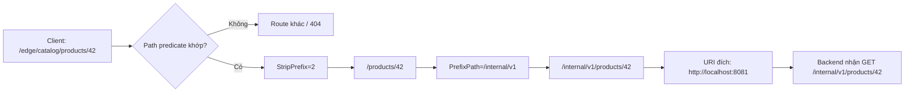

# Ý nghĩa đường dẫn trong URI đích và cấu hình rewrite riêng

## 1. Vấn đề thực tế khi cấu hình tuyến

Trong hệ thống microservices, một API Gateway thường cung cấp đường dẫn công khai khác với đường dẫn mà dịch vụ nội bộ đang sử dụng. Ví dụ:

- Client gọi **`GET /edge/catalog/products/42`** qua Spring Cloud Gateway.
- Gateway chọn dịch vụ **catalog-service** tại **`http://localhost:8081`**.
- Backend chỉ có endpoint **`GET /internal/v1/products/42`**.

Một sai lầm phổ biến là thêm `/internal/v1` vào cuối `uri` của route rồi mong Gateway tự ghép đường dẫn. Với **Spring Cloud Gateway Server WebFlux và Server Web MVC**, tài liệu chính thức nêu rõ **phần path khai báo trong route URI bị bỏ qua** khi proxy HTTP(S). Để đáp ứng API phía trên, ta phải **khai báo phép đổi đường dẫn riêng bằng filter**.

Đây là bài học thuộc chương **Cấu hình tuyến** của module **SPRING_CLOUD_GATEWAY**. Sau bài này, bạn sẽ:

1. Phân biệt path từ **request của client**, path trong **route URI đích**, và path **sau khi filter rewrite**.
2. Hiểu vì sao `uri: http://localhost:8081/internal/v1` không tự thêm prefix vào request downstream.
3. Dùng đúng các filter `StripPrefix`, `PrefixPath`, `RewritePath` và `SetPath`.
4. Xây dựng route cho cùng một backend bằng YAML và Java DSL, biết khác biệt giữa WebFlux và Web MVC.
5. Kiểm chứng HTTP path, query, header và lỗi định tuyến trong quá trình vận hành, trước khi mở rộng sang discovery, xác thực và các chính sách bảo vệ.

> **Phạm vi phiên bản:** Các ví dụ dưới đây sử dụng namespace cấu hình của **Spring Cloud Gateway Server 5.0.x**. Hãy dùng starter, BOM và tài liệu của đúng phiên bản ứng dụng. Spring Cloud Gateway 4.x có thể dùng namespace cấu hình cũ; Gateway Server Web MVC và WebFlux có API Java khác nhau. Trọng tâm của bài là route HTTP(S) ra một dịch vụ khác. Trường hợp `forward:` đến handler nội bộ được phân biệt riêng ở mục 9.

## 2. Ba khái niệm đường dẫn cần tách bạch

| Khái niệm | Ví dụ | Công dụng |
|---|---|---|
| **Path client gửi tới gateway** | `/edge/catalog/products/42` | Dữ liệu đầu vào; được kiểm tra bởi route predicate `Path` |
| **Path nằm trong URI của route** | `/internal/v1` trong `http://localhost:8081/internal/v1` | **Không tự làm base path** của request proxy HTTP(S) |
| **Path sau filter** | `/internal/v1/products/42` | Đường dẫn thực tế mà backend nhận được nếu filter biến đổi đúng |

**Route URI** thông thường cho biết **scheme** (`http`/`https`), **host** và **port** của backend. Trong khi đó, `Path` predicate chỉ kiểm tra **request có vào route hay không**. Các **gateway filter** mới quyết định có giữ, xóa, thay thế hoặc thêm segment trong đường dẫn trước khi proxy.



Trong sơ đồ, hai phép biến đổi chạy **trước lời gọi HTTP downstream**. Chúng tạo path cho request; URI đích cung cấp địa chỉ của server. Query string, ví dụ `?lang=vi`, là thành phần riêng với path và vẫn được chuyển tiếp trong những ví dụ không có filter sửa query.

### 2.1. Path predicate không phải path rewrite

```yaml
predicates:
  - Path=/edge/catalog/**
```

Dòng này có nghĩa là *chọn route cho các request có path phù hợp với mẫu*, ví dụ `/edge/catalog/products/42`. Nó **không có nghĩa** “xóa `/edge/catalog`” hoặc “chuyển path xuống `/products/42`”. Muốn làm vậy, phải thêm filter.

### 2.2. URI đích không phải URL đầy đủ được nối chuỗi

Đừng nghĩ Spring Cloud Gateway thực hiện phép nối:

```text
uri của route                       = http://localhost:8081/internal/v1
path client                         = /edge/catalog/products/42
KỲ VỌNG SAI (ghép chuỗi)             = /internal/v1/edge/catalog/products/42
KỲ VỌNG SAI (tự thay prefix)         = /internal/v1/products/42
ĐÚNG khi KHÔNG có path filter       = /edge/catalog/products/42
```

Tài liệu **How It Works** của **cả Server WebFlux lẫn Server Web MVC** quy định phần path trong `uri` route bị bỏ qua. Vì thế, trong route proxy HTTP(S), hãy viết URI đơn giản, rõ đích như `http://localhost:8081`, rồi cấu hình rewrite bằng filter.

## 3. Anti-pattern: đặt base path vào `uri`

Xét một route **Gateway Server WebFlux 5.0.x** cấu hình như sau:

```yaml
spring:
  cloud:
    gateway:
      server:
        webflux:
          routes:
            - id: catalog-wrong
              uri: http://localhost:8081/internal/v1
              predicates:
                - Path=/edge/catalog/**
```

Nếu client gọi:

```bash
curl -i 'http://localhost:8080/edge/catalog/products/42?lang=vi'
```

thì request được chuyển tới backend ở **`localhost:8081`** nhưng có **path `/edge/catalog/products/42`** vì không có filter đổi path. Backend giả định chỉ khai báo `/internal/v1/products/42` nên có thể trả **404 Not Found**. Lỗi xảy ra dù route predicate đã match và hostname/port đích hoàn toàn đúng.

Hai thay đổi khác nhau cần thực hiện là:

1. **Chọn địa chỉ backend:** `uri: http://localhost:8081`.
2. **Đổi path downstream:** thêm một hoặc nhiều filter như ở mục 4 hoặc mục 5.

Không sửa lỗi bằng cách thêm nhiều dấu gạch chéo hoặc đường dẫn vào cuối `uri`; cách làm đó không giải quyết nguyên nhân.

## 4. Cách 1: `StripPrefix` kết hợp `PrefixPath`

Đây là cách dễ hiểu khi **loại một số segment của path public rồi gắn base path nội bộ cố định**.

Giả sử backend có controller hoặc handler nhận **`GET /internal/v1/products/{id}`**. Cấu hình WebFlux hoàn chỉnh cho route này:

```yaml
# gateway-demo/src/main/resources/application.yml
server:
  port: 8080

spring:
  application:
    name: gateway-demo
  cloud:
    gateway:
      server:
        webflux:
          routes:
            - id: catalog-strip-and-prefix
              uri: http://localhost:8081
              predicates:
                - Path=/edge/catalog/**
              filters:
                - StripPrefix=2
                - PrefixPath=/internal/v1
                - AddRequestHeader=X-Gateway-Route, catalog-strip-and-prefix
```

**Tính từng bước:**

| Bước | Path | Giải thích |
|---|---|---|
| Client gửi | `/edge/catalog/products/42` | 4 segment: `edge`, `catalog`, `products`, `42` |
| `Path` predicate | `/edge/catalog/products/42` | Chỉ kiểm tra route khớp, chưa đổi path |
| `StripPrefix=2` | `/products/42` | Bỏ 2 segment đầu là `edge` và `catalog` |
| `PrefixPath=/internal/v1` | `/internal/v1/products/42` | Thêm prefix nội bộ |
| Proxy HTTP | `http://localhost:8081/internal/v1/products/42` | Backend nhận path đã biến đổi |

Ví dụ với query string:

```text
Client   GET http://localhost:8080/edge/catalog/products/42?lang=vi
Backend  GET http://localhost:8081/internal/v1/products/42?lang=vi
```

`StripPrefix` và `PrefixPath` thao tác trên **path**; chúng không có nhiệm vụ xóa/thêm query parameter. Filter `AddRequestHeader` trong ví dụ chỉ thêm header để backend có thể nhận diện route, không liên quan đến phép biến đổi đường dẫn.

**Thứ tự quan trọng:** áp dụng `StripPrefix` trước rồi `PrefixPath` như ví dụ giúp dễ dự đoán kết quả. Nếu đổi thứ tự, `StripPrefix=2` có thể xóa luôn các segment `internal` và `v1` vừa được thêm, khiến backend nhận path không mong muốn. Khi kết hợp nhiều filter biến đổi path, luôn kiểm thử **path cuối cùng**.

### 4.1. Lựa chọn khi chỉ cần một filter

- **Chỉ xóa prefix:** `Path=/api/products/**` cộng `StripPrefix=2` đưa `/api/products/42` xuống `/42`. Nếu muốn downstream là `/products/42`, dùng `StripPrefix=1`.
- **Chỉ thêm prefix:** `PrefixPath=/internal/v1` biến `/products/42` thành `/internal/v1/products/42` nhưng **không xóa** phần path cũ.
- **Cần vừa xóa vừa thêm:** phối hợp như route hoàn chỉnh ở trên hoặc dùng `RewritePath`.

## 5. Cách 2: thay path bằng một `RewritePath`

`RewritePath` nhận **biểu thức chính quy Java** (`regexp`) và **chuỗi thay thế** (`replacement`). Nó hữu ích khi đường dẫn công khai có prefix dài hoặc cấu trúc linh hoạt hơn “bỏ N segment”.

Đây là **một phương án thay thế độc lập** cho route ở mục 4; không khai báo cả hai route có cùng predicate trong cùng ví dụ thực hành nếu chưa thiết kế thứ tự ưu tiên.

```yaml
spring:
  cloud:
    gateway:
      server:
        webflux:
          routes:
            - id: catalog-rewrite
              uri: http://localhost:8081
              predicates:
                - Path=/edge/catalog/**
              filters:
                - RewritePath=^/edge/catalog/(?<tail>.*)$, /internal/v1/$\{tail}
```

Giải thích regex:

| Ký hiệu | Ý nghĩa |
|---|---|
| `^` | Neo đầu chuỗi, không rewrite một path chỉ tình cờ chứa prefix ở giữa |
| `/edge/catalog/` | Prefix public cần thay |
| `(?<tail>.*)` | Named capturing group tên `tail`; giữ phần còn lại |
| `$` | Neo cuối chuỗi |
| `/internal/v1/$\{tail}` | Thay prefix bằng base path nội bộ và chèn giá trị `tail` |

Ví dụ `/edge/catalog/products/42` trở thành `/internal/v1/products/42`. Nếu muốn thay cả path không có dấu `/` cuối (`/edge/catalog`), cần mở rộng regex và định nghĩa rõ endpoint đích tương ứng. Không giả định regex trên xử lý mọi biến thể về dấu gạch chéo.

**Chú ý cú pháp YAML:** trong cấu hình Spring Cloud Gateway, replacement tham chiếu nhóm regex được viết thành **`$\{tail}`**. Dấu **backslash** đứng giữa `$` và `{` ngăn việc biểu thức `${tail}` bị diễn giải như placeholder của cấu hình trước khi `RewritePath` dùng nó. Viết giống tài liệu Spring; khi sử dụng Java DSL, không cần cách escape dành riêng cho YAML.

### 5.1. So sánh `RewritePath` với `StripPrefix`

`StripPrefix=2` dễ đọc và ít rủi ro regex khi chỉ muốn loại hai segment cố định; `RewritePath` linh hoạt hơn khi phải **đổi tên prefix**, **giữ nhiều phần động**, hoặc ánh xạ phức tạp. Đổi lại, regex phải được kiểm thử với path có/không có dấu `/`, ký tự đặc biệt và dữ liệu URL đã mã hóa.

Để bảo trì, ưu tiên phương án **đơn giản nhất mô tả đúng phép ánh xạ**. Không trộn `StripPrefix` và `RewritePath` trong một route nếu cả hai cùng xóa prefix, trừ khi việc áp dụng tuần tự đã được thiết kế và kiểm thử cụ thể.

## 6. Cách 3: `SetPath` với biến đường dẫn

Khi public path có mẫu cụ thể, `SetPath` giúp thay **toàn bộ path** bằng một template dựa vào biến từ predicate. Ví dụ route chỉ dành cho một sản phẩm theo ID:

```yaml
spring:
  cloud:
    gateway:
      server:
        webflux:
          routes:
            - id: catalog-set-path
              uri: http://localhost:8081
              predicates:
                - Path=/edge/catalog/products/{id}
              filters:
                - SetPath=/internal/v1/products/{id}
```

Request `GET /edge/catalog/products/42` tạo biến `id=42`, nên request downstream có path `/internal/v1/products/42`. Cách này minh bạch cho route có số lượng segment xác định, nhưng không tự chuyển tiếp mọi path con như mẫu `/**`. `SetPath` dùng **template URI** còn `RewritePath` dùng **regex**: cú pháp `{id}` của `SetPath` khác cú pháp `(?<tail>.*)` và `$\{tail}` của `RewritePath`.

### 6.1. Bảng chọn nhanh filter

| Muốn làm gì? | Ví dụ đầu vào | Filter | Kết quả |
|---|---|---|---|
| Giữ nguyên path | `/public/products/42` | Không có filter path | `/public/products/42` |
| Bỏ một segment | `/api/products/42` | `StripPrefix=1` | `/products/42` |
| Bỏ hai segment | `/edge/catalog/products/42` | `StripPrefix=2` | `/products/42` |
| Thêm base path | `/products/42` | `PrefixPath=/internal/v1` | `/internal/v1/products/42` |
| Đổi cả prefix | `/edge/catalog/products/42` | `RewritePath` như mục 5 | `/internal/v1/products/42` |
| Ánh xạ mẫu cụ thể | `/edge/catalog/products/42` | `SetPath=/internal/v1/products/{id}` với predicate tương ứng | `/internal/v1/products/42` |

## 7. Áp dụng với Java DSL và Gateway Server Web MVC

### 7.1. Gateway Server WebFlux — Java `RouteLocatorBuilder`

Nếu ứng dụng khai báo route trong Java thay vì YAML, phép biến đổi vẫn tách riêng khỏi URI:

```java
import org.springframework.cloud.gateway.route.RouteLocator;
import org.springframework.cloud.gateway.route.builder.RouteLocatorBuilder;
import org.springframework.context.annotation.Bean;
import org.springframework.context.annotation.Configuration;

@Configuration
class GatewayRoutes {

    @Bean
    RouteLocator catalogRoutes(RouteLocatorBuilder builder) {
        return builder.routes()
            .route("catalog-java", r -> r
                .path("/edge/catalog/**")
                .filters(f -> f
                    .stripPrefix(2)
                    .prefixPath("/internal/v1"))
                .uri("http://localhost:8081"))
            .build();
    }
}
```

Điều quan trọng vẫn là `.uri("http://localhost:8081")` **chỉ xác định upstream**, còn `.stripPrefix(2)` và `.prefixPath(...)` tạo path gửi đến backend. Cấu hình Java là **phương án thay thế** route YAML, không cần chạy đồng thời hai cách cho cùng đường dẫn.

### 7.2. Gateway Server Web MVC — cấu hình tương ứng

Gateway Server Web MVC hoạt động trên Servlet/WebMvc.fn, không dùng `RouteLocatorBuilder` của WebFlux. Dù vậy, quy tắc **không dựa vào path trong `uri`** cũng áp dụng cho route HTTP(S), và các filter tên tương ứng có mặt trong dòng tài liệu 5.0.x:

```yaml
# Chỉ dùng trong ứng dụng Gateway Server Web MVC.
spring:
  cloud:
    gateway:
      server:
        webmvc:
          routes:
            - id: catalog-mvc
              uri: http://localhost:8081
              predicates:
                - Path=/edge/catalog/**
              filters:
                - StripPrefix=2
                - PrefixPath=/internal/v1
```

Không gộp route `server.webflux` và `server.webmvc` để “tăng khả năng tương thích”; hãy chọn **runtime** theo kiến trúc ứng dụng. Ở MVC, nếu có `server.servlet.context-path`, cần xem việc path của request có chứa context path ở giai đoạn filter hay không; những phiên bản cung cấp `StripContextPath` cho phép loại context path **trước** các filter thay đổi path. Kiểm tra riêng theo đúng phiên bản MVC đang dùng.

## 8. Tự kiểm chứng với backend thật

### 8.1. Backend thử nghiệm

Giả sử đã có ứng dụng Spring Boot `catalog-demo` dùng dependency **Spring Web**, chạy cổng **8081**, với endpoint:

```java
package com.example.catalog;

import java.util.Map;
import org.springframework.boot.SpringApplication;
import org.springframework.boot.autoconfigure.SpringBootApplication;
import org.springframework.web.bind.annotation.GetMapping;
import org.springframework.web.bind.annotation.PathVariable;
import org.springframework.web.bind.annotation.RequestHeader;
import org.springframework.web.bind.annotation.RequestParam;
import org.springframework.web.bind.annotation.RestController;

@SpringBootApplication
@RestController
public class CatalogApplication {

    public static void main(String[] args) {
        SpringApplication.run(CatalogApplication.class, args);
    }

    @GetMapping("/internal/v1/products/{id}")
    public Map<String, String> find(
            @PathVariable String id,
            @RequestParam(name = "lang", defaultValue = "default") String lang,
            @RequestHeader(name = "X-Gateway-Route",
                           defaultValue = "direct") String route) {
        return Map.of("id", id, "lang", lang, "route", route);
    }
}
```

Đặt `server.port: 8081` trong cấu hình backend; gateway dùng starter `spring-cloud-starter-gateway-server-webflux` và `server.port: 8080`. Chọn Spring Boot và Spring Cloud BOM tương thích theo tài liệu phiên bản. Bạn không cần thêm Spring Web vào ứng dụng Gateway Server WebFlux để chạy bài này.

### 8.2. Các bước kiểm thử

Trước tiên chạy backend, kiểm tra endpoint nội bộ:

```bash
curl -i 'http://localhost:8081/internal/v1/products/42?lang=vi'
```

Sau đó chạy gateway với **duy nhất một** trong những phương án route ở trên, ví dụ route mục 4:

```bash
curl -i 'http://localhost:8080/edge/catalog/products/42?lang=vi'
```

Phản hồi dự kiến cho ví dụ mục 4 (rút gọn, thứ tự trường JSON có thể thay đổi):

```http
HTTP/1.1 200 OK
Content-Type: application/json

{"id":"42","lang":"vi","route":"catalog-strip-and-prefix"}
```

Phản hồi cho thấy backend nhận được **ID 42**, **query `lang=vi`** và **header được Gateway thêm**. Hai phản hồi khi gọi trực tiếp và gọi qua gateway có thể khác giá trị `route`, chứng minh luồng proxy đã thực sự chạy qua filter.

Thử thêm:

```bash
# Path không khớp route đã cấu hình.
curl -i 'http://localhost:8080/edge/orders/42'

# Path khớp nhưng backend thử nghiệm không có controller tương ứng.
curl -i 'http://localhost:8080/edge/catalog/unknown/42'

# Gọi trực tiếp path công khai vào backend; thường 404 vì không có mapping đó.
curl -i 'http://localhost:8081/edge/catalog/products/42'
```

Các lệnh là hướng dẫn thực hành, **không phải kết quả kiểm thử đã được chạy tại đây**. Kết quả chính xác tùy backend, filter, security chain và cấu hình route khác trong ứng dụng.

### 8.3. Cách phân biệt lỗi 404

| Triệu chứng | Khả năng cao | Điểm kiểm tra |
|---|---|---|
| Gateway trả 404, không có request tới backend | Không route nào khớp `Path` hoặc method/host | Kiểm tra route predicate, route ID và request vào gateway |
| Backend trả 404 nhưng route đã match | Path sau filter không khớp controller | So sánh path thực tế backend nhận với path mong đợi |
| Backend bị gọi vào `/edge/catalog/...` | Chưa cấu hình filter rewrite hoặc filter không được áp dụng | Xem cấu hình `filters` của đúng route |
| Backend nhận thiếu `/internal/v1` | Thiếu hoặc sai `PrefixPath` / `RewritePath` | Kiểm tra thứ tự và tham số filter |
| Backend nhận `/internal/v1/internal/v1/...` | Prefix được thêm hai lần | Kiểm tra `default-filters`, route filters hoặc cấu hình ingress |
| Gateway trả 5xx | Backend tắt, host/port sai, DNS/TLS/timeout | Gọi trực tiếp backend **từ môi trường chạy Gateway**, đọc log kết nối |

Để tránh nhầm lẫn, ghi lại **request ID**, **route ID**, path ban đầu và path thực tế backend nhận, đồng thời đo upstream status/latency bằng log, metrics hoặc distributed tracing. Với Actuator Gateway, chỉ mở endpoint kiểm tra route cho người vận hành có thẩm quyền; không công khai chức năng quản trị trên Internet.

## 9. Những ngoại lệ và trường hợp cần thận trọng

### 9.1. Dùng `lb://` khi khám phá dịch vụ

Khi backend được chọn qua Spring Cloud LoadBalancer, URI có thể là `lb://catalog-service` thay cho `http://localhost:8081`. Điều này **chỉ thay cách chọn host/instance**; không tự loại prefix path:

```yaml
uri: lb://catalog-service
predicates:
  - Path=/edge/catalog/**
filters:
  - StripPrefix=2
  - PrefixPath=/internal/v1
```

Đoạn trên minh họa nội dung **một route**, không phải file `application.yml` độc lập. Để chạy được cần dependency **Spring Cloud LoadBalancer** và nguồn service instances (ví dụ DiscoveryClient) phù hợp. Việc đổi `uri` sang `lb://` không tự cung cấp service discovery.

### 9.2. Trường hợp đặc biệt `forward:`

Các khẳng định về path URI trong bài áp dụng cho **proxy HTTP(S) từ Gateway đến downstream**. Với Server WebFlux, `forward:` là cơ chế khác: `ForwardRoutingFilter` dùng `DispatcherHandler` chuyển tiếp tới **handler nội bộ** và có thể dùng **path từ forward URI** làm path xử lý. Ví dụ `forward:/localendpoint` có ý nghĩa riêng trong luồng nội bộ. Không suy từ quy tắc của `http://` rằng mọi scheme đều bỏ qua path theo cùng cách.

### 9.3. Query, fragment và header là các phần khác nhau

- Các filter `StripPrefix`, `PrefixPath`, `RewritePath`, `SetPath` được dùng ở đây để thao tác **request path**. Không dựa vào chúng để sửa query; muốn thêm hoặc thay query phải dùng tính năng dành cho query parameter.
- **Host** trong `uri` đích là nơi Gateway kết nối; `Host` predicate lại khớp request từ client. Hai vai trò khác nhau.
- **Header** như `Authorization`, `Cookie`, `X-Forwarded-*` cần chính sách truyền tiếp/xác thực phù hợp. Chỉ rewrite path không tạo ra bảo mật.
- Fragment `#section` của URL là thông tin phía client, không phải phần request-target HTTP gửi đến server; đừng dùng fragment để thiết kế route downstream.

### 9.4. Mã hóa đường dẫn, dấu gạch chéo và an toàn

Không giả định biểu thức chính quy khớp giống nhau với mọi request chứa khoảng trắng, dấu `%`, `%2F`, dấu gạch chéo kép hoặc dấu `/` cuối. Framework, reverse proxy và downstream có thể xử lý URL encoding/normalization theo quy tắc khác nhau. Với route quan trọng, kiểm thử các biến thể trên và thống nhất chính sách ở ingress, Gateway, ứng dụng.

Rewrite path cũng **không thay thế xác thực/phân quyền**. Không để một route public được rewrite vô tình truy cập các endpoint quản trị nội bộ (ví dụ `/internal/admin/**`). Đặt quy tắc cho phép và từ chối truy cập rõ ràng bằng Spring Security và kiểm thử quyền **đồng thời trên đường dẫn công khai và tài nguyên downstream thực tế**. Nếu gateway thực thi rate limiting, retry, circuit breaker hoặc TLS outbound, tiếp tục kiểm chứng thứ tự filter, địa chỉ đích và hành vi lỗi thực tế; những tính năng đó không tự sửa ánh xạ path.

## 10. Bài tập và câu hỏi ôn tập

**Bài tập 1 — Dự đoán path:** Route có `Path=/api/catalog/**`, `uri: http://localhost:8081/service`, không có path filter. Client gọi `/api/catalog/products/8`. Backend nhận path nào?

**Bài tập 2 — Đổi prefix:** Backend yêu cầu `/v2/products/8`, client gọi `/api/catalog/products/8`. Hãy viết chuỗi filter ngắn gọn bằng `StripPrefix` và `PrefixPath`.

**Bài tập 3 — Regex:** Dùng `RewritePath` để ánh xạ `/public/files/images/logo.png` sang `/storage/images/logo.png`; kiểm thử thêm `/public/files/` và `/public/files`.

**Bài tập 4 — Mẫu đường dẫn:** Dùng `SetPath` để đưa `/v1/products/17` thành `/internal/catalog/items/17` với biến `{id}` từ `Path` predicate.

**Bài tập 5 — Vận hành:** Khi Gateway báo 404, cần thu thập những dấu hiệu nào để phân biệt route không khớp và backend không tìm thấy endpoint? Nếu backend không trả lời và gateway báo 5xx, có nên sửa `RewritePath` ngay không?

### Gợi ý đáp án

1. **`/api/catalog/products/8`**; path `/service` trong HTTP route URI không được dùng để nối hoặc thay request path.
2. `StripPrefix=2` rồi `PrefixPath=/v2`; backend nhận `/v2/products/8`.
3. Có thể dùng `RewritePath=^/public/files/(?<tail>.*)$, /storage/$\{tail}`. Với URL không có dấu `/` cuối, cần quy định thêm hoặc thay regex; đừng âm thầm giả định match.
4. Predicate `Path=/v1/products/{id}` và filter `SetPath=/internal/catalog/items/{id}`.
5. Kiểm tra **route ID/predicate**, path backend thực sự nhận, status/trace và log hai phía. Lỗi 5xx kết nối thường đòi hỏi kiểm tra upstream, DNS, TLS, cổng và timeout trước.

## Tài liệu tham khảo chính thức

- [Spring Cloud Gateway Server WebFlux 5.0 — How It Works](https://docs.spring.io/spring-cloud-gateway/reference/5.0/spring-cloud-gateway-server-webflux/how-it-works.html) — xác nhận path trong route URI bị bỏ qua.
- [Spring Cloud Gateway Server Web MVC 5.0 — How It Works](https://docs.spring.io/spring-cloud-gateway/reference/5.0/spring-cloud-gateway-server-webmvc/how-it-works.html) — quy tắc URI tương tự và kiến trúc MVC.
- [Server WebFlux 5.0 — RewritePath GatewayFilter](https://docs.spring.io/spring-cloud-gateway/reference/5.0/spring-cloud-gateway-server-webflux/gatewayfilter-factories/rewritepath-factory.html) — regex, replacement và quy tắc escape trong YAML.
- [Server WebFlux 5.0 — PrefixPath GatewayFilter](https://docs.spring.io/spring-cloud-gateway/reference/5.0/spring-cloud-gateway-server-webflux/gatewayfilter-factories/prefixpath-factory.html) — thêm base path.
- [Server WebFlux 5.0 — SetPath GatewayFilter](https://docs.spring.io/spring-cloud-gateway/reference/5.0/spring-cloud-gateway-server-webflux/gatewayfilter-factories/setpath-factory.html) — URI template với biến path.
- [Server WebFlux 5.0 — StripPrefix GatewayFilter](https://docs.spring.io/spring-cloud-gateway/reference/5.0/spring-cloud-gateway-server-webflux/gatewayfilter-factories/stripprefix-factory.html) — bỏ N segment đầu.
- [Server Web MVC 5.0 — RewritePath Filter](https://docs.spring.io/spring-cloud-gateway/reference/5.0/spring-cloud-gateway-server-webmvc/filters/rewritepath.html) — cấu hình rewrite cho Servlet stack.
- [Server WebFlux 5.0 — Global Filters](https://docs.spring.io/spring-cloud-gateway/reference/5.0/spring-cloud-gateway-server-webflux/global-filters.html) — `RouteToRequestUrlFilter`, `ForwardRoutingFilter` và LoadBalancer.
