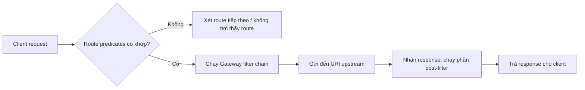

# Java DSL và kết hợp điều kiện and, or, negate

## 1. Bối cảnh: chọn đúng route trong Spring Cloud Gateway

Trong hệ thống microservices, **Spring Cloud Gateway** nhận HTTP request từ web, mobile hoặc đối tác rồi chọn dịch vụ đích. Một Gateway có thể chứa nhiều tuyến (route): tuyến đọc đơn hàng, tuyến danh mục sản phẩm, tuyến dành cho ứng dụng nội bộ hoặc tuyến dùng trong giai đoạn thử nghiệm. Khi số lượng route tăng, chỉ kiểm tra đường dẫn thường không đủ: request có thể phải đúng **host**, **path**, **HTTP method**, **header** hoặc nhiều điều kiện cùng lúc.

Ví dụ, hãy mô tả các yêu cầu sau:

- Chỉ chuyển request **GET** đến `/api/orders/**` nếu `Host` là `api.example.test`.
- Cùng một catalog service tiếp nhận `/api/catalog/**` **hoặc** `/api/products/**`.
- Route báo cáo thông thường chỉ khớp nếu path là `/api/reports/**` **và không** có header `X-Mode: preview`.

**Java DSL (fluent API)** của `RouteLocatorBuilder` giúp biểu diễn các quy tắc đó bằng code Java, đặc biệt khi cần tổ hợp **AND**, **OR**, **NOT**. Trong Gateway, các điều kiện được gọi là **route predicates**; chúng quyết định một request có thuộc route hay không. Sau khi chọn route, **Gateway filters** mới biến đổi đường dẫn/header, áp dụng các chính sách đã cấu hình và chuyển request đến upstream.

Bài thuộc chương **Cấu hình tuyến** của module **SPRING_CLOUD_GATEWAY**. Mục tiêu là biết viết route theo Java DSL, hiểu thứ tự kết hợp điều kiện và xác minh kết quả. Những phần như xác thực, rate limiting, circuit breaker, retry, TLS và observability vẫn liên quan đến vận hành Gateway nhưng phải được cấu hình bằng các thành phần thích hợp; việc viết predicate không tự kích hoạt các tính năng đó.

> **Phạm vi phiên bản:** các ví dụ tập trung vào **Spring Cloud Gateway Server WebFlux** với `RouteLocatorBuilder` và API `and()`, `or()`, `negate()`. Cách khai báo starter, namespace cấu hình và một số API phụ có thể khác giữa các phiên bản Spring Cloud Gateway/WebFlux/MVC. Hãy chọn release train tương thích với Spring Boot và đối chiếu tài liệu của phiên bản đang dùng.

## 2. Route, predicate và filter: ba trách nhiệm khác nhau

Một route gồm các thành phần cơ bản:

| Thành phần | Trả lời câu hỏi | Ví dụ |
| --- | --- | --- |
| **Route ID** | Tuyến này tên gì? | `orders-read` |
| **Predicate** | Request nào khớp tuyến? | `Path=/api/orders/**` và `Method=GET` |
| **URI** | Gửi request đến đâu? | `http://localhost:8081` hoặc `lb://ORDER-SERVICE` |
| **Filter** | Điều chỉnh request/response hoặc thực thi chính sách gì? | `StripPrefix=1`, thêm response header |

Luồng xử lý khái quát:



Predicate không tự biến đổi nội dung request; filter không dùng để thay thế bước lựa chọn route. Chẳng hạn, `path("/api/orders/**")` chọn tuyến, còn `stripPrefix(1)` mới bỏ segment `/api` khi chuyển tiếp.

Một route được xem là phù hợp khi **predicate tổng hợp** đánh giá là đúng (`true`). Nếu không có route phù hợp, Gateway thường trả `404`, tùy cấu hình xử lý và các handler khác trong ứng dụng. Nếu route đã khớp nhưng upstream không phản hồi, lỗi có thể xuất phát từ transport hoặc upstream chứ không phải predicate.

## 3. Cú pháp Java DSL cơ bản

### 3.1. Khai báo một bean RouteLocator

Ví dụ hoàn chỉnh sau giả định Gateway lắng nghe `localhost:8080` và ba service mẫu đã khởi chạy trên `8081`, `8082`, `8083`:

```java
import org.springframework.context.annotation.Bean;
import org.springframework.context.annotation.Configuration;
import org.springframework.http.HttpMethod;
import org.springframework.cloud.gateway.route.RouteLocator;
import org.springframework.cloud.gateway.route.builder.RouteLocatorBuilder;

@Configuration
public class GatewayRoutesConfig {

    @Bean
    RouteLocator gatewayRoutes(RouteLocatorBuilder builder) {
        return builder.routes()

            // AND: đúng host, đúng path và đúng HTTP method.
            .route("orders-read", r -> r
                .host("api.example.test")
                .and().path("/api/orders/**")
                .and().method(HttpMethod.GET)
                .filters(f -> f
                    .stripPrefix(1)
                    .addResponseHeader("X-Gateway-Route", "orders-read"))
                .uri("http://localhost:8081"))

            // OR: chấp nhận một trong hai đường dẫn.
            .route("catalog-alias", r -> r
                .path("/api/catalog/**")
                .or().path("/api/products/**")
                .filters(f -> f
                    .addResponseHeader("X-Gateway-Route", "catalog-alias"))
                .uri("http://localhost:8082"))

            // NOT: loại request có X-Mode: preview; vẫn giới hạn bằng path.
            .route("reports-normal", r -> r
                .header("X-Mode", "preview").negate()
                .and().path("/api/reports/**")
                .filters(f -> f
                    .addResponseHeader("X-Gateway-Route", "reports-normal"))
                .uri("http://localhost:8083"))

            .build();
    }
}
```

Các import trên là những import chính của ví dụ. `@Configuration` đăng ký class cấu hình, còn `@Bean` trả về `RouteLocator` chứa các route được tạo. Mỗi lời gọi `.route("id", r -> ...)` định nghĩa một route; `.build()` hoàn tất danh sách.

Khi có `host("api.example.test")`, phép thử cần gửi đúng HTTP `Host`, dù URL kết nối thực tế là `localhost:8080`. Trong môi trường có reverse proxy, cần kiểm tra cách host được chuyển tiếp và chính sách tin cậy proxy.

Ví dụ chuyển đường dẫn:

```text
Client:   GET /api/orders/42
Route:    orders-read (host + path + GET đều đúng)
Filter:   StripPrefix=1
Upstream: GET http://localhost:8081/orders/42
```

Hai route còn lại **không gọi** `stripPrefix`: chúng giữ nguyên request path khi đến upstream. Đây là lựa chọn minh họa; ứng dụng thật phải thiết kế filter phù hợp endpoint ở service đích.

### 3.2. Tư duy theo thứ tự cấu hình

Cú pháp thường gặp:

```java
.route("route-id", r -> r
    .path("/api/example/**")           // Định nghĩa predicate đầu tiên
    .and().method(HttpMethod.GET)       // Kết hợp predicate thứ hai
    .filters(f -> f.stripPrefix(1))     // Xử lý sau khi route khớp
    .uri("http://localhost:8081"))     // Đích chuyển tiếp
```

Nhớ rằng `.and()`, `.or()`, `.negate()` **không** phải filter và không tạo một tuyến mới. Chúng kết hợp hoặc đảo kết quả điều kiện của **route hiện tại**.

## 4. Toán tử AND: tất cả điều kiện phải đúng

`and()` tương ứng với phép giao logic: **A AND B** chỉ đúng nếu cả A lẫn B đều đúng.

| A | B | A AND B |
| --- | --- | --- |
| Sai | Sai | Sai |
| Sai | Đúng | Sai |
| Đúng | Sai | Sai |
| Đúng | Đúng | **Đúng** |

Ví dụ: chỉ cho phép **GET** trên nhóm endpoint đơn hàng thuộc host `api.example.test`:

```java
.route("orders-read", r -> r
    .host("api.example.test")
    .and().path("/api/orders/**")
    .and().method(HttpMethod.GET)
    .uri("http://localhost:8081"))
```

Biểu thức logic:

```text
Host = api.example.test
AND Path khớp /api/orders/**
AND Method = GET
```

Bảng kiểm tra:

| Host | Method | Path | Khớp route? |
| --- | --- | --- | --- |
| `api.example.test` | GET | `/api/orders/42` | **Có** |
| `api.example.test` | POST | `/api/orders` | Không, sai method |
| `api.example.test` | GET | `/api/products/42` | Không, sai path |
| `other.example.test` | GET | `/api/orders/42` | Không, sai host |

Một request sai bất kỳ điều kiện nào sẽ không được chọn vào route này. Nó **vẫn có thể** khớp route khác nếu hệ thống định nghĩa route khác.

**Các predicate trong YAML:** khi cấu hình một route với nhiều dòng `predicates` trong file cấu hình, chúng được kết hợp theo logic AND theo mô hình thông thường. Java DSL giúp diễn đạt thêm các phép OR/NOT khi cần.

## 5. Toán tử OR: một trong các điều kiện đúng là đủ

`or()` tương ứng phép hợp logic: **A OR B** đúng khi có ít nhất một điều kiện đúng.

| A | B | A OR B |
| --- | --- | --- |
| Sai | Sai | Sai |
| Sai | Đúng | **Đúng** |
| Đúng | Sai | **Đúng** |
| Đúng | Đúng | **Đúng** |

Ví dụ, trong giai đoạn đổi tên endpoint, cả `/api/catalog/**` và `/api/products/**` đều dùng cùng catalog service:

```java
.route("catalog-alias", r -> r
    .path("/api/catalog/**")
    .or().path("/api/products/**")
    .uri("http://localhost:8082"))
```

Ý nghĩa:

```text
Path khớp /api/catalog/**
OR Path khớp /api/products/**
```

Cả hai nhánh của OR đều chuyển tới **cùng URI** và đi qua **cùng filter chain** của route `catalog-alias`. Nếu cần chuyển mỗi nhánh đến một service khác nhau, hãy tạo **hai route riêng** với URI tương ứng.

### 5.1. Cách viết ngắn hơn cho nhiều giá trị cùng loại

Một số predicate hỗ trợ nhiều giá trị trong chính phương thức của nó:

```java
.route("catalog-read", r -> r
    .path("/api/catalog/**", "/api/products/**")
    .and().method(HttpMethod.GET)
    .uri("http://localhost:8082"))
```

Ở đây, hai mẫu path được kiểm tra theo logic **OR** bên trong Path predicate, còn `.and().method(GET)` yêu cầu thêm điều kiện GET. Tư duy như sau:

```text
(Path = /api/catalog/** OR Path = /api/products/**)
AND Method = GET
```

Đây thường là cách dễ đọc khi chỉ muốn gộp nhiều path vào một điều kiện. `method(HttpMethod.GET, HttpMethod.HEAD)` cũng biểu diễn một tập các HTTP method được chấp nhận.

### 5.2. Không dùng OR để bỏ qua một điều kiện bắt buộc

Giả sử viết:

```java
// Logic sai nếu muốn mọi request đều phải nằm trong /api/orders/**
.path("/api/orders/**")
.and().method(HttpMethod.GET)
.or().header("X-Channel", "mobile")
```

Ý nghĩa thực tế của biểu thức theo thứ tự kết hợp là:

```text
(Path orders AND Method GET) OR (X-Channel = mobile)
```

Nhánh header đứng sau OR có thể làm route khớp cả những path khác. Header do client gửi cũng có thể bị làm giả, vì vậy không được dùng nó làm bằng chứng đủ để cấp quyền truy cập.

Khi muốn **(Path A OR Path B) AND GET**, ưu tiên `path(A, B).and().method(GET)`, hoặc dùng predicate Java có ngoặc nhóm rõ ràng như phần 7.

## 6. Toán tử NEGATE: đảo kết quả một điều kiện

`negate()` có nghĩa là **NOT**: kết quả `true` thành `false`, và ngược lại.

| A | NOT A |
| --- | --- |
| Sai | **Đúng** |
| Đúng | Sai |

Ví dụ: một route báo cáo dành cho request thông thường, **không** nhận header `X-Mode: preview`:

```java
.route("reports-normal", r -> r
    .header("X-Mode", "preview").negate()
    .and().path("/api/reports/**")
    .uri("http://localhost:8083"))
```

Lúc gọi `.negate()`, predicate đang được tích lũy là `header("X-Mode", "preview")`; phép phủ định đảo kết quả của điều kiện này. Sau đó `.and().path(...)` giới hạn phạm vi:

```text
NOT (X-Mode khớp preview)
AND Path khớp /api/reports/**
```

| Request | Có header `X-Mode: preview`? | Path báo cáo? | Khớp? |
| --- | --- | --- | --- |
| `GET /api/reports/2026` | Không | Có | **Có** |
| `GET /api/reports/2026` | Có | Có | Không |
| `GET /api/orders/42` | Không | Không | Không |

Chú ý: `header("X-Mode", "preview")` xét giá trị header theo biểu thức chính quy. Với regex `preview`, một header thiếu hoặc có giá trị không khớp sẽ bị `negate()` đảo thành đúng. Ví dụ này chỉ phục vụ **chọn tuyến theo chế độ xử lý**, không phải kiểm tra quyền bảo mật.

### 6.1. Cạm bẫy: phủ định có thể mở rộng route rất lớn

Không nên tùy tiện đặt:

```java
// Ví dụ cảnh báo: quá rộng
.route("everything-except-admin", r -> r
    .path("/api/admin/**").negate()
    .uri("http://localhost:8083"))
```

Route này có thể khớp gần như mọi request **không thuộc** `/api/admin/**`, kể cả path không nằm trong API dự kiến. Nó có thể cạnh tranh với nhiều route khác và đưa traffic sai đến upstream.

Nếu yêu cầu là “chỉ API báo cáo, trừ preview”, hãy kết hợp **positive predicate** giới hạn path như ví dụ đầu mục 6. Trong hệ thống có nhiều loại client, default deny ở tầng bảo mật và quy tắc phân quyền độc lập với route vẫn cần thiết.

### 6.2. Negate áp dụng đến đâu?

Khi tổ hợp nhiều điều kiện, `.negate()` đảo **predicate tổng hợp tại vị trí gọi**, không tự hiểu ý định “chỉ phủ định điều kiện đứng sát cạnh”. Vì vậy:

```text
NOT (A AND B)   khác   A AND (NOT B)
```

Theo định luật De Morgan, `NOT (A AND B)` là `(NOT A) OR (NOT B)`; nó rộng hơn rất nhiều so với `A AND (NOT B)`. Để tránh đọc sai, hãy nhóm điều kiện rõ ràng trước khi phủ định hoặc sử dụng `Predicate` Java thông thường để đặt ngoặc.

## 7. Kết hợp AND, OR, NOT mà không mơ hồ

Yêu cầu giả định:

> Chuyển request GET đến catalog service nếu path bắt đầu bằng `/api/catalog/` **hoặc** `/api/products/`, nhưng **không** nhận request có `X-Mode: preview`.

Biểu thức là:

```text
((PathCatalog OR PathProducts) AND MethodGET) AND NOT(Preview)
```

Có thể diễn đạt dễ đọc với nhiều mẫu Path và một phủ định:

```java
.route("catalog-normal", r -> r
    .path("/api/catalog/**", "/api/products/**")
    .and().method(HttpMethod.GET)
    .and().not(p -> p.header("X-Mode", "preview"))
    .uri("http://localhost:8082"))
```

**Lưu ý API:** `not(Function<PredicateSpec, BooleanSpec>)` là phương thức hỗ trợ phủ định một nhóm predicate trong các phiên bản Java DSL có API này. Đừng nhầm `.not(p -> ...)` với `.negate()` không có đối số; hãy đối chiếu chữ ký có sẵn trong phiên bản đang dùng. Nếu không có `not(...)`, có thể dùng `Predicate` Java được nhóm tường minh như sau.

### 7.1. Gom biểu thức bằng java.util.function.Predicate

Dưới đây là **ví dụ độc lập** dùng `Predicate<ServerWebExchange>` để làm rõ phép nhóm. Cách kiểm tra prefix đơn giản được chọn để dễ nhìn logic, không thay thế đầy đủ ngữ nghĩa mẫu Path predicate:

```java
import java.util.function.Predicate;
import org.springframework.http.HttpMethod;
import org.springframework.web.server.ServerWebExchange;

// Các predicate Java riêng lẻ, không thực hiện blocking I/O.
Predicate<ServerWebExchange> catalog = ex ->
    ex.getRequest().getPath().value().startsWith("/api/catalog/");

Predicate<ServerWebExchange> products = ex ->
    ex.getRequest().getPath().value().startsWith("/api/products/");

Predicate<ServerWebExchange> isGet = ex ->
    HttpMethod.GET.equals(ex.getRequest().getMethod());

Predicate<ServerWebExchange> isPreview = ex ->
    "preview".equalsIgnoreCase(
        ex.getRequest().getHeaders().getFirst("X-Mode")
    );

Predicate<ServerWebExchange> matched =
    catalog.or(products)
           .and(isGet)
           .and(isPreview.negate());

// Trong builder.routes():
.route("catalog-normal", r -> r
    .predicate(matched)
    .uri("http://localhost:8082"))
```

`Predicate.and(...)`, `Predicate.or(...)` và `Predicate.negate()` ở đây thuộc Java chuẩn. Kết quả `matched` là biểu thức đã được nhóm theo các phép nối, giúp người đọc thấy rõ điều kiện. `PredicateSpec.predicate(matched)` đưa logic đó vào route Java DSL.

Trong thực tế nên **ưu tiên predicate factory có sẵn** như `path(...)`, `host(...)`, `method(...)`, `header(...)`, `query(...)` để tránh tự viết lại xử lý path, URL encoding và regex. Chỉ tạo predicate Java tùy biến khi yêu cầu thật sự chưa được các predicate có sẵn đáp ứng.

### 7.2. Bảng kết quả của biểu thức tổng hợp

| Path thuộc catalog/products? | GET? | Preview? | Route catalog-normal |
| --- | --- | --- | --- |
| Có | Có | Không | **Khớp** |
| Có | Có | Có | Không |
| Có | Không | Không | Không |
| Không | Có | Không | Không |
| Không | Có | Có | Không |

Cách kiểm tra theo bảng giúp phát hiện các biểu thức tình cờ biến thành `A OR (B AND C)` thay vì `(A OR B) AND C`.

## 8. AND/OR và thứ tự ưu tiên route

Trong một Gateway thường có các route bị chồng lấn, chẳng hạn:

```text
Route A: /api/orders/**
Route B: /api/**
```

Cả hai có thể khớp `GET /api/orders/42`. Gateway phải **chọn một route**, và việc chọn chịu ảnh hưởng bởi `order` cũng như cách các route được sắp xếp/đăng ký. Trong Java DSL, có thể khai báo thứ tự:

```java
.route("orders-specific", r -> r
    .order(-10)
    .path("/api/orders/**")
    .uri("http://localhost:8081"))

.route("api-fallback", r -> r
    .order(100)
    .path("/api/**")
    .uri("http://localhost:8089"))
```

Thứ tự `order` **càng thấp thì ưu tiên càng cao**. Trong ví dụ, route cụ thể có thứ tự `-10` và fallback có `100`, nên request `/api/orders/42` dự kiến chọn `orders-specific`. Đừng chỉ trông chờ thứ tự viết trong file nếu nhiều nguồn route có thể cùng tham gia.

Ngoài ra:

- Mỗi route phải có **ID dễ phân biệt** để truy vết trong log/metrics.
- `or()` chỉ nối các predicate **trong cùng một route**, không sắp xếp hai route.
- Một route có predicate quá rộng có thể che khuất route phía sau.
- Không có route phù hợp khác với route đã khớp nhưng upstream báo lỗi.
- Khi dùng route cấu hình YAML cùng với `RouteLocator` Java, cần kiểm tra trùng path/ID và thứ tự ưu tiên trong danh sách cuối cùng.

## 9. Trường hợp nên tạo hai route thay vì dùng OR

Giả sử:

- `GET /api/catalog/**` đi tới catalog service.
- `GET /api/pricing/**` đi tới pricing service.

Đây là **hai URI khác nhau**, nên dùng hai route:

```java
.route("catalog-service", r -> r
    .path("/api/catalog/**")
    .and().method(HttpMethod.GET)
    .filters(f -> f.stripPrefix(1))
    .uri("http://localhost:8082"))

.route("pricing-service", r -> r
    .path("/api/pricing/**")
    .and().method(HttpMethod.GET)
    .filters(f -> f.stripPrefix(1))
    .uri("http://localhost:8084"))
```

Nếu đặt `path("/api/catalog/**").or().path("/api/pricing/**")` trong **một route** rồi khai báo một `uri`, cả hai nhóm request sẽ đến cùng một đích. Điều này chỉ đúng khi chính upstream có trách nhiệm xử lý cả hai prefix.

Java DSL có thể kết hợp Service Discovery bằng URI `lb://SERVICE-ID` nếu Gateway đã tích hợp một `DiscoveryClient` hoặc nguồn `ServiceInstance` phù hợp và có Spring Cloud LoadBalancer. Viết `lb://...` đơn thuần không làm hệ thống tự đăng ký hoặc tự khám phá service.

## 10. Kiểm thử route bằng HTTP request

Giả sử cấu hình ở mục 3 đang chạy, có thể thử từng tình huống. Dùng `-i` để xem HTTP status và response header; header `X-Gateway-Route` được thêm bởi filter khi một route tương ứng được xử lý.

### 10.1. Kiểm tra AND

```bash
# Khớp cả host, path, GET:
curl -i -H "Host: api.example.test" \
  http://localhost:8080/api/orders/42

# Sai method, không khớp orders-read:
curl -i -X POST -H "Host: api.example.test" \
  http://localhost:8080/api/orders/42

# Sai host, không khớp orders-read:
curl -i -H "Host: other.example.test" \
  http://localhost:8080/api/orders/42
```

### 10.2. Kiểm tra OR

```bash
curl -i http://localhost:8080/api/catalog/products/42
curl -i http://localhost:8080/api/products/42
```

Cả hai đường dẫn dự kiến khớp `catalog-alias`. Response có thể trả `X-Gateway-Route: catalog-alias` khi các request được xử lý qua route, nhưng mã HTTP cuối cùng còn tùy upstream có tồn tại endpoint tương ứng hay không.

### 10.3. Kiểm tra NEGATE

```bash
# Không có X-Mode: preview => khớp reports-normal
curl -i http://localhost:8080/api/reports/2026

# Có X-Mode: preview => không khớp reports-normal
curl -i -H "X-Mode: preview" \
  http://localhost:8080/api/reports/2026
```

**Không dùng mã `200` đơn lẻ để kết luận route khớp.** Một request có thể khớp route rồi nhận `404` từ service, hoặc bị `401/403/429/503` do các thành phần khác. Khi thử ở hệ thống có nhiều route, nên kiểm tra log route ID, metric/trace đã cấu hình hoặc endpoint quan sát của Gateway được bảo vệ đúng cách.

### 10.4. Bảng ca kiểm thử tối thiểu

| Ca | Điều kiện đầu vào | Kỳ vọng |
| --- | --- | --- |
| A1 | Host đúng + GET + order path | Chọn `orders-read` |
| A2 | Host đúng + POST + order path | Không chọn `orders-read` |
| A3 | Host khác + GET + order path | Không chọn `orders-read` |
| O1 | Path catalog | Chọn `catalog-alias` |
| O2 | Path products | Chọn `catalog-alias` |
| O3 | Path pricing | Không chọn `catalog-alias` |
| N1 | Report path, không có header preview | Chọn `reports-normal` |
| N2 | Report path, header preview | Không chọn `reports-normal` |
| N3 | Order path, không có header preview | Không chọn `reports-normal` |

Để kiểm thử độc lập với hoạt động của upstream, có thể cấu hình service giả lập hoặc dùng công cụ kiểm thử tích hợp Gateway theo công cụ của dự án. Trong bài này, bảng là **đặc tả hành vi** cần kiểm chứng khi triển khai; không giả định có service thật tại các cổng ví dụ.

## 11. Lỗi thường gặp khi kết hợp predicate

| Lỗi | Hậu quả | Hướng xử lý |
| --- | --- | --- |
| Nhầm `and()` và `or()` | Route khớp quá rộng hoặc bỏ sót request | Viết biểu thức logic trước, lập truth table |
| Dùng `negate()` cho path mà không giới hạn dương | Bắt gần như mọi request ngoài path bị phủ định | Thêm path/host/method giới hạn hợp lý |
| Ghép `A.and().B.or().C` khi muốn `A AND (B OR C)` | Nhánh C có thể bỏ qua A | Dùng phương thức nhận nhiều giá trị hoặc predicate nhóm tường minh |
| Dùng header từ client làm quyền truy cập | Client có thể giả mạo header | Dùng Spring Security và kiểm tra quyền tại service |
| OR nhiều path nhưng cần các URI khác nhau | Request đi nhầm microservice | Tách route theo destination |
| Không thiết lập `order` cho route chồng lấn | Route fallback được chọn thay route cụ thể | Đặt thứ tự rõ ràng và kiểm thử trùng khớp |
| `404` khi client gọi path đã có filter rewrite | Upstream nhận path không đúng | Kiểm tra đường dẫn trước/sau `StripPrefix`/`RewritePath` |
| Tạo predicate tùy biến có I/O blocking | Nghẽn thread xử lý WebFlux | Giữ predicate nhanh, không gọi JDBC/HTTP đồng bộ |
| Dùng cấu hình theo API phiên bản khác | Không biên dịch hoặc không nạp route | Đối chiếu dependency, namespace và Javadoc tương ứng |

### 11.1. Predicate không phải cơ chế xác thực

Tuyến `.header("X-Role", "admin")` chỉ xét một **giá trị HTTP header** do caller có thể tự đặt. Nó không kiểm tra JWT, chữ ký, quyền hạn hoặc danh tính. Nếu một route nội bộ cần được bảo vệ:

1. Cấu hình Spring Security/WebFlux để xác thực và áp dụng quyền truy cập.
2. Kiểm tra quyền sở hữu tài nguyên và quy tắc nghiệp vụ tại microservice phù hợp.
3. Giới hạn khả năng kết nối trực tiếp vào upstream bằng kiểm soát mạng phù hợp.
4. Cấu hình TLS, rate limiter, circuit breaker và timeout độc lập theo nhu cầu; predicate chỉ lựa chọn route.

Vì vậy, `NOT Header` hay `Host` predicate có thể dùng để **phân luồng**, nhưng không nên được coi là ranh giới bảo mật duy nhất.

### 11.2. Tác động của filter đến việc đọc path/header

Route predicate thường đánh giá request tại thời điểm Gateway chọn tuyến; `GatewayFilter` chạy sau khi route khớp. Nếu sau đó dùng filter thay path/header, đừng kỳ vọng predicate sẽ được đánh giá lại trên request đã biến đổi. Với các route dùng `StripPrefix` hoặc `RewritePath`, hãy phân biệt:

```text
Path dùng để chọn route: /api/orders/42
Path chuyển đến upstream: /orders/42
```

Khi debug, xem cả hai giá trị cùng route ID. Nếu muốn áp dụng logic dựa trên path sau biến đổi, cần thiết kế filter/route theo đúng giai đoạn xử lý và thứ tự thực thi.

## 12. Khi nào Java DSL có lợi hơn YAML?

| Nhu cầu | Java DSL | YAML/Properties |
| --- | --- | --- |
| AND của nhiều predicate cơ bản | Có | Có, thường là hành vi mặc định của danh sách predicates |
| OR hoặc NOT có cấu trúc phức tạp | Linh hoạt với fluent API và Java Predicate | Có thể cần tách route hoặc cơ chế cấu hình khác tùy phiên bản |
| Predicate tùy chỉnh dùng Java | Thuận tiện, có thể dùng `predicate(...)` | Không viết trực tiếp lambda Java trong YAML |
| Chỉ đổi URI, timeout giữa môi trường | Có thể externalize vào properties | Thuận tiện để cấu hình qua environment |
| Kiểm thử logic tổ hợp | Có thể tách Predicate/RouteLocator để thử | Cần nạp cấu hình rồi thử request thực tế |

Không có quy tắc phải viết mọi route bằng Java. Với route ít và chủ yếu AND, YAML thường ngắn gọn. Khi cần nhóm điều kiện và logic tùy chỉnh được quản lý bằng mã, Java DSL hữu ích hơn. Dù chọn cách nào, hãy quản lý route ID, thứ tự ưu tiên, cấu hình theo môi trường và bộ kiểm thử tuyến.

## 13. Bài thực hành nhỏ: đưa quy tắc thành biểu thức

Yêu cầu: `GET /api/inventory/**` **hoặc** `HEAD /api/inventory/**` được chuyển đến service tồn kho, nhưng request có `X-Mode: maintenance` phải **không khớp** route đó.

Bước phân tích:

```text
Path = /api/inventory/**
AND (Method = GET OR Method = HEAD)
AND NOT (Header X-Mode khớp maintenance)
```

Có thể biểu diễn bằng phương thức nhận nhiều method và phủ định header:

```java
.route("inventory-public", r -> r
    .path("/api/inventory/**")
    .and().method(HttpMethod.GET, HttpMethod.HEAD)
    .and().not(p -> p.header("X-Mode", "maintenance"))
    .filters(f -> f
        .stripPrefix(1)
        .addResponseHeader("X-Gateway-Route", "inventory-public"))
    .uri("http://localhost:8085"))
```

Yêu cầu tự kiểm tra:

- `GET /api/inventory/items/1` không có header maintenance: phải khớp.
- `HEAD /api/inventory/items/1` không có header maintenance: phải khớp.
- `POST /api/inventory/items/1`: không khớp.
- `GET /api/inventory/items/1` với `X-Mode: maintenance`: không khớp.
- `GET /api/orders/42` không có header maintenance: không khớp.

Đây chỉ là ví dụ phân luồng; nếu “maintenance” là chính sách an toàn hoặc quyền truy cập, không được tin header do client tự kiểm soát. Có thể thay cách phủ định bằng `Predicate<ServerWebExchange>` Java đã được nhóm rõ nếu API Java DSL của phiên bản đang dùng khác ví dụ.

## 14. Tổng kết và tài liệu tham khảo

Khi cấu hình tuyến trong **Spring Cloud Gateway Server WebFlux**:

- `and()`: tất cả điều kiện phải đúng.
- `or()`: ít nhất một điều kiện đúng.
- `negate()`: đảo kết quả predicate đã tạo tại vị trí gọi.
- `path(A, B)` hoặc `method(GET, HEAD)`: có thể gom nhiều lựa chọn cùng loại mà không cần viết `.or()` tường minh.
- `Predicate<ServerWebExchange>` của Java: dùng khi cần biểu thức phức tạp với phép nhóm rõ ràng.
- `.filters(...)` và `.uri(...)`: xử lý request đã khớp và xác định đích; đây không phải toán tử logic.

Cách làm an toàn là **viết biểu thức điều kiện trước**, chuyển sang Java DSL, sau đó kiểm chứng bằng bảng các trường hợp đúng/sai. Luôn chú ý route chồng lấn, thứ tự ưu tiên, tác động của filter và ranh giới xác thực; những điều đó ảnh hưởng trực tiếp đến khả năng vận hành Gateway an toàn trong hệ thống microservices.

Tài liệu chính thức để đối chiếu API theo phiên bản:

- [Spring Cloud Gateway — Fluent Java Routes API](https://docs.spring.io/spring-cloud-gateway/reference/spring-cloud-gateway-server-webflux/fluent-java-routes-api.html).
- [Spring Cloud Gateway — Route Predicate Factories](https://docs.spring.io/spring-cloud-gateway/reference/spring-cloud-gateway-server-webflux/request-predicates-factories.html).
