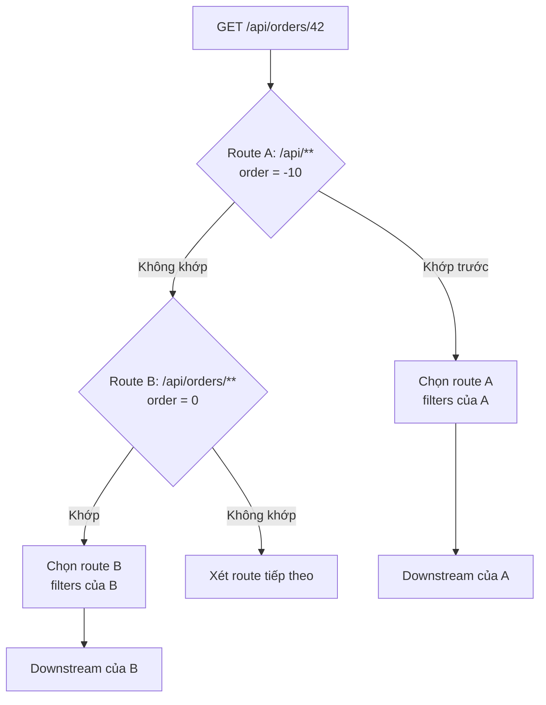

# Tuyến tổng quát, tuyến chuyên biệt và nguy cơ bắt nhầm yêu cầu

Khi một API Gateway đứng trước nhiều microservice, cùng một request có thể phù hợp với **nhiều quy tắc định tuyến**. Chẳng hạn, `GET /api/orders/42` khớp cả mẫu `/api/orders/**` lẫn `/api/**`. Nếu cấu hình không có thứ tự ưu tiên rõ ràng, request có thể được chuyển tới sai dịch vụ, đi qua sai filter hoặc bỏ lỡ chính sách dành riêng cho API đơn hàng.

Trong module **SPRING_CLOUD_GATEWAY**, chúng ta xây dựng API Gateway bằng **route predicate**, **filter chain**, biến đổi đường dẫn/header và khám phá dịch vụ; sau đó áp dụng xác thực, giới hạn lưu lượng, circuit breaker, retry, TLS và quan sát request để vận hành cổng vào microservices an toàn. Chủ đề thuộc chương **Cấu hình tuyến** này tập trung vào một yêu cầu nền tảng trước tất cả những bước đó: **định nghĩa tuyến tổng quát và tuyến chuyên biệt sao cho request được chọn đúng tuyến**.

> **Phạm vi:** Ví dụ tập trung vào **Spring Cloud Gateway Server WebFlux**, nơi `RoutePredicateHandlerMapping` chọn route từ `RouteLocator` trước khi `FilteringWebHandler` chạy gateway filters. Cấu hình `spring.cloud.gateway.routes` minh họa dạng thông dụng của một số phiên bản Spring Cloud Gateway WebFlux 4.x. Đối chiếu tên starter và namespace cấu hình với phiên bản cụ thể của ứng dụng, nhất là khi nâng cấp lên dòng hỗ trợ `spring.cloud.gateway.server.webflux.routes`.

## 1. Thế nào là tuyến tổng quát và tuyến chuyên biệt?

Một **route** trong Spring Cloud Gateway mô tả ít nhất ba điều: *khi nào một request khớp*, *request được chuyển đến URI nào* và *những filters nào chạy khi route được chọn*. Route thường có `id`, `uri`, `predicates`, `filters` và `order`.

**Tuyến tổng quát** (*general route, fallback route hoặc catch-all route*) chấp nhận một nhóm request rộng. Ví dụ:

- `Path=/api/**`: khớp nhiều API có tiền tố `/api/`.
- `Path=/api/orders/**`: khớp các đường dẫn con của API orders mà chưa phân biệt HTTP method.
- `Path=/**`: mẫu rất rộng, có thể phủ gần như toàn bộ đường dẫn HTTP đi qua gateway.

**Tuyến chuyên biệt** (*specific route*) giới hạn thêm điều kiện về path, method, host, header hoặc query. Ví dụ:

- `Path=/api/orders/**` và `Method=GET`: chỉ nhận các request GET thuộc nhóm orders.
- `Path=/api/admin/**` và `Host=admin.example.test`: chỉ nhận nhánh admin trên hostname tương ứng.
- `Path=/api/orders/{orderId}` và `Method=GET`: khớp mẫu đường dẫn có một biến `orderId` theo cú pháp URI template mà `Path` predicate hỗ trợ.

| Thuộc tính | Tuyến tổng quát | Tuyến chuyên biệt |
| --- | --- | --- |
| **Độ rộng điều kiện** | Nhận nhiều request thuộc một nhóm lớn | Nhận ít request hơn do có các điều kiện bổ sung |
| **Mục đích thường gặp** | API cũ, nhóm dịch vụ dùng chung, fallback | API quản trị, đọc/ghi đơn hàng, API phiên bản riêng, đối tác |
| **Ví dụ** | `Path=/api/**` | `Path=/api/orders/**` kết hợp `Method=GET` |
| **Rủi ro** | Có thể chặn mất tuyến chuyên biệt; đưa request đến backend ngoài ý muốn | Có thể không khớp request hợp lệ nếu method/host/header cấu hình sai |
| **Điểm cần kiểm soát** | Độ phủ, ưu tiên thấp, chính sách an toàn khi fallback | Predicate đủ chính xác, ưu tiên đúng, phân quyền và filters phù hợp |

“Tổng quát” hay “chuyên biệt” là **mối quan hệ giữa các điều kiện match**, không phải một kiểu route riêng trong thư viện. Hai route có thể dùng cùng `uri` nhưng khác predicates và filters; chúng vẫn có thể tranh nhau cùng một request.

## 2. Spring Cloud Gateway thực sự chọn route thế nào?

Với kiến trúc Server WebFlux điển hình:

1. Request đến WebFlux và đi qua những `WebFilter` được cấu hình ở tầng ứng dụng, nếu có.
2. `DispatcherHandler` tìm handler phù hợp; `RoutePredicateHandlerMapping` là handler mapping chuyên cho Gateway.
3. `RoutePredicateHandlerMapping` lấy các đối tượng `Route` đã được dựng từ `RouteLocator` và đánh giá predicate theo thứ tự route đang được cung cấp.
4. **Route khớp đầu tiên** được chọn và lưu trong `ServerWebExchange`, thường ở thuộc tính `GATEWAY_ROUTE_ATTR`.
5. `FilteringWebHandler` mới kết hợp `GlobalFilter` với `GatewayFilter` của route đó và chạy filter chain, bao gồm rewrite, bảo mật tại tầng Gateway, load balancing và routing tùy cấu hình.

`order` điều chỉnh mức ưu tiên route. Với các route được sắp theo `order`, **số nhỏ hơn được ưu tiên cao hơn**: `-20` đứng trước `0`, `0` đứng trước `100`. Nếu nhiều route trùng điều kiện và có cùng `order`, đừng dựa vào thứ tự xuất hiện trong YAML hoặc tính “cụ thể hơn” của mẫu path để xác định tuyến thắng; nên thiết kế một mức ưu tiên hoặc tập điều kiện không nhập nhằng.

**Điểm mấu chốt:** Spring Cloud Gateway không áp dụng quy tắc tổng quát “path cụ thể nhất tự động thắng” cho mọi route. Một route `Path=/api/**` với `order=-100` có thể được xét và chọn trước route `Path=/api/orders/**` với `order=0`.

### 2.1. Các predicates cùng một route thường kết hợp bằng AND

Ví dụ:

```yaml
predicates:
  - Path=/api/orders/**
  - Method=GET
```

Route này chỉ khớp khi **cả hai** điều kiện đúng. `POST /api/orders/42` khớp path nhưng sai method, do đó bị loại khỏi route trên. Một `Path` predicate riêng lẻ có thể chấp nhận nhiều path patterns và kết hợp theo ngữ nghĩa của factory đó; điều này khác với phép AND giữa **những predicate độc lập** trong cùng một route.

### 2.2. Các route cạnh tranh theo thứ tự, không phải cùng chạy

Nếu `GET /api/orders/42` khớp đồng thời route A và route B, request sẽ đi qua **filters của route được chọn** và các `GlobalFilter` tương ứng. Filters cấu hình riêng cho route còn lại không được thực thi chỉ vì predicates của nó cũng có thể khớp.

Điều này đặc biệt quan trọng khi route chuyên biệt có `RequestRateLimiter`, `CircuitBreaker` hoặc filter bổ sung header, nhưng route tổng quát được chọn trước: **những filters chỉ gắn với route chuyên biệt sẽ không được áp dụng cho request đó**. Các chính sách ở WebFilter hoặc backend vẫn có thể áp dụng độc lập; cần phân biệt rõ tầng bảo vệ.



Đây là sơ đồ logic về **matching theo thứ tự**. Nó không có nghĩa hệ thống chỉ có hai route, cũng không có nghĩa mọi HTTP request đều đi qua Gateway handler mapping: những handler mapping khác của ứng dụng có thể tiếp nhận request.

## 3. Ví dụ lỗi: tuyến tổng quát bắt nhầm request

Giả sử có hai backend:

- `order-service`: chuyên xử lý đơn hàng.
- `legacy-service`: tiếp nhận các API cũ còn lại.

Một cấu hình **có lỗi về thứ tự**:

```yaml
spring:
  cloud:
    gateway:
      routes:
        - id: api-legacy
          order: -10
          uri: http://legacy-service:8080
          predicates:
            - Path=/api/**
          filters:
            - StripPrefix=1
            - AddResponseHeader=X-Demo-Route, api-legacy

        - id: orders-api
          order: 0
          uri: lb://order-service
          predicates:
            - Path=/api/orders/**
          filters:
            - StripPrefix=1
            - AddResponseHeader=X-Demo-Route, orders-api
```

Một request `GET /api/orders/42` khớp cả hai path predicates, nhưng `api-legacy` có `order=-10` nên được chọn trước. Sau `StripPrefix=1`, request được chuyển tới `http://legacy-service:8080/orders/42` thay vì `order-service`. Kết quả có thể là `404`, phản hồi sai định dạng hoặc thậm chí là dữ liệu từ một API cũ có path tương tự.

**Dấu hiệu cảnh báo:** API đơn hàng có thể hoạt động nếu gọi trực tiếp `order-service`, nhưng đi qua gateway lại trả response của `legacy-service`. Đổi host, khởi động lại backend hay thêm retry **không giải quyết được nguyên nhân là chọn sai route**.

> Header `X-Demo-Route` chỉ phục vụ thao tác quan sát trong ví dụ; không nên mặc định công khai cấu trúc route/backend của hệ thống production cho client.

## 4. Sửa bằng ưu tiên route rõ ràng

Đặt tuyến chuyên biệt với `order` **thấp hơn**, tuyến tổng quát ở sau:

```yaml
spring:
  cloud:
    gateway:
      routes:
        - id: orders-api
          order: -20
          uri: lb://order-service
          predicates:
            - Path=/api/orders/**
          filters:
            - StripPrefix=1
            - AddResponseHeader=X-Demo-Route, orders-api

        - id: api-legacy
          order: 100
          uri: http://legacy-service:8080
          predicates:
            - Path=/api/**
          filters:
            - StripPrefix=1
            - AddResponseHeader=X-Demo-Route, api-legacy
```

Sau sửa:

| Request đầu vào | Route mong đợi | Giải thích | Path gửi downstream sau `StripPrefix=1` |
| --- | --- | --- | --- |
| `GET /api/orders/42` | `orders-api` | Route chuyên biệt khớp đầu tiên | `/orders/42` |
| `POST /api/orders` | `orders-api` | Không giới hạn method, nên path vẫn khớp | `/orders` |
| `GET /api/customers/9` | `api-legacy` | Không khớp orders, được fallback `/api/**` nhận | `/customers/9` |
| `GET /status` | Không route nào trong ví dụ | Không có predicate path phù hợp | Không có downstream thuộc hai route này |

URI `lb://order-service` là **tên dịch vụ logic**: cần Spring Cloud LoadBalancer và nguồn danh sách instance phù hợp. Việc không tìm thấy instance là **lỗi sau khi đã chọn route**, khác với tình huống `api-legacy` bắt nhầm request.

### 4.1. Vì sao không chỉ đổi vị trí hai route trong file?

Với một tập cấu hình rất nhỏ, chuyển dòng trong YAML có thể tình cờ cho kết quả mong muốn. Nhưng trong hệ thống thực tế route có thể đến từ nhiều nguồn, có cache, được nạp động hoặc có thứ tự tương đương. Dựa vào vị trí xuất hiện không phải hợp đồng định tuyến vững chắc. Hãy chỉ định `order` rõ ràng cho các route có vùng match chồng lấn và giảm giao nhau giữa predicates khi có thể.

### 4.2. Có cần luôn cho route chuyên biệt số âm?

Không. Giá trị âm không có ý nghĩa bảo mật đặc biệt. Điều quan trọng là **quan hệ thứ tự tương đối** giữa các route cạnh tranh. Ví dụ `order=10` cho route chuyên biệt và `order=100` cho fallback cũng hợp lý. Cách đặt số nên nhất quán để người vận hành có thể thêm route mới mà không đổi toàn bộ thứ tự.

## 5. Chuyên biệt bằng nhiều predicate, không chỉ bằng path

Chọn tuyến chính xác đòi hỏi hiểu đầy đủ những yếu tố request có thể ảnh hưởng tới match.

### 5.1. Cùng path, khác method

Một API có thể tách việc đọc đơn hàng khỏi tác vụ ghi:

```yaml
spring:
  cloud:
    gateway:
      routes:
        - id: orders-read
          order: -30
          uri: lb://orders-read-service
          predicates:
            - Path=/api/orders/**
            - Method=GET

        - id: orders-write
          order: -20
          uri: lb://orders-write-service
          predicates:
            - Path=/api/orders/**
            - Method=POST,PUT,PATCH,DELETE

        - id: orders-fallback
          order: 100
          uri: lb://orders-default-service
          predicates:
            - Path=/api/orders/**
```

Ở cấu hình này, `GET` khớp route đọc, các method ghi được khai báo khớp route ghi; những method khác (nếu không bị chặn trước đó) có thể đi vào fallback. Điều này có thể **không mong muốn** nếu ứng dụng cần trả `405 Method Not Allowed` hoặc chặn `OPTIONS`/`HEAD` theo chính sách riêng. Cần xác định hành vi của từng HTTP method, đặc biệt với CORS preflight, thay vì xem fallback là giải pháp cho mọi trường hợp.

**Lưu ý:** Trong `Method=POST,PUT,PATCH,DELETE`, nhiều method là giá trị thuộc **một** `Method` predicate. Còn hai dòng `Path` và `Method` là **hai predicate khác nhau** cùng phải đúng.

### 5.2. Cùng path, khác hostname

```yaml
- id: partner-orders
  order: -40
  uri: lb://partner-orders-service
  predicates:
    - Host=partners.example.test
    - Path=/api/orders/**

- id: public-orders
  order: 0
  uri: lb://public-orders-service
  predicates:
    - Host=api.example.test
    - Path=/api/orders/**
```

Hai route có path giống hệt nhau nhưng tách theo hostname. Tuy nhiên, header `Host` và những forwarded headers liên quan chịu ảnh hưởng của reverse proxy, TLS termination và cấu hình trusted proxies. **Khớp `Host` không phải xác thực danh tính người dùng**: mọi ranh giới truy cập vẫn cần security policy tương ứng. Nếu client có thể gửi bất kỳ hostname nào tới gateway, phải giới hạn hoặc xác minh nguồn và chính sách routing phù hợp.

### 5.3. Nhận dạng qua Header hoặc Query

`Header=X-Api-Version, v2` hoặc `Query=mode, preview` có thể dùng để tách các nhánh xử lý. Chỉ dùng khi giao thức API thực sự định nghĩa các giá trị đó, đồng thời xây route fallback phù hợp. Vì client thường kiểm soát được header/query, **không sử dụng những điều kiện này để quyết định quyền truy cập nhạy cảm thay cho xác thực/phân quyền**.

Ví dụ, hai route cùng `Path=/api/catalog/**`, một route thêm `Header=X-Api-Version, v2` để chuyển sang backend mới, một route còn lại nhận mọi request cũ. Hãy ưu tiên tuyến v2 trước và kiểm thử cả khi header bị thiếu, sai kiểu chữ hoặc có nhiều giá trị.

## 6. Những va chạm route khó phát hiện

### 6.1. Route `/**` được ưu tiên quá cao

Một fallback `Path=/**` có thể bắt hầu hết path đến gateway, bao gồm những endpoint vốn dự định phục vụ qua route cụ thể. Trong ứng dụng có nhiều handler mapping, ảnh hưởng đến endpoint quản trị/static cũng tùy thứ tự mapping, nhưng **đừng dựa vào điều đó như lớp bảo vệ**. Chỉ thêm route bao phủ toàn cục khi thực sự có nhu cầu, kiểm tra toàn bộ đường dẫn và thứ tự route, đồng thời chặn backend exposure ngoài ý muốn.

### 6.2. Route admin bị route public nhận trước

Giả sử `Path=/api/**` dẫn đến API public, còn `Path=/api/admin/**` dẫn đến admin service và có filter kiểm tra chính sách quản trị. Nếu route public khớp trước, filter chuyên biệt của admin **không chạy**. Tùy backend public xử lý path đó ra sao, kết quả có thể là sai dịch vụ hoặc nguy cơ truy cập qua nhánh không được bảo vệ đúng.

Nguyên tắc an toàn:

- Route admin có predicate, thứ tự ưu tiên và endpoint đích rõ ràng.
- Xác thực/phân quyền được thực thi ở **đúng ranh giới tin cậy**, bao gồm backend xử lý tài nguyên nhạy cảm; không đặt toàn bộ niềm tin vào một gateway filter dễ bị bỏ qua vì route khác thắng.
- Fallback không được tự ý chuyển tới backend có quyền rộng hơn nhu cầu; giới hạn đường vào mạng và kiểm soát header danh tính từ client.

### 6.3. Route chuyên biệt giới hạn method, route tổng quát không giới hạn

Ví dụ `orders-read` chỉ nhận `GET`, còn `api-fallback` nhận `Path=/api/**` cho mọi method. Khi client gửi `POST /api/orders/42`, route read không khớp và request bị fallback bắt lại. Đó có thể là mục đích của thiết kế, nhưng cũng có thể dẫn đến gọi sai backend. Trường hợp không cho phép method đó, cần chủ động quy định cách trả lỗi hoặc đặt route xử lý thích hợp.

### 6.4. Predicate dựa vào giá trị bị proxy thay đổi

Một route có `Host=api.example.test` có thể không khớp nếu request thực tế đến gateway có `Host=internal-proxy`; `RemoteAddr` có thể phản ánh IP proxy thay vì client. Khi chạy qua ingress/load balancer, phải kiểm tra thông tin thực tế tại gateway và cấu hình trusted forwarded headers an toàn. Không tin mù quáng `X-Forwarded-*` do client bên ngoài gửi.

### 6.5. Trùng ID, route động và cache

Trong hệ thống có route từ cấu hình và từ discovery/dynamic repository, các nguồn có thể tạo ID, predicates hoặc thứ tự không như người viết YAML dự đoán. Cần giữ route ID duy nhất và kiểm tra danh sách **route runtime** sau khi khởi động hoặc refresh. Cấu hình mới trong dữ liệu chưa chắc đã được áp dụng vào `RouteLocator` đang cache nếu cơ chế refresh chưa thực thi.

### 6.6. Rewrite path được hiểu nhầm là chọn lại route

`StripPrefix`, `SetPath` và `RewritePath` là filters chạy **sau khi gateway chọn route**. Nếu `Path=/api/**` đã thắng, filter biến `/api/orders/42` thành `/orders/42` **không làm hệ thống tìm lại** route `Path=/orders/**`. Đường dẫn sau biến đổi được dùng cho các bước xử lý/forwarding theo thứ tự filter, không phải cho một vòng route matching mặc định khác.

### 6.7. Weighted routing không giống ưu tiên theo specificity

Các cơ chế như `Weight` predicate có thể phân chia lưu lượng giữa những route thuộc cùng nhóm theo tỷ trọng được cấu hình. Đó là một hành vi được thiết kế riêng cho cân bằng/triển khai phiên bản; nó **không** có nghĩa gateway tự so độ cụ thể của mọi path để tìm tuyến thắng. Khi kết hợp weighted routes với fallback, phải thiết kế và thử rõ thứ tự và điều kiện cạnh tranh.

## 7. Thiết kế cấu hình route ít nhập nhằng

Một cách tổ chức dễ bảo trì là tách những tuyến cần chính sách khác nhau và đặt fallback thấp hơn. Xét API gồm quản trị, orders GET, orders còn lại và API cũ:

```yaml
spring:
  cloud:
    gateway:
      routes:
        - id: admin-api
          order: -100
          uri: lb://admin-service
          predicates:
            - Path=/api/admin/**
            - Host=admin.example.test
          filters:
            - StripPrefix=1
            - AddResponseHeader=X-Demo-Route, admin-api

        - id: orders-read
          order: -50
          uri: lb://order-service
          predicates:
            - Path=/api/orders/**
            - Method=GET
          filters:
            - StripPrefix=1
            - AddResponseHeader=X-Demo-Route, orders-read

        - id: orders-general
          order: -40
          uri: lb://order-service
          predicates:
            - Path=/api/orders/**
          filters:
            - StripPrefix=1
            - AddResponseHeader=X-Demo-Route, orders-general

        - id: api-fallback
          order: 100
          uri: http://legacy-service:8080
          predicates:
            - Path=/api/**
          filters:
            - StripPrefix=1
            - AddResponseHeader=X-Demo-Route, api-fallback
```

Đây là cấu hình dạy **thứ tự match**, chưa phải mẫu bảo mật production. Route `admin-api` giới hạn hostname và path, nhưng nếu client dùng hostname khác thì request `/api/admin/**` có thể rơi xuống `api-fallback`. Trong ứng dụng thực tế, **phải quyết định rõ những request admin không đúng hostname được từ chối ở đâu**, chẳng hạn tại tầng kiểm soát truy cập đáng tin cậy hoặc backend, đồng thời không để fallback tạo đường đi ngoài ý muốn. Không mặc định hành vi fallback trong ví dụ là an toàn.

| Request | Host | Route nào khớp đầu tiên? | Điều cần chú ý |
| --- | --- | --- | --- |
| `GET /api/admin/users` | `admin.example.test` | `admin-api` | Đã khớp host và path; vẫn cần auth/authorization phù hợp. |
| `GET /api/admin/users` | `api.example.test` | `api-fallback` | Có thể là **bắt nhầm nghiêm trọng** nếu fallback không từ chối nhánh admin. |
| `GET /api/orders/42` | `api.example.test` | `orders-read` | Method GET và path orders. |
| `POST /api/orders` | `api.example.test` | `orders-general` | Route read bị loại do method. |
| `GET /api/customers/7` | `api.example.test` | `api-fallback` | Chỉ route tổng quát khớp. |
| `GET /health` | `api.example.test` | Không route nào trong ví dụ | Có thể do mapping khác xử lý hoặc trả `404`. |

**Bài học của bảng:** Thứ tự ưu tiên cao **không biến một route thiếu điều kiện thành route khớp**. `admin-api` có `order=-100` nhưng vẫn không khớp nếu `Host` sai. Fallback rộng tiếp tục có thể nhận request đó; an toàn đòi hỏi chính sách từ chối rõ ràng, không chỉ sắp route.

### 7.1. Thiết kế không gian đường dẫn để tránh chồng lấn

Nếu có thể, dùng những tiền tố API ổn định, chẳng hạn `/api/orders/**`, `/api/payments/**`, `/api/catalog/**` và một route legacy chỉ nhận đúng những prefix cũ cần hỗ trợ. Không nhất thiết phải giữ catch-all `/api/**`. Khi fallback là yêu cầu nghiệp vụ, giới hạn hành động backend có thể thực hiện và kiểm thử rõ các vùng path nhạy cảm.

### 7.2. Khi nào nên tách route cho cùng backend?

Có thể tách route để áp dụng chính sách khác nhau, ví dụ GET orders với cache, POST orders với rate limiter nghiêm hơn, hoặc admin orders với cơ chế xác thực bổ sung. Hãy khai báo các predicates cho từng loại request và kiểm tra rằng một request không vô tình đi qua route có filter yếu hơn.

Nếu các route chỉ khác chút cấu hình mà tạo nhiều vùng chồng lấn, cân nhắc gom các hành vi chung vào filter phù hợp và giữ route definitions dễ kiểm soát. Bản thân **route count lớn không nhất thiết gây lỗi**; vùng match giao nhau không được kiểm thử mới là nguồn rủi ro.

## 8. Kiểm thử để phát hiện tuyến bắt nhầm

Không chỉ kiểm tra “API trả 200”. Hai backend đều có thể trả `200` cho cùng path, nhưng response thuộc sai dịch vụ. Khi kiểm thử định tuyến cần quan sát **route ID** và **backend đích**, ngoài mã trạng thái.

### 8.1. Lập ma trận request

Ít nhất nên thử:

1. Một request chắc chắn khớp route chuyên biệt.
2. Một request nằm trong vùng overlap giữa route chuyên biệt và route tổng quát.
3. Một request chỉ khớp fallback.
4. Request có path đúng nhưng method sai; `GET`, `POST`, `HEAD` và `OPTIONS` nếu phù hợp.
5. Request có Host/header/query đúng và sai.
6. Request nhạy cảm hoặc bị cấm, ví dụ `/api/admin/**` trên host public; xác nhận **bị từ chối đúng chỗ**.
7. Request không thuộc route nào; xác định liệu handler khác xử lý hay trả `404`.

Ma trận mẫu:

| Case | Request | Kỳ vọng | Lỗi sẽ phát hiện |
| --- | --- | --- | --- |
| A | `GET /api/orders/42` | Route `orders-read` | Route `/api/**` che route đọc |
| B | `POST /api/orders` | Route `orders-general` | Route GET bắt nhầm hoặc cấu hình method thiếu |
| C | `GET /api/customers/7` | Route `api-fallback` | Route orders quá rộng |
| D | `GET /api/admin/users`, Host public | Bị từ chối theo chính sách thiết kế | Fallback vô tình chuyển request admin |
| E | `OPTIONS /api/orders` | Hành vi CORS/preflight đúng thiết kế | Route method gây lỗi preflight |
| F | `GET /not-api` | Không rơi vào fallback `/api/**` | Catch-all quá rộng |

### 8.2. Quan sát route bằng response header trong môi trường demo

Với filters `AddResponseHeader=X-Demo-Route, ...` ở ví dụ và các backend chạy được, thử:

```bash
curl -i http://localhost:8080/api/orders/42
curl -i -X POST http://localhost:8080/api/orders
curl -i http://localhost:8080/api/customers/7
```

Đọc `X-Demo-Route` để biết route nào được chọn. **Đây là phương pháp demo**: không nên dựa vào header này làm bằng chứng phân quyền và nên cân nhắc loại bỏ trong môi trường production. Nếu backend không khả dụng, status lỗi không tự chứng minh predicate đã thất bại; kiểm tra route ID qua logging/metrics/trace.

Đối với route có `Host` predicate:

```bash
curl -i -H "Host: admin.example.test" http://localhost:8080/api/admin/users
curl -i -H "Host: api.example.test" http://localhost:8080/api/admin/users
```

Chỉ sử dụng cách tự đặt `Host` trong **môi trường kiểm thử kiểm soát được** để so sánh hành vi. Trong mạng production cần xử lý hostname và các ranh giới tin cậy ở proxy/TLS đúng cách.

### 8.3. Kiểm thử tự động theo contract

Trong integration test, khởi tạo gateway với các route đang kiểm tra và backend giả có thể ghi nhận request đến. Với `WebTestClient`, một phép kiểm chứng có thể viết như sau:

```java
// Giả định integration test đã khởi động gateway và backend test.
webTestClient.get()
    .uri("/api/orders/42")
    .exchange()
    .expectHeader()
    .valueEquals("X-Demo-Route", "orders-read");
```

Nên kiểm tra thêm backend stub nào đã được gọi, path sau `StripPrefix` và số lần gọi. Nếu test có route `lb://...`, cần cấu hình load balancing và discovery/stub instance cho môi trường test, hoặc dùng URI cố định để cô lập bài toán **chọn route** khỏi bài toán **tìm instance**. Test phải thất bại khi route sai, ngay cả khi cả hai backend đều trả mã `200`.

## 9. Quan sát lỗi route ở môi trường vận hành

Khi có phản ánh “gọi API A nhưng trả dữ liệu của B”, lần lượt thu thập:

| Câu hỏi | Dấu hiệu cần xem |
| --- | --- |
| Client gửi request gì? | HTTP method, host/path, query và header **đã được làm sạch**; ảnh hưởng của proxy phía trước |
| Runtime có những route nào? | Route ID, URI, predicates, filters, `order` được nạp vào gateway |
| Route nào thực sự thắng? | Route ID trong log/metrics/traces hoặc marker tạm thời ở môi trường test |
| Filter nào được áp dụng? | `GlobalFilter`, `GatewayFilter` của route đã chọn, thứ tự chạy, path rewrite |
| Request đã được gửi đến đâu? | URL sau routing, đích logic `lb://`, instance sau load balancing |
| Response lỗi do đâu? | Gateway không có route, proxy/backend trả `404`, backend timeout, rate limiter trả `429`, auth trả `401/403` |

Trong Spring Cloud Gateway Server WebFlux, có thể đọc route đã chọn từ exchange, ví dụ trong một `GlobalFilter`:

```java
Route route = exchange.getAttribute(
    ServerWebExchangeUtils.GATEWAY_ROUTE_ATTR
);
String routeId = route == null ? "unknown" : route.getId();
```

Đây chỉ là đoạn mã đọc metadata **sau khi Gateway đã chọn route**; không phải thuật toán tự tìm route mới. Metrics/tracing tích hợp có thể cung cấp nhãn route ID tùy cấu hình và phiên bản. Nếu bật actuator Gateway endpoint để xem danh sách route runtime, cần bảo vệ quyền truy cập vì thông tin route có thể tiết lộ cấu trúc nội bộ.

**Đặc biệt chú ý lỗi `404`:** nó có thể xuất phát từ **không có route phù hợp**, từ một handler WebFlux khác, hoặc từ backend của route đã được chọn. Đừng sửa predicate trước khi xác nhận nơi tạo phản hồi. Tương tự `503` có thể do không tìm thấy instance hoặc lỗi kết nối downstream, không phải do tuyến tổng quát bắt nhầm.

### 9.1. Cẩn thận khi log thông tin request

Route ID, correlation ID và thời gian xử lý thường đủ để điều tra. Không ghi nguyên token `Authorization`, cookie phiên, mật khẩu, body nhạy cảm hoặc dữ liệu cá nhân trong query vào log. Quan sát không được tạo thêm một đường rò rỉ dữ liệu.

## 10. Những nguyên tắc bảo mật và vận hành liên quan

### 10.1. Route predicate không phải cơ chế phân quyền

`Path`, `Header`, `Host` hay `Query` giúp quyết định request nên đi tới service nào, nhưng **khớp route không có nghĩa request được phép truy cập tài nguyên**. Xác thực và phân quyền cần được thực hiện tại lớp đáng tin cậy như Spring Security/WebFilter, gateway policy và đặc biệt tại backend cho quyền theo tài nguyên. Các header role/user do client tự gửi phải được xử lý như dữ liệu không đáng tin cậy trừ khi có cơ chế tin cậy được thiết lập.

### 10.2. Route bắt nhầm có thể làm sai rate limit và resilience

Giả sử route `orders-write` có giới hạn tốc độ nghiêm ngặt, còn fallback không có. Nếu request ghi bị fallback bắt, giới hạn theo route chuyên biệt sẽ không được áp dụng. Cùng vấn đề xảy ra với circuit breaker, retry, timeout hoặc header biến đổi riêng cho route.

Ngược lại, retry quá rộng trên fallback có thể lặp các thao tác ghi ngoài ý muốn. Hãy xác định chính sách nào áp dụng ở tầng toàn cục và chính sách nào phụ thuộc route; kiểm thử trường hợp overlap và dùng timeout/retry budget cùng idempotency khi thích hợp.

### 10.3. TLS và backend đích là hai bài toán khác nhau

HTTPS từ client đến gateway không tự đảm bảo kết nối gateway–backend là HTTPS/mTLS. Khi một route bắt nhầm, request có thể đi đến backend sử dụng trust boundary hoặc giao thức khác với dự kiến. Kiểm soát URI đích, certificate, mạng truy cập và quyền backend cùng với độ ưu tiên route.

### 10.4. Route thay đổi theo thời gian

Khi thay route trong config repository hoặc một nguồn động, cần biết khi nào dữ liệu được nạp, cache route có được refresh không và version nào đang được phục vụ. Sau mỗi lần thay đổi, thử lại ít nhất các request trong **vùng giao nhau** của route mới và route cũ. Việc thêm một fallback nhỏ hôm nay có thể làm che mất route chuyên biệt được triển khai ngày mai nếu bỏ qua kiểm thử hồi quy.

## 11. Checklist trước khi đưa route vào sử dụng

1. **Định nghĩa phạm vi:** path, host, method, header và query thực sự muốn match; request nào phải bị từ chối?
2. **Liệt kê vùng giao nhau:** route mới có thể khớp request của route nào đang có, đặc biệt với `/**` hoặc `/api/**`?
3. **Chỉ định `order` minh bạch:** route nào được ưu tiên, fallback ở đâu, có route trùng điều kiện/ưu tiên không?
4. **Kiểm tra policy:** xác thực, phân quyền, rate limit, retry và circuit breaker có phụ thuộc vào đúng route đang thắng không?
5. **Kiểm tra rewrite và backend:** path/header thay đổi **sau khi match** có đúng với API downstream? `lb://` có tìm được instance?
6. **Viết test cho trường hợp phủ chồng:** cả match đúng, match sai, method/host khác, request nhạy cảm và request ngoài phạm vi.
7. **Theo dõi route ID:** có thể phân biệt lỗi route selection với lỗi discovery, network, TLS hoặc backend khi vận hành không?

## 12. Bài tập tình huống và lời giải gợi ý

### Tình huống A — Tuyến “rộng” đứng trước tuyến “hẹp”

`legacy`: `Path=/api/**`, `order=-50`.  
`orders`: `Path=/api/orders/**`, `order=0`.

**Hỏi:** `GET /api/orders/42` đến đâu?  
**Trả lời:** `legacy` thắng do match trước theo ưu tiên. Cách sửa là đặt ưu tiên tuyến orders cao hơn, hạn chế phạm vi fallback hoặc kết hợp cả hai.

### Tình huống B — Path đúng nhưng method sai

`orders-read` có `Path=/api/orders/**` và `Method=GET`; `orders-general` chỉ có `Path=/api/orders/**`.

**Hỏi:** `POST /api/orders/42` có đi qua `orders-read` chỉ vì path khớp không?  
**Trả lời:** Không. Các predicates trong `orders-read` kết hợp AND; request POST có thể tiếp tục đi vào `orders-general` nếu khớp. Cần xác định route general có được phép nhận method đó không.

### Tình huống C — Thêm filter sửa path để “ưu tiên” route

Một route `Path=/api/**` đã khớp và filter `RewritePath` chuyển `/api/orders/42` thành `/orders/42`.

**Hỏi:** Gateway sẽ tự tìm route `Path=/orders/**` sau khi rewrite không?  
**Trả lời:** Không theo pipeline định tuyến thông thường: predicate đã được đánh giá trước gateway filter chain. Rewrite ảnh hưởng request xuống downstream, không tự chạy lại route matching.

### Tình huống D — Nhánh admin sai Host

`admin-api` có `Path=/api/admin/**` và `Host=admin.example.test`; `api-fallback` có `Path=/api/**`.

**Hỏi:** Điều gì xảy ra nếu request admin được gửi với `Host=api.example.test`?  
**Trả lời:** Route admin không khớp điều kiện Host; nếu fallback khớp thì request có thể bị chuyển sang backend fallback. Cần có chính sách từ chối rõ cho nhánh admin sai host và kiểm tra rằng fallback không mở đường truy cập trái phép.

### Tình huống E — Trả HTTP 404

Gateway trả `404` khi gọi `GET /api/orders/42`.

**Hỏi:** Có thể kết luận route orders bị bỏ qua không?  
**Trả lời:** Chưa. Có thể gateway không tìm thấy route, hoặc đã match nhưng backend không có endpoint đúng với path sau `StripPrefix`. Phải quan sát route ID và backend đích trước khi kết luận.

## 13. Ghi nhớ

- **Tuyến tổng quát** nhận nhiều request; **tuyến chuyên biệt** đặt thêm điều kiện để nhận một tập con.
- Trong Spring Cloud Gateway Server WebFlux, **predicate và `order` cùng quyết định route nào được chọn**. Route khớp đầu tiên theo thứ tự được sử dụng; không có quy tắc tổng quát “path cụ thể hơn luôn thắng”.
- Route chỉ được chọn **một lần trong pipeline matching thông thường** trước các `GatewayFilter` của route. Rewrite path/header trong filter không tự chọn lại route.
- Route tổng quát có thể che tuyến chuyên biệt, làm sai backend hoặc bỏ qua filter gắn riêng với route. Đặc biệt kiểm soát các endpoint admin, những method ghi và fallback rộng.
- Kiểm thử **route ID, backend đích, path sau rewrite và hành vi từ chối** cho các request ở vùng overlap; mã HTTP thành công chưa đủ chứng minh định tuyến đúng.

**Nguyên tắc thực hành:** Định nghĩa rõ vùng match, ưu tiên các route chuyên biệt hợp lý, giới hạn fallback và bảo vệ tài nguyên tại các ranh giới tin cậy. Một cấu hình tuyến dễ dự đoán là nền tảng để route predicates, filter chain, service discovery, xác thực, rate limiting, circuit breaker, retry, TLS và observability hoạt động đúng trong Spring Cloud Gateway.
