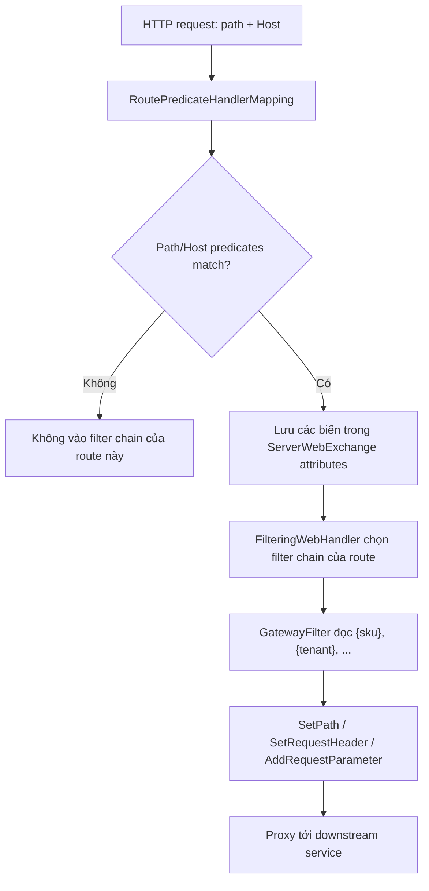

# Biến URI được trích xuất từ Path hoặc Host

## 1. Mục tiêu và bối cảnh

Trong **SPRING_CLOUD_GATEWAY**, một route có thể nhận nhiều URL có cùng cấu trúc nhưng khác giá trị cụ thể. Chẳng hạn:

- `GET /api/products/AB-120` và `GET /api/products/CD-445` đều đi tới dịch vụ sản phẩm; `AB-120`, `CD-445` là mã sản phẩm.
- `GET /orders/9001` tới host `alpha.edge.example.test` và cùng path tới `beta.edge.example.test` cần xác định hai tenant khác nhau.
- Gateway có thể chuyển path, gắn header truy xuất hoặc thêm query parameter tương ứng mà không tạo một route cho từng sản phẩm hay tenant.

Spring Cloud Gateway Server WebFlux giải quyết việc này bằng **URI template variables** (biến của mẫu URI), được trích xuất khi các route predicate như **`Path`** hoặc **`Host`** khớp request. Sau đó một số `GatewayFilter` lấy các biến này để biến đổi request hoặc response.

Kết thúc bài học, bạn sẽ hiểu:

1. Cú pháp `{variableName}` trong `Path` và `Host`, sự khác nhau giữa biến được đặt tên và wildcard.
2. Biến được lưu ở đâu trong `ServerWebExchange`, được đọc từ Java và được dùng bởi filter như thế nào.
3. Cách cấu hình `SetPath`, `AddRequestHeader`, `SetRequestHeader`, `SetResponseHeader` và `AddRequestParameter` để dùng biến.
4. Cách kiểm thử trên máy cục bộ, nhận biết trường hợp route không khớp hoặc downstream không khả dụng.
5. Các ranh giới bảo mật của Host/header, đặc biệt khi ứng dụng cần xác thực, phân vùng tenant, rate limit và quan sát request.

**Phạm vi:** ví dụ dùng **Spring Cloud Gateway Server WebFlux** thuộc Spring Cloud 2025.0.x (Gateway 4.3.x), với starter `spring-cloud-starter-gateway-server-webflux` và prefix `spring.cloud.gateway.server.webflux`. Với release train khác, kiểm tra tài liệu đi kèm: nhiều ví dụ cũ dùng `spring-cloud-starter-gateway` và `spring.cloud.gateway.routes`.

## 2. Biến mẫu URI là gì?

Một mẫu URL chứa các phân đoạn cố định và các **placeholder có tên**:

```text
Mẫu Path:    /api/products/{sku}
Request:     /api/products/AB-120
Trích xuất:  sku = AB-120

Mẫu Host:    {tenant}.edge.example.test
Host header: alpha.edge.example.test
Trích xuất:  tenant = alpha
```

**Cặp dấu ngoặc nhọn `{...}` định nghĩa tên biến.** Giá trị nhận được là chuỗi lấy từ phần request thực tế khớp mẫu, không phải giá trị cấu hình cố định và cũng không phải thông tin định danh đã được xác thực.

Phân biệt các thuật ngữ gần nhau:

| Khái niệm | Ví dụ | Ý nghĩa |
| --- | --- | --- |
| **Path template variable** | `Path=/api/products/{sku}` | Trích xuất `sku` từ đường dẫn request khớp mẫu. |
| **Host template variable** | `Host={tenant}.edge.example.test` | Trích xuất `tenant` từ Host khớp mẫu. |
| Wildcard | `Path=/api/products/**`, `Host=**.example.test` | Giúp match nhiều giá trị; bản thân `**` không tạo ra biến tên `sku` hay `tenant`. |
| Query parameter | `?page=2` | Phần query của HTTP request; không tự trở thành biến do `Path` hoặc `Host` bắt được. |
| URI đích của route | `uri: http://127.0.0.1:9001` | Địa chỉ Gateway chuyển tiếp tới, khác với biến được trích xuất khi match. |
| Header HTTP | `X-Tenant: alpha` | Có thể được filter thêm từ biến; không tự đồng nghĩa với template variable. |

**Ví dụ quan trọng:** với `Path=/api/products/{sku}`, request `/api/products/AB-120?lang=vi` có `sku=AB-120`. `lang=vi` là query parameter riêng. Request `/api/products/AB-120/details` **không khớp** mẫu gồm một phân đoạn `{sku}` ở vị trí cuối.

## 3. `Path` predicate: trích xuất từ đường dẫn

Khai báo route:

```yaml
spring:
  cloud:
    gateway:
      server:
        webflux:
          routes:
            - id: product-by-path
              uri: http://127.0.0.1:9001
              predicates:
                - Path=/api/products/{sku}
```

`PathRoutePredicateFactory` so khớp đường dẫn request với mẫu đã khai báo. Khi có match, nó trích xuất tên/giá trị thành một map. Ví dụ:

| Request path | Route khớp? | Biến trích xuất |
| --- | --- | --- |
| `/api/products/AB-120` | Có | `sku=AB-120` |
| `/api/products/42` | Có | `sku=42` |
| `/api/products/42?sort=asc` | Có | `sku=42`; query `sort` vẫn riêng biệt |
| `/api/products` | Không | Không có biến từ route này |
| `/api/products/42/reviews` | Không | Không có biến từ route này |
| `/api/orders/42` | Không | Không có biến từ route này |

Dòng có query trong bảng thể hiện **request URL**; việc match path chỉ xét phần đường dẫn, còn `?sort=asc` không thuộc path. Nếu ứng dụng có các route khác khớp những request "Không", chúng vẫn có thể được xử lý bởi route khác.

Bạn có thể đặt nhiều placeholder trong một `Path`:

```yaml
predicates:
  - Path=/customers/{customerId}/orders/{orderId}
```

Với `/customers/C-17/orders/O-902`, map chứa:

```text
customerId -> C-17
orderId    -> O-902
```

Hai tên khác nhau giúp filter tiếp theo biết giá trị nào dùng cho việc gì.

### Biến có tên khác wildcard

`Path=/files/**` hữu ích để match các path sâu dưới `/files/`, nhưng `**` **không tự đặt tên** cho phần path được match. Muốn có biến để dùng dưới dạng `{name}`, cần khai báo đúng mẫu template được framework hỗ trợ và kiểm tra điều kiện match. Đừng tự suy ra một tên biến từ wildcard.

Bản 4.3.x còn có tùy chọn về dấu `/` ở cuối path (`matchTrailingSlash`, phụ thuộc cấu hình/phiên bản). Khi cần phân biệt `/items/42` với `/items/42/`, kiểm tra tài liệu đúng phiên bản và thêm test hồi quy; không dựa vào giả định mọi phiên bản xử lý trailing slash giống nhau.

## 4. `Host` predicate: trích xuất từ tên miền

Khai báo một route phân biệt tenant theo tên miền:

```yaml
spring:
  cloud:
    gateway:
      server:
        webflux:
          routes:
            - id: tenant-by-host
              uri: http://127.0.0.1:9001
              predicates:
                - Host={tenant}.edge.example.test
```

`HostRoutePredicateFactory` kiểm tra tên miền trong HTTP `Host` header theo mẫu kiểu Ant có dấu chấm làm dấu phân cách. Placeholder `{tenant}` cho phép lấy phần cụ thể tương ứng.

| HTTP Host | Match `{tenant}.edge.example.test`? | Giá trị `tenant` |
| --- | --- | --- |
| `alpha.edge.example.test` | Có | `alpha` |
| `beta.edge.example.test` | Có | `beta` |
| `edge.example.test` | Không | — |
| `alpha.other.example.test` | Không | — |

`Host=**.edge.example.test` là một pattern rộng hơn để match hostname theo wildcard; **nó không có placeholder tên `tenant`**. Do đó filter tham chiếu `{tenant}` không nên đi kèm route chỉ có wildcard nếu không có predicate khác thực sự cung cấp tên đó.

Trong thực hành local, không cần tạo DNS công khai: `curl -H 'Host: alpha.edge.example.test' http://127.0.0.1:8080/...` cho phép thử predicate Host trên một kết nối HTTP đến Gateway ở `127.0.0.1`. Tuy nhiên, thay đổi `Host` qua `curl` cho thấy header này **có thể do client chủ động gửi**; trong production không được coi tên tenant lấy từ Host là bằng chứng xác thực.

## 5. Biến được lưu ở đâu và có vòng đời thế nào?

Sau khi route predicate khớp, các biến được đặt trong **attributes của `ServerWebExchange`**, dưới khóa:

```java
ServerWebExchangeUtils.URI_TEMPLATE_VARIABLES_ATTRIBUTE
```

Phương thức tiện ích để đọc map:

```java
import java.util.Map;
import org.springframework.cloud.gateway.support.ServerWebExchangeUtils;
import org.springframework.web.server.ServerWebExchange;

Map<String, String> variables =
        ServerWebExchangeUtils.getUriTemplateVariables(exchange);

String sku = variables.get("sku");
String tenant = variables.get("tenant");
```

Đoạn trên minh họa code **bên trong method xử lý Gateway có biến `exchange`**, chẳng hạn `GlobalFilter.filter(...)` hoặc `GatewayFilter.filter(...)`; không phải một chương trình Java độc lập.

Luồng dữ liệu:



Các lưu ý về vòng đời:

- `ServerWebExchange` gắn với **một request**. Không lưu map các biến này trong một field static/singleton để dùng giữa các request.
- Các filter của **route đã chọn** có thể đọc biến được trích xuất trong quá trình match. Route khác không cung cấp biến cho request hiện tại.
- Các filter có thể dùng cú pháp `{sku}` hoặc `{tenant}` nếu factory đó hỗ trợ URI template variables; không phải **mọi** trường cấu hình của Gateway đều tự động thay thế placeholder.
- Nếu khai báo cùng tên placeholder trong nhiều predicate của cùng route, ý nghĩa sẽ mơ hồ và có nguy cơ ghi đè tùy cách kết hợp dữ liệu. **Hãy dùng tên duy nhất**, ví dụ `{tenant}`, `{orderId}`, thay vì cùng dùng `{id}` cho cả Host và Path.
- Không nhầm `URI_TEMPLATE_VARIABLES_ATTRIBUTE` với `GATEWAY_ROUTE_ATTR`: khóa thứ nhất chứa các giá trị được trích xuất, khóa thứ hai chứa đối tượng route đã match.

### Một ví dụ `GlobalFilter` chỉ đọc metadata

Khi cần debug, bạn có thể tạo filter ghi lại **tên biến** mà Gateway nhìn thấy, tránh log giá trị nhạy cảm:

```java
package com.example.gateway;

import java.util.Map;
import org.slf4j.Logger;
import org.slf4j.LoggerFactory;
import org.springframework.cloud.gateway.filter.GatewayFilterChain;
import org.springframework.cloud.gateway.filter.GlobalFilter;
import org.springframework.cloud.gateway.support.ServerWebExchangeUtils;
import org.springframework.core.Ordered;
import org.springframework.stereotype.Component;
import org.springframework.web.server.ServerWebExchange;
import reactor.core.publisher.Mono;

@Component
public class RouteVariableDebugFilter implements GlobalFilter, Ordered {

    private static final Logger log =
            LoggerFactory.getLogger(RouteVariableDebugFilter.class);

    @Override
    public int getOrder() {
        return -50;
    }

    @Override
    public Mono<Void> filter(
            ServerWebExchange exchange, GatewayFilterChain chain) {

        Map<String, String> variables =
                ServerWebExchangeUtils.getUriTemplateVariables(exchange);

        // Chỉ log danh sách tên biến; không log token, URI đầy đủ hay giá trị tenant.
        log.debug("Captured URI template keys: {}", variables.keySet());
        return chain.filter(exchange);
    }
}
```

`GlobalFilter` này chạy trong chuỗi của **các route đã được Gateway chọn**. Nó không phải `WebFilter` áp dụng cho mọi HTTP request WebFlux. Giá trị order `-50` chỉ phục vụ minh họa; không dựa vào nó để xác định thứ tự của tất cả filter hạ tầng.

## 6. Dùng biến trong các `GatewayFilter` có sẵn

Các filter được Spring Cloud Gateway cung cấp có thể dùng lại giá trị do `Path` hoặc `Host` đã bắt.

| Filter | Minh họa | Hành vi chính |
| --- | --- | --- |
| `SetPath` | `SetPath=/internal/products/{sku}` | Tạo **path đích mới** từ biến `sku`. |
| `AddRequestHeader` | `AddRequestHeader=X-Product, {sku}` | Thêm request header có giá trị từ biến. Nếu đã có header cùng tên, có thể tồn tại nhiều giá trị. |
| `SetRequestHeader` | `SetRequestHeader=X-Tenant, {tenant}` | Thay thế các giá trị hiện có của header đó bằng giá trị mới. |
| `AddRequestParameter` | `AddRequestParameter=source, gateway-{sku}` | Thêm query parameter vào request chuyển tiếp. |
| `SetResponseHeader` | `SetResponseHeader=X-Tenant-Route, {tenant}` | Thay thế giá trị header tương ứng trong response được trả về. |

**`Add` và `Set` không giống nhau.** Với header mang ngữ nghĩa tin cậy như `X-Tenant`, nếu chọn đưa một giá trị đã được kiểm tra vào request upstream, `SetRequestHeader` phù hợp hơn việc thêm một giá trị có thể cạnh tranh với header client tự cung cấp. Tuy vậy, **`SetRequestHeader` không tự xác thực tenant**: filter chỉ biến đổi chuỗi.

Với URI `uri: http://127.0.0.1:9001`, `SetPath` thay đổi phần **path** gửi tới máy chủ đó. Nó không tự chuyển `http://127.0.0.1:9001` thành một host động bằng cách đặt `{tenant}` vào phần authority. Nếu ứng dụng cần chọn upstream theo tenant, cần dùng bảng ánh xạ service/route được kiểm soát, service discovery hoặc logic định tuyến đã kiểm tra riêng.

### Ví dụ tổng hợp: hai kiểu trích xuất

Đặt nội dung dưới đây trong `src/main/resources/application.yml` của ứng dụng Gateway Server WebFlux:

```yaml
server:
  port: 8080

spring:
  application:
    name: variable-demo-gateway
  cloud:
    gateway:
      server:
        webflux:
          routes:
            - id: product-by-path
              uri: http://127.0.0.1:9001
              predicates:
                - Path=/api/products/{sku}
              filters:
                - SetPath=/products/{sku}
                - SetRequestHeader=X-Product-Sku, {sku}
                - AddRequestParameter=source, gateway-{sku}
                - SetResponseHeader=X-Matched-Route, product-by-path

            - id: orders-by-host-and-path
              uri: http://127.0.0.1:9001
              predicates:
                - Host={tenant}.edge.example.test
                - Path=/orders/{orderId}
              filters:
                - SetPath=/orders/{orderId}
                - SetRequestHeader=X-Selected-Tenant, {tenant}
                - SetRequestHeader=X-Order-Id, {orderId}
                - SetResponseHeader=X-Matched-Route, orders-by-host-and-path
                - SetResponseHeader=X-Matched-Tenant, {tenant}
```

Ở route **`product-by-path`**, chỉ có predicate Path, nên `{sku}` được lấy từ đường dẫn. Ở route **`orders-by-host-and-path`**, hai predicate trong cùng route được kết hợp theo logic **AND**:

- Host phải khớp `{tenant}.edge.example.test`.
- Path phải khớp `/orders/{orderId}`.
- Dữ liệu được dùng trong filter theo tên đã khai báo: `tenant` từ Host, `orderId` từ Path.

Để làm việc với `/orders/9001` của tenant `alpha`, request cần cả **đường dẫn** và **Host** đúng. Gọi đúng path nhưng Host khác sẽ không match route này.

Sơ đồ kết quả:

```text
Request A:
  GET http://localhost:8080/api/products/AB-120

Path captures:
  {sku} = AB-120

Filters:
  SetPath           -> /products/AB-120
  SetRequestHeader  -> X-Product-Sku: AB-120
  AddRequestParameter -> source=gateway-AB-120

Upstream:
  http://127.0.0.1:9001/products/AB-120?source=gateway-AB-120


Request B:
  GET http://127.0.0.1:8080/orders/9001
  Host: alpha.edge.example.test

Host + Path captures:
  {tenant} = alpha
  {orderId} = 9001

Filters:
  SetPath           -> /orders/9001
  SetRequestHeader  -> X-Selected-Tenant: alpha
  SetRequestHeader  -> X-Order-Id: 9001

Upstream:
  http://127.0.0.1:9001/orders/9001
```

Khi đã định nghĩa predicate `Path=/api/products/{sku}`, **không** cần bổ sung `StripPrefix` cho ví dụ này: `SetPath` đã thiết lập toàn bộ path đích. Kết hợp cả `StripPrefix` và `SetPath` mà không tính thứ tự có thể gây biến đổi path không mong muốn.

### Phân biệt với `RewritePath`

`SetPath` có thể sử dụng biến URI template dạng `{sku}`. Trong khi đó, `RewritePath` dựa trên **biểu thức chính quy (regex)** và nhóm bắt được bằng tên trong chính regex. Ví dụ regex group `(?<remaining>.*)` là một cơ chế riêng, **không đồng nhất** với `{remaining}` của `Path`/ `Host`. Khi dùng `RewritePath` trong YAML còn cần chú ý escaping ký tự `$` để không bị xử lý như placeholder cấu hình. Với phép đổi path đơn giản theo biến `Path`, `SetPath` thường dễ đọc và dễ kiểm thử hơn.

## 7. Thực hành đầy đủ với backend Echo chạy cục bộ

Để nhìn thấy upstream nhận gì, dùng một server nhỏ có sẵn trong JDK 17. Cách này không cần cấu hình Eureka/Consul, `lb://`, cơ sở dữ liệu hay hạ tầng mạng bên ngoài.

### 7.1. Chuẩn bị ứng dụng Gateway

Ứng dụng dùng Java 17 trở lên, Spring Boot 3.5.x cùng Spring Cloud 2025.0.x tương thích, và dependency:

```xml
<dependency>
    <groupId>org.springframework.cloud</groupId>
    <artifactId>spring-cloud-starter-gateway-server-webflux</artifactId>
</dependency>
```

Spring Cloud BOM `spring-cloud-dependencies` phải được import ở `dependencyManagement`; starter không cần version riêng. Bạn chỉ cần class `@SpringBootApplication` với `SpringApplication.run(...)` và file `application.yml` ở mục 6. Có thể dùng skeleton từ Spring Initializr hoặc dự án Gateway Server WebFlux đã khởi tạo. Đảm bảo backend chưa chiếm port `8080`.

### 7.2. Tạo server quan sát request

Tạo file `EchoBackend.java` trong một thư mục thực hành cục bộ (không đóng gói vào Gateway):

```java
import com.sun.net.httpserver.HttpServer;
import java.net.InetSocketAddress;
import java.nio.charset.StandardCharsets;

public class EchoBackend {
    public static void main(String[] args) throws Exception {
        HttpServer server = HttpServer.create(
                new InetSocketAddress("127.0.0.1", 9001), 0);

        server.createContext("/", exchange -> {
            String path = exchange.getRequestURI().getRawPath();
            String query = exchange.getRequestURI().getRawQuery();

            String sku = exchange.getRequestHeaders()
                    .getFirst("X-Product-Sku");
            String tenant = exchange.getRequestHeaders()
                    .getFirst("X-Selected-Tenant");
            String order = exchange.getRequestHeaders()
                    .getFirst("X-Order-Id");

            String body = "path=" + path + "\n"
                    + "query=" + query + "\n"
                    + "sku=" + sku + "\n"
                    + "tenant=" + tenant + "\n"
                    + "order=" + order + "\n";

            byte[] bytes = body.getBytes(StandardCharsets.UTF_8);
            exchange.getResponseHeaders().set(
                    "Content-Type", "text/plain; charset=UTF-8");
            exchange.sendResponseHeaders(200, bytes.length);

            try (var output = exchange.getResponseBody()) {
                output.write(bytes);
            }
        });

        server.start();
        System.out.println("Echo backend listening on 127.0.0.1:9001");
    }
}
```

Đây là server kiểm thử không có xác thực, không giới hạn request và không có TLS. Chỉ bind loopback `127.0.0.1`; không triển khai mã này như backend production.

Chạy trong **terminal A**:

```bash
java EchoBackend.java
```

Chạy Gateway trong **terminal B**, tại thư mục dự án có `pom.xml`:

```bash
mvn spring-boot:run
```

Nếu dự án tạo bởi Spring Initializr có Maven Wrapper, dùng `./mvnw spring-boot:run` (Linux/macOS) hoặc `mvnw.cmd spring-boot:run` (Windows). Đảm bảo Gateway lắng nghe `8080`, còn backend lắng nghe `9001`.

### 7.3. Kiểm thử biến từ Path

Trong **terminal C**, chạy:

```bash
curl -i "http://127.0.0.1:8080/api/products/AB-120"
```

Kỳ vọng nhận `200 OK`, header `X-Matched-Route: product-by-path` và body tương tự:

```text
path=/products/AB-120
query=source=gateway-AB-120
sku=AB-120
tenant=null
order=null
```

Từ kết quả có thể kiểm chứng:

1. `Path=/api/products/{sku}` khớp đường dẫn request.
2. `sku` được trích xuất thành `AB-120`.
3. `SetPath` đổi path trước khi gửi backend.
4. `SetRequestHeader` gắn giá trị SKU để backend đọc.
5. `AddRequestParameter` tạo query parameter mới; header response xác nhận route đã chọn.

Gọi thêm request có query sẵn:

```bash
curl -i "http://127.0.0.1:8080/api/products/CD-445?lang=vi"
```

Backend dự kiến nhận query gồm cả `lang=vi` và `source=gateway-CD-445` (thứ tự hiển thị có thể khác). Biến `sku=CD-445` vẫn đến từ **path**, không đến từ `lang`.

### 7.4. Kiểm thử biến từ Host và Path đồng thời

Gọi Gateway bằng IP local nhưng đặt Host thủ công:

```bash
curl -i -H "Host: alpha.edge.example.test" \
     "http://127.0.0.1:8080/orders/9001"
```

Trên Windows PowerShell, có thể nhập một dòng:

```powershell
curl.exe -i -H "Host: alpha.edge.example.test" "http://127.0.0.1:8080/orders/9001"
```

Kỳ vọng:

```text
HTTP/1.1 200 OK
X-Matched-Route: orders-by-host-and-path
X-Matched-Tenant: alpha

path=/orders/9001
query=null
sku=null
tenant=alpha
order=9001
```

Đối với route này, giá trị `tenant` không lấy từ path `/orders/9001`; nó lấy từ **Host**. Giá trị `orderId` lấy từ **Path**. Cả hai đã được filter dùng lại để gắn header cho upstream.

### 7.5. Kiểm thử trường hợp không match

```bash
# Host đúng nhưng path sai
curl -i -H "Host: alpha.edge.example.test" \
     "http://127.0.0.1:8080/products/9001"

# Path đúng nhưng Host sai
curl -i -H "Host: unknown.example.invalid" \
     "http://127.0.0.1:8080/orders/9001"

# Path có thêm phân đoạn ngoài mẫu
curl -i "http://127.0.0.1:8080/api/products/AB-120/details"
```

Với ứng dụng chỉ khai báo hai route của ví dụ và không có endpoint khác, ba request này dự kiến trả **404 Not Found**. Chúng không cung cấp các biến tương ứng cho route vì route không match.

Dừng backend `9001` và gọi lại một URL khớp route: lúc đó Gateway vẫn có thể nhận được `sku` hoặc `tenant`, nhưng bước proxy đến backend sẽ thất bại, thường trả lỗi nhóm **5xx**. Phân biệt hai tình huống: **không khớp predicate** và **khớp route nhưng upstream không hoạt động**.

## 8. Dùng biến trong Java mà không làm rò rỉ dữ liệu

Trong custom filter, nên kiểm tra sự tồn tại của biến trước khi sử dụng:

```java
Map<String, String> vars =
        ServerWebExchangeUtils.getUriTemplateVariables(exchange);

String tenant = vars.get("tenant");
if (tenant == null || tenant.isBlank()) {
    // Không giả định mọi route đều có biến tenant.
    // Ở filter riêng của route tenant, xử lý phản hồi từ chối phù hợp.
}
```

Nếu filter áp dụng cho nhiều route, `tenant == null` có thể là chuyện bình thường ở route chỉ có `{sku}`. Cách xử lý phải dựa trên chính sách của route, không tự từ chối mọi request chỉ vì không có một biến tùy chọn.

Khi triển khai đa tenant thực tế:

- Kiểm tra Host thuộc danh sách domain mà tổ chức sở hữu; cấu hình proxy/load balancer/TLS và DNS tương ứng.
- **Không dùng `tenant` lấy từ Host làm bằng chứng quyền truy cập.** Người gọi có thể tự gửi Host bất kỳ. Sau bước xác thực, phải đối chiếu tenant lấy từ Host với claim/permission từ token hoặc session đã được xác thực.
- Dùng `SetRequestHeader` để tránh giữ giá trị client gửi sẵn ở header nội bộ như `X-Selected-Tenant`, và cấu hình backend chỉ tin header đó khi request tới từ cổng Gateway được bảo vệ. Việc thay thế header không tự tạo cơ chế trust.
- Giới hạn định dạng biến trước khi dùng trong logic nhạy cảm: tên tenant, định danh khách hàng, tên service; không ghép chuỗi không kiểm soát để chọn arbitrary outbound host, cổng hoặc file path.
- Không log toàn bộ `ServerWebExchange`, token truy cập hoặc giá trị nhạy cảm trong URI. Các route predicate và filter chỉ hỗ trợ định tuyến/biến đổi; cần Spring Security WebFlux, rate limit, circuit breaker, retry và TLS ở những lớp phù hợp.

## 9. Các lỗi thường gặp

| Triệu chứng | Nguyên nhân có thể | Hướng kiểm tra |
| --- | --- | --- |
| `404` dù URL nhìn gần đúng | Path có thêm/bớt phân đoạn, Host sai domain, nhiều predicate phải cùng match. | So khớp từng phần của pattern; thử lại với `curl -i -H "Host: ..."`. |
| Filter không thay thế `{sku}` | Route không có placeholder tên `sku`, đặt sai tên hoặc dùng factory không hỗ trợ interpolation. | So sánh chính tả trong `Path` và filter, đọc tài liệu của filter cụ thể. |
| Dùng `Path=/api/**` nhưng đọc `sku` là `null` | Wildcard không tự trích xuất biến có tên. | Dùng mẫu `/api/{sku}` nếu phù hợp ý nghĩa của một phân đoạn. |
| `tenant` bị `null` | Request không có Host khớp, route khác được chọn hoặc pattern không khai báo `{tenant}`. | Xem Host thật của request và route ID; kiểm tra predicate `Host`. |
| Header nội bộ có nhiều giá trị | Dùng `AddRequestHeader` khi client cũng gửi header cùng tên. | Với header phải do Gateway quản lý, cân nhắc `SetRequestHeader` cùng xác thực/ủy quyền đầy đủ. |
| Path upstream sai | `SetPath` không đúng template, hoặc thêm `StripPrefix`/ `RewritePath` gây thay đổi khác. | Gọi backend Echo xem path, giảm số filter và thêm lại có kiểm soát. |
| HTTP 5xx khi route đã match | Backend `127.0.0.1:9001` không chạy hoặc không kết nối được. | Gọi trực tiếp backend; xem log kết nối/timeout ở Gateway. |
| Cấu hình hợp lệ ở tài liệu cũ nhưng route mới không hoạt động | Dùng prefix `spring.cloud.gateway.routes` trong dự án đã chuyển sang nhóm thuộc tính `spring.cloud.gateway.server.webflux`. | Đối chiếu release train, starter và prefix đúng phiên bản. |
| Nhầm Host với danh tính người dùng | Client có thể gửi header Host; proxy có thể thay đổi metadata. | Xác thực danh tính và quyền truy cập tenant bằng hệ thống bảo mật riêng. |

### Quy trình kiểm tra theo từng bước

Khi có lỗi, dùng cách thu hẹp phạm vi sau:

1. Xác nhận route được khai báo dưới đúng prefix của phiên bản Gateway và đã được nạp.
2. Kiểm tra **predicate match** trước: Path chính xác, Host chính xác, các predicate trên cùng route là điều kiện AND.
3. Kiểm tra **biến trích xuất** qua một custom filter trong môi trường dev hoặc kết quả của built-in filter.
4. Kiểm tra **biến đổi** request ở backend Echo: path, query, header; xác nhận route ID qua response header minh họa.
5. Kiểm tra **downstream**: service có chạy, URI đích có đúng scheme/port và có timeout không.
6. Chỉ sau đó mới đi sâu vào các filter nâng cao như auth, rate limit, retry, circuit breaker và tracing.

## 10. Câu hỏi tự kiểm tra

**1.** Với `Path=/inventory/{sku}` và request `/inventory/A1?region=apac`, map biến chứa gì?

Map chứa `sku=A1`. `region` là query parameter, không tự thành biến của Path predicate.

**2.** `Host=**.edge.example.test` có sinh ra biến tên `tenant` không?

Không. Để trích xuất một phần có tên, khai báo pattern như `Host={tenant}.edge.example.test`.

**3.** Trong một route có `Host={tenant}.edge.example.test` và `Path=/orders/{orderId}`, điều kiện match là OR hay AND?

Là **AND**. Host và path đều phải khớp mới chọn route đó.

**4.** Một filter `SetPath=/internal/{orderId}` lấy `orderId` từ đâu?

Từ URI template variables mà route predicate đã trích xuất, không phải một biến Java độc lập hay header HTTP tự động.

**5.** Vì sao header `X-Selected-Tenant: alpha` được thêm từ Host vẫn chưa chứng minh người gọi được phép truy cập tenant alpha?

Bởi vì Host do client điều khiển; cần đối chiếu với danh tính và quyền đã được xác thực.

**6.** Thay `uri: http://127.0.0.1:9001` bằng một chuỗi chứa `{tenant}` có mặc nhiên được Gateway thay thế giống `SetPath` không?

Không nên giả định vậy. Cơ chế interpolation được hỗ trợ ở từng GatewayFilterFactory cụ thể; lựa chọn service đích phải được thiết kế và kiểm soát độc lập.

**7.** Phương thức Java tiện ích để lấy map biến tên/giá trị từ exchange là gì?

`ServerWebExchangeUtils.getUriTemplateVariables(exchange)`.

## Kết luận

Biến URI trong **Spring Cloud Gateway Server WebFlux** được trích xuất lúc `Path` hoặc `Host` route predicate khớp request. Chúng được giữ trong `ServerWebExchange` và có thể được `GatewayFilter` hỗ trợ template dùng lại để tạo path, request header, response header hoặc query parameter. Việc trích xuất giúp một route xử lý nhiều tài nguyên và nhiều host một cách rõ ràng, nhưng **không tự cung cấp xác thực, service discovery, giới hạn lưu lượng hay phân quyền tenant**. Đó là những trách nhiệm cần tích hợp và kiểm thử riêng khi vận hành cổng vào microservices.

### Tài liệu tham khảo chính thức

- [Spring Cloud Gateway Server WebFlux 4.3 — Route Predicate Factories: Host và Path](https://docs.spring.io/spring-cloud-gateway/reference/4.3/spring-cloud-gateway-server-webflux/request-predicates-factories.html)
- [Spring Cloud Gateway 4.3 — SetPath GatewayFilter Factory](https://docs.spring.io/spring-cloud-gateway/reference/4.3/spring-cloud-gateway-server-webflux/gatewayfilter-factories/setpath-factory.html)
- [Spring Cloud Gateway 4.3 — AddRequestHeader GatewayFilter Factory](https://docs.spring.io/spring-cloud-gateway/reference/4.3/spring-cloud-gateway-server-webflux/gatewayfilter-factories/addrequestheader-factory.html)
- [Spring Cloud Gateway 4.3 — SetRequestHeader GatewayFilter Factory](https://docs.spring.io/spring-cloud-gateway/reference/4.3/spring-cloud-gateway-server-webflux/gatewayfilter-factories/setrequestheader-factory.html)
- [Spring Cloud Gateway 4.3 — AddRequestParameter GatewayFilter Factory](https://docs.spring.io/spring-cloud-gateway/reference/4.3/spring-cloud-gateway-server-webflux/gatewayfilter-factories/addrequestparameter-factory.html)
- [Spring Cloud 2025.0 Release Notes — starter names và property prefixes](https://github.com/spring-cloud/spring-cloud-release/wiki/Spring-Cloud-2025.0-Release-Notes)
