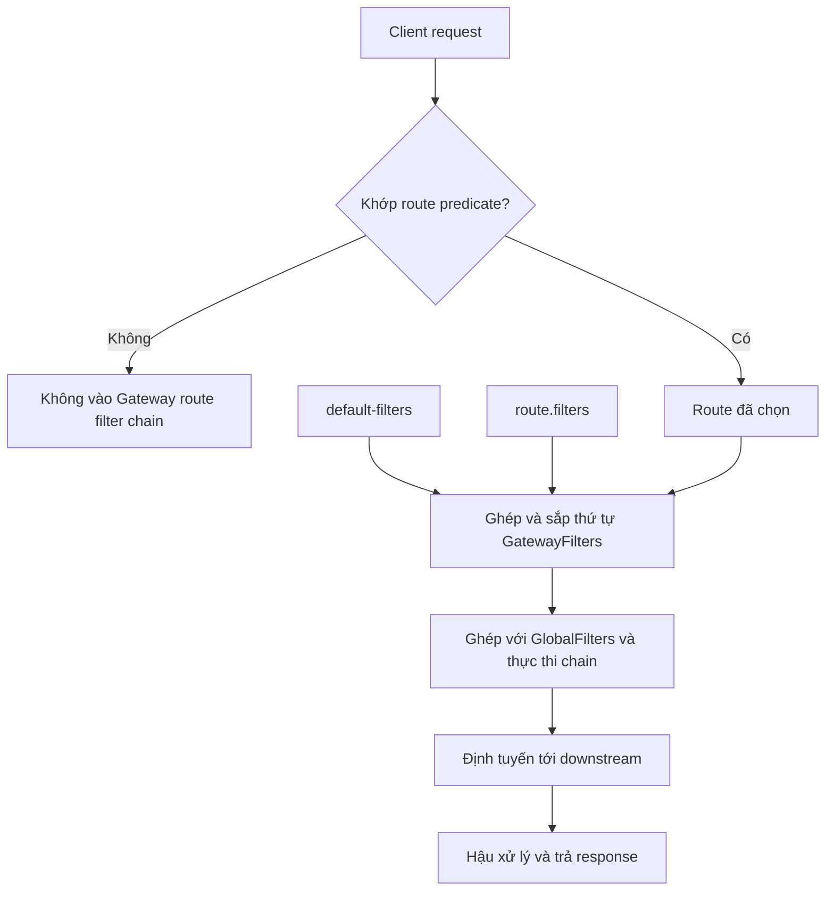

# Default filters và phạm vi áp dụng cho các tuyến trong Spring Cloud Gateway

## 1. Vấn đề cần giải quyết

Trong hệ thống microservices, **Spring Cloud Gateway** thường có nhiều route: `/api/catalog/**` đi tới dịch vụ danh mục, `/api/orders/**` đi tới dịch vụ đơn hàng, `/api/payments/**` đi tới dịch vụ thanh toán. Mỗi route có **predicate** riêng, URI đích và **filter chain** riêng. Một số hành vi như thêm header nhận diện gateway, bổ sung header phản hồi hoặc loại bỏ header không mong muốn lại cần được dùng chung.

Viết lặp cùng một filter trong `routes[*].filters` khiến cấu hình dài và dễ thiếu nhất quán khi thêm route mới. Trong **Gateway Server WebFlux**, cấu hình **`default-filters`** giải quyết bài toán này: khai báo một danh sách `GatewayFilter` mặc định để gắn vào các **route definitions** được Gateway nạp theo cơ chế cấu hình.

Sau bài học, bạn sẽ biết:

- Đặt `default-filters` đúng tiền tố cấu hình theo phiên bản Gateway.
- Phân biệt **default filter**, **filter riêng của route**, **`GlobalFilter`** và bộ lọc của Spring Security.
- Xác định route nào nhận default filters, khi nào default filters không chạy và cách chúng được sắp thứ tự.
- Dùng default filters cho các chính sách dùng chung mà vẫn giữ được biến đổi path/header, service discovery, rate limiting, circuit breaker, retry, TLS và quan sát request theo nhu cầu từng tuyến.
- Kiểm tra hành vi bằng `curl`, logs và Actuator.

> **Phạm vi kỹ thuật:** ví dụ tập trung vào **Spring Cloud Gateway Server WebFlux**. Gateway Server Web MVC dựa trên Servlet/WebMvc.fn và có API filter, namespace cấu hình riêng. Không tự giả định rằng mọi cấu hình `default-filters` WebFlux đều được hỗ trợ giống hệt trong Server MVC.

## 2. Khái niệm: default filter được gắn vào đâu?

**Route** là tổ hợp gồm ID, URI đích, các predicate và các filters. Khi request đến, Gateway tìm route có predicate phù hợp; sau đó mới đưa request qua chain filters của route ấy.

Trong cách khai báo route bằng YAML/properties, `RouteDefinitionRouteLocator` tạo `Route` từ `RouteDefinition` và hợp nhất hai nguồn filter:

1. **`default-filters`**: danh sách filter dùng chung, định nghĩa một lần ở cấp Gateway Server WebFlux.
2. **`routes[*].filters`**: danh sách filter được viết riêng trong mỗi route definition.

Gateway sắp xếp các filter thu được theo `order` rồi ghép chúng với các **`GlobalFilter`** trong Gateway filter chain. Vì vậy, `default-filters` không phải là một chain đứng riêng luôn chạy trước toàn bộ route filters.



**Điều kiện tiên quyết:** một route phải được chọn trước khi default filters của Gateway Server được chạy. `GET /khong-co-route` không tự nhiên nhận header hay chính sách từ `default-filters` nếu không có route phù hợp. Những request bị Spring Security chặn trước bước chọn route cũng có thể không đi vào chain của Gateway.

### 2.1. So sánh bốn tầng áp dụng filter

| Cơ chế | Khai báo ở đâu? | Phạm vi điển hình | Điều cần nhớ |
|---|---|---|---|
| **Default `GatewayFilter`** | `spring.cloud.gateway.server.webflux.default-filters` (4.3+) | Các route definitions được nạp qua cơ chế cấu hình Gateway Server WebFlux | Tái sử dụng filter factory; không bao phủ mọi endpoint WebFlux ngoài route Gateway |
| **Route-specific `GatewayFilter`** | `spring.cloud.gateway.server.webflux.routes[*].filters` (4.3+) | Chỉ route tương ứng | Phù hợp `StripPrefix`, `RewritePath`, timeout, retry hay chính sách riêng |
| **`GlobalFilter` bean** | Java class/bean implement `org.springframework.cloud.gateway.filter.GlobalFilter` | Các request đã khớp route và đi vào Gateway Server WebFlux filter chain | Là code, có thể đọc `ServerWebExchange`; thứ tự theo `Ordered`/`@Order` |
| **Spring Security `WebFilter`** | Cấu hình `SecurityWebFilterChain` | Theo `securityMatcher` và filter chain của Spring Security | Có thể xác thực/chặn request trước khi Gateway match route; không tự sinh từ `default-filters` |

`HttpHeadersFilter` của Gateway và các filter CORS ở tầng web cũng là các cơ chế khác. Ví dụ, cấu hình CORS toàn cục nên được xử lý bằng cơ chế CORS phù hợp; không nên coi `AddResponseHeader=Access-Control-Allow-Origin,...` là một giải pháp CORS hoàn chỉnh.

## 3. Chọn đúng property theo phiên bản

Tên `default-filters` được dùng ở nhiều dòng Gateway, nhưng **đường dẫn property thay đổi** khi Gateway giới thiệu namespace riêng cho server và web stack.

| Dòng Gateway Server WebFlux | Release train Spring Cloud tiêu biểu | Property `default-filters` | Starter tương ứng |
|---|---|---|---|
| 3.x–4.2.x | `2021.0.x`–`2024.0.x` | `spring.cloud.gateway.default-filters` | `spring-cloud-starter-gateway` |
| **4.3.x** | **`2025.0.x`** | **`spring.cloud.gateway.server.webflux.default-filters`** | `spring-cloud-starter-gateway-server-webflux` |
| **5.0.x–5.1.x** | **`2025.1.x`–`2026.0.x`** | **`spring.cloud.gateway.server.webflux.default-filters`** | `spring-cloud-starter-gateway-server-webflux` |

**Với ứng dụng mới từ Gateway 4.3**, ví dụ YAML nên đặt dưới `spring.cloud.gateway.server.webflux`. Một số trang tài liệu *Default Filters* của dòng 4.3/5.1 còn trình bày ví dụ với prefix cũ `spring.cloud.gateway.default-filters`; danh mục **Configuration Properties** 5.1 ghi rõ property mới là `spring.cloud.gateway.server.webflux.default-filters`. Đối chiếu với phiên bản đang chạy trước khi sao chép cấu hình.

Đừng dùng tiền tố WebFlux cho **Gateway Server MVC** chỉ vì hai ứng dụng cùng được gọi là Spring Cloud Gateway. Cần xem tài liệu MVC đúng phiên bản và kiểm tra filter được hỗ trợ ở stack đó.

## 4. Ví dụ cấu hình hai route dùng chung default filters

Giả sử Gateway lắng nghe cổng `8080` và có hai backend:

- `catalog-service` ở `http://localhost:8081`, xử lý path `/catalog/**`.
- `orders-service` ở `http://localhost:8082`, xử lý path `/orders/**`.

Mục tiêu: cả hai backend nhận header `X-Edge-Source: api-gateway`; client nhận header phản hồi `X-Handled-By: spring-cloud-gateway`; từng route tự xử lý bỏ tiền tố `/api`.

### 4.1. `application.yml` cho Server WebFlux 4.3+

```yaml
server:
  port: 8080

spring:
  application:
    name: edge-gateway
  cloud:
    gateway:
      server:
        webflux:
          default-filters:
            - SetRequestHeader=X-Edge-Source, api-gateway
            - AddResponseHeader=X-Handled-By, spring-cloud-gateway
          routes:
            - id: catalog-route
              uri: http://localhost:8081
              predicates:
                - Path=/api/catalog/**
              filters:
                - StripPrefix=1

            - id: orders-route
              uri: http://localhost:8082
              predicates:
                - Path=/api/orders/**
              filters:
                - StripPrefix=1
                - AddRequestHeader=X-Route-Id, orders-route
```

Ở đây `SetRequestHeader` thay thế giá trị của header cùng tên trên request chuyển tiếp, còn `AddResponseHeader` thêm header vào response. Chúng được gắn ở cấp default nên **cả hai route definitions đều nhận**. `StripPrefix=1` được đặt riêng ở từng route vì biến đổi đường dẫn là quyết định theo hợp đồng API của backend.

| Client gọi | Route được chọn | Backend nhận | Header chung gửi xuống backend | Header riêng |
|---|---|---|---|---|
| `GET /api/catalog/42` | `catalog-route` | `GET http://localhost:8081/catalog/42` | `X-Edge-Source: api-gateway` | Không khai báo thêm |
| `GET /api/orders/42` | `orders-route` | `GET http://localhost:8082/orders/42` | `X-Edge-Source: api-gateway` | `X-Route-Id: orders-route` |
| `GET /api/users/42` | Không có route tương ứng | Không gọi hai backend trên | Default filters không được áp dụng cho tuyến không tồn tại | Không |

Với hai route đã khớp, response đi qua Gateway có thêm `X-Handled-By: spring-cloud-gateway`, kể cả khi backend trả status lỗi HTTP thông thường, miễn là response vẫn đi qua phần filter và commit. Trong trường hợp kết nối client hủy hoặc lỗi xảy ra ngoài Gateway route chain, không nên khẳng định header luôn xuất hiện.

### 4.2. Dạng khai báo đầy đủ `name` và `args`

Ngoài shorthand `FilterName=arg1, arg2`, có thể viết cùng filter ở dạng tường minh để dễ đọc và tránh nhầm tham số:

```yaml
spring:
  cloud:
    gateway:
      server:
        webflux:
          default-filters:
            - name: SetRequestHeader
              args:
                name: X-Edge-Source
                value: api-gateway
            - name: AddResponseHeader
              args:
                name: X-Handled-By
                value: spring-cloud-gateway
```

Hai đoạn `default-filters` trong mục 4.1 và 4.2 là **hai cách biểu diễn thay thế nhau**, không đặt lặp cả hai vào cùng một file. Khi có nhiều tham số, regex hoặc mẫu ký tự đặc biệt, dạng `name`/`args` thường dễ bảo trì và code review hơn.

### 4.3. Cấu hình cho Server WebFlux 4.2 trở về trước

Với các dòng trước khi namespace mới ra đời, phần tương ứng được đặt trực tiếp dưới `spring.cloud.gateway`:

```yaml
spring:
  cloud:
    gateway:
      default-filters:
        - SetRequestHeader=X-Edge-Source, api-gateway
        - AddResponseHeader=X-Handled-By, spring-cloud-gateway
      routes:
        - id: catalog-route
          uri: http://localhost:8081
          predicates:
            - Path=/api/catalog/**
          filters:
            - StripPrefix=1
```

Hành vi cơ bản của default filters giống mục 4.1, nhưng **starter và property prefix** phải khớp với dòng phiên bản đang chạy. Khi nâng cấp 4.2 lên 4.3+, rà cả `routes`, `default-filters` và các property Gateway Server khác.

## 5. Phạm vi thực sự: những route nào được hưởng default filters?

Tài liệu thường mô tả `default-filters` là **áp dụng cho mọi route**. Về mặt triển khai, cần hiểu “mọi route” trong ngữ cảnh **route definitions** được chuyển thành route qua `RouteDefinitionRouteLocator`.

| Nguồn route/request | Có nên kỳ vọng nhận WebFlux `default-filters`? | Giải thích |
|---|---|---|
| `routes:` trong `application.yml`/`.properties` | **Có** | Được tạo từ `RouteDefinition` qua cơ chế cấu hình Gateway |
| Route definition nạp từ một `RouteDefinitionLocator` khác | **Có**, khi được `RouteDefinitionRouteLocator` xử lý | Các default filters được hợp nhất với filters của route definition |
| Route do DiscoveryClient locator tạo thành route definition | **Có**, khi đi qua cùng cơ chế trên | Các filter mặc định của DiscoveryClient (ví dụ xử lý path có service ID) là lớp cấu hình khác với default-filters của Gateway |
| Route tạo trực tiếp qua Java `RouteLocatorBuilder` | **Không nên mặc định là có** | Java DSL có thể tạo `Route` trực tiếp và bỏ qua bước ghép `RouteDefinitionRouteLocator`; cần kiểm tra hoặc chủ động gắn filter |
| Endpoint actuator/health hoặc handler WebFlux khác | **Không** | Không phải request được Gateway route chain chọn |
| Request không khớp bất kỳ route nào | **Không** | Không có route để áp dụng filter |
| Request bị Spring Security từ chối trước Gateway route handler | **Không bảo đảm** | Bị chặn ở lớp WebFilter bên ngoài route chain |

### 5.1. Vì sao Java DSL là trường hợp cần kiểm tra riêng?

Ví dụ một bean Java tạo route trực tiếp:

```java
@Bean
RouteLocator routes(RouteLocatorBuilder builder) {
    return builder.routes()
            .route("java-route", r -> r.path("/java/**")
                    .filters(f -> f.stripPrefix(1))
                    .uri("http://localhost:8090"))
            .build();
}
```

Đoạn minh họa giả định đã import `RouteLocator`, `RouteLocatorBuilder` và `@Bean` trong ứng dụng Gateway Server WebFlux. Route được xây trực tiếp bằng Java DSL này có thể **không** đi qua `RouteDefinitionRouteLocator`, nơi `default-filters` được ghép vào `RouteDefinition`. Vì vậy không được dùng sự tồn tại của `default-filters` trong YAML làm bằng chứng rằng `java-route` đã nhận `X-Edge-Source`.

Đối với route lập trình bằng Java, bạn có thể **thêm filter ngay trong builder** hoặc viết `GlobalFilter` dùng chung khi thực sự cần áp dụng chính sách với tất cả request đã khớp route. Với yêu cầu an ninh bắt buộc cho mọi URL, xem xét bảo vệ ở tầng **Spring Security**, nơi có `securityMatcher` và chính sách xác thực/phân quyền rõ ràng.

### 5.2. Discovery locator không thay thế global default filters

Khi bật service discovery locator, Gateway có thể tạo route definitions cho các service (`lb://service-id`). Cấu hình `discovery.locator.filters` định nghĩa **filter mặc định cho các route do discovery tạo**, chẳng hạn `RewritePath` để bỏ service ID trong URL. Đây là phạm vi **riêng của discovery-generated routes**.

Ngược lại, `default-filters` của Gateway Server áp dụng ở mức các route definitions được nạp, gồm cả các định nghĩa route từ discovery nếu chúng đi qua cùng locator xử lý. Đừng nhầm `discovery.locator.filters` với `default-filters`: thay thế danh sách filter của discovery có thể làm mất thao tác rewrite path mặc định, dù default-filters chung vẫn tồn tại.

## 6. Thứ tự thực thi: default không có nghĩa là luôn chạy trước

Với filter không tự cung cấp `Ordered`, Gateway gán thứ tự theo **vị trí khai báo, bắt đầu từ 1**. Danh sách `default-filters` và danh sách `routes[*].filters` **được đánh số độc lập**, sau đó ghép và stable-sort theo order. Khi hai filter có cùng order, default filter được đưa vào trước route filter, nên giữ vị trí trước khi stable-sort.

Ví dụ:

```text
default-filters = [D1, D2, D3, D4]
route.filters   = [R1, R2]

Order mặc định:
  D1=1, D2=2, D3=3, D4=4
  R1=1, R2=2

Chuỗi GatewayFilter sau khi sắp:
  D1 -> R1 -> D2 -> R2 -> D3 -> D4
```

**Điểm dễ sai:** “Mọi default filter chạy xong rồi mới tới filter của route” là một giả định **không đúng**. Thứ tự trên còn có thể bị thay đổi bởi filter factory tự tạo `OrderedGatewayFilter` với order riêng hoặc bởi `GlobalFilter` kết hợp sau đó.

Nếu các filter có logic trước và sau `chain.filter(...)`, filter có order nhỏ hơn chạy sớm hơn ở pha **pre** và muộn hơn ở pha **post**. Trường hợp một filter trả response luôn (short-circuit) thì các filter đứng phía trong nó có thể không chạy.

### 6.1. Ví dụ xung đột giữa hai cấp filter

Giả sử `default-filters` có `AddRequestHeader=X-Mode, default`, còn một route có `AddRequestHeader=X-Mode, route`. Tên header giống nhau **không** có nghĩa filter của route sẽ tự ghi đè filter default. Vì đều là `AddRequestHeader`, request downstream có thể có **nhiều giá trị** `X-Mode`, phụ thuộc cách biểu diễn header.

Nếu cần **một** giá trị cuối cùng, hãy xác định rõ hành vi (`SetRequestHeader` thay thế giá trị) và thứ tự thực thi, hoặc đặt chính sách duy nhất tại một cấp cấu hình. Tránh ghép `StripPrefix`/`RewritePath` ở default và route mà chưa kiểm tra: một đường dẫn có thể bị cắt hoặc rewrite **hai lần**, dẫn tới 404 ở backend.

## 7. Chọn những filter nào để đưa vào default?

Những filter dùng chung nên có hành vi hợp lệ cho **tất cả route definitions** mà chúng ảnh hưởng. Hãy ưu tiên các thay đổi ít phụ thuộc hợp đồng URL hoặc quyền truy cập của từng microservice.

| Ý tưởng | Có phù hợp để đặt mặc định? | Lý do và điều kiện |
|---|---|---|
| Gắn header nhận diện gateway như `X-Edge-Source` | Thường phù hợp | Có thể dùng `SetRequestHeader` để tránh giữ giá trị giả mạo từ client; backend vẫn cần mô hình tin cậy giữa dịch vụ |
| Bổ sung response header thông tin chung | Thường phù hợp | Chỉ dùng header không tiết lộ nội bộ/secret, tránh duplicate và đảm bảo thời điểm trước commit |
| `RemoveRequestHeader` với header nhạy cảm | Cần cân nhắc | Có thể vô tình xóa `Authorization`/trace header mà backend thật sự cần |
| `StripPrefix`, `PrefixPath`, `RewritePath` | Thường nên đặt riêng từng route | Mỗi backend có hợp đồng path khác nhau; dùng chung dễ sai URL |
| `Retry` | Không nên áp đại trà | POST/PATCH có side effect và body streaming có thể không an toàn để phát lại |
| `RequestRateLimiter` | Có thể dùng chung nếu thiết kế rõ key/quota | Cần `KeyResolver`, backend lưu trạng thái như Redis theo loại rate limiter; quota chung có thể làm các API ảnh hưởng nhau |
| `CircuitBreaker` | Cân nhắc theo downstream hoặc nhóm tuyến | Threshold, fallback và failure policy khác nhau; cấu hình chung thiếu phân tách có thể gây chia sẻ lỗi không mong muốn |
| CORS, JWT, phân quyền endpoint | Không chỉ dựa vào default-filters | CORS nên dùng cơ chế CORS; JWT và quyền truy cập cần Spring Security/Resource Server phù hợp |

**TLS** cho client kết nối tới Gateway thường dùng cấu hình HTTPS của server (`server.ssl.*`), còn TLS của HTTP client Gateway kết nối backend ở lớp HTTP client; chúng không thể chỉ được “bật” bằng cách thêm một default filter. Tương tự, service discovery cần cơ chế cung cấp instance và load balancer khi URI dùng `lb://service-name`.

### 7.1. Khi muốn áp một chính sách chỉ cho một nhóm route

Không có nghĩa vụ phải đưa tất cả chính sách chung vào `default-filters`. Nếu chỉ `/api/private/**` cần một filter, cấu hình trong `routes[*].filters` cho những route thuộc nhóm đó. Nếu nhiều route chia sẻ cấu trúc, có thể sử dụng cách sinh route definitions hoặc Java DSL phù hợp; trước khi tự động hóa, cần kiểm tra hành vi thực tế với scope đã chọn.

Với yêu cầu **mọi request HTTP đều phải được xác thực**, kể cả URL không match route, cấu hình `SecurityWebFilterChain` ở tầng WebFlux là ranh giới đáng tin cậy hơn việc chỉ dựa vào default filters của Gateway.

## 8. Thử nghiệm: chứng minh phạm vi áp dụng bằng request thực

Để chạy ví dụ mục 4, cần có Gateway tại `localhost:8080` và hai backend có thể nhận request ở `8081`, `8082`. Backend nên có endpoint echo path/header/status để thấy kết quả. Khi backend chưa chạy, lỗi kết nối không có nghĩa default filter không được gắn.

### 8.1. Thử route A và route B

```bash
curl -i http://localhost:8080/api/catalog/42
curl -i http://localhost:8080/api/orders/42
```

Kết quả mong đợi:

1. `catalog-route` nhận URL thứ nhất và gửi tới `http://localhost:8081/catalog/42`; `orders-route` nhận URL thứ hai và gửi tới `http://localhost:8082/orders/42`.
2. Cả hai backend nhận header `X-Edge-Source: api-gateway` từ filter chung.
3. Chỉ request tới `orders-route` nhận thêm `X-Route-Id: orders-route`.
4. Client nhận response header `X-Handled-By: spring-cloud-gateway` khi response đi qua Gateway filter chain và được ghi ra bình thường.

### 8.2. Thử URL không match và hành vi ghi đè header

```bash
# Không khớp hai route trong ví dụ:
curl -i http://localhost:8080/api/users/42

# Client cố gắn giá trị X-Edge-Source khác:
curl -i -H 'X-Edge-Source: untrusted-client' \
  http://localhost:8080/api/catalog/42
```

Ở lệnh đầu, Gateway không gắn default filter của route nào khi không có route khớp; nếu ứng dụng chỉ có hai route ví dụ và không có handler khác, thường nhận `404`. Ở lệnh sau, backend mong đợi thấy `X-Edge-Source: api-gateway` vì `SetRequestHeader` thay giá trị header đến từ client. **Đừng dùng riêng header này làm bằng chứng xác thực danh tính**: backend vẫn cần xác minh Gateway/identity theo mô hình bảo mật của hệ thống.

### 8.3. Kiểm tra route và filters thực tế

Nếu đã cấu hình **Spring Boot Actuator** với Gateway management endpoint được bật và chỉ cấp quyền đọc cho người vận hành, có thể đối chiếu danh sách route qua:

```bash
curl -i http://localhost:8080/actuator/gateway/routes
```

Đường dẫn này không tự hoạt động nếu chưa thêm Actuator và chưa cho phép truy cập endpoint phù hợp. Không mở endpoint quản trị công khai chỉ để thử bài học. Dữ liệu trả về/định dạng filter phụ thuộc version và cấu hình; mục tiêu là xác nhận **route đã nạp và các filters gắn vào route**, sau đó xác minh bằng HTTP request thực.

Khi kiểm tra các route từ discovery, đối chiếu cả route definition, service ID, URI `lb://` và bộ lọc rewrite path. Khi các route Java DSL không nhận header chung, hãy xác minh đường tạo route trước khi kết luận rằng property `default-filters` bị lỗi.

## 9. Những lỗi cấu hình thường gặp

| Dấu hiệu | Nguyên nhân cần điều tra | Cách sửa |
|---|---|---|
| Route hoạt động nhưng thiếu header default | Đặt `default-filters` ở prefix cũ trong Gateway 4.3+, hoặc route không đi qua RouteDefinitionRouteLocator | Kiểm tra version và namespace mới; kiểm tra nguồn tạo route |
| Chỉ route YAML có header chung, route Java DSL không có | Java DSL tạo `Route` trực tiếp | Gắn filter rõ ràng vào DSL hoặc dùng cơ chế `GlobalFilter` phù hợp |
| Backend nhận path sai/404 | Đặt `StripPrefix` hoặc `RewritePath` ở cả default và route | Gỡ cấu hình trùng, kiểm tra thứ tự và path downstream |
| Header có hai giá trị giống nhau hoặc xung đột | Dùng `AddRequestHeader`/`AddResponseHeader` ở nhiều cấp | Chọn `Set...Header` khi cần thay thế hoặc chỉ khai báo một lần |
| Filter không chạy với URL 404 | Không route nào match; request không vào route chain | Kiểm tra predicates trước khi kiểm tra filter |
| Filter không chạy với request bị từ chối 401 | Spring Security xử lý ở tầng ngoài trước Gateway handler | Kiểm tra `SecurityWebFilterChain` và điểm chặn request |
| Mọi route bị chậm sau khi thêm Retry | Chính sách retry chung gây nhiều downstream attempts | Xem lại idempotency, timeout và giới hạn retry theo route |
| `lb://service` không kết nối | Thiếu service discovery/instance hoặc Spring Cloud LoadBalancer | Bổ sung registry/load-balancer đúng stack, xác minh instance |

## 10. Bài tập tự kiểm tra

**Bài 1 — Dự đoán phạm vi.** Cấu hình có `default-filters: [AddResponseHeader=X-Edge, yes]` cùng hai YAML route `/a/**`, `/b/**`. Client gọi `/a/1`, `/b/2`, `/c/3`. Request nào chắc chắn đi qua default filter?

**Đáp án:** khi `/a/1` và `/b/2` match hai route đã khai báo, cả hai nhận default filter. `/c/3` không có route nên không đi vào Gateway route filter chain, trừ khi ứng dụng còn khai báo route khác phù hợp.

**Bài 2 — Tìm thứ tự.** Default filters có D1, D2, D3; route filters có R1, R2. Tất cả đều không tự chỉ định order. Hãy viết thứ tự pre-phase.

**Đáp án:** `D1 → R1 → D2 → R2 → D3`, do hai danh sách đánh số order độc lập từ 1 và được stable-sort. Nếu mỗi filter bao bọc `chain.filter(...)`, phần post chạy theo chiều quay lại; filter tự gán order có thể thay đổi kết quả.

**Bài 3 — Xử lý xung đột.** Default dùng `AddRequestHeader=X-Env, common`; route dùng `AddRequestHeader=X-Env, private`. Backend có chắc chỉ nhận `private` không?

**Đáp án:** không. Cả hai là thao tác **Add** nên header có thể mang nhiều giá trị. Cần xác định mục tiêu và chuyển sang `SetRequestHeader`/bố trí filter phù hợp nếu chỉ muốn một giá trị.

**Bài 4 — Kiểm tra Java DSL.** Dự án có route Java `RouteLocatorBuilder` và route YAML. `default-filters` YAML đã hiện trong cấu hình nhưng header chỉ xuất hiện khi gọi route YAML. Nguyên nhân khả dĩ?

**Đáp án:** route DSL có thể đi trực tiếp vào `RouteLocator` và bỏ qua `RouteDefinitionRouteLocator`, nơi thực hiện ghép default filters với route definition. Cần kiểm tra cách tạo route, gắn filter trực tiếp hoặc dùng `GlobalFilter` nếu muốn chính sách Gateway chung cho tất cả route đã match.

**Bài 5 — Chính sách bảo vệ.** Team đưa `RequestRateLimiter`, `Retry` và `RewritePath` vào default filters để mọi route cùng dùng. Hãy chỉ ra ba rủi ro.

**Đáp án:** rate limiter có thể chia sẻ quota sai đối tượng hoặc thiếu `KeyResolver`/hạ tầng; retry có thể lặp thao tác không idempotent; rewrite path dùng chung có thể phá vỡ hợp đồng URL của các backend khác nhau. Nên xem xét scope và cấu hình theo nhóm route/công dụng.

## 11. Tài liệu tham khảo

- [Spring Cloud Gateway 5.1 – Configuration Properties](https://docs.spring.io/spring-cloud-gateway/reference/5.1/configprops.html): xác nhận `spring.cloud.gateway.server.webflux.default-filters` là danh sách filter definitions áp dụng cho routes.
- [Spring Cloud Gateway – Default Filters và thứ tự default/route filters](https://docs.spring.io/spring-cloud-gateway/reference/spring-cloud-gateway-server-webflux/gatewayfilter-factories/default-filters.html): nguyên tắc đánh số order độc lập và stable sort; chú ý ví dụ ở trang này vẫn hiển thị prefix cũ.
- [Spring Cloud Gateway – Configuration / RouteDefinitionLocator](https://docs.spring.io/spring-cloud-gateway/reference/spring-cloud-gateway-server-webflux/configuration.html): các route definitions và cách cấu hình filter.
- [Spring Cloud Gateway – Global Filters](https://docs.spring.io/spring-cloud-gateway/reference/spring-cloud-gateway-server-webflux/global-filters.html): GlobalFilter, GatewayFilter và order trong chain.
- [Spring Cloud Gateway – DiscoveryClient Route Definition Locator](https://docs.spring.io/spring-cloud-gateway/reference/spring-cloud-gateway-server-webflux/the-discoveryclient-route-definition-locator.html): tự tạo route từ discovery và filter rewrite path.

**Ghi nhớ:** `default-filters` là cách **tái sử dụng GatewayFilter trên các route definitions** của Spring Cloud Gateway Server WebFlux. Chúng chỉ tham gia xử lý sau khi route khớp và được sắp thứ tự chung với route filters; không tự động thay thế Spring Security, `GlobalFilter` hay mọi loại route Java. Kiểm tra đúng **phiên bản, nguồn route, thứ tự và phạm vi** trước khi đưa một chính sách dùng chung vào gateway production.
