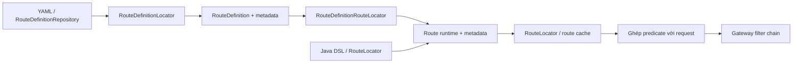
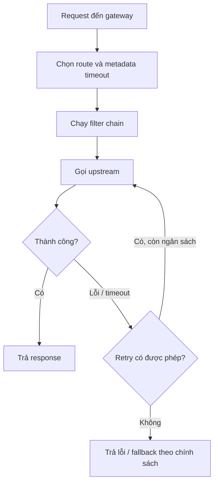

# Metadata riêng của tuyến và giới hạn cấu hình phụ thuộc phiên bản

Trong một API Gateway phục vụ nhiều microservice, các tuyến thường không có cùng nhu cầu vận hành. API danh mục sản phẩm có thể phản hồi rất nhanh, API tạo báo cáo cần nhiều thời gian hơn, API đơn hàng phải được theo dõi chặt và một số tuyến cần chính sách CORS riêng. **Spring Cloud Gateway** cho phép gắn **metadata riêng cho mỗi route** để mô tả thông tin hoặc điều chỉnh những hành vi mà thành phần gateway biết cách đọc metadata đó.

Tuy nhiên, thêm một khóa vào `metadata` không tự biến nó thành tính năng hoạt động. Một số khóa được Spring Cloud Gateway hỗ trợ sẵn, ví dụ timeout HTTP hoặc metadata `cors` trong biến thể WebFlux; nhiều khóa khác chỉ là dữ liệu do ứng dụng tự đặt và phải có mã hoặc thành phần khác sử dụng. Ngoài ra, **cùng một ý tưởng cấu hình có thể mang tên property, kiểu dữ liệu hoặc cách triển khai khác nhau giữa các phiên bản và giữa Server WebFlux với Server Web MVC**.

Bài thuộc chương **Cấu hình tuyến** của module **SPRING_CLOUD_GATEWAY**. Mục tiêu là hiểu metadata nằm ở đâu, cách đọc và áp dụng nó, cách cấu hình timeout theo tuyến, cách phân biệt metadata với predicate/filter, và cách kiểm chứng tương thích khi nâng cấp. Những ví dụ route còn đặt trong bối cảnh định tuyến, biến đổi path/header, service discovery, xác thực, rate limiting, circuit breaker, retry, TLS và quan sát request của hệ thống microservices.

> **Phạm vi kỹ thuật:** Các ví dụ `Route`, `RouteLocatorBuilder`, `GlobalFilter`, `ServerWebExchange` và metadata timeout dưới đây dành cho **Spring Cloud Gateway Server WebFlux**. Phần cấu hình YAML minh họa nhánh property trong tài liệu WebFlux hiện hành; các phiên bản cũ và biến thể Web MVC cần cấu hình riêng theo tài liệu của chính phiên bản đó.

## 1. Metadata của route là gì?

Một route thông thường gồm ID, URI đích, route predicates, filters và thứ tự ưu tiên. **Metadata** là tập cặp **khóa → giá trị** gắn vào route để cung cấp ngữ cảnh bổ sung hoặc cấu hình những tính năng đọc khóa đó.

Ví dụ, hệ thống bán hàng có ba tuyến:

| Route ID | URI upstream | Predicate | Metadata minh họa |
| --- | --- | --- | --- |
| `catalog-route` | `lb://catalog-service` | `Path=/api/catalog/**` | `owner=catalog-team`, `policy-tier=standard`, `response-timeout=2500` |
| `orders-route` | `lb://order-service` | `Path=/api/orders/**` | `owner=orders-team`, `policy-tier=strict` |
| `report-route` | `lb://report-service` | `Path=/api/reports/**` | `owner=analytics-team`, `response-timeout=15000` |

Trong bảng, `owner` và `policy-tier` là **khóa do ứng dụng tự định nghĩa**; gateway không tự động gửi email cho chủ sở hữu hay áp dụng chính sách xác thực vì thấy một chuỗi như `strict`. Ngược lại, `response-timeout` là khóa có ý nghĩa với xử lý HTTP của Gateway Server WebFlux khi dùng đúng cú pháp và đơn vị của phiên bản hỗ trợ.

### Metadata khác predicate, filter và header ở đâu?

| Khái niệm | Câu hỏi giải quyết | Ví dụ |
| --- | --- | --- |
| **Predicate** | Request có được chọn vào route này không? | `Path=/api/catalog/**`, `Method=GET` |
| **Filter** | Request/response được xử lý như thế nào? | `StripPrefix=2`, `AddRequestHeader`, `Retry` |
| **Metadata** | Route mang thêm tham số hoặc ngữ cảnh gì? | `response-timeout=2500`, `owner=catalog-team` |
| **HTTP header** | Thông tin nào đang nằm trong request/response trên mạng? | `Authorization`, `X-Correlation-Id` |
| **Biến môi trường/property toàn cục** | Cấu hình chung của tiến trình gateway là gì? | Timeout của HTTP client, thông số kết nối, bật metrics |

Metadata thuộc **cấu hình route**, không mặc nhiên trở thành HTTP header. Nếu muốn gửi một thông tin từ metadata sang upstream, cần filter được thiết kế riêng, đồng thời xem xét nguồn tin cậy và nguy cơ lộ thông tin.

## 2. Từ RouteDefinition đến metadata của Route runtime

Trong Gateway Server WebFlux, tuyến khai báo qua YAML/properties có thể được nạp thành `RouteDefinition` rồi chuyển thành `Route` runtime. Route dùng để xử lý request có metadata tương ứng.



**Không cần đọc metadata để ghép route** nếu điều kiện khớp chỉ dùng path/host/method. Metadata thường được dùng **sau khi đã chọn được route**, khi một thành phần vận hành hoặc filter cần biết tham số của tuyến đang xử lý.

Nếu route được tạo trực tiếp qua Java DSL, nó cũng có thể mang metadata mà không phải đi qua một bản `RouteDefinition` khai báo trong YAML. Đây là một điểm cần phân biệt khi viết công cụ kiểm tra hoặc cập nhật route động.

### Vòng đời của một thay đổi metadata

Khi bạn thay `response-timeout` hoặc `policy-tier` trong nguồn cấu hình:

1. Cập nhật **nguồn route** mà tiến trình gateway thật sự đọc được.
2. Để Gateway Server WebFlux nạp lại route runtime theo cơ chế refresh/deploy phù hợp.
3. Xác minh route mới đã có metadata đúng trên **từng instance gateway**.
4. Gửi request thử và đo xem thành phần đọc metadata có dùng giá trị mới không.

Chỉ sửa tệp trong một thư mục chưa được tiến trình đọc lại không đủ. Event refresh route cũng không tự biên dịch lại mã Java DSL đã được đóng gói trong một artifact cũ.

## 3. Khai báo metadata bằng YAML

Ví dụ cho một ứng dụng dùng **cú pháp WebFlux ở tài liệu phiên bản hiện hành**:

```yaml
spring:
  cloud:
    gateway:
      server:
        webflux:
          routes:
            - id: catalog-route
              uri: lb://catalog-service
              predicates:
                - Path=/api/catalog/**
              filters:
                - StripPrefix=2
              metadata:
                owner: catalog-team
                group: storefront
                policy-tier: standard
                connect-timeout: 800
                response-timeout: 2500
```

Điều kiện để ví dụ hoạt động:

- Có starter **Spring Cloud Gateway Server WebFlux** tương thích với Spring Boot/Spring Cloud của ứng dụng.
- Gateway đã cấu hình Spring Cloud LoadBalancer và nguồn instance thích hợp cho URI `lb://catalog-service`; metadata không tự tạo service discovery.
- Backend hiểu path `/products/**` sau khi gateway cắt hai phân đoạn `api` và `catalog`.
- Các giá trị timeout được khai báo bằng số nguyên **mili giây** theo quy tắc per-route của WebFlux.
- `owner`, `group` và `policy-tier` là khóa tùy biến; chưa có tác dụng nghiệp vụ hay bảo mật nếu không có thành phần xử lý chúng.

Với request:

```http
GET /api/catalog/products/42?currency=VND
```

Gateway kiểm tra `Path`, chạy filter `StripPrefix=2` rồi chuyển sang `catalog-service` với path `/products/42?currency=VND`. Trong quá trình chuyển tiếp, những thành phần HTTP client biết đọc khóa timeout có thể áp dụng giới hạn riêng của `catalog-route`.

### Metadata hỗ trợ nhiều kiểu dữ liệu

`metadata` là cấu trúc map; ví dụ một route có thể khai báo:

```yaml
metadata:
  owner: catalog-team
  revision: 3
  audit-enabled: true
  labels:
    domain: commerce
    team: catalog
```

Về mặt dữ liệu, các giá trị này có thể là chuỗi, số, boolean hoặc map lồng nhau. Nhưng khả năng **bind, chuyển kiểu và sử dụng** một giá trị phụ thuộc vào framework, phiên bản và bên đọc nó. Một filter chờ `Integer` có thể không chấp nhận chuỗi `"2500"` dù trông tương tự số `2500`.

Không nên nhét cấu hình lớn, bí mật, token, khóa TLS hay dữ liệu người dùng vào metadata của route. Thông tin route có thể xuất hiện trong log hoặc endpoint quản trị và thường được dùng chung giữa nhiều request.

## 4. Đọc metadata của route được chọn

Trong WebFlux, sau khi `RoutePredicateHandlerMapping` chọn route, thông tin route được gắn vào `ServerWebExchange`. Thành phần bên trong filter chain có thể truy cập route thông qua khóa `GATEWAY_ROUTE_ATTR`:

```java
import org.springframework.cloud.gateway.route.Route;
import org.springframework.cloud.gateway.support.ServerWebExchangeUtils;
import org.springframework.web.server.ServerWebExchange;

void inspectSelectedRoute(ServerWebExchange exchange) {
    Route route = exchange.getAttribute(
        ServerWebExchangeUtils.GATEWAY_ROUTE_ATTR);

    if (route != null) {
        String routeId = route.getId();
        Object tier = route.getMetadata().get("policy-tier");
        Object timeout = route.getMetadata().get("response-timeout");
        // Dùng các giá trị ở tầng xử lý nội bộ thích hợp.
    }
}
```

`Route#getMetadata()` truy xuất map metadata; API WebFlux còn cung cấp phương thức lấy giá trị theo khóa như `route.getMetadata("policy-tier")` ở những phiên bản hỗ trợ. Khi viết code có yêu cầu tương thích nhiều dòng phát hành, hãy kiểm tra chữ ký method và kiểu trả về ở dependency thực tế.

### Một GlobalFilter chỉ ghi dấu ngữ cảnh nội bộ

Ví dụ dưới đây cho thấy cách **đọc một khóa tùy biến**, chưa áp dụng bất kỳ rate limit hay phân quyền nào:

```java
import org.springframework.cloud.gateway.filter.GlobalFilter;
import org.springframework.cloud.gateway.route.Route;
import org.springframework.cloud.gateway.support.ServerWebExchangeUtils;
import org.springframework.context.annotation.Bean;
import org.springframework.context.annotation.Configuration;

@Configuration
public class RouteMetadataConfiguration {

    @Bean
    GlobalFilter annotatePolicyTier() {
        return (exchange, chain) -> {
            Route route = exchange.getAttribute(
                ServerWebExchangeUtils.GATEWAY_ROUTE_ATTR);

            if (route != null) {
                Object raw = route.getMetadata().get("policy-tier");
                if (raw instanceof String tier) {
                    exchange.getAttributes().put("app.policyTier", tier);
                }
            }
            return chain.filter(exchange);
        };
    }
}
```

Lưu giá trị vào attributes của exchange chỉ là **bước chuẩn bị dữ liệu trong tiến trình**. Nếu thật sự muốn thực thi chính sách `policy-tier`, phải viết logic có kiểm thử và phối hợp cơ chế bảo mật, rate limiter hoặc tracing. Không coi chuỗi metadata do quản trị viên gắn vào route là bằng chứng về danh tính hoặc quyền của client.

### Những điều cần tránh khi đọc metadata

- Kiểm tra route có tồn tại trước khi lấy metadata, nhất là ở các điểm mở rộng có thể chạy trước khâu ghép route.
- Kiểm tra kiểu dữ liệu trước khi ép kiểu; dùng giá trị mặc định có chủ đích.
- Không sửa trực tiếp map metadata của một `Route` đang được nhiều request sử dụng để “cập nhật” cấu hình động.
- Không phát sinh nhãn metrics có cardinality quá lớn từ metadata, ví dụ giá trị riêng theo mỗi user ID.
- Không đưa metadata nhạy cảm vào response header hoặc access log chỉ để dễ debug.

## 5. Timeout riêng theo tuyến: metadata có ý nghĩa thực thi

Đây là trường hợp quan trọng nhất để hiểu **giới hạn và kiểu dữ liệu phụ thuộc ngữ cảnh**.

Ở Gateway Server WebFlux, tài liệu HTTP timeouts mô tả cả **timeout toàn cục** và **timeout theo route**, nhưng chúng không luôn dùng cùng đơn vị biểu diễn.

| Tham số | Cấp cấu hình | Kiểu/đơn vị theo tài liệu WebFlux | Ý nghĩa chính |
| --- | --- | --- | --- |
| `connect-timeout` | HTTP client toàn cục | Số mili giây | Giới hạn thời gian thiết lập kết nối đến upstream. |
| `response-timeout` | HTTP client toàn cục | `java.time.Duration`, ví dụ `5s` | Giới hạn thời gian chờ phản hồi từ upstream theo ngữ nghĩa HTTP client tương ứng. |
| `metadata.connect-timeout` | Riêng một route | Số mili giây, ví dụ `800` | Ghi đè timeout kết nối cho route được hỗ trợ. |
| `metadata.response-timeout` | Riêng một route | Số mili giây, ví dụ `2500` | Ghi đè timeout phản hồi cho route được hỗ trợ. |

### 5.1. Timeout toàn cục

Với nhánh property WebFlux trong tài liệu cấu hình mới, một ví dụ minh họa là:

```yaml
spring:
  cloud:
    gateway:
      server:
        webflux:
          httpclient:
            connect-timeout: 1000
            response-timeout: 5s
```

Cách viết chính xác của **property prefix** phải được xác minh theo phiên bản. Trong nhiều tài liệu Gateway cũ, cùng các tham số được trình bày ở nhánh `spring.cloud.gateway.httpclient.*`. Hai mẫu không nên trộn tùy tiện trong một ứng dụng.

Ở ví dụ trên, timeout kết nối là **1 giây**, timeout phản hồi là **5 giây**. Timeout kết nối và timeout phản hồi không giống nhau: kết nối có thể thiết lập nhanh nhưng backend vẫn mất nhiều thời gian mới tạo được response.

### 5.2. Ghi đè trên từng route

Ví dụ một gateway có catalog ưu tiên phản hồi nhanh và report được phép lâu hơn:

```yaml
spring:
  cloud:
    gateway:
      server:
        webflux:
          routes:
            - id: catalog-route
              uri: http://localhost:8081
              predicates:
                - Path=/api/catalog/**
              filters:
                - StripPrefix=2
              metadata:
                connect-timeout: 500
                response-timeout: 1500

            - id: report-route
              uri: http://localhost:8082
              predicates:
                - Path=/api/reports/**
              filters:
                - StripPrefix=2
              metadata:
                connect-timeout: 1000
                response-timeout: 12000
```

Trong mẫu này:

- Catalog có timeout kết nối **500 ms** và phản hồi **1.500 ms**.
- Report có timeout kết nối **1.000 ms** và phản hồi **12.000 ms**.
- URI `localhost` chỉ dành cho thử nghiệm khi hai backend chạy trên đúng cổng; trong container, `localhost` của gateway không tự trỏ tới container backend.
- Các số là **giá trị giả định để học**, không phải chỉ tiêu được khuyến nghị cho mọi ứng dụng.

Một hiểu nhầm gây lỗi phổ biến là ghi `response-timeout: 5s` trong `metadata` vì thấy toàn cục dùng `5s`. Với WebFlux per-route, tài liệu yêu cầu **giá trị mili giây**, nên hãy dùng `5000`. Tương tự, `5` ở metadata không phải 5 giây mà là **5 ms**.

### 5.3. Ghi metadata timeout bằng Java DSL

Tài liệu WebFlux mô tả các hằng số metadata trong `RouteMetadataUtils`:

```java
import static org.springframework.cloud.gateway.support.RouteMetadataUtils.CONNECT_TIMEOUT_ATTR;
import static org.springframework.cloud.gateway.support.RouteMetadataUtils.RESPONSE_TIMEOUT_ATTR;

import org.springframework.cloud.gateway.route.RouteLocator;
import org.springframework.cloud.gateway.route.builder.RouteLocatorBuilder;
import org.springframework.context.annotation.Bean;
import org.springframework.context.annotation.Configuration;

@Configuration
public class GatewayRouteConfig {

    @Bean
    RouteLocator customRoutes(RouteLocatorBuilder builder) {
        return builder.routes()
            .route("catalog-route", r -> r
                .path("/api/catalog/**")
                .filters(f -> f.stripPrefix(2))
                .uri("http://localhost:8081")
                .metadata(CONNECT_TIMEOUT_ATTR, 500)
                .metadata(RESPONSE_TIMEOUT_ATTR, 1500)
                .metadata("owner", "catalog-team"))
            .build();
    }
}
```

Ví dụ Java DSL tạo route runtime trực tiếp. Nó không đòi hỏi bạn phải tạo riêng một định nghĩa tuyến YAML, và cần tránh định nghĩa thêm route trùng ID trong nguồn cấu hình khác.

### 5.4. Bỏ timeout phản hồi toàn cục đối với một tuyến

Theo tài liệu HTTP timeouts của WebFlux, giá trị `response-timeout` **âm** tại mức route có thể **vô hiệu hóa timeout phản hồi toàn cục cho route đó**:

```yaml
metadata:
  response-timeout: -1
```

Điều này **không** có nghĩa toàn bộ giao dịch trở nên không giới hạn: client, ingress, reverse proxy, mạng, circuit breaker hoặc backend có thể có timeout riêng. Không dùng giá trị âm như một cách chữa mọi lỗi timeout. Nếu thực sự cần kết nối dài hoặc streaming, phải đánh giá chính xác loại giao thức, heartbeat, idle timeout và các tầng trung gian.

### 5.5. Timeout, retry và circuit breaker tương tác ra sao?

Giả sử `catalog-route` có `response-timeout: 1500`. Nếu thêm filter `Retry` với 3 lần thử trong trường hợp phù hợp, tổng thời gian client quan sát có thể dài hơn một lần chờ upstream. Với circuit breaker, thời gian gọi, trạng thái mở/ngắt và fallback lại là những khái niệm khác.



Để tránh khuếch đại tải, cần thiết kế **ngân sách thời gian tổng**, giới hạn retry và chỉ retry khi an toàn. Không retry tùy tiện request thay đổi trạng thái như `POST /api/payments` nếu backend chưa có idempotency key và quy trình chống tạo giao dịch trùng.

Timeout tại gateway không thay thế timeout của backend, connection pool, DNS, TLS handshake hoặc hạ tầng mạng. Khi test, quan sát cùng lúc loại lỗi, tổng thời gian đo ở client và số lần upstream thực sự nhận request.

## 6. Metadata CORS theo route

Một ví dụ khác về khóa metadata **được gateway hiểu theo ngữ nghĩa xác định** trong WebFlux là `cors`. Cấu hình CORS theo route có thể dùng các thuộc tính tương ứng với `CorsConfiguration` của Spring Framework:

```yaml
spring:
  cloud:
    gateway:
      server:
        webflux:
          routes:
            - id: catalog-public
              uri: http://localhost:8081
              predicates:
                - Path=/api/catalog/**
              metadata:
                cors:
                  allowedOrigins:
                    - https://shop.example
                  allowedMethods:
                    - GET
                  allowedHeaders:
                    - Authorization
                    - Content-Type
                  maxAge: 300
```

Trong tình huống này, browser từ origin `https://shop.example` có thể gửi request phù hợp với chính sách CORS. Cần kiểm tra cả **preflight OPTIONS** khi request không đơn giản. Nếu cấu hình route còn có `Method=GET` khiến preflight không khớp predicate, việc xử lý CORS có thể cần cấu hình global CORS/handler mapping tương ứng.

**CORS không phải xác thực hay phân quyền.** Nó là cơ chế browser kiểm soát truy cập cross-origin. Client không phải trình duyệt vẫn có thể gọi endpoint nếu mạng và bảo mật cho phép; một API đơn hàng cần xác thực JWT và phân quyền ở backend theo chính sách của hệ thống.

Tránh `allowedOrigins: '*'` trên API nhạy cảm, nhất là khi sử dụng credential/cookie. Hãy khai báo origin thật sự được phép và kiểm thử trường hợp preflight, cookie, header và cache của browser.

## 7. Metadata tùy biến: quy ước trong dự án

Gateway không tự biết ý nghĩa của mọi khóa do bạn tạo. Ví dụ:

```yaml
metadata:
  app.owner: catalog-team
  app.policy-tier: gold
  app.observability-group: storefront
  app.contract-version: v2
```

Nhóm dự án có thể thống nhất chúng để phục vụ một **filter riêng**, công cụ kiểm tra cấu hình hoặc dashboard, nhưng phải ghi rõ:

| Khóa tùy biến | Ý nghĩa do nhóm định nghĩa | Thành phần chịu trách nhiệm đọc |
| --- | --- | --- |
| `app.owner` | Nhóm sở hữu API | Quy trình quản trị tuyến, kiểm tra cấu hình |
| `app.policy-tier` | Nhãn chính sách mong muốn | Filter/policy engine riêng, nếu thật sự được triển khai |
| `app.observability-group` | Nhóm dashboard dùng để tổng hợp | Mã instrument/metrics tùy chỉnh |
| `app.contract-version` | Phiên bản contract công khai | Bộ kiểm tra/registry tài liệu API |

Nếu chưa có bộ đọc tương ứng, **cả bốn khóa chỉ là dữ liệu**. Ghi `app.policy-tier: gold` không tự tăng quota trong `RequestRateLimiter`; ghi `app.contract-version: v2` không tự viết lại URL hay response.

### Quy tắc thiết kế metadata tùy biến

1. **Đặt namespace riêng** như `app.*` để tránh va chạm khóa mà gateway có thể bổ sung ở một bản sau.
2. **Định nghĩa schema**: danh sách khóa, kiểu dữ liệu, giá trị được phép, giá trị mặc định và đội sở hữu.
3. **Validate trước deploy/refresh**: route ID, URI được phép, metadata sai kiểu, giá trị âm hoặc ngoài phạm vi.
4. **Tách metadata khỏi bí mật**: thông tin xác thực, private key, API token và mật khẩu nên ở cơ chế secrets phù hợp.
5. **Giữ một nguồn sự thật** cho policy quan trọng, tránh metadata báo `gold` nhưng rate limit thực chạy ở mức `basic`.
6. **Ghi cơ chế fallback** khi không có metadata hoặc khi phiên bản mới chưa nhận dạng được khóa.
7. **Không sửa map đang được dùng chung trong runtime** để áp dụng cấu hình mới; cập nhật nguồn route, nạp lại và kiểm thử.

Metadata phù hợp để mô tả **thông số và ngữ cảnh của route**, nhưng không nên trở thành nơi nhồi toàn bộ quy tắc nghiệp vụ hoặc danh sách quyền chi tiết cho từng user.

## 8. Các giới hạn cấu hình phụ thuộc phiên bản

### 8.1. Prefix cấu hình có thể thay đổi

Những ví dụ WebFlux cũ, chẳng hạn dòng tài liệu Spring Cloud Gateway 4.2, thường dùng:

```yaml
spring:
  cloud:
    gateway:
      routes:
        - id: catalog-route
          uri: http://localhost:8081
          predicates:
            - Path=/api/catalog/**
          metadata:
            response-timeout: 1500
```

Tài liệu WebFlux hiện hành trình bày nhánh cụ thể hơn:

```yaml
spring:
  cloud:
    gateway:
      server:
        webflux:
          routes:
            - id: catalog-route
              uri: http://localhost:8081
              predicates:
                - Path=/api/catalog/**
              metadata:
                response-timeout: 1500
```

Điểm khác biệt nằm ở **đường dẫn property**, dù cùng ý nghĩa route metadata. Không được tự mặc định cả hai nhánh đều có hiệu lực ở bản đang triển khai. Nếu dùng nhầm, ứng dụng có thể khởi động nhưng route mong muốn không xuất hiện.

### 8.2. WebFlux và Web MVC có mô hình runtime khác nhau

| Khía cạnh | Gateway Server WebFlux | Gateway Server Web MVC |
| --- | --- | --- |
| Ngăn xếp | Spring WebFlux/Reactive, thường dùng Netty HTTP | Spring MVC/Servlet/WebMvc.fn |
| Routes trong tài liệu hiện hành | `spring.cloud.gateway.server.webflux.routes` | `spring.cloud.gateway.server.webmvc.routes` hoặc mô hình route MVC tương ứng |
| Mã đọc route runtime | `Route`, `ServerWebExchange`, `GATEWAY_ROUTE_ATTR` | Cơ chế route/request attributes và các điểm mở rộng MVC riêng |
| Tạo route bằng code | `RouteLocatorBuilder`, `RouteLocator` | `RouterFunction`, `HandlerFunctions` và các helper MVC |
| Metadata timeout WebFlux | `connect-timeout`, `response-timeout` theo tài liệu WebFlux | Phải đối chiếu catalog/API/cấu hình timeout **riêng của MVC** |
| Filter | `GatewayFilter` / `GlobalFilter` | Các `HandlerFilterFunction`, before/after filters phù hợp với MVC |

Không sao chép code `GlobalFilter` WebFlux vào gateway MVC; cũng không chuyển nguyên khóa timeout từ tài liệu WebFlux sang MVC rồi kết luận được hỗ trợ. Một tính năng có cùng mục đích nhưng có thể yêu cầu API, dependency hoặc cấu hình khác.

### 8.3. Starter, compatibility và vòng đời

Trước khi chọn cấu hình metadata, phải chốt:

- **JDK** đang sử dụng.
- **Spring Boot** và **Spring Cloud release train** tương thích.
- **Spring Cloud Gateway** và lựa chọn Server WebFlux/Server Web MVC.
- Starter đúng biến thể, ví dụ artifact `spring-cloud-starter-gateway-server-webflux` trong các tài liệu mới.
- Những tích hợp thực tế: Spring Cloud LoadBalancer, Spring Security, Redis/rate limiting, CircuitBreaker, Micrometer/Actuator.
- Chính sách cập nhật bảo mật, thời hạn hỗ trợ và đường nâng cấp.

Với dependency do Spring Cloud BOM quản lý, ưu tiên lấy các phiên bản tương thích từ BOM thay vì tự ghim lẻ những bản Gateway, Reactor Netty hay Security không cùng train.

### 8.4. Ma trận xác minh trước khi đổi phiên bản

| Hạng mục | Dấu hiệu dễ vấp | Cách chứng minh |
| --- | --- | --- |
| Property route | Route không xuất hiện khi dùng prefix cũ | Xem Configuration Properties đúng bản, kiểm tra route runtime bằng endpoint quản trị. |
| Metadata timeout | Nhầm `Duration` với mili giây | Dùng backend giả lập chậm và đo thời gian cùng loại lỗi thực tế. |
| CORS metadata | Preflight bị chặn hoặc origin ngoài danh sách được nhận | Kiểm tra request OPTIONS/GET, origin, allowed headers và credential. |
| Tích hợp discovery | URI `lb://` không có instance | Kiểm tra dependency, registry và danh sách instance LoadBalancer. |
| Xác thực | Copy security chain servlet sang reactive hoặc ngược lại | Test token thiếu, sai, hết hạn, scope và quyền tài nguyên. |
| Rate limiting | Chỉ có khóa tùy biến nhưng không có limiter | Test quota trên hai gateway replica với cùng client identity. |
| Circuit breaker/Retry | Filter không tồn tại hoặc hành vi khác kỳ vọng | Kiểm tra dependency/DSL đúng phiên bản, lỗi, timeout và số lần gọi backend. |
| Actuator | Endpoint quản trị không truy cập được/đã đổi quyền | Xác minh cách bật, expose và giới hạn quyền ở bản đang dùng. |
| Metrics | Tên metric/tag thay đổi sau nâng cấp | So dashboard, trace và cảnh báo trước/sau deploy. |

## 9. Metadata, cache tuyến và refresh

Với những định nghĩa route được nạp động trong WebFlux, các `Route` runtime có thể được cache để tránh tái dựng trên mỗi request. Do vậy:

- **Nguồn đã đổi** không đồng nghĩa **route runtime trên tất cả replica đã đổi**.
- Thay metadata `response-timeout` trong repository cần cơ chế refresh tuyến tương ứng.
- Nếu route được tạo từ Java DSL cố định, sửa mã Java cần build/deploy phiên bản mới.
- Nếu sửa file cấu hình mà process không tự reload, refresh route cache không tự cập nhật giá trị được bind từ file cũ.

Các phiên bản Gateway WebFlux hỗ trợ endpoint quản trị như:

```http
GET /actuator/gateway/routes
POST /actuator/gateway/refresh
```

Ở các phiên bản tài liệu có hỗ trợ lọc refresh theo metadata, có thể yêu cầu ví dụ:

```http
POST /actuator/gateway/refresh?metadata=group:storefront
```

Lệnh này nhằm refresh nhóm route có metadata phù hợp, **không tự ghi một định nghĩa mới**. Phải kiểm tra API, ngữ nghĩa và quyền truy cập theo phiên bản triển khai. Nếu chạy ba replica gateway, từng replica có cache tuyến trong tiến trình riêng và cần được đồng bộ theo quy trình rollout của hệ thống.

**Bảo vệ Actuator:** trong các bản Spring Boot/Gateway mới, endpoint gateway có thể yêu cầu cấp quyền truy cập `read-only` hoặc `unrestricted` bên cạnh web exposure. Chỉ bật quyền ghi/refresh trong vùng quản trị được bảo vệ; tránh công khai endpoint cho Internet. Chi tiết tên property quản trị, quyền và trạng thái mặc định phụ thuộc phiên bản.

### Metadata có hiển thị trong Actuator không?

Endpoint `/actuator/gateway/routes` giúp quan sát các route runtime, nhưng **định dạng response không cố định giữa các phiên bản và cấu hình verbose**. Không xây logic dựa vào giả định rằng mọi endpoint hoặc mọi bản đều trả toàn bộ metadata theo cùng cấu trúc JSON.

Để kiểm tra một khóa quan trọng, có thể kết hợp:

1. Xác nhận nguồn route definition đã chứa giá trị mới.
2. Kiểm tra gateway đã nạp route ID đúng.
3. Dùng endpoint quản trị phù hợp hoặc kiểm tra trực tiếp `Route.getMetadata()` trong mã nội bộ.
4. Gửi request tới backend giả lập để xác nhận **hành vi**, ví dụ timeout thực tế.
5. So sánh từng replica, nhất là trong giai đoạn rolling deployment.

## 10. Bài thực hành: cấu hình timeout, metadata và kiểm chứng phiên bản

### Bối cảnh

Bạn có một Gateway Server WebFlux chạy cục bộ, hai backend giả lập:

- `catalog-service` trả lời nhanh qua `http://localhost:8081/products/42`.
- `report-service` hỗ trợ tham số tạo độ trễ qua `http://localhost:8082/reports/summary`.

Gateway công bố:

| URL công khai | URL sau khi chuyển tiếp | Metadata trọng tâm |
| --- | --- | --- |
| `/api/catalog/products/42` | `/products/42` | `response-timeout=1500` |
| `/api/reports/summary` | `/reports/summary` | `response-timeout=12000` |

Sử dụng Java DSL hoặc YAML **đúng bản đang chạy**, khai báo `StripPrefix=2` và timeout cho hai route.

### Các bước

**Bước 1 — Kiểm tra cấu hình route.** Khởi động gateway và dùng endpoint quan sát route nếu được bật. Xác nhận hai route tồn tại, URI đích và predicate/filter khớp mong muốn.

**Bước 2 — Gửi request bình thường.**

```bash
curl -i "http://localhost:8080/api/catalog/products/42"
curl -i "http://localhost:8080/api/reports/summary"
```

Nếu backend phản hồi nhanh hơn timeout, request phải được xử lý bình thường. Body và mã HTTP cuối cùng phụ thuộc backend và filter, không do metadata tùy biến tự tạo.

**Bước 3 — Tạo chậm có chủ đích trên backend.** Cho catalog phản hồi sau 2 giây. Với `response-timeout=1500`, quan sát gateway có giới hạn thời gian theo cấu hình không, response code gì và log báo loại lỗi nào. Không giả định mọi timeout sẽ trả cùng một HTTP status ở tất cả phiên bản và mọi filter chain.

**Bước 4 — So đơn vị.** Trong môi trường thử nghiệm, thay `response-timeout: 1500` bằng `response-timeout: 5` và xác nhận vì sao request gần như chắc chắn quá thời hạn. Khôi phục giá trị ban đầu; không áp dụng một timeout quá ngắn vào production chỉ để test.

**Bước 5 — Kiểm tra refresh.** Nếu nguồn tuyến động, cập nhật `group: storefront` hoặc `response-timeout` rồi yêu cầu refresh theo cơ chế hỗ trợ. Kiểm tra runtime và hành vi mới. Nếu dùng Java DSL cố định, rebuild/redeploy ứng dụng thay vì chỉ gọi refresh.

**Bước 6 — Chạy lại trên phiên bản mục tiêu.** Khi nâng Spring Boot/Spring Cloud/Gateway, đối chiếu prefix cấu hình, starter, API metadata và chạy lại toàn bộ test. Nếu chuyển WebFlux sang MVC, viết lại ví dụ và tiêu chí kiểm chứng dựa trên tài liệu MVC.

### Bảng kết quả thực hành nên ghi

| Ca thử | Cấu hình | Đầu vào | Bằng chứng cần lưu |
| --- | --- | --- | --- |
| T01 | Catalog timeout 1500 ms | Backend trả sau 100 ms | Thành công, route ID và độ trễ. |
| T02 | Catalog timeout 1500 ms | Backend trả sau 2000 ms | Loại timeout, response code, trace/log. |
| T03 | Report timeout 12000 ms | Backend trả sau 5000 ms | So với catalog, xác nhận override theo route. |
| T04 | `metadata.response-timeout=-1` | Backend chậm | Xác minh việc bỏ global response-timeout, đồng thời kiểm tra timeout ở các tầng khác. |
| T05 | Route không có override | Backend trả chậm | Đo hành vi với cấu hình timeout toàn cục. |
| T06 | Thay metadata trên nguồn động | Request sau refresh | Cả nguồn và route runtime có revision/giá trị mới. |
| T07 | Hai replica gateway | Gọi qua từng replica | Kết quả đồng nhất sau rollout/refresh. |
| T08 | CORS theo route | Preflight đúng/sai origin | Trạng thái và CORS headers theo chính sách. |
| T09 | Custom `policy-tier` | Route có/không có khóa | Filter đọc được dữ liệu; không tự áp dụng security/rate limit. |

Khi log hoặc chia sẻ kết quả test, không ghi token, cookie phiên, mật khẩu, dữ liệu thanh toán hay toàn bộ request body nhạy cảm.

## 11. Lỗi thường gặp và hướng chẩn đoán

| Triệu chứng | Nguyên nhân khả dĩ | Cách kiểm tra |
| --- | --- | --- |
| Đã viết `metadata` nhưng không thấy tác dụng | Khóa tùy biến chưa có thành phần đọc | Xác định consumer của metadata; kiểm tra filter/logic tương ứng. |
| Timeout nhanh hơn 1000 lần dự kiến | Dùng `5` thay vì `5000` ở route | Kiểm tra đơn vị mili giây của per-route timeout. |
| Toàn cục không có tác dụng | Dùng sai property prefix hoặc sai kiểu dữ liệu | Đối chiếu Configuration Properties đúng phiên bản và kiểm tra binding. |
| Route biến mất sau đổi phiên bản | Dùng YAML key của release cũ | Kiểm tra starter, `routes` path và log định nghĩa tuyến. |
| CORS vẫn lỗi dù có metadata | Predicate không nhận OPTIONS hoặc chính sách origin/header chưa đúng | Test preflight, global CORS mapping và security chain. |
| Client nhận 401/403 | Lỗi xác thực/phân quyền | Xem JWT, session, scope và kiểm tra quyền trong backend. |
| URI `lb://` không giải quyết được | Thiếu discovery/LoadBalancer hoặc hết instance | Kiểm tra registry, health và dependency thay vì sửa metadata. |
| Một số request dùng timeout cũ | Replica chưa refresh hoặc nguồn chưa reload | Kiểm tra revision trên từng gateway process. |
| Retry làm tổng thời gian tăng | Filter Retry thử thêm nhiều lần | Đo số lần gọi upstream và ngân sách thời gian tổng. |
| Header nội bộ lộ ra client | Custom filter đưa metadata vào response thiếu kiểm soát | Xem chain, loại thông tin nhạy cảm và kiểm thử tại biên. |

## 12. Checklist trước khi đưa cấu hình vào production

- [ ] Chốt biến thể **Server WebFlux hoặc Server Web MVC**, JDK, Spring Boot, Spring Cloud release train và phiên bản Gateway.
- [ ] Tra cứu chính xác property prefix, starter, API và kiểu dữ liệu trong tài liệu **cùng phiên bản**.
- [ ] Định nghĩa route ID, predicate, filter, URI và metadata theo schema do nhóm thống nhất.
- [ ] Phân loại khóa metadata nào **được framework hỗ trợ**, khóa nào **do ứng dụng tự xử lý**.
- [ ] Test riêng timeout kết nối, timeout phản hồi, timeout tổng và tương tác với Retry/CircuitBreaker.
- [ ] Kiểm tra CORS preflight, xác thực và phân quyền; không coi metadata tùy biến là chính sách bảo mật.
- [ ] Kiểm tra discovery/load balancing khi dùng `lb://`; TLS và proxy trust được xác định theo từng chặng.
- [ ] Bảo vệ các endpoint quản trị và lưu bằng chứng nạp/refresh route trên từng replica.
- [ ] Có log, metrics và tracing theo route ID; tránh rò rỉ secret và nhãn quá nhiều giá trị.
- [ ] Có rollback cho thay đổi route metadata và quy trình kiểm chứng lại sau nâng cấp.

## 13. Câu hỏi tự kiểm tra

1. Vì sao `metadata: {policy-tier: gold}` chưa đủ để thực hiện quota cao hơn cho khách hàng cao cấp?
2. Trong WebFlux, vì sao `response-timeout: 5s` ở cấp HTTP client toàn cục có thể hợp lệ, còn cùng cách ghi ở cấp route metadata lại không đúng đơn vị được tài liệu yêu cầu?
3. Thay `metadata.response-timeout` trong một repository tuyến động khác gì với sửa Java DSL rồi redeploy?
4. Nếu một route dùng `lb://order-service` nhưng không tìm được instance backend, refresh route metadata có giải quyết được không?
5. Những điểm nào phải kiểm tra trước khi sao chép route từ một bài hướng dẫn Gateway 4.2 vào dự án dùng dòng Gateway 5.x?
6. Trong mô hình ba gateway replica, làm sao chứng minh timeout theo route đã được cập nhật đồng nhất?

## Tài liệu tham khảo và nguyên tắc sử dụng

Các đường dẫn sau là nguồn **đối chiếu theo phiên bản** từ tài liệu dự án. Khi triển khai, dùng bộ phiên bản đã khóa trong ứng dụng thay vì mặc định mọi ví dụ trên Internet tương thích:

- [Spring Cloud Gateway Server WebFlux — Route Metadata Configuration](https://docs.spring.io/spring-cloud-gateway/reference/spring-cloud-gateway-server-webflux/route-metadata-configuration.html)
- [Spring Cloud Gateway Server WebFlux — HTTP timeouts configuration](https://docs.spring.io/spring-cloud-gateway/reference/spring-cloud-gateway-server-webflux/http-timeouts-configuration.html)
- [Spring Cloud Gateway Server WebFlux — CORS Configuration](https://docs.spring.io/spring-cloud-gateway/reference/spring-cloud-gateway-server-webflux/cors-configuration.html)
- [Spring Cloud Gateway Server WebFlux — Actuator API](https://docs.spring.io/spring-cloud-gateway/reference/spring-cloud-gateway-server-webflux/actuator-api.html)
- [Spring Cloud Gateway 4.2 — Route Metadata Configuration](https://docs.spring.io/spring-cloud-gateway/reference/4.2/spring-cloud-gateway/route-metadata-configuration.html)
- [Spring Cloud Gateway — Configuration Properties](https://docs.spring.io/spring-cloud-gateway/reference/configprops.html)
- [Spring Cloud Gateway Server Web MVC — How It Works](https://docs.spring.io/spring-cloud-gateway/reference/spring-cloud-gateway-server-webmvc/how-it-works.html)

**Kết luận:** Metadata là phần thông tin bổ sung **gắn với một route**; chỉ các khóa được framework hoặc code của bạn đọc mới làm thay đổi hành vi. Với Spring Cloud Gateway Server WebFlux, timeout và CORS là hai ứng dụng cụ thể cần hiểu chính xác **đơn vị, kiểu dữ liệu và phạm vi hiệu lực**. Khi thiết kế cổng vào microservices, hãy coi cấu hình metadata là một phần của hợp đồng vận hành cần được kiểm thử theo **đúng biến thể và đúng phiên bản** trước mỗi lần thay đổi.
