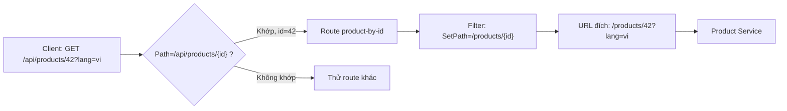
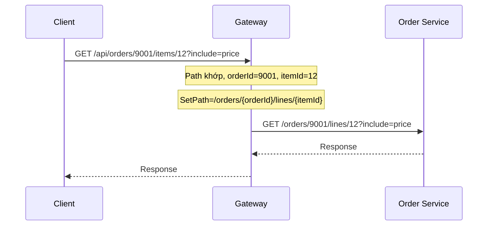

# Path Route Predicate: mẫu đường dẫn, biến URI và dấu gạch chéo cuối trong Spring Cloud Gateway

Trong kiến trúc microservices, một API Gateway thường công bố những đường dẫn thống nhất như `/api/products/42`, `/api/orders/99` hay `/api/accounts/me`, rồi chuyển request đến backend phù hợp. **Spring Cloud Gateway** dùng các **route predicate** để quyết định route nào được chọn; trong số đó, **`Path` Route Predicate Factory** là công cụ phổ biến nhất để khớp request dựa trên đường dẫn URL.

Bài học thuộc chương **Điều kiện định tuyến** của module `SPRING_CLOUD_GATEWAY`, tập trung vào ba kỹ năng:

1. Viết và đọc chính xác **mẫu đường dẫn** (`Path` pattern), kể cả wildcard và điều kiện bắt một segment.
2. Hiểu và sử dụng **biến URI** (`{id}`, `{segment}`) được trích xuất khi request khớp route.
3. Kiểm soát **dấu gạch chéo cuối** (`/api/products/42` so với `/api/products/42/`) để tránh khác biệt khó phát hiện giữa gateway và backend.

Các nội dung này liên hệ trực tiếp với filter chain, đổi path/header, khám phá dịch vụ, đồng thời tạo nền tảng để cấu hình xác thực, giới hạn lưu lượng, circuit breaker, retry, TLS và quan sát request một cách nhất quán.

> **Phạm vi:** Ví dụ sử dụng **Spring Cloud Gateway Server WebFlux**. Chi tiết namespace cấu hình và hành vi mặc định có thể khác theo phiên bản Spring Cloud Gateway; khi triển khai thực tế phải dùng đúng starter, API và tài liệu của phiên bản tương thích với Spring Boot đang chạy.

## 1. `Path` làm gì trong luồng xử lý request?

Giả sử gateway nhận request:

```http
GET /api/products/42?lang=vi HTTP/1.1
Host: api.example.com
```

Một route có thể khai báo:

```yaml
predicates:
  - Path=/api/products/{id}
```

Gateway đối chiếu **phần đường dẫn** `/api/products/42` với mẫu `/api/products/{id}`. Nếu khớp, route trở thành ứng viên để được chọn; biến `id` mang giá trị `42`. **Query string** `?lang=vi` và **Host** `api.example.com` không phải là phần được `Path` đánh giá.

Sau khi route đã được chọn, các filter tương ứng mới biến đổi request hoặc áp dụng chính sách. Ví dụ `SetPath` có thể thay `/api/products/42` thành `/products/42` trước khi gateway chuyển tiếp đến Product Service.



**Phân biệt ba việc:**

| Công việc | Thành phần chủ đạo | Kết quả |
| --- | --- | --- |
| Request có thuộc nhóm API này không? | **`Path` predicate** | Khớp hoặc không khớp route, có thể thu thập biến URI. |
| Đường dẫn gửi tới backend có cần đổi không? | Filter như `StripPrefix`, `SetPath`, `RewritePath` | URI/path đã biến đổi trong pipeline. |
| Backend nào sẽ nhận request? | URI của route, `RouteToRequestUrlFilter` và filter load balancing/routing | URL đích để chuyển tiếp, có thể qua `lb://service-name`. |

`Path` là **điều kiện định tuyến**, không phải một HTTP endpoint do gateway tạo ra và cũng không tự gọi tới backend.

## 2. Cấu trúc một route sử dụng `Path`

Ví dụ một route cho dịch vụ sản phẩm:

```yaml
spring:
  cloud:
    gateway:
      server:
        webflux:
          routes:
            - id: product-by-id
              uri: http://localhost:8081
              predicates:
                - Path=/api/products/{id}
                - Method=GET
              filters:
                - SetPath=/products/{id}
```

Cách đọc:

- `id: product-by-id` là mã định danh route để theo dõi và phân biệt với route khác.
- `uri` là địa chỉ đích; có thể thay bằng `lb://product-service` nếu tích hợp discovery/load balancer.
- `Path=/api/products/{id}` khớp đường dẫn có một segment tại vị trí `{id}`.
- `Method=GET` yêu cầu request đồng thời dùng phương thức `GET`.
- `SetPath=/products/{id}` dùng biến URI đã bắt để dựng path mà backend mong đợi.

Cấu hình trên minh họa namespace `spring.cloud.gateway.server.webflux.routes`. Ở các nhánh Spring Cloud Gateway Server WebFlux cũ hơn, cấu hình route thường nằm tại `spring.cloud.gateway.routes`. Không nên khai báo cả hai namespace mà không kiểm tra phiên bản thực tế.

Ví dụ đối chiếu:

| Request | `Path` khớp? | `Method=GET` khớp? | Route `product-by-id` được chọn? |
| --- | --- | --- | --- |
| `GET /api/products/42` | Có | Có | Có |
| `GET /api/products/abc` | Có | Có | Có |
| `POST /api/products/42` | Có | Không | Không |
| `GET /api/products/42/reviews` | Không | Có | Không |
| `GET /api/orders/42` | Không | Có | Không |

Bảng trên chưa xét biến thể có dấu `/` cuối; phần đó được cấu hình riêng ở mục 5.

Khi một route có nhiều predicate, Gateway kết hợp các điều kiện trong route theo **logic AND**. Nếu muốn một trong nhiều mẫu path cùng được chấp nhận, có thể khai báo nhiều mẫu **trong cùng một `Path` predicate**, như phần tiếp theo.

## 3. Cú pháp mẫu đường dẫn

`Path` sử dụng cú pháp path pattern của Spring, thường thông qua cơ chế `PathPattern` trong Spring WebFlux. Đây là cách mô tả **các segment của đường dẫn**, khác với việc coi toàn bộ URI là một biểu thức chính quy thuần túy.

Một số cú pháp quan trọng:

| Mẫu | Ý nghĩa | Ví dụ phù hợp |
| --- | --- | --- |
| `/api/products` | Đường dẫn cố định. | `/api/products` |
| `/api/products/*` | Một segment có các ký tự bất kỳ, không đi qua ký tự phân tách `/`. | `/api/products/42` |
| `/api/products/**` | Phần cuối đường dẫn có thể chứa nhiều cấp segment. | `/api/products/42/reviews` |
| `/api/products/{id}` | Bắt **một segment** thành biến tên `id`. | `/api/products/42` → `id=42` |
| `/api/products/{id:[0-9]+}` | Bắt một segment khi giá trị thỏa biểu thức chính quy được nêu. | `/api/products/42` |
| `/api/files/{*path}` | Bắt phần đường dẫn còn lại theo cú pháp catch-all của `PathPattern`. | `/api/files/docs/2026/readme.txt` |
| `/api/items/item-?` | Dấu `?` trong pattern đại diện một ký tự của segment. | `/api/items/item-1` |

### 3.1. `*` và `**`: một cấp hay nhiều cấp?

Xét các request:

```text
/api/products/42
/api/products/42/reviews
/api/products/42/reviews/7
```

- Mẫu `/api/products/*` dùng để khớp **một** segment sau `/api/products`, vì vậy thích hợp cho `/api/products/42`.
- Mẫu `/api/products/**` bao phủ đường dẫn lồng nhiều cấp, chẳng hạn `/api/products/42/reviews/7`.
- Mẫu `/api/products/{id}` cũng yêu cầu một segment nhưng khác `*` ở chỗ **gắn tên** cho giá trị được bắt.

Đừng dùng `/**` cho mọi route chỉ vì tiện: mẫu quá rộng có thể nhận cả URL quản trị, URL mới được bổ sung hoặc các request mà bạn dự định giao cho một route khác.

Với `PathPattern`, dấu `**` và biến catch-all `{*path}` được dùng **ở cuối mẫu** để tránh các cách khớp mơ hồ. Nếu cần khớp nhiều cấp trong phần giữa, hãy thiết kế lại các nhóm URL hoặc dùng cơ chế định tuyến khác có chủ đích.

### 3.2. Mẫu có điều kiện định dạng

Giả sử endpoint chỉ chấp nhận ID dạng số nguyên dương không có dấu:

```yaml
predicates:
  - Path=/api/products/{id:[0-9]+}
```

- `GET /api/products/42`: phần `42` phù hợp với biểu thức `[0-9]+`.
- `GET /api/products/abc`: không khớp route này.
- `GET /api/products/42/reviews`: dư một segment nên không khớp.

Đây là **kiểm tra mẫu đường dẫn**, không phải kiểm tra tài nguyên có tồn tại hay quyền người dùng có thể xem sản phẩm đó. Backend vẫn phải xác thực các ràng buộc nghiệp vụ; nếu một đường dẫn không khớp, Gateway có thể thử route khác.

Không nên viết những regex phức tạp trong `Path` chỉ để thay thế validation ở backend. Predicate càng khó đọc thì route chồng lấn càng khó dự đoán.

### 3.3. Một `Path` chứa nhiều mẫu

Ví dụ cùng một backend phục vụ cả đường dẫn công khai `/api/catalog/**` và `/api/items/**`:

```yaml
predicates:
  - Path=/api/catalog/**,/api/items/**
```

Các **mẫu trong một `Path` predicate** được hiểu theo nghĩa **OR**: request khớp một trong các mẫu là đủ để predicate đó đúng. Các predicate khác trong route (ví dụ `Method=GET`) vẫn phải đúng.

Có thể dùng dạng cấu hình mở rộng để dễ đọc:

```yaml
predicates:
  - name: Path
    args:
      patterns:
        - /api/catalog/**
        - /api/items/**
```

Đừng nhầm cơ chế này với hai route độc lập. Một route có nhiều pattern vẫn chia sẻ cùng URI đích, các filter và các chính sách liên quan.

## 4. Biến URI: `{id}`, `{segment}` và giá trị được trích xuất

### 4.1. Cách thu được biến URI

Cho mẫu:

```text
/api/orders/{orderId}/items/{itemId}
```

Với request:

```text
GET /api/orders/9001/items/12
```

Sau khi `Path` predicate khớp, Gateway có thể trích xuất các biến:

| Tên biến | Giá trị |
| --- | --- |
| `orderId` | `9001` |
| `itemId` | `12` |

**Biến URI** ở đây là giá trị **một phần đường dẫn đã khớp**. Nó không tự lấy giá trị từ query parameter, header hay JSON body.

Biến được đặt trong ngữ cảnh `ServerWebExchange` để các thành phần liên quan sử dụng. Trong Spring Cloud Gateway Server WebFlux có helper:

```java
Map<String, String> variables =
    ServerWebExchangeUtils.getUriTemplateVariables(exchange);

String orderId = variables.get("orderId");
String itemId = variables.get("itemId");
```

Nếu viết custom filter, cần xử lý trường hợp biến không tồn tại (ví dụ filter dùng chung nhiều route). Không mặc định mọi request đi qua Gateway đều có `orderId` hoặc `itemId`.

### 4.2. Dùng biến URI với `SetPath`

Một ứng dụng phổ biến là công bố URL “đẹp” ở Gateway nhưng backend có đường dẫn khác.

Client gọi:

```text
GET /api/orders/9001/items/12?include=price
```

Route cấu hình:

```yaml
- id: order-item
  uri: lb://order-service
  predicates:
    - Path=/api/orders/{orderId}/items/{itemId}
    - Method=GET
  filters:
    - SetPath=/orders/{orderId}/lines/{itemId}
```

Sau `SetPath`, đường dẫn chuyển tiếp trở thành:

```text
/orders/9001/lines/12?include=price
```

Filter `SetPath` sử dụng biến đã được bắt để thay vào template. Query parameter `include=price` không phải biến `Path`; nó được bảo toàn nếu không có filter khác chủ động sửa query.



Lệnh request này chỉ thành công khi có route, instance `order-service` hợp lệ và endpoint backend tương ứng.

### 4.3. Biến URI với header và custom filter

Một số Gateway Filter Factory hỗ trợ thay thế biến URI trong giá trị cấu hình, ví dụ:

```yaml
filters:
  - AddRequestHeader=X-Product-Id, {id}
```

Với route có `Path=/api/products/{id}`, header được thêm dựa vào giá trị `id` của đường dẫn đã khớp. Tuy nhiên, **header do Gateway thêm không trở thành bằng chứng danh tính hoặc quyền truy cập**; backend vẫn phải xác thực thông tin tin cậy và kiểm tra quyền nghiệp vụ.

Khi cần quan sát biến trong một `GlobalFilter`:

```java
import java.util.Map;

import org.springframework.cloud.gateway.filter.GatewayFilterChain;
import org.springframework.cloud.gateway.filter.GlobalFilter;
import org.springframework.cloud.gateway.support.ServerWebExchangeUtils;
import org.springframework.core.Ordered;
import org.springframework.stereotype.Component;
import org.springframework.web.server.ServerWebExchange;
import reactor.core.publisher.Mono;

@Component
public class PathVariableContextFilter implements GlobalFilter, Ordered {

    @Override
    public int getOrder() {
        return -100;
    }

    @Override
    public Mono<Void> filter(ServerWebExchange exchange,
                             GatewayFilterChain chain) {
        Map<String, String> vars =
            ServerWebExchangeUtils.getUriTemplateVariables(exchange);

        String productId = vars.get("id");
        if (productId != null) {
            exchange.getAttributes().put("matchedProductId", productId);
        }
        return chain.filter(exchange);
    }
}
```

Đoạn code chỉ lưu biến vào **thuộc tính nội bộ** của exchange để minh họa; nó không tạo thêm HTTP header và không thao tác blocking. Trong thực tế, chỉ nên thêm custom filter khi các filter tích hợp không đáp ứng mục đích, đồng thời tránh dùng biến từ đường dẫn như một nguồn quyền hạn chưa được xác minh.

### 4.4. Khi đặt tên biến cần lưu ý gì?

- Dùng tên có ý nghĩa: `{orderId}`, `{tenantId}` dễ hiểu hơn `{x}`.
- Nếu một route nhận nhiều mẫu `Path` khác nhau, bảo đảm những filter sử dụng template có đủ biến ở **mọi mẫu**. Ví dụ `SetPath=/products/{id}` sẽ gặp vấn đề nếu một pattern của route không hề bắt `id`.
- Biến được dùng để định tuyến và biến đổi đường dẫn **không phải dữ liệu đã qua kiểm định nghiệp vụ**.
- Tránh nối thẳng một biến không tin cậy vào hostname/URI đích tùy ý. Nếu cần định tuyến theo tenant, dùng danh sách đích được phép và xác thực ngữ cảnh trước.

## 5. Dấu gạch chéo cuối và `matchTrailingSlash`

Dấu gạch chéo cuối (*trailing slash*) là ký tự `/` nằm ở cuối phần path:

```text
/api/products/42
/api/products/42/
```

Hai URL này có thể được một số thành phần coi là tương đương, nhưng cũng có thể là hai endpoint khác nhau tùy cấu hình, phiên bản framework, proxy và backend. Khi gateway khớp route còn backend xử lý đường dẫn khác cách, bạn có thể gặp lỗi 404 khó hiểu hoặc sai lệch bảo mật.

### 5.1. Tham số `matchTrailingSlash`

`Path` Route Predicate Factory hỗ trợ tham số `matchTrailingSlash` trong các phiên bản WebFlux tương ứng. Nó quyết định liệu mẫu đường dẫn có cho phép một dấu `/` cuối tùy chọn khi so khớp hay không.

Để tránh phụ thuộc vào mặc định của phiên bản, hãy **khai báo tường minh** khi hành vi dấu `/` cuối quan trọng.

Ví dụ chỉ cho phép path đúng dạng **không có** slash cuối:

```yaml
predicates:
  - name: Path
    args:
      patterns:
        - /api/products/{id}
      matchTrailingSlash: false
```

Khi `matchTrailingSlash: false`, mẫu `/api/products/{id}` khớp `/api/products/42` nhưng **không** khớp `/api/products/42/`. Nếu muốn chấp nhận cả hai biến thể, dùng `matchTrailingSlash: true` khi phiên bản Gateway bạn đang dùng hỗ trợ hành vi này.

| Path yêu cầu | `/api/products/{id}`, `matchTrailingSlash: false` | `/api/products/{id}`, `matchTrailingSlash: true` |
| --- | --- | --- |
| `/api/products/42` | Khớp | Khớp |
| `/api/products/42/` | Không khớp | Khớp |
| `/api/products/42/reviews` | Không khớp | Không khớp |
| `/api/products/` | Không khớp | Không khớp |

Một số tài liệu/phát hành Spring Cloud Gateway đặt mặc định `matchTrailingSlash` là `true`; trong khi các API phân tích path của Spring Framework qua các phiên bản có thay đổi riêng về dấu phân cách cuối. **Không suy luận hành vi Gateway chỉ từ mặc định của Spring MVC/WebFlux controller hoặc từ kinh nghiệm với phiên bản khác**. Cấu hình rõ ràng và kiểm thử request thật là cách an toàn nhất.

### 5.2. Khớp hai biến thể không đồng nghĩa đổi URL

Giả sử route có:

```yaml
predicates:
  - name: Path
    args:
      patterns:
        - /api/products/{id}
      matchTrailingSlash: true
```

Nếu client gửi `GET /api/products/42/`, predicate có thể chấp nhận request, nhưng **không tự xóa dấu `/` cuối**. Path hiện tại vẫn có slash cuối cho đến khi một filter chủ động biến đổi nó.

Với backend chỉ có endpoint `GET /products/{id}` và không chấp nhận `/products/{id}/`, cấu hình `matchTrailingSlash: true` ở Gateway chưa bảo đảm backend trả kết quả thành công. Cần thống nhất hợp đồng path của gateway và backend.

Ba chiến lược thường gặp:

| Chính sách | Cách triển khai | Đặc điểm |
| --- | --- | --- |
| **Phân biệt hai URL** | `matchTrailingSlash: false`; cấu hình mẫu chính xác hoặc route khác. | Dễ kiểm soát API nghiêm ngặt, nhưng client phải gửi đúng URL. |
| **Cho phép cả hai** | `matchTrailingSlash: true`, backend xử lý được cả hai biến thể. | Dễ dùng với client, nhưng cần thống nhất các lớp bảo mật/cache. |
| **Chuẩn hóa một dạng** | Cho predicate chấp nhận biến thể cần thiết, dùng filter/path mapping hoặc redirect có chủ đích. | Tạo URI nhất quán nhưng phải kiểm tra method, body, query, status redirect và ảnh hưởng backend. |

`SetPath=/products/{id}` có thể hữu ích khi mục tiêu là **chuyển tiếp tới backend bằng path chuẩn** sau khi đã khớp biến `{id}`. Đây là hành vi của filter biến đổi path, không phải của `Path` predicate.

### 5.3. Đừng nhầm slash cuối với slash trong nhiều cấp

Ba request sau khác nhau:

```text
/api/products/42       # không có dấu slash cuối
/api/products/42/      # có một dấu slash cuối
/api/products/42//     # có hai dấu slash liên tiếp
```

`matchTrailingSlash` không phải công cụ tổng quát để loại bỏ mọi slash thừa, giải mã ký tự percent-encoded, hay hợp nhất các segment trống. Tương tự, `/**` biểu diễn một mẫu đường dẫn rộng, **không phải** một lệnh chuẩn hóa dấu slash.

Đặc biệt, các proxy, firewall, servlet container, WebFlux routing và backend có thể xử lý `//`, `.%2e`, `%2F` hoặc mã hóa URL khác nhau. Với các đường dẫn nhạy cảm, cần kiểm thử xuyên suốt hạ tầng thay vì dựa trên một phép so khớp đơn lẻ.

## 6. Kết hợp `Path` với các predicate khác

Trong hệ thống thật, đường dẫn thường chưa đủ để xác định tuyến.

### 6.1. `Path` + `Method`

```yaml
predicates:
  - Path=/api/orders/{id}
  - Method=GET
```

Route chỉ nhận request vừa có path phù hợp vừa dùng `GET`. Một request `DELETE /api/orders/42` không khớp route này, nhưng **có thể** khớp một route `DELETE` khác nếu được khai báo.

### 6.2. `Path` + `Host`

```yaml
predicates:
  - Host=admin.example.com
  - Path=/api/reports/**
```

Route chỉ áp dụng khi cả host và path thỏa điều kiện. Tuy nhiên, client có thể kiểm soát trường `Host` hoặc các forwarded header tùy cách triển khai; predicate `Host` **không tự chứng minh** người dùng được phép truy cập API quản trị.

### 6.3. `Path` + `Query`

```yaml
predicates:
  - Path=/api/catalog/**
  - Query=version, v2
```

Route yêu cầu path thuộc `/api/catalog/**` và query parameter `version` khớp giá trị/mẫu `v2`. Với `GET /api/catalog/products?version=v2`, query được đánh giá bởi **`Query`**, không phải bởi `Path`.

### 6.4. Một route có nhiều `Path` predicate thì sao?

Không dùng nhiều mục `Path` độc lập để biểu đạt OR. Các predicate độc lập trong cùng một route được kết hợp theo **AND**. Muốn nhận `/api/products/**` **hoặc** `/api/items/**`, dùng một `Path` chứa nhiều mẫu hoặc tách route rõ ràng.

## 7. Route chồng lấn và thứ tự ưu tiên

Một request có thể khớp nhiều mẫu:

```text
GET /api/products/42
```

Đường dẫn trên có thể phù hợp đồng thời với:

- `Path=/api/**`
- `Path=/api/products/**`
- `Path=/api/products/{id}`

Không nên cho rằng Gateway sẽ luôn ưu tiên mẫu **dài nhất** hoặc **cụ thể nhất** trong mọi cấu hình. Khi nhiều route cùng hợp lệ, hãy thiết kế predicate không chồng lấn hoặc cấu hình `order` rõ ràng.

Ví dụ:

```yaml
spring:
  cloud:
    gateway:
      server:
        webflux:
          routes:
            - id: product-detail
              order: -10
              uri: lb://product-service
              predicates:
                - Path=/api/products/{id}
                - Method=GET
              filters:
                - SetPath=/products/{id}

            - id: api-fallback
              order: 100
              uri: lb://legacy-service
              predicates:
                - Path=/api/**
```

Giá trị `order` nhỏ hơn được ưu tiên trước. Nếu `GET /api/products/42` khớp hai route, ý đồ của cấu hình là chọn `product-detail` trước; những request khác thuộc `/api/**` có thể dùng `api-fallback`.

Với route rộng như `Path=/**`, cần đặc biệt cẩn thận: nó có thể nhận những request không mong muốn, bao gồm endpoint sức khỏe, route bảo mật hoặc URL do backend khác phụ trách nếu không có điều kiện bổ sung.

## 8. `Path` và filter biến đổi URI: thứ tự ảnh hưởng kết quả

Nhắc lại quy tắc quan trọng: **route predicate được dùng để chọn route trước khi các GatewayFilter của route đó xử lý request**. Nếu `Path=/api/products/{id}` khớp, filter `SetPath=/products/{id}` chỉ chỉnh đường dẫn **sau khi** route được chọn.

### 8.1. `StripPrefix` không trích xuất biến

```yaml
- id: product-api
  uri: lb://product-service
  predicates:
    - Path=/api/products/**
  filters:
    - StripPrefix=1
```

Với request `GET /api/products/42`, `StripPrefix=1` bỏ segment `api`, tạo `/products/42`. Nếu URL gửi đến backend có dạng `/api/products/42` thì có thể filter chưa chạy hoặc cấu hình/route chưa đúng như dự kiến.

Bản thân `StripPrefix` không tạo biến `id` từ path. Muốn sử dụng biến `{id}`, hãy khai báo mẫu `Path` có phần bắt biến.

### 8.2. `SetPath` sử dụng biến

```yaml
- id: product-api
  uri: lb://product-service
  predicates:
    - Path=/api/products/{id}
  filters:
    - SetPath=/products/{id}
```

Ở đây `SetPath` sử dụng `id` để tạo đường dẫn đích. Nếu cần route hỗ trợ thêm `/api/products/{id}/reviews`, nên khai báo mẫu và filter tương ứng thay vì mong `{id}` tự nuốt nhiều segment.

### 8.3. `RewritePath` dùng regex khác với `Path`

`Path` dùng mẫu theo segment. `RewritePath` dùng **regular expression** để thay đổi đường dẫn. Dù cùng có thể chứa dấu `{...}` hoặc nhóm bắt, không nên xem cú pháp của hai filter/predicate là tương đương.

Trong những tình huống đơn giản chỉ thay tiền tố hoặc chèn biến, ưu tiên `StripPrefix`/`SetPath` vì dễ đọc và dễ kiểm chứng. Chỉ sử dụng regex rewrite khi thực sự cần quy tắc biến đổi phức tạp, đồng thời kiểm tra escaping trong YAML và kiểm thử các ca đặc biệt.

### 8.4. Khi chuyển tiếp qua `lb://`

Ví dụ route có `uri: lb://product-service`. Sau khi chọn route và biến đổi path, `RouteToRequestUrlFilter` tạo URL logic, chẳng hạn:

```text
lb://product-service/products/42
```

Sau đó bộ lọc load balancer thích hợp mới chọn instance của `product-service`, rồi filter định tuyến HTTP chuyển tiếp request thực tế. Predicate `Path` **không tự phân giải tên dịch vụ**, và khám phá dịch vụ không có nhiệm vụ quyết định biến `{id}`.

## 9. Bảo mật: Path matching không phải phân quyền

Có hai request:

```text
GET /api/users/123/profile
GET /api/users/456/profile
```

Một route `Path=/api/users/{id}/profile` khớp cả hai và trích xuất `id` khác nhau. Điều đó không chứng minh người gọi có quyền xem profile nào.

**Phân tách trách nhiệm:**

| Thành phần | Câu hỏi có thể trả lời | Không thay thế được |
| --- | --- | --- |
| `Path` predicate | URL này có thuộc một route không? | Xác thực JWT/session, vai trò, quyền tài nguyên. |
| Spring Security ở gateway | Người gọi có hợp lệ; có đáp ứng chính sách truy cập đầu vào? | Kiểm tra quyền sở hữu bản ghi và các ràng buộc nghiệp vụ phía backend. |
| Backend service | Người gọi có được đọc/sửa tài nguyên cụ thể? | Cấu hình định tuyến, giới hạn lưu lượng toàn cục. |
| Gateway filters khác | Rate limit, retry, circuit breaker, header policy và quan sát. | Tự động bảo đảm dữ liệu/URL đầu vào đáng tin cậy. |

Đặc biệt, **khác biệt chuẩn hóa path giữa nhiều lớp** có thể tạo lỗ hổng khi gateway hoặc chính sách bảo mật xem `/admin` và `/admin/` tương đương nhưng backend lại phân biệt, hoặc ngược lại. Hãy thống nhất chính sách dấu slash cuối, chữ hoa/chữ thường, ký tự mã hóa và đường dẫn có nhiều slash.

Một số nguyên tắc vận hành:

1. Không dùng một predicate `Path=/api/admin/**` để khẳng định chỉ quản trị viên được phép truy cập. Cần cơ chế xác thực/phân quyền rõ ràng.
2. Không tin một biến `{tenantId}` do client điều khiển khi quyết định tenant được phép truy cập.
3. Hạn chế sử dụng `/**` trong những route có quyền truy cập rộng.
4. Kiểm tra cả URL công khai lẫn path mà backend thật sự nhận sau filter.
5. Ghi log route ID, trace ID và HTTP status với dữ liệu đã kiểm soát; không ghi token, password hay toàn bộ query có thông tin nhạy cảm.

## 10. Kiểm thử route theo ma trận request

Giả sử cấu hình:

```yaml
- id: product-detail
  uri: http://localhost:8081
  predicates:
    - name: Path
      args:
        patterns:
          - /api/products/{id:[0-9]+}
        matchTrailingSlash: false
    - Method=GET
  filters:
    - SetPath=/products/{id}
```

Backend giả định có endpoint `GET /products/{id}`, chỉ trả 200 khi sản phẩm tồn tại. Ma trận kiểm thử:

| Request tới gateway | Route có khớp? | Path backend nếu route được chọn | Ghi chú |
| --- | --- | --- | --- |
| `GET /api/products/42` | Có | `/products/42` | ID số, method đúng. |
| `GET /api/products/42?lang=vi` | Có | `/products/42?lang=vi` | Query không ảnh hưởng `Path`. |
| `GET /api/products/42/` | Không | — | `matchTrailingSlash: false`. |
| `GET /api/products/abc` | Không | — | `abc` không khớp regex số. |
| `GET /api/products/42/reviews` | Không | — | Dư một segment. |
| `POST /api/products/42` | Không | — | Không thỏa `Method=GET`. |
| `GET /api/orders/42` | Không | — | Sai tiền tố path. |

Ký hiệu “Không” chỉ nói **route `product-detail` không được chọn**; nếu Gateway có route khác phù hợp, request vẫn có thể được chuyển tiếp. Ngay cả khi route khớp và path đúng, backend vẫn có thể trả 404 vì sản phẩm không tồn tại.

Thử bằng `curl` khi Gateway ở `http://localhost:8080`:

```bash
curl -i "http://localhost:8080/api/products/42"
curl -i "http://localhost:8080/api/products/42/"
curl -i "http://localhost:8080/api/products/abc"
curl -i -X POST "http://localhost:8080/api/products/42"
curl -i "http://localhost:8080/api/products/42?lang=vi"
```

Đừng chỉ nhìn HTTP status nếu hệ thống có nhiều route. Muốn biết route nào được chọn, có thể bổ sung logging/metrics theo route ID, trace ID hoặc kiểm tra request nhận tại mock backend. Phân biệt:

- **404 do không route nào khớp:** request không tới backend qua route đang xét.
- **404 do backend:** route đã khớp và chuyển tiếp nhưng endpoint/tài nguyên phía sau không tồn tại.
- **503 do không có instance:** route `lb://...` có thể khớp nhưng bộ cân bằng tải không tìm được backend.
- **5xx/timeout do upstream:** request có thể đã tới backend, lỗi xuất hiện ở kết nối hoặc thời gian xử lý.

### 10.1. Kiểm thử tự động

Ở tầng tích hợp WebFlux, có thể dùng `WebTestClient` với cấu hình Gateway và backend giả lập để xác minh đường dẫn thực tế:

```java
webTestClient.get()
    .uri("/api/products/42")
    .exchange()
    .expectStatus().isOk();

webTestClient.get()
    .uri("/api/products/42/")
    .exchange()
    .expectStatus().isNotFound();
```

Ví dụ giả định **không có route khác** nhận đường dẫn có slash cuối, và mock backend trả 200 cho sản phẩm `42`. Cần kiểm tra cả request thực tế được gửi tới backend, vì một status 200 không chứng minh `SetPath` hoặc biến URI được xử lý đúng khi có nhiều route.

### 10.2. Những ca biên cần thêm

Với ứng dụng thực tế, mở rộng kiểm thử:

- `/api/products/42` và `/api/products/42/`.
- `/api/products/42//` và đường dẫn chứa dấu `/` lặp lại.
- Chữ hoa/chữ thường trong path: `/API/products/42`.
- Ký tự được percent-encode, UTF-8 và encoded slash/dot segment nếu API cho phép.
- URL có query phức tạp nhưng phần path giống nhau.
- Sự chồng lấn giữa các route `/api/**`, `/api/products/**` và `/api/products/{id}`.
- Request dùng phương thức khác, đặc biệt `HEAD`, `OPTIONS`, `POST`.
- Đường dẫn có giá trị biến rỗng, quá dài hoặc sai định dạng.
- Cách proxy/ingress và backend xử lý path sau các filter.

Các kết quả path encoding và normalization có thể phụ thuộc vào phiên bản Spring Framework, web server, reverse proxy và cấu hình bảo mật. Vì vậy hãy kiểm tra **end-to-end** thay vì giả định mọi thành phần giải mã và chuẩn hóa giống hệt nhau.

## 11. Lỗi thường gặp và cách khắc phục

| Triệu chứng | Nguyên nhân có thể | Cách kiểm tra/sửa |
| --- | --- | --- |
| `GET /api/products/42/` trả 404, còn không slash thì 200. | `matchTrailingSlash` không chấp nhận slash cuối, hoặc backend không chấp nhận path sau khi chuyển tiếp. | Kiểm tra predicate, filter biến path và endpoint backend; quy định chính sách slash rõ ràng. |
| `/api/products/42/reviews` không đi qua route `/api/products/{id}`. | `{id}` chỉ khớp một segment. | Tạo route `/api/products/{id}/reviews` hoặc mẫu rộng hơn nếu thật sự cần. |
| `SetPath=/products/{id}` thiếu giá trị `id`. | Một pattern cùng route không trích xuất biến `id`, hoặc tên biến không khớp. | Kiểm tra từng pattern, thống nhất tên biến và test mọi nhánh. |
| Request được gửi tới sai backend. | Các route chồng lấn; route rộng có thứ tự ưu tiên cao hơn. | Thu hẹp predicate, cấu hình `order` và kiểm tra route ID thực tế. |
| Path đúng ở Gateway nhưng backend trả 404. | `StripPrefix`/`SetPath` sai, khác biệt slash cuối hoặc endpoint backend không tồn tại. | Ghi nhận path phía backend bằng mock hoặc trace có kiểm soát. |
| Query `?id=42` không làm biến `{id}` có giá trị. | `Path` lấy giá trị từ segment URL, không phải query. | Dùng `Query` predicate để kiểm tra query hoặc đọc query trong handler/filter phù hợp. |
| URL có mã hóa đặc biệt khớp khác kỳ vọng. | Proxy, Spring WebFlux và backend diễn giải đường dẫn khác nhau. | Kiểm thử encoding, loại bỏ giả định về decode/normalization và củng cố chính sách bảo mật. |
| Bật `/**` khiến request đi vào route không mong muốn. | Pattern quá rộng, route chồng lấn. | Giới hạn URL có chủ đích, dùng `order` và test tuyến fallback. |
| Có route nhưng `lb://` trả lỗi. | Không tìm thấy instance, tên dịch vụ sai hoặc thiếu tích hợp load balancer. | Kiểm tra discovery, `ServiceInstance` và cấu hình `Spring Cloud LoadBalancer`; `Path` không giải quyết việc tìm instance. |

## 12. Bài tập thực hành có đáp án

### Bài 1 — Đọc pattern

Cho ba mẫu:

```text
A: /api/docs/{docId}
B: /api/docs/**
C: /api/docs/{docId:[0-9]+}
```

Request `GET /api/docs/abc` khớp mẫu nào?

**Đáp án:** A và B. Mẫu C yêu cầu `docId` chỉ chứa chữ số. Mẫu A bắt `docId=abc`; mẫu B bao phủ đường dẫn phía sau `/api/docs`.

### Bài 2 — Tìm biến URI

Route:

```yaml
predicates:
  - Path=/api/shops/{shopId}/products/{productId}
filters:
  - SetPath=/shops/{shopId}/items/{productId}
```

Client gọi `GET /api/shops/7/products/25?currency=VND`. Backend được chuyển tiếp theo path nào?

**Đáp án:** `/shops/7/items/25?currency=VND`. Biến `shopId=7`, `productId=25` được lấy từ path; query parameter được giữ nếu không có filter khác thay đổi.

### Bài 3 — Kiểm soát slash cuối

Một API chỉ công bố `/api/invoices/{id}`, backend không nhận dạng `/invoices/{id}/`. Bạn muốn Gateway từ chối request có slash cuối ngay từ route matching. Nên chọn cấu hình nào?

**Đáp án:** Khai báo `Path` với `patterns: [/api/invoices/{id}]` và `matchTrailingSlash: false` trên phiên bản hỗ trợ tham số này; đồng thời kiểm tra backend, reverse proxy và bảo mật áp dụng chính sách tương ứng.

### Bài 4 — Phát hiện sai lầm về bảo mật

Một route `Path=/api/users/{userId}/profile` được triển khai. Có người đề xuất lấy `userId` từ URL làm danh tính đã xác thực của người gọi để truy cập profile.

**Đáp án:** Không an toàn. `userId` là dữ liệu client kiểm soát. Xác thực người gọi phải dựa trên token/session hoặc cơ chế bảo mật tin cậy, sau đó kiểm tra quyền truy cập vào tài nguyên `userId` ở lớp phù hợp.

### Bài 5 — Phân biệt OR và AND

Bạn muốn chấp nhận `GET` ở hai đường dẫn `/api/products/**` hoặc `/api/items/**`, nhưng không chấp nhận `POST`. Cấu hình predicate nào thể hiện ý đồ rõ ràng?

```yaml
predicates:
  - Path=/api/products/**,/api/items/**
  - Method=GET
```

**Đáp án:** Các mẫu Path kết hợp OR bên trong một predicate; `Method=GET` kết hợp AND với predicate đó.

### Bài 6 — Chẩn đoán khi path đúng nhưng lỗi upstream

Route `Path=/api/products/{id}` khớp, `SetPath=/products/{id}` đã tạo đúng path, nhưng `lb://product-service` không tìm được instance. Có nên sửa `{id}` thành `**`?

**Đáp án:** Không có căn cứ. Vấn đề thuộc khám phá dịch vụ/load balancing, không phải cú pháp bắt biến URI. Kiểm tra service ID, registry, danh sách instance và tích hợp load balancer.

## 13. Checklist áp dụng trong dự án

Trước khi đưa một route `Path` vào môi trường vận hành, hãy trả lời được:

1. Mẫu này nhận những endpoint cụ thể nào? Có đang dùng `/**` rộng hơn cần thiết không?
2. Mọi biến `{...}` có được đặt tên nhất quán và có giá trị ở mọi nhánh của route không?
3. Route có cần giới hạn `Method`, `Host` hoặc `Query` cùng với `Path` không?
4. Hai biến thể có và không có slash cuối có được chấp nhận không? Điều đó đã được cấu hình rõ chưa?
5. Các filter `StripPrefix`, `SetPath`, `RewritePath` tạo path nào trước bước routing?
6. Những route khác có thể cùng khớp URL này không? `order` đã thể hiện đúng ưu tiên chưa?
7. Gateway, proxy, bộ lọc bảo mật và backend có cùng cách hiểu đường dẫn, encoding và normalization không?
8. Xác thực, phân quyền nghiệp vụ và giới hạn lưu lượng có được cấu hình độc lập với predicate `Path` không?
9. `lb://` có danh sách instance hợp lệ, timeout và chính sách chịu lỗi thích hợp không?
10. Có thể quan sát route ID, path sau filter và kết quả backend mà không ghi dữ liệu nhạy cảm vào log không?

## 14. Tổng kết

**`Path` Route Predicate Factory** quyết định request có thuộc route dựa trên **mẫu đường dẫn**. Các dạng `*`, `**`, `{id}` và `{id:regex}` phục vụ các nhu cầu khác nhau; **biến URI** được trích xuất để filter như `SetPath` có thể tái sử dụng; còn **`matchTrailingSlash`** kiểm soát việc khớp biến thể có dấu `/` ở cuối mà không tự viết lại URL.

Khi thiết kế API Gateway với Spring Cloud Gateway, hãy đặt các câu hỏi theo thứ tự: **Path nào được phép khớp? Biến nào được trích xuất? Dấu slash cuối được xử lý thế nào? Filter sẽ tạo path nào? Route nào được ưu tiên và backend nào thực sự nhận request?** Sự nhất quán ở các bước này giúp định tuyến chính xác, tránh sai lệch bảo mật và hỗ trợ triển khai rate limiting, retry, circuit breaker, TLS, khám phá dịch vụ cùng observability trên một cổng vào microservices an toàn.
