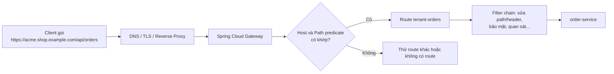
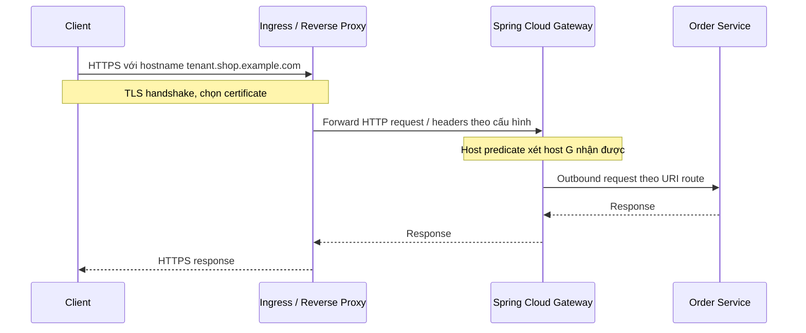

# Host: khớp tên miền, tên miền con và biến mẫu

Khi nhiều API cùng đi qua một **Spring Cloud Gateway**, đường dẫn URL không phải tiêu chí duy nhất để xác định microservice đích. Ví dụ, ba địa chỉ sau có thể cùng dùng đường dẫn `/api/orders` nhưng cần phục vụ các nhóm người dùng khác nhau:

- `https://api.example.com/api/orders`: API công khai.
- `https://admin.example.com/api/orders`: giao diện vận hành.
- `https://acme.shop.example.com/api/orders`: API của một không gian (tenant) mang tên `acme`.

**Host Route Predicate Factory** của Spring Cloud Gateway giải quyết bài toán lựa chọn route dựa trên **tên host mà client yêu cầu**. Nó hỗ trợ host cụ thể, mẫu tên miền có ký tự đại diện và các biến mẫu lấy ra từ hostname. Bài thuộc chương **Điều kiện định tuyến** trong module **SPRING_CLOUD_GATEWAY**: dùng route predicate để gửi request tới đúng dịch vụ, rồi kết hợp filter chain, biến đổi path/header, service discovery, xác thực, rate limiting, circuit breaker, retry, TLS và quan sát lưu lượng.

> **Phạm vi:** Ví dụ tập trung vào **Spring Cloud Gateway Server WebFlux**. Cú pháp prefix cấu hình thay đổi theo phiên bản và starter; cách khai báo ngắn `Host=...` và khái niệm matching được dùng xuyên suốt bài. Không suy luận rằng mọi cơ chế routing của bản Server MVC có cùng triển khai nội bộ.

## 1. Host predicate kiểm tra điều gì?

Mỗi HTTP request đến một địa chỉ công khai mang theo thông tin về host đích. Trong HTTP/1.1, thông tin này thường xuất hiện ở header `Host`:

```http
GET /api/orders/42 HTTP/1.1
Host: acme.shop.example.com
Accept: application/json
```

Với HTTP/2, thông tin authority thường được truyền qua trường `:authority` và được HTTP framework diễn giải thành thông tin host của request. Ở mức routing, **Host predicate** so sánh host của request mà gateway nhìn thấy với các mẫu đã cấu hình, rồi trả kết quả **khớp / không khớp**.

Host predicate không tự chứng minh client đã truy cập từ đúng website và cũng không tự xác định tài nguyên nghiệp vụ có được phép truy cập hay không. Nó chỉ giúp **lựa chọn route**.



Để tránh nhầm lẫn, phân biệt các lớp:

| Khái niệm | Vai trò | Có tự thay thế Host predicate không? |
| --- | --- | --- |
| **DNS** | Phân giải `api.example.com` thành địa chỉ IP hoặc endpoint mạng | Không. DNS đưa kết nối tới máy/ingress, không tự chọn route Spring Cloud Gateway. |
| **TLS/SNI** | Khi dùng HTTPS, hỗ trợ xác định chứng chỉ/cấu hình TLS trong bắt tay kết nối | Không. TLS diễn ra trước khi xử lý route HTTP; SNI và HTTP Host có thể không giống nhau. |
| **HTTP Host / authority** | Cho biết tên máy chủ đích trong HTTP request đã được gateway nhận | Đây là dữ liệu Host predicate xét sau khi request được framework xử lý. |
| **Route URI** | Địa chỉ *upstream* Gateway sẽ gọi, chẳng hạn `lb://order-service` | Không. Route URI là đích sau khi match; không nhất thiết giống Host công khai. |
| **Path predicate** | Xét đường dẫn như `/api/orders/**` | Có thể kết hợp với Host để xác định route cụ thể hơn. |
| **Authentication/authorization** | Xác minh danh tính và quyền thao tác | Phải được thực hiện bằng cơ chế riêng; Host predicate không phải lớp phân quyền. |

**Ghi nhớ:** client có thể tự tạo một HTTP request với header Host tùy ý trong nhiều hoàn cảnh. Vì vậy, quyết định nhạy cảm như “người dùng được xem đơn hàng của tenant nào?” không được chỉ dựa vào kết quả Host match.

## 2. Cấu hình Host khớp tên miền chính xác

Giả sử gateway đang nghe ở `localhost:8080` và có backend thử nghiệm tại `localhost:8081`. Ta muốn route chỉ khớp request đến `api.example.com` có đường dẫn bắt đầu bằng `/api/catalog/`:

```yaml
spring:
  cloud:
    gateway:
      routes:
        - id: public-catalog
          uri: http://localhost:8081
          predicates:
            - Host=api.example.com
            - Path=/api/catalog/**
          filters:
            - StripPrefix=1
```

**Giải thích:**

- `Host=api.example.com`: request phải khớp host `api.example.com`.
- `Path=/api/catalog/**`: request cũng phải khớp đường dẫn `/api/catalog/` và phần sau đó theo mẫu.
- `Host` và `Path` là **hai predicate khác loại trong cùng một route**: cả hai cần thỏa mãn để route này khớp.
- `StripPrefix=1`: loại bỏ đoạn đầu `api`; ví dụ path `/api/catalog/products` được chuyển thành `/catalog/products` khi gửi tới backend.
- `uri: http://localhost:8081`: là địa chỉ backend ở môi trường thử nghiệm, không phải tên miền client yêu cầu.

Với cấu hình này, request `GET /api/catalog/products` tới `api.example.com` sẽ khớp route `public-catalog`. Cùng đường dẫn đó nhưng Host là `admin.example.com` sẽ không khớp route này.

**Lưu ý phiên bản:** Một số phiên bản Spring Cloud Gateway Server WebFlux khai báo routes dưới `spring.cloud.gateway.routes`; các phiên bản mới có thể dùng `spring.cloud.gateway.server.webflux.routes`. Cần kiểm tra tài liệu đúng phiên bản dependency đang chạy và chỉ dùng prefix mà phiên bản đó hỗ trợ.

### Cách gọi thử từ máy phát triển

Vì `api.example.com` có thể không trỏ về gateway local, ta có thể giả lập Host:

```bash
curl -i \
  -H "Host: api.example.com" \
  http://localhost:8080/api/catalog/products
```

Thử một Host không khớp:

```bash
curl -i \
  -H "Host: other.example.com" \
  http://localhost:8080/api/catalog/products
```

Ở lệnh thứ hai, **route `public-catalog` sẽ không match**. Status cuối cùng còn phụ thuộc ứng dụng có route khác hoặc handler khác xử lý request hay không; không nên khẳng định nó luôn là `404` trong mọi ứng dụng.

Các lệnh dùng HTTP local chỉ nhằm kiểm thử route. Chúng không chứng minh cấu hình HTTPS, chứng chỉ TLS hoặc DNS production đã chính xác.

## 3. Host khớp một tên miền con và nhiều cấp tên miền con

Spring Cloud Gateway Host predicate nhận **mẫu kiểu Ant** với dấu chấm (`.`) làm dấu phân tách các thành phần hostname. Hai ký hiệu quan trọng là:

- `*`: phù hợp khi muốn match ký tự trong **một thành phần** hostname.
- `**`: phù hợp khi muốn match qua **nhiều thành phần** hostname trong mẫu.

Ví dụ:

```yaml
predicates:
  - Host=*.example.com
```

Một trường hợp thông dụng là match các host như `api.example.com` hoặc `admin.example.com` (một cấp phía trước `example.com`).

Nếu muốn hỗ trợ nhiều cấp subdomain:

```yaml
predicates:
  - Host=**.example.com
```

Ví dụ có thể match `api.example.com`, `v1.api.example.com` hoặc `a.b.example.com` theo cơ chế matching Ant của Host predicate.

| Host mẫu | Host request | Ý nghĩa kỳ vọng |
| --- | --- | --- |
| `api.example.com` | `api.example.com` | Khớp tên miền chính xác |
| `api.example.com` | `admin.example.com` | Không khớp |
| `*.example.com` | `shop.example.com` | Khớp một thành phần tên miền con |
| `*.example.com` | `a.b.example.com` | Không nên trông đợi match nhiều cấp |
| `**.example.com` | `a.b.example.com` | Khớp mẫu cho nhiều cấp |
| `{tenant}.shop.example.com` | `acme.shop.example.com` | Khớp và trích xuất `tenant=acme` |
| `{tenant}.shop.example.com` | `a.b.shop.example.com` | Không phải một giá trị tenant đơn cấp |

**Trường hợp apex:** Nếu muốn chắc chắn cho phép cả `example.com` (tên miền gốc) lẫn các tên miền con, hãy **khai báo rõ** tên miền gốc, ví dụ `Host=example.com,**.example.com`. Không dựa vào suy đoán về việc `**` có thể match 0 thành phần hoặc cách chuẩn hóa host qua các phiên bản/hạ tầng.

**Trường hợp cổng và chuẩn hóa:** Trong môi trường local, Host header có thể được gửi dưới dạng `api.example.com:8080`. Reverse proxy cũng có thể thay đổi Host/authority mà gateway nhìn thấy. Khi matcher phụ thuộc chính xác hostname, nên viết integration test với Host thực tế có hoặc không có port, chữ hoa/chữ thường và cấu hình proxy tương ứng; đừng giả định một mẫu route đủ cho mọi kiểu authority.

### Mẫu Host khác với wildcard của chứng chỉ TLS

Một route có `Host=**.example.com` **không cấp** chứng chỉ TLS cho mọi subdomain. Chứng chỉ wildcard kiểu `*.example.com` thường chỉ bao phủ một cấp tên miền theo quy tắc xác minh chứng chỉ TLS; nó không tự bao phủ `a.b.example.com`. Muốn truy cập HTTPS thành công, client phải hoàn thành TLS handshake với chứng chỉ thích hợp trước khi Host predicate hoạt động.

## 4. Nhiều mẫu Host trong một predicate: quan hệ OR

Một Host predicate có thể nhận **danh sách mẫu**, cách nhau bằng dấu phẩy:

```yaml
spring:
  cloud:
    gateway:
      routes:
        - id: tenant-api
          uri: http://localhost:8081
          predicates:
            - Host=api.example.com,api.example.net
            - Path=/v1/**
```

Với route này:

- `api.example.com` **hoặc** `api.example.net` đều thỏa mãn điều kiện Host.
- Đồng thời request vẫn phải thỏa `Path=/v1/**`.
- Host không khớp một trong hai mẫu thì route không khớp, bất kể đường dẫn.

Có thể diễn đạt như biểu thức logic:

```text
Route khớp =
    (Host là api.example.com HOẶC api.example.net)
    VÀ
    (Path khớp /v1/**)
```

Điểm cần tránh: thay vì viết nhiều mẫu trong **một** Host predicate, người học có thể vô tình cấu hình **hai predicate Host riêng biệt** trong cùng route. Các predicate cùng route thường được kết hợp theo AND, dẫn đến route không thỏa nếu hai Host độc lập yêu cầu hai giá trị không thể đồng thời đúng. Khi cần danh sách host thay thế nhau, hãy đặt chúng trong cùng một `Host=...,...`.

### Kết hợp thêm Method, Header và Query

```yaml
- id: orders-read
  uri: http://localhost:8082
  predicates:
    - Host=api.example.com
    - Path=/api/orders/**
    - Method=GET
  filters:
    - StripPrefix=1
```

Route chỉ phù hợp với các request thỏa cả Host, Path và phương thức GET. `POST /api/orders` có thể cần một route khác với chính sách riêng, ngay cả khi dùng cùng backend.

**Thiết kế predicate nên dễ hiểu:** Host phân chia miền truy cập (public/admin/tenant), Path phân chia tài nguyên, Method phân chia loại thao tác, còn filter áp dụng các chính sách HTTP và kỹ thuật đi kèm.

## 5. Biến mẫu trong Host: trích xuất tên miền con

Với hệ thống đa tenant, không thể khai báo từng hostname bằng tay khi số tenant tăng liên tục. Host predicate có thể dùng **URI template variable**:

```yaml
spring:
  cloud:
    gateway:
      routes:
        - id: tenant-orders
          uri: http://localhost:8083
          predicates:
            - Host={tenant}.shop.example.com
            - Path=/api/orders/**
          filters:
            - StripPrefix=1
            - SetRequestHeader=X-Matched-Subdomain, {tenant}
```

Ví dụ:

```http
GET /api/orders/42 HTTP/1.1
Host: acme.shop.example.com
```

Khi Host pattern khớp, Gateway trích xuất giá trị:

```text
tenant = acme
```

Filter `SetRequestHeader` có thể mở rộng biến URI template đã được trích xuất để điền vào header `X-Matched-Subdomain` gửi tới upstream. `SetRequestHeader` được chọn vì nó **đặt/thay thế** giá trị header, tránh tích lũy giá trị do client tự gửi như khi chỉ thêm header mới.

| Thành phần | Trong request/cấu hình | Khi match |
| --- | --- | --- |
| Host pattern | `{tenant}.shop.example.com` | Mẫu một tên miền con mang tên biến `tenant` |
| Host thực tế | `acme.shop.example.com` | Trích xuất `tenant = acme` |
| Path public | `/api/orders/42` | `StripPrefix=1` tạo `/orders/42` |
| Header outbound | `X-Matched-Subdomain: {tenant}` | Gửi `X-Matched-Subdomain: acme` |
| Route URI | `http://localhost:8083` | Backend nhận request tại upstream cố định |

Trong Gateway WebFlux, biến được thu thập từ route predicate có thể được truy cập từ map thuộc tính của `ServerWebExchange`. Ví dụ đoạn mã sau chỉ minh họa việc đọc metadata, **không thực hiện phân quyền**:

```java
Map<String, String> variables =
    ServerWebExchangeUtils.getUriTemplateVariables(exchange);

String requestedTenant = variables.get("tenant");
```

Đoạn mã giả định đã import `java.util.Map` và `org.springframework.cloud.gateway.support.ServerWebExchangeUtils`, đồng thời đang chạy trong một GatewayFilter/GlobalFilter sau khi route đã được match.

### 5.1. Vì sao tên tenant từ Host chưa đủ để xác thực?

Host là **đầu vào từ phía request**. Một client có thể thử:

```bash
curl -i \
  -H "Host: another-tenant.shop.example.com" \
  http://localhost:8080/api/orders/42
```

Nếu gateway chỉ lấy tên tenant từ Host rồi backend mặc nhiên cho phép xem đơn hàng tương ứng, đây là lỗ hổng phân quyền giữa các tenant.

Thiết kế an toàn hơn:

1. Gateway **xác thực** token/session/API key theo cơ chế thích hợp; kiểm soát nguồn Host nếu có proxy bên ngoài.
2. Gateway có thể chuyển tiếp tên tenant được yêu cầu như **metadata định tuyến**.
3. Backend đối chiếu tenant được yêu cầu với **identity đã xác minh**, quyền truy cập và dữ liệu thực tế. Nếu user không thuộc tenant đó, backend từ chối.
4. Nếu backend chỉ tin header nội bộ, phải bảo đảm client không thể đi vòng qua gateway và gateway xóa/thay thế các header nhận diện do client cung cấp. Có thể ưu tiên token đã ký hoặc mTLS và ràng buộc identity ở service.

Biến `{tenant}` cũng không phải đầu vào đã được xác minh về định dạng hoặc sự tồn tại của tenant. Dịch vụ hoặc lớp chính sách cần validate tên tenant, trạng thái tenant, quyền tương ứng và quy tắc quản lý hostname.

### 5.2. Một biến mẫu không tự tạo route động cho từng backend

Đặt `Host={tenant}.shop.example.com` không có nghĩa URI `lb://...` hay địa chỉ upstream sẽ được tự động tạo theo tên tenant. Trong ví dụ, mọi tenant vẫn tới backend `http://localhost:8083`. Nếu cần chuyển mỗi tenant tới một service hoặc cluster riêng, phải thiết kế cơ chế route động, service discovery hoặc chính sách chọn upstream phù hợp và kiểm tra an toàn; không nên ghép URI từ chuỗi Host tùy ý rồi gửi request ra Internet vì có nguy cơ SSRF/open proxy.

## 6. Thứ tự route khi Host pattern bị chồng lấn

Giả sử gateway có cả route cho `admin.example.com` và route tổng quát cho `**.example.com`. Một request đến `admin.example.com` có thể match **cả hai**. Khi nhiều route khớp, thứ tự/ưu tiên route ảnh hưởng route nào được chọn.

Ví dụ cấu hình:

```yaml
spring:
  cloud:
    gateway:
      routes:
        - id: admin-api
          order: -10
          uri: http://localhost:8082
          predicates:
            - Host=admin.example.com
            - Path=/api/**
          filters:
            - StripPrefix=1

        - id: public-api
          order: 0
          uri: http://localhost:8081
          predicates:
            - Host=**.example.com
            - Path=/api/**
          filters:
            - StripPrefix=1
```

Ở đây `admin-api` có giá trị `order` nhỏ hơn và được ưu tiên khi request đồng thời khớp các điều kiện của route đó. Nhưng chỉ dựa vào `order` để phân vùng bảo mật thường khó duy trì: một route mới thêm sau này hoặc một thay đổi predicate có thể vô tình làm admin traffic đi sai backend.

**Khuyến nghị thiết kế:** cố gắng tránh vùng match chồng lấn cho các route có yêu cầu bảo mật khác nhau. Nếu phải chồng lấn, xác định rõ ưu tiên, viết test xác minh **route ID thực sự được chọn**, và luôn có phân quyền riêng cho endpoint quản trị.

### Tình huống route rộng nuốt route hẹp

| Request | Các route có thể khớp | Route mong muốn |
| --- | --- | --- |
| `Host: admin.example.com`, `GET /api/users` | `admin-api`, `public-api` | `admin-api` |
| `Host: shop.example.com`, `GET /api/catalog` | `public-api` | `public-api` |
| `Host: admin.example.com`, `GET /other` | Không route nào khớp Path `/api/**` | Không có route phù hợp từ cấu hình này |
| `Host: malicious.example.net`, `GET /api/users` | Không route nào khớp Host `*.example.com` / `**.example.com` | Không có route phù hợp từ cấu hình này |

Đừng hiểu “route được match sớm” là cơ chế phân quyền. Với API nhạy cảm, Spring Security có thể chặn request và backend vẫn phải kiểm tra quyền trên tài nguyên.

## 7. Host của client khác Host của kết nối upstream

Một nguồn nhầm lẫn phổ biến là tưởng `Host=shop.example.com` sẽ làm Gateway kết nối tới `shop.example.com`. Thực tế:

- **Host predicate** xét host **inbound** mà gateway thấy.
- **`uri` của route** xác định đích **outbound** (ví dụ `http://localhost:8081` hoặc `lb://catalog-service`).
- Khi sử dụng `lb://catalog-service`, load balancer/discovery tìm instance; cuối cùng HTTP client có URI cụ thể để kết nối.
- **Host header outbound** phụ thuộc các quy tắc header/proxy và filter như `PreserveHostHeader` nếu được bật. Header này không tự thay đổi nơi tạo kết nối TCP/TLS.

Ví dụ:

```yaml
- id: catalog-by-domain
  uri: lb://catalog-service
  predicates:
    - Host=shop.example.com
    - Path=/api/catalog/**
  filters:
    - StripPrefix=1
```

Client gửi `Host: shop.example.com` nhưng dịch vụ đích có thể là một instance nội bộ như `catalog-service-2:8080` do hệ thống discovery trả về. Để dùng `lb://`, phải có tích hợp Spring Cloud LoadBalancer và nguồn instance phù hợp; khai báo URI đơn lẻ không tự bật service discovery.

### PreserveHostHeader có dùng để chọn route không?

Filter `PreserveHostHeader` hữu ích khi upstream yêu cầu nhận **Host gốc** cho virtual hosting hoặc kiểm tra cấu hình HTTP. Nó tác động chiều **forward request**, không quyết định Host predicate có khớp trước đó hay không.

Cần kiểm thử kỹ khi dùng với HTTPS upstream: tên dùng cho TLS SNI và kiểm tra chứng chỉ của kết nối outbound phải phù hợp cấu hình HTTP client và backend thực tế. Đừng giả định bật `PreserveHostHeader` sẽ tự khắc phục mọi lỗi hostname/certificate.

## 8. Reverse proxy, TLS và tính đáng tin cậy của Host

Nhiều hệ thống đặt ingress, reverse proxy hoặc load balancer phía trước Spring Cloud Gateway:



Điểm kiểm tra quan trọng:

1. **TLS trước route matching:** nếu client truy cập HTTPS nhưng ingress/gateway không có chứng chỉ hợp lệ cho host tương ứng, handshake có thể thất bại trước khi bất kỳ Host predicate nào được xét.
2. **Host mà Gateway nhận được:** reverse proxy có thể giữ nguyên Host từ client, hoặc thay bằng tên nội bộ. Nếu bị thay, pattern `Host=api.example.com` sẽ không match như mong đợi. Phải cấu hình ingress/proxy phù hợp yêu cầu hệ thống.
3. **Forwarded headers:** `Forwarded` và `X-Forwarded-Host` chỉ có thể được tin khi xuất phát từ reverse proxy đáng tin cậy và đã có chính sách chống client giả mạo. Chúng không đương nhiên đồng nghĩa với Host header mà Host predicate đang dùng.
4. **HTTP/2 authority và HTTP/1.1 Host:** hạ tầng có thể chuẩn hóa các trường này khác nhau. Cần test tại lớp giao thức thực tế được triển khai.
5. **Cổng trong authority:** với request `Host: api.example.com:8443`, cần kiểm thử matcher theo version và topology. Tránh phát biểu máy móc rằng mọi phiên bản đều xử lý dấu `:port` giống nhau.
6. **Tên miền do người dùng nhập:** không dùng Host để tạo URI outbound tùy ý hoặc cấp quyền vào admin/tenant. Phải có allowlist và xác minh danh tính, quyền, nguồn proxy tương ứng.

Trong hệ thống đa tenant, có thể dùng Host để chọn **bối cảnh được yêu cầu**, sau đó backend sử dụng token/identity được xác thực để xét **quyền truy cập bối cảnh đó**. Đây là sự khác biệt cốt lõi giữa định tuyến và bảo mật nghiệp vụ.

## 9. Kiểm thử Host predicate trong thực tế

### 9.1. Kiểm tra HTTP local bằng curl

Với cấu hình:

```yaml
spring:
  cloud:
    gateway:
      routes:
        - id: tenant-orders
          uri: http://localhost:8083
          predicates:
            - Host={tenant}.shop.example.com
            - Path=/api/orders/**
          filters:
            - StripPrefix=1
            - SetRequestHeader=X-Matched-Subdomain, {tenant}
```

Hãy chạy backend kiểm thử `localhost:8083` có endpoint `/orders/42` và ghi nhận path + header. Sau đó gọi:

```bash
# Host hợp lệ, tenant đơn cấp
curl -i \
  -H "Host: acme.shop.example.com" \
  http://localhost:8080/api/orders/42

# Host sai suffix
curl -i \
  -H "Host: acme.other.example.com" \
  http://localhost:8080/api/orders/42

# Đường dẫn sai dù Host đúng
curl -i \
  -H "Host: acme.shop.example.com" \
  http://localhost:8080/api/catalog/products
```

Ở request đầu tiên, kỳ vọng route `tenant-orders` khớp, backend nhận `/orders/42` và header `X-Matched-Subdomain: acme`. Hai request sau **không khớp route `tenant-orders`**; status cuối cùng tùy ứng dụng có route/handler khác hay không.

Thử client tự gửi header trùng tên:

```bash
curl -i \
  -H "Host: acme.shop.example.com" \
  -H "X-Matched-Subdomain: attacker" \
  http://localhost:8080/api/orders/42
```

Với filter `SetRequestHeader` trong ví dụ, backend cần thấy giá trị được đặt từ biến match (`acme`), thay vì giá trị `attacker`. Tuy vậy, backend vẫn không được xem `acme` là bằng chứng user có quyền truy cập tenant đó.

### 9.2. Kiểm thử HTTPS, Host và SNI cùng lúc

Khi gateway/ingress đã được cấu hình TLS và đang nghe trên cổng `8443`, có thể dùng `--resolve` để chuyển kết nối đến một IP mong muốn mà **vẫn dùng hostname trong URL**:

```bash
curl -i \
  --resolve api.example.com:8443:127.0.0.1 \
  https://api.example.com:8443/api/catalog/products
```

Lệnh này chỉ thành công khi endpoint TLS, chứng chỉ và hostname/port được cấu hình hợp lệ. `--resolve` giúp chủ động IP đích trong thử nghiệm, không tự tạo chứng chỉ hợp lệ. Không dùng tùy chọn bỏ kiểm tra chứng chỉ như một cách kiểm thử bảo mật production.

### 9.3. Bảng test nên có

| Nhóm test | Ví dụ | Kiểm tra |
| --- | --- | --- |
| Exact Host | `api.example.com` | Route exact được chọn |
| Host khác | `admin.example.com` | Không bị route exact bắt nhầm |
| Một cấp subdomain | `acme.example.com` | Khớp `*.example.com` theo quy tắc kỳ vọng |
| Nhiều cấp | `a.b.example.com` | Kiểm thử `**.example.com`; không giả định `*.example.com` cũng nhận |
| Tên miền gốc | `example.com` | Có route explicit nếu muốn hỗ trợ apex |
| Biến mẫu | `acme.shop.example.com` | Trích xuất `tenant=acme`, không tin biến để phân quyền |
| Path sai | Host đúng, Path ngoài mẫu | Route không khớp |
| Method sai | Host/Path đúng, Method khác yêu cầu | Route có Method predicate không khớp |
| Route chồng lấn | `admin.example.com` với pattern rộng | Đúng route ID/`order` và kiểm soát quyền |
| Reverse proxy | Host bị giữ hoặc thay đổi bởi ingress | Route matching đúng trong topology thực |
| TLS/certificate | Tên miền HTTPS và SNI khác nhau | Handshake và xác minh chứng chỉ đúng |
| Header giả mạo | Client tự đặt `X-Matched-Subdomain` | Header được xử lý theo chính sách và backend tự kiểm tra quyền |

Nếu nhiều route trùng lặp, quan sát **route ID** trong metrics/log/traces sẽ hữu ích hơn việc chỉ nhìn response body.

## 10. Những lỗi phổ biến và cách chẩn đoán

| Triệu chứng | Nguyên nhân cần kiểm tra | Hướng giải quyết |
| --- | --- | --- |
| Route không khớp dù path đúng | Host chưa đúng, có port, proxy thay Host, sai suffix tên miền | In log metadata Host an toàn trong môi trường thử nghiệm, kiểm tra request và ingress; viết test cụ thể |
| `Host=*.example.com` không nhận nhiều cấp | `*` không dành cho nhiều thành phần hostname | Dùng `**` nếu mục tiêu cho phép nhiều cấp, kiểm tra lại phạm vi cần nhận |
| Route admin bị route public nhận | Pattern `**` quá rộng, route chồng lấn hoặc order không như mong đợi | Thu hẹp pattern, cấu hình order và kiểm tra route ID; giữ phân quyền riêng |
| Biến `{tenant}` không xuất hiện trong header | Mẫu Host không match, sai tên biến, filter đang dùng trước/sai route | Kiểm tra Host, tên biến và filter trên route match; thử ví dụ tối giản |
| Backend thấy Host nội bộ thay vì Host public | HTTP client tạo request outbound theo URI backend | Xem có thực sự cần `PreserveHostHeader`; cấu hình theo virtual host và TLS của backend |
| Gateway gặp lỗi TLS trước khi trả response | Chứng chỉ/hostname/SNI không phù hợp | Sửa cấu hình TLS và chứng chỉ; không cố sửa Host predicate để vượt handshake |
| Tenant A truy cập được dữ liệu Tenant B | Logic backend tin biến subdomain hoặc header không xác thực | Kiểm tra authorization theo identity và ownership dữ liệu, network policy, chống spoof header |
| Gateway forward đến địa chỉ client gợi ý | Logic tự xây URI từ Host không có kiểm soát | Giới hạn URI upstream theo allowlist/discovery, chống SSRF/open proxy |

Khi xử lý sự cố, xác định lỗi thuộc **DNS/TLS, ingress, route matching, filter, load balancing, HTTP proxy hay backend**. Ví dụ `404` có thể là không có route khớp hoặc backend trả “không tìm thấy tài nguyên”; cần trace và route ID để phân biệt.

## 11. Bài thực hành thiết kế ba miền API

**Bối cảnh:** Một công ty cung cấp API công khai, trang quản trị và hệ thống bán hàng đa tenant. Các tên miền:

- `api.example.com`: client ứng dụng gọi REST API công khai.
- `admin.example.com`: API quản trị có yêu cầu bảo mật riêng.
- `{tenant}.shop.example.com`: API đọc đơn hàng theo tenant.

**Nhiệm vụ:** Tạo ba route tới ba backend thử nghiệm (ví dụ `localhost:8081`, `8082`, `8083`), yêu cầu:

1. Route public khớp Host chính xác `api.example.com` và Path `/api/catalog/**`.
2. Route admin khớp Host chính xác `admin.example.com` và Path `/api/**`, có kiểm soát xác thực/phân quyền thích hợp bằng Spring Security và backend.
3. Route tenant khớp biến mẫu `{tenant}.shop.example.com` cùng Path `/api/orders/**`; chuyển metadata tenant tới backend bằng header được **đặt lại từ biến đã match**.
4. Dùng `StripPrefix=1` để backend nhận path không có đoạn `/api`.
5. Xác minh route ID, path và header phía backend bằng `curl`; bổ sung test Host sai hoặc request giả mạo header.
6. Nếu chuyển route sang `lb://service-name`, xác minh discovery và LoadBalancer cung cấp instance phù hợp. Không coi tên tenant là hostname upstream tùy ý.

Một cấu hình minh họa:

```yaml
spring:
  cloud:
    gateway:
      routes:
        - id: public-catalog
          uri: http://localhost:8081
          predicates:
            - Host=api.example.com
            - Path=/api/catalog/**
          filters:
            - StripPrefix=1

        - id: admin-api
          uri: http://localhost:8082
          predicates:
            - Host=admin.example.com
            - Path=/api/**
          filters:
            - StripPrefix=1

        - id: tenant-orders
          uri: http://localhost:8083
          predicates:
            - Host={tenant}.shop.example.com
            - Path=/api/orders/**
          filters:
            - StripPrefix=1
            - SetRequestHeader=X-Matched-Subdomain, {tenant}
```

Ở ví dụ này, Host predicate chỉ **phân luồng request**. Thực tế vẫn cần thiết lập xác thực, quyền endpoint admin, quyền trên dữ liệu tenant, rate limit, timeout, quan sát request, TLS và kiểm soát header tin cậy theo thiết kế ứng dụng. Không coi việc vào được hostname admin là bằng chứng người gọi có vai trò quản trị.

### Câu hỏi tự kiểm tra

**1. `Host=api.example.com` khác `uri: lb://api-service` như thế nào?**

> Host predicate kiểm tra thông tin host inbound để chọn route. URI route mô tả upstream mà Gateway sẽ kết nối sau khi đã match và có bước load balancing/discovery phù hợp.

**2. Nếu cấu hình `Host=api.example.com,api.example.net` thì có cần request cùng lúc mang cả hai Host không?**

> Không. Hai mẫu trong một Host predicate là các lựa chọn thay thế (OR). Request chỉ cần thỏa một mẫu; các predicate khác trong route vẫn phải đồng thời đúng.

**3. Vì sao không nên dùng `Host=*.example.com` khi cần nhận `eu.tenant.example.com`?**

> Mẫu `*` phục vụ một thành phần hostname. Khi mục tiêu bao gồm nhiều cấp, cần mẫu phù hợp như `**.example.com` hoặc thiết kế route cụ thể hơn và kiểm thử.

**4. Vì sao `{tenant}` từ hostname chưa đủ để trả danh sách đơn hàng?**

> Client có thể yêu cầu tên tenant khác. Backend phải xác minh identity, quyền của principal trên tenant đó và quyền truy cập từng tài nguyên.

**5. Host predicate có đảm bảo chứng chỉ `*.example.com` dùng được cho `a.b.example.com` không?**

> Không. Host predicate xử lý HTTP sau TLS. Điều kiện match route và phạm vi tên miền được chứng chỉ TLS bảo vệ là hai việc khác nhau.

**6. Nếu request đi qua ingress, nên kiểm tra Host ở đâu khi route không match?**

> Kiểm tra cả Host/authority do client gửi và giá trị ingress thực sự chuyển tiếp tới Gateway, cùng chính sách trust và forwarded headers. Gateway chỉ có thể match theo thông tin request mà nó nhận được.

## 12. Checklist trước khi triển khai Host predicate

- [ ] Chọn **Host chính xác**, `*` hay `**` theo phạm vi tên miền cần nhận; khai báo riêng apex nếu yêu cầu.
- [ ] Kết hợp Host với Path/Method/Headers khi cần, hiểu quan hệ **OR trong danh sách mẫu Host** và **AND giữa các predicate route**.
- [ ] Tránh route rộng chồng lên route nhạy cảm; cấu hình order và kiểm tra route ID trong integration test.
- [ ] Đọc biến `{tenant}` như metadata request, **không dùng một mình làm căn cứ cấp quyền**.
- [ ] Nếu chuyển tenant sang header, ghi đè/loại bỏ giá trị client giả mạo; backend vẫn kiểm tra ownership và authorization.
- [ ] Phân biệt Host inbound với URI upstream, xử lý `lb://` qua discovery và LoadBalancer nếu dùng.
- [ ] Kiểm thử ingress giữ/thay Host, forwarded headers và trường hợp request có port/case khác nhau.
- [ ] Kiểm thử cả TLS certificate/SNI; route matching không tự thiết lập HTTPS hợp lệ.
- [ ] Không tạo URI outbound tùy ý từ header Host hoặc biến tên miền; tránh SSRF/open proxy.
- [ ] Bổ sung rate limit, timeout, circuit breaker và retry đúng ngữ nghĩa; chúng không thay thế xác thực và phân quyền.
- [ ] Quan sát route ID, HTTP status, latency, trace ID; không đưa toàn bộ Host do client điều khiển vào metric label không giới hạn số giá trị.
- [ ] Kiểm tra cả Host hợp lệ, Host sai, subdomain nhiều cấp, route chồng lấn và tấn công header giả mạo.

## Kết luận

**Host Route Predicate Factory** cho phép Spring Cloud Gateway phân luồng request theo **tên miền chính xác**, **mẫu subdomain** và **biến mẫu** như `{tenant}`. Đây là công cụ quan trọng khi nhiều API công khai, admin hoặc tenant cùng dùng một cổng vào microservices. Danh sách mẫu trong một Host predicate có quan hệ OR, còn Host kết hợp với Path/Method và các predicate khác theo quan hệ AND để chọn route phù hợp.

Để vận hành an toàn, phải phân biệt **điều kiện định tuyến HTTP** với **DNS, TLS/SNI, Host outbound và quyền nghiệp vụ**. Kết hợp Host predicate với filter chain, service discovery, xác thực, rate limit và khả năng quan sát giúp gateway gửi request đúng nơi, nhưng mỗi service vẫn chịu trách nhiệm xác minh người dùng có quyền với tenant và tài nguyên thực tế hay không.
