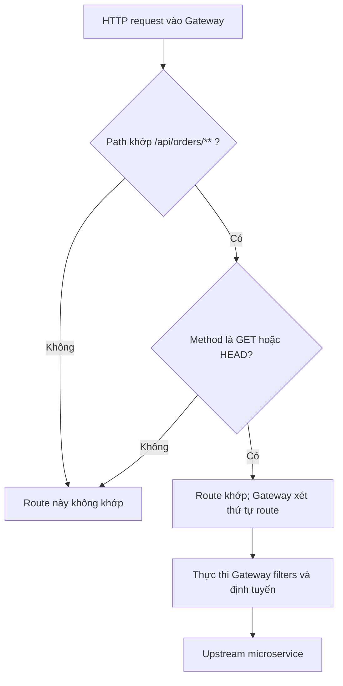
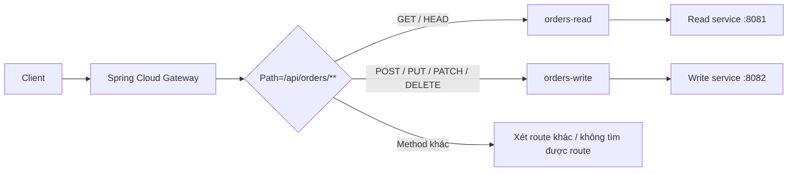

# Method: chọn tuyến theo một hoặc nhiều HTTP method

Trong **Spring Cloud Gateway**, một URL có thể phục vụ nhiều thao tác khác nhau: `GET /api/orders/42` để đọc đơn hàng, `POST /api/orders` để tạo đơn, `PATCH /api/orders/42` để cập nhật và `DELETE /api/orders/42` để xóa. Dù cùng bắt đầu bằng `/api/orders`, các request này có thể cần chuyển đến những dịch vụ, chính sách giới hạn lưu lượng hoặc filter khác nhau.

**`Method` Route Predicate Factory** giúp Gateway quyết định **route nào khớp** dựa trên HTTP method của request. Có thể khai báo một method hoặc nhiều method trên cùng route. Đây là một điều kiện định tuyến của Spring Cloud Gateway Server WebFlux, kết hợp được với `Path`, `Host`, `Header`, `Query` và các predicate khác; bản thân nó không thực hiện xác thực, đổi method hay gửi request đến backend.

Bài học thuộc chương **Điều kiện định tuyến**, sử dụng các ví dụ quản lý API Gateway cho microservices. Sau bài này, bạn có thể cấu hình `Method`, hiểu cách kết hợp các điều kiện, dự đoán kết quả khi request không khớp, kiểm thử bằng `curl` và tránh những nhầm lẫn quan trọng về `HEAD`, `OPTIONS`, phân quyền và retry.

## 1. Method predicate quyết định điều gì?

HTTP method là động từ trong dòng yêu cầu HTTP: `GET`, `POST`, `PUT`, `PATCH`, `DELETE`, `HEAD`, `OPTIONS`, v.v. Trong WebFlux, method của request được biểu diễn qua `org.springframework.http.HttpMethod`.

Một route gồm ít nhất ba phần quan trọng:

- **`id`:** định danh route, giúp ghi log và đo metric.
- **`uri`:** đích chuyển tiếp nếu route được chọn, có thể là địa chỉ HTTP cụ thể hoặc URI có load balancing như `lb://order-service`.
- **`predicates`:** tập điều kiện phải thỏa trước khi route được chọn.

Giả sử route khai báo:

```yaml
predicates:
  - Path=/api/orders/**
  - Method=GET,HEAD
```

Route sẽ khớp khi **đồng thời**:

1. Đường dẫn request khớp `/api/orders/**`.
2. Method là **GET hoặc HEAD**.

Có thể ghi ngắn gọn:

```text
Match(route, request)
    = Match(Path = /api/orders/**)
      AND
      (Method = GET OR Method = HEAD)
```

Trong danh sách nhiều method của **cùng một `Method` predicate**, các method mang quan hệ **OR**. Giữa `Method` và các predicate khác trên **cùng một route**, kết quả thường được kết hợp bằng **AND**. Nếu một điều kiện sai, route đó không được chọn.



**Thời điểm đánh giá:** Route predicate được kiểm tra **trước** khi chạy các Gateway filter của route được chọn. Vì vậy `StripPrefix`, `RewritePath` hay `AddRequestHeader` trong filter chain không thể làm một request vốn không khớp `Method` trở thành khớp hồi tố. Cấu hình `Method` nhìn vào method **Gateway nhận từ client**, không mặc định nhìn vào cách dịch vụ đích diễn giải request.

## 2. Cấu hình một HTTP method

Ví dụ chỉ cho phép các request `GET` vào route đọc đơn hàng:

```yaml
spring:
  cloud:
    gateway:
      routes:
        - id: orders-read
          uri: http://localhost:8081
          predicates:
            - Path=/api/orders/**
            - Method=GET
          filters:
            - StripPrefix=1
```

Trong cấu hình này:

- `GET /api/orders/42` thỏa `Path` và `Method`, được gửi tới `http://localhost:8081/orders/42` sau khi `StripPrefix=1` bỏ đoạn `api`.
- `POST /api/orders/42` thỏa `Path` nhưng **không** thỏa `Method`, vì thế **route `orders-read` không được chọn**.
- `GET /api/customers/42` không thỏa `Path`, dù method là `GET`.

Ví dụ YAML dùng tên thuộc tính `spring.cloud.gateway.routes` của cấu hình Gateway WebFlux truyền thống. **Tên tiền tố thuộc tính phụ thuộc phiên bản/starter**: ở các bản Spring Cloud Gateway Server WebFlux mới, nhóm cấu hình tương ứng có thể là `spring.cloud.gateway.server.webflux.routes`. Khi dùng một phiên bản cụ thể, hãy chọn đúng prefix theo tài liệu cấu hình của phiên bản đó; cách khai báo `- Method=GET` và nguyên tắc khớp method vẫn như nhau.

Không có yêu cầu rằng một route dùng `Method` phải chỉ có một method; cũng không bắt buộc mỗi route phải khai báo `Method`. **Nếu không khai báo `Method`**, route không bị giới hạn bởi predicate method này, dù vẫn có thể chịu ràng buộc từ `Path` và các điều kiện khác.

### Method predicate không đổi HTTP method

`Method=GET` là một phép **kiểm tra**. Nó không biến `POST` thành `GET`, không thay đổi request body và không gọi trực tiếp backend. Trách nhiệm này phân tách rõ:

| Thành phần | Vai trò |
| --- | --- |
| `Method` predicate | Chọn xem request có đủ điều kiện khớp route hay không |
| `Path` predicate | So khớp URL path ban đầu của request |
| `GatewayFilter` | Áp chính sách và/hoặc biến đổi request/response sau khi route được chọn |
| Routing filter | Chuyển tiếp tới URI đích được xác định |
| Spring Security | Xác thực và phân quyền request theo cấu hình bảo mật |

## 3. Chọn một route cho nhiều HTTP method

Có thể liệt kê các method bằng dấu phẩy trong một `Method` predicate:

```yaml
spring:
  cloud:
    gateway:
      routes:
        - id: orders-write
          uri: http://localhost:8082
          predicates:
            - Path=/api/orders/**
            - Method=POST,PUT,PATCH,DELETE
          filters:
            - StripPrefix=1
            - AddRequestHeader=X-Edge-Route,orders-write
```

Cùng một route này có thể khớp cả bốn method. Nó có thể dẫn các thao tác ghi dữ liệu đến một upstream chung, áp dụng một tập filter chung và có metric gắn với route ID `orders-write`.

Một biến thể khác dùng `GET,HEAD` để gộp các phương thức đọc:

```yaml
predicates:
  - Path=/api/products/**
  - Method=GET,HEAD
```

Dấu phẩy ở đây biểu diễn **tập method được chấp nhận**. Không nên hiểu thành thứ tự ưu tiên: `Method=GET,HEAD` không ưu tiên GET hơn HEAD; nó chỉ kiểm tra membership trong tập.

### Cách đọc một request cụ thể

Với `Path=/api/orders/**` và `Method=POST,PUT,PATCH,DELETE`:

| Request | Khớp `Path`? | Khớp `Method`? | Route khớp? |
| --- | --- | --- | --- |
| `POST /api/orders` | Có | Có | Có |
| `PUT /api/orders/42` | Có | Có | Có |
| `PATCH /api/orders/42` | Có | Có | Có |
| `DELETE /api/orders/42` | Có | Có | Có |
| `GET /api/orders/42` | Có | Không | Không |
| `HEAD /api/orders/42` | Có | Không | Không |
| `POST /api/customers` | Không | Có | Không |

**Lưu ý:** Kết quả bảng chỉ nói về **route được xét**. Một request không khớp route này vẫn có thể khớp **route khác** trong Gateway.

## 4. Tách route đọc và route ghi cho cùng API

Đây là tình huống thường gặp khi các backend tách dịch vụ đọc và ghi hoặc khi muốn policy khác nhau giữa các thao tác.

```yaml
spring:
  cloud:
    gateway:
      routes:
        - id: orders-read
          order: 0
          uri: http://localhost:8081
          predicates:
            - Path=/api/orders/**
            - Method=GET,HEAD
          filters:
            - StripPrefix=1

        - id: orders-write
          order: 0
          uri: http://localhost:8082
          predicates:
            - Path=/api/orders/**
            - Method=POST,PUT,PATCH,DELETE
          filters:
            - StripPrefix=1
```

Hai route có cùng `Path`, nhưng tập method **không giao nhau** nên không tranh nhau một request ở những method đã khai báo.



**Tính đúng đắn của cấu hình này phụ thuộc vào contract API.** Không phải mọi đường dẫn trong `/api/orders/**` đều cho phép tất cả bốn thao tác ghi. Chẳng hạn `DELETE /api/orders` có thể là một thao tác không được backend hỗ trợ. Method predicate chỉ chọn nơi chuyển tiếp; **backend vẫn phải kiểm tra endpoint cụ thể**, dữ liệu đầu vào và quyền truy cập.

### Viết tương đương bằng Java DSL

Khi cấu hình route bằng mã Java trong Gateway WebFlux:

```java
@Configuration
public class OrderGatewayRoutes {

    @Bean
    public RouteLocator orderRoutes(RouteLocatorBuilder builder) {
        return builder.routes()
            .route("orders-read", r -> r
                .path("/api/orders/**")
                .and()
                .method(HttpMethod.GET, HttpMethod.HEAD)
                .filters(f -> f.stripPrefix(1))
                .uri("http://localhost:8081"))

            .route("orders-write", r -> r
                .path("/api/orders/**")
                .and()
                .method(
                    HttpMethod.POST,
                    HttpMethod.PUT,
                    HttpMethod.PATCH,
                    HttpMethod.DELETE)
                .filters(f -> f.stripPrefix(1))
                .uri("http://localhost:8082"))
            .build();
    }
}
```

Các kiểu chính: `RouteLocatorBuilder`, `RouteLocator`, `HttpMethod`, `Configuration` và `Bean`. Việc gọi `.path(...).and().method(...)` tạo điều kiện kết hợp, tương đương ý nghĩa với YAML ở trên.

Java DSL có lợi khi route được mô tả trong code hoặc cần tái sử dụng hằng số; YAML có lợi khi cần chỉnh policy định tuyến bằng cấu hình. Dù viết theo cách nào, kết quả vẫn là **chọn route bằng request method**.

## 5. Nhiều route cùng khớp: hiểu thứ tự ưu tiên

Method predicate **không tự quyết định route thắng** nếu có nhiều route cùng thỏa. Spring Cloud Gateway xét các route theo thứ tự đã sắp xếp và sử dụng route phù hợp đầu tiên; thuộc tính `order` giúp chủ động xác định thứ tự ưu tiên. **Order nhỏ hơn có ưu tiên cao hơn.**

Ví dụ muốn request `POST /api/orders/**` đi đến dịch vụ ghi, còn các request khác đi vào một route bao phủ rộng hơn:

```yaml
spring:
  cloud:
    gateway:
      routes:
        - id: orders-write
          order: -10
          uri: http://localhost:8082
          predicates:
            - Path=/api/orders/**
            - Method=POST

        - id: api-general
          order: 100
          uri: http://localhost:8090
          predicates:
            - Path=/api/**
```

`POST /api/orders` khớp **cả hai route**, nhưng `orders-write` được xét trước vì `-10` nhỏ hơn `100`. `GET /api/orders` không khớp route đầu nhưng có thể vào `api-general`.

| Trường hợp | Route được chọn nếu không bị lớp khác chặn |
| --- | --- |
| `POST /api/orders` | `orders-write` (order `-10`) |
| `GET /api/orders` | `api-general` (order `100`) |
| `PATCH /api/orders/42` | `api-general` (order `100`) |
| `POST /other` | Không khớp hai route trên |

Một route `Path=/api/**` **không có `Method`** có thể nhận cả các method không mong muốn, bao gồm `PATCH` hoặc `DELETE`. Chỉ sử dụng route bao phủ rộng khi thực sự cần và phải có chính sách bảo mật/giới hạn chặt chẽ.

Nếu hai route có tập điều kiện chồng lấn và cùng `order`, đừng dựa vào vị trí khai báo YAML như một hợp đồng ưu tiên lâu dài. Nên gán `order` rõ ràng hoặc làm các predicate loại trừ nhau, sau đó kiểm tra route được chọn bằng kiểm thử tích hợp.

## 6. Các điểm dễ nhầm: HEAD, OPTIONS, 404 và 405

### `HEAD` không mặc nhiên là `GET`

Theo ngữ nghĩa HTTP, `HEAD` yêu cầu metadata tương ứng với `GET` nhưng không có response body. Một số tầng framework/controller có thể tự hỗ trợ `HEAD` cho endpoint `GET`. Tuy nhiên, **Method predicate của Gateway kiểm tra method được khai báo**. Không nên dựa vào hành vi tự động của controller để suy ra:

```yaml
predicates:
  - Method=GET
```

sẽ khớp `HEAD`. Nếu Gateway cần chuyển tiếp `HEAD`, hãy khai báo **`Method=GET,HEAD`** và đảm bảo upstream xử lý `HEAD` theo contract.

### `OPTIONS` và CORS preflight

Browser có thể phát sinh `OPTIONS` trước một request khác nguồn (cross-origin) nhằm hỏi về chính sách CORS. Ví dụ:

```http
OPTIONS /api/orders HTTP/1.1
Origin: https://app.example
Access-Control-Request-Method: POST
Access-Control-Request-Headers: authorization,content-type
```

**Method thực tế của preflight là `OPTIONS`**, không phải `POST`. Header `Access-Control-Request-Method: POST` cho biết browser **dự định** gửi `POST` sau khi preflight được chấp nhận. Vì thế route `Method=POST` **không khớp trực tiếp** với preflight `OPTIONS`.

Trong hệ thống thực, CORS preflight thường được xử lý bởi cơ chế CORS của WebFlux, Gateway và/hoặc Spring Security trước hoặc ngoài route filter thông thường. Hãy cấu hình CORS tổng thể cho đường dẫn cần truy cập và tích hợp với Security, thay vì đơn giản thêm `Method=OPTIONS` vào mọi route rồi chuyển preflight đến microservice.

Một cấu hình CORS phải quyết định rõ allowed origins, headers, methods và credentials. Nếu dùng cookies/credentials, không cấu hình wildcard tùy tiện; cần tránh các lớp cùng ghi header CORS mâu thuẫn.

### Không khớp route không đồng nghĩa tự động trả `405`

Nếu không có route nào thỏa `Path` và `Method`, Gateway thường **không tìm được handler route** và request có thể kết thúc bằng `404 Not Found`, tùy các handler và cấu hình khác của ứng dụng. Gateway **không tự động đảm bảo** tạo danh sách method được phép rồi trả `405 Method Not Allowed` chỉ vì `Path` khớp nhưng `Method` không khớp.

Ngược lại, **upstream** có thể nhận request sau khi Gateway chọn một route rộng hơn và tự trả `405`. Một controller WebFlux khác trong cùng ứng dụng cũng có thể có hành vi riêng. Vì vậy cần phân biệt rõ:

- **Route predicate không khớp:** không chọn route đó; có thể route khác tiếp tục được xét.
- **Gateway đã chọn route, upstream trả `405`:** response HTTP do dịch vụ đích sinh ra.
- **Spring Security chặn:** có thể trả `401` hoặc `403` trước khi Gateway chọn route.
- **CORS preflight bị từ chối:** có thể do tầng CORS/Security xử lý, không chứng minh `Method` predicate bị lỗi.

### `TRACE`, `CONNECT` và phương thức không dùng đến

Không để một route bắt rộng vô tình chuyển tiếp các method ngoài contract. Thực hiện chính sách kiểm soát method tại điểm vào theo hạ tầng và Spring Security khi cần, đồng thời giữ backend có kiểm tra method độc lập. Với những endpoint chỉ hỗ trợ `GET`/`POST`, việc khai báo cụ thể `Method` cũng giúp giảm bề mặt định tuyến ngoài ý muốn, nhưng **không thay thế firewall hoặc kiểm soát bảo mật**.

## 7. Method predicate không phải kiểm soát quyền

Một hiểu nhầm nguy hiểm là nghĩ `Method=POST` đã “bảo vệ” thao tác ghi. Predicate chỉ kiểm tra request có method `POST`, **không biết người gọi là ai** và không kiểm tra quyền tạo đơn.

Trong Gateway có Spring Security WebFlux, xác thực/phân quyền nên ở `SecurityWebFilterChain`. Ví dụ minh họa chính sách scope:

```java
@Bean
SecurityWebFilterChain securityWebFilterChain(ServerHttpSecurity http) {
    return http
        .csrf(ServerHttpSecurity.CsrfSpec::disable)
        .authorizeExchange(exchanges -> exchanges
            .pathMatchers(HttpMethod.GET, "/api/orders/**")
                .hasAuthority("SCOPE_orders.read")
            .pathMatchers(HttpMethod.HEAD, "/api/orders/**")
                .hasAuthority("SCOPE_orders.read")
            .pathMatchers(HttpMethod.POST, "/api/orders/**")
                .hasAuthority("SCOPE_orders.write")
            .pathMatchers(HttpMethod.PUT, "/api/orders/**")
                .hasAuthority("SCOPE_orders.write")
            .pathMatchers(HttpMethod.PATCH, "/api/orders/**")
                .hasAuthority("SCOPE_orders.write")
            .pathMatchers(HttpMethod.DELETE, "/api/orders/**")
                .hasAuthority("SCOPE_orders.write")
            .anyExchange().authenticated())
        .oauth2ResourceServer(oauth2 ->
            oauth2.jwt(Customizer.withDefaults()))
        .build();
}
```

Đoạn mã giả định Gateway được cấu hình làm OAuth2 Resource Server xác minh JWT, có scope `orders.read` hoặc `orders.write` được ánh xạ thành authority tương ứng. Quyết định vô hiệu CSRF chỉ phù hợp với API dùng Bearer token stateless, không dùng cookie/session xác thực trình duyệt; dự án dùng session/cookie cần áp dụng CSRF đúng cách.

Các nguyên tắc:

1. **Bảo mật đánh giá request phía client**. Security WebFilter thường chạy trước Gateway route selection; nếu có `StripPrefix`/`RewritePath`, rule Security phải viết theo URL công khai trước khi rewrite.
2. **Đăng ký route mới không tự tạo policy bảo mật mới**. Luôn duy trì quy tắc mặc định cho các endpoint chưa được liệt kê.
3. **Cùng path nhưng khác method có thể cần quyền khác nhau**. Đọc đơn và hủy đơn không phải cùng một quyền.
4. **Microservice đích vẫn chịu trách nhiệm bảo vệ dữ liệu và hành động quan trọng** theo mô hình tin cậy của hệ thống.

Ngoài ra, không dùng header như `X-HTTP-Method-Override` từ client không tin cậy để lách chính sách method. Nếu một tầng proxy/upstream có hỗ trợ method override thì phải thống nhất **method thực sự được kiểm tra ở Gateway, Security và backend**; nếu không, có thể phát sinh lỗ hổng do lệch cách diễn giải method.

## 8. Tương tác với filter, retry và discovery

Một route có thể chứa `Method` cùng với filter chức năng:

```yaml
spring:
  cloud:
    gateway:
      routes:
        - id: inventory-read
          uri: lb://inventory-service
          predicates:
            - Path=/api/inventory/**
            - Method=GET,HEAD
          filters:
            - StripPrefix=1
            - AddRequestHeader=X-Entry-Point,gateway
```

Luồng xử lý `GET /api/inventory/sku-001`:

1. `Path` và `Method` khớp, route `inventory-read` được chọn.
2. Gateway filter đổi path còn `/inventory/sku-001` và thêm header `X-Entry-Point`.
3. Load balancer/service discovery tìm instance của `inventory-service` nếu đã được cấu hình.
4. Gateway chuyển tiếp request cùng HTTP method gốc đến instance đã chọn.
5. Response được trả về client qua chuỗi filter.

**Lưu ý về header:** Header tùy chỉnh từ client có thể bị giả mạo; khi upstream coi header do Gateway thêm là nguồn tin cậy, cần xác định quy tắc ghi đè/xóa header cùng tên do client gửi. Không sử dụng một header tùy ý chưa bảo vệ làm bằng chứng danh tính.

### Retry theo method: phải xét idempotency

Nếu bật Gateway `Retry` cho một route có `POST,PUT,PATCH,DELETE`, cần kiểm tra kỹ:

- **`GET` và `HEAD`:** thường phù hợp hơn với retry có giới hạn trong trường hợp lỗi tạm thời, nhưng vẫn cần deadline và giới hạn số lần thử.
- **`PUT`, `DELETE`:** có đặc tính idempotent theo ngữ nghĩa HTTP khi triển khai đúng, nhưng retry vẫn có thể phát sinh tác dụng phụ phụ trợ như log, gửi sự kiện hoặc chi phí vận hành.
- **`POST`, `PATCH`:** không mặc định idempotent; retry có thể tạo giao dịch trùng. Cần idempotency key, cơ chế chống lặp hoặc cam kết riêng của backend.
- **Request có body:** retry có thể cần lưu/cấp lại request body theo khả năng của Gateway; phải kiểm tra giới hạn bộ nhớ và cách xử lý `DataBuffer`.
- **Timeout và circuit breaker:** method predicate chỉ định tuyến; nó không đặt timeout, không đảm bảo rollback và không tự cấu hình circuit breaker.

Trong môi trường sản xuất, hãy phân nhóm method trên các route khi cần áp chính sách rate limit, timeout hoặc retry khác nhau, nhưng đừng áp những chính sách này chỉ dựa trên tên method mà bỏ qua hợp đồng nghiệp vụ.

## 9. Kiểm thử với curl và upstream giả lập

Giả sử hai upstream đang chạy:

- Service đọc tại `http://localhost:8081`, có endpoint `GET /orders/42`.
- Service ghi tại `http://localhost:8082`, có endpoint `POST /orders`.

Gateway chạy tại `http://localhost:8080` với hai route `orders-read`/`orders-write` ở mục 4.

### Gửi request hợp lệ

```bash
# GET -> orders-read -> http://localhost:8081/orders/42
curl -i -X GET http://localhost:8080/api/orders/42

# HEAD -> orders-read, nếu upstream hỗ trợ HEAD
curl -I http://localhost:8080/api/orders/42

# POST -> orders-write -> http://localhost:8082/orders
curl -i -X POST http://localhost:8080/api/orders \
  -H "Content-Type: application/json" \
  -d '{"productId":"sku-001","quantity":2}'

# PATCH -> orders-write -> http://localhost:8082/orders/42
curl -i -X PATCH http://localhost:8080/api/orders/42 \
  -H "Content-Type: application/json" \
  -d '{"status":"CONFIRMED"}'
```

Trên Windows PowerShell, có thể dùng `curl.exe` nếu `curl` là alias của một lệnh PowerShell ở môi trường đang dùng.

Không nên xác minh định tuyến **chỉ bằng HTTP status**: hai upstream có thể tình cờ trả cùng một status. Dùng mock server, access log hoặc header đáp ứng do upstream giả lập đặt để biết request thực sự đi đến đâu và được chuyển tiếp bằng method/path nào.

### Gửi request không khớp

```bash
# Không khớp hai route nếu chỉ cho GET,HEAD và POST,PUT,PATCH,DELETE.
curl -i -X OPTIONS http://localhost:8080/api/orders/42

# Không khớp Path=/api/orders/**
curl -i -X GET http://localhost:8080/api/customers/42
```

Kết quả quan sát có thể chịu ảnh hưởng bởi CORS, Security hoặc một route khác. Do đó, không viết test cứng rằng mọi request `OPTIONS` bắt buộc trả `404`. Hãy xác định điều kiện đầu vào, các lớp cấu hình đang bật và **route nào thực sự được chọn**.

### Ma trận kiểm thử đề xuất

| Test | Method | Path | Kỳ vọng ở tầng định tuyến |
| --- | --- | --- | --- |
| T1 | GET | `/api/orders/42` | `orders-read` |
| T2 | HEAD | `/api/orders/42` | `orders-read` |
| T3 | POST | `/api/orders` | `orders-write` |
| T4 | PUT | `/api/orders/42` | `orders-write` |
| T5 | PATCH | `/api/orders/42` | `orders-write` |
| T6 | DELETE | `/api/orders/42` | `orders-write` |
| T7 | OPTIONS | `/api/orders/42` | Không route nào trong hai route được chọn; CORS có thể xử lý riêng |
| T8 | GET | `/api/customers/42` | Không route nào trong hai route được chọn |
| T9 | POST | `/api/orders` không có token hợp lệ | Security có thể từ chối **trước** khi route được chọn |

Trong kiểm thử tích hợp, kết hợp `WebTestClient` với upstream giả lập (WireMock, MockWebServer hoặc dịch vụ test) để kiểm tra cả **request thực tế đến backend**. Với hai route có cùng path nhưng policy khác nhau, kiểm thử thêm route `order` khi đưa route bao phủ rộng vào hệ thống. Nếu dùng `lb://`, phải có cấu hình load balancer/discovery test phù hợp hoặc tạm dùng URL HTTP cố định.

## 10. Chẩn đoán khi Method predicate không hoạt động như mong đợi

| Hiện tượng | Nguyên nhân cần kiểm tra | Hướng xử lý |
| --- | --- | --- |
| `GET` chạy được, `HEAD` không vào route | Chỉ khai báo `Method=GET` | Bổ sung `HEAD` nếu upstream hỗ trợ |
| `POST` vào route bao phủ rộng | Route rộng không giới hạn method hoặc có order ưu tiên hơn | Kiểm tra `order` và tập predicate của từng route |
| `OPTIONS` bị trả lỗi | CORS/Security chưa cho phép preflight hoặc request không được giải quyết ở tầng CORS | Cấu hình CORS thống nhất với Security và đường dẫn public |
| Nhầm `404` thành `405` | Chỉ có Path match, còn Method không match; không có route khác | Phân biệt lỗi không match route với response từ backend |
| Request đến sai backend | Hai route chồng lấn method/path, order không rõ | Làm tập điều kiện loại trừ nhau hoặc đặt order tường minh |
| Gateway báo không có route dù cấu hình đúng ý tưởng | Sai tên prefix cấu hình theo version/starter | Kiểm tra cấu hình phiên bản Gateway đang dùng, route đã được load chưa |
| `POST` bị retry nhiều lần | Retry policy của route chưa xét side effect | Đặt whitelist retry, deadline và idempotency key |
| Có route hợp lệ nhưng vẫn nhận `401/403` | Spring Security từ chối trước bước Gateway routing | Kiểm tra authentication/authorization, không chỉ predicate |

Khi quan sát, nên ghi ít nhất **method**, **path**, **HTTP status**, **route ID** (nếu có), **correlation/trace ID** và thời gian xử lý. Không ghi Bearer token, cookie hoặc payload nhạy cảm. Một response `405` từ backend và một `404` do không chọn được route cần được phân loại khác nhau để tránh sửa nhầm điều kiện định tuyến.

## 11. Bài thực hành tự kiểm tra

**Bài tập:** Thiết kế Gateway cho API `/api/payments/**`:

- `GET` và `HEAD` chuyển đến dịch vụ tra cứu `payment-query`.
- `POST` chuyển đến dịch vụ thực hiện thanh toán `payment-command`.
- `PUT`, `PATCH`, `DELETE` không được dùng ở API public này.
- Đường dẫn upstream bỏ tiền tố `/api`.
- Phải đảm bảo request thiếu quyền không được gọi tới upstream.

**Gợi ý cấu hình route:**

```yaml
spring:
  cloud:
    gateway:
      routes:
        - id: payment-query
          uri: lb://payment-query
          predicates:
            - Path=/api/payments/**
            - Method=GET,HEAD
          filters:
            - StripPrefix=1

        - id: payment-command
          uri: lb://payment-command
          predicates:
            - Path=/api/payments/**
            - Method=POST
          filters:
            - StripPrefix=1
```

Để hoàn thiện, cần bổ sung Spring Security authorization phù hợp và chọn cách xử lý `OPTIONS`/CORS. Với thao tác `POST /api/payments`, **không bật retry một cách mù quáng**: một lần request timeout không chứng minh thanh toán chưa được thực hiện; hãy thiết kế idempotency key và đối soát trạng thái thanh toán.

**Câu hỏi tự kiểm tra:**

1. Vì sao `Method=GET,HEAD` có nghĩa “GET **hoặc** HEAD”, còn hai dòng `Path` và `Method` trên cùng route có nghĩa “Path **và** Method”?
2. Nếu một route `Path=/api/**` không khai báo `Method` và có order cao hơn route `Method=POST`, request POST sẽ đi đâu?
3. Vì sao preflight có `Access-Control-Request-Method: POST` vẫn **không** khớp `Method=POST`?
4. Khi client gửi `DELETE` và không có route nào khớp, vì sao không được mặc định kết luận Gateway phải trả `405`?
5. Vì sao `Method=POST` không thay thế Spring Security hay idempotency key?

**Ghi nhớ:** `Method` là **điều kiện chọn tuyến dựa trên HTTP method của request**, nhận một hoặc nhiều method, kết hợp với các predicate khác trước khi Gateway filter chain chạy. Dùng nó để phân luồng và áp chính sách theo loại thao tác; đồng thời quản lý route order, CORS, phân quyền và retry độc lập để Gateway vận hành an toàn.

