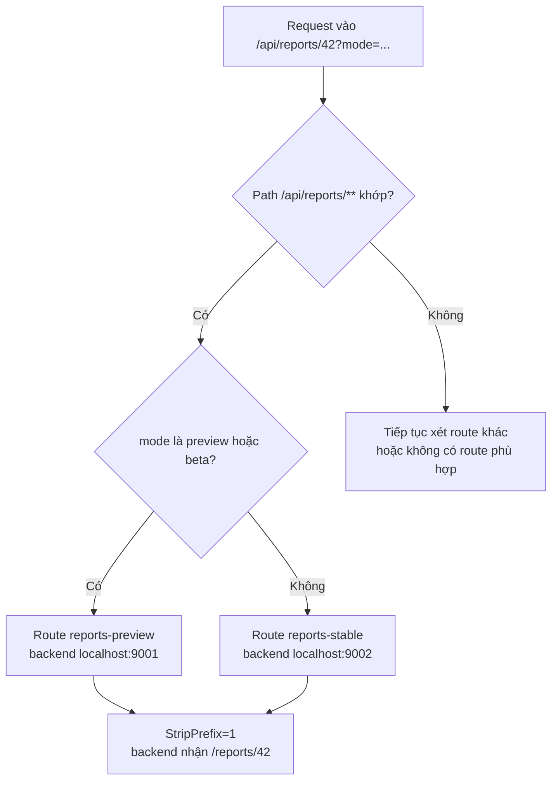
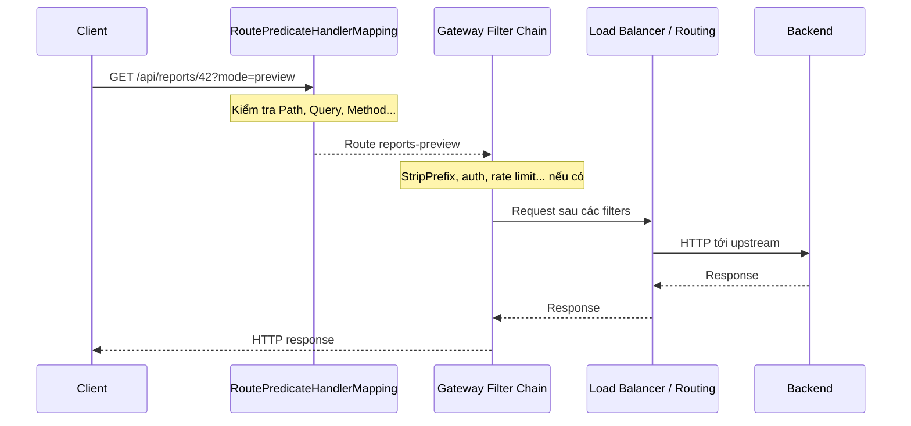

# Query: kiểm tra tên và giá trị query parameter

## Mục tiêu bài học

Trong chương **Điều kiện định tuyến** của **Spring Cloud Gateway**, bài này giới thiệu **Query Route Predicate**: cách kiểm tra tên và giá trị của query parameter để quyết định một HTTP request có phù hợp với một route hay không. Đây là một thành phần của cơ chế route predicate; filter chain, biến đổi đường dẫn/header, service discovery, xác thực, rate limiting, circuit breaker, retry, TLS và observability được xử lý ở những thành phần khác của gateway.

Sau bài học, bạn có thể:

- Phân biệt query parameter với path, method, header và request body.
- Cấu hình `Query=<tên>` khi chỉ cần sự hiện diện của parameter, hoặc `Query=<tên>,<regexp>` khi cần xét giá trị.
- Kết hợp Query với các predicate `Path`, `Method` và các route có độ ưu tiên khác nhau.
- Hiểu hành vi với giá trị rỗng, chữ hoa/chữ thường, tên parameter trùng lặp và URL encoding.
- Kiểm thử route được chọn và HTTP request thực sự tới backend.
- Tránh lạm dụng query parameter do client kiểm soát cho xác thực hoặc phân quyền.

## 1. Query parameter là gì?

Xét request HTTP:

```http
GET /api/reports/42?mode=preview&lang=vi HTTP/1.1
Host: api.example.com
```

Các thành phần quan trọng:

| Thành phần | Ví dụ | Cơ chế kiểm tra thường dùng |
| --- | --- | --- |
| HTTP method | `GET` | `Method` predicate |
| Path | `/api/reports/42` | `Path` predicate |
| Query string | `mode=preview&lang=vi` | `Query` predicate |
| Tên query parameter | `mode`, `lang` | Tham số `param` của `Query` |
| Giá trị query parameter | `preview`, `vi` | Tham số regex tùy chọn của `Query` |
| Header | `Host: api.example.com` | `Host` hoặc `Header` predicate theo yêu cầu |

Query string xuất hiện sau dấu hỏi `?` trong URL; nhiều cặp tên–giá trị thường được ngăn cách bởi dấu `&`. Ví dụ:

```text
/api/catalog/items?category=books
/api/search?q=spring%20cloud
/api/reports/42?format=csv
/api/reports/42?mode=preview
```

Query parameter có thể dùng để chọn chế độ hiển thị, định dạng trả về, nguồn dữ liệu hoặc nhóm API phù hợp. Query predicate được đánh giá **trong giai đoạn chọn route**, không phải trong quá trình xử lý nội dung body. Nó không tự thêm, xóa hay thay đổi query parameter.

## 2. Query Route Predicate Factory

Trong Spring Cloud Gateway Server WebFlux, `QueryRoutePredicateFactory` cung cấp predicate tên **`Query`**, với hai tham số:

1. **`param`** (bắt buộc): tên query parameter cần kiểm tra.
2. **`regexp`** (tùy chọn): biểu thức chính quy Java dùng để kiểm tra giá trị của parameter.

Khai báo ngắn:

```yaml
predicates:
  - Query=campaign
```

Điều kiện trên khớp khi request có parameter tên `campaign`, không đòi hỏi giá trị cụ thể:

| Request | Predicate `Query=campaign` |
| --- | --- |
| `/api/products/7?campaign=sale` | Khớp |
| `/api/products/7?campaign=2026` | Khớp |
| `/api/products/7?campaign=` | Khớp |
| `/api/products/7?campaign` | Khớp theo kiểm tra sự hiện diện của tên |
| `/api/products/7?Campaign=sale` | Không khớp; tên khác chữ hoa/thường |
| `/api/products/7` | Không khớp; thiếu parameter |

Đối với dạng `?campaign` không có dấu bằng, cách HTTP stack biểu diễn *giá trị* có thể khác với `?campaign=`, nhưng điều kiện chỉ kiểm tra **tên có xuất hiện** vẫn phù hợp. Khi xây dựng API contract liên quan giá trị rỗng, hãy kiểm tra trên HTTP stack và phiên bản thư viện thực tế.

### 2.1. Kiểm tra cả tên lẫn giá trị

```yaml
predicates:
  - Query=mode,^(preview|beta)$
```

Trong cấu hình này:

- `mode` là tên parameter.
- `^(preview|beta)$` là regex chỉ chấp nhận `preview` hoặc `beta`.
- Những query parameter khác, chẳng hạn `lang=vi`, không làm mất kết quả khớp của `mode`.

| Query string | Khớp? | Giải thích |
| --- | --- | --- |
| `?mode=preview` | Có | Giá trị `preview` được chấp nhận |
| `?mode=beta` | Có | Giá trị `beta` được chấp nhận |
| `?mode=stable` | Không | Giá trị không thuộc tập |
| `?mode=PREVIEW` | Không | Mặc định phân biệt chữ hoa/thường |
| `?mode=preview-extra` | Không | Không khớp toàn bộ giá trị |
| `?mode=` | Không | Giá trị rỗng không được chấp nhận |
| `?lang=vi` | Không | Thiếu parameter `mode` |
| `?mode=preview&lang=vi` | Có | `mode` hợp lệ, tham số bổ sung không ảnh hưởng |

Trong cách triển khai thông dụng của `QueryRoutePredicateFactory`, giá trị được so bằng **Java regular expression với hành vi khớp toàn bộ chuỗi**, tương tự `String.matches(...)`. Vì vậy, regex `preview` không tự chấp nhận giá trị `preview-extra`. Dùng `^` và `$` giúp biểu đạt chủ ý rõ ràng; cần kiểm thử trên phiên bản Gateway triển khai thực tế.

Một số mẫu regex hữu ích:

| Regex | Các giá trị hợp lệ ví dụ | Dùng khi |
| --- | --- | --- |
| `^(json|csv)$` | `json`, `csv` | Chọn định dạng báo cáo |
| `^[1-9][0-9]*$` | `1`, `35`, `200` | Kiểm tra hình dạng số dương |
| `^(v1|v2)$` | `v1`, `v2` | Chọn nhóm API |
| `(?i)^preview$` | `preview`, `PREVIEW` | Giá trị không phân biệt hoa/thường |
| `^[A-Z]{2}$` | `VN`, `US` | Kiểm tra mã gồm hai chữ in hoa |

Regex chỉ kiểm tra **hình dạng** của dữ liệu. Ví dụ `[1-9][0-9]*` không tự kiểm tra giá trị có nằm trong khoảng nghiệp vụ, không vượt giới hạn số nguyên hoặc đã được phép sử dụng.

### 2.2. Cấu hình dạng đầy đủ

Khi regex có dấu phẩy (ví dụ lượng lặp `{2,4}`) hoặc có cấu trúc phức tạp, nên dùng dạng `name` và `args` để tránh bộ phân tách cú pháp dạng ngắn hiểu nhầm dấu phẩy là điểm ngắt tham số:

```yaml
spring:
  cloud:
    gateway:
      routes:
        - id: regional-reports
          uri: http://localhost:9001
          predicates:
            - Path=/api/reports/**
            - name: Query
              args:
                param: region
                regexp: '^[A-Z]{2,4}$'
```

Ở đây, `?region=VN` và `?region=APAC` khớp, còn `?region=vn` hay `?region=ASIA5` không khớp. Đặt regex trong dấu nháy đơn của YAML giúp tránh nhiều rắc rối với ký tự đặc biệt và backslash.

**Lưu ý phiên bản:** các ví dụ trong bài sử dụng kiểu cấu hình `spring.cloud.gateway.routes` quen thuộc của **Spring Cloud Gateway Server WebFlux**. Một số phiên bản hoặc biến thể (như Server MVC) dùng namespace và API cấu hình khác. Khi đưa ví dụ vào dự án, kiểm tra tài liệu tương ứng với dependency đã chọn.

## 3. Ví dụ đầy đủ: định tuyến theo `mode`

Giả sử một API báo cáo có hai backend:

- `reports-preview`: chạy bản xử lý mới ở `http://localhost:9001`.
- `reports-stable`: chạy bản ổn định ở `http://localhost:9002`.

Yêu cầu: request tới `/api/reports/**` với `mode=preview` hoặc `mode=beta` sử dụng preview, còn request cùng path với giá trị `mode` khác hoặc không có `mode` dùng stable.

```yaml
spring:
  cloud:
    gateway:
      routes:
        - id: reports-preview
          order: -10
          uri: http://localhost:9001
          predicates:
            - Path=/api/reports/**
            - Query=mode,^(preview|beta)$
          filters:
            - StripPrefix=1

        - id: reports-stable
          order: 0
          uri: http://localhost:9002
          predicates:
            - Path=/api/reports/**
          filters:
            - StripPrefix=1
```

Hai backend trên chỉ là địa chỉ thử nghiệm; để chạy cấu hình cần khởi động các server tương ứng. Cả hai backend trong ví dụ được giả định hỗ trợ path `/reports/**`.

### 3.1. Request được chọn route như thế nào?



Mô hình logic:

1. Gateway xem các route theo thứ tự ưu tiên; `order` nhỏ hơn được ưu tiên trước.
2. Với route `reports-preview`, cả `Path` **và** `Query` phải đúng.
3. Nếu `mode=preview` hoặc `mode=beta`, chọn route preview và thực thi filter chain của route đó.
4. Nếu Query không khớp, Gateway tiếp tục xem route `reports-stable` chỉ có điều kiện Path.
5. `StripPrefix=1` bỏ đoạn `api`, nên `/api/reports/42` trở thành `/reports/42`; query string vẫn được chuyển tiếp nếu không có filter khác biến đổi.

Nếu bỏ route `reports-stable`, request `?mode=stable` không tự chuyển sang stable: nó có thể khớp route khác hoặc không có route phù hợp.

### 3.2. Ma trận kết quả

| Request | Route được chọn | Request đến backend sau `StripPrefix=1` |
| --- | --- | --- |
| `GET /api/reports/42?mode=preview` | `reports-preview` | `GET /reports/42?mode=preview` |
| `GET /api/reports/42?mode=beta` | `reports-preview` | `GET /reports/42?mode=beta` |
| `GET /api/reports/42?mode=stable` | `reports-stable` | `GET /reports/42?mode=stable` |
| `GET /api/reports/42` | `reports-stable` | `GET /reports/42` |
| `GET /api/reports/42?mode=PREVIEW` | `reports-stable` | `GET /reports/42?mode=PREVIEW` |
| `POST /api/reports/42?mode=preview` | `reports-preview` | `POST /reports/42?mode=preview` |
| `GET /api/catalog/42?mode=preview` | Không thuộc hai route trên | Không áp dụng |

Query predicate không giới hạn HTTP method. Nếu backend preview chỉ hỗ trợ `GET` mà client gửi `POST`, route có thể vẫn khớp và backend trả lỗi do method không hỗ trợ. Muốn giới hạn, thêm `Method=GET` vào predicates.

## 4. Kết hợp Query với predicates khác

### 4.1. Nhiều predicates trong một route là AND

```yaml
predicates:
  - Path=/api/reports/**
  - Method=GET
  - Query=format,^csv$
```

Route chỉ khớp khi:

```text
Path đúng AND method là GET AND query format là csv
```

Chỉ có `?format=csv` không thể khiến request tới path khác hoặc dùng method khác tự khớp route. Đây là cách xác định rõ hợp đồng HTTP.

### 4.2. Nhiều Query predicates kiểm tra nhiều tên

```yaml
predicates:
  - Path=/api/export/**
  - Query=format,^(csv|json)$
  - Query=source,^partner$
```

Để route khớp, request cần cả `format` hợp lệ **và** `source=partner`. Các ví dụ khớp:

```text
/api/export/orders?format=csv&source=partner
/api/export/orders?format=json&source=partner
```

Ví dụ không khớp:

```text
/api/export/orders?format=csv
```

Hai dòng `Query=mode,preview` và `Query=mode,beta` trong **cùng một route** không biểu diễn OR; chúng là hai điều kiện kết hợp **AND**. Với một tên parameter có nhiều giá trị được phép, dùng regex `^(preview|beta)$`. Nếu cần filter/upstream khác nhau, tách thành những route riêng và đặt `order` phù hợp.

### 4.3. Route tổng quát có thể che route cụ thể

Ví dụ cấu hình cần tránh:

```yaml
routes:
  - id: reports-generic
    order: -20
    uri: http://localhost:9002
    predicates:
      - Path=/api/reports/**

  - id: reports-preview
    order: 0
    uri: http://localhost:9001
    predicates:
      - Path=/api/reports/**
      - Query=mode,^preview$
```

`?mode=preview` match **cả hai route**, nhưng route tổng quát được ưu tiên trước nên có thể nhận request. Sửa bằng cách đặt route cụ thể trước (order nhỏ hơn) hoặc thiết kế các điều kiện loại trừ có chủ đích. Khi debug, phải xem **route thực tế được chọn**, không chỉ nhìn một regex đúng.

## 5. Các trường hợp biên phải hiểu

### 5.1. Parameter tồn tại không có nghĩa giá trị hợp lệ

Ví dụ:

```yaml
- Query=page
```

Cấu hình này chỉ kiểm tra có tên `page`; giá trị `0`, `-3`, `abc` vẫn có thể làm predicate khớp. Nếu muốn giới hạn hình dạng số dương:

```yaml
- Query=page,^[1-9][0-9]*$
```

Nhưng regex không thay thế kiểm tra khoảng giá trị, giới hạn phân trang và validation tại backend.

### 5.2. Chữ hoa và chữ thường

Với `Query=mode,^preview$`:

```text
?mode=preview  → khớp
?mode=Preview  → không khớp
?Mode=preview  → không khớp
```

Regex `(?i)^preview$` có thể giúp không phân biệt hoa/thường ở **giá trị**. Nó không làm tên parameter `Mode` trở thành `mode`; nên chuẩn hóa tên query parameter trong contract API.

### 5.3. Trùng tên parameter

HTTP cho phép nhiều giá trị cho cùng một tên:

```text
?mode=preview&mode=stable
?mode=stable&mode=preview
```

WebFlux biểu diễn query parameters bằng `MultiValueMap<String, String>`. Với cách triển khai thông dụng của `QueryRoutePredicateFactory`, khi có regex, predicate kiểm tra **giá trị đầu tiên** của tên (`getFirst`), không tự tìm bất kỳ giá trị nào phù hợp. Do đó thứ tự xuất hiện có thể làm kết quả khác nhau.

Không dùng hành vi này như quy tắc bảo mật. Nếu API chỉ cho phép một `mode`, hãy định nghĩa rõ contract và từ chối parameter trùng lặp ở lớp kiểm tra request phù hợp. Kiểm thử hành vi cụ thể trong phiên bản Gateway đang triển khai.

### 5.4. Rỗng, không có dấu bằng và regex

`?flag` và `?flag=` đều thể hiện sự hiện diện của tên `flag` trong nhiều HTTP stack, nên `Query=flag` có thể khớp. Tuy nhiên, cách parser biểu diễn giá trị của dạng không có `=` cần kiểm tra nếu đang sử dụng regex phân biệt `null` và chuỗi rỗng.

Nếu yêu cầu cờ phải bằng `true`:

```yaml
- Query=flag,^true$
```

Không coi `?flag`, `?role=admin` hoặc `?authorized=yes` là bằng chứng đã xác thực hay có quyền truy cập.

### 5.5. URL encoding

Ví dụ:

```text
?q=spring%20cloud
?lang=vi
```

HTTP server/WebFlux phân tích query string trước khi predicate đọc tên và giá trị. Regex được áp dụng lên **giá trị mà parser cung cấp**, không nhất thiết lên raw bytes của chuỗi URL. Các ký tự `&`, `+`, `%`, dấu bằng và khoảng trắng cần encode đúng theo yêu cầu của HTTP client; nếu `&` không được encode, nó có thể tạo query parameter mới.

Nên thử bằng công cụ HTTP thực tế và sử dụng `--data-urlencode` khi cần. Regex không nên quá rộng (như `.*`) khi chỉ muốn chọn một tập giá trị hữu hạn.

### 5.6. Query predicate không biến đổi request

Cấu hình:

```yaml
predicates:
  - Query=version,^v2$
```

Không tự xóa `version=v2` khỏi request chuyển đến backend, không thêm header `X-Api-Version: v2` và không sửa path thành `/v2/...`. Để thay đổi request cần filter riêng như `RemoveRequestParameter`, `RewritePath`, `SetRequestHeader` hoặc custom filter theo hợp đồng backend. Có thể kết hợp Query với những filters đó, nhưng hai nhóm có nhiệm vụ khác nhau.

## 6. Query nằm ở đâu trong vòng đời request?



Trong Spring Cloud Gateway Server WebFlux:

- **Route predicate** đánh giá request để chọn một route. `Query` chỉ đọc query parameters khi kiểm tra điều kiện.
- **Route** chứa ID, URI đích, order, predicates và danh sách filters. Route được chọn có thể quan sát qua `GATEWAY_ROUTE_ATTR` trong exchange khi filter chain bắt đầu chạy.
- **Gateway filter chain** có thể sửa path/header, xác thực, giới hạn lưu lượng, retry và áp dụng circuit breaker nếu cấu hình.
- **Load balancing/service discovery** giải quyết địa chỉ instance khi URI dùng `lb://service-name`, nếu các dependency và nguồn instance đã được cấu hình.
- **Routing** chuyển tiếp HTTP/WebSocket theo route; TLS, timeout và kết quả backend là những vấn đề riêng.

Tự khai báo `Query` không làm Gateway xác thực danh tính, giới hạn lưu lượng, cấu hình circuit breaker hoặc chọn instance từ service registry. Query giúp **chọn tuyến logic** để các chính sách khác được áp dụng ở vị trí thích hợp.

## 7. Thực hành kiểm thử bằng HTTP

Dùng lại hai route `reports-preview` và `reports-stable` ở mục 3. Giả sử Gateway ở `http://localhost:8080` và hai backend stub đã chạy:

```bash
# Preview:
curl -i "http://localhost:8080/api/reports/42?mode=preview"

# Beta:
curl -i "http://localhost:8080/api/reports/42?mode=beta"

# Stable:
curl -i "http://localhost:8080/api/reports/42?mode=stable"

# Không có mode:
curl -i "http://localhost:8080/api/reports/42"

# Query không tự giới hạn method:
curl -i -X POST "http://localhost:8080/api/reports/42?mode=preview"
```

Để mã hóa giá trị có dấu cách an toàn:

```bash
curl -i --get \
  --data-urlencode "mode=preview build" \
  "http://localhost:8080/api/reports/42"
```

Vì `preview build` không nằm trong regex `^(preview|beta)$`, request này đi tới stable route.

### 7.1. Ma trận kiểm thử

| Nhóm | Request thử | Hành vi cần xác minh |
| --- | --- | --- |
| Đúng tên, đúng giá trị | `?mode=preview` | Chọn preview |
| Giá trị khác | `?mode=stable` | Chọn stable |
| Không có key | Không có `mode` | Chọn stable |
| Sai tên do chữ hoa | `?Mode=preview` | Không khớp Query của preview |
| Sai value do chữ hoa | `?mode=PREVIEW` | Không khớp regex |
| Rỗng | `?mode=` | Không khớp regex preview |
| Thêm parameter | `?mode=preview&lang=vi` | Vẫn chọn preview |
| Key trùng | `?mode=stable&mode=preview` | Kiểm tra policy và hành vi phiên bản |
| Path khác | `/api/catalog/42?mode=preview` | Không khớp hai route của ví dụ |
| Method khác | `POST ...?mode=preview` | Có thể chọn preview nếu không có `Method` predicate |
| Route chồng lấn | Route generic ưu tiên cao hơn | Xác nhận order quyết định route chọn |

**Chỉ kiểm tra HTTP 200 là chưa đủ.** Hai backend có thể cùng trả 200. Dùng backend stub trả response header `X-Backend: preview` hoặc `X-Backend: stable`, hoặc ghi đường dẫn thực nhận tại backend; sau đó kiểm tra đúng upstream và path `/reports/42`.

Ví dụ phần thân integration test với `WebTestClient` (giả định đã cấu hình WebTestClient và backend stub):

```java
webTestClient.get()
    .uri("/api/reports/42?mode=preview")
    .exchange()
    .expectStatus().isOk()
    .expectHeader().valueEquals("X-Backend", "preview");

webTestClient.get()
    .uri("/api/reports/42?mode=stable")
    .exchange()
    .expectStatus().isOk()
    .expectHeader().valueEquals("X-Backend", "stable");
```

Đây là ví dụ về các assertion, chưa phải một lớp test độc lập: dự án cần test framework, Gateway test server và backend thử nghiệm. Khi thay đổi predicate hoặc order, chạy lại các trường hợp thành công và fallback.

## 8. Bảo mật và vận hành

### 8.1. Query là dữ liệu do client kiểm soát

Client có thể chủ động gọi:

```text
?mode=preview
?role=admin
?tenant=customer-b
```

Vì vậy **không dùng Query predicate thay cho authentication/authorization**. Ví dụ `?role=admin` không thể là điều kiện duy nhất để truy cập API quản trị. Gateway phải xác minh danh tính và quyền ở lớp phù hợp, còn backend phải kiểm tra quyền đối với tài nguyên và nghiệp vụ. Route theo `mode` chỉ phù hợp khi cả các upstream được chọn đã đáp ứng các yêu cầu bảo mật cần thiết.

### 8.2. Không đưa bí mật vào query string

Query có thể xuất hiện trong lịch sử trình duyệt, access log, công cụ giám sát, URL được chia sẻ hoặc những luồng điều hướng. Tránh đặt token, password, API key hay dữ liệu cá nhân nhạy cảm vào URL chỉ để chọn route.

Khi quan sát gateway nên ưu tiên **route ID, HTTP status, latency, error rate, trace ID/correlation ID**. Không ghi nguyên URL, query string hoặc token vào log. Chỉ dùng nhãn có cardinality phù hợp trong metrics.

### 8.3. Regex và chi phí xử lý

Regex quá phức tạp có thể gây CPU cao khi nhận nhiều request hoặc input dài. Nên:

- Ưu tiên biểu thức ngắn, rõ tập giá trị như `^(json|csv)$`.
- Tránh các nhóm lặp lồng nhau dễ gây backtracking tốn kém.
- Giới hạn độ dài URI/query ở tầng HTTP/proxy thích hợp.
- Không xây regex trực tiếp từ input không tin cậy.
- Kiểm thử những query bất thường, tên lặp lại và request có nhiều parameter.

Khi nhiều routes cùng path nhưng phân nhánh dựa trên Query, tài liệu API cần nói rõ giá trị hợp lệ, route fallback, thứ tự ưu tiên và cách thay đổi cấu hình an toàn. Nếu sử dụng `lb://` thay vì upstream tĩnh, route được chọn vẫn phải qua load balancer/service discovery để đến instance cụ thể.

## 9. Bài luyện tập có đáp án

Hệ thống xử lý ảnh có hai backend:

```yaml
routes:
  - id: image-fast
    order: -5
    uri: http://localhost:9101
    predicates:
      - Path=/api/images/**
      - Query=quality,^(low|medium)$

  - id: image-default
    order: 0
    uri: http://localhost:9102
    predicates:
      - Path=/api/images/**
```

Xác định route cho các request:

1. `GET /api/images/8?quality=low`
2. `GET /api/images/8?quality=high`
3. `POST /api/images/8?quality=medium`
4. `GET /api/images/8?Quality=low`
5. `GET /api/videos/8?quality=low`

**Đáp án:**

1. `image-fast`: path và Query đều khớp.
2. `image-default`: `high` không nằm trong regex của fast.
3. `image-fast`: chưa có `Method` predicate nên POST vẫn có thể khớp.
4. `image-default`: tên `Quality` khác `quality`.
5. Không khớp hai route trên vì Path khác; có thể được route khác xử lý hoặc không có route phù hợp.

**Mở rộng:** thêm `Method=GET,POST` và `Query=source,^web$` vào route `image-fast`; dự đoán kết quả khi thiếu `source`, rồi tạo HTTP integration test xác nhận behavior. Khi một route có nhiều predicates, nhớ áp dụng logic **AND**.

## Tổng kết

**Query Route Predicate** trong Spring Cloud Gateway kiểm tra **tên query parameter** và tùy chọn **Java regex cho giá trị**:

```yaml
- Query=campaign
- Query=mode,^(preview|beta)$
```

Query là công cụ định tuyến dựa trên input HTTP, không phải công cụ xác thực hay biến đổi request. Hãy thiết kế rõ `Path`/`Method` đi kèm, thứ tự các route chồng lấn, fallback và các trường hợp query bất thường. Kiểm thử phải xác nhận **backend nào nhận request và nhận path nào**. Khi phối hợp với filter chain, service discovery, rate limiting, circuit breaker, retry, TLS và tracing, Query giúp đưa request đến đúng tuyến để các chính sách vận hành của API Gateway hoạt động nhất quán.
