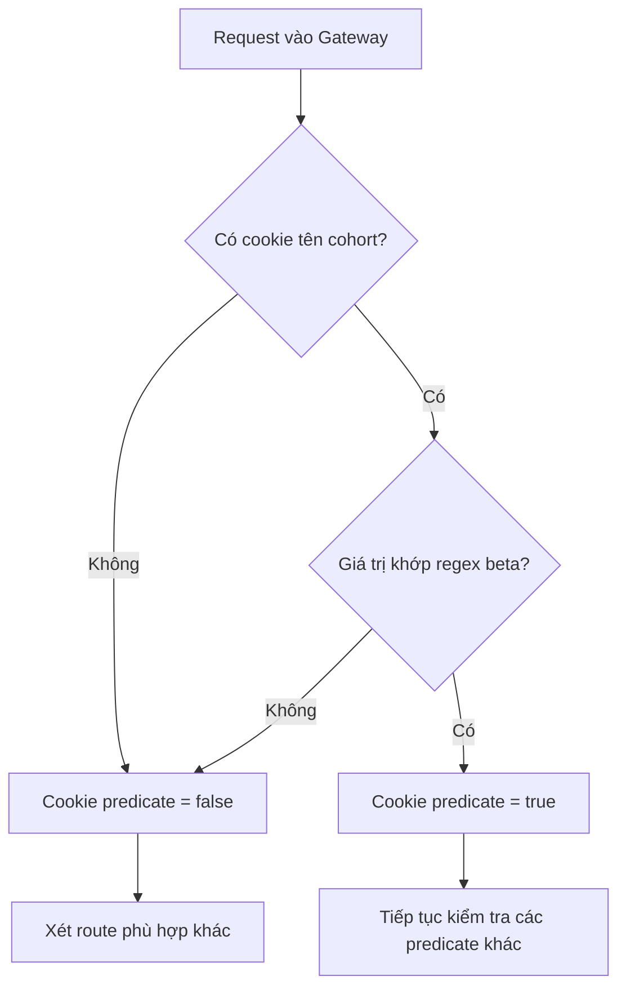
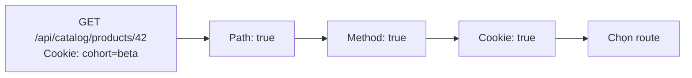
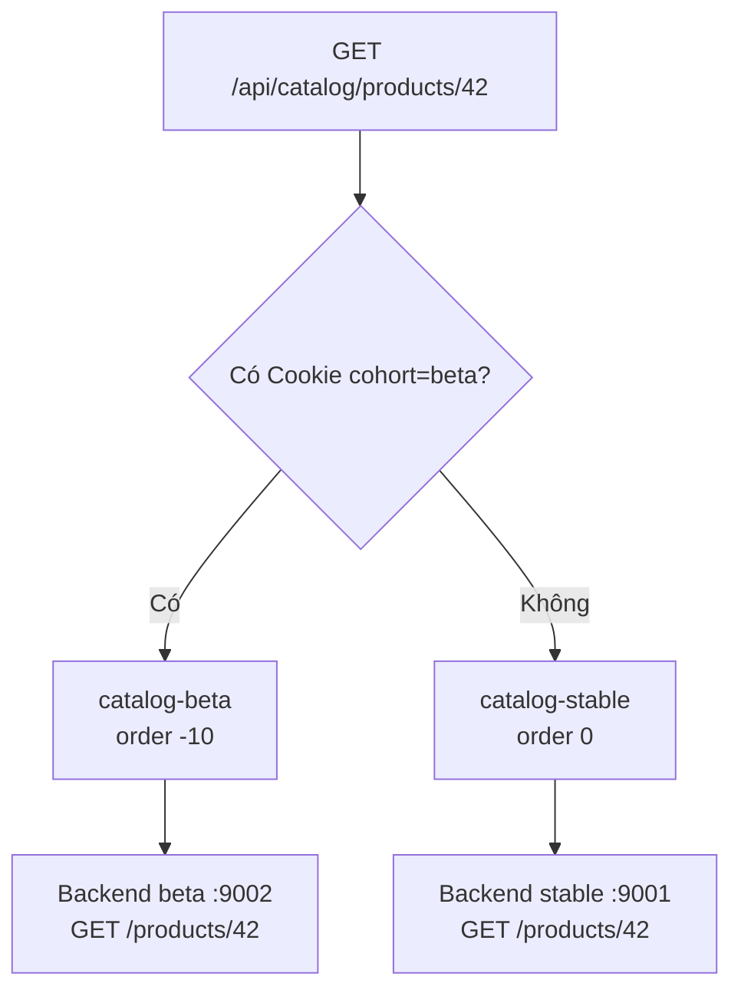

# Cookie Route Predicate: Điều kiện định tuyến theo tên và giá trị cookie

Trong **Spring Cloud Gateway**, một **route predicate** là điều kiện để quyết định request nào được phép đi vào một route. Bên cạnh `Path`, `Method` hoặc `Host`, **Cookie Route Predicate Factory** cho phép chọn route dựa trên **tên cookie** và **giá trị cookie** mà client gửi trong HTTP request. Cách này phù hợp để thử nghiệm giao diện mới (canary), phân nhóm trải nghiệm hoặc giữ một nhóm request đi đến backend riêng.

Đây là một phần của chương **Điều kiện định tuyến**. Bài tập trung vào Spring Cloud Gateway **Server WebFlux** trên dòng Gateway **5.0.x**, với đường dẫn cấu hình `spring.cloud.gateway.server.webflux.routes`. Các phiên bản cũ có thể sử dụng tiền tố khác, ví dụ `spring.cloud.gateway.routes`; biến thể Server Web MVC cũng có API và chi tiết cấu hình riêng. Hãy đối chiếu tài liệu đúng phiên bản trước khi sao chép ví dụ.

> **Giới hạn quan trọng:** Cookie do client gửi có thể bị người dùng chỉnh sửa. Kết quả khớp Cookie predicate **không chứng minh** người gửi đã đăng nhập, thuộc nhóm khách hàng được trả phí hay có quyền vào API. Xác thực và phân quyền phải được triển khai riêng bằng Spring Security, token hoặc session đã được kiểm chứng.

## 1. Mục tiêu học tập

Sau bài này, bạn có thể:

1. Giải thích Gateway lấy tên và giá trị cookie từ đâu, và cách Cookie predicate trả về `true` hoặc `false`.
2. Khai báo `Cookie=<name>, <regexp>` trong `application.yml`, cả cú pháp rút gọn lẫn `name`/`args`.
3. Phân biệt các trường hợp **thiếu cookie**, **sai tên**, **sai giá trị**, **giá trị khớp regex**.
4. Kết hợp `Cookie` với `Path` và `Method`, thiết kế route beta có route stable dự phòng.
5. Kiểm thử bằng `curl` và xử lý trường hợp trình duyệt không gửi cookie vì `Path`, `Domain`, `Secure` hoặc `SameSite`.
6. Đặt Cookie predicate đúng vai trò trong API Gateway: định tuyến lưu lượng, không thay thế security, rate limiting hay resilience.

## 2. Cookie đi từ client đến Gateway thế nào?

HTTP request có thể mang header `Cookie`, chứa các cặp `tên=giá_trị`, thường ngăn nhau bằng dấu chấm phẩy:

```http
GET /api/catalog/products/42 HTTP/1.1
Host: localhost:8080
Cookie: cohort=beta; theme=dark; locale=vi
```

Ở đây:

- Tên cookie thứ nhất là `cohort`, giá trị là `beta`.
- Tên cookie thứ hai là `theme`, giá trị là `dark`.
- Tên cookie thứ ba là `locale`, giá trị là `vi`.

Cookie predicate của Spring Cloud Gateway đọc **cookies trong request đã được HTTP stack phân tích**, tìm cookie theo tên đã khai báo và kiểm tra **giá trị bằng biểu thức chính quy** (regex). Nó không dựa vào thứ tự các cặp cookie trong header.



**Điểm cần nhớ:** Cookie predicate chỉ kiểm tra **request** đang đi vào Gateway. Header `Set-Cookie` là header thường xuất hiện trong **response** để yêu cầu trình duyệt lưu hoặc cập nhật cookie; nó không phải thứ mà Cookie predicate sử dụng để chọn route cho request hiện tại.

## 3. Cú pháp cấu hình Cookie Route Predicate Factory

### 3.1. Cú pháp rút gọn

Dưới `predicates` của một route:

```yaml
predicates:
  - Cookie=cohort, beta
```

Cookie Route Predicate Factory nhận **hai tham số**:

| Tham số | Vai trò | Ví dụ |
|---|---|---|
| `name` | Tên cookie cần tìm trong request | `cohort` |
| `regexp` | Biểu thức chính quy áp dụng lên **giá trị** cookie | `beta` |

Đoạn cấu hình trên có ý nghĩa: *request có cookie mang tên `cohort`, đồng thời giá trị của cookie đó khớp regex `beta`*. Nếu thiếu cookie hoặc giá trị không khớp, predicate trả về `false`.

Ví dụ theo tài liệu Gateway thường dùng dạng `Cookie=chocolate, ch.p`: cookie `chocolate=chip` khớp vì dấu `.` trong regex tương ứng một ký tự; `chocolate=chop` cũng khớp. Khi cần so sánh giá trị chính xác, dùng chuỗi cố định như `beta` hoặc biểu thức được giới hạn rõ ràng.

### 3.2. Cú pháp đầy đủ với `name` và `args`

Cùng điều kiện có thể viết:

```yaml
predicates:
  - name: Cookie
    args:
      name: cohort
      regexp: 'beta'
```

Dạng này giúp phân biệt rõ **tên predicate factory** (`Cookie`) với **tên cookie** (`cohort`). Cũng dễ đọc hơn khi regex chứa ký tự đặc biệt:

```yaml
predicates:
  - name: Cookie
    args:
      name: cohort
      regexp: 'beta|preview'
```

Ở đây cookie `cohort` có giá trị `beta` **hoặc** `preview` đều khớp. Dùng dấu nháy đơn YAML cho regex phức tạp thường an toàn vì dấu gạch chéo ngược được giữ nguyên, tránh phải thoát ký tự hai lần như trong chuỗi nháy kép.

**Không cần khai báo cả hai kiểu** cho cùng một điều kiện trong một route. Shortcut và fully expanded là hai cách viết thay thế.

## 4. Regex kiểm tra giá trị cookie như thế nào?

Tham số thứ hai là **Java regular expression**, không phải danh sách chuỗi đơn thuần. Mục tiêu là so khớp **giá trị của cookie cụ thể**, không phải toàn bộ header `Cookie`.

| Cấu hình | Giá trị khớp | Giá trị không khớp | Ghi chú |
|---|---|---|---|
| `Cookie=cohort, beta` | `beta` | `stable`, `Beta`, `beta123` | Giá trị chính xác, phân biệt chữ hoa/thường |
| `Cookie=cohort, beta|preview` | `beta`, `preview` | `stable` | Phép OR trong regex |
| `Cookie=locale, (vi|en)` | `vi`, `en` | `fr` | Nhóm các lựa chọn |
| `Cookie=variant, [AB]` | `A`, `B` | `a`, `AB` | Lớp ký tự |
| `Cookie=release, v[0-9]+` | `v1`, `v2026` | `v`, `vA` | Số lượng chữ số từ một trở lên |
| `Cookie=flag, .+` | Chuỗi không rỗng | Chuỗi rỗng | Kiểm tra giá trị có ít nhất một ký tự |

Trong triển khai WebFlux, kiểm tra giá trị tuân theo **regex match** trên giá trị cookie; đừng dựa vào substring match mặc định. Chẳng hạn `beta` không khớp với `my-beta-test`. Muốn cho phép nhiều giá trị, hãy khai báo nhóm cụ thể (`beta|preview`) thay vì dùng `.*beta.*` quá rộng.

Nếu muốn nhấn mạnh ranh giới toàn chuỗi, có thể viết:

```yaml
predicates:
  - name: Cookie
    args:
      name: cohort
      regexp: '^(beta|preview)$'
```

Các dấu `^` và `$` làm rõ ý định so khớp cả giá trị; với nhiều phiên bản Gateway, bản thân `matches` đã đòi hỏi khớp toàn bộ. Khi dùng regex cho giá trị do client kiểm soát, **tránh biểu thức quá phức tạp** có khả năng gây chi phí đánh giá lớn trên input dài.

### 4.1. Cookie có tên nào thì kiểm tra tên đó

Với:

```yaml
predicates:
  - Cookie=cohort, beta
```

các request sau cho kết quả khác nhau:

| Request header | Predicate có khớp? | Vì sao |
|---|---|---|
| `Cookie: cohort=beta` | Có | Đúng tên `cohort` và giá trị `beta` |
| `Cookie: cohort=stable` | Không | Sai giá trị |
| `Cookie: theme=beta` | Không | Không có cookie tên `cohort` |
| `Cookie: Cohort=beta` | Không nên coi là khớp | Tên cookie phân biệt chữ hoa/thường; dùng đúng `cohort` |
| `Cookie: cohort=Beta` | Không | Regex `beta` phân biệt hoa/thường |
| Không có header `Cookie` | Không | Không tìm thấy cookie cần thiết |
| `Cookie: cohort=beta; theme=dark` | Có | Có đúng cặp `cohort=beta`, cookie khác không cản trở |

Không nên cố khai thác hành vi khi một request gửi **nhiều cookie trùng tên** (đôi khi phát sinh khi trình duyệt có các cookie cùng tên nhưng khác `Path`). Cách chọn giá trị có thể phụ thuộc lớp phân tích cookie và cách backend xử lý. Thiết kế tên/path cookie rõ ràng để tránh trường hợp mơ hồ, sau đó kiểm tra bằng request thực tế.

### 4.2. Mã hóa giá trị và ký tự đặc biệt

Cookie gửi trên mạng có thể chứa giá trị đã được ứng dụng mã hóa hoặc ký. Ví dụ, giá trị logic `beta user` có thể được ứng dụng biểu diễn thành một chuỗi khác để phù hợp cú pháp cookie. Predicate không tự hiểu định dạng nghiệp vụ: regex phải được thiết kế cho **giá trị mà Gateway thực sự nhìn thấy**. Đối với session ID, JWT hoặc cookie đã ký, không thử diễn giải nội dung bằng regex để quyết định quyền truy cập.

## 5. Cookie kết hợp với các predicate khác

Trong một route, các predicate thông thường được kết hợp theo phép **AND**: tất cả cùng phải trả về `true`.

```yaml
predicates:
  - Path=/api/catalog/**
  - Method=GET
  - Cookie=cohort, beta
```

Route này khớp khi:

1. Path nằm dưới `/api/catalog/**`.
2. HTTP method là `GET`.
3. Request có cookie `cohort=beta`.



Nếu client gửi `POST /api/catalog/products/42` có `cohort=beta`, route vẫn **không** khớp vì `Method=GET`. Nếu client gửi `GET /api/orders/42` có `cohort=beta`, route cũng không khớp vì sai `Path`.

### 5.1. Hai cookie bắt buộc đồng thời tồn tại

Nếu muốn nhận request có **cả** hai cặp cookie, có thể viết:

```yaml
predicates:
  - Path=/api/catalog/**
  - Cookie=cohort, beta
  - Cookie=locale, (vi|en)
```

Request phải có `cohort=beta` **và** `locale=vi` hoặc `locale=en`. Không viết hai predicate `Cookie=cohort, beta` và `Cookie=cohort, preview` để tạo phép OR: hai điều kiện cùng tên đó có thể loại bỏ phần lớn request; muốn beta **hoặc** preview, dùng **một** regex `beta|preview`.

### 5.2. So sánh Cookie với Header predicate

| Tình huống | Cookie predicate | Header predicate |
|---|---|---|
| Điều kiện dựa trên giá trị của cookie `cohort` | `Cookie=cohort, beta` | Có thể kiểm tra raw header `Cookie` bằng regex, nhưng dễ nhầm với cookie khác |
| Điều kiện dựa trên HTTP header `X-Client-Version` | Không phù hợp | `Header=X-Client-Version, v2` |
| Cookie gồm nhiều cặp `name=value` | Tìm theo tên cookie | Kiểm tra biểu diễn chuỗi header, phụ thuộc định dạng/regex |
| Bảo vệ API nhạy cảm | Không phải cơ chế xác thực | Cũng không phải cơ chế xác thực |

Khi yêu cầu thực sự là **tên và giá trị cookie**, Cookie predicate thể hiện ý định rõ nhất.

## 6. Tình huống thực tế: chia lưu lượng stable và beta

Một nhóm phát triển muốn thử **catalog-service phiên bản beta** với người dùng đã nhận cookie `cohort=beta`, trong khi người dùng khác vẫn đến backend ổn định. API công khai không đổi: `GET /api/catalog/products/42`.

Giả sử:

- Gateway lắng nghe ở `http://localhost:8080`.
- Backend **stable** lắng nghe ở `http://localhost:9001`.
- Backend **beta** lắng nghe ở `http://localhost:9002`.
- Hai backend cùng phục vụ đường dẫn `/products/**`.

Cấu hình `application.yml` hoàn chỉnh cho **Server WebFlux 5.0.x**:

```yaml
server:
  port: 8080

spring:
  application:
    name: catalog-gateway
  cloud:
    gateway:
      server:
        webflux:
          routes:
            - id: catalog-beta
              uri: http://localhost:9002
              order: -10
              predicates:
                - Path=/api/catalog/**
                - Method=GET
                - Cookie=cohort, beta
              filters:
                - StripPrefix=2
                - AddRequestHeader=X-Selected-Variant, beta
                - AddResponseHeader=X-Gateway-Route, catalog-beta

            - id: catalog-stable
              uri: http://localhost:9001
              order: 0
              predicates:
                - Path=/api/catalog/**
                - Method=GET
              filters:
                - StripPrefix=2
                - AddRequestHeader=X-Selected-Variant, stable
                - AddResponseHeader=X-Gateway-Route, catalog-stable
```

**Vì sao cần hai route?**

- `catalog-beta` chỉ khớp khi `Path`, `Method` và `Cookie` cùng đúng.
- `catalog-stable` không cần Cookie predicate; nó nhận mọi `GET /api/catalog/**` còn phù hợp.
- `order: -10` khiến route beta được xét trước route stable có `order: 0`. **Số nhỏ hơn có độ ưu tiên cao hơn.**
- Nếu không có `cohort=beta`, route beta không khớp; gateway có thể chọn route stable.
- `StripPrefix=2` xóa **hai segment đầu** là `api` và `catalog`. Vì vậy `/api/catalog/products/42` trở thành `/products/42`.
- Hai header `X-Selected-Variant` và `X-Gateway-Route` hỗ trợ kiểm thử, không bắt buộc cho Cookie predicate.



**Cẩn thận với giới hạn của route dự phòng:** Route stable ở đây chỉ được chọn **khi điều kiện của route beta không khớp**. Nếu request đã khớp route beta mà backend `9002` bị lỗi, Gateway **không mặc nhiên thử lại route stable**. Để xử lý lỗi backend, cần cấu hình timeout, circuit breaker, fallback hoặc cơ chế chuyển đổi dịch vụ phù hợp; đó là các chức năng khác với Cookie predicate.

### 6.1. Bảng quyết định định tuyến

| Request | Cookie | Route | URI đích |
|---|---|---|---|
| `GET /api/catalog/products/42` | Không có | `catalog-stable` | `http://localhost:9001/products/42` |
| `GET /api/catalog/products/42` | `cohort=beta` | `catalog-beta` | `http://localhost:9002/products/42` |
| `GET /api/catalog/products/42` | `cohort=stable` | `catalog-stable` | `http://localhost:9001/products/42` |
| `GET /api/catalog/products/42` | `cohort=Beta` | `catalog-stable` | `http://localhost:9001/products/42` |
| `GET /api/orders/42` | `cohort=beta` | Không route nào ở trên | Thường `404` nếu không có handler khác |
| `POST /api/catalog/products` | `cohort=beta` | Không route nào ở trên | Thường `404` nếu không có handler khác |

Nếu bỏ `order` và để cả hai route cùng ưu tiên, không nên dựa vào thứ tự xuất hiện trong YAML để đảm bảo beta được chọn. Hãy đặt ưu tiên rõ ràng, đồng thời thiết kế predicate để giảm sự chồng lấn.

## 7. Thực hành đầy đủ với backend echo

Để kiểm chứng route thật sự được chọn, ta tạo **hai HTTP backend** tối giản bằng module `jdk.httpserver` có sẵn trong JDK 17+.

### 7.1. Tạo ứng dụng Gateway

Dùng Spring Initializr tạo ứng dụng Spring Boot phù hợp với Spring Cloud release train tương ứng, thêm **Spring Cloud Gateway Server WebFlux**. Nếu chỉnh `pom.xml` thủ công, dependency chính là:

```xml
<dependency>
    <groupId>org.springframework.cloud</groupId>
    <artifactId>spring-cloud-starter-gateway-server-webflux</artifactId>
</dependency>
```

Dự án Maven vẫn cần **Spring Cloud BOM tương thích với Spring Boot** để quản lý phiên bản; dependency snippet này không phải một `pom.xml` hoàn chỉnh. Với WebFlux, tránh thêm Servlet MVC starter một cách vô ý.

Một class khởi động tối thiểu:

```java
import org.springframework.boot.SpringApplication;
import org.springframework.boot.autoconfigure.SpringBootApplication;

@SpringBootApplication
public class CatalogGatewayApplication {
    public static void main(String[] args) {
        SpringApplication.run(CatalogGatewayApplication.class, args);
    }
}
```

Đặt cấu hình YAML ở mục 6 trong `src/main/resources/application.yml`.

### 7.2. Tạo hai backend kiểm thử

Trong một thư mục thực hành, tạo file `CatalogBackend.java`:

```java
import com.sun.net.httpserver.HttpServer;
import java.net.InetSocketAddress;
import java.nio.charset.StandardCharsets;

public class CatalogBackend {
    public static void main(String[] args) throws Exception {
        if (args.length != 2) {
            System.err.println("Usage: java CatalogBackend.java <port> <variant>");
            return;
        }

        int port = Integer.parseInt(args[0]);
        String variant = args[1];
        HttpServer server = HttpServer.create(
                new InetSocketAddress("127.0.0.1", port), 0);

        server.createContext("/", exchange -> {
            String response =
                    "backend=" + variant + "\n" +
                    "method=" + exchange.getRequestMethod() + "\n" +
                    "path=" + exchange.getRequestURI().getRawPath() + "\n" +
                    "query=" + exchange.getRequestURI().getRawQuery() + "\n" +
                    "X-Selected-Variant=" +
                    exchange.getRequestHeaders()
                            .getFirst("X-Selected-Variant") + "\n";

            byte[] body = response.getBytes(StandardCharsets.UTF_8);
            exchange.getResponseHeaders().set(
                    "Content-Type", "text/plain; charset=utf-8");
            exchange.sendResponseHeaders(200, body.length);
            try (var out = exchange.getResponseBody()) {
                out.write(body);
            }
        });

        server.start();
        System.out.println("Listening on " + port + " (" + variant + ")");
    }
}
```

Mở **hai terminal** để chạy độc lập:

```bash
# Terminal 1: backend stable
java --add-modules jdk.httpserver CatalogBackend.java 9001 stable

# Terminal 2: backend beta
java --add-modules jdk.httpserver CatalogBackend.java 9002 beta
```

Mở **terminal thứ ba** tại thư mục dự án Gateway, chạy ứng dụng:

```bash
# Linux/macOS
./mvnw spring-boot:run

# Windows PowerShell
.\mvnw.cmd spring-boot:run
```

Ví dụ backend ở đây chỉ trả `200` kèm thông tin về đường dẫn và biến thể; nó không đại diện cho API thực tế hoặc cơ chế bảo mật. Mỗi terminal backend sẽ giữ tiến trình chạy cho tới khi dừng thủ công.

### 7.3. Kiểm thử từng nhánh bằng `curl`

**Không có cookie:**

```bash
curl -i "http://localhost:8080/api/catalog/products/42"
```

Phản hồi mẫu:

```http
HTTP/1.1 200 OK
X-Gateway-Route: catalog-stable
Content-Type: text/plain; charset=utf-8

backend=stable
method=GET
path=/products/42
query=null
X-Selected-Variant=stable
```

**Có cookie beta:**

```bash
curl -i --cookie "cohort=beta" \
  "http://localhost:8080/api/catalog/products/42?lang=vi"
```

Phản hồi mẫu:

```http
HTTP/1.1 200 OK
X-Gateway-Route: catalog-beta
Content-Type: text/plain; charset=utf-8

backend=beta
method=GET
path=/products/42
query=lang=vi
X-Selected-Variant=beta
```

**Có nhiều cookie, trong đó cookie cần tìm vẫn khớp:**

```bash
curl -i -H "Cookie: theme=dark; cohort=beta; locale=vi" \
  "http://localhost:8080/api/catalog/products/42"
```

Kết quả vẫn đi đến backend beta. Cookie predicate chỉ quan tâm cookie `cohort` và giá trị của nó; các cookie khác không khiến điều kiện trở thành `false`.

**Có cookie nhưng sai giá trị:**

```bash
curl -i -H "Cookie: cohort=stable" \
  "http://localhost:8080/api/catalog/products/42"
```

Kết quả đi đến backend stable. Hãy thử tiếp với `cohort=Beta`, `cohort=preview` và `theme=beta` để thấy sự khác biệt giữa tên và giá trị cookie.

> Trên PowerShell 5.1, `curl` có thể là alias cho một lệnh PowerShell; hãy gọi `curl.exe` nếu muốn dùng nguyên cú pháp trên. Các lệnh có dấu `\` nối dòng dành cho shell Unix; trên Windows có thể viết trên **một dòng**, ví dụ `curl.exe -i --cookie "cohort=beta" "http://localhost:8080/api/catalog/products/42"`.

### 7.4. Quan sát route được nạp bằng Actuator

Nếu dự án có `spring-boot-starter-actuator`, cấu hình mở endpoint Gateway ở chế độ chỉ đọc trong cùng `application.yml`:

```yaml
management:
  endpoint:
    gateway:
      access: read-only
  endpoints:
    web:
      exposure:
        include: health,info,gateway
```

Khởi động lại ứng dụng rồi gọi:

```bash
curl -i http://localhost:8080/actuator/gateway/routes
```

Bạn cần tìm các route ID `catalog-beta` và `catalog-stable`, cùng `predicates` và `order` trong dữ liệu trả về (cấu trúc JSON có thể khác theo release). Kiểm tra này xác nhận **route đã được nạp**; nó không tự chứng minh Cookie predicate đã khớp request. Để kiểm chứng lựa chọn thực tế, kết hợp request `curl`, response header debug `X-Gateway-Route` và log/tracing. Khi triển khai thật, cần kiểm soát truy cập endpoint quản trị; tránh để lộ thông tin định tuyến nội bộ cho mọi client.

## 8. Vì sao cookie có trên trình duyệt nhưng Gateway không nhận được?

Khi `curl --cookie` gửi cookie thủ công, lệnh kiểm thử thường bỏ qua những quy tắc lựa chọn cookie mà **trình duyệt** áp dụng. Browser chỉ gửi cookie khi domain/path, giao thức và chính sách cookie phù hợp. Các thuộc tính của cookie thường được server thiết lập bằng header `Set-Cookie`.

Ví dụ response của một backend có thể chứa:

```http
Set-Cookie: cohort=beta; Path=/api; Max-Age=86400; SameSite=Lax; Secure; HttpOnly
```

Điều đó có nghĩa trình duyệt được yêu cầu lưu cookie với những ràng buộc nhất định; request tiếp theo chỉ mang `Cookie: cohort=beta` khi trình duyệt quyết định có thể gửi.

| Thuộc tính | Ý nghĩa khi kiểm thử định tuyến |
|---|---|
| `Domain` | Giới hạn host/domain nhận cookie; cookie từ miền khác thường không gửi tới Gateway |
| `Path` | Giới hạn path của request; `Path=/account` không được gửi tới `/api/catalog/**` |
| `Secure` | Trình duyệt chỉ gửi cookie trên kết nối an toàn theo quy tắc của trình duyệt; khi local HTTP, cần chú ý hành vi với `localhost` |
| `HttpOnly` | JavaScript trong trang không đọc được cookie, nhưng trình duyệt **vẫn có thể gửi** trong HTTP request |
| `SameSite` | Ảnh hưởng việc gửi cookie trong yêu cầu cross-site |
| `Expires` / `Max-Age` | Cookie hết hạn sẽ không còn được gửi |

**Đừng nhầm:** Các thuộc tính như `Path`, `SameSite`, `HttpOnly` là metadata khi thiết lập cookie bằng `Set-Cookie`; chúng **không** được lặp lại như tham số trong header `Cookie` của mỗi request. Gateway Cookie predicate kiểm tra cặp `tên=giá_trị` thực sự được chuyển tới.

Một quy trình debug hiệu quả:

1. Mở **DevTools → Network** ở trình duyệt, chọn request gửi tới gateway; xem request headers có `Cookie` phù hợp không.
2. Nếu cookie không có, kiểm tra `Domain`, `Path`, `Secure`, `SameSite`, hạn sử dụng, chế độ riêng tư và chính sách browser.
3. Nếu đang dùng `fetch` qua nguồn khác, kiểm tra cấu hình gửi credentials (`credentials`), CORS và điều kiện cookie cross-site.
4. Nếu cookie có nhưng route không khớp, kiểm tra **đúng tên (phân biệt hoa/thường)**, giá trị và regex, sau đó thử lại với `curl`.
5. Nếu cookie khớp mà backend vẫn không đúng, kiểm tra `order`, route chồng lấn và đường dẫn sau `StripPrefix`.

Khi truy cập Gateway qua reverse proxy, cần bảo đảm không có thành phần trung gian vô ý loại bỏ header `Cookie`. Không bật log in nguyên header `Cookie` trong production vì có thể chứa session ID hoặc thông tin nhạy cảm.

## 9. Cookie predicate không phải hệ thống phân quyền

Giả sử bạn viết:

```yaml
predicates:
  - Path=/api/admin/**
  - Cookie=role, admin
```

Đây **không phải** bảo vệ quyền admin. Người dùng có thể gửi `Cookie: role=admin` bằng `curl`. Nếu route dẫn đến API admin và hệ thống không có xác thực/phân quyền thực, bạn đã tạo một lỗ hổng.

Thiết kế đúng cần tách vai trò:

| Nhu cầu | Thành phần chịu trách nhiệm |
|---|---|
| Chọn backend beta hay stable bằng nhãn client không nhạy cảm | `Cookie` route predicate |
| Xác định người dùng là ai | Xác thực session/JWT qua Spring Security phù hợp WebFlux |
| Kiểm tra quyền đọc đơn hàng hoặc gọi admin | Authorization tại Gateway và/hoặc backend; backend vẫn kiểm tra quyền tài nguyên |
| Giới hạn số request trên mỗi người dùng/tenant | Rate limiter và khóa định danh đã xác thực |
| Xử lý backend chậm, lỗi hoặc ngắt kết nối | Timeout, retry có giới hạn, circuit breaker/fallback |
| Bảo mật kênh truyền | TLS và xác thực certificate thích hợp |
| Phân tích request theo route | Actuator, Micrometer, tracing và log an toàn |

Một cookie có chữ ký/mã hóa có thể mang thông tin đáng tin **sau khi server xác minh chữ ký, hạn dùng và ngữ cảnh**. Cookie predicate **không thực hiện bước xác minh đó**: nó chỉ so regex trên chuỗi giá trị đã nhận.

Đối với ví dụ phân nhóm canary, nếu cần gắn cohort do máy chủ quyết định và chống giả mạo, hãy xác thực session hoặc cookie đã ký trước khi sử dụng danh tính/cohort tin cậy trong chính sách định tuyến. Không dùng một cookie do client tùy ý sửa để phân chia quyền lợi nhạy cảm.

## 10. Lỗi phổ biến khi sử dụng Cookie predicate

| Triệu chứng | Nguyên nhân thường gặp | Hướng xử lý |
|---|---|---|
| Gọi `curl --cookie "cohort=beta"` vẫn đi stable | Route beta chưa nạp, sai prefix, `order` hoặc predicate khác không khớp | Xem Actuator, kiểm tra `Path`/`Method` và ưu tiên route |
| Browser đi stable nhưng curl đi beta | Browser không gửi cookie do Domain/Path/Secure/SameSite/credentials | Xem DevTools Network request thực tế |
| `cohort=Beta` không vào beta | Regex mặc định phân biệt chữ hoa/thường | Thống nhất giá trị hoặc viết regex hợp lệ nếu cần hỗ trợ cả hai |
| Đặt `Cookie=cohort, beta|preview` nhưng không hiểu kết quả | `regexp` là regex, `|` nghĩa là OR | Kiểm thử các giá trị khác nhau, ưu tiên biểu thức rõ ràng |
| Thiếu cookie và nhận `404` | Chỉ khai báo route có Cookie, không có route chung khớp | Thêm route stable không phụ thuộc cookie nếu phù hợp |
| Beta backend tắt, request beta trả lỗi dù có stable | Cookie routing không tự failover khi upstream đã chọn bị hỏng | Thiết kế circuit breaker/fallback hoặc deployment rollback |
| Dùng `Cookie=role, admin` để bảo vệ API | Cookie do client tự khai báo, chưa xác thực | Dùng Spring Security và kiểm tra quyền thực sự |
| Backend nhận đường dẫn `/api/catalog/products/42` | Chưa dùng `StripPrefix` hoặc dùng số segment sai | Với path ví dụ này, `StripPrefix=2` để backend nhận `/products/42` |
| Regex chứa dấu phẩy bị phân tích sai | Shortcut dựa trên danh sách tham số | Dùng dạng `name`/`args` và quote chuỗi YAML |
| Route test khớp nhưng production khác | Phiên bản Gateway khác, thêm GlobalFilter, proxy thay đổi header hoặc DNS/container khác | Đối chiếu version, inspect route, trace và test end-to-end |

Đừng dùng status code đơn lẻ để khẳng định Cookie predicate có khớp: `404` có thể do không route nào khớp **hoặc** do backend được chọn trả `404`. Trong môi trường học tập, response header đánh dấu route giúp phân biệt hai tình huống; production nên dựa vào metrics/tracing thay vì công khai thông tin nội bộ.

## 11. Mở rộng: khi route và cookie thay đổi theo hệ thống

Cookie predicate đặc biệt tiện trong mô hình **canary release** hoặc **A/B testing**, khi cần giữ client trong một nhóm qua nhiều request. Tuy nhiên, để thực thi ổn định trong microservices:

- Hãy thống nhất ai đặt cookie `cohort`, khi nào cookie hết hạn và môi trường nào có quyền sử dụng nó. Đừng để mỗi backend tự diễn giải một giá trị khác nhau.
- Đặt các route chồng lấn có `order` tường minh, đồng thời kiểm thử khi cookie thiếu hoặc không hợp lệ.
- Khi backend được triển khai nhiều instance, có thể thay `uri: http://localhost:9002` bằng `uri: lb://catalog-beta` nếu đã có **Spring Cloud LoadBalancer** và nguồn service discovery phù hợp. `lb://` không tự tạo registry.
- Đừng đặt rate limiting dựa duy nhất vào giá trị cookie mà client tùy ý đổi. Với quota thật, dùng user ID/tenant ID đã xác thực hoặc khóa đáng tin.
- Giám sát tỷ lệ traffic stable/beta, độ trễ p95/p99, lỗi 4xx/5xx, timeout, retry và trạng thái circuit breaker để phát hiện canary gây lỗi.
- Khi cần thu hồi beta khẩn cấp, xác định cơ chế rollout/rollback; route predicate chỉ quyết định **request phù hợp** chứ không điều khiển vòng đời release.

Với API Gateway an toàn, các route predicate (Path, Method, Cookie…) chỉ là một tầng chọn tuyến. Chuỗi filter và Spring Security phải đảm nhận các chính sách kiểm soát truy cập, biến đổi đường dẫn/header, giới hạn lưu lượng và độ tin cậy theo từng route.

## 12. Câu hỏi tự kiểm tra

**Câu 1.** `Cookie=cohort, beta` kiểm tra tên cookie hay toàn bộ chuỗi `Cookie`?

**Trả lời:** Tìm cookie tên `cohort` trong request, sau đó kiểm tra **giá trị** cookie với regex `beta`. Không dùng regex trên toàn bộ header Cookie.

**Câu 2.** Khi request có `Cookie: theme=dark; cohort=beta`, predicate `Cookie=cohort, beta` có khớp không?

**Trả lời:** Có. Cookie `cohort` tồn tại và giá trị phù hợp; cookie `theme` không ảnh hưởng.

**Câu 3.** Viết route chỉ nhận `GET /api/catalog/**` cho người dùng có `cohort=beta`.

**Đáp án mẫu:**

```yaml
predicates:
  - Path=/api/catalog/**
  - Method=GET
  - Cookie=cohort, beta
```

**Câu 4.** Trong một route, viết hai dòng `Cookie=cohort, beta` và `Cookie=cohort, preview` có tạo phép OR không?

**Trả lời:** Không. Các predicate cùng route được kết hợp theo AND. Dùng một dòng `Cookie=cohort, beta|preview` để chấp nhận một trong hai giá trị.

**Câu 5.** Vì sao route stable có thể được chọn khi không có cookie `cohort`?

**Trả lời:** Route beta không khớp Cookie predicate, còn route stable trong ví dụ chỉ yêu cầu Path và Method. Với `order` đã cấu hình, route beta được xét trước khi đủ điều kiện; nếu không, stable vẫn có thể khớp.

**Câu 6.** Gateway có tự gửi request beta sang stable nếu beta backend trả `503` không?

**Trả lời:** Không. Route stable dùng để khớp các request không thuộc beta; chuyển đổi khi backend lỗi cần cơ chế resilience/fallback riêng.

**Câu 7.** `HttpOnly` có khiến Cookie predicate không nhìn thấy cookie không?

**Trả lời:** Không. `HttpOnly` ngăn JavaScript đọc cookie, nhưng trình duyệt vẫn có thể gửi nó trong HTTP request khi các điều kiện khác phù hợp.

**Câu 8.** `Cookie=role, admin` có đủ an toàn để cho phép truy cập endpoint quản trị không?

**Trả lời:** Không. Người dùng có thể tự gửi cookie đó; cần xác thực và phân quyền trên thông tin đã được xác minh.

## 13. Tài liệu chính thức để đối chiếu

- [Spring Cloud Gateway Server WebFlux — Route Predicate Factories (Cookie)](https://docs.spring.io/spring-cloud-gateway/reference/5.0/spring-cloud-gateway-server-webflux/request-predicates-factories.html).
- [Spring Cloud Gateway Server WebFlux — Configuring Route Predicate Factories and Gateway Filter Factories](https://docs.spring.io/spring-cloud-gateway/reference/5.0/spring-cloud-gateway-server-webflux/configuring-route-predicate-factories-and-filter-factories.html).
- [Spring Cloud Gateway Server WebFlux — How It Works](https://docs.spring.io/spring-cloud-gateway/reference/5.0/spring-cloud-gateway-server-webflux/how-it-works.html).
- [Spring Cloud Gateway Server WebFlux — Actuator API](https://docs.spring.io/spring-cloud-gateway/reference/5.0/spring-cloud-gateway-server-webflux/actuator-api.html).
- [MDN — Cookie HTTP request header](https://developer.mozilla.org/en-US/docs/Web/HTTP/Reference/Headers/Cookie).
- [MDN — Set-Cookie HTTP response header và thuộc tính cookie](https://developer.mozilla.org/en-US/docs/Web/HTTP/Reference/Headers/Set-Cookie).

**Ghi nhớ:** `Cookie=<name>, <regexp>` là một điều kiện định tuyến dựa trên **tên và giá trị cookie trong request**. Hãy kết hợp với `Path`/`Method` và `order` để chọn đúng route, kiểm chứng bằng request HTTP thật, đồng thời luôn tách biệt định tuyến theo cookie khỏi xác thực, phân quyền và xử lý lỗi backend.
