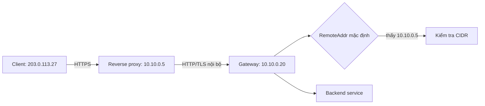
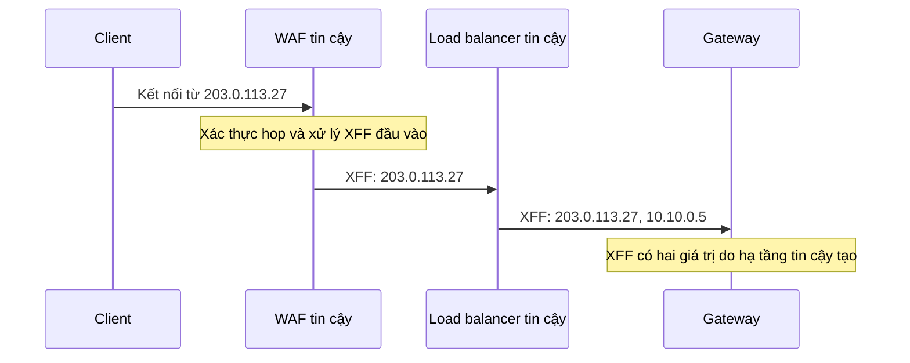

# RemoteAddr: địa chỉ IP, CIDR và bộ phân giải địa chỉ

## 1. Vai trò của RemoteAddr trong Spring Cloud Gateway

**Spring Cloud Gateway** là API Gateway cho microservices: chọn dịch vụ đích bằng **route predicate**, áp dụng **filter chain** để chuyển đổi path/header và có thể tích hợp service discovery, xác thực, rate limiting, retry, circuit breaker, TLS, metrics và tracing. Khi muốn một route chỉ khớp với request đến từ mạng nội bộ hoặc một dải địa chỉ cho phép, ta có thể dùng **`RemoteAddr` Route Predicate Factory**.

Ví dụ: hệ thống có endpoint `/internal/reports/**` để nhân viên truy cập từ VPN, còn API công khai `/public/**` phục vụ mọi client. `RemoteAddr` giúp **quyết định route nào được chọn** dựa trên địa chỉ mạng; tuy nhiên, nó **không thay thế cơ chế bảo mật chặn truy cập** của Spring Security, firewall hoặc API management policy.

Sau bài này, bạn sẽ biết:

- Đọc địa chỉ IP của kết nối TCP tới Gateway và phân biệt nó với IP gốc của người dùng.
- Viết dải địa chỉ **CIDR** cho IPv4 và IPv6; dự đoán một IP có khớp mạng hay không.
- Khai báo `RemoteAddr` bằng YAML và Java `RouteLocatorBuilder` trên **Gateway Server WebFlux**.
- Sử dụng `RemoteAddressResolver` và `XForwardedRemoteAddressResolver.maxTrustedIndex(n)` khi có reverse proxy đáng tin cậy.
- Nhận diện nguy cơ giả mạo `X-Forwarded-For`, khác biệt với `XForwardedRemoteAddr`, và xây dựng bộ kiểm thử vận hành.

> **Phạm vi phiên bản:** Các ví dụ dựa trên **Spring Cloud Gateway Server WebFlux 5.0.x** với namespace `spring.cloud.gateway.server.webflux.routes` (dòng 4.x thường dùng `spring.cloud.gateway.routes`). Trong tài liệu predicate của **Gateway Server Web MVC 5.0.x**, `RemoteAddr` không được liệt kê như một predicate dựng sẵn tương đương. Không sao chép Java API WebFlux sang MVC; nếu dùng MVC, kiểm tra chức năng của bản đang chạy và áp dụng `RequestPredicate`, Servlet filter hoặc cơ chế bảo mật phù hợp.

## 2. RemoteAddr thực sự kiểm tra địa chỉ nào?

Giả sử client gọi:

```http
GET /internal/reports/monthly HTTP/1.1
Host: gateway.example.test
```

Gateway Server WebFlux nhận một kết nối có **remote socket address** (thường lấy qua `ServerHttpRequest.getRemoteAddress()`). Mặc định, predicate `RemoteAddr` dùng địa chỉ đó để so khớp với các dải IP được cấu hình. Đây là địa chỉ **đối tác kết nối trực tiếp với Gateway**.



Nếu Gateway đứng **sau reverse proxy**, một request của client `203.0.113.27` có thể đi vào từ peer `10.10.0.5`. Lúc này `RemoteAddr=10.10.0.0/16` khớp **IP proxy**, không chứng minh người dùng nằm trong mạng nội bộ. Đây là nguồn gây lỗi phân quyền phổ biến.

| Địa chỉ / dữ liệu | Ví dụ | Do đâu cung cấp? | Có thể dùng trực tiếp làm IP gốc đáng tin? |
|---|---|---|---|
| Remote socket IP ở Gateway | `10.10.0.5` | Kết nối mạng từ hop ngay trước Gateway | Chỉ đại diện cho hop trực tiếp; cần biết topology |
| `X-Forwarded-For` | `203.0.113.27, 10.10.0.5` | Header HTTP do proxy gửi tiếp hoặc client tự đưa vào | **Không** nếu chưa có ranh giới proxy tin cậy |
| `Forwarded: for=...` | `for=203.0.113.27` | Header theo RFC 7239 | Cũng là dữ liệu header, phải xác minh nguồn |
| IP backend thấy | `10.10.0.20` | Kết nối từ Gateway đến backend | Thường là IP Gateway, không phải IP client |

**Phân biệt ba chức năng:** `RemoteAddr` là **predicate chọn route**; `XForwardedRemoteAddressResolver` quyết định **cách tính địa chỉ cho predicate** trong Java DSL; còn các filter tạo/chuyển tiếp `X-Forwarded-*` là chức năng **header giữa Gateway và downstream**. Bật một filter ghi header không mặc nhiên thay cách `RemoteAddr` quyết định route.

## 3. CIDR: biểu diễn một mạng gồm nhiều IP

`RemoteAddr` nhận **ít nhất một** chuỗi `sources` theo ký pháp **CIDR** (Classless Inter-Domain Routing), hỗ trợ **IPv4 lẫn IPv6**. Cú pháp thường gặp:

```text
IPv4: 192.168.50.0/24
IPv6: 2001:db8:1234::/48
      └─ địa chỉ mạng ┘  └ số bit prefix
```

- **IPv4** dài 32 bit: `/24` nghĩa là giữ 24 bit đầu để xác định mạng; 8 bit còn lại là phần host. Mạng `192.168.50.0/24` trải từ `192.168.50.0` đến `192.168.50.255` khi xét phép so CIDR.
- **IPv6** dài 128 bit: `/48` giữ 48 bit đầu; ví dụ `2001:db8:1234::/48` chứa `2001:db8:1234:abcd::10`.
- **`/32` (IPv4)** hoặc **`/128` (IPv6)** chọn đúng một địa chỉ cụ thể. `/0` khớp toàn bộ không gian địa chỉ của họ IP tương ứng; rất rộng và không thích hợp để hạn chế truy cập.
- Có thể truyền nhiều CIDR vào **một** predicate; request khớp nếu địa chỉ nằm trong **ít nhất một** dải, tức phép **OR** giữa các source. Còn `Path` và `RemoteAddr` là các predicate khác nhau trong cùng route nên được kết hợp theo **AND**.

### 3.1. Ví dụ nhận diện mạng IPv4

| CIDR | IP đang kiểm tra | Khớp? | Lý do |
|---|---|---|---|
| `192.168.50.0/24` | `192.168.50.42` | Có | 24 bit đầu cùng mạng |
| `192.168.50.0/24` | `192.168.51.42` | Không | Sang mạng `192.168.51.0/24` |
| `10.20.0.0/16` | `10.20.200.9` | Có | Hai octet đầu là `10.20` |
| `10.20.0.0/16` | `10.21.0.9` | Không | Octet thứ hai khác |
| `198.51.100.17/32` | `198.51.100.17` | Có | Một host duy nhất |
| `127.0.0.1/32` | `127.0.0.2` | Không | Hai địa chỉ loopback khác nhau |

Các IP `192.0.2.0/24`, `198.51.100.0/24`, `203.0.113.0/24` và IPv6 `2001:db8::/32` được dành cho **ví dụ tài liệu**; không dùng chúng làm dải cho phép của hệ thống thực. Chọn CIDR từ sơ đồ mạng do đội vận hành quản lý. Tránh dùng IP DNS của hostname hoặc IP ảo của load balancer thay cho dải client khi mục tiêu là nhận biết nguồn người dùng.

### 3.2. Hai sai lầm khi đọc CIDR

1. `192.168.1.10/24` vẫn biểu thị **mạng có 24 bit đầu tương ứng**, không chỉ duy nhất IP `192.168.1.10`. Để chính xác một host, dùng `192.168.1.10/32`.
2. `10.0.0.0/8` khớp một không gian rất rộng (`10.x.x.x`); nếu đây là allowlist cho endpoint nhạy cảm, hãy thu hẹp mạng và xác nhận IP được nhìn thấy đúng là của client, không phải proxy.

IPv6 cần được đưa vào thiết kế ngay cả khi ví dụ chính dùng IPv4. Một client có thể đến Gateway qua `::1` thay vì `127.0.0.1`, hoặc qua IPv6 public; kiểm thử đầy đủ cả hai họ địa chỉ. Một địa chỉ IPv4 không tự khớp với CIDR IPv6 và ngược lại; dạng IPv4-mapped IPv6 cũng cần xác minh ở runtime thực tế.

## 4. Khai báo `RemoteAddr` trong `application.yml`

Ví dụ dưới đây là **Gateway Server WebFlux**. Giả sử Gateway chạy `:8080`, backend `catalog-service` demo chạy `:8081` và chúng ta muốn chỉ định tuyến endpoint `/internal/**` khi socket remote IP thuộc `10.20.0.0/16` hoặc chính máy loopback.

```yaml
# gateway-demo/src/main/resources/application.yml
server:
  port: 8080

spring:
  application:
    name: gateway-demo
  cloud:
    gateway:
      server:
        webflux:
          routes:
            - id: internal-network-route
              uri: http://localhost:8081
              predicates:
                - Path=/internal/**
                - RemoteAddr=10.20.0.0/16,127.0.0.1/32,::1/128
              filters:
                - StripPrefix=1
                - AddRequestHeader=X-Edge-Route, internal-network-route
```

**Giải thích:**

1. `Path=/internal/**`: chỉ xét request đến các URL như `/internal/status`; một request `/public/status` không vào route này.
2. `RemoteAddr=...`: route chỉ khớp nếu **remote address do resolver trả về** thuộc **ít nhất một** trong ba dải IPv4/IPv6.
3. `StripPrefix=1`: nếu route đã khớp, xóa segment `internal`; backend nhận `/status`.
4. `AddRequestHeader`: bổ sung header để backend thấy request đã đi qua route nào. Header này không phải bằng chứng xác thực.
5. `uri: http://localhost:8081`: đích HTTP downstream của demo. Trong production có thể thay bằng `lb://catalog-service` **khi** đã cấu hình Spring Cloud LoadBalancer và service discovery.

**Đừng nhầm hai mã HTTP:** request không khớp `RemoteAddr` được bỏ qua khi tìm route; nếu không có handler/route khác, client thường nhận **404**, **không phải tự động 403 Forbidden**. Request khớp route nhưng backend chưa chạy có thể nhận **5xx do kết nối**. Nếu cần trả 403 dứt khoát, dùng policy Spring Security hoặc filter thực thi quyết định từ chối.

### 4.1. Kiểm thử tối thiểu trên máy phát triển

Khởi động backend HTTP trên cổng `8081`, cung cấp `GET /status` (ví dụ một controller Spring Boot trả JSON). Sau đó khởi động Gateway WebFlux với cấu hình trên và chạy:

```bash
# Cố định IPv4, không sử dụng HTTP proxy khai báo trong môi trường curl.
curl --noproxy '*' -4 -i 'http://127.0.0.1:8080/internal/status'

# Không khớp Path predicate.
curl --noproxy '*' -4 -i 'http://127.0.0.1:8080/public/status'

# Cố ý thêm header giả; với resolver mặc định vẫn dùng remote socket IP.
curl --noproxy '*' -4 -i \
  -H 'X-Forwarded-For: 203.0.113.88' \
  'http://127.0.0.1:8080/internal/status'
```

Ở máy kết nối thẳng qua loopback IPv4, hai request vào `/internal/status` đều khớp `127.0.0.1/32`; thêm `X-Forwarded-For` **không đổi nguồn mà `RemoteAddr` mặc định sử dụng**. Request `/public/status` không vào route này. Đây là **kết quả dự kiến**; tài liệu không tuyên bố đã chạy ứng dụng hoặc lệnh `curl`.

Nếu Gateway chạy trong Docker/Kubernetes, remote IP có thể là IP bridge, ingress hoặc proxy; `127.0.0.1/32` không còn là phép thử hợp lệ từ host. Phải quan sát peer IP thực tế và kiểm tra network path, không thêm bừa `0.0.0.0/0` để “chữa lỗi”.

## 5. Java DSL: `RouteLocatorBuilder` với địa chỉ kết nối trực tiếp

Với **Gateway Server WebFlux**, Java DSL giúp gắn predicate và filter cho route mà không cần khai báo chúng trong YAML. Lớp dưới đây là một cấu hình thay thế cho route YAML ở mục 4:

```java
package com.example.gateway;

import org.springframework.cloud.gateway.route.RouteLocator;
import org.springframework.cloud.gateway.route.builder.RouteLocatorBuilder;
import org.springframework.context.annotation.Bean;
import org.springframework.context.annotation.Configuration;

@Configuration
public class NetworkRouteConfig {

    @Bean
    public RouteLocator networkRoutes(RouteLocatorBuilder builder) {
        return builder.routes()
            .route("internal-network-route", r -> r
                .path("/internal/**")
                .and()
                .remoteAddr("10.20.0.0/16", "127.0.0.1/32", "::1/128")
                .filters(f -> f
                    .stripPrefix(1)
                    .addRequestHeader("X-Edge-Route", "internal-network-route"))
                .uri("http://localhost:8081"))
            .build();
    }
}
```

`remoteAddr(String... sources)` dùng cách phân giải mặc định. `.and()` biểu thị đồng thời thỏa điều kiện path và remote IP. Không đặt đồng thời bean Java và YAML có **cùng route ID** cho bài lab, tránh khó phân biệt route đang được dùng.

Khi muốn sửa cách xác định client IP **cho riêng route**, Java DSL hỗ trợ một overload nhận `RemoteAddressResolver` trước danh sách CIDR; nội dung tiếp theo giải thích cách sử dụng an toàn.

## 6. Khi Gateway đứng sau proxy: `X-Forwarded-For`

### 6.1. Header chứa một chuỗi địa chỉ qua nhiều hop

`X-Forwarded-For` (viết tắt **XFF**) thường có dạng:

```http
X-Forwarded-For: 203.0.113.27, 10.10.0.5
```

Thứ tự thường là địa chỉ client được ghi nhận ở phía trái, sau đó các proxy đã tham gia khi header được nối tiếp qua nhiều hop. Tuy nhiên, **client cũng có thể tự gửi XFF** trước khi request vào hạ tầng. Vì thế, “phần tử đầu tiên bên trái” **không chắc là client thực**.



Sơ đồ chỉ đúng **khi WAF/LB được cấu hình làm sạch/ghi lại XFF đầu vào và Gateway không có đường truy cập trực tiếp ngoài chuỗi proxy**. Nếu client có thể gọi Gateway thẳng hoặc proxy đầu tiên giữ nguyên header giả, việc đếm hop một mình không đảm bảo tin cậy.

### 6.2. `RemoteAddressResolver` là điểm mở rộng

Mặc định, `RemoteAddr` dùng remote IP từ request. Spring Cloud Gateway Server WebFlux cho phép truyền **`RemoteAddressResolver`** tùy biến. Implementation có sẵn là `XForwardedRemoteAddressResolver`, dùng header XFF để xác định địa chỉ trong một chuỗi proxy.

| Resolver | Nguồn địa chỉ | Đặc điểm |
|---|---|---|
| Mặc định | Peer IP của kết nối vào Gateway | Không lấy IP trái nhất từ XFF; sau proxy thường là IP proxy |
| `XForwardedRemoteAddressResolver.trustAll()` | Giá trị **đầu tiên** của XFF | Dễ bị giả mạo khi client được phép cung cấp XFF; **không dùng làm căn cứ bảo mật production** |
| `XForwardedRemoteAddressResolver.maxTrustedIndex(n)` | Giá trị đếm từ **bên phải** của XFF, tối đa `n` bước | Hữu ích khi số hop proxy tin cậy **đã được xác minh** và luồng vào bị kiểm soát |
| Resolver tự viết | Dựa trên chính sách của tổ chức | Chỉ nên dùng khi hiểu chuẩn header, trust boundary và IPv4/IPv6; có kiểm thử và review |

Với `maxTrustedIndex(n)`, `n` **phải dương**; `0` hoặc số âm gây `IllegalArgumentException` lúc khởi tạo. `n` nên phản ánh số lượng proxy được tin cậy đứng trước Gateway, đồng thời tương thích với cách các proxy **ghi, nối hoặc làm sạch** XFF.

### 6.3. Ví dụ `maxTrustedIndex` chọn phần tử nào?

Giả sử Gateway nhận:

```http
X-Forwarded-For: 192.0.2.10, 198.51.100.20, 203.0.113.30
```

Theo quy tắc của Spring Cloud Gateway, giá trị được chọn là:

| `maxTrustedIndex` | Giá trị IP được phân giải | Diễn giải |
|---:|---|---|
| `1` | `203.0.113.30` | Giá trị cuối cùng (bên phải) |
| `2` | `198.51.100.20` | Giá trị thứ hai từ phải qua |
| `3` | `192.0.2.10` | Giá trị đầu tiên bên trái |
| `4` | `192.0.2.10` | Danh sách chỉ có ba phần tử nên vẫn lấy phần tử đầu |
| `0` | Không khởi tạo được | Giá trị không hợp lệ |

Các địa chỉ dùng trong bảng chỉ để minh họa thứ tự. **Chọn `n` lớn hơn số hop tin cậy thực tế có thể vô tình quay về giá trị do client cung cấp.** Chọn `n` quá nhỏ lại chọn IP của proxy trung gian, khiến policy cho phép/từ chối sai đối tượng.

### 6.4. Java DSL dùng `maxTrustedIndex(1)`

Ví dụ này **chỉ phù hợp cho một proxy duy nhất đứng trước Gateway**, đã cấu hình để chuẩn hóa header XFF. Backend HTTP minh họa trên `:8081`, route `/partner/**` cho phép IP tài liệu trong dải `198.51.100.0/24`:

```java
package com.example.gateway;

import org.springframework.cloud.gateway.route.RouteLocator;
import org.springframework.cloud.gateway.route.builder.RouteLocatorBuilder;
import org.springframework.cloud.gateway.support.ipresolver.RemoteAddressResolver;
import org.springframework.cloud.gateway.support.ipresolver.XForwardedRemoteAddressResolver;
import org.springframework.context.annotation.Bean;
import org.springframework.context.annotation.Configuration;

@Configuration
public class PartnerRouteConfig {

    @Bean
    public RouteLocator partnerRoutes(RouteLocatorBuilder builder) {
        RemoteAddressResolver resolver =
            XForwardedRemoteAddressResolver.maxTrustedIndex(1);

        return builder.routes()
            .route("partner-allowed", r -> r
                .path("/partner/**")
                .and()
                .remoteAddr(resolver, "198.51.100.0/24")
                .filters(f -> f.stripPrefix(1))
                .uri("http://localhost:8081"))
            .build();
    }
}
```

Khi proxy tin cậy gửi `X-Forwarded-For: 198.51.100.45`, resolver chọn `198.51.100.45` và route khớp dải trong ví dụ. Khi header chứa nhiều phần tử, `maxTrustedIndex(1)` chọn **phần tử cuối**, theo bảng trên. Trong triển khai thật, thay các địa chỉ tài liệu bằng allowlist đã được phê duyệt.

**Điều kiện bảo mật bắt buộc:** khóa đường vào Gateway để **chỉ proxy tin cậy** được kết nối, đồng thời cấu hình proxy ấy **xóa/ghi đè XFF không được tin cậy** hoặc nối header theo quy tắc đã kiểm chứng. Nếu client vẫn gọi thẳng Gateway và tự gửi XFF, Java DSL trên không tạo ra cơ chế chống spoofing hoàn chỉnh. Một resolver có thể fallback về peer IP khi XFF vắng mặt; phải thử cả tình huống **thiếu header**.

## 7. Phân biệt `RemoteAddr` và `XForwardedRemoteAddr`

Tài liệu WebFlux còn mô tả **`XForwardedRemoteAddr` Route Predicate Factory**:

```yaml
# Một route WebFlux khác, minh họa factory dựa trên header XFF.
spring:
  cloud:
    gateway:
      server:
        webflux:
          routes:
            - id: xff-inspection-demo
              uri: http://localhost:8081
              predicates:
                - Path=/xff-demo/**
                - XForwardedRemoteAddr=198.51.100.0/24
              filters:
                - StripPrefix=1
```

Điểm khác nhau:

| Đặc điểm | `RemoteAddr` | `XForwardedRemoteAddr` |
|---|---|---|
| Giá trị mặc định được xét | Remote socket IP | Nội dung header `X-Forwarded-For` |
| Nhận danh sách CIDR | Có | Có |
| Điều chỉnh resolver ngay trong Java DSL | Có overload `remoteAddr(resolver, ...)` | Không nên giả định dùng cùng overload |
| Trước một reverse proxy | Thường thấy IP proxy nếu chưa có resolver khác | Dựa vào header proxy chuyển tới |
| Đủ để chứng minh danh tính client | **Không** | **Không** |

**Cảnh báo:** `XForwardedRemoteAddr` xem xét dữ liệu trong header. Nếu proxy không loại bỏ dữ liệu XFF do client tự khai, việc request **khớp CIDR trong header** không chứng minh client sở hữu IP ấy. Đặc biệt không biến một predicate chỉ dựa vào XFF thành ranh giới bảo vệ endpoint quản trị. Với yêu cầu bảo mật, cần enforce allowlist ở trusted ingress/firewall hoặc dùng custom resolver và policy rõ ràng; kết hợp xác thực, phân quyền.

**Một điểm khác rất dễ nhầm:** thuộc tính `spring.cloud.gateway.server.webflux.trusted-proxies` trong tài liệu HTTP headers dùng cấu hình các proxy tin cậy khi xử lý `Forwarded` / `X-Forwarded-*` để **chuyển tiếp header tới downstream**. Không giả định chỉ đặt thuộc tính này sẽ tự động biến mọi `RemoteAddr` thành phép kiểm IP gốc qua XFF; `RemoteAddressResolver` của route vẫn cần được chọn/cấu hình đúng nơi.

## 8. Thực hành kiểm thử với proxy và nhiều nguồn IP

### 8.1. Thiết kế bộ thử trước khi bật allowlist

Một bộ thử có giá trị phải thay đổi được **remote socket IP thật** hoặc đưa request qua **proxy được cấu hình rõ ràng**. Chỉ thêm `-H 'X-Forwarded-For: ...'` bằng `curl` không mô phỏng được remote socket IP cho `RemoteAddr` mặc định.

| Trường hợp | Đường vào | IP thật / XFF | Kỳ vọng |
|---|---|---|---|
| T1 | Kết nối trực tiếp | Peer nằm trong CIDR | Route `RemoteAddr` khớp |
| T2 | Kết nối trực tiếp | Peer nằm ngoài CIDR | Route không khớp |
| T3 | Kết nối trực tiếp | Peer ngoài CIDR, gửi XFF giả là IP hợp lệ | `RemoteAddr` **mặc định** vẫn không khớp |
| T4 | Qua một proxy tin cậy | Proxy chuẩn hóa XFF, IP client hợp lệ | `maxTrustedIndex(1)` chọn IP hợp lệ |
| T5 | Qua một proxy tin cậy | Proxy chuẩn hóa XFF, IP client không hợp lệ | `maxTrustedIndex(1)` không khớp |
| T6 | Qua nhiều proxy tin cậy | XFF có thêm các hop đã xác minh | Chọn `n` theo topology và xác nhận IP được chọn |
| T7 | Qua proxy tin cậy | Client cố chèn XFF giả trước địa chỉ thật | Giả mạo không được vượt policy |
| T8 | Gọi Gateway trực tiếp | XFF giả; đường vào không qua proxy | Kết nối phải bị chặn ở mạng/ingress |
| T9 | IPv6 trực tiếp | `::1` hoặc IPv6 thuộc/ngoài prefix | Kết quả đúng cho IPv6 |

Kiểm thử cả trường hợp **header vắng mặt**, **header nhiều phần tử**, **header rỗng/sai định dạng**, **IP không nằm trong danh sách** và **số hop thực tế khác cấu hình**. Các request phải đi qua topology tương tự production, vì network/NAT/ingress có thể làm thay đổi peer IP.

### 8.2. Lệnh kiểm tra đường đi

Ví dụ minh họa khi Gateway ở `127.0.0.1:8080`:

```bash
# RemoteAddr mặc định: XFF không làm đổi peer IP.
curl --noproxy '*' -4 -i \
  'http://127.0.0.1:8080/internal/status'

curl --noproxy '*' -4 -i \
  -H 'X-Forwarded-For: 198.51.100.45' \
  'http://127.0.0.1:8080/internal/status'

# Thử route dựa trên XFF / custom resolver (CHỈ môi trường lab),
# sau khi đã cấu hình đúng các route minh họa tương ứng:
curl --noproxy '*' -4 -i \
  -H 'X-Forwarded-For: 198.51.100.45' \
  'http://127.0.0.1:8080/xff-demo/status'
```

Lệnh cuối có thể làm route dựa vào XFF khớp **ngay cả khi client tự thêm header**. Đây là cách **chứng minh nguy cơ spoofing trong lab**, không phải hướng dẫn bật chính sách đó ở production. Không sử dụng ví dụ đầu mục 7 như cơ chế ACL bảo mật.

### 8.3. Những dữ liệu nên quan sát

Để điều tra một request không đi đúng route, thu thập có kiểm soát:

- **Route ID**, path, method và kết quả match predicate.
- **Remote socket IP** Gateway thực sự nhận, không chỉ `X-Forwarded-For`.
- Chuỗi XFF **sau hop tin cậy** và giá trị IP mà resolver quyết định chọn (ghi vào log nội bộ với giới hạn truy cập).
- IP và số hop proxy dự kiến; quy tắc proxy ghi đè hoặc nối XFF.
- Trạng thái Gateway và downstream, latency, timeout, dấu hiệu rate limit hay circuit breaker.

Không log bừa token, cookie, mật khẩu, payload nhạy cảm hoặc toàn bộ header. Dữ liệu IP cũng có thể liên quan đến quyền riêng tư; đặt thời hạn giữ và phân quyền đọc log phù hợp.

## 9. Bảo mật: predicate IP không đủ làm lớp bảo vệ

### 9.1. Route không khớp không đồng nghĩa request bị chặn

Một `RemoteAddr` predicate trả **false** chỉ có nghĩa là **route đó không được chọn**. Gateway vẫn có thể match route rộng hơn như `Path=/**`, hoặc xử lý bằng handler khác. Nếu cần từ chối với `403`, dùng **Spring Security** và network policy trong thiết kế. Không dựa vào việc vô tình chưa có route khác để bảo vệ dữ liệu.

Ví dụ nguy hiểm:

```yaml
# Minh họa lỗi thiết kế, KHÔNG dùng để bảo vệ /admin.
routes:
  - id: admin-limited
    uri: http://localhost:8081
    predicates:
      - Path=/admin/**
      - RemoteAddr=10.20.0.0/16
  - id: catch-all
    uri: http://localhost:8081
    predicates:
      - Path=/**
```

Nếu `admin-limited` không khớp, `catch-all` **có thể vẫn đưa request `/admin/**` đến backend**. Muốn bảo vệ endpoint quản trị, phải cấu hình từ chối/ủy quyền nhất quán ở ingress, Gateway security chain và backend.

### 9.2. Checklist trước khi vận hành

1. **Vẽ rõ topology:** client → CDN/WAF → LB/Ingress → Gateway → service; ghi ai terminate TLS và ai có quyền sửa XFF.
2. **Khóa đường vào:** security group/firewall/network policy cho phép Gateway chỉ nhận từ proxy đã tin cậy nếu dùng XFF làm cơ sở.
3. **Chuẩn hóa header ở biên:** chặn hoặc ghi đè XFF do người dùng tự gửi, xác minh thứ tự ghép địa chỉ qua từng hop.
4. **Chọn resolver đúng:** peer IP khi cần kiểm soát đối tác kết nối; `maxTrustedIndex(n)` chỉ khi số hop tin cậy đã rõ; không dùng `trustAll()` cho quyết định bảo mật.
5. **Thu hẹp CIDR:** dùng danh sách mạng được phê duyệt; tách policy IPv4/IPv6; cập nhật khi NAT, ingress hoặc dải mạng thay đổi.
6. **Enforce quyền truy cập:** Spring Security (JWT/OAuth2/mTLS hoặc phân quyền), firewall và policy upstream/downstream; không coi `RemoteAddr` là xác thực người dùng.
7. **Thử nghiệm giả mạo:** kiểm thử XFF tự tạo, Gateway truy cập trực tiếp, thêm/bớt proxy, thiếu header và route fallback.
8. **Giám sát thay đổi:** theo dõi route ID, lý do chặn, metrics và trace; xem lại policy sau khi mở rộng service discovery, retry, rate limiting hoặc circuit breaker.

### 9.3. Liên hệ với các chức năng Gateway khác

`RemoteAddr` **chọn tuyến dựa trên IP**; `RequestRateLimiter` giới hạn lưu lượng theo một key; `TokenRelay` hoặc Spring Security xử lý token; circuit breaker và retry bảo vệ khỏi lỗi downstream; TLS mã hóa kết nối; tracing giúp quan sát request. Các cơ chế giải quyết **những mục tiêu khác nhau**. Nếu dùng IP làm key rate limit, cần áp dụng **cùng một chính sách resolver đáng tin cậy** để tránh bỏ qua quota hoặc gom nhầm nhiều người dùng phía sau NAT/proxy.

## 10. Lỗi thường gặp và cách chẩn đoán

| Hiện tượng | Nguyên nhân khả dĩ | Cách kiểm tra |
|---|---|---|
| Request nội bộ bị 404 ở Gateway | CIDR không khớp IP peer, sai `Path`, sai namespace cấu hình | Kiểm tra route ID, log predicate và remote socket IP |
| Mọi user qua cùng LB đều vào route dành cho IP nội bộ | `RemoteAddr` mặc định đang so khớp IP LB | Dùng policy ở ingress hoặc resolver được cấu hình an toàn |
| Thêm `X-Forwarded-For` không đổi kết quả `RemoteAddr` | Default resolver không đọc XFF | Phân biệt peer IP và resolver tùy biến |
| Cho phép IP lạ khi dùng `trustAll()` | Client giả mạo phần tử XFF bên trái | Xóa/ghi đè header ở proxy đầu tiên và không dùng `trustAll` để bảo vệ |
| `maxTrustedIndex(2)` chọn sai IP | Số hop thực tế hoặc cách append header khác dự kiến | Thu thập chuỗi XFF sau trusted proxy, thử từng topology |
| IPv4 localhost khớp nhưng IPv6 localhost không khớp | Chỉ khai báo `127.0.0.1/32` | Bổ sung `::1/128` khi cần và kiểm tra dual-stack |
| IP được phép mà backend vẫn trả 404 | Route khớp nhưng path sau filter sai | Kiểm tra `StripPrefix`/`RewritePath` và URL backend |
| Gateway trả 5xx | Backend tắt, DNS/TLS/timeout hoặc service discovery lỗi | Gọi downstream từ môi trường Gateway, đọc log và trace |
| Gọi từ host vào container không khớp loopback | NAT/bridge/ingress thay địa chỉ peer | Kiểm tra remote address thực trong container, không nới `/0` |
| Đã tạo route hạn chế nhưng endpoint vẫn truy cập được | Route fallback khác vẫn nhận request | Kiểm tra toàn bộ route match và Spring Security/network policy |

Khi cần quan sát route qua Actuator, chỉ mở API quản trị theo chính sách bảo mật; không công khai route config hay các địa chỉ mạng nội bộ ra Internet.

## 11. Bài tập thực hành

**Bài 1 — CIDR:** Với `RemoteAddr=10.30.0.0/16,192.168.5.0/24`, hãy xác định request từ `10.30.17.4`, `10.31.1.1`, `192.168.5.99` và `192.168.6.1` có khớp không.

**Bài 2 — IP loopback:** Gateway có `RemoteAddr=127.0.0.1/32`; khi gọi `http://localhost:8080`, có nhất định khớp không? Giải thích ảnh hưởng của IPv6, DNS và container.

**Bài 3 — Reverse proxy:** Client `203.0.113.18` → WAF `10.1.0.8` → LB `10.1.0.9` → Gateway. Tại Gateway có `X-Forwarded-For: 203.0.113.18, 10.1.0.8`. Default resolver, `maxTrustedIndex(1)` và `maxTrustedIndex(2)` lần lượt thấy IP nào? Điều kiện nào khiến câu trả lời đáng tin?

**Bài 4 — Giả mạo:** Client gửi `X-Forwarded-For: 198.51.100.9` trực tiếp tới Gateway nhưng socket IP thật là `203.0.113.29`. So sánh kết quả của `RemoteAddr` mặc định và resolver `trustAll()` khi allowlist chỉ chứa `198.51.100.0/24`.

**Bài 5 — Định tuyến và bảo mật:** Một route `/admin/**` có `RemoteAddr=10.0.0.0/8`, kế đó là catch-all route `/**` đến cùng backend. Vì sao client ngoài dải IP có thể vẫn vào endpoint? Đề xuất các lớp bảo vệ thực tế.

### Gợi ý đáp án

1. Có, không, có, không — tương ứng theo thứ tự IP.
2. Không nhất định: `localhost` có thể phân giải thành `::1`, và giữa host/container có thể xuất hiện bridge IP. Hãy nhìn peer IP thực tế.
3. Mặc định thấy **IP LB `10.1.0.9`**; `maxTrustedIndex(1)` chọn **`10.1.0.8`**; `maxTrustedIndex(2)` chọn **`203.0.113.18`**. Chỉ tin kết quả khi chuỗi proxy được kiểm soát, XFF do hạ tầng tin cậy tạo và đường vào Gateway bị hạn chế.
4. `RemoteAddr` mặc định **không khớp** allowlist (vì socket IP `203.0.113.29`); `trustAll()` **có thể khớp nhầm** IP `198.51.100.9` do client tự khai.
5. Predicate trả false chỉ bỏ qua route đầu, nhưng catch-all có thể đưa request vào cùng backend. Cần **network ACL**, security chain xác thực/phân quyền, ranh giới proxy tin cậy và kiểm thử cả route fallback.

## Tài liệu tham khảo chính thức

- [Spring Cloud Gateway Server WebFlux 5.0 — Route Predicate Factories](https://docs.spring.io/spring-cloud-gateway/reference/5.0/spring-cloud-gateway-server-webflux/request-predicates-factories.html) — `RemoteAddr`, `RemoteAddressResolver`, `maxTrustedIndex`, `XForwardedRemoteAddr`.
- [Spring Cloud Gateway Server WebFlux 5.0 — Fluent Java Routes API](https://docs.spring.io/spring-cloud-gateway/reference/5.0/spring-cloud-gateway-server-webflux/fluent-java-routes-api.html) — `RouteLocatorBuilder` và predicate Java.
- [Spring Cloud Gateway Server WebFlux 5.0 — HttpHeadersFilters](https://docs.spring.io/spring-cloud-gateway/reference/5.0/spring-cloud-gateway-server-webflux/httpheadersfilters.html) — `Forwarded`, `X-Forwarded-*` và `trusted-proxies`.
- [Spring Cloud Gateway Server Web MVC 5.0 — Gateway Request Predicates](https://docs.spring.io/spring-cloud-gateway/reference/5.0/spring-cloud-gateway-server-webmvc/gateway-request-predicates.html) — đối chiếu predicate có trong Servlet stack.
- [RFC 4632 — Classless Inter-domain Routing (CIDR)](https://www.rfc-editor.org/rfc/rfc4632) — khái niệm tiền tố mạng IPv4.
- [RFC 7239 — Forwarded HTTP Extension](https://www.rfc-editor.org/rfc/rfc7239) — header `Forwarded` và mô hình trung gian.
- [RFC 5737 — IPv4 Address Blocks Reserved for Documentation](https://www.rfc-editor.org/rfc/rfc5737) và [RFC 3849 — IPv6 Documentation Address Prefix](https://www.rfc-editor.org/rfc/rfc3849) — các dải IP dành riêng cho ví dụ.
