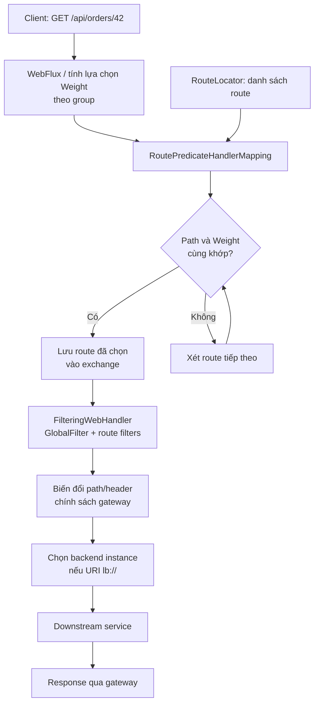
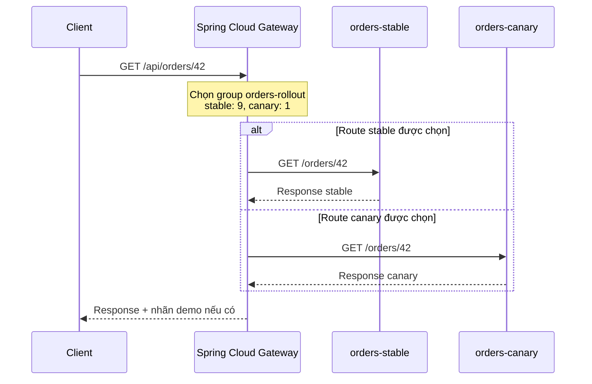

# Weight: chia lưu lượng theo nhóm và trọng số

Khi phát hành phiên bản mới của một microservice, không nhất thiết phải chuyển toàn bộ request sang phiên bản mới ngay lập tức. Một cách triển khai an toàn hơn là cho phiên bản ổn định xử lý phần lớn lưu lượng, còn phiên bản mới nhận một tỷ lệ nhỏ để đo lỗi, độ trễ và tính tương thích trước khi tăng dần tỷ trọng.

Trong **Spring Cloud Gateway**, **`Weight` Route Predicate Factory** giúp chia **request giữa các route thuộc cùng một nhóm** theo trọng số tương đối. Ví dụ, route A có trọng số `8` và route B có trọng số `2` trong cùng nhóm thì về lâu dài chúng nhận xấp xỉ **80% và 20%** lưu lượng thuộc phạm vi được cấu hình. Đây là một khả năng **chọn route**, có thể dùng cho canary release, chuyển đổi dần backend hoặc thử nghiệm một luồng xử lý thay thế.

Bài này thuộc chương **Điều kiện định tuyến** của module **SPRING_CLOUD_GATEWAY**. Trong hành trình xây dựng API Gateway, `Weight` phối hợp với route predicate như `Path`, `Method`, `Host`; với filter chain để sửa đường dẫn/header; với service discovery và load balancing để gọi instance thực tế. Những lớp xác thực, rate limiting, circuit breaker, retry, TLS và quan sát request vẫn phải được thiết kế độc lập, đặc biệt khi hai phiên bản backend nhận tỷ lệ request khác nhau.

## 1. Trọng số là một điều kiện định tuyến, không phải phần trăm cố định

Route thông thường trả lời câu hỏi: **request này có khớp hay không?** Predicate `Weight` bổ sung một lựa chọn có xác suất giữa những route được khai báo cùng `group`. Cú pháp rút gọn:

```yaml
predicates:
  - Weight=orders-rollout, 8
```

Hai đối số là:

| Đối số | Kiểu/ý nghĩa | Ví dụ | Lưu ý |
| --- | --- | --- | --- |
| `group` | Tên nhóm các route tham gia cùng một phép chia lưu lượng | `orders-rollout` | Phải thống nhất **chính xác** giữa những route muốn chia lưu lượng với nhau. |
| `weight` | Số nguyên biểu thị độ lớn tương đối của phần lưu lượng | `8` | Dùng số nguyên dương. Đây không phải giá trị phần trăm riêng lẻ. |

Ví dụ các route trong **cùng nhóm**:

```yaml
- id: orders-stable
  uri: lb://orders-stable
  predicates:
    - Weight=orders-rollout, 8

- id: orders-canary
  uri: lb://orders-canary
  predicates:
    - Weight=orders-rollout, 2
```

Hệ thống tính tỷ lệ của mỗi route dựa trên **tổng các trọng số trong nhóm đó**. Nó không yêu cầu tổng trọng số bằng `10` hay `100`.

### 1.1. Công thức

Với nhóm có `n` route, mỗi route `i` mang trọng số `w_i` dương:

\[
P(\text{chọn route }i)
=\frac{w_i}{\sum_{j=1}^{n}w_j}
\]

Ví dụ:

| Trọng số nhóm | Xác suất mong đợi từng route | Cách hiểu |
| --- | --- | --- |
| `8 : 2` | `80% : 20%` | Phiên bản ổn định nhận khoảng bốn lần request của canary. |
| `9 : 1` | `90% : 10%` | Canary nhận khoảng một phần mười. |
| `95 : 5` | `95% : 5%` | Một bước canary nhỏ. |
| `5 : 3 : 2` | `50% : 30% : 20%` | Ba route cùng nhóm. |
| `1 : 1` | `50% : 50%` | Chia gần bằng nhau. |
| `2 : 2` | `50% : 50%` | Cùng tỷ lệ với `1 : 1`. |

**Không nhầm:** `Weight=orders-rollout, 8` **không** nghĩa route này nhận đúng `8%` request. Nó nhận `8 / tổng_trọng_số_nhóm` trong mô hình chọn có xác suất.

### 1.2. Kỳ vọng thống kê khác quota chính xác

Chia trọng số là cách **lấy mẫu request theo xác suất**, vì vậy không có cam kết rằng trong **10 request đầu tiên** với tỷ lệ `8:2` sẽ có chính xác 8 request đi A và 2 request đi B. Một khoảng thời gian ngắn có thể gặp 10 request đều rơi vào A hoặc nhiều request liên tiếp vào B.

Với `1.000` request độc lập, tỷ lệ canary `10%` cho số lượng kỳ vọng khoảng `100`, nhưng kết quả thực tế có thể là `91`, `108` hoặc số khác. Khi số mẫu lớn, tỷ lệ quan sát thường tiến gần tỷ lệ cấu hình; không có đồng hồ đo nào buộc mỗi phút phải phân phối đúng theo tỷ lệ tuyệt đối.

Theo mô hình lấy mẫu độc lập gần đúng, số request tới canary có kỳ vọng `np` và độ lệch chuẩn `sqrt(np(1-p))`, với `n` là số request và `p` là xác suất canary. Đây là công cụ **diễn giải kết quả kiểm thử**, không phải một cam kết kiểm soát lưu lượng theo cửa sổ thời gian.

## 2. `group` xác định phạm vi cạnh tranh giữa các route

Trọng số chỉ có ý nghĩa **tương đối giữa những route cùng group**. Ví dụ:

```text
Group: orders-rollout
  orders-stable       weight 9  -> khoảng 90%
  orders-canary       weight 1  -> khoảng 10%

Group: catalog-rollout
  catalog-stable      weight 7  -> khoảng 70%
  catalog-canary      weight 3  -> khoảng 30%
```

Hai nhóm này có phép chọn trọng số **riêng**. Trọng số `9` trong nhóm orders không đem so với `7` trong nhóm catalog, và việc nâng canary của catalog từ `3` lên `5` không làm đổi tỷ lệ tính toán của orders.

Tuy nhiên, **tách group chưa thay thế điều kiện chọn API**. Các route vẫn tham gia vào quá trình matching chung của gateway. Cần có predicates như `Path`, `Host`, `Method` để phân biệt request orders với request catalog; đồng thời bảo đảm các route thuộc **một phép chia** có cùng tập điều kiện ngoài `Weight`, trừ khi đã thiết kế và kiểm thử một hành vi phức tạp có chủ đích.

### 2.1. Đặt tên group

Nên đặt theo **ranh giới lưu lượng cần phân chia**, ví dụ:

- `orders-v2-rollout` cho các request đến API orders.
- `catalog-rollout` cho API catalog.
- `partner-api-migration` cho quá trình chuyển đổi API đối tác.

Tránh dùng tên chung như `group1` ở mọi nơi trong hệ thống. Nếu vô tình gán hai tập route không liên quan vào cùng group, phép chọn trọng số có thể khiến chúng tranh nhau một kết quả chọn, làm một số request không khớp route mong muốn.

**Group không phải nhóm instance service discovery.** Nó là nhãn phục vụ **weighted route selection**. Sau khi chọn route, URI `lb://...` có thể tiếp tục được giải quyết bằng Spring Cloud LoadBalancer để chọn **một instance của service logic**.

## 3. Luồng xử lý request khi dùng `Weight`

Trong Spring Cloud Gateway **Server WebFlux**, bộ lọc trọng số ở tầng WebFlux (thường được triển khai bằng `WeightCalculatorWebFilter`) chuẩn bị lựa chọn của từng group; khi `RoutePredicateHandlerMapping` đánh giá các route, `Weight` predicate của route đối chiếu lựa chọn đó để quyết định có khớp hay không.

Lược đồ logic:



Sơ đồ mô tả trách nhiệm theo luồng xử lý, không có nghĩa có một máy chủ `WeightCalculatorWebFilter` riêng. Kết quả lựa chọn theo group liên quan đến **request hiện tại**; gateway không mặc nhiên nhớ rằng user A đã được chọn phiên bản canary ở lần gọi trước.

Điều quan trọng là **Weight chỉ giúp route đủ điều kiện để được chọn**. Sau đó:

1. `RoutePredicateHandlerMapping` xác định route thực tế từ danh sách runtime.
2. `FilteringWebHandler` thực thi filter chain của route được chọn; các filter khác trên route không được chọn không tự chạy.
3. Filter rewrite như `StripPrefix` hoặc `RewritePath` thay đổi path **sau khi chọn route**.
4. Routing/load-balancing filters phân giải `lb://service-id` và chuyển request.
5. Backend và các lớp bảo vệ tiếp tục xử lý; kết quả được trả về qua gateway.

**Tách biệt hai bước lựa chọn:** `Weight` chia request **giữa những route** có thể trỏ tới các service khác nhau. Spring Cloud LoadBalancer chia request **giữa các instance** của service đã được chọn. Một hệ thống có thể sử dụng đồng thời hai lớp này.

## 4. Ví dụ hoàn chỉnh: 90% stable, 10% canary

Giả sử có hai phiên bản xử lý đơn hàng:

- `orders-stable`: phiên bản đang vận hành ổn định.
- `orders-canary`: phiên bản mới cần quan sát trước khi mở rộng lưu lượng.

Client vẫn gọi chung `GET /api/orders/42`. Gateway cần chọn khoảng 90% request đến stable và 10% đến canary. **Cả hai route dùng cùng `Path`, cùng group, nhưng có trọng số khác nhau.**

### 4.1. Ví dụ YAML

Ví dụ sau dùng namespace cấu hình của **Spring Cloud Gateway Server WebFlux** trong tài liệu tham chiếu hiện hành:

```yaml
spring:
  cloud:
    gateway:
      server:
        webflux:
          routes:
            - id: orders-stable
              order: -20
              uri: lb://orders-stable
              predicates:
                - Path=/api/orders/**
                - Weight=orders-rollout, 9
              filters:
                - StripPrefix=1
                - AddResponseHeader=X-Demo-Variant, stable

            - id: orders-canary
              order: -20
              uri: lb://orders-canary
              predicates:
                - Path=/api/orders/**
                - Weight=orders-rollout, 1
              filters:
                - StripPrefix=1
                - AddResponseHeader=X-Demo-Variant, canary

            - id: api-fallback
              order: 100
              uri: lb://legacy-service
              predicates:
                - Path=/api/**
              filters:
                - StripPrefix=1
```

**Tương thích phiên bản:** Một số dòng Spring Cloud Gateway Server WebFlux trước đây sử dụng `spring.cloud.gateway.routes`, trong khi tài liệu mới đặt thuộc tính dưới `spring.cloud.gateway.server.webflux.routes`. Chọn đúng prefix và starter theo **phiên bản trong dự án**, không đặt đồng thời hai bộ route chỉ để thử.

Cách đọc:

- `Path=/api/orders/**` giới hạn phép chia vào các request orders.
- `Weight=orders-rollout, 9` và `Weight=orders-rollout, 1` khai báo hai route của **một nhóm**, tỷ lệ kỳ vọng `9/(9+1)=90%` và `1/(9+1)=10%`.
- `order=-20` cho cả hai route giúp nhóm orders được xét trước fallback có `order=100`. Trong phép chia hai route, kết quả `Weight` mới xác định một route phù hợp; không nên kỳ vọng tên route hay vị trí trong file quyết định tỷ lệ.
- `StripPrefix=1` chuyển `/api/orders/42` thành `/orders/42` cho backend tương ứng.
- `lb://orders-stable` và `lb://orders-canary` là **service ID logic**, đòi hỏi tích hợp Spring Cloud LoadBalancer và nguồn instance phù hợp. Đó là bước sau khi route được chọn.
- `AddResponseHeader` gắn một nhãn để **quan sát khi thực hành**. Không nên mặc định công khai thông tin nội bộ này trong production.
- Route `api-fallback` chỉ để minh họa thứ tự ưu tiên cho nhóm API khác; trong thực tế cần giới hạn phạm vi và tránh để fallback che lỗi chọn tuyến hoặc chuyển request nhạy cảm đến backend không phù hợp.

Hai backend phải hiểu cùng một API contract, bao gồm path, method, auth context và định dạng response, để client có thể được phục vụ bởi một trong hai phiên bản mà không gây lỗi bất ngờ.

### 4.2. Với một request cụ thể, điều gì có thể xảy ra?



Nhánh `alt` thể hiện **một** kết quả chọn cho request minh họa. Không phải gateway gửi request đến **cả hai** backend rồi chỉ chọn một response. Việc gửi nhân bản request (*shadow traffic/mirroring*) là bài toán khác, phải có cơ chế chuyên biệt và bảo vệ dữ liệu phù hợp.

### 4.3. Ví dụ thay đổi trọng số

Giữ group và predicates không đổi, chỉ điều chỉnh hai trọng số:

| Giai đoạn | Stable | Canary | Tỷ lệ mong đợi | Quyết định vận hành |
| --- | ---: | ---: | --- | --- |
| Bắt đầu | 99 | 1 | 99% / 1% | Kiểm tra khả năng tiếp nhận lưu lượng nhỏ. |
| Thăm dò | 95 | 5 | 95% / 5% | So sánh lỗi và độ trễ theo phiên bản. |
| Mở rộng | 90 | 10 | 90% / 10% | Theo dõi thêm dưới tải thực tế. |
| Tăng dần | 50 | 50 | 50% / 50% | Kiểm tra công suất và độ ổn định hai bên. |
| Chuyển hoàn toàn | Không sử dụng route stable | Chỉ còn route canary | 100% ở route còn lại | Sau khi xác minh và thay đổi cấu hình có kiểm soát. |

Không nên giả định `Weight=group, 0` là cách chuẩn để “tắt” một route trong mọi phiên bản. Cách dễ hiểu khi muốn dừng sử dụng là **loại bỏ/disable route trong cấu hình có kiểm soát**, bảo đảm route runtime và dữ liệu tính weight đã được refresh đồng bộ, rồi kiểm thử đường đi thực tế.

## 5. Sai lầm quan trọng: các route trong cùng group có predicate nền khác nhau

Để chia **cùng một tập request** giữa các phiên bản, hai route cùng group nên có **các điều kiện ngoài `Weight` giống nhau**. Nếu không, hệ thống có thể lựa chọn một route theo trọng số nhưng route đó lại không khớp `Path` hoặc `Method` của request hiện tại.

### 5.1. Ví dụ sai: gom API orders và payments vào một group

```yaml
# Có rủi ro sai: cùng group nhưng hai route phục vụ hai path khác nhau.
- id: orders
  uri: lb://order-service
  predicates:
    - Path=/api/orders/**
    - Weight=business-rollout, 8

- id: payments
  uri: lb://payment-service
  predicates:
    - Path=/api/payments/**
    - Weight=business-rollout, 2
```

Đây **không phải** cách chia 80% request orders và 20% request payments. Người dùng chọn API bằng **path**, không phải nhờ may rủi. Trong cơ chế weight chọn route theo group, nếu request orders rơi vào lựa chọn `payments`, `Path` của payments lại không khớp; route orders cũng không phải route được chọn theo Weight cho request đó. Kết quả có thể không tìm được route phù hợp hoặc bị một fallback khác nhận. Triệu chứng có thể xuất hiện như lỗi định tuyến ngẫu nhiên, khó tái hiện.

Cách sửa: nếu chỉ cần định tuyến theo path, **bỏ `Weight`**:

```yaml
- id: orders
  uri: lb://order-service
  predicates:
    - Path=/api/orders/**

- id: payments
  uri: lb://payment-service
  predicates:
    - Path=/api/payments/**
```

Nếu **mỗi API** đều cần canary, hãy tạo **hai group riêng**, chẳng hạn `orders-rollout` và `payments-rollout`. Trong mỗi group, các route của stable/canary sử dụng cùng điều kiện `Path` và các predicates nền khác.

### 5.2. Ví dụ sai: một route GET, một route POST cùng group

```yaml
# Có rủi ro sai: route GET và POST không cạnh tranh cho cùng tập request.
- id: orders-read
  uri: lb://orders-read
  predicates:
    - Path=/api/orders/**
    - Method=GET
    - Weight=orders-mixed, 9

- id: orders-write
  uri: lb://orders-write
  predicates:
    - Path=/api/orders/**
    - Method=POST
    - Weight=orders-mixed, 1
```

Đây không phải cách bảo đảm GET đi `orders-read` và POST đi `orders-write`. Với một request GET, phép chọn Weight có thể chỉ đến route POST, còn POST predicate không khớp; request không được phục vụ như kỳ vọng. Nếu chỉ phân tuyến theo method, **bỏ Weight** và dùng `Method`; nếu muốn canary **riêng** cho GET hoặc POST, dùng hai group tách biệt và bảo đảm các route trong từng group có cùng method predicate.

### 5.3. Tương tác với `order` và fallback

Ngay cả khi weight của hai route cấu hình đúng, một route tổng quát như `Path=/api/**` có `order` ưu tiên cao hơn có thể thắng **trước cả hai route weighted**. Vì vậy:

1. Dùng `order` để đặt nhóm weighted trước fallback tổng quát.
2. Trong nhóm weighted, giữ predicates nền giống nhau và tránh những route khác với điều kiện chồng lấn có ưu tiên cao hơn ngoài chủ đích.
3. Kiểm thử endpoint nhạy cảm, đặc biệt các đường dẫn admin và những HTTP method không được phép.
4. Đừng hiểu việc gateway trả response thành công là bằng chứng nó đã chọn **đúng route**.

**Weight không phải một vòng phân phối lại khi route đã chọn không khớp điều kiện khác.** Đừng thiết kế kỳ vọng nó sẽ tự bốc thăm lần hai trong cùng group cho đến khi tìm được route có `Path` phù hợp.

## 6. Phân biệt `Weight` với các công cụ phân phối lưu lượng khác

| Cơ chế | Phân phối cái gì? | Cách lựa chọn thường thấy | Ví dụ |
| --- | --- | --- | --- |
| **`Weight` Route Predicate** | Các **route** trong cùng group | Xác suất theo trọng số tương đối | Chọn `orders-stable` hay `orders-canary`. |
| **Spring Cloud LoadBalancer** | Các **instance** của cùng một service ID | Thuật toán theo cấu hình như round robin hoặc chiến lược tùy biến | Chọn một instance của `orders-stable`. |
| **`order` của route** | Thứ tự route được xét khi có khả năng khớp | Ưu tiên số thấp hơn trước | Route orders trước `/api/**` fallback. |
| **`Path`/`Method`/`Host`** | Tập request đủ điều kiện cho một route | Điều kiện dựa trên HTTP request | Chỉ API orders GET. |
| **RequestRateLimiter** | Quyền tiếp nhận/tần suất request | Chính sách token bucket hoặc bộ giới hạn được cấu hình | Giới hạn request của một client/API. |
| **Circuit breaker** | Việc cho phép gọi downstream khi phát hiện lỗi | Trạng thái lỗi/khả năng phục hồi | Ngừng gửi thêm request vào một downstream bị lỗi. |

**Không đồng nhất 10% route traffic với 10% số người dùng.** Một user gửi nhiều request có thể xuất hiện ở cả stable lẫn canary vì `Weight` không mặc định gắn quyết định với user, session hoặc cookie. Khi cần thí nghiệm A/B theo **người dùng nhất quán** hoặc canary sticky, cần thiết kế thêm cách chọn dựa trên identity/cookie/hash ở ranh giới tin cậy hoặc dùng giải pháp hỗ trợ stickiness phù hợp.

**Không đồng nhất Weight với health-based routing.** Route canary vẫn có xác suất được chọn ngay cả khi backend canary gặp lỗi, trừ khi có cơ chế bổ sung phát hiện và xử lý lỗi. `Weight` không tự đo health, không tự giảm tỷ trọng khi lỗi tăng và không đảm bảo fallback sang stable.

## 7. Thực hành kiểm tra tỷ lệ lưu lượng

Giả sử cấu hình 9:1 ở mục 4 đã được nạp, gateway chạy tại `localhost:8080`, hai service có instance khả dụng và đều trả response hợp lệ.

### 7.1. Thử thủ công

```bash
curl -i http://localhost:8080/api/orders/42
curl -i http://localhost:8080/api/orders/42
curl -i http://localhost:8080/api/orders/42
```

Header demo `X-Demo-Variant` có thể cho biết route nào được chọn. Nhưng chỉ vài request thì **không đủ mẫu** để đánh giá tỷ lệ 90:10; ba lần liên tiếp đều nhận `stable` hoàn toàn bình thường.

Không dùng `curl -I` thay cho GET khi route còn giới hạn `Method=GET`, vì `-I` gửi HTTP HEAD. Các request trong phép đo cần có cùng method, path, host và những điều kiện predicate liên quan.

### 7.2. Lấy mẫu khoảng 1.000 request trong môi trường thử nghiệm

Ví dụ lệnh Bash dùng header demo, phù hợp khi backend sẵn sàng và gateway không có cache phản hồi làm sai số lượt gọi:

```bash
for i in $(seq 1 1000); do
  curl -sS -D - -o /dev/null http://localhost:8080/api/orders/42 |
    awk 'tolower($1) == "x-demo-variant:" {
      gsub("\r", "", $2);
      print $2
    }'
done | sort | uniq -c
```

Đầu ra có thể có dạng **minh họa**:

```text
  904 stable
   96 canary
```

Ví dụ này không phải kết quả chạy thật; tỷ lệ được kỳ vọng dao động quanh 900/100 với 1.000 mẫu. Nếu chỉ có 980 nhãn được ghi nhận, hãy kiểm tra 20 request còn lại có trả lỗi, thiếu response header hoặc bị một handler/route khác nhận hay không. **Đừng âm thầm bỏ request lỗi khỏi mẫu rồi kết luận tỷ lệ đúng.**

Khi thử trên hệ thống thực, cần giới hạn tốc độ phát mẫu, tránh gây tải quá mức và tuân thủ chính sách dành cho môi trường đang kiểm tra. Không thử bằng request ghi dữ liệu hoặc thanh toán có thể tạo tác dụng phụ, trừ khi dùng test data và cơ chế idempotency đúng.

### 7.3. Đo theo route ID thay vì chỉ dựa vào header

Trong Gateway Server WebFlux, route được chọn thường được lưu tại `ServerWebExchangeUtils.GATEWAY_ROUTE_ATTR`. Một custom `GlobalFilter` có thể đọc route này phục vụ quan sát:

```java
import org.springframework.cloud.gateway.route.Route;
import org.springframework.cloud.gateway.support.ServerWebExchangeUtils;

Route selected = exchange.getAttribute(
    ServerWebExchangeUtils.GATEWAY_ROUTE_ATTR
);
String routeId = selected == null ? "unknown" : selected.getId();
```

Đây là đoạn minh họa cho vị trí **sau khi handler mapping đã chọn route**, không phải một chương trình filter độc lập có thể biên dịch mà không có ngữ cảnh. Khi vận hành, nên sử dụng metrics, traces và logs của gateway đã tích hợp để đo theo route ID, trạng thái response và độ trễ; nhóm số liệu theo cùng khoảng thời gian.

**Tỷ lệ có thể đo khác nhau theo chỉ số.** Tỷ lệ *request route được chọn*, *request backend thực nhận*, *request thành công* và *người dùng độc nhất* không phải cùng một đại lượng. Nếu 10% request được chọn vào canary nhưng nhiều request canary timeout, phần trăm response thành công từ canary có thể thấp hơn 10% dù weight đang hoạt động đúng.

## 8. Đọc kết quả kiểm thử bằng thống kê

Giả sử canary có xác suất `p=0,10`. Với `n=1.000` request độc lập:

- Số request kỳ vọng tới canary: `n×p = 100`.
- Độ lệch chuẩn xấp xỉ: `sqrt(1.000×0,10×0,90) ≈ 9,49` request.
- Khoảng tham khảo gần 95% quanh kỳ vọng theo xấp xỉ chuẩn: khoảng `100 ± 19` request, tức khoảng `81–119` trên 1.000 request.

Đây là xấp xỉ để nhận biết mức dao động **bình thường** của một mẫu độc lập; nó không phải tiêu chí pass/fail duy nhất và không thay cho phân tích traffic thực tế. Request có cache, retry, fallback, lỗi kết nối, session behavior hoặc không đồng nhất cấu hình giữa các gateway replica có thể làm tỷ lệ quan sát sai khác đáng kể.

Khi số mẫu nhỏ, chẳng hạn chỉ `20` request, kết quả `1` canary (5%) hay `4` canary (20%) chưa đủ để kết luận cấu hình sai. Tăng số mẫu, kiểm tra điều kiện route và so sánh cùng một định nghĩa metric trước khi điều chỉnh.

### 8.1. Khi có nhiều replica của chính gateway

Nếu gateway chạy ba instance phía sau load balancer, mỗi instance gateway phải có **cấu hình route/weight nhất quán** và được refresh đúng. Một gateway ở tỷ lệ 90:10 và gateway khác vẫn ở 80:20 có thể tạo tỷ lệ tổng khác mong đợi. Hơn nữa, load balancer trước gateway có thể gửi số lượng request khác nhau tới từng replica.

Cần kiểm tra traffic theo **gateway instance**, **route ID**, **thời gian** và **version triển khai**; thống kê tổng hợp chỉ có ý nghĩa khi các instance cùng đang phục vụ cấu hình intended.

## 9. Kiểm thử các tình huống ngoài happy path

Một bộ kiểm thử Weight đủ tin cậy cần xác nhận cả **định tuyến đúng** lẫn **trạng thái backend**. Các tình huống nên đưa vào integration test:

| Tình huống | Điều cần xác nhận |
| --- | --- |
| Hai route cùng group, cùng `Path`, weight 9:1 | Sau đủ mẫu request, route IDs gần tỷ lệ cấu hình và mọi request khớp một route mong đợi. |
| Request nằm ngoài `/api/orders/**` | Không tự rơi vào một trong hai route weighted của orders. |
| Có fallback `/api/**` | Weighted route orders được ưu tiên đúng; fallback chỉ nhận request thật sự ngoài nhóm orders. |
| Client gọi `POST` nhưng route có thêm `Method=GET` | Không kết luận từ phép đo GET; phải kiểm tra luồng POST và policy method riêng. |
| Stable và canary có filters khác nhau | Đúng filter được áp dụng cho route thắng; khác biệt phải là chủ đích. |
| Một backend down hoặc không có instance | Gateway trả lỗi/fallback theo cấu hình, không kỳ vọng Weight tự tránh backend lỗi. |
| Một trong hai route bị xóa hoặc đổi trọng số | Danh sách route runtime và dữ liệu nhóm weight được cập nhật đồng bộ, không còn route cũ trong quyết định. |
| Nhiều gateway replica | Mỗi replica có cùng group và weights; đo tỷ lệ theo replica để tránh nhầm. |

### 9.1. Kiểm thử tính chất thống kê và tính chính xác

Nên tách hai loại test:

1. **Test xác định:** với một request, xác minh route được chọn thuộc nhóm hợp lệ, path sau `StripPrefix` đúng, headers/policies phù hợp và backend stub nhận request như dự kiến. Loại này có thể dùng `WebTestClient` cùng backend giả.
2. **Test phân phối:** gửi đủ nhiều request độc lập trong môi trường kiểm soát, đếm route IDs và đối chiếu tỷ lệ với khoảng dung sai thống kê đã định nghĩa từ trước. Tránh dùng một số đếm rất nhỏ rồi assert bằng chính xác 90/10.

Đừng viết test canary dựa vào giả định request thứ nhất luôn vào stable, request thứ mười luôn vào canary. Nếu ứng dụng cần hành vi **deterministic**, phải dùng cơ chế chọn có tính quyết định theo tiêu chí phù hợp, thay vì kỳ vọng xác suất tạo một chu kỳ round-robin cố định.

### 9.2. Kiểm tra chính sách CORS và HTTP method

Nếu các route weighted được giới hạn `Method=GET`, request preflight `OPTIONS` không tự khớp chúng. CORS có thể được xử lý ở tầng riêng theo cấu hình WebFlux/Gateway; cần kiểm thử cả preflight và request thực, nhất là khi canary thay đổi header response. Tránh dùng Weight như phương pháp “chọn” một nhánh CORS giữa các backend khác nhau.

## 10. Lỗi cấu hình thường gặp và cách khắc phục

### Lỗi 1: Hai route không cùng tên group

```yaml
- id: stable
  predicates:
    - Weight=orders-rollout, 9

- id: canary
  predicates:
    - Weight=order-rollout, 1
```

`orders-rollout` và `order-rollout` là **hai group khác nhau**. Không có phép chia 90:10 như dự định. Cần sửa cả hai về **một tên group**, rồi xác nhận route runtime đã cập nhật.

### Lỗi 2: Nhập weight như phần trăm hoặc số thập phân

```yaml
# Không biểu diễn 90% bằng một số thập phân tại Weight.
- Weight=orders-rollout, 0.9
```

`weight` là **số nguyên**, không phải `float`. Để diễn tả 90:10, dùng hai giá trị `9` và `1`, hoặc `90` và `10`. Tránh trọng số bằng `0` hoặc âm nếu không có xác nhận rõ từ contract và phiên bản đang dùng; với nhu cầu dừng nhận traffic, hãy dùng quy trình thay đổi/xóa route có kiểm chứng.

### Lỗi 3: Tưởng route chuyên biệt tự thắng route tổng quát

Một `Path=/api/**` có `order=-100` có thể che toàn bộ nhóm `/api/orders/**` có `order=0`. Hãy đặt nhóm weighted trước fallback, đặt vùng match cụ thể và test request ở vùng chồng lấn.

### Lỗi 4: Cùng group nhưng khác `Path`, `Host` hoặc `Method`

Phép bốc chọn của group không bảo đảm route được chọn khớp các điều kiện nền khác. Tổ chức **mỗi group cho một tập request có chung predicates nền**, hoặc bỏ Weight nếu chỉ cần phân biệt path/method.

### Lỗi 5: Đổi YAML nhưng tỷ lệ không đổi

Kiểm tra:

- Cấu hình có được nạp vào **đúng namespace** và đúng profile?
- Route runtime đang có IDs, groups, weights như mong đợi không?
- Hệ thống dùng nguồn route động/cache có cần phát sự kiện refresh không?
- Dữ liệu tính trọng số có được làm mới cùng route definitions không?
- Có replica gateway đang chạy bản cấu hình cũ không?
- Có route có ưu tiên cao hơn luôn nhận request trước nhóm weighted không?

Đã từng có những phiên bản/triển khai gặp lỗi cập nhật bảng trọng số khi refresh route động; đừng xem thay file cấu hình là bằng chứng hệ thống runtime đã áp dụng. Hãy xác minh bằng quan sát request thực sau mỗi lần thay đổi, và kiểm tra bản vá tương ứng cho phiên bản đang vận hành khi thấy vấn đề.

### Lỗi 6: Gọi Weight là “circuit breaker tự động”

Weight không giảm lưu lượng đến route đang lỗi một cách tự động. Nếu muốn giảm canary từ 10% về 1% hoặc loại bỏ canary, cần điều chỉnh route weights/cấu hình qua một quy trình rollout, đồng bộ tới gateway replicas và xác minh kết quả. Circuit breaker, retry, timeout và fallback có cơ chế riêng.

### Lỗi 7: Kết luận tỷ lệ bằng số response thành công

Nếu stable thành công 99% còn canary thành công 50%, tỷ lệ response thành công từ hai bên sẽ **khác** tỷ lệ request được định tuyến. Hãy đếm cả status lỗi và sự kiện routing theo route ID, tránh chỉ nhìn traffic thành công rồi tăng weight sai.

## 11. Bảo mật và độ bền khi chia lưu lượng

### 11.1. Auth và phân quyền phải nhất quán trên hai tuyến

Cả stable và canary đều phải tuân thủ những yêu cầu xác thực, kiểm soát scope và phân quyền tài nguyên đã thống nhất. Route nào được chọn không nên quyết định user được bỏ qua kiểm tra quyền.

Ví dụ, nếu stable có filter giới hạn truy cập API ghi nhưng canary không có, 10% request vào canary có thể thiếu chính sách của stable. Ưu tiên thực thi chính sách toàn cục ở tầng phù hợp, áp dụng chính sách theo route nhất quán và bảo vệ tài nguyên tại backend. **Route predicate `Weight` không phải bằng chứng quyền truy cập.**

### 11.2. Rate limiting và công suất của canary

Nhận 10% request có thể vẫn gây quá tải nếu canary chỉ có một instance yếu hoặc có truy vấn cơ sở dữ liệu đắt hơn. Cần đo RPS thực tế, mức đồng thời, p95/p99 latency, tỷ lệ 4xx/5xx và saturation của từng backend. Rate limiter nếu đặt **riêng theo route** có thể tạo quota khác nhau; giới hạn toàn cục theo user/API cần được thiết kế rõ để người dùng không thể “lách” quota nhờ request rơi vào nhiều route.

### 11.3. Retry có thể làm tăng số lời gọi tới backend

Một request gateway được chọn một route nhưng trong giai đoạn xử lý có thể phát sinh **nhiều lần gọi downstream** nếu retry được bật. Vì vậy, 10% request **ở cửa vào** không đồng nghĩa chính xác 10% số kết nối backend hoặc 10% tải CPU/database.

Cấu hình timeout, retry budget, backoff và idempotency phù hợp. Đặc biệt thận trọng với POST thanh toán, tạo đơn hàng hoặc thay đổi trạng thái. Đừng thử nghiệm canary bằng cách gửi request ghi lặp mà không có cơ chế kiểm soát tác dụng phụ.

### 11.4. TLS và service discovery ở từng tuyến

Hai URI `lb://orders-stable` và `lb://orders-canary` có thể phân giải về những service/instance khác nhau. Cần kiểm tra DNS/discovery, mạng, certificate và TLS giữa gateway với từng backend. HTTPS ở client–gateway không tự bảo đảm chặng gateway–backend dùng HTTPS/mTLS. Weighted routing chỉ chọn route, không cấp bảo mật kết nối.

### 11.5. Canary phải có khả năng rollback rõ ràng

Trước khi tăng weight, xác định:

1. **Điều kiện vào:** backend canary khỏe mạnh; contract và migration database tương thích.
2. **Chỉ số theo dõi:** tỷ lệ lỗi, latency, throughput, saturation và những metric nghiệp vụ quan trọng của canary so với stable.
3. **Ngưỡng dừng:** khi nào ngừng tăng hoặc đảo về route stable.
4. **Hành động rollback:** cấu hình route nào cần sửa/loại bỏ, làm sao đồng bộ route refresh đến mọi gateway replica.
5. **Xác minh sau rollback:** request thực không còn bị điều đến canary ngoài chủ đích; quan sát đủ lâu để xử lý các request đã vào hệ thống.

Không giả định thay đổi weight sẽ can thiệp vào những kết nối đang xử lý hoặc hủy các request đã đến backend.

## 12. Bài tập tự kiểm tra

### Tình huống A — Ba phiên bản

Cùng một group `orders-rollout` có ba route trọng số `5`, `3`, `2`. **Tỷ lệ mong đợi là bao nhiêu?**

**Đáp án:** Tổng trọng số `10`, nên lần lượt là `50%`, `30%`, `20%`. Cả ba phải cạnh tranh cho **cùng tập request** nếu mục tiêu là chia phiên bản của một API.

### Tình huống B — Tổng trọng số không bằng 100

Stable dùng `Weight=orders-rollout, 12`, canary dùng `Weight=orders-rollout, 3`. **Canary có nhận 3% traffic không?**

**Đáp án:** Không. Tỷ lệ kỳ vọng là `3/(12+3)=20%` cho canary và `80%` cho stable.

### Tình huống C — Group trùng tên giữa hai API

Route orders có `Path=/api/orders/**` và Weight thuộc `group1`; route payments có `Path=/api/payments/**` cũng thuộc `group1`. **Vì sao đôi lúc request có thể không đi đúng backend?**

**Đáp án:** Cả hai đang tham gia **cùng phép chọn weighted** dù phục vụ hai tập path khác nhau. Route được chọn theo group có thể không khớp path request. Phải tách group hoặc bỏ Weight nếu đơn thuần muốn routing theo path.

### Tình huống D — Test có 20 request

Với tỷ lệ canary 10%, nhóm test gửi 20 request nhưng chỉ 1 request tới canary. **Có phải cấu hình sai?**

**Đáp án:** Chưa đủ cơ sở. Kết quả 1/20 là 5%, vẫn có thể xảy ra bình thường trong mẫu nhỏ. Cần tăng số mẫu, đo route ID và loại trừ các lỗi route/fallback/backend.

### Tình huống E — Phiên bản canary bị lỗi

Gateway vẫn chọn canary khoảng 10%, nhưng 30% request canary trả `503`. **Weight có tự giảm về 0% không?**

**Đáp án:** Không. Phải có chính sách resilience/rollout riêng và một quy trình rollback rõ ràng. Cần tách tỷ lệ request được **chọn vào route** khỏi tỷ lệ request **được xử lý thành công**.

### Tình huống F — Client yêu cầu stickiness

Một người dùng cần liên tục đi vào cùng phiên bản vì hai phiên bản chưa dùng chung session state. **Chỉ dùng Weight có đủ không?**

**Đáp án:** Không. Weight mặc định không đảm bảo sticky theo user. Cần cơ chế định tuyến nhất quán, hoặc thiết kế hệ thống stateless/chia sẻ session để request có thể đến bất cứ phiên bản nào một cách an toàn.

## 13. Những điều cần ghi nhớ

1. **`Weight=group, weight`** là predicate chọn route theo **trọng số tương đối trong cùng group**. Với 8:2, tỷ lệ kỳ vọng khoảng 80%:20%, không bảo đảm chính xác trong mỗi tập request nhỏ.
2. **Đặt cùng group cho các route phục vụ cùng tập request**; giữ `Path`/`Method`/`Host` và những điều kiện nền nhất quán giữa các route muốn chia lưu lượng.
3. **`Weight` chọn route, `lb://` chọn service logic, load balancer chọn instance**. Chúng là những bước khác nhau.
4. **`order` vẫn quan trọng**: một route fallback tổng quát được ưu tiên cao hơn có thể che hoàn toàn nhóm weighted.
5. **Quan sát route ID và cả request lỗi**, đo đủ mẫu và phân biệt tỷ lệ request routing với tỷ lệ thành công/tải backend.
6. **Canary phải có chính sách an toàn** về auth, quota, retry, TLS, observability, đồng bộ cấu hình và rollback.

**Kết luận thực hành:** Dùng `Weight` khi cần chia **cùng một bề mặt API** giữa những route đích khác nhau, chẳng hạn phiên bản ổn định và canary. Cấu hình group rõ ràng, giữ điều kiện match giống nhau, đặt ưu tiên phù hợp và đo kết quả bằng các chỉ số có ý nghĩa. Khi kết hợp đúng với filter chain, service discovery, rate limiting, circuit breaker, retry và observability, Spring Cloud Gateway trở thành điểm kiểm soát triển khai phiên bản API có thể quan sát và đảo ngược khi cần.

### Tài liệu tham khảo

- [Spring Cloud Gateway — Route Predicate Factories (Server WebFlux)](https://docs.spring.io/spring-cloud-gateway/reference/spring-cloud-gateway-server-webflux/request-predicates-factories.html), mục **The Weight Route Predicate Factory**: cú pháp `group`/`weight` và ví dụ 8:2.
- [Spring Cloud Gateway 4.2 — Route Predicate Factories](https://docs.spring.io/spring-cloud-gateway/reference/4.2/spring-cloud-gateway/request-predicates-factories.html): ví dụ namespace `spring.cloud.gateway.routes` trong các phiên bản cũ hơn.
