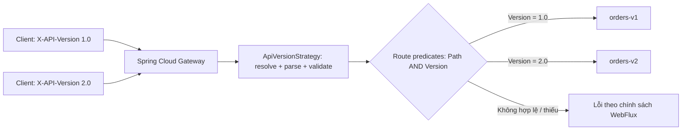
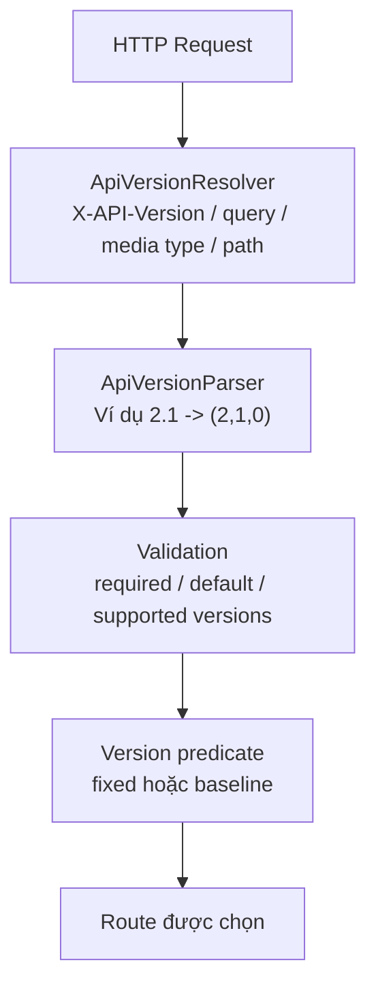

# Version và ApiVersionStrategy cho định tuyến theo phiên bản API khi được hỗ trợ

Một API của hệ thống microservices thường phải phục vụ nhiều thế hệ client cùng lúc. Ứng dụng mobile cũ còn dùng hợp đồng dữ liệu **v1**, trong khi web mới đã chuyển sang **v2**. Với **Spring Cloud Gateway**, ta có thể định tuyến hai loại request về các backend khác nhau thông qua route predicate, thay vì bắt client ghi nhớ địa chỉ triển khai của từng phiên bản.

Chẳng hạn, cả hai request đều gọi đường dẫn `GET /api/orders/42` nhưng mang metadata khác nhau:

```http
GET /api/orders/42 HTTP/1.1
Host: api.example.com
X-API-Version: 1.0
```

```http
GET /api/orders/42 HTTP/1.1
Host: api.example.com
X-API-Version: 2.0
```

Trong các phiên bản **Spring Cloud Gateway Server WebFlux có hỗ trợ `Version` Route Predicate Factory**, gateway có thể dùng phiên bản API đã được **`ApiVersionStrategy`** trích xuất và chuẩn hóa để chọn route thích hợp. Bài thuộc chương **Điều kiện định tuyến** của module **SPRING_CLOUD_GATEWAY**, kết nối kiến thức về predicate với filter chain, biến đổi path/header, khám phá dịch vụ, xác thực, rate limiting, circuit breaker, retry, TLS và quan sát request.

Mục tiêu của bài học là hiểu:

1. `Version` predicate dựa vào dữ liệu gì và khác gì với `Header`, `Query` hoặc `Path` predicate?
2. Vì sao phải cấu hình `ApiVersionStrategy` trước khi dùng `Version`, và tác hại khi thiếu strategy?
3. Phân biệt `Version=1.3` với `Version=1.1+`; xử lý route chồng lấn và phiên bản không hợp lệ ra sao?
4. Có thể định tuyến API theo phiên bản thế nào khi thư viện Gateway đang dùng **chưa hỗ trợ** `Version`?

> **Giới hạn phiên bản quan trọng:** Tài liệu chính thức của Spring Cloud Gateway **Server WebFlux 5.0.x và 5.1.x** mô tả `Version` Route Predicate Factory cùng cấu hình `spring.webflux.apiversion.*`. Tài liệu Gateway WebFlux **4.3.x** chưa liệt kê factory này. Do đó, **không dùng `Version=...` chỉ vì thấy cấu hình ví dụ**; trước tiên phải xác minh phiên bản Gateway, Spring Framework, Spring Boot và starter tương thích trong ứng dụng. Bài sử dụng cú pháp cấu hình **Gateway Server WebFlux 5.x** cho phần chính, sau đó trình bày phương án thay thế.

## 1. Vì sao cần định tuyến theo phiên bản API?

**Phiên bản API** là cách diễn đạt thay đổi của **hợp đồng giao tiếp với client**: tài nguyên, trường dữ liệu, ý nghĩa tham số, mã lỗi hoặc hành vi. Nó khác với số bản build của service, phiên bản thư viện Java hoặc tag image container.

Ví dụ:

| Client | Hợp đồng API | Yêu cầu backend |
| --- | --- | --- |
| Mobile cũ | v1: trả `totalAmount` dạng chuỗi | `orders-v1` |
| Web mới | v2: trả `total` dạng object tiền tệ | `orders-v2` |
| Công cụ nội bộ | v2: hỗ trợ bộ lọc mới | `orders-v2` |

Nếu toàn bộ request không phân biệt phiên bản đều đi về backend v2, client mobile cũ có thể gặp lỗi parse response, dù đường dẫn vẫn là `/api/orders/42`.

Version routing có ích khi cần:

- Duy trì nhiều **hợp đồng API** đồng thời trong giai đoạn chuyển đổi.
- Cho phép thay backend của một hợp đồng mà vẫn giữ endpoint công khai.
- Phát hành thay đổi phá vỡ tương thích một cách có kế hoạch.
- Quan sát tỷ lệ client còn dùng v1 để quyết định thời điểm ngừng hỗ trợ.

Version routing **không đồng nghĩa** triển khai canary hoặc A/B testing. Với canary, một phần client cùng gọi hợp đồng v2 có thể được đưa đến bản build mới theo trọng số; với version routing, client yêu cầu **hợp đồng v1/v2** rõ ràng.

### Mô hình khái quát



Đường dẫn công khai, xác thực và những chính sách gateway có thể thống nhất; mỗi backend vẫn tự bảo đảm hợp đồng và quy tắc nghiệp vụ của mình.

## 2. Khả năng hỗ trợ: nhận diện đúng thế hệ Gateway

Tên `Version` dễ làm người học hiểu rằng nó có trong mọi bản Spring Cloud Gateway. Thực tế, tính năng này phụ thuộc **thế hệ framework và loại server**.

| Thành phần / phiên bản | Cách hiểu đúng |
| --- | --- |
| **Gateway Server WebFlux 5.0.x, 5.1.x** | Tài liệu chính thức có `Version` Route Predicate Factory, dùng `ApiVersionStrategy` của Spring Framework WebFlux. |
| **Gateway Server WebFlux 4.3.x** | Tài liệu route predicate chính thức của nhánh này không liệt kê `Version`; không giả định cú pháp `Version=...` được hỗ trợ. |
| **Gateway Server Web MVC 5.x** | Cũng có tài liệu predicate phiên bản, nhưng namespace resolver là `spring.mvc.apiversion.*` và cách chạy khác WebFlux. |
| **Spring Framework 7 / Spring Boot 4** | Có cơ chế versioning WebFlux và cấu hình `spring.webflux.apiversion.*` tương ứng khi dùng stack hỗ trợ. |
| **Gateway khác, bản tùy biến hoặc thư viện nội bộ** | Phải kiểm tra class/factory thực tế, starter, tài liệu và integration test của version đang triển khai. |

Đây là **điều kiện tiên quyết**, không phải lựa chọn cú pháp thuần túy. Nếu Gateway không có factory `Version`, một route dùng `Version=1.0` có thể thất bại trong quá trình khởi tạo/bind route. Nếu factory có nhưng thiếu strategy, có một chế độ lỗi khác nguy hiểm hơn: **route có thể match không đúng theo version**.

### Prefix YAML cũng phụ thuộc phiên bản

Trong các ví dụ chính của Gateway Server WebFlux 5.x, cấu hình nằm dưới:

```yaml
spring:
  cloud:
    gateway:
      server:
        webflux:
          routes:
            # ...
```

Nhiều ví dụ của các bản Gateway cũ sử dụng `spring.cloud.gateway.routes`. Không sao chép một namespace từ phiên bản khác rồi kết luận predicate “không hoạt động”. Hãy xác định dependency thực tế trước khi cấu hình.

**Tài liệu đối chiếu chính thức:**

- [Spring Cloud Gateway WebFlux 5.x — Route Predicate Factories](https://docs.spring.io/spring-cloud-gateway/reference/spring-cloud-gateway-server-webflux/request-predicates-factories.html)
- [Spring Cloud Gateway WebFlux 4.3.x — Route Predicate Factories](https://docs.spring.io/spring-cloud-gateway/reference/4.3/spring-cloud-gateway-server-webflux/request-predicates-factories.html)
- [Spring Framework — API Versioning trong WebFlux](https://docs.spring.io/spring-framework/reference/web/webflux-versioning.html)
- [Spring Boot — Reactive Web Applications / API Versioning](https://docs.spring.io/spring-boot/reference/web/reactive.html)

## 3. ApiVersionStrategy giải quyết bài toán nào?

`Version` route predicate không nhất thiết đọc trực tiếp một header có tên cố định. Việc đọc và diễn giải **phiên bản mà client yêu cầu** thuộc `ApiVersionStrategy`, cơ chế chung của Spring Framework dành cho API versioning.

Strategy phối hợp ba vai trò:

1. **`ApiVersionResolver`:** tìm phiên bản thô trong HTTP request, ví dụ `X-API-Version: 2.0`, `?apiVersion=2.0`, tham số của media type hoặc một đoạn path.
2. **`ApiVersionParser`:** chuyển chuỗi thô thành dạng so sánh được. Bộ parser semantic mặc định diễn giải các phần `major.minor.patch` theo số, không so sánh kiểu chuỗi ký tự đơn thuần.
3. **Validation:** kiểm tra yêu cầu có cung cấp phiên bản theo policy hay không, phiên bản có hợp lệ và thuộc danh sách được hỗ trợ hay không.



Với bộ parser semantic mặc định, các giá trị như `1.9` và `1.10` được so sánh theo các thành phần số; **`1.10` mới hơn `1.9`**. Việc lấy `"1.10" > "1.9"` bằng so sánh từ điển chuỗi là sai trong bài toán này.

### Tại sao không thể chỉ viết Version=2.0?

Giả sử cấu hình chỉ có:

```yaml
predicates:
  - Path=/api/orders/**
  - Version=2.0
```

Nếu không cấu hình ít nhất một resolver và không có bean `ApiVersionStrategy` tương ứng, theo tài liệu Gateway 5.x, **`Version` predicate vẫn được đăng ký nhưng trả kết quả match cho request khi không giải được version**. Như vậy, request thiếu header phiên bản vẫn có thể đi vào route mang tên `orders-v2`.

Đây là lý do cần kiểm tra cả **route config** và **strategy config**. Một chuỗi `Version=2.0` trong YAML **không tự tạo ra cơ chế kiểm tra phiên bản**.

## 4. Cấu hình ApiVersionStrategy qua application.yml

Ví dụ chọn **một nguồn version từ header** `X-API-Version` và khai báo hai phiên bản được hỗ trợ:

```yaml
spring:
  webflux:
    apiversion:
      use:
        header: X-API-Version
      required: true
      detect-supported: false
      supported:
        - "1.0"
        - "2.0"
```

Giải thích:

| Thuộc tính | Ý nghĩa |
| --- | --- |
| `spring.webflux.apiversion.use.header` | Cho biết tên header để resolver trích xuất phiên bản API. |
| `required: true` | Yêu cầu request cần có version; request thiếu version có thể bị từ chối, thường bằng HTTP `400` theo cơ chế versioning WebFlux. |
| `detect-supported: false` | Không tự phát hiện phiên bản hỗ trợ từ mapping controller; thích hợp minh họa gateway tập trung vào định tuyến. |
| `supported` | Danh sách phiên bản mà API hiện chấp nhận; cần đồng bộ với các route và chính sách hỗ trợ thật. |

Việc khai báo `supported` giúp kiểm soát vòng đời API: nếu client yêu cầu version **chưa được hỗ trợ**, hệ thống có thể từ chối từ sớm thay vì gửi nhầm vào backend khác. Trong Spring Framework, phiên bản thiếu hoặc không hợp lệ có thể phát sinh `MissingApiVersionException` hoặc `InvalidApiVersionException` và được ánh xạ thành HTTP `400` theo handling tương ứng.

Trong môi trường thực tế, danh sách `supported` cần phản ánh hợp đồng API đang được cung cấp. Gateway thường không có controller annotation liệt kê mọi version của service khác, nên không nên dựa vào tự động phát hiện từ controller nếu các API đều là proxy route.

### Có thể chọn nguồn phiên bản khác không?

Có. Spring Framework WebFlux hỗ trợ cấu hình resolver theo các loại metadata phổ biến:

```yaml
spring:
  webflux:
    apiversion:
      use:
        # Chỉ minh họa các loại resolver có thể cấu hình;
        # chọn chiến lược và ưu tiên rõ ràng cho hệ thống thật.
        header: X-API-Version
        query-parameter: apiVersion
        media-type-parameter:
          "[application/json]": version
      required: false
```

Trong ví dụ này, phiên bản có thể đến từ header, query parameter hoặc tham số media type khi request phù hợp. Khi dùng nhiều nguồn, phải xác định **thứ tự ưu tiên và xử lý mâu thuẫn**; Spring Boot có thể yêu cầu cấu hình bằng `WebFluxConfigurer.configureApiVersioning(...)` nếu cần thứ tự chính xác. Tránh mặc định rằng khi client đồng thời gửi `X-API-Version: 1.0` và `?apiVersion=2.0`, hệ thống chắc chắn ưu tiên một nguồn cụ thể mà chưa kiểm thử.

Nếu version nằm trong URL, có thể dùng resolver theo **vị trí đoạn path**, với thuộc tính `spring.webflux.apiversion.use.path-segment`. Chỉ số đoạn đường dẫn cần được xác minh theo cách Spring Framework diễn giải path thực tế; đừng tự suy luận từ cách đếm dấu `/` hay path rewrite đã diễn ra. Khi dùng version trong path, cấu hình route và filter biến đổi path cũng phải được phối hợp để backend nhận đúng đường dẫn.

### required, default và supported khác nhau như thế nào?

- **`required`:** client có bắt buộc chỉ định version hay không.
- **`default`:** phiên bản mặc định theo cấu hình, hữu ích khi muốn duy trì client cũ trong giai đoạn chuyển đổi.
- **`supported`:** những phiên bản API được chấp nhận, không đồng nghĩa một route cho phép chúng sẽ tự được tạo.

Ví dụ trong giai đoạn di trú, có thể đặt:

```yaml
spring:
  webflux:
    apiversion:
      use:
        header: X-API-Version
      default: "1.0"
      required: false
      detect-supported: false
      supported:
        - "1.0"
        - "2.0"
```

Khi đó request không chỉ định version được thiết kế để đi theo default `1.0` trong chính sách versioning; cần integration test xác nhận hành vi và các route liên quan. Khi bắt đầu yêu cầu client khai báo phiên bản, đổi sang `required: true` và bỏ default phù hợp lộ trình.

## 5. Version predicate: fixed version và baseline version

`Version` route predicate nhận một đối số `version` với hai dạng chính.

### 5.1. Fixed: chỉ khớp một phiên bản

```yaml
predicates:
  - Path=/api/orders/**
  - Version=2.0
```

Route chỉ dành cho request có version **bằng** `2.0` sau khi đã được strategy phân giải, parse và validate. Một request yêu cầu `1.0` không nên match route này.

Fixed version phù hợp khi có backend theo hợp đồng API riêng biệt, ví dụ v1 và v2 khác cấu trúc JSON.

### 5.2. Baseline: khớp từ một phiên bản trở lên

```yaml
predicates:
  - Path=/api/catalog/**
  - Version=1.1+
```

Dấu `+` ở **cuối** giá trị là cú pháp baseline: match phiên bản bằng hoặc **lớn hơn** `1.1`. Ví dụ `1.2`, `1.5` hoặc `2.0` có thể thỏa, miễn được strategy chấp nhận. Đây là **so sánh phiên bản API**, không phải biểu thức cộng và cũng không phải regex.

| Version client gửi | `Version=1.3` | `Version=1.1+` | Ghi chú |
| --- | --- | --- | --- |
| `1.0` | Không | Không | Cũ hơn baseline 1.1. |
| `1.1` | Không | Có | Bằng baseline. |
| `1.2` | Không | Có | Cao hơn baseline. |
| `1.3` | Có | Có | Có thể **chồng lấn** hai route. |
| `1.10` | Không | Có | So sánh theo version đã parse, không theo chuỗi. |
| `2.0` | Không | Có | Baseline có thể mở rộng qua major version. |
| Không có version | Tùy strategy | Tùy strategy | `required/default` ảnh hưởng việc phiên bản được xác định. |
| `banana` | Không thể coi là version semantic hợp lệ | Không thể coi là version semantic hợp lệ | Parser/validation có thể từ chối trước route selection. |

Bảng minh họa hành vi predicate **với giả định version đã resolve và nằm trong chính sách supported**. Nếu `supported` không có `1.10` hoặc `2.0`, request có thể bị từ chối trước khi quyết định route theo bảng.

**Cảnh báo:** `Version=1.1+` **không** có nghĩa “chỉ các minor version 1.x” hoặc “tất cả version tương thích”. Nếu hợp đồng `2.0` có thay đổi phá vỡ tương thích, phải thu hẹp phạm vi được hỗ trợ/thiết kế route riêng hoặc áp dụng chiến lược version cụ thể; đừng mặc định baseline tự biết điều gì là breaking change.

## 6. Ví dụ hoàn chỉnh: phân luồng orders v1 và v2 theo HTTP header

Giả sử hai backend local chạy tại:

- `http://localhost:8081`: hỗ trợ JSON hợp đồng v1, endpoint `GET /orders/42`.
- `http://localhost:8082`: hỗ trợ JSON hợp đồng v2, endpoint `GET /orders/42`.

Gateway WebFlux 5.x chạy tại `http://localhost:8080`. Đây là ví dụ tự chứa dùng `Version` predicate, một resolver duy nhất và danh sách supported rõ ràng:

```yaml
spring:
  webflux:
    apiversion:
      use:
        header: X-API-Version
      required: true
      detect-supported: false
      supported:
        - "1.0"
        - "2.0"

  cloud:
    gateway:
      server:
        webflux:
          routes:
            - id: orders-v1
              order: 0
              uri: http://localhost:8081
              predicates:
                - Path=/api/orders/**
                - Version=1.0
              filters:
                - StripPrefix=1

            - id: orders-v2
              order: 0
              uri: http://localhost:8082
              predicates:
                - Path=/api/orders/**
                - Version=2.0
              filters:
                - StripPrefix=1
```

Hai route có giá trị `order` bằng nhau vì các predicate fixed version **không có vùng chồng lấn** khi strategy hoạt động đúng và request có một version. Nếu thêm route rộng hơn, cần xem lại order và chiến lược tránh match trùng.

Luồng dành cho v2:

1. Client gọi `GET /api/orders/42` với header `X-API-Version: 2.0`.
2. WebFlux `ApiVersionResolver` đọc phiên bản từ header; parser và validator xử lý dữ liệu.
3. Gateway xét `Path=/api/orders/**` và `Version=2.0`; route `orders-v2` khớp.
4. Filter `StripPrefix=1` chuyển đường dẫn công khai `/api/orders/42` thành `/orders/42`.
5. Reactor Netty HTTP client proxy request tới `http://localhost:8082/orders/42`.
6. Backend v2 tự thực hiện xác thực/phân quyền cần thiết và trả dữ liệu theo hợp đồng v2.
7. Gateway chuyển response cho client, áp dụng các chính sách filter và observability liên quan.

**Kiểm thử bằng curl:**

```bash
# Yêu cầu hợp đồng v1
curl -i http://localhost:8080/api/orders/42 \
  -H "X-API-Version: 1.0"

# Yêu cầu hợp đồng v2
curl -i http://localhost:8080/api/orders/42 \
  -H "X-API-Version: 2.0"

# Thiếu phiên bản: với required=true, kỳ vọng bị từ chối
curl -i http://localhost:8080/api/orders/42

# Không được supported theo cấu hình
curl -i http://localhost:8080/api/orders/42 \
  -H "X-API-Version: 9.9"

# Giá trị không parse được
curl -i http://localhost:8080/api/orders/42 \
  -H "X-API-Version: abc"
```

Trong môi trường test, backend nên ghi log **route nhận được** hoặc trả marker không nhạy cảm như `X-Backend-Contract: v1` / `v2` để kiểm tra **backend thực sự được gọi**. Chỉ xem HTTP status không đủ xác minh routing.

Nếu cả hai backend đều dùng service discovery, `uri` có thể được thay bằng `lb://orders-v1` và `lb://orders-v2` khi đã có Spring Cloud LoadBalancer, discovery client hoặc nguồn instance tương ứng. Version matching và cơ chế chọn instance là hai bước khác nhau.

## 7. Phối hợp Version với các route predicate khác

Spring Cloud Gateway kết hợp các predicate **khác nhau trong cùng một route** theo logic AND. Vì vậy, có thể yêu cầu đồng thời:

- Host là `api.example.com`.
- Path nằm trong `/api/orders/**`.
- HTTP method là `GET`.
- Version bằng `2.0`.

```yaml
- id: orders-v2-read
  uri: http://localhost:8082
  predicates:
    - Host=api.example.com
    - Path=/api/orders/**
    - Method=GET
    - Version=2.0
  filters:
    - StripPrefix=1
```

Đây là **một phần của danh sách route** dưới `spring.cloud.gateway.server.webflux.routes`, không phải YAML hoàn chỉnh độc lập. Với route này, một `POST` dù có header `X-API-Version: 2.0` vẫn không khớp, vì `Method=GET` không thỏa.

### Version và việc sửa header

`Version` dùng metadata request để chọn route; nó **không tự đổi hợp đồng backend**. Nếu cần chuyển sang header nội bộ thống nhất, có thể sử dụng các filter `SetRequestHeader` / `RemoveRequestHeader` theo thiết kế. Ví dụ:

```yaml
filters:
  - StripPrefix=1
  - SetRequestHeader=X-Resolved-Api-Contract, v2
```

Đây là marker cho backend biết route đang sử dụng hợp đồng nào; không nên sử dụng header này để chứng minh danh tính hay quyền truy cập. Nếu client có thể tự gửi header tương ứng, cơ chế `SetRequestHeader` giúp thay thế giá trị trên request outbound khi filter được thực thi đúng. Backend vẫn cần xác thực request theo quy tắc hệ thống.

### Version trong URL có cần Version predicate không?

Không nhất thiết. Nếu API công khai dùng `/v1/orders` và `/v2/orders` thì `Path` predicate vốn đã có thể tách route. `Version` hữu ích nhất khi muốn một chiến lược API versioning có cấu hình resolver/parser/validation chung, ví dụ cùng URL nhưng version nằm ở header hoặc query parameter.

Nếu dùng cả path chứa version **và** `Version`, cần thiết kế sao cho resolver path và `Path` predicate nhất quán. `RewritePath`/`StripPrefix` chủ yếu biến đổi request ở filter chain sau route matching; không nên dựa vào path đã rewrite để giải thích cách resolver xác định version trước đó.

## 8. Route baseline, ưu tiên và nguy cơ chồng lấn

Giả sử API catalog phiên bản 1.0 và 1.1 tương thích, nhưng phiên bản 2.0 có backend hoàn toàn khác:

```yaml
- id: catalog-v2
  order: -10
  uri: http://localhost:8082
  predicates:
    - Path=/api/catalog/**
    - Version=2.0

- id: catalog-legacy-baseline
  order: 10
  uri: http://localhost:8081
  predicates:
    - Path=/api/catalog/**
    - Version=1.0+
```

Nếu strategy cho phép `2.0`, request version `2.0` có thể match cả `Version=2.0` **và** `Version=1.0+`. Với cấu hình ví dụ, route `catalog-v2` có `order=-10` để được ưu tiên khi cả hai khớp.

Đây là lựa chọn có rủi ro: một route baseline quá rộng có thể vô tình nhận version mới khi route đặc thù bị xóa, bị cấu hình sai hoặc không có instance. Không nên coi `order` là cơ chế đảm bảo an toàn hợp đồng API.

**Thiết kế an toàn hơn**:

1. Giới hạn các phiên bản thực sự được hỗ trợ trong `ApiVersionStrategy`.
2. Dùng fixed version routes cho các hợp đồng phá vỡ tương thích.
3. Chỉ dùng baseline khi dịch vụ thực sự đảm bảo tương thích trong phạm vi đã công bố.
4. Viết test cho **mọi version được hỗ trợ** để xác nhận **route ID được chọn**, không chỉ test response `200`.
5. Nếu có route mặc định `Path=/api/**`, kiểm tra nó không làm yêu cầu version không hợp lệ đi vào backend ngoài dự kiến.

Không giả định Gateway `Version` predicate tự áp dụng quy tắc “route có baseline gần nhất thắng” giống một số cơ chế chọn `@RequestMapping` controller của Spring Framework. **Gateway route selection** còn phụ thuộc thứ tự route và các predicate khác. Chỉ dùng hành vi đã xác minh với đúng phiên bản Gateway hiện hành.

## 9. Thay thế khi Gateway chưa hỗ trợ Version predicate

Với Spring Cloud Gateway Server WebFlux đời cũ không có `Version` factory, có thể dùng các predicate **`Header`, `Query` hoặc `Path`** sẵn có. Chúng match trực tiếp request và không cần `ApiVersionStrategy`.

### 9.1. Định tuyến theo header

```yaml
spring:
  cloud:
    gateway:
      routes:
        - id: orders-v1
          uri: http://localhost:8081
          predicates:
            - Path=/api/orders/**
            - Header=X-API-Version,1[.]0
          filters:
            - StripPrefix=1

        - id: orders-v2
          uri: http://localhost:8082
          predicates:
            - Path=/api/orders/**
            - Header=X-API-Version,2[.]0
          filters:
            - StripPrefix=1
```

`Header` dùng regex; mẫu `1[.]0` biểu diễn dấu chấm **theo nghĩa ký tự literal**, tránh regex `1.0` vô tình match bất kỳ ký tự nào ở giữa. Đây là lựa chọn phù hợp cho hai phiên bản cố định và một nguồn header.

Hạn chế: `Header` predicate **không có** cơ chế parse semantic, `supported`, default version và validation thống nhất như `ApiVersionStrategy`. Nếu không có route khớp, response có thể đi qua xử lý “không tìm thấy route” hoặc route fallback, tùy ứng dụng. Không mặc định rằng lỗi version sẽ tự thành `400`.

### 9.2. Định tuyến theo query parameter

```yaml
predicates:
  - Path=/api/orders/**
  - Query=apiVersion,2[.]0
```

Client gọi `/api/orders/42?apiVersion=2.0`. Cách này dễ thử nghiệm nhưng cần chú ý cache key, ghi log URL và việc client có thể gửi nhiều giá trị query parameter. Nếu query version thay đổi hợp đồng API, các lớp cache phải phân biệt đúng phiên bản.

### 9.3. Định tuyến theo đường dẫn

```yaml
predicates:
  - Path=/api/v2/orders/**
filters:
  - StripPrefix=2
```

Với path `/api/v2/orders/42`, `StripPrefix=2` bỏ hai đoạn `api` và `v2` để backend nhận `/orders/42`. Đây là ví dụ trực quan, nhưng URL công khai thay đổi khi lên version mới.

### So sánh hai cách tiếp cận

| Tiêu chí | `Version` + `ApiVersionStrategy` | `Header` / `Query` / `Path` |
| --- | --- | --- |
| Điều kiện phiên bản | Được parse và validate qua strategy | Match trực tiếp header/query/path |
| So sánh “từ version trở lên” | Có cú pháp baseline `1.1+` khi được hỗ trợ | Tự thiết kế regex hoặc nhiều route; khó đảm bảo semantic |
| Policy thiếu/không hỗ trợ version | Có `required`, `default`, `supported` và handling WebFlux | Phải tự bổ sung policy/response phù hợp |
| Tương thích bản Gateway cũ | Không thể giả định có | Thường là hướng thực tế khi factory `Version` chưa có |
| Khả năng test | Test resolver, parser, validation và route | Test regex/URL, route order và nhánh không khớp |

**Không tạo một custom `VersionRoutePredicateFactory` chỉ để bắt chước hỗ trợ 5.x** nếu hệ thống chưa sẵn sàng nâng cấp hoặc bảo trì logic so sánh/versioning riêng. Những predicate cơ bản có thể đáp ứng yêu cầu đơn giản; nếu cần semantic versioning nghiêm ngặt, hãy thiết kế policy riêng có test thay vì giả định regex là đủ.

## 10. Version routing không thay cho bảo mật và quản lý hợp đồng API

### 10.1. Version là input, không phải quyền

Client có thể chủ động gửi `X-API-Version: 2.0`; header này **không chứng minh** client là admin, đã mua gói Pro hoặc có quyền xem dữ liệu tenant khác. Gateway vẫn cần xác thực token/session theo thiết kế, rate limit, kiểm soát request size và các chính sách biên phù hợp. Backend phải kiểm tra quyền với tài nguyên thực tế.

**Ví dụ sai:** route v2 cung cấp chức năng quản trị, gateway nghĩ “chỉ client mới biết version 2.0” nên không yêu cầu authentication. Bất kỳ client nào biết header đều có thể thử gửi `2.0`.

**Thiết kế đúng:** cho cả v1/v2 qua lớp xác thực phù hợp; quyền đặc biệt được kiểm tra dựa trên principal/claim đã xác thực và các quy tắc nghiệp vụ.

### 10.2. Giữ ổn định API trong một version

Version routing chỉ chọn backend. Nó không bảo đảm backend v2 thực sự trả đúng JSON v2. Các việc quan trọng vẫn phải có ở service và quy trình release:

- Contract tests cho request/response từng version.
- Chính sách tương thích ngược, loại bỏ trường và mã lỗi rõ ràng.
- Chính sách deprecation/sunset và truyền thông tới client.
- Idempotency cho thao tác ghi, đặc biệt khi có retry ở gateway.
- Kịch bản rollback trong khi nhiều version cùng hoạt động.

### 10.3. TLS, discovery, resilience và caching

| Chủ đề | Ảnh hưởng khi version routing |
| --- | --- |
| **TLS** | Version header chỉ xuất hiện sau khi kết nối HTTP/TLS được thiết lập; TLS certificate và trust policy vẫn phải đúng. |
| **Service discovery** | `lb://orders-v1` và `lb://orders-v2` cần source instance và LoadBalancer thực tế. |
| **Timeout/circuit breaker** | Có thể cấu hình theo route hoặc backend vì v1/v2 có đặc điểm tải khác nhau; không tự tạo fallback “v2 thành công” khi v2 lỗi. |
| **Retry** | Xem HTTP method, thao tác side effect, idempotency và khả năng replay body; không retry mù quáng request thanh toán. |
| **Cache** | Nếu response khác theo `X-API-Version`, cache phải đưa version vào cache key hoặc cấu hình phân biệt đúng; cân nhắc `Vary: X-API-Version` theo HTTP caching. |
| **Observability** | Dùng route ID, status, latency, trace ID và một tập nhãn version có số giá trị hữu hạn; tránh lấy raw version tùy ý làm metric label. |

Với việc gọi policy service từ filter (ví dụ tra quyền version theo tenant), dùng reactive client và tránh I/O đồng bộ trên event loop của WebFlux. `Version` predicate không giải quyết được việc custom filter chứa `Thread.sleep()` hay JDBC blocking.

## 11. Quan sát lỗi thường gặp

| Dấu hiệu | Nguyên nhân cần kiểm tra | Hướng chẩn đoán |
| --- | --- | --- |
| Startup báo không biết `Version` predicate | Gateway version/starter chưa hỗ trợ hoặc cấu hình nhầm WebFlux/MVC | Xem dependency, phiên bản, prefix YAML và tài liệu tương ứng; dùng Header/Path fallback nếu cần |
| Client không gửi version nhưng vẫn vào v2 | Thiếu `ApiVersionStrategy`; hoặc `required: false`/`default` được cấu hình | Xác minh resolver bean/property và route ID thực tế; kiểm thử request thiếu header |
| Header `X-API-Version: 1.0` lại vào route v2 | Route chồng lấn, order, regex/fallback rộng; strategy không được khởi tạo đúng | Kiểm tra danh sách route, bộ resolver và route ID trong trace/log |
| Client gửi `1.10` nhưng so sánh không như kỳ vọng | Tự so sánh chuỗi version hoặc dùng regex chưa chặt | Dùng semantic parser khi có, viết test phiên bản ở ranh giới `1.9` / `1.10` |
| Version không được hỗ trợ trả `400` | Validator loại version theo policy `supported` | Kiểm tra danh sách supported, client gửi đúng header/query và chính sách công bố |
| Không có route khớp dù version hợp lệ | Path/Host/Method cũng phải match; route URI/order/config có thể sai | Kiểm tra từng predicate và route ID; không chỉ nhìn version |
| Cấu hình Header và Query cùng lúc nhưng chọn version bất ngờ | Chưa xác định độ ưu tiên khi nhiều nguồn cùng có giá trị | Chọn một nguồn hoặc cấu hình resolver order rõ ràng, test trường hợp mâu thuẫn |
| Request v1/v2 cùng trả nội dung v1 | Chọn sai upstream, backend không phân biệt contract, cache không phân biệt version | Kiểm tra backend marker, proxy URI, cache key/`Vary` và contract test |
| Route v2 không đến backend | Discovery chưa có instance, upstream timeout/TLS/connection pool | Dùng route ID + trace ID + metrics HTTP client để tách lỗi routing với lỗi version |
| p95/p99 tăng khi thêm version handling | Custom predicate/resolver gọi blocking I/O, logging nặng, service policy chậm | Đo thread/latency; tránh blocking trên Reactor Netty event loop |

**Cần phân biệt:** `400` có thể đến từ parser/validator; `404` có thể do route không khớp hoặc backend trả “không tìm thấy”; `503` có thể liên quan không có instance, circuit breaker hoặc upstream không sẵn sàng. Chỉ HTTP status không cho biết chính xác nguyên nhân.

## 12. Bài thực hành: kiểm thử phân luồng Version và trường hợp lỗi

### Chuẩn bị

Dùng Gateway WebFlux **có hỗ trợ Version predicate**, cấu hình ở mục 6, hai backend thử nghiệm và một client như `curl`. Mỗi backend nên trả marker dễ phân biệt:

- Backend 8081 trả `X-Api-Contract: v1` và body theo hợp đồng v1.
- Backend 8082 trả `X-Api-Contract: v2` và body theo hợp đồng v2.

Đừng dùng marker backend làm bằng chứng phân quyền; chỉ dùng nó trong test để xác nhận route.

### Bảng kịch bản

| Request | Kết quả cần xác minh |
| --- | --- |
| `X-API-Version: 1.0` | Route `orders-v1`, backend 8081, path `/orders/42` |
| `X-API-Version: 2.0` | Route `orders-v2`, backend 8082, path `/orders/42` |
| Thiếu header với `required: true` | Bị từ chối theo policy WebFlux; không được vào nhầm v2 |
| `X-API-Version: 9.9` khi supported chỉ có 1.0, 2.0 | Bị từ chối là version không được hỗ trợ; không fallback âm thầm |
| `X-API-Version: invalid` | Parser/validator xử lý giá trị sai; không gửi tùy ý tới backend |
| Path `/api/catalog/42` | Route orders không khớp dù version hợp lệ |
| Host/Method sai khi đã thêm predicate | Route không khớp vì các điều kiện kết hợp theo AND |
| Thêm route baseline `Version=1.0+` | Version 2.0 có thể match cả route fixed và baseline; xác minh ưu tiên |
| Tháo resolver version trong môi trường test cô lập | Phát hiện trường hợp `Version` predicate luôn match khi không có strategy; khôi phục resolver ngay sau kiểm thử |
| Tắt backend v2 | Xác định rõ lỗi upstream, không nhầm với lỗi version; quan sát timeout/circuit breaker |

**Quan trọng:** Thử nghiệm bỏ resolver chỉ thực hiện trong môi trường kiểm thử; không triển khai cấu hình `Version` thiếu `ApiVersionStrategy` lên production.

### Tự kiểm tra kiến thức

**Câu 1.** Vì sao `Version=1.0` không đủ để bảo đảm request không có version bị từ chối?

> Vì trong Gateway 5.x, nếu không có `ApiVersionStrategy`, `Version` predicate có thể luôn match. Phải cấu hình resolver, validation và kiểm tra hành vi thiếu version.

**Câu 2.** `Version=1.1+` có tự chọn route sát với version client nhất khi nhiều route baseline cùng match không?

> Không được mặc nhiên giả định. Baseline chỉ mô tả điều kiện khớp từ version đó trở lên; route order và các predicate khác vẫn ảnh hưởng việc chọn route. Cần thiết kế tránh overlap hoặc kiểm thử ưu tiên rõ ràng.

**Câu 3.** Nếu app dùng Gateway WebFlux 4.3 và không nhận ra `Version` thì nên làm gì?

> Dùng các predicate `Header`, `Query` hoặc `Path` mà version đang hỗ trợ để tách route, rồi tự quy định policy validation tương ứng; hoặc nâng cấp theo bộ phiên bản Spring tương thích khi phù hợp.

**Câu 4.** Vì sao request `1.10` không nên được coi thấp hơn `1.9`?

> Vì semantic API versioning so sánh các thành phần số. `1.10` có minor version 10, lớn hơn minor version 9 của `1.9`.

**Câu 5.** Có nên dùng `X-API-Version: 2.0` để quyết định người dùng đã trả tiền cho chức năng mới không?

> Không. Version là lựa chọn hợp đồng API do client đề nghị. Việc được phép dùng chức năng thuộc authentication, authorization và quy tắc nghiệp vụ.

**Câu 6.** Khi client yêu cầu v2 nhưng nhận JSON v1, cần điều tra ở đâu?

> Kiểm tra strategy có resolve đúng version không, route ID và order, URI upstream, filter thay header/path, backend thực tế và cache có phân biệt theo version không.

## 13. Checklist triển khai trong môi trường thực tế

- [ ] Xác minh **Spring Cloud Gateway Server WebFlux version** có `Version` Route Predicate Factory; nếu không, dùng `Header`/`Query`/`Path` phù hợp.
- [ ] Dùng đúng namespace routes `spring.cloud.gateway.server.webflux.routes` cho Gateway WebFlux 5.x và đúng namespace versioning `spring.webflux.apiversion.*`.
- [ ] Khai báo resolver rõ ràng; không dùng `Version=...` khi thiếu `ApiVersionStrategy`.
- [ ] Định nghĩa `required`, `default`, `supported` có chủ đích và viết test cho thiếu, không hợp lệ, không hỗ trợ version.
- [ ] Nếu dùng nhiều nguồn version, có thứ tự ưu tiên rõ và test request gửi giá trị mâu thuẫn.
- [ ] Phân biệt fixed version và baseline; baseline có thể match các major version cao hơn nếu được supported.
- [ ] Kiểm thử vùng route overlap, `order` và **route ID thực sự được chọn**.
- [ ] Đảm bảo filter biến đổi path/header không phá hợp đồng API của backend; khi dùng `lb://` phải cấu hình discovery/load balancer.
- [ ] Không xem version như bằng chứng danh tính hoặc cấp quyền; backend kiểm tra quyền trên tài nguyên.
- [ ] Cache và HTTP response phân biệt đúng version, có kế hoạch deprecation/sunset khi bỏ v1.
- [ ] Áp dụng timeout, retry, circuit breaker, rate limit và TLS theo từng backend; không tạo fallback thành công giả.
- [ ] Quan sát lưu lượng theo route ID/version có danh sách hữu hạn, trace ID, lỗi parser/validator và độ trễ; không log token hoặc dữ liệu cá nhân.

## Kết luận

Khi **Spring Cloud Gateway Server WebFlux có hỗ trợ `Version` predicate**, việc định tuyến theo phiên bản API nên được thiết kế cùng **`ApiVersionStrategy`** để thống nhất cách lấy version, parse semantic và validation. `Version=1.3` dành cho hợp đồng cố định; `Version=1.1+` dành cho các version từ mốc baseline trở lên, nhưng cần kiểm soát danh sách supported và tránh route chồng lấn. Điều đặc biệt cần nhớ là **thiếu `ApiVersionStrategy` có thể khiến `Version` predicate luôn match** thay vì bảo vệ route theo version.

Với Gateway chưa hỗ trợ `Version`, các predicate `Header`, `Query` và `Path` vẫn là phương án định tuyến hữu ích, miễn bổ sung chính sách kiểm tra phiên bản phù hợp. Kết hợp kiến thức này với filter chain, khám phá dịch vụ, bảo mật, rate limiting, resilience, TLS và observability giúp vận hành nhiều hợp đồng API trên một cổng vào microservices mà vẫn giữ rõ trách nhiệm của gateway và backend.
