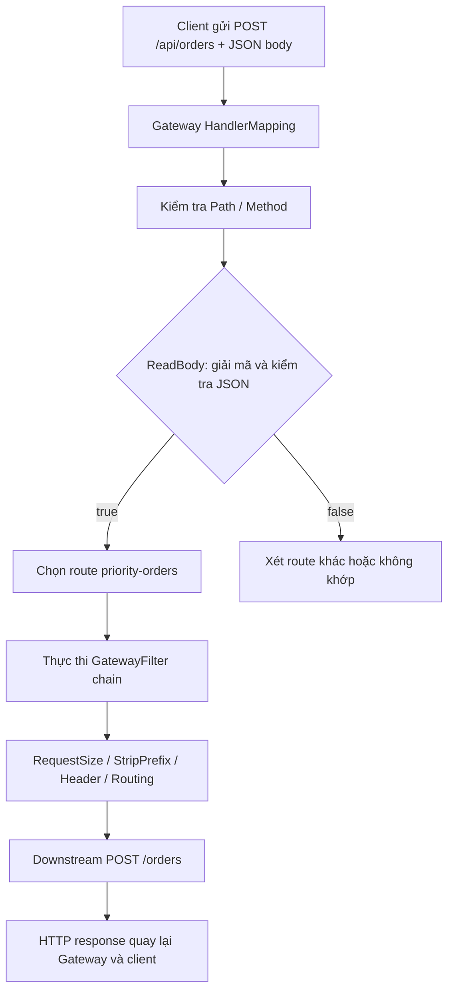
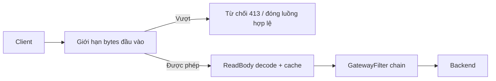

# ReadBody qua Java DSL và giới hạn lưu request body

**Chương:** Điều kiện định tuyến  
**Module:** `SPRING_CLOUD_GATEWAY` — Spring Cloud Gateway

Trong một API Gateway cho microservices, các route predicate thường kiểm tra thông tin **không cần đọc nội dung request**: `Path`, `Method`, `Host`, `Header` hoặc `Query`. Đôi khi việc chọn đích thực sự phụ thuộc vào nội dung JSON: chẳng hạn request đặt hàng với `"priority": true` được gửi sang nhóm xử lý ưu tiên. **ReadBody Route Predicate** của Spring Cloud Gateway Server WebFlux giải quyết trường hợp này bằng cách đọc body, giải mã về kiểu Java và áp dụng một `Predicate`.

Sự tiện lợi ấy đi kèm chi phí: body HTTP là luồng dữ liệu vốn chỉ đọc một lần; muốn kiểm tra body **trước khi chọn route** nhưng vẫn chuyển body cho downstream, Gateway phải hỗ trợ đọc và **cache** dữ liệu. Nếu mỗi request lớn và nhiều request đến đồng thời, bộ nhớ có thể tăng mạnh. Do vậy, hiểu ReadBody phải đi cùng hiểu **giới hạn kích thước, thời điểm kiểm tra giới hạn và vòng đời cache**, cũng như cách quan sát request khi kết hợp filter chain, retry, circuit breaker và các chính sách bảo mật.

> **Phạm vi:** Ví dụ chính dựa trên **Spring Cloud Gateway Server WebFlux** (reactive). Gateway Server Web MVC và Proxy Exchange có API/mô hình khác; không sao chép `readBody(...)` của WebFlux DSL sang các flavor đó mà không kiểm tra tài liệu tương ứng. Với release train mới, starter WebFlux được đặt tên `spring-cloud-starter-gateway-server-webflux`; tên dependency và prefix YAML đời cũ có thể khác.

## 1. Kết quả cần đạt

Sau bài học, bạn có thể:

1. Giải thích `ReadBody` nhận dữ liệu ở bước **chọn route** và khác `CacheRequestBody`/`ModifyRequestBody` ở bước filter.
2. Viết cấu hình `RouteLocatorBuilder` sử dụng `readBody(Class<T>, Predicate<T>)`, kết hợp `Path` và `Method`.
3. Chứng minh rằng body vẫn đến downstream khi route khớp, thay vì bị predicate tiêu thụ mất.
4. Phân biệt request không khớp predicate, body JSON không hợp lệ và body vượt giới hạn.
5. Đánh giá bộ nhớ theo kích thước body, số lượng request đồng thời và các cơ chế cache khác.
6. Xác định giới hạn của `RequestSize` khi nó nằm **sau** bước đọc body để chọn route, và thiết kế lớp bảo vệ đến trước khi body được tổng hợp.

## 2. ReadBody làm việc ở đâu trong luồng Gateway?



Các bước có ý nghĩa khác nhau:

| Bước | Câu hỏi | Thời điểm |
|---|---|---|
| `Path`, `Method` | Request này có đáng xét route body không? | Chọn route |
| `ReadBody` | Nội dung body có thỏa điều kiện Java không? | **Chọn route** |
| `RequestSize`, `StripPrefix`, `AddRequestHeader` | Có cho phép chuyển tiếp và cần thay đổi gì? | **Sau khi route đã được chọn** |
| Routing filter | Gửi request đến `http://`, `https://` hay `lb://` nào? | Sau các bộ lọc liên quan |

**Điểm mấu chốt:** `ReadBody` là *route predicate*, không phải một GatewayFilter. Một `GatewayFilter` đặt trong route **chưa thể chạy** nếu predicate của route chưa hoàn tất. Điều này ảnh hưởng trực tiếp đến cách giới hạn body size.

### 2.1. Vì sao cần cache?

Trong Spring WebFlux, `ServerHttpRequest.getBody()` cung cấp luồng `Flux<DataBuffer>`. Khi một thành phần đã tiêu thụ luồng này, không thể giả định một handler phía sau sẽ đọc lại y nguyên như một mảng byte có sẵn. `ReadBody` sử dụng cơ chế cache và giải mã body để đánh giá điều kiện; tài liệu Spring mô tả rằng body được cache trong bộ nhớ sau lần đọc đầu tiên để những lần đánh giá tiếp theo không cần deserialize lại.

Mô hình khái niệm:

```text
HTTP request body (stream, một lượt đọc)
         |
         v
  ReadBody predicate
    | đọc/giải mã thành đối tượng Java
    | giữ dữ liệu cần thiết trong cache/request attributes
    +-- kiểm tra điều kiện -> true/false
         |
         v
  Request được xử lý tiếp; Gateway dùng cơ chế replay/cache thích hợp
  để chuyển body xuống downstream khi route khớp.
```

Không tự đọc `exchange.getRequest().getBody()` thêm lần nữa trong một predicate/filter tùy chỉnh rồi hy vọng downstream vẫn nhận body, trừ khi bạn hiểu và cài đặt đúng caching, decoration, ownership và giải phóng `DataBuffer`. Đặc biệt với pooled Netty buffers, giữ tham chiếu quá lâu hoặc release sai có thể gây memory leak hay lỗi body rỗng.

### 2.2. Khi nào không nên sử dụng ReadBody?

Nếu có thể định tuyến bằng `Path`, `Method`, `Host`, `Header` hoặc metadata đã được chuẩn hóa tại lớp xác thực, hãy ưu tiên các predicate đó: chúng không bắt buộc decode body trước khi định tuyến. Với file upload, multipart lớn, streaming request hoặc body binary, cần rất thận trọng vì thiết kế lấy cả body vào bộ nhớ dễ đánh mất lợi ích streaming của WebFlux.

## 3. API Java DSL: cấu trúc và ý nghĩa

Tài liệu chính thức minh họa phương thức:

```java
@Bean
public RouteLocator routes(RouteLocatorBuilder builder) {
    return builder.routes()
        .route("read-body-route", r -> r
            .readBody(String.class, body -> body.contains("yes"))
            .uri("https://example.org"))
        .build();
}
```

`readBody` nhận hai tham số:

| Tham số | Ví dụ | Ý nghĩa |
|---|---|---|
| `inClass` | `String.class`, `Map.class`, một DTO | Kiểu Java mà HTTP message reader dùng để giải mã body |
| `predicate` | `body -> Boolean.TRUE.equals(body.get("priority"))` | Hàm Java đánh giá đối tượng đã giải mã; `true` mới chọn route |

**Chỉ Java DSL hỗ trợ ReadBody:** không thể biểu diễn Java `Predicate<T>` bằng chuỗi YAML. Cấu hình bên dưới là **không hợp lệ cho ReadBody**:

```yaml
# Sai ý tưởng: ReadBody không hỗ trợ khai báo lambda bằng YAML.
spring:
  cloud:
    gateway:
      server:
        webflux:
          routes:
            - id: invalid-read-body
              uri: http://localhost:8081
              predicates:
                - ReadBody=body -> body.contains("yes")
```

Bạn vẫn có thể dùng YAML cho route thông thường, trong khi các route cần ReadBody được khai báo dưới dạng bean `RouteLocator`.

### 3.1. `String.class` hay DTO/`Map.class`?

Ví dụ dùng `String.class` dễ bắt đầu nhưng dễ gây định tuyến sai:

```java
.readBody(String.class, body -> body != null && body.contains("priority"))
```

Điều kiện trên khớp cả `{"priority":false}` và `{"comment":"priority"}`. Cả khoảng trắng và thứ tự key JSON cũng làm cho phép tìm kiếm chuỗi cụ thể trở nên mong manh. Với JSON nghiệp vụ, hãy **giải mã cấu trúc** rồi so sánh giá trị đã được parse:

```java
.readBody(Map.class, body ->
    body != null && Boolean.TRUE.equals(body.get("priority")))
```

Với hệ thống thực, thường nên dùng DTO và validation phù hợp schema. Khi so sánh giá trị, xử lý rõ null/thiếu field, kiểu dữ liệu sai và các trường không được phép.

## 4. Bài lab: định tuyến đơn hàng ưu tiên theo JSON

Ta tạo hai ứng dụng:

- **Gateway WebFlux** ở `http://localhost:8080`, chỉ chuyển request `POST /api/orders` nếu body JSON có `"priority": true`.
- **Orders Backend** ở `http://localhost:8081`, nhận `POST /orders` và trả JSON chứa payload nhận được.

Ứng dụng Gateway và backend có thể chạy với web stack khác nhau vì liên lạc qua HTTP.

### 4.1. Backend Spring Boot tối thiểu

Tạo ứng dụng Spring Boot có dependency **Spring Web**, Java 17+ theo phiên bản Boot đã chọn. `application.yml` của **backend**:

```yaml
server:
  port: 8081
```

Tạo `OrdersBackendApplication.java`:

```java
package com.example.orders;

import java.util.Map;
import org.springframework.boot.SpringApplication;
import org.springframework.boot.autoconfigure.SpringBootApplication;
import org.springframework.http.MediaType;
import org.springframework.web.bind.annotation.PostMapping;
import org.springframework.web.bind.annotation.RequestBody;
import org.springframework.web.bind.annotation.RestController;

@SpringBootApplication
public class OrdersBackendApplication {
    public static void main(String[] args) {
        SpringApplication.run(OrdersBackendApplication.class, args);
    }
}

@RestController
class OrderController {
    @PostMapping(value = "/orders", consumes = MediaType.APPLICATION_JSON_VALUE)
    public Map<String, Object> receive(@RequestBody Map<String, Object> body) {
        return Map.of("backend", "orders-8081", "received", body);
    }
}
```

Thử trực tiếp backend trước:

```bash
curl -i -X POST http://localhost:8081/orders \
  -H "Content-Type: application/json" \
  --data '{"priority":true,"orderId":"A-100"}'
```

Phản hồi kỳ vọng có `backend=orders-8081` và `received.priority=true`. Trường `orderId` giúp kiểm tra nội dung vẫn đến backend, không chỉ điều kiện định tuyến.

### 4.2. Cấu hình Gateway bằng Java DSL

Tạo một Spring Boot Gateway Server WebFlux riêng. Với Spring Cloud 2025.0+/dòng Gateway tương thích, thêm starter sau, do Spring Cloud BOM tương ứng quản lý version:

```xml
<dependency>
    <groupId>org.springframework.cloud</groupId>
    <artifactId>spring-cloud-starter-gateway-server-webflux</artifactId>
</dependency>
```

`application.yml` **của Gateway**:

```yaml
server:
  port: 8080

spring:
  application:
    name: gateway-readbody-lab
```

Tạo `BodyRouteConfiguration.java` trong package được `@SpringBootApplication` quét:

```java
package com.example.gateway;

import java.util.Map;
import org.springframework.cloud.gateway.route.RouteLocator;
import org.springframework.cloud.gateway.route.builder.RouteLocatorBuilder;
import org.springframework.context.annotation.Bean;
import org.springframework.context.annotation.Configuration;
import org.springframework.http.HttpMethod;
import org.springframework.util.unit.DataSize;

@Configuration
public class BodyRouteConfiguration {

    @Bean
    public RouteLocator orderBodyRoutes(RouteLocatorBuilder builder) {
        return builder.routes()
            .route("priority-orders", r -> r
                .path("/api/orders")
                .and()
                .method(HttpMethod.POST)
                .and()
                .readBody(Map.class, body ->
                    body != null
                        && Boolean.TRUE.equals(body.get("priority")))
                .filters(f -> f
                    .setRequestSize(DataSize.ofKilobytes(64))
                    .stripPrefix(1)
                    .addRequestHeader("X-Selected-Route", "priority-orders"))
                .uri("http://localhost:8081"))
            .build();
    }
}
```

Ở ví dụ trên:

1. `path("/api/orders")` và `method(HttpMethod.POST)` là các điều kiện rẻ hơn, nên đặt **trước** điều kiện đọc body bằng cách kết hợp `and()`.
2. `readBody(Map.class, ...)` giải mã JSON thành `Map` và chỉ khớp khi trường `priority` thực sự là boolean `true`. Chuỗi `"true"` không được xem là boolean `true`.
3. `setRequestSize(DataSize.ofKilobytes(64))` yêu cầu giới hạn `64 KiB` ở **route filter**, tương đương 65.536 byte. **Filter này chạy sau ReadBody** và không bảo vệ toàn diện việc cache xảy ra khi đánh giá predicate.
4. `stripPrefix(1)` chuyển `/api/orders` thành `/orders` để backend nhận đúng mapping.
5. `addRequestHeader(...)` đặt header phục vụ quan sát, không phải bằng chứng xác thực nguồn tin cậy.
6. `uri("http://localhost:8081")` là địa chỉ downstream; khi chuyển sang `lb://orders-service` cần bổ sung Spring Cloud LoadBalancer và nguồn service instances.

> **Quan trọng:** `setRequestSize` là tên phương thức trong Java DSL `GatewayFilterSpec`; trong cấu hình YAML của route không dùng Java DSL, filter tương ứng mang tên `RequestSize` với đối số `maxSize`. Không nhầm `setRequestSize` với một phương thức `requestSize` trên mọi phiên bản/flavor.

### 4.3. Kiểm tra ba trường hợp

Khởi động backend `8081` rồi Gateway `8080`; từ terminal thứ ba:

```bash
# Có priority=true: route được chọn và chuyển tiếp body.
curl -i -X POST http://localhost:8080/api/orders \
  -H "Content-Type: application/json" \
  --data '{"priority":true,"orderId":"A-100"}'

# priority=false: route không khớp.
curl -i -X POST http://localhost:8080/api/orders \
  -H "Content-Type: application/json" \
  --data '{"priority":false,"orderId":"B-200"}'

# Sai method: không vào route POST.
curl -i http://localhost:8080/api/orders
```

| Lệnh thử | Điều kiện ReadBody | Kết quả kỳ vọng với ví dụ **chỉ có một route** |
|---|---|---|
| POST với `"priority": true` | `true` | Backend nhận body và trả JSON, thông thường `200` |
| POST với `"priority": false` | `false` | Không chọn route này; Gateway thường trả `404` nếu không có route khác |
| GET cùng path | Không đến ReadBody nếu `Method` loại sớm | Không chọn route; thường `404` |

Nếu có thêm route khác khớp cùng request, kết quả có thể khác và còn phụ thuộc thứ tự ưu tiên route. Vì vậy không dùng mã `404` như một đặc tính bắt buộc của `ReadBody` trong mọi cấu hình.

Điều đáng kiểm chứng nhất ở request đầu là **backend nhận được nguyên payload hợp lệ** (ít nhất `priority` và `orderId`), dù Gateway đã giải mã body để xét predicate trước đó.

## 5. Body JSON sai định dạng, thiếu body hoặc sai Content-Type

`ReadBody(Map.class, ...)` yêu cầu có message reader/decoder tương thích và dữ liệu đầu vào phù hợp. Khác biệt giữa các request:

| Trường hợp | Ví dụ | Khả năng xảy ra |
|---|---|---|
| JSON hợp lệ, trường boolean | `{"priority":true}` | Predicate kiểm tra bình thường |
| JSON hợp lệ nhưng thiếu field | `{"orderId":"C-1"}` | `body.get("priority")` là null, predicate trả false |
| Sai kiểu field | `{"priority":"true"}` | Không khớp vì đây là chuỗi |
| JSON sai cú pháp | `{"priority":` | Lỗi giải mã; không đồng nhất với predicate false |
| Thiếu `Content-Type` hoặc khai báo sai | Body JSON nhưng `text/plain` | Decoder cho `Map.class` có thể không chọn được hoặc trả lỗi media type |
| Empty body | Không có bytes | Cách xử lý phụ thuộc body reader và phiên bản; không nên suy đoán luôn là false |

Trong bài lab, luôn gửi header `Content-Type: application/json` và JSON hợp lệ khi đánh giá logic route. Thêm kiểm thử body rỗng, sai kiểu và JSON lỗi như **nhóm ca kiểm tra lỗi độc lập**. Phản hồi có thể là lỗi 4xx/5xx tùy thời điểm giải mã, error handling và phiên bản; xác minh log trước khi gán cứng một HTTP status.

### Vì sao không nhét validation phức tạp vào predicate?

Route predicate nên làm một phép kiểm tra **nhanh, xác định, không chặn thread**. Không gọi database, không dùng `.block()`, không gọi HTTP đồng bộ hoặc truy cập file lâu trong lambda. Những việc này dễ chặn event-loop Netty, làm tăng latency cho các request khác.

Chẳng hạn cần xét quyền người dùng, hạn mức, token, policy chi tiết hoặc lưu trạng thái, hãy áp dụng Spring Security, filter phù hợp và backend nghiệp vụ. `ReadBody` chỉ nên quyết định **route nào phù hợp** với tín hiệu nhỏ, không thay thế xác thực/ủy quyền.

## 6. Vì sao phải giới hạn lưu request body?

WebFlux hỗ trợ xử lý dữ liệu theo luồng, nhưng một predicate cần **cả nội dung request** để đưa ra quyết định sẽ khiến hệ thống giữ dữ liệu/đối tượng đã giải mã trong một khoảng thời gian. Ngay cả khi mỗi request nhỏ, tổng số request đồng thời cũng có thể tạo áp lực lên heap và direct memory.

Ước tính sơ bộ với body tối đa `64 KiB`:

| Số request đang giữ body đồng thời | Dữ liệu body thô tối thiểu, chưa tính overhead |
|---:|---:|
| 10 | Khoảng 640 KiB |
| 100 | Khoảng 6,25 MiB |
| 1.000 | Khoảng 62,5 MiB |
| 5.000 | Khoảng 312,5 MiB |

Đây chỉ là phép nhân `concurrency × bytes/request`. Bộ nhớ thực tế còn gồm `DataBuffer`, đối tượng Java sau khi giải mã JSON, map/string, attributes của exchange, bản sao tạm, request retry và chi phí runtime. Không dùng bảng này để đặt thẳng `-Xmx` mà phải đo cùng peak concurrency, GC và direct memory của Netty.

Các rủi ro chính:

- Request lớn, nhất là JSON có base64, array lớn hoặc nhiều trường;
- Nhiều request đồng thời cùng vào route có `ReadBody`;
- Nhiều route đọc body, thêm cache/biến đổi body hoặc retry có body;
- Client gửi body chậm, không có `Content-Length` hoặc sử dụng chunked transfer;
- Log/trace lưu nguyên payload nhạy cảm, gây thêm áp lực và rò rỉ thông tin.

**Không xem `Content-Length` là bằng chứng chắc chắn về kích thước body đã nhận.** Với HTTP/1.1 chunked, HTTP/2 và một số client, độ dài có thể không được khai báo trước. Nếu cần bảo vệ cứng, phải tính byte thực nhận.

## 7. Ba lớp kiểm soát kích thước khác nhau

| Cơ chế | Thời điểm | Bảo vệ điều gì? | Giới hạn |
|---|---|---|---|
| **Ingress / WebFilter trước route** có kiểm đếm bytes thực | Trước `ReadBody` | Chặn body quá lớn trước khi decode/cache | Kiểm tra riêng header `Content-Length` chưa đủ |
| **Giới hạn HTTP codec** như `maxInMemorySize` | Trong lúc reader/decoder buffer | Hạn chế bộ nhớ mà codec được phép aggregate theo cấu hình | Không phải absolute cap cho mọi cách cache và streaming |
| **`RequestSize` GatewayFilter** | Sau khi route khớp | Hạn chế request xuống downstream, có thể trả HTTP 413 | Không xóa chi phí đọc/cache body đã xảy ra ở bước predicate |

### 7.1. Thời điểm chạy `RequestSize`

Trong ví dụ Java DSL:

```java
.filters(f -> f
    .setRequestSize(DataSize.ofKilobytes(64))
    .stripPrefix(1))
```

`setRequestSize` cấu hình filter trên route với ngưỡng `64 KiB = 65.536 bytes`. Tài liệu Spring Cloud Gateway mô tả filter `RequestSize` với đối số `maxSize`: nếu nó xác định request vượt giới hạn, Gateway từ chối (thông thường `413 Payload Too Large`) và không forward downstream.

Tuy nhiên, thứ tự là:

```text
Client POST kèm body
   -> HandlerMapping xét route
   -> ReadBody đọc/giải mã/cache để biết predicate đúng hay sai
   -> route khớp: Gateway mới chạy RequestSize GatewayFilter
   -> những filter còn lại -> downstream
```

Vì vậy, body có thể đã được đưa vào bộ nhớ **trước khi `RequestSize` được gọi**. Nếu `ReadBody` trả false, toàn bộ filter gắn với route đó không chạy. Nếu body quá lớn gây lỗi decoder, lỗi có thể xảy ra **trước** filter size. Do đó, `RequestSize` chỉ là **một lớp bảo vệ**, không phải một công cụ bảo đảm mọi input vượt ngưỡng không bao giờ được cache.

**Chú ý phiên bản:** đã có báo cáo về hành vi `RequestSize` dựa trên header `Content-Length` trong một số phiên bản, khiến body chunked hoặc request không khai báo độ dài có thể đi qua. Phải kiểm tra trên **đúng bản Gateway và protocol** đang triển khai; nếu cần giới hạn cứng thì phải có bộ đếm bytes thực nhận ở lớp sớm hơn.

Trên một route **YAML thông thường không dùng ReadBody**, cú pháp của cùng loại filter là:

```yaml
spring:
  cloud:
    gateway:
      server:
        webflux:
          routes:
            - id: ordinary-upload
              uri: http://localhost:8081
              predicates:
                - Path=/upload/**
              filters:
                - name: RequestSize
                  args:
                    maxSize: 64KB
```

Không thêm `ReadBody=...` vào YAML này; ReadBody cần Java `Predicate` nên dùng Java DSL. Và cũng không giả định default filters cấu hình qua YAML sẽ tự áp dụng cho **mọi** Java `RouteLocator`; nếu cần filter trên route viết bằng code, khai báo rõ trong DSL.

### 7.2. Giới hạn bộ đệm/decoder WebFlux

`ReadBody(String.class, ...)` hoặc `ReadBody(Map.class, ...)` phụ thuộc vào HTTP reader/decoder. Với các codec cần tổng hợp dữ liệu, Spring WebFlux có `maxInMemorySize`. Ví dụ giới hạn default codecs:

```java
package com.example.gateway;

import org.springframework.context.annotation.Configuration;
import org.springframework.http.codec.ServerCodecConfigurer;
import org.springframework.web.reactive.config.WebFluxConfigurer;

@Configuration
public class CodecLimitConfiguration implements WebFluxConfigurer {
    @Override
    public void configureHttpMessageCodecs(ServerCodecConfigurer configurer) {
        configurer.defaultCodecs().maxInMemorySize(256 * 1024);
    }
}
```

Ở một số phiên bản Spring Boot WebFlux, có thể cấu hình bằng property `spring.codec.max-in-memory-size`; phải đối chiếu phiên bản đang dùng và xác minh property thực sự tác động đến reader/decoder của Gateway. Khi codec vượt ngưỡng, bạn có thể gặp `DataBufferLimitException`. **Mã HTTP cuối không tự động luôn là 413**: còn phụ thuộc exception mapping của WebFlux/Gateway và cấu hình error handler.

Ví dụ lab chọn `256 KiB` cho codec và `64 KiB` cho `RequestSize` để có thể quan sát hai tầng riêng. Trong ứng dụng thật, chọn ngưỡng theo schema payload và giới hạn tài nguyên; tăng codec limit quá cao chỉ để hết lỗi có thể làm tăng nguy cơ cạn bộ nhớ.

### 7.3. Giới hạn trước khi predicate đọc body

Nếu mục tiêu là **không cache body vượt quá 64 KiB**, phải chặn ở lớp **đến trước bước chọn route**:

1. Đặt giới hạn kích thước ở load balancer, ingress, reverse proxy hoặc server HTTP có khả năng đếm **bytes thực nhận** và từ chối khi vượt ngưỡng (bao gồm chunked/HTTP2).
2. Nếu viết `WebFilter` ở WebFlux, kiểm tra `Content-Length` lớn hơn ngưỡng để loại sớm trường hợp dễ nhận biết; đồng thời cần cơ chế **giới hạn stream theo số byte thật**, xử lý backpressure/cancel/release buffer đúng cách. Việc chỉ đọc header là chưa đủ.
3. Tách endpoint file upload/streaming thành route không cần `ReadBody`; chuyển tín hiệu chọn route nhỏ lên header/path khi kiến trúc cho phép.



Ví dụ đơn lẻ:

```java
request.getHeaders().getContentLength() > 64 * 1024
```

chỉ có thể là kiểm tra **fast-fail** khi client khai báo độ dài. `getContentLength()` có thể là `-1`, hoặc không phản ánh hoàn toàn số byte thực tế. Đừng quảng bá đoạn so sánh này như giải pháp chống body không giới hạn; cần bộ đếm trong quá trình nhận và chính sách dừng/cancel request thật sự.

## 8. Kiểm thử request quá lớn

Trong lab, ta có `RequestSize=64 KiB` và codec limit `256 KiB`. Tạo JSON hợp lệ dài khoảng `70 KiB` để kiểm tra tầng filter. Với **Windows PowerShell**:

```powershell
$payload = '{"priority":true,"padding":"' + ('x' * 70000) + '"}'
[System.IO.File]::WriteAllText((Join-Path (Get-Location) 'oversize.json'), $payload)
curl.exe -i -X POST "http://localhost:8080/api/orders" -H "Content-Type: application/json" --data-binary "@oversize.json"
```

Nếu client gửi `Content-Length` đúng và codec không lỗi trước, filter `RequestSize` có thể từ chối request bằng `413`. Backend không nên nhận request này. Nhưng **`ReadBody` đã đọc body để quyết định route**: kết quả 413 không chứng minh Gateway chưa từng cache ~70 KiB.

| Trường hợp | Điều muốn kiểm tra | Quan sát cần ghi lại |
|---|---|---|
| JSON nhỏ, `priority=true` | Chọn route, replay body | Backend nhận payload đầy đủ |
| JSON nhỏ, `priority=false` | ReadBody từ chối route | Backend của route này không được gọi |
| JSON ~70 KiB, `priority=true` | Filter size ở ngưỡng 64 KiB | Status client, log Gateway, log backend |
| Body lớn hơn giới hạn codec | Lỗi giải mã/buffering | Log decoder, status và mức sử dụng bộ nhớ |
| Chunked không có `Content-Length` | Giới hạn thực nhận có bị bỏ qua? | Giao thức request thực tế, số byte backend nhận |

Không mặc định mọi môi trường cho cùng một mã trạng thái ở bốn trường hợp này. Kiểm tra trực tiếp HTTP exchange và log. Các bài thử tải lớn hoặc fuzzing cần môi trường cô lập; không dùng dữ liệu thật hay tạo áp lực không kiểm soát trên Gateway đang phục vụ production.

## 9. ReadBody khác CacheRequestBody và ModifyRequestBody thế nào?

Ba tên này dễ gây nhầm lẫn vì cùng liên quan đến việc đọc/có thể lưu body:

| Khái niệm | Loại | Mục đích chính | Khi nào thực thi? |
|---|---|---|---|
| `ReadBody` | **Route predicate factory** | Giải mã và kiểm tra body để **quyết định có chọn route** | Khi Gateway tìm route |
| `CacheRequestBody` | **GatewayFilter factory** | Đọc/cache body để các filter/handler phía sau có thể sử dụng | Sau khi route được chọn |
| `ModifyRequestBody` | **GatewayFilter factory** | Chuyển đổi nội dung body trước khi gửi downstream | Sau khi route được chọn |
| `RequestSize` | **GatewayFilter factory** | Hạn chế body vượt ngưỡng theo khả năng của filter | Sau khi route được chọn |

`CacheRequestBody` thường được cấu hình với `bodyClass` và có thể lưu đối tượng body vào `ServerWebExchange` attributes. `ModifyRequestBody` dùng các kiểu dữ liệu và rewrite function để biến đổi payload. **Không cần tự thêm CacheRequestBody chỉ vì đã dùng ReadBody**; cấu hình thừa có thể khiến đường đời body và bộ nhớ khó hiểu hơn. Nếu nhiều thành phần cần body, xác định rõ bên nào đọc đầu tiên, nơi lưu cache và cách trả body về downstream.

Ví dụ route chỉ cần cache body để filter khác sử dụng (không dựa vào body để **chọn route**) có thể dùng:

```yaml
spring:
  cloud:
    gateway:
      server:
        webflux:
          routes:
            - id: cache-body-example
              uri: http://localhost:8081
              predicates:
                - Path=/inspect/**
              filters:
                - name: CacheRequestBody
                  args:
                    bodyClass: java.lang.String
```

Ví dụ này cho thấy **CacheRequestBody có thể khai báo qua YAML**, trong khi `ReadBody` không thể. CacheRequestBody chỉ được tài liệu Gateway Server WebFlux mô tả cho request HTTP/HTTPS; không mặc định áp dụng cho WebSocket hoặc streaming vô hạn.

## 10. Nhiều route cùng path: cách tránh đọc body không cần thiết

Giả sử hệ thống có tuyến:

- `POST /api/orders` với `priority=true` đến backend ưu tiên;
- `POST /api/orders` còn lại đến backend thường.

Cách tiếp cận dễ hiểu là đặt route có `ReadBody` **trước** route dự phòng cho path/method đó, dựa trên thứ tự route được cấu hình:

```text
POST /api/orders
  -> Kiểm tra path và method
  -> Kiểm tra ReadBody(priority == true)
      -> true: priority-orders
      -> false: xét standard-orders
  -> Thực hiện filter chain của route được chọn
  -> Chuyển tiếp body
```

Tuy nhiên, có các điểm phải **thử bằng test end-to-end**:

1. Thứ tự chọn route có đúng như mong muốn không? Nếu route tổng quát được ưu tiên hơn, ReadBody có thể không được đánh giá.
2. Khi ReadBody của route đầu **đã đọc body nhưng trả false**, route phía sau có còn nhận được body đầy đủ không? Kiểm tra trên phiên bản Gateway đang chạy, đặc biệt nếu kết hợp filter tự viết.
3. Hai route có dùng `bodyClass` tương thích và không giải mã lại vô ích?
4. Có route nào không mong muốn đọc body cho request upload hoặc request đã bị giới hạn bởi `Path/Method`?
5. Chỉ một route được chọn mỗi request, nhưng các bước predicate trước đó vẫn có thể tiêu tốn CPU/bộ nhớ.

Để giảm việc cache không cần thiết, **ưu tiên kiểm tra `Path` và `Method` trước** trong DSL. Đừng đặt ReadBody là điều kiện đầu tiên cho mọi URL trên Gateway. Nếu phần lớn request không cần định tuyến theo body, cân nhắc tách chúng ra khỏi đường đi của `ReadBody`.

## 11. Tương tác với xác thực, rate limiting, retry và circuit breaker

ReadBody là bước lựa chọn tuyến, không phải một biện pháp bảo vệ ứng dụng. Khi thiết kế API Gateway an toàn:

### 11.1. Xác thực và phân quyền

- Cần xác thực request ở lớp phù hợp bằng Spring Security và chính sách tin cậy giữa Gateway/backend.
- Giá trị JSON như `"tenant":"gold"` hoặc `"role":"admin"` do client gửi **không chứng minh** client có quyền của tenant hoặc vai trò đó. ReadBody có thể dùng làm gợi ý định tuyến, nhưng backend vẫn phải kiểm tra authorization.
- Hạn chế trả lỗi phân biệt quá chi tiết giữa các route nhạy cảm; route mismatch không nên làm lộ tên service hoặc trạng thái dữ liệu người dùng.
- Không ghi body, token, cookie hoặc thông tin khách hàng thật vào log để debug.

### 11.2. Giới hạn lưu lượng

`RequestRateLimiter` giúp áp dụng chính sách theo key phù hợp, nhưng một **GatewayFilter theo route** cũng chạy sau khi ReadBody đã khớp. Nếu mục tiêu là hạn chế request từ sớm để giảm áp lực decode/cache, thiết kế thêm lớp kiểm soát đầu vào hoặc dùng cơ chế được tích hợp ở tầng nhận request.

Phải kiểm soát cả **kích thước payload** và **số request/concurrency**. Body nhỏ nhưng hàng chục nghìn kết nối đồng thời cũng có thể gây memory pressure, còn một request quá lớn có thể vượt budget một mình.

### 11.3. Retry và idempotency

Với các HTTP method có body, Gateway Retry có thể phải cache dữ liệu để phát lại; tài liệu Spring cảnh báo điều này có thể gây giới hạn bộ nhớ. Một route `POST /orders` không nên tự động retry như `GET /products` nếu không có cơ chế idempotency hoặc business key tránh xử lý lặp đơn hàng/thanh toán.

Nếu đã kết hợp `ReadBody + Retry + ModifyRequestBody`, hãy kiểm tra kỹ:

- Body qua **lần forward đầu và các lần retry** có giống nhau không;
- Các filter phía sau Retry có chạy lại và gây side effect gì không;
- Cache có được giải phóng khi request kết thúc/lỗi/cancel không;
- Timeout, số lần retry và lượng request đồng thời có tạo quá tải downstream không.

### 11.4. Circuit breaker và khả năng chịu lỗi

Circuit breaker có thể bảo vệ một backend lỗi, nhưng không làm cho `ReadBody` trở thành thao tác không tốn bộ nhớ. Nếu request không khớp predicate, circuit breaker gắn với route sẽ không chạy. Nếu request khớp rồi backend lỗi, circuit breaker mới có thể tác động theo filter và cấu hình tương ứng.

### 11.5. TLS và khám phá dịch vụ

ReadBody không thay đổi logic TLS của kết nối Gateway → backend. Có thể thay `uri("http://localhost:8081")` thành một backend `https://...`, khi đó phải kiểm tra truststore/hostname và mTLS nếu cần. Tương tự, nếu chọn `lb://orders-service`, Gateway cần Spring Cloud LoadBalancer và nguồn service instances.

Sự tồn tại của ReadBody không tự bật xác thực, rate limiting, TLS, retry, circuit breaker, metrics hoặc discovery; mỗi năng lực cần được thiết kế và cấu hình ở đúng lớp.

## 12. Quan sát, đo đạc và chẩn đoán

### 12.1. Điều gì nên theo dõi?

| Tín hiệu | Lý do |
|---|---|
| Số request đến `/api/orders` theo method, status và route ID | Phân biệt request không khớp với lỗi downstream |
| Tỉ lệ `priority=true` / không khớp | Kiểm chứng chính sách routing theo body |
| Tỉ lệ HTTP 413, lỗi codec và lỗi JSON decoder | Phát hiện payload quá giới hạn hoặc sai định dạng |
| Body-size histogram theo dải, không lưu body thô | Chọn memory budget và giới hạn phù hợp |
| Concurrent requests, heap usage, direct memory, GC pause | Phát hiện cache tạo áp lực |
| Thời gian chọn route và tổng latency qua Gateway | Phát hiện decode body trở thành bottleneck |
| Số lượt backend nhận trên mỗi request/trace | Phát hiện retry hoặc request lặp |

Không dùng **body content** làm label của metric: nhãn có cardinality cao, chứa thông tin nhạy cảm và làm hệ thống giám sát quá tải. Dùng route ID, loại trạng thái, endpoint chuẩn hóa và reason code đã kiểm soát.

### 12.2. Lỗi thường gặp

| Hiện tượng | Nguyên nhân có thể | Hành động kiểm tra |
|---|---|---|
| `priority=true` nhưng không route | `Content-Type` sai, key sai kiểu, route order, `Path/Method` không khớp | Xem payload JSON, log và định nghĩa DSL |
| `priority=false` nhận 404 | Không có route dự phòng | Đây có thể là kết quả đúng; thêm route fallback nếu nghiệp vụ cần |
| JSON lỗi gây exception | Reader không parse được body | Kiểm tra log decoder, không đánh đồng với false |
| Backend thấy body rỗng hoặc bị thay đổi | Có filter/handler tùy chỉnh đọc stream và không replay đúng | Kiểm tra thứ tự filter, body decorator, cache |
| HTTP 413 cho body tương đối nhỏ | Ngưỡng `RequestSize` hoặc ingress limit thấp | So sánh kích thước raw bytes, đơn vị KiB/KB và Content-Length |
| `DataBufferLimitException` | Codec không cho aggregate thêm bytes | So sánh `maxInMemorySize`, body-size thực tế, loại reader |
| Body lớn bị cache trước khi 413 | `ReadBody` chạy khi xét route, RequestSize chạy sau | Bổ sung giới hạn trước route |
| Request không có Content-Length lọt qua | Filter size/proxy chưa đo được bytes thực nhận | Kiểm tra chunked/HTTP2, cấu hình ingress và version |
| Tăng heap làm lỗi giảm tạm thời | Concurrency/body size quá cao | Giảm mức cache, áp sớm size/concurrency limit |
| Một POST được xử lý nhiều lần | Retry, client resubmit hoặc timeout | Kiểm tra trace/request ID, idempotency key |

### 12.3. Quy trình debug theo từng lớp

1. Gọi backend trực tiếp với payload nhỏ để xác nhận `POST /orders` hoạt động.
2. Xác nhận Gateway có đúng `RouteLocator` bean, `Path` và `Method` khớp.
3. Gửi JSON `priority=true`, quan sát backend nhận đủ body.
4. Đổi `priority=false`, xác nhận route không được chọn trong lab một route.
5. Thử JSON sai cú pháp hoặc Content-Type không đúng, đối chiếu lỗi decoder.
6. Thử request khoảng 70 KiB và xem log của `RequestSize`; phân biệt 413 với lỗi codec.
7. Kiểm tra ingress/streaming size protection, không chỉ dựa vào `Content-Length`.
8. Đo memory và concurrency trước khi mở route cho lưu lượng thật.

## 13. Checklist thiết kế trước khi đưa lên môi trường vận hành

- [ ] Chỉ dùng ReadBody khi điều kiện định tuyến **thực sự phải** dựa vào body.
- [ ] Giới hạn phạm vi bằng `Path`/`Method` trước khi đọc payload.
- [ ] Dùng DTO/`Map` có kiểu rõ thay cho phép `String.contains(...)` trên JSON nghiệp vụ.
- [ ] Predicate không block event loop, không có side effect và không thao tác I/O đồng bộ.
- [ ] Có giới hạn bytes thực nhận ở lớp **trước route selection**, kể cả khi `Content-Length` vắng mặt.
- [ ] Codec limit, `RequestSize` và ingress limit được kiểm thử như **ba tầng khác nhau**.
- [ ] Thử body rỗng, sai media type, JSON lỗi, trường sai kiểu và request chunked.
- [ ] Kiểm tra body được downstream nhận nguyên vẹn ở route khớp; kiểm tra route fallback nếu có.
- [ ] Đã tính memory budget theo concurrency, body size, số lần cache/retry.
- [ ] Không dùng nội dung body chưa được xác thực để cấp quyền hoặc bỏ qua security.
- [ ] Không log raw body/token/cookie; metrics không tạo nhãn có dữ liệu nhạy cảm.
- [ ] Có đo đạc lỗi codec, status 413, timeout, heap/direct memory và số lượt retry.

## 14. Câu hỏi ôn tập

1. Tại sao không thể viết `ReadBody=...` trong `application.yml` như các predicate `Path`/`Method`?
2. ReadBody chạy trước hay sau `RequestSize` khi cả hai thuộc cùng một route?
3. Request `{"priority":"true"}` có khớp lambda `Boolean.TRUE.equals(body.get("priority"))` không?
4. Khi Gateway trả `DataBufferLimitException`, tăng `RequestSize.maxSize` có giải quyết đúng nguyên nhân không?
5. Tại sao `Content-Length` có thể không tồn tại? Làm sao giới hạn body dù không có header này?
6. Vì sao một retry của POST có body có thể tăng bộ nhớ và tạo đơn hàng trùng?
7. Khi một route body-specific không khớp, vì sao mọi filter trên route đó có thể chưa hề chạy?

**Đáp án định hướng:** (1) cần Java `Predicate<T>`; (2) ReadBody là predicate nên chạy khi chọn route, RequestSize là filter nên chạy sau; (3) không, đó là chuỗi; (4) không, cần xem codec limit; (5) chunked/HTTP2, phải kiểm số byte thực nhận; (6) body được cache/phát lại, backend có thể xử lý lặp; (7) vì filter chain chỉ thực thi cho route được chọn.

## 15. Tổng kết

`ReadBody` cho phép **Spring Cloud Gateway Server WebFlux định tuyến dựa trên nội dung request** thông qua `RouteLocatorBuilder` và một Java predicate. Khi route khớp, Gateway có cơ chế cache/replay để downstream vẫn xử lý payload. Đây là giải pháp hữu ích khi có một tín hiệu JSON nhỏ quyết định nhóm dịch vụ đích, nhưng việc đọc body trước khi chọn route làm tăng chi phí bộ nhớ.

Để vận hành an toàn, đừng chỉ nhìn vào số `64 KiB` trong `setRequestSize`. Hãy xác định **khi nào bytes được nhận, khi nào được decode/cache, và filter nào chạy trước hoặc sau**; áp giới hạn sớm theo bytes thực nhận, kiểm soát codec limit, dùng RequestSize như một lớp bổ sung và kiểm thử đường đi với body lớn/chunked. Sau đó mới kết hợp với xác thực, giới hạn lưu lượng, circuit breaker, retry, TLS và observability theo đúng nhu cầu của gateway.

## Tài liệu tham khảo

1. [Spring Cloud Gateway Server WebFlux — Route Predicate Factories: ReadBody](https://docs.spring.io/spring-cloud-gateway/reference/spring-cloud-gateway-server-webflux/request-predicates-factories.html).
2. [Spring Cloud Gateway Server WebFlux — Fluent Java Routes API](https://docs.spring.io/spring-cloud-gateway/reference/spring-cloud-gateway-server-webflux/fluent-java-routes-api.html).
3. [Spring Cloud Gateway Server WebFlux — RequestSize GatewayFilter](https://docs.spring.io/spring-cloud-gateway/reference/spring-cloud-gateway-server-webflux/gatewayfilter-factories/requestsize-factory.html).
4. [Spring Cloud Gateway Server WebFlux — CacheRequestBody GatewayFilter](https://docs.spring.io/spring-cloud-gateway/reference/spring-cloud-gateway-server-webflux/gatewayfilter-factories/cacherequestbody-factory.html).
5. [Spring Cloud Gateway Server WebFlux — Retry GatewayFilter](https://docs.spring.io/spring-cloud-gateway/reference/spring-cloud-gateway-server-webflux/gatewayfilter-factories/retry-factory.html).
6. [Spring Framework — WebFlux Config: HTTP Message Codecs](https://docs.spring.io/spring-framework/reference/web/webflux/config.html).
7. [Spring Framework — Reactive Core: Decoder Limits](https://docs.spring.io/spring-framework/reference/web/webflux/reactive-spring.html).
8. [GitHub Spring Cloud Gateway #3843 — báo cáo RequestSize phụ thuộc Content-Length](https://github.com/spring-cloud/spring-cloud-gateway/issues/3843) (xem là báo cáo cần kiểm chứng theo version, không coi như kết luận cho mọi phiên bản).

> **Chú ý phiên bản:** ví dụ dùng API Gateway Server WebFlux với Spring Cloud BOM tương thích. Các bản Spring Cloud Gateway 4.x/5.x có thể khác tên starter và một số thuộc tính; đối chiếu tài liệu theo đúng bản trước khi triển khai. Bài viết mô tả cơ chế và hướng dẫn thực hành, không thay cho kiểm thử memory, protocol và security trên hạ tầng thật.
