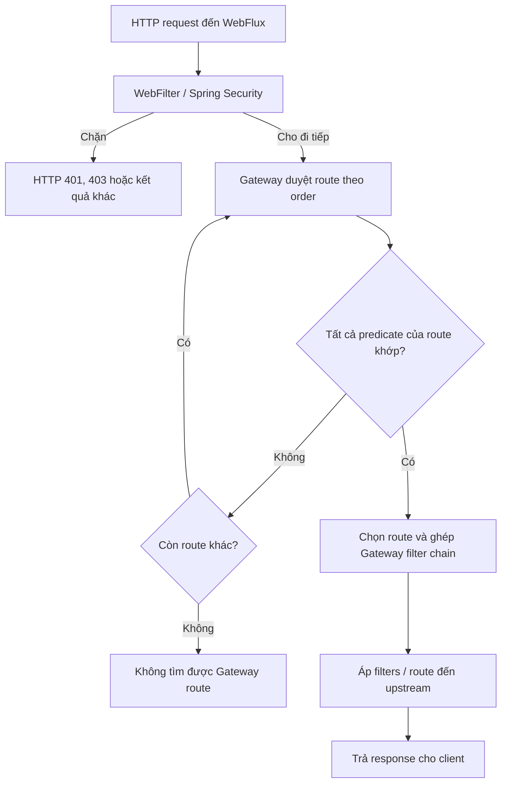
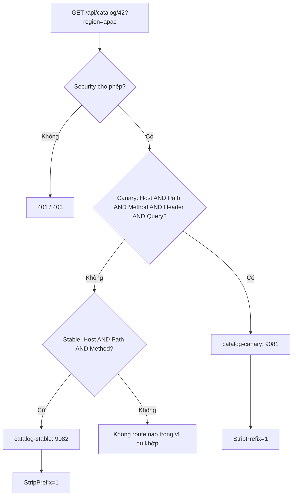
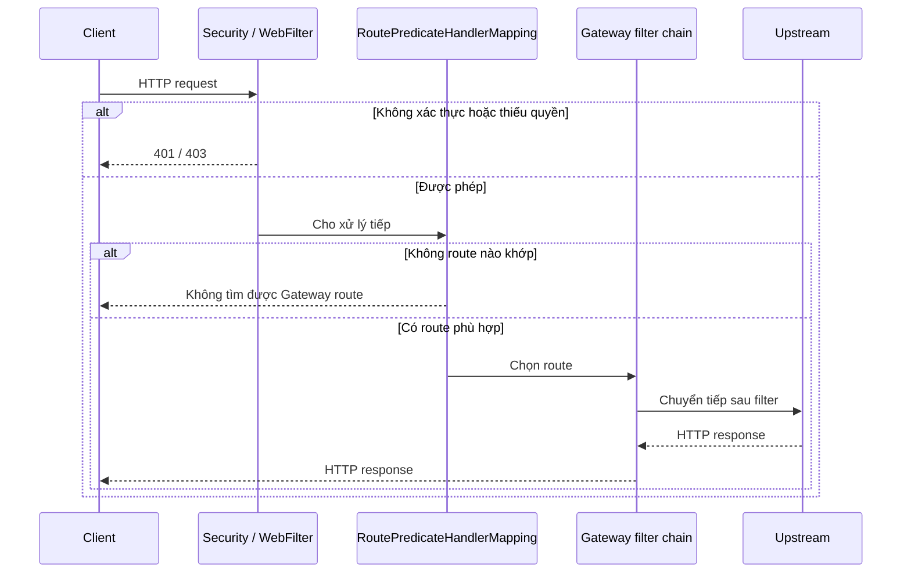

# Phối hợp predicate và kiểm tra điều kiện thực tế của một yêu cầu

Trong **Spring Cloud Gateway**, Route Predicate Factories trả lời câu hỏi: *“Request hiện tại có phù hợp với route này không?”* Một API Gateway thực tế hiếm khi chỉ dựa vào đường dẫn. Ví dụ, cùng `/api/catalog/42`, hệ thống có thể phân luồng theo HTTP method, tên miền, vùng triển khai, header thử nghiệm và chính sách canary, rồi mới áp dụng filter chuyển đổi path/header, retry, circuit breaker hoặc gọi dịch vụ qua service discovery.

Bài học thuộc chương **Điều kiện định tuyến**, tập trung vào **cách phối hợp nhiều predicate** và **cách kiểm tra một request cụ thể sẽ đi vào route nào**. Mục tiêu là suy luận được kết quả định tuyến từ dữ liệu HTTP thực tế, phát hiện route chồng lấn, giải thích vì sao request rơi vào nhánh dự phòng hoặc không tìm được route, và thiết kế cách kiểm thử để xác nhận route được chọn.

> **Phạm vi:** Các ví dụ dùng Spring Cloud Gateway **Server WebFlux**. Một số tên thuộc tính cấu hình thay đổi theo phiên bản/starter. Khi triển khai, kiểm tra prefix `spring.cloud.gateway.routes` hoặc `spring.cloud.gateway.server.webflux.routes` phù hợp với bản đang sử dụng; nguyên tắc phối hợp predicate được giữ nguyên. Gateway Server MVC có pipeline và API cấu hình riêng.

## 1. Một route được chọn như thế nào?

Mỗi route chứa các thông tin chính:

| Thành phần | Ví dụ | Vai trò |
| --- | --- | --- |
| `id` | `catalog-canary` | Định danh dùng để quan sát, chẩn đoán |
| `uri` | `http://localhost:9081` hoặc `lb://catalog-service` | Đích của request sau khi route được chọn |
| `predicates` | `Path`, `Method`, `Host`, `Header`, `Query` | Quyết định route có khớp request hay không |
| `filters` | `StripPrefix`, `RewritePath`, `AddRequestHeader`, `Retry` | Xử lý sau khi route đã được chọn |
| `order` | `-10`, `100` | Thứ tự ưu tiên giữa các route có khả năng khớp |

Spring Cloud Gateway WebFlux sử dụng `RoutePredicateHandlerMapping` để xét các route; khi chọn được route, `FilteringWebHandler` tổ chức chuỗi `GlobalFilter` và các `GatewayFilter` thuộc route đó. Trong trường hợp bình thường, các route được xét theo `order` (giá trị **nhỏ hơn** có mức ưu tiên **cao hơn**) và route khớp đầu tiên được sử dụng.



Có hai ranh giới quan trọng:

1. **Predicate được đánh giá trước các Gateway filter của route.** `StripPrefix` hay `RewritePath` không thể khiến một route vốn không khớp trở thành khớp “ngược thời gian”. `Path` nhìn vào URL request tại thời điểm route matching.
2. **Không phải request nào cũng đến bước xét Gateway route.** Spring Security có thể chặn trước; WebFlux có thể xử lý CORS preflight hoặc handler khác. Do đó, một response `401`/`403` không chứng minh rằng predicate `Path` hay `Method` bị sai.

## 2. Hiểu đúng quan hệ AND, OR và ưu tiên route

### Nhiều loại predicate trong cùng route: AND

Ví dụ:

```yaml
predicates:
  - Host=api.example.test
  - Path=/api/catalog/**
  - Method=GET,HEAD
  - Header=X-Canary,enabled
  - Query=region,apac|eu
```

Để **route này** khớp, request cần thỏa **tất cả** điều kiện:

- Host khớp `api.example.test`.
- Đường dẫn khớp `/api/catalog/**`.
- HTTP method thuộc tập `GET` hoặc `HEAD`.
- Header `X-Canary` có giá trị khớp biểu thức chính quy `enabled`.
- Query parameter `region` có giá trị khớp biểu thức chính quy `apac|eu`.

Một điều kiện sai là đủ khiến route không khớp. Gateway không cộng “điểm” cho từng điều kiện. Thỏa 4/5 điều kiện vẫn là **không khớp**.

### Nhiều lựa chọn trong cùng predicate: tùy semantics của factory

Không thể mặc định mọi dấu phẩy đều mang nghĩa OR; **cú pháp do từng Route Predicate Factory định nghĩa**.

| Predicate | Cú pháp | Cách hiểu |
| --- | --- | --- |
| `Method=GET,HEAD` | Danh sách method | GET **hoặc** HEAD |
| `Path=/api/a/**,/api/b/**` | Danh sách path pattern | Một trong hai path pattern |
| `Host=api.example.test,shop.example.test` | Danh sách host pattern | Một trong các host |
| `Header=X-Canary,enabled` | Header name và regex | Có header tên `X-Canary` với giá trị khớp `enabled` |
| `Query=region,apac|eu` | Query name và regex | Có `region` với giá trị khớp `apac` hoặc `eu` |
| `RemoteAddr=10.0.0.0/8,192.168.0.0/16` | Các CIDR | Địa chỉ remote thuộc ít nhất một CIDR |

Trong `Header` và `Query`, dấu phẩy **tách tham số của factory** chứ không phải tách hai lựa chọn độc lập. Với regex, ký hiệu `|` biểu diễn lựa chọn trong biểu thức chính quy Java. Ví dụ `Header=X-Channel,web|mobile` yêu cầu header `X-Channel` khớp `web` hoặc `mobile`.

Biểu thức chính quy thông thường có phân biệt chữ hoa/chữ thường; vì vậy giá trị `ENABLED` không tự động khớp `enabled`. Với các quy tắc quan trọng, kiểm tra cả trường hợp giá trị viết hoa, có khoảng trắng, nhiều giá trị và URL được mã hóa.

### Nhiều route: route nào khớp trước sẽ được chọn

Nếu khai báo hai route với cùng `Path` nhưng method khác nhau, request chỉ khớp route phù hợp. Nếu hai route **cùng có thể khớp**, `order` quyết định route nào được xét trước; không mặc định có cơ chế “route cụ thể hơn luôn thắng”.

Ví dụ:

```yaml
- id: catalog-special
  order: -10
  uri: http://localhost:9081
  predicates:
    - Path=/api/catalog/**
    - Method=GET

- id: api-general
  order: 100
  uri: http://localhost:9082
  predicates:
    - Path=/api/**
```

`GET /api/catalog/42` khớp cả hai nhưng `catalog-special` được ưu tiên. `POST /api/catalog/42` không khớp method của route đặc biệt, song có thể vào `api-general`. Chính route bao phủ rộng có thể tạo ra việc chuyển tiếp không mong muốn nếu thiếu kiểm soát.

Nếu nhiều route chồng lấn và có cùng `order`, không nên dựa vào thứ tự xuất hiện trong YAML như hợp đồng ổn định. Hãy **làm predicate loại trừ nhau** hoặc gán `order` rõ ràng rồi kiểm thử.

### AND/OR/NOT trong Java DSL

Java DSL có thể diễn đạt logic phức tạp hơn YAML shortcut. Ví dụ một route chỉ nhận request đến một trong hai đường dẫn:

```java
@Bean
RouteLocator sampleRoutes(RouteLocatorBuilder builder) {
    return builder.routes()
        .route("catalog-lookup", r -> r
            .path("/api/catalog/**")
            .and()
            .method(HttpMethod.GET, HttpMethod.HEAD)
            .filters(f -> f.stripPrefix(1))
            .uri("http://localhost:9082"))
        .build();
}
```

Trong ví dụ, `.and()` nối điều kiện `Path` và `Method`. Java DSL còn có cơ chế phối hợp boolean như `or` và `negate` tùy API builder của phiên bản đang dùng; khi cần logic nhiều nhánh khó đọc, thường dễ kiểm thử hơn nếu tách thành **nhiều route rõ ràng**, có `order` minh bạch. Đừng nhầm **OR trong danh sách Method** với OR giữa hai predicate thuộc loại khác nhau.

## 3. Case study: chọn canary hay stable cho một request

Giả sử doanh nghiệp vận hành API catalog với hai upstream:

- `catalog-canary` tại `http://localhost:9081`: phiên bản thử nghiệm, chỉ dành cho request được gắn điều kiện thử nghiệm.
- `catalog-stable` tại `http://localhost:9082`: phiên bản đang phục vụ thông thường.

Cả hai có cùng public API `/api/catalog/**`. Đội vận hành muốn thử nghiệm canary cho request đọc từ một số vùng, đồng thời để các request khác rơi về stable.

### Cấu hình minh họa

```yaml
spring:
  cloud:
    gateway:
      routes:
        - id: catalog-canary
          order: -10
          uri: http://localhost:9081
          predicates:
            - Host=api.example.test
            - Path=/api/catalog/**
            - Method=GET,HEAD
            - Header=X-Canary,enabled
            - Query=region,apac|eu
          filters:
            - StripPrefix=1
            - AddRequestHeader=X-Gateway-Route,catalog-canary

        - id: catalog-stable
          order: 100
          uri: http://localhost:9082
          predicates:
            - Host=api.example.test
            - Path=/api/catalog/**
            - Method=GET,HEAD
          filters:
            - StripPrefix=1
            - AddRequestHeader=X-Gateway-Route,catalog-stable
```

**Chú ý về phiên bản:** Prefix `spring.cloud.gateway.routes` là dạng thông dụng trong các phiên bản Spring Cloud Gateway WebFlux trước đây. Với phiên bản mới sử dụng nhóm cấu hình `spring.cloud.gateway.server.webflux.routes`, chuyển **đúng prefix theo tài liệu của phiên bản đó**; không khai báo đồng thời cả hai rồi mặc định hệ thống sẽ sử dụng một cấu hình tùy ý.

**Chú ý về an toàn:** Header `X-Canary` và tham số `region` đến từ request phía client trong ví dụ, nên **có thể bị giả mạo**. Chỉ dùng chúng làm tiêu chí phân luồng thử nghiệm không liên quan đặc quyền. Nếu muốn canary theo user được cấp phép hoặc theo vùng thật, hãy xác minh identity/thuộc tính từ nguồn đáng tin cậy ở tầng bảo mật hoặc gateway nội bộ trước khi ra quyết định; không dùng header client tự khai để mở quyền truy cập dữ liệu.

### Diễn giải từng bước

Với request:

```http
GET /api/catalog/42?region=apac HTTP/1.1
Host: api.example.test
X-Canary: enabled
Authorization: Bearer <token-hợp-lệ>
```

Giả sử Spring Security đã xác thực và cho phép request đi tiếp. Gateway xét `catalog-canary` trước vì `order=-10`:

| Kiểm tra | Dữ liệu thực tế | Predicate | Kết quả |
| --- | --- | --- | --- |
| Host | `api.example.test` | `Host=api.example.test` | PASS |
| Path | `/api/catalog/42` | `Path=/api/catalog/**` | PASS |
| Method | `GET` | `Method=GET,HEAD` | PASS |
| Header | `X-Canary: enabled` | `Header=X-Canary,enabled` | PASS |
| Query | `region=apac` | `Query=region,apac|eu` | PASS |

Vì tất cả đều PASS, Gateway chọn `catalog-canary`. `StripPrefix=1` bỏ segment `api`, nên URL phía upstream tương ứng `http://localhost:9081/catalog/42?region=apac`. Query string vẫn được mang theo; `StripPrefix` chỉ tác động lên path.

Ngược lại, nếu request thiếu `X-Canary`, route canary không khớp. Gateway tiếp tục xét `catalog-stable`, chỉ kiểm tra Host, Path và Method; nếu ba điều kiện này khớp, request được chuyển đến `http://localhost:9082/catalog/42?region=apac`.



### Ma trận request và kết quả dự kiến

Giả sử không có route nào khác, Security cho phép mọi trường hợp dưới đây và không có cơ chế CORS xử lý sớm.

| Request | Host | `X-Canary` | `region` | Route khớp |
| --- | --- | --- | --- | --- |
| GET `/api/catalog/42` | `api.example.test` | `enabled` | `apac` | `catalog-canary` |
| GET `/api/catalog/42` | `api.example.test` | *không có* | `apac` | `catalog-stable` |
| GET `/api/catalog/42` | `api.example.test` | `enabled` | `us` | `catalog-stable` |
| GET `/api/catalog/42` | `api.example.test` | `ENABLED` | `eu` | `catalog-stable` |
| HEAD `/api/catalog/42` | `api.example.test` | `enabled` | `eu` | `catalog-canary` |
| POST `/api/catalog/42` | `api.example.test` | `enabled` | `apac` | Không thuộc hai route |
| GET `/api/catalog/42` | `other.example.test` | `enabled` | `apac` | Không thuộc hai route |
| GET `/api/users/42` | `api.example.test` | `enabled` | `apac` | Không thuộc hai route |
| GET `/api/catalog/42` | `api.example.test` | `enabled` | *không có* | `catalog-stable` |

Bảng phân biệt **“một route không khớp”** và **“request không có route nào khớp”**. Khi canary không khớp, stable vẫn là ứng viên. Chỉ khi không có route nào phù hợp mới đến tình huống Gateway không tìm được route; lúc ấy response thường là `404`, nhưng còn phụ thuộc handler khác, Security và các lớp xử lý lỗi.

## 4. Kiểm tra request thực tế bằng curl

Để thử nghiệm, giả sử Gateway đang lắng nghe tại `localhost:8080` và hai upstream `9081`/`9082` đã hoạt động. Khi test HTTP local, có thể dùng `Host` header để mô phỏng hostname yêu cầu:

```bash
# Đủ điều kiện canary
curl -i 'http://localhost:8080/api/catalog/42?region=apac' \
  -H 'Host: api.example.test' \
  -H 'X-Canary: enabled'

# Thiếu header canary -> stable
curl -i 'http://localhost:8080/api/catalog/42?region=apac' \
  -H 'Host: api.example.test'

# Region khác regex cho phép -> stable
curl -i 'http://localhost:8080/api/catalog/42?region=us' \
  -H 'Host: api.example.test' \
  -H 'X-Canary: enabled'

# HTTP method không được khai báo ở hai route
curl -i -X POST 'http://localhost:8080/api/catalog/42?region=apac' \
  -H 'Host: api.example.test' \
  -H 'X-Canary: enabled'

# Host sai -> không khớp hai route ví dụ
curl -i 'http://localhost:8080/api/catalog/42?region=apac' \
  -H 'Host: other.example.test' \
  -H 'X-Canary: enabled'
```

Trong PowerShell, dùng `curl.exe` nếu `curl` ánh xạ đến lệnh PowerShell; dấu nối dòng `\` ở đây là cú pháp shell kiểu Bash.

**Khi dùng HTTPS**, host trong HTTP request còn liên quan SNI và kiểm tra chứng chỉ TLS. Không dùng cách sửa `Host` tùy ý để thay thế bài test TLS/virtual-host thật. Có thể dùng `curl --resolve` với hostname phù hợp chứng chỉ để trỏ domain thử nghiệm về địa chỉ IP cần kiểm tra.

### Tránh dự đoán route chỉ từ mã HTTP

Nếu cả hai upstream đều trả `200`, nhìn riêng status không biết request đã đi đâu. Trong môi trường thử nghiệm, hãy cho upstream giả lập trả một marker khác nhau:

```http
HTTP/1.1 200 OK
X-Test-Upstream: canary
```

hoặc:

```http
HTTP/1.1 200 OK
X-Test-Upstream: stable
```

Khi đó kiểm tra `X-Test-Upstream` và **method/path/query thực sự mà upstream nhận được**. Không dùng một header do client tự gửi làm bằng chứng request đã vào đúng route; marker kiểm thử phải do upstream/test server tạo. Header `X-Gateway-Route` trong ví dụ là **request header chuyển tiếp** cho upstream; nó không tự động trở thành response header của Gateway trả về client.

## 5. Bóc tách dữ liệu đầu vào của từng predicate

Khi một request đi sai route, nên ghi lại **giá trị thực tế** từng predicate đọc, thay vì chỉ nhìn URL được hiển thị trong trình duyệt.

### Path và URL encoding

`Path` kiểm tra đường dẫn request theo cơ chế path matching của WebFlux/Gateway; query string **không nằm trong path**. Ví dụ:

```text
GET /api/catalog/42?region=eu
    path   = /api/catalog/42
    query  = region=eu
    method = GET
```

Các pattern `/api/catalog/**` và `/api/catalog/{id}` không tương đương: pattern thứ nhất rộng hơn và có thể khớp nhiều segment con; pattern thứ hai biểu diễn một segment biến. Với request chứa phần được percent-encode, ký tự đặc biệt hoặc dấu `/` cuối, nên kiểm thử trên **HTTP request thực tế** thay vì tự ghép chuỗi và suy đoán. Hành vi matching cụ thể có thể chịu ảnh hưởng từ phiên bản Spring Framework và các tùy chọn path matcher.

### Method và CORS preflight

`Method=POST` nhìn vào **HTTP method đang được gửi**. Một browser preflight như sau mang method `OPTIONS`:

```http
OPTIONS /api/catalog/42 HTTP/1.1
Host: api.example.test
Origin: https://store.example.test
Access-Control-Request-Method: POST
```

`Access-Control-Request-Method: POST` chỉ mô tả method của request mà browser dự kiến gửi tiếp theo; nó **không đổi** method thực tế từ `OPTIONS` thành `POST`. Preflight có thể được cơ chế CORS/Spring Security xử lý trước khi route được chọn. Nếu không, `Method=GET,HEAD` và `Method=POST` đều không khớp `OPTIONS`.

Cũng không nên suy diễn rằng `Method=GET` tự động bao gồm `HEAD` chỉ vì một backend controller có khả năng hỗ trợ HEAD. Khi muốn route nhận HEAD, khai báo rõ `GET,HEAD`.

### Host và header do client điều khiển

`Host` thường dựa vào host của HTTP request. Nếu Gateway đứng sau reverse proxy, Host mà nó nhìn thấy phụ thuộc cách proxy chuyển tiếp request. Xác minh proxy giữ nguyên hay chuẩn hóa Host theo thiết kế.

`Header` kiểm tra sự hiện diện/giá trị header qua biểu thức chính quy. Header `X-Canary` trong ví dụ chỉ là **tín hiệu routing**. Vì client có thể đặt header tùy ý, nó không phù hợp để chứng minh user thuộc nhóm đặc quyền. Quy tắc xác thực JWT, scope/role hoặc API key cần được kiểm tra trong tầng bảo mật đáng tin cậy.

Một số môi trường proxy có thể chuẩn hóa/loại bỏ header. Nếu request qua proxy khác với request gọi trực tiếp Gateway, hãy đối chiếu dữ liệu request thực sự đến Gateway.

### Query parameter và regex

`Query=region,apac|eu` kiểm tra parameter `region` có giá trị khớp mẫu. Thiếu `region` khiến predicate không khớp. `region=APAC` không mặc định khớp regex phân biệt hoa/thường `apac|eu`.

Nếu có query parameter lặp như `?region=apac&region=eu`, đừng giả định mọi phiên bản, thư viện hoặc thành phần trong hệ thống đều sử dụng cùng một giá trị. Cần có policy rõ ràng với parameter đa trị và test theo đúng logic mà Gateway/backend đang áp dụng, đặc biệt khi query ảnh hưởng bảo mật hoặc cache key.

### Cookie, IP và điều kiện thời gian

Những predicate khác thường được phối hợp:

| Predicate | Cách sử dụng | Điểm cần kiểm tra |
| --- | --- | --- |
| `Cookie=name,regexp` | Phân nhóm client theo cookie | Cookie có thể bị giả mạo; không dùng đơn lẻ để authorize |
| `RemoteAddr=10.0.0.0/8` | Chọn request theo IP remote | Sau reverse proxy, remote IP có thể là IP của proxy |
| `XForwardedRemoteAddr` | Đánh giá địa chỉ từ thông tin forwarded theo cấu hình | Chỉ tin forwarded headers từ proxy đáng tin cậy |
| `After`, `Before`, `Between` | Áp route theo mốc thời gian | Kiểm tra timezone/offset, ranh giới ngày giờ và đồng bộ đồng hồ |
| `Weight` | Chia lưu lượng giữa các route cùng nhóm theo trọng số | Đây là cơ chế chọn có trọng số; không coi như chuỗi AND thuần túy khi suy luận tỉ lệ |

Ví dụ kết hợp IP và path cho một tuyến quản trị nội bộ:

```yaml
predicates:
  - Path=/internal/operations/**
  - RemoteAddr=10.0.0.0/8,192.168.0.0/16
```

Đây mới là **điều kiện định tuyến**, không phải lớp bảo mật toàn diện. Reverse proxy có thể khiến Gateway nhìn thấy IP proxy thay vì client. Phải bảo vệ endpoint quản trị bằng Spring Security/mTLS/network policy đúng kiến trúc và xác định nguồn IP đáng tin cậy. Không tin trực tiếp `X-Forwarded-For` do client internet tự khai.

## 6. Cần phân biệt predicate, filter và Spring Security

Một request có thể thất bại ở nhiều lớp khác nhau:



| Dấu hiệu quan sát | Khả năng cần xét | Không nên kết luận vội |
| --- | --- | --- |
| `401 Unauthorized` | Chưa xác thực, token không hợp lệ | Predicate `Method` sai |
| `403 Forbidden` | Thiếu quyền hoặc policy chặn | Gateway route không khớp |
| `404 Not Found` | Không có handler/route hoặc upstream trả `404` | Luôn là lỗi `Path` |
| `405 Method Not Allowed` | Có thể do upstream/handler khác từ chối method | Gateway tự động sinh `405` từ `Method` |
| `429 Too Many Requests` | Rate limiter sau route selection hoặc chính sách khác | `Query` predicate không khớp |
| `502`/`503`/`504` | Routing/upstream, load balancer, timeout/circuit breaker | Route chắc chắn không được chọn |

Không phải tất cả trạng thái HTTP từ 4xx/5xx đều phát `onError` trong Reactor. Gateway có thể proxy một response `503` của upstream và hoàn tất reactive pipeline bình thường; việc khớp route được xác định ở bước khác.

Filter như `StripPrefix`, `RewritePath` và `AddRequestHeader` chỉ xử lý request **sau khi route được chọn**. `RequestRateLimiter`, `Retry`, `CircuitBreaker` và các filter liên quan cũng không thể thay thế việc chọn route hoặc xác thực. Retry chỉ nên được áp dụng với lỗi tạm thời có căn cứ, có giới hạn thời gian và xem xét idempotency của thao tác ghi.

## 7. Lập bảng quyết định trước khi triển khai

Thay vì đọc cấu hình từ trên xuống rồi đoán, hãy lập **bảng quyết định** cho các tình huống quan trọng. Ví dụ với catalog:

| Trục kiểm tra | Giá trị hợp lệ canary | Giá trị không hợp lệ canary | Kỳ vọng |
| --- | --- | --- | --- |
| Host | `api.example.test` | `other.example.test` | Host khác: không khớp hai route |
| Path | `/api/catalog/42` | `/api/users/42` | Path khác: không khớp hai route |
| Method | `GET`/`HEAD` | `POST`/`DELETE` | Method khác: không khớp hai route |
| Header | `X-Canary: enabled` | Thiếu/`disabled` | Rơi về stable nếu Host/Path/Method khớp |
| Query | `region=apac`/`region=eu` | Thiếu/`region=us` | Rơi về stable nếu Host/Path/Method khớp |
| Security | JWT hợp lệ, đủ quyền | Thiếu/không hợp lệ | Chặn sớm theo security policy |
| Route order | Canary `-10`, stable `100` | Hoán đổi order | Stable có thể bắt trước canary |

Bảng quyết định giúp kiểm thử cả **điều kiện dương** (route đúng được chọn) và **điều kiện âm** (route đó không được chọn). Đặc biệt, phải kiểm tra các trường hợp gần đúng: chỉ sai một điều kiện, route cùng path nhưng method khác, route rộng có order cao hơn, header thiếu, query khác chữ hoa/thường.

### Mẹo tránh sai sót khi có nhiều route

1. Vẽ sơ đồ các route cùng namespace, ghi rõ `Path`, `Method`, `Host`, header/query và `order`.
2. Tìm vùng chồng lấn: request có thể thỏa cả hai route nào?
3. Nếu route rộng là fallback, gán order thấp hơn (giá trị số **lớn hơn**) route chuyên biệt.
4. Kiểm tra một route mới không vô tình mở lại method đã bị cấm ở route khác.
5. Xác minh version/config prefix và danh sách route **đã thực sự được load**, đặc biệt khi config được nạp từ profile, discovery hoặc cấu hình động.
6. Giữ xác thực/phân quyền độc lập ở Spring Security và upstream theo mô hình tin cậy hệ thống.

## 8. Kiểm thử tích hợp để xác nhận route

Một bài test có giá trị phải xác nhận **upstream nào nhận request**, không chỉ `HTTP 200`. Có thể dùng `WebTestClient` phối hợp WireMock/MockWebServer hoặc upstream giả lập khác.

Ví dụ giả định test fixture đã khởi động hai upstream, response của canary có header `X-Test-Upstream: canary` và stable có `X-Test-Upstream: stable`:

```java
@Test
void routesRequestToCanaryWhenEveryPredicateMatches() {
    webTestClient.get()
        .uri("/api/catalog/42?region=apac")
        .header(HttpHeaders.HOST, "api.example.test")
        .header("X-Canary", "enabled")
        .exchange()
        .expectStatus().isOk()
        .expectHeader().valueEquals("X-Test-Upstream", "canary");
}

@Test
void fallsBackToStableWithoutCanaryHeader() {
    webTestClient.get()
        .uri("/api/catalog/42?region=apac")
        .header(HttpHeaders.HOST, "api.example.test")
        .exchange()
        .expectStatus().isOk()
        .expectHeader().valueEquals("X-Test-Upstream", "stable");
}
```

Các ví dụ này minh họa **phần assertion**; cần cấu hình `WebTestClient`, profile test, stub server và base URI cho ứng dụng Gateway. Nếu Spring Security đang bật, test phải cấp danh tính hợp lệ cho request hoặc cấu hình security policy kiểm thử rõ ràng; nếu không, test có thể bị `401` trước khi kiểm tra được routing.

Ngoài header, nên assertion các yếu tố upstream đã nhận:

- Method là `GET` hay `HEAD` như dự kiến.
- Path sau `StripPrefix=1` là `/catalog/42`.
- Query `region=apac` vẫn còn.
- Header `X-Gateway-Route` phản ánh route tương ứng.
- Request không khớp route không được gửi đến bất cứ upstream nào trong tập đang thử.
- Trong trường hợp chồng lấn, route có `order` nhỏ hơn được chọn.

Với route `lb://service-name`, môi trường test phải có load balancer/discovery hoặc cung cấp URI HTTP cố định thay thế. Không nên giải thích lỗi không tìm được service instance thành lỗi của `Path`/`Method` predicate khi route thực ra đã được chọn.

## 9. Quan sát và gỡ lỗi trên Gateway đang chạy

Có ba mức bằng chứng, từ dễ đến sâu:

**Mức 1 — Request đầu vào.** Ghi method, host, path, query an toàn, những header cần thiết cho routing và trace/correlation ID. Không đưa `Authorization`, cookie hoặc dữ liệu cá nhân nhạy cảm vào log. Query cũng có thể chứa token/PII, nên áp dụng allowlist/che dữ liệu.

**Mức 2 — Danh sách route mà ứng dụng thực sự nạp.** Nếu đã cài Actuator và cấu hình phơi bày endpoint Gateway phù hợp, các endpoint quản trị như `/actuator/gateway/routes` giúp kiểm tra route ID, predicates, URI và order. Tên/định dạng endpoint và khả năng kích hoạt phụ thuộc phiên bản; cần giới hạn truy cập bằng bảo mật quản trị, không mở công khai trên internet. Khi dùng route động, kiểm tra quá trình cập nhật/refresh route cache theo cơ chế phiên bản đang dùng.

**Mức 3 — Route được chọn và request upstream nhận.** Quan sát route ID bằng Gateway metrics, tracing hoặc log có cấu trúc tại vị trí sau route matching. Nếu không có route ID nhưng Security đã trả `401` thì hãy kiểm tra security trước. Nếu có route ID đúng nhưng upstream lỗi, tập trung vào URI/routing filter, load balancing, timeout và backend.

Có thể tăng log tạm thời cho các package liên quan Gateway và Reactor Netty trong môi trường test:

```yaml
logging:
  level:
    org.springframework.cloud.gateway: DEBUG
    reactor.netty: INFO
```

Chỉ tăng mức log sâu khi cần chẩn đoán và có giới hạn thời gian; log verbose có thể tăng tải và lộ thông tin nếu cấu hình không thận trọng. Với production, ưu tiên metric/trace có cấu trúc gắn route ID, method, status và latency.

## 10. Các lỗi phối hợp predicate thường gặp

| Triệu chứng | Nguyên nhân khả dĩ | Cách kiểm tra/khắc phục |
| --- | --- | --- |
| Request “đúng URL” nhưng route không khớp | Sai Host, Method, Header, Query hoặc regex | Đối chiếu từng điều kiện với **HTTP request thực tế** |
| Route chuyên biệt không bao giờ được chọn | Route bao phủ rộng được xét trước | Kiểm tra `order` và vùng predicate chồng lấn |
| `GET` vào route nhưng `HEAD` không | `Method` chỉ chứa GET | Bổ sung HEAD nếu contract hỗ trợ |
| `OPTIONS` nhận lỗi khi browser gọi | CORS preflight chưa được xử lý đúng | Xác minh CORS/Security trước khi sửa `Method` |
| `Header` không khớp dù “có giá trị” | Sai regex, phân biệt chữ hoa hoặc header bị proxy thay đổi | Kiểm tra giá trị Gateway nhận và regex |
| Region bất ngờ không khớp | Query thiếu/sai chính tả/sai chữ hoa/thường | Kiểm thử `region` trên URL thực tế và query đa trị |
| Test bằng `Host` chạy HTTP nhưng production HTTPS sai | SNI/chứng chỉ/virtual host khác trong hạ tầng TLS | Test HTTPS đúng hostname và chứng chỉ |
| `RemoteAddr` luôn là IP proxy | Reverse proxy ở trước Gateway | Thiết kế trust proxy và nguồn IP phù hợp |
| Route ID đúng nhưng vẫn nhận `503` | Upstream/discovery/load balancer không sẵn sàng | Kiểm tra target URI, service instance, kết nối |
| Sửa YAML nhưng route không đổi | Sai config prefix, profile, nguồn cấu hình hoặc chưa refresh | Xác minh routes đang được load trong tiến trình |
| Không thể biết request đã vào canary hay stable | Cả hai trả cùng status/body | Gắn marker do upstream tạo, trace và route ID |

## 11. Bài tập áp dụng

Một Gateway cần điều hướng `/api/orders/**` theo chính sách:

- `GET` hoặc `HEAD` từ domain `api.example.test` đến `order-query`.
- `POST` từ cùng domain đến `order-command`.
- `GET /api/orders/**` có header `X-Experiment: blue` chỉ được thử nghiệm với `order-query-blue`; các GET khác vẫn vào `order-query`.
- `DELETE` không thuộc ba route này.
- Các request có token không hợp lệ phải bị xử lý ở tầng bảo mật trước khi gọi upstream.

**Một phương án YAML minh họa:**

```yaml
spring:
  cloud:
    gateway:
      routes:
        - id: order-query-blue
          order: -20
          uri: lb://order-query-blue
          predicates:
            - Host=api.example.test
            - Path=/api/orders/**
            - Method=GET
            - Header=X-Experiment,blue

        - id: order-query
          order: 0
          uri: lb://order-query
          predicates:
            - Host=api.example.test
            - Path=/api/orders/**
            - Method=GET,HEAD

        - id: order-command
          order: 0
          uri: lb://order-command
          predicates:
            - Host=api.example.test
            - Path=/api/orders/**
            - Method=POST
```

Các `lb://` URI yêu cầu tích hợp service discovery/load balancer hoạt động. Nếu upstream muốn nhận path bỏ tiền tố `/api`, bổ sung `StripPrefix=1` theo từng route. Cần cấu hình Spring Security cho các quyền đọc/ghi và không sử dụng `X-Experiment` như điều kiện cấp quyền.

**Tự kiểm tra:**

1. Request `GET /api/orders/42`, Host đúng, `X-Experiment: blue`: route nào được chọn? Vì sao?
2. Request giống trên nhưng thiếu header thử nghiệm: tại sao vẫn có route được chọn?
3. `HEAD /api/orders/42` có đi vào `order-query-blue` không?
4. Nếu đặt `order-query` với order `-30`, việc định tuyến GET có thể thay đổi thế nào?
5. `DELETE /api/orders/42` nên nhận response gì nếu không có route khác, và vì sao không nên mặc định kết luận là `405`?
6. Nếu Spring Security trả `403`, tại sao chưa thể dùng kết quả đó để kết luận `Method` predicate đúng hay sai?

**Ghi nhớ:** Trong một route, các predicate thông thường được phối hợp theo **AND**; lựa chọn bên trong từng factory như danh sách method/host/path hoặc regex phải đọc theo **ngữ nghĩa của factory**. Giữa nhiều route, Gateway xét ưu tiên và chọn route phù hợp. Muốn biết request thực tế sẽ đi đâu, hãy kiểm tra **toàn bộ method, host, path, header, query, thứ tự route, lớp bảo mật và route đã được nạp**, rồi xác nhận bằng request mà upstream thực sự nhận được.

