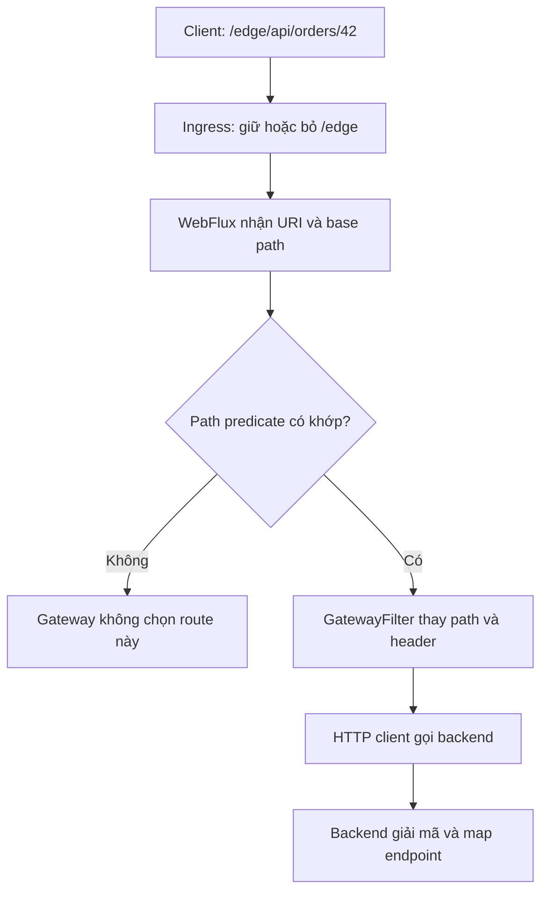

# Tác động của base path, mã hóa URL và chuẩn hóa đường dẫn trong Spring Cloud Gateway

## 1. Vì sao cùng một URL có thể khớp hoặc không khớp route?

Trong **Spring Cloud Gateway**, `Path` route predicate là một điều kiện quyết định request được chuyển tới microservice nào. Một cấu hình trông đơn giản như `Path=/api/orders/**` có thể cho kết quả khác mong đợi khi hệ thống có **base path**, có **reverse proxy** đặt phía trước, hoặc client dùng các dạng URL như `%2F`, `%2e`, dấu `/` ở cuối, `//` và các phân đoạn `.`/`..`.

Đó là vì “đường dẫn của request” không phải lúc nào cũng là một chuỗi duy nhất từ đầu đến cuối. Trong đường đi từ client đến backend, mỗi lớp có thể nhìn thấy một dạng path khác nhau:

1. **Client** tạo request-target chứa path và query, có thể có percent encoding.
2. **Ingress/reverse proxy** có thể giữ, thêm hoặc bỏ tiền tố đường dẫn.
3. **Web server/WebFlux** phân tích URI thành các phân đoạn path để xác định context/base path.
4. **Gateway `Path` predicate** so khớp mẫu với path mà tầng routing sử dụng.
5. **Gateway filters** như `StripPrefix`, `RewritePath`, `SetPath`, `PrefixPath` có thể sửa URI **sau khi** route đã khớp.
6. **HTTP client của Gateway và backend** tiếp nhận URI kết quả, có thể áp dụng quy tắc giải mã hoặc chuẩn hóa của riêng chúng.

Hiểu đúng các lớp này rất quan trọng khi triển khai Gateway có xác thực, phân quyền, rate limiting, circuit breaker, retry, TLS, service discovery và quan sát request. Một khác biệt trong cách hiểu path có thể gây `404` ở gateway, `404` ở backend hoặc, nghiêm trọng hơn, làm lệch phạm vi của một chính sách bảo vệ API.

**Mục tiêu bài học:** phân biệt *base path* của WebFlux với prefix do reverse proxy thêm vào; hiểu ký tự `/`, `%2F`, `.`/`..` và nhiều dấu `/`; cấu hình và thử nghiệm `Path` predicate theo đúng phiên bản Spring Cloud Gateway.

> **Phạm vi:** ví dụ chính dùng **Gateway Server WebFlux**. Trong Gateway 4.3+, cấu hình route nằm dưới `spring.cloud.gateway.server.webflux.routes`; ở WebFlux 4.2 trở về trước thường là `spring.cloud.gateway.routes`. Gateway Server Web MVC có prefix và cách xử lý context path riêng; không sao chép nguyên xi ví dụ WebFlux sang MVC.

## 2. Năm biểu diễn path cần phân biệt

Giả sử người dùng gọi `https://edge.example.test/edge/api/orders/42?view=full`, trong đó `/edge` là tiền tố công bố API trên Internet.

| Biểu diễn | Ví dụ | Ai quyết định? | Tác động |
|---|---|---|---|
| **External path** (client nhìn thấy) | `/edge/api/orders/42` | API public, DNS, proxy phía trước | Đường dẫn client phải gọi |
| **Path chuyển tới Gateway** | `/edge/api/orders/42` **hoặc** `/api/orders/42` | Quy tắc rewrite của ingress/proxy | Dữ liệu WebFlux thực sự nhận và match |
| **WebFlux base path** | `spring.webflux.base-path=/edge` | Cấu hình ứng dụng Gateway | Ảnh hưởng `Path` route predicate và context của WebFlux |
| **Route path pattern** | `Path=/api/orders/**` | Cấu hình Spring Cloud Gateway | Chọn route, trước các route filters |
| **Downstream path** | `/orders/42` (ví dụ) | Các filter thay path và cách dựng URI đích | Đường dẫn backend tiếp nhận |

Phần `?view=full` là **query**, không thuộc path pattern. `Path=/api/orders/**` không kiểm tra giá trị `view`; muốn quyết định dựa trên query parameter, sử dụng thêm `Query` predicate. Fragment như `#detail` không được gửi trong HTTP request-target, nên không thể dùng `Path` predicate để đọc fragment đó.



**Nguyên tắc:** cấu hình URL công khai, logic match route và logic sửa URL cho backend là **ba quyết định khác nhau**. Thay đổi ở một lớp phải được kiểm tra lại ở hai lớp còn lại.

## 3. `spring.webflux.base-path` tác động thế nào đến `Path` predicate?

### 3.1. WebFlux tự ghép base path vào mẫu định tuyến

Theo tài liệu chính thức của **Spring Cloud Gateway Server WebFlux**, khi đặt `spring.webflux.base-path=/edge`, Gateway tự thêm `/edge` vào đầu **mẫu** của `Path` route predicate. Bạn vẫn khai báo pattern theo phần path của API **sau base path**.

Ví dụ **chỉ để kiểm tra route matching**, chưa thêm filter sửa path:

```yaml
# application.yml — Gateway Server WebFlux 4.3+
server:
  port: 8080

spring:
  webflux:
    base-path: /edge
  cloud:
    gateway:
      server:
        webflux:
          routes:
            - id: orders-route
              uri: http://localhost:8081
              predicates:
                - Path=/api/orders/**
```

Từ góc nhìn pattern, Gateway so khớp như thể có mẫu đầy đủ `/edge/api/orders/**`:

| Request path mà Gateway nhận | Pattern khai báo | Kỳ vọng chọn `orders-route` |
|---|---|---|
| `/edge/api/orders/42` | `/api/orders/**` | Có, vì framework tự ghép base path |
| `/api/orders/42` | `/api/orders/**` | Không thể coi là cùng URL khi base path `/edge` đang có hiệu lực; request có thể bị chặn ở tầng WebFlux trước khi tới route |
| `/edge/other/42` | `/api/orders/**` | Không |
| `/edge/edge/api/orders/42` | `/api/orders/**` | Không khớp mẫu API dự kiến |

**Không viết** `Path=/edge/api/orders/**` chỉ để “bù” cho `spring.webflux.base-path=/edge`; cách này có nguy cơ bị **ghép tiền tố hai lần** vào mẫu định tuyến. Nếu bạn không muốn Gateway có base path mà chỉ muốn API public có prefix, hãy để reverse proxy hoặc một route pattern xử lý prefix đó theo kiến trúc thực tế.

### 3.2. Base path không đồng nghĩa với `StripPrefix`

`spring.webflux.base-path` giúp WebFlux định nghĩa phần context của ứng dụng và ảnh hưởng cách `Path` predicate match. Nó **không phải** lệnh yêu cầu Gateway xóa phần `/edge` trước khi proxy tới backend.

Các filter sửa đường dẫn hoạt động với request URI ở giai đoạn sau khi route được chọn. Khi có base path, không nên tự suy rằng `StripPrefix=1` sẽ luôn loại bỏ `/api`: còn phải xét filter đang nhận path đầy đủ hay phần path trong ứng dụng, cách các phiên bản xử lý context path và thứ tự filter. Trong hệ thống có base path, nên **log đường dẫn downstream thực tế**, sau đó quyết định số segment phải strip hoặc dùng rewrite tường minh phù hợp.

Để có ví dụ `StripPrefix` đơn giản, xác định được kết quả mà không cần xét base path, mục 6 sẽ dùng một Gateway **không cấu hình `spring.webflux.base-path`**.

### 3.3. WebFlux base path khác Servlet context path

| Mô hình | Cấu hình liên quan | Ghi chú |
|---|---|---|
| Gateway Server **WebFlux** | `spring.webflux.base-path` | Ảnh hưởng `Path` predicate theo tài liệu WebFlux |
| Gateway Server **Web MVC** | `server.servlet.context-path` | Servlet context path và MVC route matching đi theo pipeline khác |
| Reverse proxy/Ingress | Quy tắc rewrite và `X-Forwarded-*` theo proxy | Không phải một trong hai property ứng dụng kể trên |

Ở Server Web MVC, một số bản có `StripContextPath` để loại Servlet context path khỏi URI trước các filter sửa đường dẫn; ví dụ đó **không áp dụng tự động** cho WebFlux. Luôn đối chiếu bộ filter và phiên bản của stack đang chạy.

## 4. Base path do reverse proxy tạo ra khác với base path của ứng dụng

Xét hai cách triển khai public URL `https://edge.example.test/public/api/orders/42`:

**Phương án A — Proxy giữ nguyên tiền tố:**

```text
Client                    Proxy                   Gateway
/public/api/orders/42  -> giữ nguyên path     -> /public/api/orders/42
```

Gateway cần match đúng path mà nó **thực sự nhận**. Nếu không dùng `spring.webflux.base-path`, có thể khai báo `Path=/public/api/orders/**` và sau đó thiết kế filter để tạo downstream path phù hợp. Nếu dùng `spring.webflux.base-path=/public`, có thể khai báo `Path=/api/orders/**` như mục 3. Không kết hợp cả hai cách trong một route nếu không chủ đích.

**Phương án B — Proxy bỏ tiền tố:**

```text
Client                    Proxy                   Gateway
/public/api/orders/42  -> bỏ /public          -> /api/orders/42
```

Trong phương án B, Gateway thường không cần `spring.webflux.base-path=/public`; route có thể dùng `Path=/api/orders/**`. Prefix `/public` tồn tại trên **external URL** nhưng không còn trong **path Gateway nhận**.

Header như `X-Forwarded-Prefix: /public` có thể được proxy bổ sung để ứng dụng biết prefix bên ngoài khi tạo link/redirect. **Nó không tự đảm bảo** request URI đã được rewrite như phương án A hay B. Chỉ tin các header forwarding do **reverse proxy đáng tin cậy** kiểm soát; phải ngăn client tự gửi header giả nếu ứng dụng dùng chúng để quyết định URL hoặc quyền truy cập.

### 4.1. Bảng quyết định nhanh

| Gateway nhận request path | Có `spring.webflux.base-path`? | Ví dụ `Path` predicate khai báo | Nhận xét |
|---|---|---|---|
| `/api/orders/42` | Không | `/api/orders/**` | Gateway trực tiếp hoặc proxy đã bỏ prefix |
| `/public/api/orders/42` | Không | `/public/api/orders/**` | Prefix public nằm trong route pattern |
| `/public/api/orders/42` | `/public` | `/api/orders/**` | Base path tự được ghép vào pattern |
| `/api/orders/42` | `/public` | `/api/orders/**` | Cấu hình/proxy có khả năng không nhất quán |

Hãy chọn **một điểm sở hữu việc thêm/bỏ prefix** và kiểm thử qua proxy thật. Nếu nhiều lớp cùng làm rewrite, log từ client và log phía Gateway phải cho biết chính xác từng lần biến đổi.

## 5. `PathPattern`: ký tự đặc biệt, wildcard và phân đoạn path

`Path` predicate của Server WebFlux sử dụng cách khớp URL dựa trên **Spring `PathPattern`**. Cách khớp này phân tích path thành từng đoạn thay vì chỉ so khớp một chuỗi đã giải mã toàn bộ. Một số mẫu hay dùng:

| Pattern | Ý nghĩa | Ví dụ khớp | Ví dụ không khớp |
|---|---|---|---|
| `/api/orders` | Path cố định | `/api/orders` | `/api/orders/42` |
| `/api/orders/*` | Một segment bất kỳ | `/api/orders/42` | `/api/orders/42/items` |
| `/api/orders/{id}` | Một segment, lưu biến `id` | `/api/orders/42` | `/api/orders/42/items` |
| `/api/orders/{id:[0-9]+}` | Segment `id` chỉ gồm chữ số | `/api/orders/42` | `/api/orders/abc` |
| `/api/orders/**` | Không hoặc nhiều segment ở cuối | `/api/orders/42/items` | `/api/catalog/42` |
| `/api/{*remaining}` | Phần path còn lại (catch-all) | `/api/a/b` | `/other/a/b` |

**Lưu ý:** `**` và `{*remaining}` được đặt ở **cuối pattern** theo cú pháp `PathPattern`. Không dùng kiểu `/api/**/orders` như thể đang cấu hình mọi cơ chế glob tùy ý. Chữ hoa/thường của path thường có ý nghĩa trong matching; đừng giả định `/API/orders` và `/api/orders` là cùng một endpoint.

Khi pattern có biến như `{id}`, Gateway có thể lưu URI template variables trong `ServerWebExchange` để filter dùng tiếp. Phân đoạn biến được trích ra **không phải giá trị đã được xác thực**: nếu `id` tham gia kiểm tra quyền hoặc tạo URI đích, phải có ràng buộc đầu vào phù hợp.

### 5.1. `Path` không dùng query string để quyết định route

```yaml
predicates:
  - Path=/api/orders/{id}
  - Method=GET
```

Với route này, `GET /api/orders/42?view=full` và `GET /api/orders/42?view=compact` có cùng path `/api/orders/42` nên **đều thỏa mãn `Path`**; muốn chia tuyến theo `view`, thêm `Query` predicate tương ứng. `POST /api/orders/42` không thỏa `Method=GET`, dù path khớp.

## 6. Ví dụ thực hành: match trước, sửa path sau

Để thấy rõ khác biệt giữa route predicate và filter, ta tạo một Gateway Server WebFlux 4.3+ **không có base path**. Backend tại `http://localhost:8081` nhận route `/orders/**`.

```yaml
# application.yml
server:
  port: 8080

spring:
  application:
    name: api-gateway
  cloud:
    gateway:
      server:
        webflux:
          routes:
            - id: orders-route
              uri: http://localhost:8081
              predicates:
                - Path=/api/orders/**
                - Method=GET
              filters:
                - StripPrefix=1
                - AddRequestHeader=X-Route, orders-route
```

Thứ tự xảy ra:

1. Client gọi `GET /api/orders/42`.
2. `Path=/api/orders/**` và `Method=GET` đều khớp; Gateway chọn `orders-route`.
3. `StripPrefix=1` bỏ segment `api` khỏi path hiện có.
4. Gateway gọi `http://localhost:8081/orders/42` và bổ sung `X-Route: orders-route`.
5. Backend trả response, rồi Gateway chuyển kết quả về client (có thể kèm các filter khác về metrics, retry, header...).

Nếu backend trả `404`, hãy kiểm tra path đã gửi tới backend. Nếu Gateway không tìm thấy route, `StripPrefix` **không có cơ hội chạy** nên việc sửa filter chưa giải quyết được nguyên nhân match sai.

### 6.1. Đổi sang `RewritePath` khi path không đơn giản là bỏ segment

Ví dụ backend muốn `/v1/orders/42` thay vì `/orders/42`, có thể dùng `RewritePath` thay `StripPrefix`:

```yaml
filters:
  - RewritePath=/api/orders/?(?<rest>.*), /v1/orders/$\{rest}
```

Trong file YAML của Spring Cloud Gateway, nhóm regex có tên `rest` được tham chiếu qua `$\{rest}` để tránh YAML/Spring xử lý dấu `$` sai ý định. Sau khi pattern route đã match `GET /api/orders/42`, filter sẽ tạo đường dẫn `/v1/orders/42`. Đây là bước **sửa request gửi downstream**, không phải thay đổi pattern `Path` đã dùng để chọn route ban đầu.

Đừng áp dụng đồng thời cả `StripPrefix` và `RewritePath` trong ví dụ này nếu chưa xác định thứ tự; hai filter có thể cùng sửa URI, khiến backend nhận path không mong muốn.

## 7. Percent encoding: `%2F` không giống dấu `/` thật trên wire

URL có thể chứa **percent encoding**: một byte được biểu diễn bằng `%HH` với `HH` là hai chữ số hệ 16. Ví dụ:

| Dạng trong URL | Ý nghĩa sau giải mã | Điều cần chú ý |
|---|---|---|
| `%20` | Dấu cách | Có thể hợp lệ trong một segment hoặc được proxy chuẩn hóa |
| `%2F` hoặc `%2f` | Dấu `/` | Dấu phân cách path đã mã hóa; không thể mặc định tương đương dấu `/` thật |
| `%2E` hoặc `%2e` | Dấu `.` | Liên quan dot segments khi được giải mã rồi chuẩn hóa |
| `%25` | Dấu `%` | Có thể dẫn tới chuỗi trông như mã hóa lần hai, ví dụ `%252F` |
| `%3B` | Dấu `;` | Có thể liên quan matrix/path parameters tùy parser |

**Hai giá trị quan trọng của Java URI:**

```java
// Ví dụ: URI nhận được có path /api/files/a%2Fb
String rawPath = exchange.getRequest().getURI().getRawPath();
String decodedPath = exchange.getRequest().getURI().getPath();
// rawPath     = "/api/files/a%2Fb"
// decodedPath = "/api/files/a/b"
```

`getRawPath()` giữ chuỗi percent-encoded, còn `getPath()` trả về chuỗi path đã được Java URI giải mã. **Không tự chia `decodedPath` theo `/` để thực hiện kiểm tra bảo mật**, vì `a%2Fb` ban đầu là **một segment** nhưng chuỗi đã giải mã sẽ nhìn như hai segment.

Trong Spring WebFlux, **`PathPattern` và `PathContainer` phân tích cấu trúc path trước, rồi giải mã từng segment**. Cách này tránh để `%2F` sau khi giải mã tự biến thành dấu phân cách segment khi *matching*. Tuy nhiên, kết quả backend nhận được còn phụ thuộc **cách filter dựng URI, cách proxy chuyển tiếp và cách backend giải mã/chuẩn hóa**. Vì vậy:

- `/api/files/a%2Fb` và `/api/files/a/b` **không được mặc định là hai URL đồng nghĩa** khi thiết kế route.
- `{id}` là biến của **một segment**; khi giá trị có ký tự mã hóa đặc biệt, cần xác minh route có match và backend diễn giải id thế nào.
- Bộ lọc bảo mật, ACL hoặc logic kiểm soát tenant không nên tin vào phép giải mã toàn chuỗi tự viết nếu downstream có quy tắc khác.
- Nếu nghiệp vụ **không cần** encoded path separators, việc **từ chối dạng mơ hồ tại biên tin cậy** thường giảm rủi ro hơn là cố hỗ trợ tất cả dạng URL.

### 7.1. Mã hóa một lần và hai lần là hai vấn đề khác nhau

```text
Raw URL: /api/files/a%2Fb
  Giải mã một lần toàn chuỗi (minh họa): /api/files/a/b

Raw URL: /api/files/a%252Fb
  Giải mã một lần: /api/files/a%2Fb
  Giải mã lần hai: /api/files/a/b
```

Đây là **minh họa việc giải mã chuỗi**, không phải khẳng định Spring Cloud Gateway luôn giải mã URL hai lần. Vấn đề xuất hiện khi gateway, WAF và backend **không thống nhất** về số lần giải mã, và một lớp thực hiện kiểm tra quyền trên chuỗi khác với chuỗi lớp phía sau dùng để chọn tài nguyên.

Đừng dùng regex filter tùy chỉnh để “decode cho tiện” trước khi xác thực. Nếu phải cho phép encoded slash vì lý do nghiệp vụ, cần kiểm thử từ client qua toàn bộ chuỗi reverse proxy → Gateway → backend, gồm mã trạng thái, route ID, raw path và path backend thực nhận.

## 8. Chuẩn hóa đường dẫn: `.`/`..`, `//`, chữ hoa và dấu `/` cuối

Chuẩn hóa đường dẫn (*path normalization*) có thể bao gồm loại bỏ dot segments, xử lý dấu slash lặp, biến đổi ký tự phần trăm, hoặc áp quy tắc với slash cuối. **Không có một quy tắc chuẩn hóa duy nhất được bảo đảm diễn ra giống nhau ở tất cả các lớp mạng và framework**.

### 8.1. Dot segments (`.` và `..`)

Ví dụ:

```text
/api/orders/./42
/api/orders/v1/../42
/api/orders/%2E/42
/api/orders/%2e%2e/42
```

Theo RFC 3986, `.` và `..` là các đoạn có vai trò trong quá trình giải tham chiếu URI; nhiều client hoặc proxy thực hiện bước loại bỏ dot segments. Dạng `%2E` là dấu chấm đã mã hóa và cách chuẩn hóa phụ thuộc thứ tự các phép biến đổi. Do đó, một request có thể **được biến đổi từ trước khi tới Gateway**, hoặc có thể bị lớp xử lý URL từ chối.

Khi thiết kế ranh giới phân quyền theo prefix, tuyệt đối không giả định rằng kiểm tra chuỗi `startsWith("/api/private/")` trên raw path có nghĩa backend chắc chắn xử lý tài nguyên trong `/api/private/`. Hãy yêu cầu lớp tiếp nhận xác định **một canonical path nhất quán** và từ chối các dạng mơ hồ mà ứng dụng không hỗ trợ.

### 8.2. Double slash (`//`) và slash cuối

Đây là những URL **nên kiểm thử riêng**:

```text
/api//orders/42
/api/orders//42
/api/orders/42/
/API/orders/42
```

- Hai dấu `/` liền nhau có thể được một proxy giữ nguyên, một proxy khác gộp hoặc một security firewall từ chối; không dựa vào hành vi chuẩn hóa ngầm định.
- URL có slash cuối có thể match khác URL không có slash cuối. Ở nhiều dòng Gateway 4.x, `Path` có tùy chọn `matchTrailingSlash` (mặc định là `true`) với ý nghĩa nới lỏng việc khớp dấu slash cuối. Nhưng **Gateway 5.0.x chạy Spring Framework 7.0** từng được báo cáo không còn tôn trọng tùy chọn này như tài liệu cũ do framework thay đổi API. Cần xác minh theo **bản vá đang dùng** và viết test cho cả hai dạng nếu API cần hỗ trợ.
- Chữ hoa/thường của path thường được phân biệt trong `PathPattern`; đổi `/API` thành `/api` nên là quyết định rõ ràng của ứng dụng hoặc reverse proxy, không phải giả định.

**Gợi ý bảo trì:** nếu API chỉ công bố `/api/orders/{id}` và không có yêu cầu nhận `/api/orders/{id}/`, hãy chuẩn hóa contract public ngay từ đầu; nếu muốn hỗ trợ cả hai, khai báo/match rõ ràng và kiểm tra theo phiên bản thay vì tin rằng mọi framework tự bỏ qua slash cuối.

### 8.3. Mẫu đường dẫn bất thường và rủi ro lệch chính sách

| Tình huống | Rủi ro vận hành | Quy tắc kiểm soát |
|---|---|---|
| Client gửi `%2F` hoặc `%252F` | Gateway và backend hiểu khác số segment/đường dẫn | Thống nhất mức độ hỗ trợ encoding; kiểm tra và reject dạng không cần thiết |
| Client gửi `%2e%2e` hoặc `../` | Các lớp loại dot segments không đồng nhất | Chuẩn hóa hoặc từ chối tại trust boundary; đối chiếu path downstream |
| Client gửi `//` | Mismatch giữa CDN/proxy/Gateway/firewall/backend | Xác định một quy tắc và kiểm thử trực tiếp qua proxy |
| Proxy bỏ prefix nhưng Gateway vẫn bật base path | Route không match hoặc request bị chặn trước Gateway handler | Quy định rõ lớp chịu trách nhiệm prefix |
| Gateway dùng `StripPrefix`, backend dùng mapping khác | Route match ở Gateway nhưng backend trả `404` | Log path sau filter, kiểm tra hợp đồng API backend |
| Quy tắc ACL dùng chuỗi raw, routing dùng path parsed | Có thể tạo khác biệt giữa phạm vi bảo vệ và tài nguyên thực | Thực hiện phân quyền trên biểu diễn path thống nhất, kiểm tra lại ở backend |

Những dạng URL trên không mặc định là một lỗ hổng. Chúng là **trường hợp cần kiểm thử để xác nhận không có khác biệt về ngữ nghĩa** giữa thành phần chọn route, thành phần kiểm soát quyền và backend.

## 9. Kiểm thử với `curl --path-as-is`

`curl` có thể tự xử lý một số phân đoạn URL khi tạo request. Tùy chọn `--path-as-is` yêu cầu `curl` không tự loại các dot segments `.` hoặc `..` ở path. Nhờ đó có thể gửi các dạng đường dẫn bất thường **đến Gateway**, nhưng reverse proxy/web server ở giữa vẫn có thể chuẩn hóa hoặc từ chối chúng.

Trước hết, dùng cấu hình **không base path** tại mục 6, với backend đang chạy ở `8081`:

```bash
# Kiểm tra cơ bản
curl -i http://localhost:8080/api/orders/42

# Các biến thể path cần quan sát riêng
curl --path-as-is -i 'http://localhost:8080/api/orders/./42'
curl --path-as-is -i 'http://localhost:8080/api/orders/v1/../42'
curl --path-as-is -i 'http://localhost:8080/api/orders//42'
curl --path-as-is -i 'http://localhost:8080/api/orders/42/'
curl --path-as-is -i 'http://localhost:8080/api/orders/%2e%2e/42'
curl --path-as-is -i 'http://localhost:8080/api/orders/a%2Fb'
curl --path-as-is -i 'http://localhost:8080/api/orders/a%252Fb'
```

Ở đây `Path=/api/orders/**` là mẫu tương đối rộng, nên **một số** biến thể có thể vẫn khớp route. Tuy nhiên HTTP status cuối cùng còn tùy frontend server, các filters và backend; bảng kiểm thử không nên ghi sẵn `200` hoặc `404` cho mọi URL lạ. Để nhận biết tác động của `Path` rõ hơn, dùng một route thử **hẹp** `Path=/api/orders/{id}` (và bỏ bớt filter rewrite nếu cần), rồi chạy lại từng biến thể.

Khi kiểm thử base path, có thể chạy lại ứng dụng với `spring.webflux.base-path=/edge` và truy cập:

```bash
curl -i http://localhost:8080/edge/api/orders/42
curl -i http://localhost:8080/api/orders/42
```

**Đừng sửa duy nhất URL mà quên cấu hình Gateway**: phép thử base path này cần route predicate như mục 3 và phải kiểm tra downstream path thực tế nếu có thêm các path-mutating filters.

### 9.1. Ghi nhận điều gì trong ma trận test?

| Trường cần ghi | Ví dụ | Giá trị thực tế cần lấy ở đâu? |
|---|---|---|
| URL client gửi | `/api/orders/a%2Fb` | Công cụ client hoặc test |
| URI/raw path Gateway nhận | `.../a%2Fb` | Log an toàn tại Gateway ingress |
| Path WebFlux nhìn thấy | `RequestPath`, context path, path trong app | Thông tin request đã parse trong Gateway |
| Route ID đã match | `orders-route` hoặc không có | Gateway logs/Actuator phù hợp |
| URI/path sau filter | `/orders/a%2Fb` hoặc giá trị khác | Log trước HTTP client/downstream test service |
| Path backend nhận và route backend chọn | Tùy bộ giải mã backend | Echo backend hoặc access log có kiểm soát |
| Status và lớp tạo response | `200`, `400`, `404`, `401`, `403`, `502`... | Trace/Gateway/backend response |

Nếu một request bị chặn ở reverse proxy hoặc Spring Security trước khi chọn route, `GlobalFilter` của Gateway có thể **không chạy**, nên cần cả **ingress access log** và log backend. Không ghi token, cookie hoặc query parameters chứa dữ liệu nhạy cảm; cũng nên giới hạn tag metrics theo route ID thay vì raw URL nhiều giá trị.

## 10. Dùng Java quan sát raw path và parsed path (chỉ để chẩn đoán)

Đoạn `GlobalFilter` sau dành cho **Gateway Server WebFlux**, có thể tạm thêm vào ứng dụng thử nghiệm để so sánh những biểu diễn path. Bộ lọc chỉ chạy **sau khi route đã được chọn**; nó không thấy URL không khớp route và cũng không thay thế access log ở ingress.

```java
package com.example.gateway.filter;

import org.slf4j.Logger;
import org.slf4j.LoggerFactory;
import org.springframework.cloud.gateway.filter.GatewayFilterChain;
import org.springframework.cloud.gateway.filter.GlobalFilter;
import org.springframework.core.Ordered;
import org.springframework.stereotype.Component;
import org.springframework.web.server.ServerWebExchange;
import reactor.core.publisher.Mono;

@Component
public class PathDiagnosticFilter implements GlobalFilter, Ordered {
    private static final Logger log =
            LoggerFactory.getLogger(PathDiagnosticFilter.class);

    @Override
    public Mono<Void> filter(ServerWebExchange exchange, GatewayFilterChain chain) {
        var request = exchange.getRequest();

        log.debug("path raw={} parsed={} context={} withinApp={}",
                request.getURI().getRawPath(),
                request.getPath().value(),
                request.getPath().contextPath().value(),
                request.getPath().pathWithinApplication().value());

        return chain.filter(exchange);
    }

    @Override
    public int getOrder() {
        return -1000;
    }
}
```

`getRawPath()` cho biết biểu diễn percent-encoded ở URI của tầng Gateway. `getPath().value()` cho biết biểu diễn path theo `RequestPath`; `contextPath()` và `pathWithinApplication()` giúp phân biệt prefix của ứng dụng. **Không kết luận downstream path chỉ từ log này**, vì route filters phía sau còn có thể thay URI.

Đây là mã dành cho môi trường phát triển. Trong production, phải tránh log raw path khi path có thể chứa thông tin cá nhân/secret, và ưu tiên **Micrometer/observability** cùng các log đã được xử lý dữ liệu nhạy cảm. Khi cần biết URL cuối được proxy, bổ sung ghi nhận đúng vị trí routing hoặc dùng backend echo test.

## 11. Quy trình xử lý sự cố do path mismatch

Khi Gateway khởi động bình thường nhưng request trả `404` hoặc đi nhầm service, làm lần lượt:

1. **Xác định phiên bản và stack:** Gateway Server WebFlux hay Web MVC, namespace của routes, cấu hình `spring.webflux.base-path` hoặc `server.servlet.context-path`.
2. **Đọc URL thực tại từng lớp:** client gửi gì, reverse proxy giữ/bỏ prefix gì, Gateway nhận raw path nào. Không suy từ URL công khai ra path nội bộ.
3. **Xác minh route match:** `Path`, `Method`, `Host`, `Query` và order của các route. Một request có thể không vào Gateway chain vì lớp trước đã từ chối.
4. **Xem khác biệt encoding:** `%2F`, `%252F`, `%2E`, `.`/`..`, `//`, slash cuối; dùng test có kiểm soát và đối chiếu mức decode giữa các lớp.
5. **Đối chiếu filter thay path:** `StripPrefix`, `RewritePath`, `SetPath`, `PrefixPath`, đặc biệt khi kết hợp base path. Quan sát URI sau filter.
6. **Đối chiếu backend:** endpoint backend thật, access log và web stack; `404` từ backend khác `404` vì Gateway không có route.
7. **Kiểm tra chính sách bảo vệ:** Spring Security/JWT, rate limiter, WAF và gateway route có cùng cách nhìn về canonical path; không dựa riêng vào so khớp chuỗi tùy chỉnh.
8. **Viết regression tests:** kiểm tra URL hợp lệ, URL có prefix, encoded separator, dot segments và slash cuối qua cùng proxy như production.

### 11.1. Phân biệt lỗi theo triệu chứng

| Triệu chứng | Vùng cần kiểm tra trước | Giải thích |
|---|---|---|
| `404` ngay tại Gateway | `Path` predicate, base path, proxy rewrite, version | Có thể không route nào khớp |
| Route đã khớp nhưng backend trả `404` | `StripPrefix`/`RewritePath` và mapping backend | Gateway có thể đang gửi sai path |
| `400` trước khi thấy route ID | Proxy/web server/security firewall | Dạng URL có thể bị từ chối vì ký tự/encoding không được chấp nhận |
| `401`/`403` ở một số biến thể path | Security matcher, canonical path, token/quyền | Phải loại trừ khác biệt về cách giải mã và so khớp |
| `502`/`503` hoặc kết nối thất bại | DNS, load balancer, service discovery, TLS, backend | Không mặc định là lỗi `Path` predicate |
| URL có slash cuối chỉ lỗi sau nâng cấp | `matchTrailingSlash`, Spring Framework version, API contract | Tài liệu 4.x và hành vi 5.0.x có thể khác |

Trong hệ thống có `lb://service-name`, service discovery quyết định instance downstream **sau** khi route match. Việc route khớp đúng không đảm bảo downstream path đúng; ngược lại, lỗi tìm service instance không có nghĩa pattern path sai.

## 12. Bài tập và đáp án

**Bài 1 — Base path.** Gateway WebFlux có `spring.webflux.base-path=/edge` và `Path=/api/items/**`. Client gọi `/edge/api/items/7`. Có cần đổi predicate thành `Path=/edge/api/items/**` không?

**Đáp án:** không. Tài liệu Gateway WebFlux nêu rằng base path được tự ghép vào mẫu predicate. Giữ `Path=/api/items/**`; bổ sung `/edge` lần nữa có thể khiến pattern bị lặp prefix. Nếu proxy đã bỏ `/edge` trước khi request đến Gateway, cần điều chỉnh kiến trúc/cấu hình để nhất quán.

**Bài 2 — Encoded slash.** API có `Path=/api/files/{id}`. Hai URL `/api/files/a%2Fb` và `/api/files/a/b` có chắc giống nhau không?

**Đáp án:** không. Với `PathPattern`, encoded separator trong một segment không tự trở thành dấu phân cách segment của quá trình matching. Backend hoặc proxy vẫn có thể giải mã theo quy tắc khác, nên phải thử cả hai và xác định liệu nghiệp vụ có cho phép `%2F` trong `id` hay không.

**Bài 3 — Sửa path trước hay sau match?** Client gọi `/api/orders/42` tới route có `Path=/api/orders/**` và `StripPrefix=1`. Backend nhận gì nếu không dùng base path và không có filter khác sửa path?

**Đáp án:** route match trên `/api/orders/42` trước; `StripPrefix=1` sau đó bỏ `api`, nên backend nhận `/orders/42`. Không nên ghi `Path=/orders/**` để mô tả path sau filter.

**Bài 4 — Prefix ở ingress.** Client gọi `/public/api/orders/42`, proxy đã bỏ `/public` trước khi chuyển vào Gateway, nhưng ứng dụng vẫn cấu hình `spring.webflux.base-path=/public`. Vấn đề gì có thể xảy ra?

**Đáp án:** Gateway nhìn thấy `/api/orders/42` còn WebFlux/base path lại kỳ vọng `/public` ở đầu. Request có thể không vào route hoặc bị từ chối trước Gateway handler. Chọn rõ proxy hay ứng dụng sở hữu public prefix và kiểm tra request thực tại Gateway.

**Bài 5 — Dot segments.** Đội vận hành đặt ACL dựa trên `rawPath.startsWith("/api/private/")`, còn backend chuẩn hóa `..` trước khi map endpoint. ACL này có bảo đảm kiểm soát đúng tài nguyên không?

**Đáp án:** không. Cần kiểm tra/path validation trên một biểu diễn canonical nhất quán qua các lớp, chặn đường dẫn mơ hồ và thực hiện phân quyền tài nguyên tại backend khi cần. So khớp chuỗi raw không đủ làm ranh giới bảo mật.

**Bài 6 — Slash cuối sau nâng cấp.** Trước đây `GET /api/orders/42/` khớp route có mẫu `/api/orders/{id}`; sau khi nâng cấp lên Gateway 5.0.x thì không khớp. Nên kiểm tra gì?

**Đáp án:** kiểm tra Spring Framework/Gateway patch version và hành vi `matchTrailingSlash`. Các bản Framework 7.0 đã có thay đổi khiến tùy chọn cũ không còn hiệu lực như mong đợi trong một số bản Gateway 5.0. Thiết kế test rõ hai dạng URL và quy định API có hỗ trợ slash cuối hay không.

## 13. Tài liệu tham khảo

- [Spring Cloud Gateway Server WebFlux 5.0 — Route Predicate Factories, `Path`](https://docs.spring.io/spring-cloud-gateway/reference/5.0/spring-cloud-gateway-server-webflux/request-predicates-factories.html): cách cấu hình `Path`, biến URI template, `spring.webflux.base-path` và `matchTrailingSlash`.
- [Spring Cloud Gateway Server WebFlux 4.2 — Route Predicate Factories](https://docs.spring.io/spring-cloud-gateway/reference/4.2/spring-cloud-gateway/request-predicates-factories.html): đối chiếu prefix cấu hình cũ và hành vi `Path` trong dòng 4.x.
- [Spring Cloud Gateway — `StripPrefix` GatewayFilter](https://docs.spring.io/spring-cloud-gateway/reference/spring-cloud-gateway-server-webflux/gatewayfilter-factories/stripprefix-factory.html): số segment bị bỏ khi proxy.
- [Spring Cloud Gateway — `RewritePath` GatewayFilter](https://docs.spring.io/spring-cloud-gateway/reference/spring-cloud-gateway-server-webflux/gatewayfilter-factories/rewritepath-factory.html): dùng regex để chuyển path downstream.
- [Spring Framework — `PathContainer` API](https://docs.spring.io/spring-framework/docs/current/javadoc-api/org/springframework/http/server/PathContainer.html): parse raw path theo segment, giải mã từng segment và giữ cấu trúc path.
- [Spring Framework — URL Matching with `PathPattern`](https://spring.io/blog/2020/06/30/url-matching-with-pathpattern-in-spring-mvc/): lý do tránh giải mã toàn chuỗi trước khi so khớp path.
- [RFC 3986 — URI Generic Syntax](https://www.rfc-editor.org/rfc/rfc3986): percent encoding và loại bỏ dot segments.
- [Spring Cloud Gateway issue #4212 — `matchTrailingSlash` trên Framework 7.0](https://github.com/spring-cloud/spring-cloud-gateway/issues/4212): ví dụ khác biệt hành vi cần kiểm thử theo patch version.

**Ghi nhớ:** `Path` predicate chọn tuyến theo **request path mà Gateway thật sự nhìn thấy** và quy tắc của `PathPattern`. `spring.webflux.base-path` có thể được ghép vào mẫu matching, trong khi proxy prefix và filter thay path là các bước riêng. **Không đánh đồng raw URL, decoded URL, path được match và downstream path**; kiểm tra cùng một canonical path qua mọi lớp để vừa định tuyến đúng vừa vận hành Gateway an toàn.
