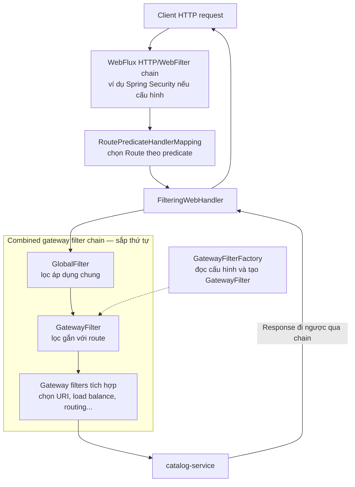
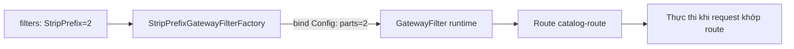
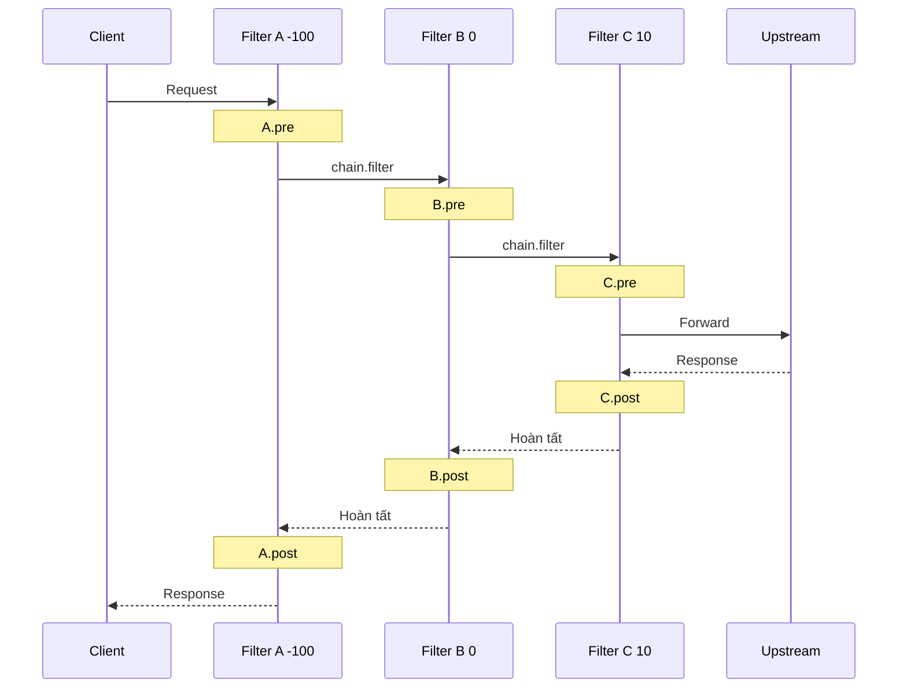
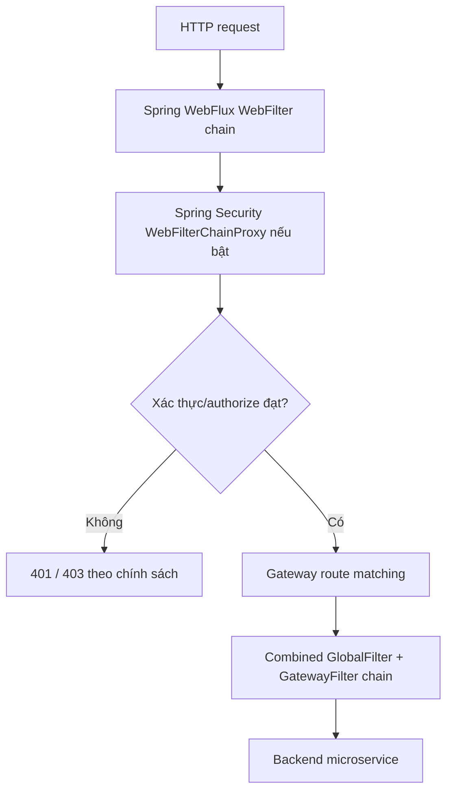

# Phân biệt GatewayFilter, GlobalFilter và GatewayFilterFactory

Trong **Spring Cloud Gateway**, định tuyến trả lời câu hỏi *“request này cần đến dịch vụ nào?”*, còn **filter chain** trả lời câu hỏi *“trước và sau khi chuyển tiếp, gateway cần xử lý request/response như thế nào?”*. Một route có thể cần bỏ tiền tố URL, bổ sung header hoặc đặt chính sách retry; đồng thời mọi route được chuyển tiếp có thể cần đo thời gian xử lý và gắn thông tin truy vết.

Ba tên thường xuất hiện trong mã nguồn và tài liệu là **`GatewayFilter`**, **`GlobalFilter`** và **`GatewayFilterFactory`**. Chúng có quan hệ với nhau nhưng không đảm nhiệm cùng một việc:

- **`GatewayFilter`** là **bộ lọc thực thi** trong phạm vi một route.
- **`GlobalFilter`** là **bộ lọc thực thi chung** cho chuỗi xử lý của các request đã được gateway ghép với route.
- **`GatewayFilterFactory`** là **nhà máy tạo ra `GatewayFilter`** từ cấu hình; bản thân factory không phải bước xử lý chạy cho từng request.

Bài thuộc chương **Chuỗi bộ lọc** của module **SPRING_CLOUD_GATEWAY**. Mục tiêu là hiểu phạm vi, điểm đăng ký, thứ tự thực thi và cách viết filter để sử dụng đúng các khả năng của API Gateway: route predicate, thay đổi path/header, service discovery, xác thực, rate limiting, circuit breaker, retry, TLS và quan sát request.

> **Giới hạn phiên bản:** Các tên interface, chữ ký method và ví dụ Java trong bài tập trung vào **Spring Cloud Gateway Server WebFlux**. Spring Cloud Gateway Server Web MVC có pipeline và các API filter riêng dựa trên Spring MVC/`HandlerFilterFunction`. Tên starter, property prefix và một số filter tích hợp có thể thay đổi giữa các release; cần đối chiếu tài liệu đúng bộ Spring Boot/Spring Cloud/Gateway khi triển khai.

## 1. Bức tranh tổng thể: request đi qua đâu?

Giả sử client gọi:

```http
GET /api/catalog/products/42 HTTP/1.1
Host: api.shop.example
X-Client-Version: 2
```

Một route `catalog-route` có predicate `Path=/api/catalog/**` và filter `StripPrefix=2`. Trước khi request đến backend, gateway còn cần chạy những xử lý chung như ghi thời gian và trace ID.



Sơ đồ diễn tả **vai trò logic**, không ấn định thứ tự chính xác giữa ba nhóm filter trong một ứng dụng. Khi chạy, các `GlobalFilter` và `GatewayFilter` của route đã chọn được **kết hợp thành một chuỗi** rồi sắp xếp theo `Ordered` hoặc thứ tự hiệu lực. Việc một filter thuộc nhóm global không tự bảo đảm nó luôn chạy trước mọi filter thuộc route.

### Điều kiện để filter chạy

1. Request phải đến gateway và được xử lý qua ngăn xếp HTTP phù hợp.
2. `RoutePredicateHandlerMapping` chọn một `Route` có predicate khớp.
3. `FilteringWebHandler` xây dựng chuỗi filter từ global filters và route filters của route đó.
4. Chuỗi filter có thể tiếp tục sang upstream hoặc **kết thúc sớm** bằng một response do filter tạo ra.
5. Khi upstream hoặc bước sau hoàn tất, những phần hậu xử lý đã đăng ký trong chuỗi có thể chạy.

Vì vậy, một `GlobalFilter` **không có nghĩa là filter cho mọi HTTP request đến tiến trình**: request không khớp route hoặc request tới endpoint ngoài gateway, chẳng hạn actuator, không mặc nhiên đi qua `FilteringWebHandler`.

## 2. Bảng đối chiếu ba khái niệm

| Tiêu chí | `GatewayFilter` | `GlobalFilter` | `GatewayFilterFactory` |
| --- | --- | --- | --- |
| Bản chất | Interface bộ lọc thực thi | Interface bộ lọc thực thi áp dụng chung | Interface/abstraction tạo bộ lọc |
| Mục đích | Xử lý request/response của route được gắn filter | Xử lý chung cho các route đi qua gateway handler | Chuyển cấu hình thành `GatewayFilter` |
| Được gọi vào thời điểm nào? | Khi request khớp route và filter nằm trong chain | Khi request khớp route được xử lý qua gateway chain | Khi xây dựng/nạp hoặc làm mới định nghĩa route cần filter |
| Cách gắn | Trong route DSL hoặc cấu hình filter của route | Đăng ký bean `GlobalFilter` | Đăng ký factory và tham chiếu tên filter trong cấu hình |
| Nhận cấu hình riêng theo route? | Có thể được tạo với tham số riêng | Tự đọc metadata/điều kiện nếu muốn hành vi theo route | Có: tạo một filter từ `Config` tương ứng |
| Có thể chặn request? | Có | Có | Không trực tiếp; filter mà nó tạo có thể chặn |
| Ví dụ | Bộ lọc `StripPrefix` của route catalog | Filter đo thời gian cho các gateway route | `StripPrefixGatewayFilterFactory` |
| Đối tượng chủ yếu | `ServerWebExchange` + `GatewayFilterChain` | `ServerWebExchange` + `GatewayFilterChain` | Một `Config` → một `GatewayFilter` |

**Quan hệ quan trọng:** một `GatewayFilterFactory` sinh ra `GatewayFilter`, nhưng không phải mọi `GatewayFilter` đều phải đi qua factory. Với Java DSL, bạn có thể cung cấp một `GatewayFilter` trực tiếp.

## 3. GatewayFilter: bộ lọc của một route

Trong Server WebFlux, `GatewayFilter` có chữ ký ý tưởng như sau:

```java
public interface GatewayFilter {
    Mono<Void> filter(ServerWebExchange exchange, GatewayFilterChain chain);
}
```

`ServerWebExchange` cung cấp ngữ cảnh HTTP request/response; `GatewayFilterChain` cho phép chuyển điều khiển đến filter tiếp theo. Nếu filter gọi `chain.filter(exchange)`, chuỗi tiếp tục. Nếu filter trả về một `Mono<Void>` hoàn tất response mà không gọi chain, các bước sau trong chuỗi sẽ không chạy.

### 3.1. Ví dụ filter gắn riêng cho route

Trong Java DSL, route có thể kết hợp filter tích hợp và filter tự viết:

```java
import org.springframework.cloud.gateway.filter.GatewayFilter;
import org.springframework.cloud.gateway.route.RouteLocator;
import org.springframework.cloud.gateway.route.builder.RouteLocatorBuilder;
import org.springframework.context.annotation.Bean;
import org.springframework.context.annotation.Configuration;

@Configuration
public class CatalogGatewayRoutes {

    @Bean
    RouteLocator catalogRoutes(RouteLocatorBuilder builder) {
        GatewayFilter annotateCatalogRoute = (exchange, chain) -> {
            exchange.getAttributes().put("app.routeFamily", "catalog");
            return chain.filter(exchange);
        };

        return builder.routes()
            .route("catalog-route", r -> r
                .path("/api/catalog/**")
                .filters(f -> f
                    .stripPrefix(2)
                    .setRequestHeader("X-Edge-Source", "gateway")
                    .filter(annotateCatalogRoute))
                .uri("lb://catalog-service"))
            .build();
    }
}
```

Khi `GET /api/catalog/products/42` khớp `catalog-route`:

1. `StripPrefix=2` bỏ `api` và `catalog` để upstream nhận `/products/42`.
2. `SetRequestHeader` đặt giá trị `X-Edge-Source` cho request chuyển tiếp.
3. Filter `annotateCatalogRoute` đặt thuộc tính nội bộ `app.routeFamily` của **request hiện tại**.
4. Gateway tiếp tục qua những filter được sắp xếp khác để giải quyết `lb://catalog-service` và gửi request nếu hạ tầng discovery/load balancing đã sẵn sàng.

`app.routeFamily` là **exchange attribute**, không tự được thêm vào HTTP header hoặc gửi đến upstream. Đó chỉ là ví dụ một filter riêng cho tuyến; ứng dụng cần thành phần khác để đọc giá trị này nếu muốn sử dụng.

> **Lưu ý bảo mật:** Header `X-Edge-Source` không phải bằng chứng client đã được xác thực. Nếu cần danh tính, sử dụng Spring Security và cơ chế xác minh token/mTLS phù hợp; backend cũng phải kiểm tra quyền đối với tài nguyên nghiệp vụ.

### 3.2. GatewayFilter thường làm việc gì?

| Công việc | Ví dụ | Cẩn trọng |
| --- | --- | --- |
| Biến đổi URL | `StripPrefix`, `RewritePath` | Kiểm tra query string, URL encoding và contract backend. |
| Thay đổi header | `AddRequestHeader`, `SetRequestHeader`, `RemoveResponseHeader` | Không để client giả mạo header được backend coi là tin cậy. |
| Thay đổi trạng thái HTTP | Filter tạo response lỗi trước khi gọi upstream | Phân biệt lỗi do gateway với lỗi nghiệp vụ. |
| Khả năng phục hồi | `Retry`, `CircuitBreaker` | Timeout và ngân sách retry, idempotency với các thao tác ghi. |
| Kiểm soát lưu lượng | `RequestRateLimiter` | Cần khóa hạn mức và kho trạng thái phù hợp cho nhiều replica. |
| Gắn thông tin tùy biến | Đặt exchange attribute / metadata nội bộ | Tránh rò rỉ bí mật và tạo mutable state dùng chung. |

Những tên filter tích hợp là ví dụ từ các dòng WebFlux hỗ trợ tương ứng. Tính năng như rate limiting hoặc circuit breaker có thể cần dependency/cấu hình riêng; không suy ra một filter tự có tác dụng chỉ từ tên.

## 4. GlobalFilter: bộ lọc dùng chung trong Gateway chain

`GlobalFilter` có phương thức xử lý cùng dạng với `GatewayFilter`:

```java
public interface GlobalFilter {
    Mono<Void> filter(ServerWebExchange exchange, GatewayFilterChain chain);
}
```

Điểm khác biệt là **phạm vi đăng ký**. Thông thường, một bean `GlobalFilter` được Spring phát hiện và Gateway kết hợp vào chuỗi lọc của các request đã được gắn route. Nó thích hợp cho chức năng hạ tầng chung như đo latency, thêm thông tin truy vết hoặc kiểm tra một quy tắc áp dụng trên toàn bộ gateway routes.

### 4.1. Ví dụ GlobalFilter đo thời gian theo route

```java
import java.util.concurrent.TimeUnit;

import org.slf4j.Logger;
import org.slf4j.LoggerFactory;
import org.springframework.cloud.gateway.filter.GatewayFilterChain;
import org.springframework.cloud.gateway.filter.GlobalFilter;
import org.springframework.cloud.gateway.route.Route;
import org.springframework.cloud.gateway.support.ServerWebExchangeUtils;
import org.springframework.core.Ordered;
import org.springframework.stereotype.Component;
import org.springframework.web.server.ServerWebExchange;
import reactor.core.publisher.Mono;

@Component
public class RouteTimingGlobalFilter implements GlobalFilter, Ordered {

    private static final Logger log =
        LoggerFactory.getLogger(RouteTimingGlobalFilter.class);

    @Override
    public int getOrder() {
        return -100;
    }

    @Override
    public Mono<Void> filter(
            ServerWebExchange exchange,
            GatewayFilterChain chain) {

        long startedAt = System.nanoTime();

        return chain.filter(exchange).doFinally(signalType -> {
            Route route = exchange.getAttribute(
                ServerWebExchangeUtils.GATEWAY_ROUTE_ATTR);
            String routeId = route == null ? "unknown" : route.getId();
            long elapsedMs = TimeUnit.NANOSECONDS.toMillis(
                System.nanoTime() - startedAt);

            log.info(
                "route={} status={} elapsedMs={} signal={}",
                routeId,
                exchange.getResponse().getStatusCode(),
                elapsedMs,
                signalType);
        });
    }
}
```

Giải thích:

- `@Component` giúp Spring đăng ký filter dưới dạng bean.
- `getOrder()` khai báo thứ tự tương đối của filter trong chuỗi tổng hợp; số `-100` chỉ là giá trị minh họa, không bảo đảm nó chạy trước mọi filter khác.
- `chain.filter(exchange)` cho phép request tiếp tục.
- `doFinally` giúp ghi nhận khi luồng hoàn tất, lỗi hoặc bị hủy, kể cả các trường hợp cần quan sát hủy kết nối.
- `GATEWAY_ROUTE_ATTR` đọc route đã được chọn. Việc đo ở đây chỉ mang tính minh họa; trong hệ thống thật, nên ưu tiên cơ chế metrics/tracing được hỗ trợ như Micrometer/Actuator và chuẩn hóa nhãn route.

Filter này chạy cho **những request thực sự đi qua gateway filter chain**. Nếu Spring Security từ chối request từ trước khâu chọn route, hoặc request không được gateway mapping xử lý, filter sẽ không ghi log cho request đó.

### 4.2. Vì sao không gắn mọi xử lý vào GlobalFilter?

GlobalFilter có thể đọc route đã chọn để quyết định điều kiện, nhưng cấu hình route-specific thường rõ ràng hơn nếu viết dưới dạng `GatewayFilterFactory` và gắn vào từng route.

| Nhu cầu | Lựa chọn thường hợp lý |
| --- | --- |
| Đo thời gian/chỉ số cơ bản cho nhiều route | `GlobalFilter` hoặc observability tích hợp |
| Áp dụng một header chung có cùng giá trị | `GlobalFilter` hoặc `default-filters`, tùy yêu cầu |
| Bỏ prefix chỉ cho catalog | `GatewayFilter` cấu hình trên `catalog-route` |
| Mỗi route có tham số kiểm tra khác nhau | `GatewayFilterFactory` sinh `GatewayFilter` theo `Config` |
| JWT/resource-server authentication | Spring Security (security filter chain phù hợp), phối hợp Gateway filter khi thực sự cần |
| Phân quyền người dùng đối với một đơn hàng cụ thể | Dịch vụ sở hữu dữ liệu đơn hàng, có thể bổ sung kiểm tra biên ở gateway |

Đưa logic nghiệp vụ vào GlobalFilter có thể làm gateway trở nên khó bảo trì và khiến thay đổi một route ảnh hưởng toàn hệ thống. Các filter chung nên có trách nhiệm ngắn gọn, dễ kiểm thử và không làm các việc blocking trên luồng reactive.

## 5. GatewayFilterFactory: tạo filter từ cấu hình

Trong cấu hình route, ta thường thấy:

```yaml
filters:
  - StripPrefix=2
  - AddRequestHeader=X-Client-Origin, gateway
```

Những chuỗi này **không phải class GatewayFilter được khởi tạo sẵn**. Gateway Server WebFlux tìm `GatewayFilterFactory` tương ứng, bind tham số vào cấu hình của factory rồi tạo `GatewayFilter` để gắn vào route.

Ví dụ:



Khi route được nạp hoặc làm mới, gateway có thể gọi lại factory để tạo filter phù hợp với cấu hình mới. Nhưng **factory không được gọi như một bước xử lý request mỗi lần có HTTP request**; chính `GatewayFilter` mà factory trả về mới thực hiện công việc đó.

### 5.1. Cấu hình ngắn và cấu hình có tên tham số

Hai cách diễn đạt thường gặp:

```yaml
filters:
  - StripPrefix=2
```

```yaml
filters:
  - name: StripPrefix
    args:
      parts: 2
```

Factory định nghĩa cách nhận tham số, tên tham số và chuyển đổi giá trị. Dạng shortcut chỉ hoạt động đúng nếu factory hỗ trợ thứ tự trường tương ứng. Với factory tùy chỉnh, khai báo rõ schema giúp tránh nhập nhầm và khó debug.

### 5.2. Phân biệt factory với RoutePredicateFactory

| Factory | Sản phẩm tạo ra | Công dụng |
| --- | --- | --- |
| `RoutePredicateFactory` | Predicate dùng để **khớp route** | Ví dụ `Path=/api/catalog/**`, `Method=GET` |
| `GatewayFilterFactory` | `GatewayFilter` dùng để **xử lý request/response** | Ví dụ `StripPrefix=2`, `SetRequestHeader` |

Nếu muốn kiểm tra method để chọn một route, dùng `Method` predicate. Nếu muốn từ chối request bằng điều kiện nghiệp vụ sau khi route đã được chọn, có thể dùng một GatewayFilter phù hợp; hai cách khác nhau ở thời điểm xử lý và cách ghi nhận lỗi.

## 6. Tự viết GatewayFilterFactory theo tham số

Giả sử một số route yêu cầu client gửi header `X-Client-Version` để phục vụ kiểm tra tương thích API. Ta muốn cấu hình:

```yaml
filters:
  - RequireClientHeader=X-Client-Version
```

Có thể tạo một factory WebFlux như sau:

```java
import java.util.List;

import org.springframework.cloud.gateway.filter.GatewayFilter;
import org.springframework.cloud.gateway.filter.factory.AbstractGatewayFilterFactory;
import org.springframework.http.HttpStatus;
import org.springframework.stereotype.Component;
import org.springframework.util.Assert;

@Component
public class RequireClientHeaderGatewayFilterFactory
        extends AbstractGatewayFilterFactory<
            RequireClientHeaderGatewayFilterFactory.Config> {

    public RequireClientHeaderGatewayFilterFactory() {
        super(Config.class);
    }

    @Override
    public List<String> shortcutFieldOrder() {
        return List.of("headerName");
    }

    @Override
    public GatewayFilter apply(Config config) {
        Assert.hasText(config.getHeaderName(),
            "headerName must not be blank");

        return (exchange, chain) -> {
            boolean present = exchange.getRequest().getHeaders()
                .containsKey(config.getHeaderName());

            if (!present) {
                exchange.getResponse().setStatusCode(HttpStatus.BAD_REQUEST);
                return exchange.getResponse().setComplete();
            }
            return chain.filter(exchange);
        };
    }

    public static class Config {
        private String headerName;

        public String getHeaderName() {
            return headerName;
        }

        public void setHeaderName(String headerName) {
            this.headerName = headerName;
        }
    }
}
```

Cơ chế hoạt động:

1. Spring đăng ký bean `RequireClientHeaderGatewayFilterFactory`.
2. Khi nạp route có `RequireClientHeader=X-Client-Version`, gateway nhận diện tên factory ngắn `RequireClientHeader` và gán tham số vào `Config.headerName`.
3. Factory kiểm tra tham số và trả về một `GatewayFilter`.
4. Khi request khớp route, filter kiểm tra sự có mặt của header; thiếu header sẽ trả `400 Bad Request` và **không gọi `chain.filter(...)`**.
5. Khi có header, request tiếp tục đến các filter tiếp theo và backend.

Trong mô hình đặt tên WebFlux, class thường có hậu tố `GatewayFilterFactory` để gateway nhận diện tên ngắn. Cần kiểm tra quy ước và thông báo của bản Gateway đang dùng; không đặt tên factory tùy tiện khi muốn dùng shortcut YAML.

> **Đây không phải bộ lọc xác thực.** Client có thể tự gửi `X-Client-Version` với giá trị bất kỳ. Kiểm tra hiện diện header chỉ phục vụ thỏa thuận client/API, không thay thế JWT validation, phân quyền hay kiểm tra nguồn tin cậy.

### 6.1. Đưa factory vào một route

Ví dụ trên dùng cú pháp cấu hình tuyến của Server WebFlux ở các dòng tài liệu mới:

```yaml
spring:
  cloud:
    gateway:
      server:
        webflux:
          routes:
            - id: catalog-route
              uri: http://localhost:8081
              predicates:
                - Path=/api/catalog/**
              filters:
                - StripPrefix=2
                - RequireClientHeader=X-Client-Version

            - id: orders-route
              uri: http://localhost:8082
              predicates:
                - Path=/api/orders/**
              filters:
                - StripPrefix=2
```

Kết quả mong đợi:

| Request | Route | Kết quả từ factory tùy chỉnh |
| --- | --- | --- |
| `GET /api/catalog/products` không có `X-Client-Version` | `catalog-route` | Trả `400` trước khi gửi backend. |
| `GET /api/catalog/products` có `X-Client-Version: 2` | `catalog-route` | Cho request tiếp tục đến backend. |
| `GET /api/orders/123` không có header đó | `orders-route` | Factory này không được gắn nên không chặn vì thiếu header. |
| `GET /api/unknown` | Không khớp hai route trên | Không chạy hai route filters này; có thể trả `404` nếu không có handler khác. |

Nếu đang dùng dòng Gateway WebFlux cũ có nhánh cấu hình `spring.cloud.gateway.routes`, **không sao chép nguyên prefix mới** mà không kiểm tra. Hai nhánh không thể giả định luôn hoạt động song song.

### 6.2. Khi nào nên dùng GatewayFilterFactory?

Nên tạo factory khi có **một loại xử lý tái sử dụng**, mỗi route được phép cấu hình tham số khác nhau:

- Header cần kiểm tra khác nhau ở mỗi API.
- Quy tắc rewrite/mapping tùy route, nếu filter tích hợp chưa đáp ứng.
- Chọn policy/threshold riêng theo tuyến nhưng vẫn dùng một bộ logic chung.
- Tích hợp một thành phần nội bộ có schema cấu hình cần validate rõ ràng.

Nếu chỉ cần thêm header hoặc bỏ prefix, hãy ưu tiên **filter tích hợp** thay vì viết lại cơ chế đã có. Mã tùy chỉnh phải được bảo trì khi nâng cấp Gateway, đặc biệt khi framework thay đổi API hoặc khả năng thực thi reactive.

## 7. Thứ tự thực thi: pre, post và Ordered

Sau khi gateway ghép các `GlobalFilter` và các `GatewayFilter` của route, các filter được sắp theo giá trị `Ordered`. **Giá trị order càng nhỏ thì độ ưu tiên càng cao**:

- Ở pha **pre**, filter có ưu tiên cao thường được gọi trước.
- Ở pha **post**, phần xử lý sau `chain.filter(...)` của filter ưu tiên cao thường hoàn tất sau.

Ví dụ ba filter có thứ tự:

| Filter | Order | Pha pre | Pha post |
| --- | ---: | --- | --- |
| A – GlobalFilter ghi thời gian | `-100` | Bắt đầu đầu tiên | Hoàn thành cuối cùng |
| B – GatewayFilter thay header | `0` | Bắt đầu thứ hai | Hoàn thành thứ hai |
| C – GatewayFilter kiểm tra/ghi response | `10` | Bắt đầu thứ ba | Hoàn thành đầu tiên |

Minh họa dạng lồng:

```text
Request
  A.pre
    B.pre
      C.pre
        Gọi bước tiếp theo / upstream
      C.post
    B.post
  A.post
Response
```



**Đây là thứ tự minh họa**, với điều kiện tất cả filter đều gọi tiếp chuỗi và có bước hậu xử lý. Thứ tự và cách gán order cho các filter tích hợp thay đổi theo loại filter và phiên bản; filter được khai báo ở vị trí sau trong YAML không đồng nghĩa luôn có order cao hơn một GlobalFilter tùy chỉnh. Hãy kiểm tra chain thực tế khi cần ràng buộc thứ tự an toàn.

### 7.1. “Post” trong reactive chain cần hiểu đúng

Một filter WebFlux thường trả về `Mono<Void>`, không gọi upstream đồng bộ. Ví dụ:

```java
return chain.filter(exchange)
    .doOnSuccess(ignored -> {
        // Chuỗi phía sau hoàn tất thành công.
    })
    .doOnError(error -> {
        // Chuỗi phía sau gặp lỗi.
    })
    .doFinally(signal -> {
        // Hoàn tất, lỗi hoặc bị hủy.
    });
```

`doOnSuccess` không bao trùm mọi trường hợp: nếu chain lỗi hoặc bị hủy, callback thành công không chạy. `doFinally` quan sát cả các tín hiệu kết thúc nhưng không thích hợp để thay đổi response đã được commit. Nếu cần **thay header response trước khi gửi**, phải đăng ký xử lý đúng thời điểm, ví dụ `beforeCommit` khi phù hợp, hoặc sử dụng filter tích hợp.

Không ép `block()`, thực hiện I/O blocking hoặc ngủ luồng trong pipeline WebFlux. Những tác vụ đó có thể cản trở luồng event-loop và gây suy giảm throughput khi nhiều request đồng thời.

### 7.2. Short-circuit thay đổi những bước nào?

Trong ví dụ `RequireClientHeaderGatewayFilterFactory`, thiếu header khiến filter trả response `400` mà không gọi `chain.filter(exchange)`. Vì vậy:

- Những filter **đứng sau nó** trong chuỗi sẽ không được gọi.
- Những filter **đứng trước nó** vẫn có thể chạy phần hậu xử lý đã đăng ký và quan sát response.
- Backend sẽ **không nhận** request đó.
- Một bộ lọc theo dõi đặt quá muộn có thể không nhìn thấy request bị chặn sớm.

Điều này quan trọng khi chọn nơi đo lỗi, áp dụng CORS, ghi trace hoặc bổ sung header trả về. Không thiết kế bảo mật dựa trên giả định mọi filter luôn chạy dù một filter trước đã kết thúc chain.

## 8. default-filters khác GlobalFilter thế nào?

Spring Cloud Gateway WebFlux còn có khái niệm **`default-filters`**: một danh sách filter được cấu hình để áp dụng cho các route, thường được tạo thông qua **GatewayFilterFactory**. Ví dụ:

```yaml
spring:
  cloud:
    gateway:
      server:
        webflux:
          default-filters:
            - AddRequestHeader=X-Edge-App, storefront
```

Phân biệt:

| Tiêu chí | `default-filters` | `GlobalFilter` |
| --- | --- | --- |
| Cách định nghĩa | Cấu hình tập filter, dùng factory tương ứng | Bean Java triển khai `GlobalFilter` |
| Cách có mặt trong chain | Được gắn làm filter mặc định cho các route | Được đưa vào tập global filters |
| Tham số | Theo cấu hình filter factory | Tự xử lý trong mã bean hoặc qua dependency |
| Khi nào dùng | Muốn áp một filter tích hợp/cấu hình chung cho nhiều route | Muốn viết logic xử lý chung tùy chỉnh |
| Rủi ro | Vô tình áp cấu hình cho route không muốn; xung đột với route filters | Logic lan rộng tới nhiều route, order và chi phí chung |

Hai cơ chế đều có thể ảnh hưởng nhiều route, nhưng **không đồng nghĩa về loại đối tượng, cách cấu hình và thứ tự triển khai**. Nên ưu tiên `default-filters` khi chỉ cần áp filter tích hợp có cùng tham số cho mọi route, và `GlobalFilter` khi có logic Java cần dùng chung.

## 9. Gateway filter chain và Spring Security là hai tầng khác nhau

Spring WebFlux có cơ chế `WebFilter` và `SecurityWebFilterChain`. Khi ứng dụng bật Spring Security, các bước xử lý bảo mật diễn ra ở **security/web handler chain**, không mặc nhiên trở thành một `GatewayFilter` hay `GlobalFilter`.



Vì thế:

1. `GlobalFilter` ghi log route có thể **không thấy** request đã bị Spring Security từ chối trước route matching.
2. `GatewayFilterFactory` dùng để tạo filter route **không tự cung cấp cơ chế JWT validation an toàn**. Có thể dùng Spring Security OAuth 2.0 Resource Server và cấu hình phù hợp.
3. Phân quyền chi tiết như “user có được xem đơn hàng 123 không?” thường vẫn thuộc dịch vụ sở hữu dữ liệu.
4. Với token relay hoặc header danh tính, chỉ truyền thông tin đã được tin cậy, và kiểm soát kết nối giữa gateway và backend.

Đừng viết `GlobalFilter` kiểm tra sự tồn tại của chuỗi `Authorization` rồi coi đó là xác thực. Có token trong header không chứng minh chữ ký, issuer, audience, hạn sử dụng hoặc quyền truy cập hợp lệ.

## 10. Tác động đến route, discovery, resilience và TLS

Việc chọn đúng loại filter còn quan trọng ở các nghiệp vụ chung của gateway:

| Bài toán | Liên quan đến filter chain | Vị trí cần kiểm soát |
| --- | --- | --- |
| **Route predicate** | Chọn route **trước khi** thực thi GatewayFilter của route. | Kiểm tra path/method/host và `order` của route; không nhầm với filter order. |
| **Rewrite path/header** | Các filter có thể thay request trước khi chuyển tiếp. | Thứ tự biến đổi và hợp đồng backend. |
| **Service discovery** | Với `lb://service`, thành phần load-balancing chọn instance. | Cần registry/nguồn instance và các filter chuyển tiếp tương ứng. |
| **Rate limiting** | Filter có thể chặn sớm với `429`. | Key resolver, store dùng chung giữa replica, chính sách khi store lỗi. |
| **Circuit breaker** | Filter bảo vệ lời gọi tới upstream theo trạng thái/phản hồi. | Dependency tương thích, timeout và fallback không rò rỉ dữ liệu. |
| **Retry** | Filter có thể gọi lại downstream chain theo chính sách. | Giới hạn số lần, timeout tổng, request body và idempotency. |
| **TLS** | TLS handshake thường thuộc lớp HTTP server/client và hạ tầng. | Không xem một GatewayFilter thay header là thay thế TLS/mTLS. |
| **Observability** | Đo latency, route ID, mã trạng thái, trace context. | Tránh log secret và các nhãn metrics có quá nhiều giá trị. |

### Ví dụ: vì sao thứ tự filter và retry có thể gây hậu quả lớn?

Giả sử một filter tự viết gửi request đến hệ thống đo lưu lượng ở mỗi lần gọi, đồng thời route có `Retry`. Nếu cách sắp thứ tự khiến filter đếm request được chạy lại khi retry, số lần thực thi của nó có thể khác với số request client ban đầu. Tương tự, đặt phép biến đổi body không lặp lại được trước/bên trong retry có thể khiến lần thử tiếp theo sử dụng dữ liệu không như mong đợi.

Với request ghi như `POST /api/orders` hoặc `POST /api/payments`, không bật retry tùy tiện: backend có thể đã hoàn tất giao dịch dù gateway chưa nhận response. Cần idempotency key, chính sách retry an toàn và ngân sách thời gian được thiết kế đầy đủ.

### Route order và filter order không giống nhau

- **Route order** quyết định ưu tiên chọn tuyến khi nhiều predicate có thể khớp.
- **Filter order** quyết định các bước xử lý trong chain của **route đã được chọn**.

Thay `order` của `catalog-route` không tự giải quyết việc GlobalFilter ghi log chạy sớm hay muộn. Ngược lại, chỉnh `getOrder()` của GlobalFilter không làm cho request `/api/catalog/**` tự chuyển sang `orders-route`.

## 11. Bài thực hành: xác định loại filter qua hành vi

### Mô hình thử nghiệm

Sử dụng một dự án Spring Cloud Gateway **Server WebFlux** tương thích với phiên bản Spring Boot/Spring Cloud đã chọn. Giả sử:

- Gateway lắng nghe tại `http://localhost:8080`.
- Backend catalog ở `http://localhost:8081`, có endpoint `GET /products/42`.
- Backend orders ở `http://localhost:8082`, có endpoint `GET /orders/123`.
- Gateway có hai route như ví dụ ở mục 6.1 và bean `RouteTimingGlobalFilter` ở mục 4.1.

Backend có thể là mock server chỉ trả JSON đơn giản; không cần dựng service discovery cho bài thực hành này. Khi chuyển URI sang `lb://...`, phải thêm LoadBalancer và nguồn thông tin instance phù hợp.

### Bước 1 — Kiểm tra route được chọn

```bash
curl -i "http://localhost:8080/api/catalog/products/42"
```

Nếu không có `X-Client-Version`, filter tùy chỉnh trả `400`. Kiểm tra backend không nhận request, đồng thời GlobalFilter đo thời gian có log `catalog-route`.

### Bước 2 — Thử với header hợp lệ về mặt hiện diện

```bash
curl -i \
  -H "X-Client-Version: 2" \
  "http://localhost:8080/api/catalog/products/42"
```

Gateway tiếp tục đến backend `/products/42` sau khi `StripPrefix=2`. Header có mặt chỉ bảo đảm điều kiện của custom filter được thỏa; dữ liệu/mã trạng thái trả về vẫn phụ thuộc backend.

### Bước 3 — Chứng minh phạm vi route-specific

```bash
curl -i "http://localhost:8080/api/orders/123"
```

`orders-route` không gắn `RequireClientHeader`, nên việc thiếu `X-Client-Version` không gây `400` từ filter đó. GlobalFilter vẫn có thể ghi thời gian cho route orders.

### Bước 4 — Chứng minh phạm vi GlobalFilter

```bash
curl -i "http://localhost:8080/not-a-route"
```

Nếu không có handler khác nhận path này, client có thể thấy `404`; `RouteTimingGlobalFilter` thường không chạy vì gateway không chọn route. Đây là bằng chứng thực nghiệm rằng global filter của Gateway khác một `WebFilter` chung của toàn ứng dụng WebFlux.

### Bước 5 — Thử thứ tự và short-circuit

Tạo hai filter thử nghiệm có log `before`/`after` và `Ordered` khác nhau, nhưng chỉ dùng trên môi trường thử nghiệm. Quan sát:

- Trong trường hợp thành công, pre theo thứ tự ưu tiên, post theo chiều ngược lại khi tất cả filter gọi chain.
- Trong trường hợp thiếu header, những filter đứng sau `RequireClientHeader` không được gọi.
- Phần `doFinally` của filter đứng trước vẫn có thể ghi nhận tín hiệu hoàn tất.

Không kết luận thứ tự từ vị trí hai dòng trong file YAML khi chưa kiểm tra `Ordered` hoặc cách framework bao bọc filter.

### Bước 6 — Thử với các chức năng vận hành

Gắn một `RequestRateLimiter` hoặc filter `Retry` có cấu hình đúng phiên bản cho một route thử nghiệm. Đo response code, số lần backend nhận request, thời gian xử lý và trace. Nếu dùng rate limiting phân tán, thử qua hai replica để biết store quota có hoạt động nhất quán.

### Bảng ghi kết quả

| Case | Request | Kết quả kỳ vọng | Điều cần kiểm chứng |
| --- | --- | --- | --- |
| F01 | Catalog thiếu header yêu cầu | `400` do custom GatewayFilter | Không gửi backend. |
| F02 | Catalog đủ header | Đi tiếp đến backend | Đường dẫn được `StripPrefix` sửa đúng. |
| F03 | Orders thiếu header | Không bị custom filter catalog chặn | Cùng GlobalFilter vẫn ghi log theo route. |
| F04 | Path không khớp route | `404` nếu không có handler khác | Gateway GlobalFilter không mặc định chạy. |
| F05 | Filter short-circuit | Response lỗi có chủ đích | Filter sau không chạy; filter trước có thể hoàn tất post. |
| F06 | Bật Retry | Có thể phát sinh nhiều lần gọi upstream | Cần giới hạn số lần, điều kiện retry và idempotency. |
| F07 | Bật JWT authentication | Token sai bị từ chối ở security chain | Không nhầm với GatewayFilterFactory. |

## 12. Những lỗi thường gặp khi viết và đăng ký filter

| Triệu chứng | Nguyên nhân khả dĩ | Hướng kiểm tra |
| --- | --- | --- |
| Có class factory nhưng route không tìm thấy tên filter | Sai tên bean/quy ước đặt tên, chưa scan component hoặc dùng biến thể khác | Kiểm tra `@Component`, hậu tố factory, tên shortcut, log bind route. |
| Cấu hình shortcut bị sai tham số | `shortcutFieldOrder()` không trùng thứ tự hoặc dữ liệu không hợp lệ | So `Config`, cách bind và chuyển sang dạng `name/args` để dễ kiểm tra. |
| Chỉ một route bị ảnh hưởng | Filter được gắn trong route, không phải GlobalFilter | Kiểm tra danh sách filters của từng route. |
| Mọi route bị thay đổi ngoài ý muốn | GlobalFilter hoặc `default-filters` đang áp chung | Kiểm tra phạm vi, điều kiện và thứ tự của filter. |
| GlobalFilter không thấy request bị 401 | Security từ chối ở `SecurityWebFilterChain` trước khi gateway chọn route | Đặt metrics/audit ở đúng tầng bảo mật nếu cần bao quát tất cả request. |
| Filter chưa gọi backend mà request “treo” | Quên trả `chain.filter(exchange)` hoặc `Mono` hoàn thành response đúng cách | Kiểm tra luồng trả về, short-circuit và response commit. |
| Header/response không đổi như kỳ vọng | Response đã commit hoặc filter chạy sau bước chuyển tiếp | Dùng điểm mở rộng thích hợp, `beforeCommit` khi phù hợp và kiểm tra order. |
| Độ trễ tăng mạnh sau khi thêm filter | Có blocking I/O hoặc tạo tác vụ nặng cho từng request | Profiling, đo event loop, chuyển xử lý blocking sang nơi thích hợp hoặc loại bỏ. |
| Retry khiến backend nhận nhiều request | Filter retry đang gọi lại downstream chain | Xem điều kiện lỗi, thứ tự filter, request body và idempotency. |
| Sau nâng cấp route biến mất | Property prefix/starter/filter API không tương thích | Đối chiếu release train, configuration properties và log khởi tạo. |

### Các nguyên tắc an toàn với WebFlux

**Không chia sẻ trạng thái mutable theo request trong bean singleton.** `GlobalFilter` và các filter được factory tạo có thể được sử dụng đồng thời bởi nhiều request; biến đếm, dữ liệu client, request body hoặc token không được giữ trong field mutable không có cơ chế đồng bộ/phân tách phù hợp. Dùng attributes của `ServerWebExchange` cho dữ liệu của riêng request.

**Không log dữ liệu nhạy cảm.** Header `Authorization`, cookie phiên, mật khẩu và dữ liệu thanh toán không nên xuất hiện trong log filter. Với metrics, dùng nhãn có lượng giá trị hữu hạn như route ID; tránh dùng URL chứa ID đơn hàng hoặc user ID làm tag.

**Không dùng filter để thay nghiệp vụ backend.** Gateway có thể xác thực, giới hạn lưu lượng và kiểm soát đường vào, nhưng dịch vụ nghiệp vụ vẫn phải xử lý dữ liệu, phân quyền theo tài nguyên, idempotency và kiểm tra hợp lệ.

## 13. Kiểm tra tương thích phiên bản trước khi áp dụng

Một ví dụ filter có thể đúng về ý tưởng nhưng sai API hoặc property khi chuyển giữa các dòng Spring Cloud Gateway.

| Điều cần khóa | Cách kiểm tra |
| --- | --- |
| **Spring Boot và Spring Cloud release train** | Chọn cặp phiên bản được hỗ trợ chính thức; quản lý dependency qua BOM tương ứng. |
| **Gateway Server WebFlux hay Web MVC** | Dùng starter và API đúng biến thể; `GlobalFilter`/`GatewayFilterFactory` của WebFlux không được áp nguyên cho MVC. |
| **Nhánh routes/default-filters** | Kiểm tra `spring.cloud.gateway.server.webflux.*` của dòng mới hoặc nhánh khác theo bản đang dùng. |
| **Factory và kiểu cấu hình** | Kiểm tra tên factory, shortcut, binding, tham số, trạng thái hỗ trợ và dependency. |
| **Thứ tự filter tích hợp** | Xác minh `Ordered` và hành vi pre/post khi kết hợp với custom filters. |
| **Security** | Phân biệt WebFlux `SecurityWebFilterChain` với MVC servlet security chain. |
| **Actuator và observability** | Xác minh endpoint, cấu hình exposure/permissions, metrics/tracing và cách log. |
| **Tích hợp phục hồi** | Rate limit, circuit breaker và retry cần được test trên đúng phiên bản, backend và topology. |

Tài liệu tham khảo nên đối chiếu theo bản đang triển khai:

- [Spring Cloud Gateway Server WebFlux — Global Filters](https://docs.spring.io/spring-cloud-gateway/reference/spring-cloud-gateway-server-webflux/global-filters.html)
- [Spring Cloud Gateway Server WebFlux — GatewayFilter Factories](https://docs.spring.io/spring-cloud-gateway/reference/spring-cloud-gateway-server-webflux/gatewayfilter-factories.html)
- [Spring Cloud Gateway Server WebFlux — How It Works](https://docs.spring.io/spring-cloud-gateway/reference/spring-cloud-gateway-server-webflux/how-it-works.html)
- [Spring Cloud Gateway — Configuration Properties](https://docs.spring.io/spring-cloud-gateway/reference/configprops.html)
- [Spring Cloud Gateway Server Web MVC — How It Works](https://docs.spring.io/spring-cloud-gateway/reference/spring-cloud-gateway-server-webmvc/how-it-works.html)

## 14. Câu hỏi tự kiểm tra

1. Vì sao `StripPrefixGatewayFilterFactory` không chạy trực tiếp cho mỗi request, dù cú pháp route viết `StripPrefix=2`?
2. Nếu chỉ muốn đo thời gian của những request đã khớp gateway route, nên chọn `GlobalFilter` hay một `GatewayFilter` riêng cho từng route? Tại sao?
3. Điều gì xảy ra với các filter phía sau khi một `GatewayFilter` trả response `400` mà không gọi `chain.filter(exchange)`?
4. Với `A.order=-100` và `B.order=10`, pre và post chạy theo thứ tự nào nếu cả hai đều tiếp tục chain?
5. Vì sao `default-filters` có phạm vi rộng nhưng không phải cùng loại với `GlobalFilter`?
6. Tại sao một `GlobalFilter` kiểm tra header `Authorization` không thể được xem là cơ chế xác thực JWT đáng tin cậy?
7. Khi chuyển ứng dụng từ Gateway Server WebFlux sang Server Web MVC, những API và cấu hình nào phải được đánh giá lại?

**Ghi nhớ:** **`GatewayFilter` xử lý request/response ở phạm vi route; `GlobalFilter` tham gia chuỗi xử lý chung của các gateway route; còn `GatewayFilterFactory` chuyển cấu hình thành những `GatewayFilter` có thể thực thi**. Nắm được ba vai trò và thứ tự pre/post giúp bạn xây dựng chuỗi lọc rõ ràng, kiểm soát chính sách bảo mật, tránh lỗi retry/timeout và quan sát chính xác lưu lượng đi qua cổng vào microservices.
