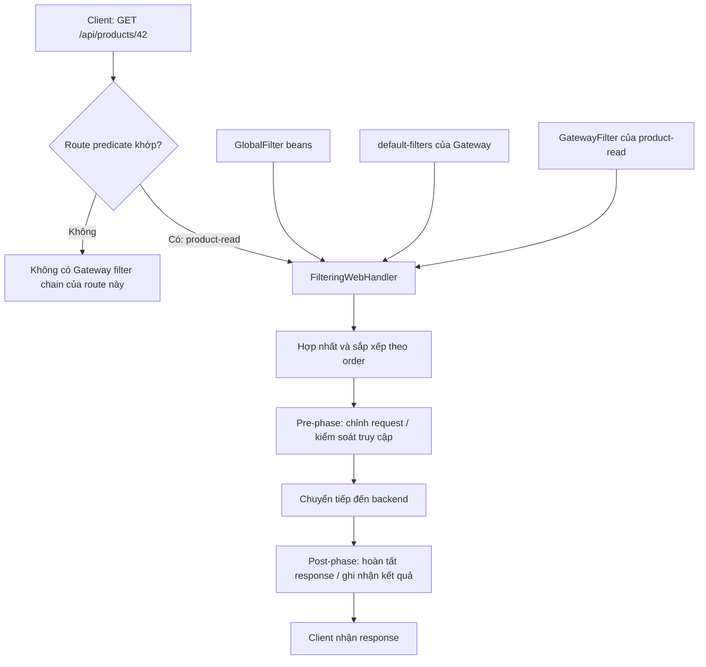
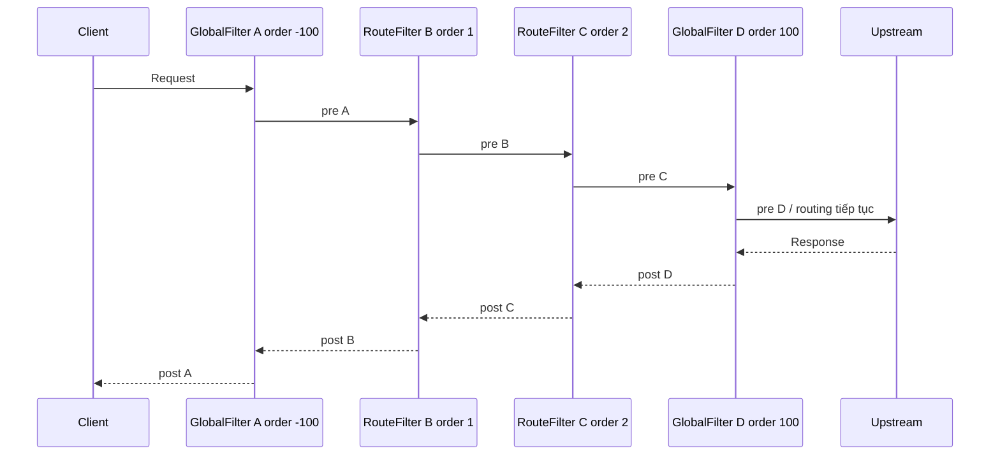

# Kết hợp GlobalFilter với bộ lọc riêng của tuyến trong Spring Cloud Gateway

Trong kiến trúc microservices, một API Gateway thường cần áp dụng **chính sách chung** cho mọi tuyến, đồng thời cho phép từng API có **quy tắc riêng**. Ví dụ, mọi request đi qua gateway đều cần một mã truy vết, nhưng chỉ tuyến quản lý đơn hàng cần circuit breaker; tuyến sản phẩm có thể phải bỏ tiền tố `/api` còn tuyến thanh toán cần kiểm soát retry chặt chẽ.

**Spring Cloud Gateway Server WebFlux** giải quyết bài toán này bằng cách kết hợp `GlobalFilter` với `GatewayFilter` của route đã khớp thành **một chuỗi thực thi có thứ tự**. Hiểu đúng cách kết hợp giúp xây dựng API Gateway của module `SPRING_CLOUD_GATEWAY`: chọn route theo predicate, biến đổi path/header, chuyển tiếp qua service discovery, triển khai xác thực, giới hạn lưu lượng, circuit breaker, retry, TLS và quan sát request nhất quán.

Bài học thuộc chương **Chuỗi bộ lọc**, tập trung vào ba câu hỏi: **filter nào tham gia vào một request; chúng chạy theo thứ tự nào; và việc kết hợp đó ảnh hưởng ra sao đến request/response thực tế?**

> Các API và ví dụ dưới đây dành cho **Spring Cloud Gateway Server WebFlux**. Biến thể Server MVC có pipeline và cơ chế filter riêng. Cấu hình namespace phụ thuộc phiên bản Spring Cloud Gateway/Spring Boot đang sử dụng.

## 1. Ba phạm vi xử lý dễ nhầm: GlobalFilter, GatewayFilter và WebFilter

Các lớp filter có tên gần giống nhau nhưng thuộc những giai đoạn khác nhau.

| Thành phần | Phạm vi | Cơ chế khai báo thường gặp | Ví dụ |
| --- | --- | --- | --- |
| **`GlobalFilter`** | Tham gia **mọi chuỗi Gateway** của các request đã được chọn route trong WebFlux Gateway. | Bean Spring implement `GlobalFilter`, thường kèm `Ordered`. | Truy vết request, đo độ trễ theo route, kiểm tra chính sách gateway dùng chung. |
| **`GatewayFilter`** | Tham gia **route đã khớp**; các bộ lọc từ `default-filters` cũng được gắn vào các route. | `GatewayFilterFactory` qua YAML/Properties hoặc API Java DSL. | `StripPrefix`, `SetPath`, `AddRequestHeader`, `RequestRateLimiter`. |
| **`WebFilter`** | Thuộc **Spring WebFlux web filter chain**, bên ngoài tầng chọn route và Gateway filter chain. | Bean Spring WebFlux / Spring Security. | Spring Security xác thực/ủy quyền HTTP request trước khi đi vào handler Gateway. |

Điểm quan trọng là chữ **global** trong `GlobalFilter` không có nghĩa “mọi request HTTP trên server đều chạy qua filter này”. Nó áp dụng khi request đã được xử lý bởi cơ chế chọn route của Gateway và đi vào `FilteringWebHandler`. Request không có route phù hợp có thể nhận `404` trước khi chạy bất kỳ Gateway filter nào. Nếu cần xử lý request ở tầng WebFlux bất kể route, phải xem xét `WebFilter` hoặc cơ chế web phù hợp.

Cũng không nên đồng nhất `GlobalFilter` với một filter tự gắn vào mọi route qua `default-filters`. Hai cách này có thể tạo phạm vi ảnh hưởng tương tự đối với request đã match, nhưng **API lập trình, cách cấu hình và cách tham gia thứ tự** khác nhau.

### 1.1. Hình dung một request thật

Giả sử client gọi:

```http
GET /api/products/42 HTTP/1.1
Host: gateway.example.com
```

Gateway có route `product-read` với predicate `Path=/api/products/**` và `Method=GET`. Khi route đã chọn:

1. Spring Cloud Gateway lấy các `GlobalFilter` đã đăng ký.
2. Gateway lấy các `GatewayFilter` gắn với `product-read`, kể cả filter mặc định áp dụng vào route đó.
3. Hai nhóm được **gộp và sắp theo thứ tự**.
4. Chuỗi chạy các thao tác phía request (*pre-phase*), thực hiện định tuyến và trả response qua các thao tác phía response (*post-phase*).



**Kết luận ở mức kiến trúc:** các `GlobalFilter` và `GatewayFilter` của tuyến không tạo hai pipeline tách biệt chạy tuần tự. Chúng là các phần tử của **cùng một Gateway filter chain** sau khi đã khớp route.

## 2. Bộ lọc riêng của route được tạo từ đâu?

Một route có thể khai báo các filter bằng cách liệt kê `filters`:

```yaml
spring:
  cloud:
    gateway:
      server:
        webflux:
          routes:
            - id: product-read
              uri: http://localhost:8081
              predicates:
                - Path=/api/products/**
                - Method=GET
              filters:
                - StripPrefix=1
                - SetRequestHeader=X-Gateway-Route, product-read
```

Ý nghĩa:

- `StripPrefix=1`: `/api/products/42` thành `/products/42` trước khi gửi đến backend.
- `SetRequestHeader=X-Gateway-Route, product-read`: gán header kỹ thuật vào request gửi upstream.
- Hai bộ lọc này **chỉ** thuộc route `product-read` trong cấu hình đang xét.
- URI `http://localhost:8081` là đích tĩnh; nếu dùng `lb://product-service`, Gateway cần Spring Cloud LoadBalancer và nguồn instance hợp lệ để phân giải.

Trong Server WebFlux, các mục khai báo như `StripPrefix` và `SetRequestHeader` được ánh xạ sang các **`GatewayFilterFactory`**, tạo ra `GatewayFilter` phục vụ route. Một route khác có thể có tập filter hoàn toàn khác.

Ví dụ tuyến đơn hàng:

```yaml
- id: order-api
  uri: http://localhost:8082
  predicates:
    - Path=/api/orders/**
  filters:
    - StripPrefix=1
    - AddRequestHeader=X-Request-Source, api-gateway
```

Với hai route trên, `GET /api/products/42` không chạy `AddRequestHeader=X-Request-Source` của `order-api`. Ngược lại, `GET /api/orders/7` không chạy `SetRequestHeader=X-Gateway-Route` của `product-read`. Các `GlobalFilter` đang đăng ký vẫn được xem xét ở cả hai tuyến sau khi chúng khớp.

> Ví dụ dùng namespace `spring.cloud.gateway.server.webflux.routes` của các phiên bản WebFlux mới. Những phiên bản trước thường dùng `spring.cloud.gateway.routes`. Cần kiểm tra namespace và starter của phiên bản thực tế, không khai báo đồng thời cả hai với giả định chúng tương đương.

## 3. `default-filters`: áp dụng một GatewayFilter vào mọi route

Bên cạnh `GlobalFilter` viết bằng Java, Gateway có cơ chế `default-filters` để áp dụng **GatewayFilter Factory** chung cho các route.

Ví dụ:

```yaml
spring:
  cloud:
    gateway:
      server:
        webflux:
          default-filters:
            - AddResponseHeader=X-Gateway-Edge, spring-cloud-gateway
          routes:
            - id: product-read
              uri: http://localhost:8081
              predicates:
                - Path=/api/products/**
              filters:
                - StripPrefix=1

            - id: order-api
              uri: http://localhost:8082
              predicates:
                - Path=/api/orders/**
              filters:
                - StripPrefix=1
```

Với ví dụ này, mỗi route nhận filter mặc định `AddResponseHeader`, đồng thời nhận filter `StripPrefix` của chính nó. Một response được xử lý qua route có thể được bổ sung header `X-Gateway-Edge`.

So sánh hai cách triển khai chính sách chung:

| Tiêu chí | `GlobalFilter` | `default-filters` |
| --- | --- | --- |
| Hình thức | Viết bean Java thực hiện `GlobalFilter`. | Cấu hình các `GatewayFilterFactory` ở mức gateway. |
| Phạm vi | Mỗi request đi vào Gateway chain của một route đã khớp. | Bộ lọc mặc định được gắn vào mỗi route. |
| Phù hợp | Logic tùy chỉnh, quan sát, ngữ cảnh request hoặc logic cần kết hợp API reactive. | Dùng lại filter tích hợp mà không cần viết mã Java cho từng route. |
| Kiểm soát thứ tự | Thường dùng `Ordered` / `@Order`. | Theo cách Gateway xây dựng, đánh thứ tự các route/default filters và sắp chuỗi; cần kiểm tra hành vi phiên bản. |
| Cần lưu ý | Một bean global có thể ảnh hưởng đến mọi backend đi qua gateway. | Header/path được thêm lặp hoặc xung đột nếu một route cũng cấu hình filter tương tự. |

**Không phải filter nào cũng nên đặt ở cấp toàn cục.** Ví dụ, `StripPrefix=1` áp dụng cho mọi route sẽ sai khi một backend cần giữ nguyên `/api`. Tương tự, điều kiện retry hoặc circuit breaker phụ thuộc tính chất thao tác và mục đích từng service; không nên áp dụng đồng loạt khi chưa đánh giá.

Đối với những quy tắc đơn giản dùng chung, `default-filters` thường dễ theo dõi trong cấu hình. Khi logic thực sự đòi hỏi xử lý reactive tùy biến, `GlobalFilter` là một lựa chọn thích hợp.

## 4. Gateway thực sự kết hợp hai nhóm filter như thế nào?

Sau khi một route được chọn, thành phần `FilteringWebHandler` lấy **global filters** và **gateway filters** gắn với route rồi xây dựng **một danh sách chung**. Các filter được sắp xếp theo cơ chế thứ tự của Spring, trong đó `Ordered` và các wrapper có thứ tự đóng vai trò quyết định.

Điều này dẫn đến ba nhận xét quan trọng:

1. **Không có quy tắc cố định “global luôn chạy trước route”.** Một `GlobalFilter` có thứ tự thấp có thể chạy trước route filter, còn global filter có thứ tự cao có thể chạy sau route filter trong pre-phase.
2. **Route filter cũng có thứ tự.** Các filter khai báo trong route và các filter mặc định được gán thứ tự khi Gateway tạo chuỗi; custom `GatewayFilter` có thể cần thứ tự rõ ràng nếu phụ thuộc một bước khác.
3. **Bộ lọc hạ tầng của Gateway cũng tham gia chuỗi.** Các thành phần như `RouteToRequestUrlFilter`, `ReactiveLoadBalancerClientFilter` và `NettyRoutingFilter` có thứ tự riêng. Thứ tự của custom filter phải xét cả những filter này, không chỉ các filter bạn nhìn thấy trong YAML.

### 4.1. Thứ tự `Ordered`

Theo quy tắc chung, **giá trị `order` nhỏ hơn có độ ưu tiên cao hơn**. Ví dụ:

| Filter | `order` minh họa | Pre-phase |
| --- | ---: | --- |
| `GlobalFilter A` (thêm trace ID) | `-100` | Sớm nhất trong bốn filter minh họa |
| `GatewayFilter B` (biến đổi path) | `1` | Sau A |
| `GatewayFilter C` (thêm header) | `2` | Sau B |
| `GlobalFilter D` (quan sát đích) | `100` | Sau C |

Khi response đi ngược qua những filter bọc quanh `chain.filter(exchange)`, trình tự hoàn tất thường là **D → C → B → A**. Các số của B/C ở đây chỉ **minh họa cách sắp xếp** một chuỗi đã được gán order; không bảo đảm mọi phiên bản Gateway đều sinh chính xác những con số ấy với cấu hình bất kỳ.



Sơ đồ mô tả tính chất **bao quanh nhau** của filter chain. Trong thực tế, từng filter có thể không viết phần xử lý post, một filter có thể từ chối request và không gọi tiếp chain, và các routing/global filter tích hợp cũng sẽ nằm trong chuỗi theo order của chúng.

### 4.2. Order của route khác order của filter

Một route có thể có:

```yaml
- id: product-read
  order: -10
  uri: http://localhost:8081
  predicates:
    - Path=/api/products/**
  filters:
    - StripPrefix=1
```

Ở đây `order: -10` trên **route** phục vụ ưu tiên chọn route khi có nhiều route cùng khớp. Nó **không** đặt thứ tự thực thi của `StripPrefix` bằng `-10` trong combined filter chain.

Khi phân tích thứ tự, luôn phân biệt:

- **Route selection order:** route nào thắng nếu nhiều predicate cùng khớp.
- **Filter execution order:** filter nào chạy trước/sau trong route đã được chọn.

Cùng là từ `order` nhưng thuộc hai quyết định khác nhau.

## 5. Pre-phase và post-phase là gì?

Mỗi filter có thể làm việc **trước** và/hoặc **sau** `chain.filter(exchange)`. Trong Reactor, `chain.filter(exchange)` trả về `Mono<Void>` biểu diễn phần còn lại của chuỗi xử lý, thay vì một kết quả HTTP đồng bộ.

Ví dụ khái niệm:

```java
@Override
public Mono<Void> filter(ServerWebExchange exchange, GatewayFilterChain chain) {
    // PRE: xử lý trước khi chuyển tới filter tiếp theo.
    System.out.println("pre");

    return chain.filter(exchange)
        .doFinally(signal -> {
            // Quan sát tín hiệu cuối: hoàn tất, lỗi hoặc hủy.
            System.out.println("finally: " + signal);
        });
}
```

**`doFinally`** chỉ quan sát tín hiệu kết thúc, không có nghĩa đây là thời điểm còn có thể chỉnh response trước khi gửi client. Khi callback chạy, HTTP response có thể đã được commit, hoặc client có thể đã hủy request.

Cách tư duy:

- **Pre-phase:** đọc route, thêm/bớt request header, thay path, đánh dấu ngữ cảnh, ra quyết định từ chối request.
- **Routing:** những filter hạ tầng xác định đích/instance rồi thực hiện HTTP/WebSocket/forward.
- **Post-phase:** ghi nhận thời gian, status, lỗi/hủy; thay đổi response chỉ khi thực hiện đúng thời điểm trước commit.

Bởi vì response trả từ backend theo phương thức reactive, không được giả định code nằm sau lời gọi `chain.filter(exchange)` theo kiểu imperative sẽ chạy sau khi HTTP hoàn tất:

```java
// KHÔNG đúng nếu muốn "done" chỉ xuất hiện sau khi xử lý request xong.
Mono<Void> result = chain.filter(exchange);
log.info("done");
return result;
```

Đoạn log trên có thể chạy ngay khi pipeline được xây dựng. Muốn gắn một hành động vào thời điểm chuỗi kết thúc, sử dụng operator reactive như `doFinally` hoặc `then(...)` tùy mục đích; không gọi `block()` để đợi.

### 5.1. Từ chối request cũng là một lựa chọn của filter

Một filter không bắt buộc phải gọi `chain.filter(exchange)`. Khi muốn từ chối request dựa vào chính sách hợp lệ:

```java
@Override
public Mono<Void> filter(ServerWebExchange exchange, GatewayFilterChain chain) {
    boolean allowed = isAllowed(exchange);

    if (!allowed) {
        exchange.getResponse().setStatusCode(HttpStatus.FORBIDDEN);
        return exchange.getResponse().setComplete();
    }

    return chain.filter(exchange);
}
```

Đoạn mã chỉ minh họa cấu trúc; `isAllowed` đại diện cho kết quả kiểm tra chính sách đã được thiết kế đúng. Nếu filter này trả response trực tiếp, những filter **ở phía sau nó** trong chuỗi sẽ không chạy, bao gồm cả thao tác gọi backend. Các filter bao quanh ở phía trước vẫn có thể nhận tín hiệu hoàn tất/hủy để ghi nhận kết quả.

**Lưu ý bảo mật:** dùng `Spring Security` để xác thực/ủy quyền nhất quán khi phù hợp, không dựa vào một header do client tự khai báo như `X-Role: admin` để quyết định `allowed`.

## 6. Ví dụ kết hợp GlobalFilter viết bằng Java và GatewayFilter cấu hình YAML

Xây dựng hệ thống có hai dịch vụ:

- `Product Service`: chạy tại `http://localhost:8081`, cung cấp `GET /products/{id}`.
- `Order Service`: chạy tại `http://localhost:8082`, cung cấp `GET /orders/{id}`.

Gateway chạy tại `http://localhost:8080`. Yêu cầu: mọi request đến backend có mã truy vết do Gateway cấp; response có header nhận diện cổng vào; chỉ từng route tự chọn cách biến đường dẫn và thêm header riêng.

### 6.1. GlobalFilter sinh mã truy vết và đo độ trễ

```java
import java.util.UUID;
import java.util.concurrent.TimeUnit;

import org.slf4j.Logger;
import org.slf4j.LoggerFactory;
import org.springframework.cloud.gateway.filter.GatewayFilterChain;
import org.springframework.cloud.gateway.filter.GlobalFilter;
import org.springframework.cloud.gateway.route.Route;
import org.springframework.cloud.gateway.support.ServerWebExchangeUtils;
import org.springframework.core.Ordered;
import org.springframework.http.server.reactive.ServerHttpRequest;
import org.springframework.stereotype.Component;
import org.springframework.web.server.ServerWebExchange;

import reactor.core.publisher.Mono;

@Component
public class GatewayTraceGlobalFilter implements GlobalFilter, Ordered {
    private static final Logger log =
        LoggerFactory.getLogger(GatewayTraceGlobalFilter.class);

    @Override
    public int getOrder() {
        return -100;
    }

    @Override
    public Mono<Void> filter(ServerWebExchange exchange, GatewayFilterChain chain) {
        String requestId = UUID.randomUUID().toString();
        long startedAt = System.nanoTime();

        Route route = exchange.getAttribute(
            ServerWebExchangeUtils.GATEWAY_ROUTE_ATTR
        );
        String routeId = route != null ? route.getId() : "unknown";

        ServerHttpRequest request = exchange.getRequest()
            .mutate()
            .headers(headers ->
                headers.set("X-Gateway-Request-Id", requestId))
            .build();

        ServerWebExchange updated = exchange.mutate()
            .request(request)
            .build();

        // Thực hiện ngay trước khi response được commit.
        updated.getResponse().beforeCommit(() -> {
            updated.getResponse().getHeaders()
                .set("X-Gateway-Request-Id", requestId);
            return Mono.empty();
        });

        return chain.filter(updated)
            .doFinally(signal -> {
                long elapsedMs = TimeUnit.NANOSECONDS.toMillis(
                    System.nanoTime() - startedAt
                );
                log.info(
                    "routeId={} requestId={} status={} elapsedMs={} signal={}",
                    routeId,
                    requestId,
                    updated.getResponse().getStatusCode(),
                    elapsedMs,
                    signal
                );
            });
    }
}
```

Giải thích:

1. `@Component` đăng ký bean `GlobalFilter`; `Ordered` cung cấp `order=-100` để đặt filter sớm trong pre-phase.
2. Gateway **tự sinh mã request** và ghi đè header `X-Gateway-Request-Id`, không tin một giá trị do client tự khai báo.
3. `request.mutate()` tạo request mới, còn `exchange.mutate().request(request).build()` truyền request đã đổi vào phần còn lại của chain.
4. `beforeCommit(...)` là chỗ phù hợp để đặt response header khi response chưa commit; tránh đặt header trong `doFinally`.
5. `doFinally` quan sát hoàn tất, lỗi và hủy. Không gọi `subscribe()` hoặc `block()`; WebFlux quản lý subscription.
6. Log dùng `routeId` và mã sinh bởi gateway, không ghi token, mật khẩu hay toàn bộ query string.

Ví dụ này dùng cho mục đích học tập. Trong hệ thống thực, nên ưu tiên **Micrometer Observation/Tracing**, định dạng correlation ID thống nhất, sampling, log không chặn và cardinality nhãn metric được kiểm soát. Nếu cần đưa request ID tới mọi trường hợp lỗi trước cả route matching, nên đặt cơ chế ở tầng thích hợp như WebFlux `WebFilter`.

### 6.2. Cấu hình filter chung và filter của từng route

```yaml
server:
  port: 8080

spring:
  application:
    name: edge-gateway
  cloud:
    gateway:
      server:
        webflux:
          default-filters:
            - AddResponseHeader=X-Gateway-Edge, edge-gateway
          routes:
            - id: product-read
              uri: http://localhost:8081
              predicates:
                - Path=/api/products/**
                - Method=GET
              filters:
                - StripPrefix=1
                - SetRequestHeader=X-Route-Name, product-read

            - id: order-api
              uri: http://localhost:8082
              predicates:
                - Path=/api/orders/**
              filters:
                - StripPrefix=1
                - SetRequestHeader=X-Route-Name, order-api
```

Bây giờ, mỗi request khớp một trong hai route sẽ có:

- `GatewayTraceGlobalFilter` tạo `X-Gateway-Request-Id` gửi upstream và trả về client.
- `AddResponseHeader=X-Gateway-Edge` được gắn vào route nhờ `default-filters`.
- `StripPrefix=1` đổi path gửi backend.
- `SetRequestHeader=X-Route-Name` gắn nhãn route riêng trước khi chuyển tiếp.

Với `GET /api/products/42`, backend sản phẩm nhận đường dẫn `/products/42` và header `X-Route-Name: product-read`. Với `GET /api/orders/7`, backend đơn hàng nhận `/orders/7` và header `X-Route-Name: order-api`.

Tùy cấu hình thực tế, header response từ backend và các filter khác cũng có thể ảnh hưởng kết quả cuối cùng. Tránh áp dụng cùng tên header qua nhiều bộ lọc `Add*Header` nếu không muốn giá trị bị lặp; `Set*Header` phù hợp khi cần thay thế một giá trị.

### 6.3. Ma trận request

| Request | Route khớp | Filter route | Global/default filters |
| --- | --- | --- | --- |
| `GET /api/products/42` | `product-read` | `StripPrefix`, đặt `X-Route-Name=product-read` | Có; mã request, header `X-Gateway-Edge`. |
| `POST /api/products/42` | Không khớp `product-read` do `Method=GET` | Không chạy filter của route này | Nếu không có route khác, Gateway filter chain không được thiết lập. |
| `GET /api/orders/7` | `order-api` | `StripPrefix`, đặt `X-Route-Name=order-api` | Có; mã request, header `X-Gateway-Edge`. |
| `GET /unknown` | Không có route khớp trong ví dụ | Không | Không chạy các Gateway filters thuộc route đã chọn, vì không có route. |

Có thể kiểm tra bằng:

```bash
curl -i "http://localhost:8080/api/products/42"
curl -i "http://localhost:8080/api/orders/7"
curl -i -X POST "http://localhost:8080/api/products/42"
```

Thử nghiệm cần hai backend chạy ở cổng tương ứng. Để chắc chắn filter biến path đúng, quan sát **request thực tế backend nhận**, không chỉ nhìn HTTP status từ Gateway.

## 7. Tùy biến GatewayFilter riêng của tuyến

Khi filter tích hợp chưa đáp ứng nhu cầu, có thể viết `GatewayFilterFactory` và cấu hình cho đúng những route cần dùng. Một ví dụ nhẹ là thêm nhãn kỹ thuật do cấu hình quyết định, không có tác dụng xác thực.

```java
import org.springframework.cloud.gateway.filter.GatewayFilter;
import org.springframework.cloud.gateway.filter.factory.AbstractGatewayFilterFactory;
import org.springframework.http.server.reactive.ServerHttpRequest;
import org.springframework.stereotype.Component;

@Component
public class RouteLabelGatewayFilterFactory
    extends AbstractGatewayFilterFactory<RouteLabelGatewayFilterFactory.Config> {

    public RouteLabelGatewayFilterFactory() {
        super(Config.class);
    }

    @Override
    public GatewayFilter apply(Config config) {
        return (exchange, chain) -> {
            ServerHttpRequest request = exchange.getRequest()
                .mutate()
                .headers(headers ->
                    headers.set("X-Route-Label", config.getValue()))
                .build();

            return chain.filter(
                exchange.mutate().request(request).build()
            );
        };
    }

    public static class Config {
        private String value;

        public String getValue() {
            return value;
        }

        public void setValue(String value) {
            this.value = value;
        }
    }
}
```

Cấu hình dành riêng một route:

```yaml
filters:
  - name: RouteLabel
    args:
      value: catalog-public
```

Quy ước tên factory `RouteLabelGatewayFilterFactory` cho phép dùng tên filter `RouteLabel` trong cấu hình tương ứng. Custom factory này tạo ra một `GatewayFilter` cho route đã khai báo; nó **không** tự trở thành `GlobalFilter`.

Nếu yêu cầu chỉ là thêm header, hãy ưu tiên filter tích hợp `SetRequestHeader` để giảm lượng code cần bảo trì. Custom filter hữu ích khi cần quy tắc phức tạp và được kiểm soát, ví dụ xác định header theo một ánh xạ nội bộ đã xác thực.

### 7.1. Route filter viết trong Java DSL

Cũng có thể cấu hình route bằng `RouteLocatorBuilder` thay cho YAML:

```java
@Bean
public RouteLocator apiRoutes(RouteLocatorBuilder builder) {
    return builder.routes()
        .route("product-read", r -> r
            .path("/api/products/**")
            .and()
            .method("GET")
            .filters(f -> f
                .stripPrefix(1)
                .setRequestHeader("X-Route-Name", "product-read"))
            .uri("http://localhost:8081"))
        .build();
}
```

Cấu hình bằng Java DSL vẫn tạo route với các `GatewayFilter` và được kết hợp với `GlobalFilter` trong `FilteringWebHandler` như cấu hình khai báo. Khi sử dụng factory hoặc DSL tùy biến, cần xem cách filter đó công bố `order` và quan hệ với các filter hạ tầng của phiên bản đang chạy.

## 8. Thứ tự kết hợp với các filter hạ tầng

Một request khớp route chưa được gửi đến backend ngay. Với WebFlux Gateway, sau các thao tác pre, những filter hạ tầng có thể:

1. Dùng `RouteToRequestUrlFilter` để xây URL từ route đã chọn và path hiện tại, lưu trong `GATEWAY_REQUEST_URL_ATTR`.
2. Nếu URL dùng `lb://`, chạy `ReactiveLoadBalancerClientFilter` để chọn instance và cập nhật URL.
3. Dùng filter định tuyến phù hợp như `NettyRoutingFilter`, `WebsocketRoutingFilter` hoặc `ForwardRoutingFilter`.
4. Ghi HTTP response về client qua filter tương ứng.

Điều này ảnh hưởng trực tiếp đến **vị trí đặt filter custom**:

| Mục tiêu | Thời điểm phù hợp |
| --- | --- |
| Thêm header mà backend sẽ đọc. | Trước HTTP routing filter gửi request. |
| Thay path bằng `StripPrefix`, `SetPath`. | Trước khi URL routing được dựng hoặc đồng bộ chính xác với thuộc tính URL. |
| Ghi tên route và mã truy vết. | Một filter sớm sau route matching có thể làm được; không cần đợi tìm instance. |
| Quan sát URL instance cuối cùng. | Sau bước load balancing nhưng trước bước gửi request, hoặc dùng công cụ tracing phù hợp. |
| Đặt response header. | Trước khi response commit, chẳng hạn đăng ký `beforeCommit` ở filter chạy sớm. |

`RouteToRequestUrlFilter` thường có hằng thứ tự `ROUTE_TO_URL_FILTER_ORDER=10000` ở các nhánh WebFlux được sử dụng rộng rãi. `ReactiveLoadBalancerClientFilter` thường có thứ tự `10150`. Các giá trị cụ thể có thể thay đổi theo thư viện, vì vậy chỉ dùng chúng để thiết kế khi đã kiểm tra phiên bản triển khai.

Nếu filter tùy biến sửa đường dẫn **sau** bước xây `GATEWAY_REQUEST_URL_ATTR`, backend có thể vẫn nhận URL cũ. Trong tình huống bình thường, ưu tiên filter path tích hợp ở vị trí pre trước routing.

## 9. Khi nhiều filter cùng thay đổi một header, path hoặc response

### 9.1. Trùng header request

Giả sử `GlobalFilter` đặt `X-Channel: web`, còn route dùng:

```yaml
filters:
  - SetRequestHeader=X-Channel, partner
```

Giá trị cuối cùng phụ thuộc **filter nào thực thi sau trong pre-phase** và cách từng filter thay header. Nếu cả hai dùng `AddRequestHeader`, upstream có thể nhận nhiều giá trị cùng tên. Nếu dùng `SetRequestHeader`, một filter chạy sau có thể ghi đè giá trị đã đặt trước.

**Quy tắc thiết kế:** chỉ định một lớp chịu trách nhiệm cho các header có ý nghĩa bảo mật, như danh tính sau xác thực. Nếu gateway chủ động tạo header tin cậy cho backend, cần xóa hoặc ghi đè bản do client cung cấp và bảo vệ đường truy cập backend. Không tin một header chỉ vì tên bắt đầu bằng `X-Gateway-`.

### 9.2. Trùng filter chỉnh path

Một route có:

```yaml
filters:
  - StripPrefix=1
  - PrefixPath=/internal
```

Với `/api/products/42`, ý đồ là bỏ `/api` để được `/products/42`, rồi thêm `/internal` để được `/internal/products/42`. Tuy nhiên, nếu còn một filter khác sửa path ở cấp default hoặc global, kết quả cần được kiểm tra theo **thứ tự thực tế**.

Không nên đặt nhiều lần `StripPrefix` tại các phạm vi khác nhau rồi hy vọng tổng hiệu ứng vẫn đúng. Hãy mô tả đường dẫn công khai và đường dẫn backend một cách tường minh, sau đó kiểm thử bằng mock backend.

### 9.3. Thay response quá muộn

Response có vòng đời commit. Nếu một filter làm:

```java
return chain.filter(exchange)
    .doFinally(signal -> {
        exchange.getResponse().getHeaders().set("X-Result", "done");
    });
```

thì **không thể bảo đảm header được gửi đến client**, vì `doFinally` xảy ra sau tín hiệu kết thúc/hủy và response có thể đã commit.

Khi cần đặt một header trước commit:

```java
exchange.getResponse().beforeCommit(() -> {
    exchange.getResponse().getHeaders().set("X-Result", "done");
    return Mono.empty();
});

return chain.filter(exchange);
```

Cách này chỉ thích hợp nếu callback được đăng ký trước khi response commit. Khi dùng những filter như `AddResponseHeader`, `SetResponseHeader`, `RemoveResponseHeader`, phải xét thứ tự filter và thời điểm response được ghi để tránh tác dụng chồng chéo.

## 10. Lỗi, short-circuit, retry và circuit breaker trong filter chain

Một filter có thể tạo response trực tiếp hoặc biến lỗi thành một kết quả khác. Đây là lý do **không phải filter nào trong danh sách cũng luôn chạy**.

Ví dụ filter giới hạn lưu lượng từ chối request trước khi gọi backend:

```text
Global tracing filter (pre)
  -> RequestRateLimiter filter
       -> Quota không còn: trả HTTP 429
       -> Không gọi filter phía sau / không gọi backend
Global tracing filter nhận tín hiệu kết thúc (post)
```

Nếu filter giới hạn tốc độ được đặt trước route filter thêm header, header route đó có thể **không được thêm** vào response bị từ chối. Nếu muốn một header chung xuất hiện trên cả response lỗi sớm, cần thiết kế filter hoặc lớp xử lý phù hợp.

### 10.1. Retry có thể chạy lại phần xử lý phía sau

Filter `Retry` có thể lặp lại một phần thao tác downstream theo cấu hình. Do đó các side effect như ghi audit, tăng bộ đếm hoặc sửa request body cần được thiết kế **idempotent** hoặc bảo đảm chỉ xảy ra số lần mong muốn.

Đặc biệt:

- Không tự retry `POST` tạo đơn hàng hay thanh toán nếu chưa có cơ chế bảo đảm tác dụng phụ không lặp ngoài ý muốn.
- Với request body streaming, kiểm tra khả năng cache/replay và chi phí bộ nhớ trước khi bật retry.
- Không áp dụng retry rộng đến mọi lỗi HTTP, vì lỗi client 4xx thường không được giải quyết bằng gửi lại cùng request.

### 10.2. Circuit breaker thay đổi nhánh xử lý

Filter `CircuitBreaker` có thể cho phép lời gọi upstream, từ chối khi circuit mở hoặc chuyển sang fallback tùy cấu hình. Khi fallback xử lý request, chuỗi response và status quan sát được có thể khác so với lời gọi backend thông thường.

Một `GlobalFilter` đo tổng latency có thể nhận thời gian cả fallback; muốn phân biệt nguyên nhân cần kết hợp route ID, kết quả circuit breaker và HTTP status trong metric/tracing.

### 10.3. Status HTTP khác tín hiệu lỗi Reactive Streams

Không phải response `503` từ backend luôn tạo tín hiệu `onError` trong filter chain. Gateway có thể chuyển tiếp status `503` hợp lệ theo giao thức rồi hoàn tất pipeline bình thường. Vì vậy muốn giám sát lỗi phải xem **cả status HTTP lẫn tín hiệu reactive**. `doOnError` một mình không thể đếm chính xác toàn bộ request 5xx.

## 11. GlobalFilter và Spring Security: đặt xác thực ở đâu?

Một cách hiểu sai thường gặp là “tất cả logic xác thực phải nằm trong `GlobalFilter`”. Trong ứng dụng Server WebFlux, Spring Security thường sử dụng **`WebFilter`** trong chuỗi bảo mật ở tầng WebFlux, trước logic xử lý route. Các gateway filters có thể tiếp tục áp dụng chính sách đặc thù theo route nhưng không nên thay thế việc xác thực nhất quán bằng cách kiểm tra header tự chế.

| Nhu cầu | Lớp nên cân nhắc |
| --- | --- |
| Xác thực access token và quản lý principal. | Spring Security trong WebFlux, kết hợp cấu hình resource server khi phù hợp. |
| Phân quyền ở mức URL chung. | Chính sách Spring Security; backend vẫn kiểm tra quyền theo tài nguyên. |
| Giới hạn lưu lượng theo route/user đã xác thực. | `RequestRateLimiter` và `KeyResolver` dựa trên ngữ cảnh danh tính đáng tin cậy. |
| Thêm correlation/trace ID tới upstream. | `GlobalFilter` hoặc tracing tích hợp, với quy tắc tin cậy rõ ràng. |
| Biến đổi path/header riêng cho backend. | `GatewayFilter` của route. |
| CORS, TLS, giới hạn kích thước request và các ràng buộc web. | Cấu hình lớp tương ứng, không mặc định mọi thứ là GatewayFilter. |

Cần thống nhất **ranh giới tin cậy giữa gateway và backend**. Backend không được mặc định rằng có header `X-User-Id` nghĩa là request đã qua xác thực. Các header do client tự gửi phải bị loại bỏ hoặc kiểm soát trước khi gắn thông tin danh tính tin cậy, và backend cần được bảo vệ khỏi đường truy cập không qua gateway nếu mô hình bảo mật đòi hỏi.

TLS cho chặng client–gateway và gateway–backend cũng được thiết lập ở tầng HTTP/network tương ứng, không phải tự sinh ra vì có một `GlobalFilter` hay `GatewayFilter`.

## 12. Debug thứ tự và quan sát hiệu quả

Khi request tới sai backend, header bị thiếu hoặc response không có trường dự kiến, hãy theo dõi theo trình tự:

1. **Route matching:** request có khớp route nào? Route ID và predicate là gì?
2. **Danh sách filter đã ghép:** GlobalFilter, default-filters, route filters và order thực tế.
3. **Pre-phase:** đường dẫn/header bị thay đổi theo thứ tự nào?
4. **Routing:** `GATEWAY_REQUEST_URL_ATTR` là gì sau `RouteToRequestUrlFilter` và sau load balancing?
5. **Response:** status, header trước commit, lỗi mạng, fallback, tình huống bị hủy.
6. **Tài nguyên:** latency, kết nối, bộ nhớ, blocking operation và áp lực ở upstream.

### 12.1. Đừng suy luận thứ tự từ vị trí khai báo trong YAML đơn thuần

Các mục `filters` trong một route thường có trình tự riêng khi được chuyển thành các `GatewayFilter`, nhưng chúng còn được **trộn với global và default filters**. Một route filter được liệt kê đầu tiên trong YAML không nhất thiết là filter chạy đầu tiên trong toàn bộ pipeline.

Khi muốn biết order thật, có thể bật logging theo nhóm lớp liên quan hoặc khai thác Actuator endpoint của Spring Cloud Gateway **trong môi trường được bảo vệ** nếu phiên bản hỗ trợ. Không công khai cấu hình route, URI nội bộ, header nhạy cảm hay actuator nhạy cảm lên Internet.

### 12.2. Logging có kiểm soát

Nên ghi:

- route ID, request/correlation ID đã xác thực hoặc do gateway tạo, HTTP method;
- HTTP status, latency, tín hiệu hoàn tất/lỗi/hủy;
- tên service logic, trạng thái load balancer và loại lỗi khi cần;
- các thuộc tính ổn định, cardinality thấp làm metric labels.

Tránh ghi:

- access token, cookie xác thực, mật khẩu;
- nguyên vẹn query string chứa dữ liệu cá nhân;
- body request/response trong môi trường thật trừ khi có cơ chế bảo vệ rõ ràng;
- URL đầy đủ có tham số độc nhất làm metric label.

### 12.3. Ma trận lỗi thường gặp

| Triệu chứng | Khả năng cần kiểm tra | Hướng xử lý |
| --- | --- | --- |
| GlobalFilter không chạy với `GET /unknown`. | Không có route nào khớp. | Xác nhận phạm vi `GlobalFilter`; nếu cần xử lý trước route mapping, xem xét `WebFilter`. |
| Một route thiếu header chung. | Filter không gắn đúng phạm vi, bị filter khác ghi đè hoặc short-circuit sớm. | Kiểm tra default-filters, order và điểm commit response. |
| Header request có hai giá trị. | Dùng `AddRequestHeader` ở cả default và route. | Xác định chủ sở hữu header; dùng `SetRequestHeader` khi phù hợp. |
| Backend nhận path khác mong đợi. | Nhiều filter thay path hoặc custom filter chạy sau URL builder. | Kiểm tra order, path tại backend và `GATEWAY_REQUEST_URL_ATTR`. |
| Có trace ID nhưng backend không tìm thấy. | Filter tạo ID sau khi HTTP routing đã gửi request, hoặc gửi sai header. | Đặt filter trước routing và kiểm tra upstream thực nhận. |
| `doFinally` ghi log nhưng response thiếu header. | Response đã commit. | Dùng `beforeCommit` hoặc filter response đúng thời điểm. |
| Request trả `429` nhưng không chạy filter nghiệp vụ. | `RequestRateLimiter` chặn trước và không gọi phần chain còn lại. | Xác nhận đây là chủ đích; đặt quan sát cần thiết ở lớp chạy sớm. |
| Cùng một side effect xảy ra nhiều lần. | Retry lặp lại một phần downstream chain. | Xem chính sách retry, idempotency và điểm đặt logic audit. |
| Lỗi `lb://` mặc dù predicate đúng. | Thiếu instance/discovery/load balancer. | Kiểm tra danh sách instance và cấu hình ServiceInstance, không sửa Path predicate vô cớ. |
| Latency tăng khi số kết nối tăng. | Blocking call trong global/custom gateway filter. | Dùng API non-blocking hoặc cách ly blocking workload có giới hạn. |

## 13. Bài tập tình huống có đáp án

### Bài 1 — Xác định filter nào tham gia

Giả sử gateway có `GatewayTraceGlobalFilter`, `default-filters` chứa `AddResponseHeader=X-Edge, 1`, route A có `StripPrefix=1`, route B có `PrefixPath=/internal`.

**Câu hỏi:** request khớp route A sẽ chạy `PrefixPath` của route B không?

**Đáp án:** Không. Gateway hợp nhất global filters với default/route filters **của route đã được chọn**. `PrefixPath` của route B không nằm trong chain của route A.

### Bài 2 — Thứ tự pre/post

Có bốn filter với order lần lượt `G1=-50`, `R1=1`, `R2=2`, `G2=40`; tất cả gọi chain và ghi log trước/sau.

**Câu hỏi:** thứ tự pre và post là gì?

**Đáp án:** Pre: `G1 → R1 → R2 → G2`. Post (đối với logic gắn đúng vào pha hoàn tất): `G2 → R2 → R1 → G1`. Các filter hạ tầng có thể chen vào nếu xét toàn bộ pipeline thực.

### Bài 3 — Route order và filter order

Route A có `order=-10`, route B có `order=10`. GlobalFilter có `getOrder()=-100`.

**Câu hỏi:** `order=-10` có nghĩa filter của route A chạy trước GlobalFilter không?

**Đáp án:** Không. `order` của route được dùng khi chọn route. Khi route A được chọn, các filter của A cùng global filters mới được sắp xếp theo thứ tự thực thi riêng.

### Bài 4 — Response header trên request bị từ chối

`GlobalFilter` A đăng ký `beforeCommit` để đặt `X-Gateway-Request-Id`. Route có `RequestRateLimiter` chặn với `429` trước khi chạy `AddResponseHeader` đặt ở filter phía sau.

**Câu hỏi:** response có thể thiếu header nào?

**Đáp án:** Header do filter `AddResponseHeader` ở phía sau có thể không xuất hiện vì filter đó không chạy. Header `X-Gateway-Request-Id` của filter A đã đăng ký callback sớm có thể được ghi trước commit, nếu response đi qua callback như dự kiến.

### Bài 5 — Sai lầm trong reactive filter

Một lập trình viên viết:

```java
@Override
public Mono<Void> filter(ServerWebExchange exchange, GatewayFilterChain chain) {
    auditService.save(exchange).subscribe();
    return chain.filter(exchange);
}
```

**Câu hỏi:** rủi ro ở đâu?

**Đáp án:** `subscribe()` tạo nhánh chạy độc lập với vòng đời HTTP request; lỗi, hủy và thứ tự hoàn tất không còn gắn chặt với gateway chain. Nếu audit là một bước bắt buộc phải hoàn tất trước khi chuyển tiếp và `save` trả `Mono<Void>`, nên ghép trực tiếp:

```java
return auditService.save(exchange)
    .then(chain.filter(exchange));
```

Nếu audit cần độc lập, hãy thiết kế cơ chế hàng đợi/hệ thống audit có đảm bảo truyền nhận riêng; không sử dụng `subscribe()` tùy tiện trong filter.

### Bài 6 — Chọn lớp xử lý thích hợp

Hệ thống cần: (a) xác thực JWT cho mọi API bảo vệ; (b) gắn nhãn kỹ thuật lên response của mọi route; (c) đổi `/api/products/42` thành `/products/42` riêng tuyến sản phẩm.

**Đáp án:** (a) cân nhắc Spring Security `WebFilter` và backend authorization; (b) có thể dùng `default-filters` với `AddResponseHeader` hoặc `GlobalFilter` khi cần logic bổ sung; (c) dùng `StripPrefix`/`SetPath` trong `GatewayFilter` của tuyến sản phẩm.

## 14. Checklist trước khi đưa filter chain vào production

- [ ] Các `GlobalFilter` chỉ xử lý đúng logic cần áp dụng cho tất cả request **đã khớp route**.
- [ ] Những filter như `StripPrefix`, `CircuitBreaker` và `Retry` được cấu hình phù hợp với từng route, tránh áp dụng mặc định quá rộng.
- [ ] Đã kiểm tra `order` thực tế của GlobalFilter, custom GatewayFilter và filter hạ tầng.
- [ ] Đã phân biệt `order` chọn route với `order` thực thi filter.
- [ ] Header có chủ sở hữu rõ ràng; không để nhiều filter vô tình thêm/ghi đè cùng một header.
- [ ] Request path được biến đổi đúng **trước** bước dựng URL chuyển tiếp.
- [ ] Logic response header được thực hiện trước commit; `doFinally` chỉ dùng cho quan sát sau cùng.
- [ ] Nhánh short-circuit trả status đúng và không vô tình bỏ qua xử lý bắt buộc.
- [ ] Rate limiter, circuit breaker, retry/timeout và khả năng replay body đã được kiểm thử riêng.
- [ ] Filter tự viết không chứa blocking call hoặc `subscribe()` tách khỏi chuỗi reactive.
- [ ] Spring Security và backend kiểm tra danh tính/quyền, không tin header tự khai báo.
- [ ] Trace/log/metric đủ để lần theo route và latency nhưng không phát tán thông tin nhạy cảm.
- [ ] Dùng TLS/trust store đúng cho từng chặng kết nối; test với upstream thực tế khi dùng `lb://`.

## 15. Tổng kết

Trong **Spring Cloud Gateway Server WebFlux**, `GlobalFilter` và `GatewayFilter` của tuyến đã chọn **được hợp nhất thành một filter chain rồi sắp xếp theo order**. Filter có ưu tiên cao thường chạy **sớm trong pre-phase** và **muộn trong post-phase**. `default-filters` giúp áp dụng GatewayFilter tích hợp cho các route; `WebFilter` của WebFlux/Spring Security hoạt động ở một tầng khác.

Muốn vận hành Gateway an toàn và dễ debug, hãy xác định rõ **phạm vi filter, thứ tự, tác động lên request/response và điểm dừng của chain**. Khi những phần này nhất quán, các chức năng như biến đổi path/header, định tuyến qua service discovery, xác thực, rate limiting, circuit breaker, retry, TLS và quan sát request mới có thể phối hợp ổn định trong cổng vào microservices.
