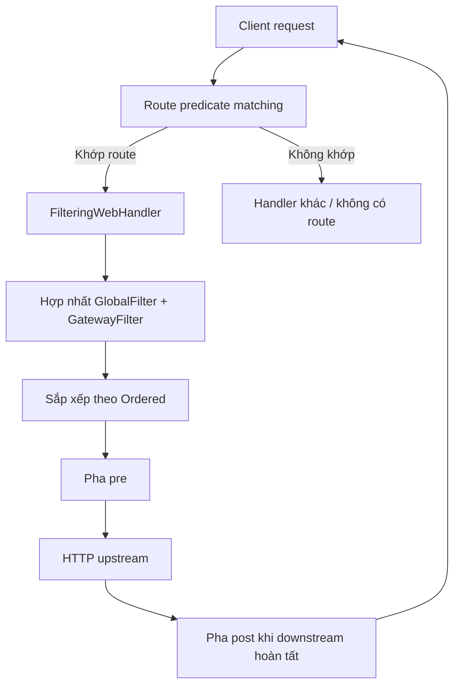
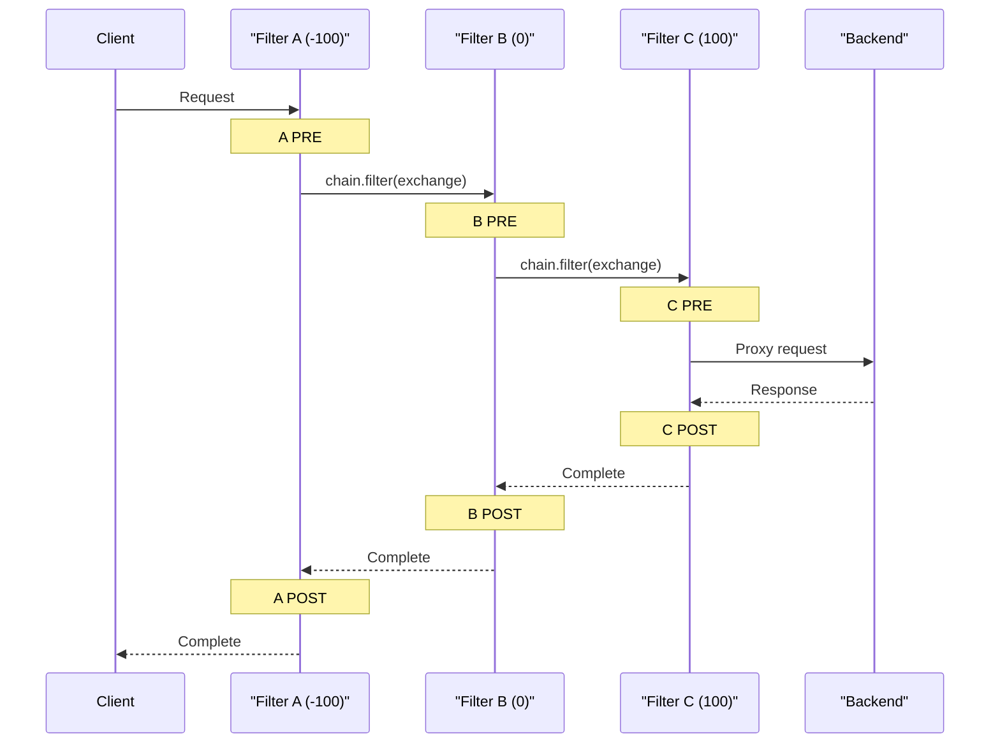

# `Ordered` và thứ tự thực thi trước/sau theo chiều đảo ngược trong Spring Cloud Gateway

Trong **Spring Cloud Gateway**, request không chỉ đi qua một bộ lọc. Sau khi tìm được route phù hợp qua các **route predicate**, gateway kết hợp các **`GlobalFilter`** và **`GatewayFilter`** của route thành một chuỗi, rồi sắp xếp trước khi thực thi. Mỗi filter có cơ hội xử lý request ở **pha trước** (*pre*) và phản hồi ở **pha sau** (*post*).

Quy tắc quan trọng nhất của chương **Chuỗi bộ lọc** là: **filter có `order` nhỏ hơn thường chạy phần `pre` trước, nhưng phần `post` của chính filter đó chạy sau các filter bên trong**. Điều này giống các lớp middleware lồng nhau hoặc các khối `try/finally` được lồng nhiều tầng.

Bài viết tập trung vào **Spring Cloud Gateway Server WebFlux**, sử dụng các API `GlobalFilter`, `GatewayFilter`, `GatewayFilterChain` và Reactor `Mono<Void>`. Phần lớn ví dụ YAML theo **Spring Cloud Gateway 5.0.x** (Spring Cloud 2025.1.x/Spring Boot 4.x) với tiền tố `spring.cloud.gateway.server.webflux`. Với Gateway phiên bản cũ hoặc biến thể **Server Web MVC**, cần đối chiếu đúng tài liệu: MVC dùng mô hình WebMvc.fn và các filter API khác.

## 1. Mục tiêu học tập

Sau bài này, bạn có thể:

1. Giải thích tại sao `Ordered` có thể quyết định vị trí của một filter trong chuỗi.
2. Đọc thứ tự `pre` và `post` khi nhiều filter có các giá trị `order` khác nhau.
3. Phân biệt **độ ưu tiên route** với **độ ưu tiên filter**, cũng như `GlobalFilter`, `GatewayFilter` và default filters.
4. Viết filter dùng `chain.filter(exchange)` cùng Reactor `then`, `doOnError` hoặc `doFinally` đúng ý nghĩa.
5. Dùng Java DSL và Actuator để kiểm tra thứ tự thực tế.
6. Tránh các lỗi vận hành liên quan đến sửa response sau khi đã commit, thao tác blocking, retry, xác thực, rate limiting và quan sát request.

## 2. Filter chain hình thành lúc nào?

Hãy xét request:

```http
GET /api/orders/42 HTTP/1.1
Host: localhost:8080
Authorization: Bearer <token>
```

Một route có thể khai báo:

```yaml
server:
  port: 8080

spring:
  cloud:
    gateway:
      server:
        webflux:
          routes:
            - id: orders-route
              uri: http://localhost:9001
              predicates:
                - Path=/api/orders/**
              filters:
                - StripPrefix=1
                - AddRequestHeader=X-Gateway-Route, orders-route
```

Diễn biến khái quát:

1. Gateway tìm route có predicate khớp: ở đây là `Path=/api/orders/**`.
2. `FilteringWebHandler` nhận danh sách `GatewayFilter` của route và các `GlobalFilter` được đăng ký ở ứng dụng.
3. Gateway gộp, chuyển chúng về dạng tương thích và **sắp xếp theo thứ tự `Ordered`**.
4. Filter chain lần lượt được gọi: các bước trước `chain.filter(exchange)` là `pre`; các xử lý được nối sau `Mono` trả về là `post`.
5. Các filter định tuyến nội bộ chuyển request tới backend và xử lý response theo cơ chế non-blocking.



**Giới hạn phạm vi:** `GlobalFilter` nói ở đây thuộc **Spring Cloud Gateway**, không đồng nghĩa với mọi filter của Spring WebFlux hoặc Spring Security. Chẳng hạn `WebFilter` của Spring Security có thể chạy ở một lớp xử lý khác trước khi đến route gateway. Vì vậy không được dùng `GlobalFilter.getOrder()` để suy diễn thứ tự tuyệt đối với toàn bộ cơ chế bảo mật và Servlet/WebFlux của ứng dụng.

## 3. `Ordered` là gì?

`org.springframework.core.Ordered` là interface của Spring cho đối tượng có độ ưu tiên:

```java
import org.springframework.core.Ordered;

public class ExamplePriority implements Ordered {
    @Override
    public int getOrder() {
        return -100;
    }
}
```

Giá trị trả về từ `getOrder()` là một **số nguyên**. Trong cơ chế sắp xếp `Ordered`:

- **Số nhỏ hơn có độ ưu tiên cao hơn**: `-100` đi trước `0`, và `0` đi trước `100`.
- `Ordered.HIGHEST_PRECEDENCE` tương ứng `Integer.MIN_VALUE`, mức ưu tiên cực cao.
- `Ordered.LOWEST_PRECEDENCE` tương ứng `Integer.MAX_VALUE`, mức ưu tiên cực thấp.
- Hai thành phần **cùng order** không nên được thiết kế với giả định thứ tự lẫn nhau luôn ổn định. Nếu thứ tự quan trọng, hãy cấp các giá trị phân biệt và kiểm tra thực tế.

Ví dụ:

| Filter | `getOrder()` | Thứ tự vào pha `pre` (trong ba filter này) |
|---|---:|---:|
| A — kiểm tra/correlation | `-100` | 1 |
| B — biến đổi request | `0` | 2 |
| C — ghi log upstream | `100` | 3 |

**Giá trị `order` ở đây là thứ tự filter**, không phải trường `order` bên trong cấu hình route. Trường `routes[*].order` quyết định **route nào được xét trước** khi nhiều route có thể khớp; nó không sắp xếp các filter bên trong một route.

### 3.1. `@Order` và `Ordered`

Spring cũng hỗ trợ annotation `@Order` trên class hoặc cấu hình bean trong nhiều tình huống. Tuy nhiên, khi cần kiểm soát một `GlobalFilter`, cách rõ ràng nhất là để đối tượng **triển khai `Ordered` và trả về `getOrder()`**. Với `GatewayFilter` khai báo bằng Java DSL, có thể dùng `OrderedGatewayFilter` để gắn order cụ thể. Đừng cho rằng thêm `@Order` tùy ý vào một phương thức tạo route sẽ thay thế việc gắn order cho filter thực tế.

### 3.2. Khi nào không nên chọn order cực trị?

Dùng `Integer.MIN_VALUE` hoặc `Integer.MAX_VALUE` cho tất cả các filter tự viết thường không cần thiết: Gateway đã có các global filter nội bộ phục vụ URL, load balancing, HTTP routing và ghi response. Filter tự viết nên có **thứ tự rõ ràng phục vụ một mục đích cụ thể** và được kiểm tra cạnh những filter nội bộ có liên quan.

Ví dụ, một filter muốn sửa path trước khi gateway dựng request upstream cần chạy trước bước routing phù hợp; một filter muốn đo *toàn bộ* chuỗi có thể cần order nhỏ, nhưng việc chọn đúng con số phải được xác nhận trên phiên bản Gateway đang dùng. Các giá trị nội bộ có thể khác giữa release.

## 4. Vì sao `pre` tăng dần nhưng `post` đảo ngược?

Phần cốt lõi của mô hình là lời gọi `chain.filter(exchange)`. Filter A có thể thực hiện thao tác trước khi gọi chain, giao quyền cho B; B thực hiện trước khi gọi chain, giao cho C; khi C kết thúc, lần lượt trả quyền cho B rồi A.

Giả sử ba filter có:

| Filter | Order | Hành vi |
|---|---:|---|
| A | `-100` | Log `A PRE`; chờ downstream; log `A POST` |
| B | `0` | Log `B PRE`; chờ downstream; log `B POST` |
| C | `100` | Log `C PRE`; chờ downstream; log `C POST` |

Một request thành công sẽ cho thứ tự log **tương đối giữa A, B, C**:

```text
A PRE
B PRE
C PRE
--- xử lý backend/downstream ---
C POST
B POST
A POST
```



Giải thích bằng cấu trúc lồng nhau:

```text
A PRE
  B PRE
    C PRE
      downstream
    C POST
  B POST
A POST
```

**Hệ quả:** Filter có order cao nhất về độ ưu tiên (`order` nhỏ nhất) có thể **bao quanh** các filter phía trong. Nó chạy `pre` đầu tiên nhưng phần `post` của nó nằm sau khi downstream hoàn tất.

Nói chính xác hơn, thứ tự đảo ngược này áp dụng cho **các continuation sau `chain.filter(...)` trên đường hoàn tất thành công**. Khi có lỗi, hủy subscription hoặc short-circuit, những khối hậu xử lý cụ thể có thể không chạy; các trường hợp đó được giải thích ở mục 8.

## 5. Minh họa bằng Reactor `Mono<Void>`

### 5.1. Viết một filter có cả `pre` và `post`

Mẫu cơ bản của một `GlobalFilter`:

```java
import org.slf4j.Logger;
import org.slf4j.LoggerFactory;
import org.springframework.cloud.gateway.filter.GatewayFilterChain;
import org.springframework.cloud.gateway.filter.GlobalFilter;
import org.springframework.core.Ordered;
import org.springframework.stereotype.Component;
import org.springframework.web.server.ServerWebExchange;
import reactor.core.publisher.Mono;

@Component
public class TraceGlobalFilter implements GlobalFilter, Ordered {
    private static final Logger log =
            LoggerFactory.getLogger(TraceGlobalFilter.class);

    @Override
    public int getOrder() {
        return -100;
    }

    @Override
    public Mono<Void> filter(
            ServerWebExchange exchange,
            GatewayFilterChain chain) {

        log.info("A PRE  {}", exchange.getRequest().getPath());

        return chain.filter(exchange)
                .then(Mono.fromRunnable(
                    () -> log.info("A POST {}", exchange.getResponse().getStatusCode())
                ));
    }
}
```

Hãy đọc đoạn mã theo thứ tự:

1. Khi filter được gọi, lệnh `log.info("A PRE ...")` được thực hiện.
2. `chain.filter(exchange)` trả về một `Mono<Void>` mô tả phần xử lý downstream.
3. `then(Mono.fromRunnable(...))` nối công việc hậu xử lý vào **sau khi downstream hoàn tất thành công**.
4. Nếu chuỗi phía sau phát tín hiệu lỗi, `then(...)` **không chạy** đoạn `A POST`; lỗi được truyền tiếp.
5. Nếu subscription bị hủy, đoạn `A POST` cũng không bảo đảm chạy.

Đây là mô hình **reactive asynchronous composition**, không phải một lời gọi đồng bộ chặn thread cho đến lúc backend trả response. `Mono` là biểu diễn công việc bất đồng bộ và được Spring WebFlux subscribe tại thời điểm thích hợp.

Không viết:

```java
// SAI nếu kỳ vọng đây là hậu xử lý sau backend:
Mono<Void> result = chain.filter(exchange);
log.info("POST?"); // Chạy ngay khi dựng Mono, chưa chờ downstream kết thúc.
return result;
```

Nếu log cần thực sự nằm sau downstream, hãy nối bằng operator như `then` hoặc `doOnSuccess`, tùy yêu cầu.

### 5.2. `then`, `doOnSuccess`, `doOnError` và `doFinally`

| Operator | Khi nào chạy | Khi dùng |
|---|---|---|
| `then(Mono.fromRunnable(...))` | Downstream hoàn tất **thành công** | Hậu xử lý phụ cần chạy sau downstream, phát tiếp tín hiệu hoàn tất |
| `doOnSuccess(...)` | `Mono` hoàn tất thành công (với `Mono<Void>` giá trị là `null`) | Log/metric khi xử lý thành công |
| `doOnError(...)` | Luồng phát tín hiệu lỗi | Log lỗi, tăng đếm lỗi; không tự phục hồi lỗi |
| `doFinally(signal -> ...)` | Kết thúc thành công, lỗi **hoặc cancel** | Dọn tài nguyên không-blocking, đánh dấu thời gian hoặc đo signal cuối |
| `onErrorResume(...)` | Khi có lỗi và cần chuyển sang publisher dự phòng | Fallback có chủ đích, tránh nuốt lỗi ngoài ý muốn |

Ví dụ đo thời gian cho cả đường thành công và lỗi/hủy:

```java
@Override
public Mono<Void> filter(
        ServerWebExchange exchange,
        GatewayFilterChain chain) {

    return Mono.defer(() -> {
        long started = System.nanoTime();
        log.info("PRE request={}", exchange.getRequest().getId());

        return chain.filter(exchange)
                .doOnError(error ->
                    log.warn("Gateway downstream error", error))
                .doFinally(signal -> {
                    long millis =
                            (System.nanoTime() - started) / 1_000_000;
                    log.info("FINISH signal={} elapsedMs={}",
                            signal, millis);
                });
    });
}
```

Dùng `Mono.defer` để bắt đầu đồng hồ **khi có subscription**, phù hợp với thời điểm xử lý thực tế. `doFinally` quan sát tín hiệu kết thúc kể cả `CANCEL`, nhưng **không có nghĩa response còn chưa gửi**. Ngoài ra, các callback `doFinally` có thể xuất hiện khác thứ tự mong đợi trong log vì vị trí đặt operator và scheduling; nếu bài toán yêu cầu suy luận `pre/post`, hãy dùng mẫu `then` thành công ở trên, sau đó phân tích riêng nhánh lỗi/hủy.

**Không dùng `block()`, `Thread.sleep()`, HTTP/JDBC đồng bộ trực tiếp trên Reactor event-loop** trong filter WebFlux. Một tác vụ blocking trên event-loop có thể làm chậm nhiều request. Khi bắt buộc gọi thư viện blocking, thiết kế chuyển sang scheduler thích hợp và đo tải, nhưng tách thread không tự tạo thêm vô hạn năng lực xử lý.

## 6. Ví dụ chạy được: hai `GlobalFilter` và một `GatewayFilter`

Ta tạo ba filter minh họa:

- **A**: `GlobalFilter`, order `-100`.
- **B**: `GatewayFilter` gắn trong một route, order `0`.
- **C**: `GlobalFilter`, order `100`.

Tất cả đều ghi log ở cả hai pha. Ví dụ này **thay cho** cấu hình route YAML ở mục 2, không được đăng ký đồng thời cùng route ID theo hai cách.

### 6.1. Ứng dụng và dependency

Tạo Spring Boot project có **Spring Cloud Gateway Server WebFlux** phù hợp với Spring Cloud BOM và phiên bản Boot. Trong Maven, dependency chính là:

```xml
<dependency>
    <groupId>org.springframework.cloud</groupId>
    <artifactId>spring-cloud-starter-gateway-server-webflux</artifactId>
</dependency>
```

Đoạn trên không phải `pom.xml` đầy đủ: dự án vẫn cần Spring Boot parent/plugin và Spring Cloud BOM tương thích. Với Gateway WebFlux, sử dụng Reactor Netty và tránh thêm `spring-boot-starter-web` một cách vô ý.

Class khởi động:

```java
import org.springframework.boot.SpringApplication;
import org.springframework.boot.autoconfigure.SpringBootApplication;

@SpringBootApplication
public class GatewayApplication {
    public static void main(String[] args) {
        SpringApplication.run(GatewayApplication.class, args);
    }
}
```

Với **ví dụ Java DSL ở mục này**, `application.yml` chỉ cần:

```yaml
server:
  port: 8080

spring:
  application:
    name: gateway-filter-order-demo
```

### 6.2. Cấu hình ba filter trong Java

Đặt class `FilterOrderConfiguration.java` trong package được `@SpringBootApplication` quét:

```java
import org.slf4j.Logger;
import org.slf4j.LoggerFactory;
import org.springframework.cloud.gateway.filter.GatewayFilter;
import org.springframework.cloud.gateway.filter.GatewayFilterChain;
import org.springframework.cloud.gateway.filter.GlobalFilter;
import org.springframework.cloud.gateway.filter.OrderedGatewayFilter;
import org.springframework.cloud.gateway.route.RouteLocator;
import org.springframework.cloud.gateway.route.builder.RouteLocatorBuilder;
import org.springframework.context.annotation.Bean;
import org.springframework.context.annotation.Configuration;
import org.springframework.core.Ordered;
import org.springframework.web.server.ServerWebExchange;
import reactor.core.publisher.Mono;

@Configuration
public class FilterOrderConfiguration {
    private static final Logger log =
            LoggerFactory.getLogger(FilterOrderConfiguration.class);

    @Bean
    GlobalFilter traceFilterA() {
        return new TraceGlobal("A", -100);
    }

    @Bean
    GlobalFilter traceFilterC() {
        return new TraceGlobal("C", 100);
    }

    @Bean
    RouteLocator demoRoutes(RouteLocatorBuilder builder) {
        GatewayFilter filterB = (exchange, chain) ->
                trace("B", exchange, chain);

        return builder.routes()
                .route("orders-demo", r -> r
                        .path("/api/orders/**")
                        .filters(f -> f
                                .filter(new OrderedGatewayFilter(filterB, 0))
                                .stripPrefix(1))
                        .uri("http://localhost:9001"))
                .build();
    }

    private static Mono<Void> trace(
            String name,
            ServerWebExchange exchange,
            GatewayFilterChain chain) {

        log.info("{} PRE  path={}", name,
                exchange.getRequest().getURI().getRawPath());

        return chain.filter(exchange)
                .then(Mono.fromRunnable(() ->
                        log.info("{} POST status={}", name,
                                exchange.getResponse().getStatusCode())
                ));
    }

    private static final class TraceGlobal
            implements GlobalFilter, Ordered {
        private final String name;
        private final int order;

        private TraceGlobal(String name, int order) {
            this.name = name;
            this.order = order;
        }

        @Override
        public int getOrder() {
            return order;
        }

        @Override
        public Mono<Void> filter(
                ServerWebExchange exchange,
                GatewayFilterChain chain) {
            return trace(name, exchange, chain);
        }
    }
}
```

Điểm kỹ thuật cần quan sát:

- `TraceGlobal` thực hiện `GlobalFilter` **và** `Ordered`, nên cả A và C có order do `getOrder()` trả về.
- B là `GatewayFilter` gắn với route bằng `OrderedGatewayFilter(filterB, 0)`; B chỉ áp dụng cho route `orders-demo`.
- `stripPrefix(1)` là route filter bổ sung, xóa segment `api` trước khi gửi tới backend.
- Với ba filter ghi log đã tự định nghĩa, thứ tự đi vào là **A (-100), B (0), C (100)**, sau đó các log `POST` của chúng đi ngược lại trên **đường hoàn tất thành công**.
- Gateway còn có **GlobalFilter nội bộ**; log của chúng và sự kiện ghi response có thể xen giữa. Ví dụ không khẳng định ba filter là toàn bộ filter chain.

### 6.3. Backend echo nhỏ để chạy thử

Nếu đã có service nhận `GET /orders/42` tại `localhost:9001`, có thể dùng service đó. Nếu chưa có, tạo file `OrderEchoServer.java` trong một thư mục thực hành:

```java
import com.sun.net.httpserver.HttpServer;
import java.net.InetSocketAddress;
import java.nio.charset.StandardCharsets;

public class OrderEchoServer {
    public static void main(String[] args) throws Exception {
        HttpServer server = HttpServer.create(
                new InetSocketAddress("127.0.0.1", 9001), 0);

        server.createContext("/", exchange -> {
            String bodyText = "method=" + exchange.getRequestMethod()
                    + "\npath=" + exchange.getRequestURI().getRawPath()
                    + "\n";

            byte[] bytes = bodyText.getBytes(StandardCharsets.UTF_8);
            exchange.getResponseHeaders().set(
                    "Content-Type", "text/plain; charset=utf-8");
            exchange.sendResponseHeaders(200, bytes.length);

            try (var output = exchange.getResponseBody()) {
                output.write(bytes);
            }
        });

        server.start();
        System.out.println("Backend listening on localhost:9001");
    }
}
```

Chạy backend bằng JDK 17+ ở terminal thứ nhất:

```bash
java --add-modules jdk.httpserver OrderEchoServer.java
```

Chạy gateway bằng Maven wrapper ở terminal thứ hai:

```bash
# Linux/macOS
./mvnw spring-boot:run

# Windows PowerShell
.\mvnw.cmd spring-boot:run
```

Gửi request ở terminal thứ ba:

```bash
curl -i http://localhost:8080/api/orders/42
```

Backend sẽ trả phần body gần như sau:

```text
method=GET
path=/orders/42
```

Trên console của gateway, tìm các dòng do ba filter tự viết in ra. Theo thứ tự logic của ba filter, kết quả **đường thành công** sẽ giống:

```text
A PRE  path=/api/orders/42
B PRE  path=/api/orders/42
C PRE  path=/orders/42
C POST status=200 OK
B POST status=200 OK
A POST status=200 OK
```

Lưu ý giá trị path trong từng log phản ánh thời điểm filter chạy: `StripPrefix=1` là một filter khác trong cùng chain. Do filter B được chỉ định order `0` và `StripPrefix` khai báo kế tiếp, đường dẫn ở B có thể vẫn là path gốc; C có thể nhìn thấy path đã được sửa. Khi nâng cấp thư viện hoặc thêm các filter khác, hãy xác minh theo **order thực tế** thay vì lấy ví dụ path log như một hợp đồng chung.

Nếu chạy `curl` nhưng không thấy log A/B/C, hãy kiểm tra class cấu hình có được component scan, có bean `RouteLocator`, và request có khớp `/api/orders/**` hay không. Một request không khớp route này sẽ không chạy filter B của route `orders-demo`.

## 7. Phân biệt `GlobalFilter`, `GatewayFilter` và `default-filters`

Chúng cùng tham gia xử lý request nhưng khác **phạm vi đăng ký**:

| Loại | Khai báo điển hình | Phạm vi | Thứ tự |
|---|---|---|---|
| `GlobalFilter` | Java bean thực hiện `GlobalFilter` | Các request đã match route và đi qua `FilteringWebHandler` | Theo `Ordered` hoặc thứ tự mà framework áp dụng |
| `GatewayFilter` | `routes[*].filters` hoặc Java DSL | Route được chọn | Được kết hợp và sắp xếp chung với các global filters |
| Default filter | `spring.cloud.gateway.server.webflux.default-filters` | Được bổ sung cho các route | Trở thành filter trong danh sách route, rồi tham gia sắp xếp |

Ví dụ cấu hình default filter:

```yaml
spring:
  cloud:
    gateway:
      server:
        webflux:
          default-filters:
            - AddRequestHeader=X-Gateway-Platform, scg
          routes:
            - id: orders-route
              uri: http://localhost:9001
              predicates:
                - Path=/api/orders/**
              filters:
                - StripPrefix=1
```

Khi request khớp `orders-route`, cả default filter `AddRequestHeader` và route filter `StripPrefix` sẽ tham gia. **Default filter không phải một `GlobalFilter` Java**; nó là một cấu hình filter áp dụng chung cho nhiều route.

### 7.1. Thứ tự dòng trong YAML có quyết định tất cả không?

Với các filter factory cấu hình trong một route, Spring Cloud Gateway tạo `GatewayFilter` và có cơ chế gán/sắp xếp thứ tự; thứ tự khai báo là một tín hiệu có ý nghĩa ở các ví dụ đơn giản. Nhưng trong pipeline thực tế, chuỗi còn có global filters và các filter mang `Ordered` riêng, nên **không thể suy ra toàn bộ thứ tự chỉ từ thứ tự dòng YAML**.

Đặc biệt, `order` được đặt trên route:

```yaml
routes:
  - id: orders-route
    uri: http://localhost:9001
    order: -10
    predicates:
      - Path=/api/orders/**
    filters:
      - StripPrefix=1
```

Ở đây `order: -10` có ý nghĩa đối với **độ ưu tiên chọn route**, không biến `StripPrefix` thành filter có `order = -10`.

### 7.2. Khi nào nên dùng global filter?

Dùng `GlobalFilter` khi một xử lý thực sự **áp dụng nhất quán trên các route**, chẳng hạn bổ sung correlation ID đáng tin cậy, ghi metric thời gian hoặc chính sách log an toàn. Dùng `GatewayFilter` theo route khi logic phụ thuộc đường dẫn, backend, tên nghiệp vụ, biến đổi header/path hoặc resilience riêng cho một nhóm API.

Một filter áp dụng rộng chưa chắc là nơi thích hợp cho mọi cơ chế: **xác thực và phân quyền** cần phối hợp với Spring Security, **rate limiting** cần khóa nhận dạng đáng tin, còn **TLS** có cấu hình máy chủ/client riêng. Không tự cho rằng đăng ký global filter thì nó sẽ thay thế mọi tầng xử lý này.

## 8. Các trường hợp làm thay đổi hoặc bỏ qua `post`

Quy tắc đảo ngược dễ hiểu nhất khi tất cả filter đều gọi `chain.filter(exchange)` và downstream hoàn tất **thành công**. Thực tế có những nhánh khác.

### 8.1. Filter chặn request ngay tại cổng

Ví dụ một gateway filter kiểm tra điều kiện và trả lỗi mà **không gọi chain**:

```java
GatewayFilter rejectMissingKey = (exchange, chain) -> {
    String key = exchange.getRequest()
            .getHeaders().getFirst("X-Api-Key");

    if (key == null || key.isBlank()) {
        exchange.getResponse().setStatusCode(
                org.springframework.http.HttpStatus.UNAUTHORIZED);
        return exchange.getResponse().setComplete();
    }

    return chain.filter(exchange);
};
```

Khi điều kiện từ chối xảy ra, các filter **phía sau vị trí chặn** không được gọi: chúng không có `PRE` hay `POST`. Các filter **phía trước** đã gọi chain có thể chạy continuation hậu xử lý khi `setComplete()` hoàn tất, tùy cách code của chúng. Đây là hiện tượng *short-circuit*.

Đoạn code trên **chỉ minh họa điều khiển chain**, không phải phương thức xác thực API key dùng trong production. Hệ thống thật cần kiểm chứng credential, xử lý quyền và log an toàn theo Spring Security hoặc cơ chế bảo mật được thiết kế đầy đủ.

### 8.2. Downstream báo lỗi

Với:

```java
return chain.filter(exchange)
        .then(Mono.fromRunnable(() -> log.info("POST SUCCESS")));
```

nếu downstream phát ra tín hiệu `onError`, `POST SUCCESS` **không chạy**. Để ghi log hoặc metric lỗi, dùng `doOnError`:

```java
return chain.filter(exchange)
        .doOnError(error -> log.warn("Downstream failed", error))
        .then(Mono.fromRunnable(
                () -> log.info("POST after successful completion")));
```

Một HTTP response có status `404` hoặc `503` **không đồng nghĩa** với Reactor `onError`. Nếu backend trả HTTP `503` hợp lệ và gateway chuyển tiếp response bình thường, pipeline có thể vẫn hoàn tất thành công; `then` vẫn có thể chạy. Muốn phân loại kết quả theo status, kiểm tra mã phản hồi và giai đoạn nó sẵn có, thay vì chỉ dựa vào `doOnError`.

### 8.3. Client ngắt kết nối hoặc subscription bị hủy

Khi client đóng kết nối giữa chừng, reactive pipeline có thể nhận tín hiệu **cancel**. `doFinally` có thể quan sát `SignalType.CANCEL`, còn `then` của luồng đang chờ sẽ không chạy như một pha `post` thành công. Điều này quan trọng khi đo metrics và dọn tài nguyên.

Tạo log bền vững, metric hoặc audit không nên phụ thuộc duy nhất vào `POST` thành công. Thiết kế đo lường cần xử lý cả `onError` và cancel, đồng thời không để logging gây blocking trên event-loop.

### 8.4. Retry và circuit breaker

**Retry** có thể subscribe/chạy lại một số thao tác downstream khi gặp điều kiện lỗi; vì thế một số log `PRE`, `POST` hoặc metric ở phía trong ranh giới retry có thể xuất hiện **nhiều lần cho một request client**. Vị trí retry filter trong chain ảnh hưởng rõ rệt đến những phần nào được thực thi lại.

**Circuit breaker** có thể cắt đường gọi upstream và chuyển tới fallback theo cấu hình. Khi fallback trả kết quả thành công, chuỗi bên ngoài có thể hoàn tất thành công dù backend chính đã lỗi. Khi quan sát request, phân biệt status cuối trả cho client với số attempt, nguyên nhân fallback và trạng thái circuit.

Với các API không idempotent như `POST /payments`, retry mù quáng có thể tạo tác động trùng. Phối hợp timeout, số lần retry, backoff, idempotency key và policy route cụ thể.

## 9. `post` và thời điểm response được commit

Trong WebFlux, việc **hoàn tất publisher** không luôn đồng nghĩa với mọi thay đổi HTTP vẫn còn được phép thực hiện. Khi response đã **commit** (header/status đã được chốt để ghi ra mạng), việc đổi status hoặc bổ sung header có thể không còn hiệu lực hoặc gây lỗi.

Một sai lầm:

```java
return chain.filter(exchange)
        .then(Mono.fromRunnable(() ->
                exchange.getResponse().getHeaders()
                        .add("X-Trace-Late", "1")));
```

Ở một số vị trí trong filter chain, response có thể đã commit trước khi continuation chạy; đừng coi đây là cách luôn an toàn để thêm header.

Nếu cần đặt header **trước khi response được commit**, cân nhắc đặt từ pha `pre`:

```java
exchange.getResponse().getHeaders()
        .add("X-Gateway-Trace", "demo");
return chain.filter(exchange);
```

Hoặc đăng ký callback `beforeCommit` từ sớm:

```java
exchange.getResponse().beforeCommit(() ->
        Mono.fromRunnable(() ->
            exchange.getResponse().getHeaders()
                    .add("X-Response-Marker", "gateway")
        ));
return chain.filter(exchange);
```

`beforeCommit` đăng ký một hành động thực hiện trước khi response được commit; không nên đăng ký nó sau khi response đã commit. Việc có thể thay đổi response body, status hay header còn tùy filter, pha xử lý và trạng thái response. Với chỉnh sửa response body, dùng các filter chuyên biệt được thiết kế cho việc buffer/transform và tính đến kích thước body, streaming, content length, encoding.

### 9.1. `NettyWriteResponseFilter` và sự nhầm lẫn về "post"

Trong Server WebFlux với Reactor Netty, Gateway có các filter nội bộ như **`NettyRoutingFilter`** để gửi request và **`NettyWriteResponseFilter`** để ghi response. `NettyWriteResponseFilter` thường thực hiện phần công việc ghi response ở **pha post** theo order của nó. Vì vậy một filter hậu xử lý đặt bên ngoài hay bên trong `NettyWriteResponseFilter` có thể chạy trước hoặc sau bước ghi HTTP thực tế.

Kết luận thực hành: **thứ tự `POST` đảo ngược là quy tắc về callback trong chuỗi, không phải bảo đảm rằng từng callback luôn có thể sửa HTTP response**. Chọn vị trí filter và API phù hợp với dữ liệu muốn thay đổi, sau đó kiểm chứng trên phiên bản cụ thể.

## 10. Quan sát thứ tự filter bằng Actuator và log

Với dependency `spring-boot-starter-actuator`, Spring Cloud Gateway có endpoint để xem routes, global filters và route filters. Trên nhánh Gateway 5.0.x, có thể cấu hình:

```yaml
management:
  endpoint:
    gateway:
      access: read-only
  endpoints:
    web:
      exposure:
        include: health,info,gateway
```

Đặt `management` ở cấp gốc trong `application.yml`, thêm cùng các cấu hình hiện có; khởi động lại ứng dụng rồi chạy:

```bash
curl -i http://localhost:8080/actuator/gateway/routes
curl -i http://localhost:8080/actuator/gateway/routes/orders-demo
curl -i http://localhost:8080/actuator/gateway/globalfilters
curl -i http://localhost:8080/actuator/gateway/routefilters
```

Các endpoint có thể cung cấp thông tin về filter và các giá trị order. Lưu ý:

- `/actuator/gateway/globalfilters` cho biết nhiều **global filters**, bao gồm filter nội bộ Gateway và filter của bạn.
- `/actuator/gateway/routefilters` chủ yếu mô tả **route filter factories**; với một số bản, giá trị order ở đây có thể là `null` hoặc không biểu diễn đúng toàn bộ thứ tự thực tế của từng route.
- `/actuator/gateway/routes/orders-demo` cho phép xem route đã được tạo và filter liên quan; định dạng chi tiết phụ thuộc phiên bản.
- **Thứ tự callback thực tế** nên được kiểm chứng bằng log đánh dấu `A PRE/B PRE/C PRE/C POST/B POST/A POST`, hoặc các công cụ tracing/metrics đã cấu hình.

Các endpoint quản trị cần bị giới hạn truy cập khi đưa vào môi trường có người dùng thật. Đừng để public endpoint tiết lộ cấu trúc mạng nội bộ, tên service hay chính sách route.

### 10.1. Một checklist xác định order

Khi thứ tự không giống mong đợi, hãy kiểm tra lần lượt:

1. Request có **khớp route** bạn nghĩ hay không?
2. `GlobalFilter` được đăng ký đúng bean và `getOrder()` trả về số nào?
3. `GatewayFilter` có được bọc bằng `OrderedGatewayFilter` hoặc factory có order riêng không?
4. Route có **default filters** và global filters nội bộ nào xen giữa?
5. Log `PRE` được thực thi trước `chain.filter`, còn log `POST` có thực sự nối bằng Reactor operator không?
6. Có filter nào short-circuit, retry, fallback, trả lỗi hoặc hủy request không?
7. Response đã commit trước lúc filter muốn sửa header/status/body hay chưa?
8. Môi trường thử có dùng đúng **Gateway Server WebFlux release** không?

Đối với các nghiệp vụ cần thứ tự chính xác, hãy dùng bài thử nhỏ trên một route có backend echo, rồi kiểm tra log và response thực tế, thay vì chỉ nhìn YAML.

## 11. Thiết kế thứ tự cho các chính sách của API Gateway

Spring Cloud Gateway thường phải đáp ứng nhiều chức năng: chọn route theo predicate, biến đổi path/header, khám phá dịch vụ, xác thực, giới hạn lưu lượng, circuit breaker/retry, TLS và quan sát request. Việc sắp xếp filter có ảnh hưởng đến những chính sách này.

| Nhu cầu | Cân nhắc về thứ tự / ranh giới |
|---|---|
| Correlation ID, trace | Gắn/thu nhận ID ở bước sớm phù hợp, truyền cho downstream, không log token/cookie nhạy cảm |
| Kiểm tra truy cập | Xác thực và phân quyền bằng Spring Security ở tầng thích hợp; không tin một header do client tự gửi |
| Rewrite path, header | Thực hiện trước khi HTTP routing đọc request đã biến đổi; giữ query/encoding đúng yêu cầu |
| Load balancing `lb://` | Xác định thời điểm URI đã đổi và bộ lọc cân bằng tải cần dùng URI đó; kiểm tra thứ tự của filter biến đổi URI/path |
| Rate limiting | Chọn key đã xác thực hoặc từ nguồn đáng tin, phản hồi `429` đúng lúc và tránh retry không cần thiết |
| Circuit breaker, retry | Hiểu ranh giới filter nào được gọi lại và thời điểm fallback hoàn tất; kiểm soát timeout tổng |
| Metrics/tracing | Đo cả đường thành công, lỗi, cancel; phân biệt logical request với các lần retry |
| Response header/body | Sửa trước commit hoặc qua filter chuyên dụng; không giả định mọi `POST` đều còn sửa được response |
| TLS | Xác thực chứng chỉ cả chiều inbound/outbound theo mô hình triển khai; đây không đơn thuần là một bước trong route filter chain |

**Ví dụ:** Một `GlobalFilter` ghi log đặt ở order nhỏ có thể bắt đầu đồng hồ trước khi gọi downstream và kết thúc sau khi downstream hoàn tất. Nếu trong chuỗi có `Retry`, số lần gọi backend có thể nhiều hơn số request được đếm ở outer filter. Vì vậy cần cả metric tổng ở ranh giới gateway và metric per-attempt khi điều tra sự cố.

Trong production, đừng thay đổi order của filter bảo mật/resilience dựa trên trực giác. Hãy kiểm chứng luồng khi backend chậm, `503`, request body lớn, client hủy giữa chừng và khi response đã commit.

## 12. Những lỗi thường gặp

| Hiện tượng | Nguyên nhân thường gặp | Cách sửa |
|---|---|---|
| Thấy `POST` in trước lúc backend trả | Log `POST` được gọi ngay sau `chain.filter(exchange)`, chưa nối Reactor operator | Dùng `then` / `doOnSuccess` để chờ downstream |
| Thứ tự giữa A/B/C bị đổi | Giá trị `getOrder()` khác dự kiến hoặc cùng order | Đặt order cụ thể, phân biệt và xem log/Actuator |
| Dùng `route.order: -100` mà filter không chạy trước | Nhầm ưu tiên **route** với ưu tiên **filter** | Sử dụng `Ordered` / `OrderedGatewayFilter` cho filter |
| Một filter không có log `PRE` | Route không khớp hoặc filter trước đó short-circuit | Kiểm tra predicate, route ID và nhánh return |
| `POST` không chạy khi backend lỗi | `then` chỉ chạy sau hoàn tất thành công của publisher | Thêm `doOnError` / `doFinally` theo mục đích |
| Có nhiều `PRE` cho một request | `Retry` chạy lại chuỗi con hoặc chính client gửi nhiều request | Gắn request/correlation ID, đếm attempts riêng |
| Sửa header trong `POST` không hiệu lực | Response có thể đã commit | Dùng pre, `beforeCommit` hoặc response filter phù hợp |
| Xử lý chậm toàn gateway | Thao tác blocking trên Reactor event-loop | Dùng API non-blocking, tách blocking hợp lý và đo tải |
| Global filter không xử lý request | Request không đi qua route đã match hoặc bean không được đăng ký | Kiểm tra route/handler, component scan và bean |
| Chuyển từ Server WebFlux sang MVC rồi dùng nguyên `GlobalFilter` | Hai runtime và API filter khác nhau | Viết lại theo WebMvc.fn/gateway MVC phù hợp |
| Metric đếm sai lỗi | Chỉ theo dõi `onError` mà bỏ qua HTTP `5xx` thành công ở mức reactive | Ghi cả status cuối, signal và origin lỗi |
| Token xuất hiện trong log | Log toàn bộ request headers/cookies | Redact `Authorization`, `Cookie`, dữ liệu cá nhân |

## 13. Tự kiểm tra kiến thức

**Câu 1.** Filter A có `order: -20`, B có `order: 0` và C có `order: 10`. Nếu cả ba filter đều gọi chain và downstream thành công, thứ tự log `PRE` và `POST` là gì?

**Đáp án:** `A PRE → B PRE → C PRE → C POST → B POST → A POST`.

**Câu 2.** Vì sao filter có order nhỏ nhất lại chạy `POST` cuối cùng?

**Đáp án:** Filter đó bao quanh `chain.filter(exchange)` của các filter sau. Continuation hậu xử lý của nó chỉ chạy sau khi publisher downstream hoàn tất.

**Câu 3.** `order: -10` trong YAML một route có giúp `StripPrefix` chạy trước mọi `GlobalFilter` không?

**Đáp án:** Không. Đây là thứ tự **chọn route**. Thứ tự filter được sắp xếp riêng trong chuỗi đã hợp nhất.

**Câu 4.** Đoạn mã sau in `POST` khi nào?

```java
Mono<Void> result = chain.filter(exchange);
log.info("POST");
return result;
```

**Đáp án:** Log chạy ngay lúc filter đang dựng và trả publisher, không bảo đảm chờ backend hoàn tất. Nó không thể hiện đúng `post` reactive.

**Câu 5.** Với `return chain.filter(exchange).then(Mono.fromRunnable(...))`, nếu downstream phát `onError` thì callback có chạy không?

**Đáp án:** Không. `then` chỉ chuyển sang publisher tiếp theo sau khi upstream hoàn tất thành công. Dùng `doOnError` để quan sát lỗi.

**Câu 6.** Backend trả HTTP `503` thì có chắc Reactor phát `onError` không?

**Đáp án:** Không. HTTP `503` có thể là một response được chuyển tiếp bình thường. Cần đọc status code, không đồng nhất HTTP error status với tín hiệu reactive `onError`.

**Câu 7.** Vì sao không nên thêm header tùy ý sau `chain.filter(exchange)` trong `POST`?

**Đáp án:** Response có thể đã commit. Sửa header từ pha sớm hoặc dùng `beforeCommit`/filter chuyên dụng.

**Câu 8.** Một filter trả `exchange.getResponse().setComplete()` mà không gọi `chain.filter(exchange)` thì điều gì xảy ra?

**Đáp án:** Chuỗi phía sau filter bị cắt; chúng không thực thi `PRE` hay `POST`. Những filter bên ngoài đã gọi chain vẫn có thể thực hiện continuation khi publisher hoàn tất.

**Bài thực hành:** Đổi `traceFilterA()` từ order `-100` sang `200`, khởi động lại, gửi cùng request và dự đoán lại thứ tự A/B/C. Tiếp theo, đổi backend thành service trả `503` hợp lệ và quan sát `POST`. Sau đó tắt backend để tạo lỗi kết nối và so sánh với hành vi `doOnError`. Giải thích tại sao ba trường hợp này không hoàn toàn giống nhau.

## 14. Tài liệu tham khảo

- [Spring Cloud Gateway Server WebFlux 5.0 — How It Works](https://docs.spring.io/spring-cloud-gateway/reference/5.0/spring-cloud-gateway-server-webflux/how-it-works.html): cách route được khớp và chuỗi filter được sắp xếp.
- [Spring Cloud Gateway Server WebFlux 5.0 — Global Filters](https://docs.spring.io/spring-cloud-gateway/reference/5.0/spring-cloud-gateway-server-webflux/global-filters.html): các filter global và order.
- [Spring Cloud Gateway Server WebFlux 5.0 — GatewayFilter Factories](https://docs.spring.io/spring-cloud-gateway/reference/5.0/spring-cloud-gateway-server-webflux/gatewayfilter-factories.html): route filter và cấu hình.
- [Spring Cloud Gateway Server WebFlux 5.0 — Actuator API](https://docs.spring.io/spring-cloud-gateway/reference/5.0/spring-cloud-gateway-server-webflux/actuator-api.html): kiểm tra filters/routes.
- [Spring Framework — `Ordered` interface](https://docs.spring.io/spring-framework/docs/current/javadoc-api/org/springframework/core/Ordered.html).
- [Project Reactor — Reference Guide](https://projectreactor.io/docs/core/release/reference/): ngữ nghĩa hoàn tất, lỗi, cancellation và các operator.

**Điểm cần ghi nhớ:** `Ordered` quyết định **thứ tự đi vào chuỗi**; filter ưu tiên cao hơn (order nhỏ hơn) thực hiện `pre` trước nhưng thường thực hiện `post` sau cùng do các callback được lồng theo `chain.filter(exchange)`. Quy tắc đảo chiều có ý nghĩa trong luồng hoàn tất thành công; khi filter chặn, retry, lỗi hoặc response đã commit, cần đánh giá hành vi reactive và thời điểm ghi response để xây API Gateway an toàn, dễ quan sát và đáng tin cậy.
