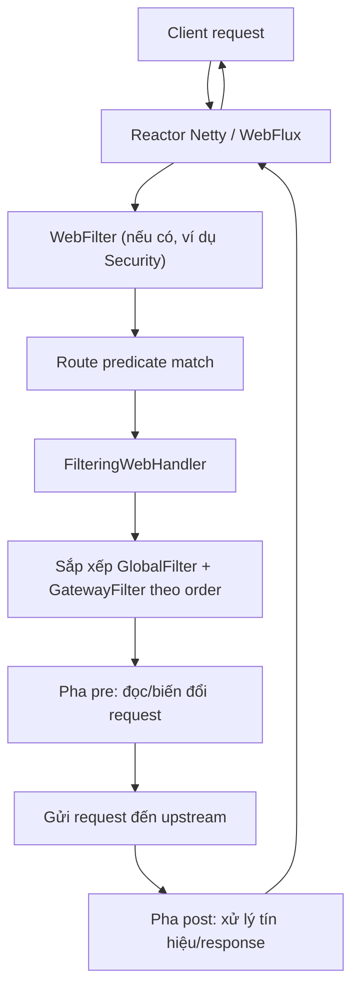
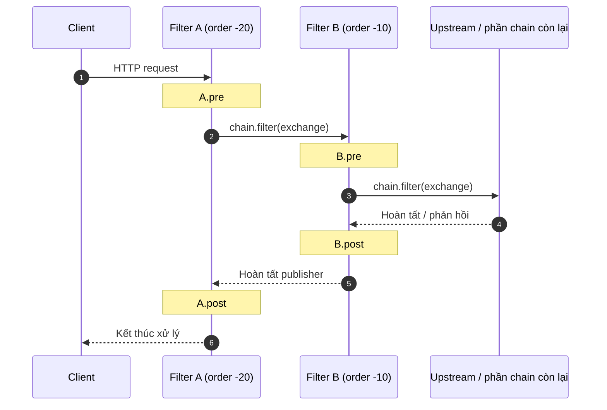

# OrderedGatewayFilter và thứ tự bộ lọc trong Java DSL

## 1. Vì sao thứ tự filter quan trọng trong Spring Cloud Gateway?

Trong **Spring Cloud Gateway**, sau khi một HTTP request khớp route predicate, Gateway đưa request qua **chuỗi bộ lọc (filter chain)** trước khi chuyển đến microservice đích. Filter có thể sửa path, thêm/xóa header, kiểm tra giới hạn lưu lượng, ghi nhận thời gian xử lý, hoặc phối hợp retry, circuit breaker và các chính sách an toàn đã được cấu hình.

Thứ tự thực thi tạo ra khác biệt rõ rệt. Ví dụ, một filter kiểm tra header có thể nhìn thấy giá trị gốc của client nếu nó chạy **trước** filter chuẩn hóa header, nhưng nhìn thấy giá trị đã chuẩn hóa nếu chạy **sau**. Một filter ghi thời gian toàn request cần bao bọc các filter còn lại; trong khi filter sửa response header phải chạy trước khi response được commit.

**`OrderedGatewayFilter`** là một cách gán thứ tự tường minh cho một `GatewayFilter` khi cấu hình route bằng **Java DSL**. Nó giúp kiểm soát chính xác thứ tự tương đối giữa các filter tham gia cùng chuỗi xử lý.

Mục tiêu của bài thuộc chương **Chuỗi bộ lọc** trong module **SPRING_CLOUD_GATEWAY**:

1. Hiểu `GatewayFilter`, `GlobalFilter`, `OrderedGatewayFilter` và `GatewayFilterChain`.
2. Giải thích quy tắc **order nhỏ chạy trước ở pha pre, chạy sau ở pha post**.
3. Viết Java DSL dùng `RouteLocatorBuilder` và `OrderedGatewayFilter` để gán order.
4. Phân biệt thời điểm biến đổi request, quan sát response, xử lý lỗi và hủy request.
5. Kiểm chứng thứ tự bằng log/curl, đồng thời tránh các lỗi ảnh hưởng bảo mật và hiệu năng.

> Bài áp dụng cho biến thể **Spring Cloud Gateway Server WebFlux** sử dụng `RouteLocatorBuilder`. Spring Cloud Gateway Server MVC có cách tổ chức filter và API khác. Cần đối chiếu chữ ký API, starter và namespace cấu hình với phiên bản Spring Cloud Gateway đang chạy.

## 2. Một request đi qua những loại filter nào?

Ba loại thành phần thường gặp trong luồng xử lý Gateway là:

| Thành phần | Phạm vi | Trách nhiệm |
| --- | --- | --- |
| `GatewayFilter` | Route đã gán filter | Xử lý request/response khi route tương ứng được chọn |
| `GlobalFilter` | Các route đi qua Gateway filter chain | Xử lý chung, ví dụ đo thời gian hoặc phối hợp định tuyến |
| `GatewayFilterChain` | Chuỗi các filter đang được thực thi | Cho filter tiếp theo chạy thông qua `chain.filter(exchange)` |

Ngoài ra, Spring WebFlux có `WebFilter`, và Spring Security reactive thường sử dụng chuỗi WebFilter để xử lý bảo mật. **WebFilter và GatewayFilter không thuộc cùng một chuỗi thứ tự chỉ bằng cách đặt order giống nhau.** Một WebFilter bao quanh handler của WebFlux, còn GatewayFilter nằm trong chuỗi lọc của Spring Cloud Gateway sau khi route đã được chọn.

Khi Gateway xác định được route, `FilteringWebHandler` tập hợp **GlobalFilter** và **GatewayFilter** của route, rồi sắp xếp theo order trước khi thực thi. Các filter hệ thống của Gateway cũng có thể thuộc chuỗi này: định tuyến URL, load balancing, gửi request bằng HTTP client và ghi response.



Hình này mô tả mối quan hệ khái niệm. Trong thực tế, các filter chạy trên chuỗi reactive không chặn; không có một bước “pre” và “post” tách thành hai danh sách độc lập. Mỗi filter có thể làm việc trước khi gọi `chain.filter(exchange)`, rồi gắn xử lý tiếp theo khi publisher phía dưới hoàn tất, lỗi hoặc bị hủy.

## 3. Cơ chế pre/post và thứ tự Ordered

Một filter WebFlux thông thường có chữ ký:

```java
Mono<Void> filter(
    ServerWebExchange exchange,
    GatewayFilterChain chain
);
```

`exchange` chứa request, response và các thuộc tính của lần trao đổi HTTP; `chain.filter(exchange)` trả về một `Mono<Void>` đại diện cho phần xử lý tiếp theo. Không nên gọi `.block()` hoặc `.subscribe()` thủ công để điều khiển chuỗi này.

Ví dụ hai filter `A` và `B` với order khác nhau:

```text
A: order = -20
B: order = -10

Request đi vào:    A.pre -> B.pre -> các filter còn lại -> upstream
Response quay về:  upstream -> các filter còn lại -> B.post -> A.post
```

Diễn giải:

- `-20` nhỏ hơn `-10`, nên **A có ưu tiên cao hơn B** và chạy trước B ở pha pre.
- Vì B được lồng bên trong lời gọi `chain.filter` của A, phần xử lý post của B thường hoàn tất trước phần post của A.
- `order = 0` đứng sau `-10`; `order = 100` đứng sau `0` ở pha pre.
- Giá trị `Ordered.HIGHEST_PRECEDENCE` và `Ordered.LOWEST_PRECEDENCE` biểu diễn hai đầu phạm vi ưu tiên; số âm **không tự động** có nghĩa là “filter hệ thống” hay “filter bảo mật”.



**Quy tắc nhớ:** filter có độ ưu tiên cao nhất thực hiện **pre sớm nhất** và **post muộn nhất** nếu phần xử lý sau được gắn vào publisher returned từ chain.

Không được suy ra rằng “post” luôn có thể sửa HTTP response: tại thời điểm callback chạy, response có thể đã được **commit** hoặc body đã được gửi. Muốn điều chỉnh header sát thời điểm ghi response, nên dùng API `beforeCommit` đúng lúc; phần 7 sẽ minh họa.

### Khi nào post không chạy?

Đoạn `chain.filter(exchange).then(Mono.fromRunnable(...))` chỉ thực hiện callback sau khi chain **hoàn thành thành công**. Nếu xảy ra lỗi (`onError`) hoặc hủy subscription (`cancel`), callback sau `then` không nhất thiết chạy. Khi cần dọn tài nguyên hoặc quan sát mọi cách kết thúc, dùng `doFinally` và phân biệt `SignalType`.

## 4. OrderedGatewayFilter là gì?

`OrderedGatewayFilter` thuộc package `org.springframework.cloud.gateway.filter`. Đây là một **wrapper** bao quanh một `GatewayFilter`, đồng thời cung cấp thứ tự theo hợp đồng `org.springframework.core.Ordered`.

Một cách tạo đơn giản:

```java
GatewayFilter audit = (exchange, chain) -> chain.filter(exchange);

GatewayFilter orderedAudit =
        new OrderedGatewayFilter(audit, -20);
```

Khái niệm:

```text
OrderedGatewayFilter
├── GatewayFilter gốc: audit
└── order: -20
```

Wrapper không tự đổi request, không tự xác thực, cũng không tự bật metrics. Nó chủ yếu giúp **gắn metadata thứ tự** lên filter đã có. Nếu một route không chứa filter này, wrapper không chạy trên route đó.

### 4.1. Phân biệt ba cách quản lý thứ tự

| Cách | Phạm vi dùng | Ý nghĩa |
| --- | --- | --- |
| `new OrderedGatewayFilter(filter, order)` | Filter gắn với route | Gán order tường minh cho filter bằng Java |
| `GatewayFilter` tự triển khai `Ordered` | Filter tùy biến | Đối tượng filter tự cung cấp `getOrder()` |
| `GlobalFilter` đồng thời triển khai `Ordered` | Filter áp dụng chung | Filter dùng chung được sắp xếp cùng các route filter ở Gateway chain |

Với filter được tạo từ một `GatewayFilterFactory` hoặc bằng phương thức tiện ích trên `GatewayFilterSpec`, Gateway có thể gán thứ tự khi tổng hợp route filters. **Không nên dựa vào vị trí khai báo mặc định để giải quyết tương tác phức tạp** giữa custom filter và global filter: nếu phụ thuộc thứ tự, hãy biểu diễn order tường minh và kiểm tra sau khi cấu hình.

Một `@Order` trên lớp cấu hình hay trên method tạo `RouteLocator` không tự động có nghĩa tất cả GatewayFilter bên trong route nhận thứ tự đó. Khi muốn cố định thứ tự của **một GatewayFilter**, hãy gắn order trực tiếp vào filter như ví dụ của bài.

### 4.2. Nguyên tắc chọn giá trị order

- Dùng số nguyên nhỏ có chủ đích, ví dụ `-20`, `-10`, để biểu diễn thứ tự **tương đối giữa các filter do ứng dụng tự viết**.
- Ghi rõ mục đích trong tên filter, comment hoặc tài liệu; tránh “magic numbers” nằm rải rác.
- Không coi các order ví dụ này là khoảng số được Spring dành riêng: **global filters của framework cũng tham gia sắp xếp**, có thể chen giữa custom filters.
- Khi cần chèn filter trước/sau một filter hệ thống cụ thể, phải biết order của filter hệ thống trong **đúng phiên bản** đang dùng và xác minh hành vi.
- Tránh cho nhiều filter phụ thuộc nhau dùng cùng order; thứ tự của các filter bằng nhau không nên trở thành điều kiện thiết kế.

## 5. Viết Java DSL với OrderedGatewayFilter

Giả sử Gateway nhận:

```http
GET /api/orders/42 HTTP/1.1
Host: localhost:8080
```

Upstream `order-service` đang nghe tại `http://localhost:8081` và xử lý `GET /orders/42`. Ta muốn:

1. `trace-A` ghi sự kiện lúc request đi vào và lúc chain kết thúc.
2. `trace-B` làm tương tự nhưng được lồng trong `trace-A`.
3. `StripPrefix=1` bỏ `/api` trước khi chuyển tiếp.

### 5.1. Ví dụ cấu hình RouteLocatorBuilder

```java
package example.gateway;

import org.slf4j.Logger;
import org.slf4j.LoggerFactory;
import org.springframework.cloud.gateway.filter.GatewayFilter;
import org.springframework.cloud.gateway.filter.OrderedGatewayFilter;
import org.springframework.cloud.gateway.route.RouteLocator;
import org.springframework.cloud.gateway.route.builder.RouteLocatorBuilder;
import org.springframework.context.annotation.Bean;
import org.springframework.context.annotation.Configuration;

@Configuration
public class GatewayRoutesConfig {

    private static final Logger log =
            LoggerFactory.getLogger(GatewayRoutesConfig.class);

    private static GatewayFilter trace(String label) {
        return (exchange, chain) -> {
            log.info("{} pre, path={}",
                    label, exchange.getRequest().getPath());

            return chain.filter(exchange)
                    .doOnSuccess(ignored ->
                            log.info("{} post-success", label))
                    .doOnError(error ->
                            log.warn("{} error: {}",
                                    label, error.toString()))
                    .doFinally(signal ->
                            log.debug("{} finished: {}",
                                    label, signal));
        };
    }

    @Bean
    RouteLocator apiRoutes(RouteLocatorBuilder builder) {
        GatewayFilter traceA = trace("trace-A");
        GatewayFilter traceB = trace("trace-B");

        return builder.routes()
                .route("order-route", r -> r
                        .path("/api/orders/**")
                        .filters(f -> f
                                .filter(new OrderedGatewayFilter(
                                        traceA, -20))
                                .filter(new OrderedGatewayFilter(
                                        traceB, -10))
                                .stripPrefix(1))
                        .uri("http://localhost:8081"))
                .build();
    }
}
```

Ví dụ dùng API của **Spring Cloud Gateway Server WebFlux**. `log.info` ở đây minh họa trình tự; production có thể dùng log có sampling hoặc metrics/tracing để tránh ghi quá nhiều dòng trên mỗi request.

Các bước:

- Predicate `.path("/api/orders/**")` chọn route `order-route`.
- `.filter(new OrderedGatewayFilter(traceA, -20))` gắn filter A có order `-20`.
- `.filter(new OrderedGatewayFilter(traceB, -10))` gắn filter B có order `-10`.
- `.stripPrefix(1)` bỏ segment `api`, chuyển `/api/orders/42` thành `/orders/42`.
- `.uri("http://localhost:8081")` chỉ upstream; thay bằng `lb://ORDER-SERVICE` khi dự án có service discovery và load balancing phù hợp.

**Về thứ tự thực tế:** A chạy pre trước B, và callback `post-success` của B chạy trước callback thành công của A. Các GlobalFilter và filter hệ thống vẫn có thể nằm giữa A/B, StripPrefix và HTTP client. Ví dụ không khẳng định `StripPrefix` chạy ngay sau B.

Nếu upstream trả `404` nhưng request đã được gửi và chain hoàn thành bình thường, `doOnSuccess` vẫn có thể chạy vì **HTTP 404 là HTTP response**, không nhất thiết là lỗi reactive `onError`. Cần đo mã trạng thái HTTP riêng với ngoại lệ transport hoặc exception của filter.

### 5.2. Trình tự log kỳ vọng

Giả sử không có lỗi và mức log cho các dòng `info` đã bật:

```text
trace-A pre, path=/api/orders/42
trace-B pre, path=/api/orders/42
trace-B post-success
trace-A post-success
```

Cả A và B ở ví dụ đều đọc path trong pha pre **trước** `stripPrefix` theo thứ tự dự kiến. Khi Gateway thêm filter khác hoặc thay order, kết quả cần được kiểm tra lại. Dòng `doFinally` phụ thuộc mức log `DEBUG`; có thể xuất hiện ở các thời điểm khác do chuỗi callback reactive.

### 5.3. Lưu ý khi kết hợp với addRequestHeader/rewritePath

Giả sử filter A muốn đọc header đã được chuẩn hóa bởi filter B, A phải đọc nó tại **đúng giai đoạn sau khi B đã thực hiện biến đổi**. Chỉ đặt order nhỏ hơn không làm mã trong pha pre của A tự nhìn thấy kết quả mà B tạo ra sau đó.

Ví dụ sai về kỳ vọng:

```java
// A chạy trước B ở pre, nên header có thể chưa được B thêm:
log.info("value={}",
        exchange.getRequest().getHeaders().getFirst("X-Trusted-Id"));
return chain.filter(exchange);
```

Nếu A bắt buộc cần header đã chuẩn hóa trong pre, hãy sắp xếp để B thực hiện biến đổi trước A hoặc tách việc đọc thành pha thích hợp. Ngoài ra, header từ client là dữ liệu **không tin cậy** trừ khi đã được kiểm tra; không xem `X-Trusted-Id` là quyền truy cập chỉ vì một filter đã chuyển tiếp nó.

## 6. Khi nào nên dùng GlobalFilter thay cho GatewayFilter?

Một policy áp dụng cho **tất cả route được Gateway xử lý** có thể được đặt trong `GlobalFilter`. Ví dụ: đo thời gian xử lý tổng quát hoặc gắn metadata quan sát theo route, với lưu ý từng luồng lỗi trước khi chọn route có thể không chạy qua Gateway filter chain.

```java
package example.gateway;

import org.slf4j.Logger;
import org.slf4j.LoggerFactory;
import org.springframework.cloud.gateway.filter.GlobalFilter;
import org.springframework.cloud.gateway.filter.GatewayFilterChain;
import org.springframework.core.Ordered;
import org.springframework.stereotype.Component;
import org.springframework.web.server.ServerWebExchange;
import reactor.core.publisher.Mono;

@Component
public class GatewayTimingFilter implements GlobalFilter, Ordered {

    private static final Logger log =
            LoggerFactory.getLogger(GatewayTimingFilter.class);

    @Override
    public int getOrder() {
        return -30;
    }

    @Override
    public Mono<Void> filter(
            ServerWebExchange exchange,
            GatewayFilterChain chain) {

        long started = System.nanoTime();

        return chain.filter(exchange)
                .doFinally(signal -> {
                    long elapsedMs =
                            (System.nanoTime() - started) / 1_000_000;
                    log.debug("gateway duration={}ms signal={}",
                            elapsedMs, signal);
                });
    }
}
```

Ở đây, `getOrder() = -30` là ưu tiên tương đối của filter chung trong chuỗi Gateway. Nó có thể chạy pre trước route filters A/B (`-20`, `-10`) và xử lý `doFinally` sau chúng khi cùng tham gia một chain. `doFinally` nhận cả tín hiệu hoàn tất, lỗi hoặc hủy nhưng **không tự đo đầy đủ thời gian network ở phía client**, và thời điểm bắt đầu/kết thúc phụ thuộc vị trí của filter trong chuỗi.

`GlobalFilter` vẫn phải được đăng ký bằng Spring bean. Không cần dùng `OrderedGatewayFilter` để biến một `GlobalFilter` thành global; nó đã có phạm vi global nhờ interface và Spring registration.

### So sánh phạm vi

| Tình huống | Phù hợp |
| --- | --- |
| Chỉ tuyến `/api/orders/**` cần sửa path hoặc thêm header | `GatewayFilter` gắn ở route |
| Mọi route cần ghi thời gian xử lý chung | `GlobalFilter` |
| Kiểm tra JWT/authorization cho tất cả endpoint trước handler | Thường là Spring Security reactive/`WebFilter` |
| Chính sách rate limit khác nhau theo route | `RequestRateLimiter` hoặc filter chuyên dụng theo route |
| Quan sát trạng thái truy cập ở gateway | Tùy mục tiêu: metrics/tracing, Gateway filter hoặc WebFilter |

Một bean `GatewayFilter` thông thường **không tự áp dụng cho mọi route** chỉ vì là bean. Bạn cần gắn nó vào các route thích hợp hoặc tạo cơ chế chung có chủ đích.

## 7. Biến đổi header đúng pha và thời điểm commit response

Một tác vụ thực tế là **chuẩn hóa request ID**: tạo một giá trị đáng tin cậy tại gateway, truyền xuống upstream và trả lại cho client. Có hai thời điểm khác nhau:

- Request header phải được đặt **trước khi HTTP client gửi upstream**.
- Response header phải được đặt **trước khi response bị commit**.

Ví dụ GatewayFilter sau hoạt động trong một route. Nó tạo ID mới để không phải tin một header tùy ý do client cung cấp:

```java
import java.util.UUID;
import org.springframework.cloud.gateway.filter.GatewayFilter;
import org.springframework.http.server.reactive.ServerHttpRequest;
import org.springframework.web.server.ServerWebExchange;
import reactor.core.publisher.Mono;

GatewayFilter correlationIdFilter = (exchange, chain) -> {
    String id = UUID.randomUUID().toString();

    ServerHttpRequest request = exchange.getRequest().mutate()
            .headers(headers -> headers.set("X-Request-Id", id))
            .build();

    ServerWebExchange updated = exchange.mutate()
            .request(request)
            .build();

    updated.getResponse().beforeCommit(() -> {
        updated.getResponse().getHeaders().set("X-Request-Id", id);
        return Mono.empty();
    });

    return chain.filter(updated);
};

// Gắn trong GatewayFilterSpec:
// .filter(new OrderedGatewayFilter(correlationIdFilter, -30))
```

Khi `beforeCommit` được đăng ký trước lúc response commit, callback được thực hiện trước khi ghi headers. Trong thực tế, hãy dùng API đúng phiên bản, đảm bảo đường xử lý lỗi cũng tạo response và xử lý quyền ghi header hợp lệ. Không dùng `.then(...)` sau khi gửi response để cố thay header đã được commit.

**Lưu ý bảo mật:** ví dụ luôn tạo ID mới. Nếu sản phẩm cần giữ trace ID từ client, phải xác minh cấu trúc, độ dài, nguồn tin cậy và quy tắc phân phối; không đưa thẳng token hoặc dữ liệu cá nhân vào request ID hay log.

### Không nhầm post-processing với response mutation

```java
return chain.filter(exchange)
        .then(Mono.fromRunnable(() -> {
            // Thích hợp với log/cleanup khi thành công.
            // Có thể quá muộn để set response header ở đây.
        }));
```

`Mono.fromRunnable` trong `then` là xử lý **sau khi** downstream hoàn tất bình thường. HTTP response ở phía dưới có thể đã được gửi. Những thao tác cần thay đổi response phải sử dụng đúng hook và đúng thứ tự trước khi commit.

## 8. Phân biệt lỗi, mã HTTP và cancellation

Thứ tự filter có ý nghĩa đối với cả nhánh xử lý lỗi. Ví dụ:

```java
return chain.filter(exchange)
    .doOnSuccess(ignored -> log.info("chain completed"))
    .doOnError(error -> log.error("chain failed", error))
    .doFinally(signal -> log.debug("terminal signal={}", signal));
```

| Tín hiệu | Có thể quan sát qua | Ý nghĩa |
| --- | --- | --- |
| Hoàn tất bình thường | `doOnSuccess`, `doFinally(ON_COMPLETE)` | Publisher xử lý xong; HTTP status vẫn có thể là 4xx/5xx |
| Kết thúc bằng exception | `doOnError`, `doFinally(ON_ERROR)` | Một tác vụ trong chain phát lỗi reactive |
| Bị hủy | `doFinally(CANCEL)` | Subscriber không còn cần publisher; kết quả upstream có thể vẫn đang diễn ra |

Đừng dựa trên `doOnSuccess` để kết luận response là `200 OK`. Với lỗi từ upstream, Gateway có thể **chuyển nguyên HTTP 4xx/5xx về client** mà không phát `onError`. Ngược lại, một exception có thể được handler bên ngoài ánh xạ sang HTTP 5xx.

Nếu cần đo tỷ lệ lỗi, hãy thu thập cả **HTTP status**, **route ID**, **thời gian đáp ứng** và **loại ngoại lệ**, tránh đếm mọi lần `doOnError` là HTTP 500.

**Cancellation không đồng nghĩa rollback:** nếu client ngắt kết nối sau khi upstream đã thực hiện thanh toán, hủy subscriber của Gateway không đảm bảo hủy được giao dịch. Các cơ chế retry/idempotency và transaction ở service vẫn phải được thiết kế độc lập.

## 9. Thứ tự filter và các tính năng bảo mật/khả năng chịu lỗi

Các filter có thể ảnh hưởng trực tiếp đến an toàn và độ tin cậy. Ví dụ:

| Chính sách | Vì sao thứ tự có ý nghĩa? | Điều cần kiểm tra |
| --- | --- | --- |
| Xóa/chuẩn hóa header | Filter đọc hoặc chuyển tiếp header cần nhìn thấy giá trị đã được kiểm soát | Không tin header do client tự gửi làm bằng chứng quyền |
| Xác thực JWT | Tầng bảo mật phải bảo vệ API trước khi cho phép thao tác nhạy cảm | Phân biệt Spring Security WebFilter với GatewayFilter |
| Rate limiting | Khóa giới hạn theo user/API key phải được xác thực hoặc chuẩn hóa trước | Không lấy key từ header tùy ý mà không xác minh |
| Path rewrite | URI và path dùng để gửi upstream phải được hoàn thiện trước routing | `StripPrefix`/`RewritePath` thực thi đúng lúc |
| Circuit breaker | Phạm vi filter bao quanh lệnh gọi upstream ảnh hưởng điều gì được tính là lỗi | Chọn timeout/fallback đúng ngữ nghĩa |
| Retry | Filter bao quanh các thao tác phía trong có thể khiến thao tác được gọi lại | Tránh request ghi không idempotent bị gửi lặp |
| TLS | Cấu hình transport và ranh giới tin cậy ảnh hưởng các chặng được mã hóa | TLS không tự sinh ra chỉ bằng `OrderedGatewayFilter` |
| Metrics/tracing | Filter đo sớm/muộn sẽ bao trùm các đoạn thời gian khác nhau | Không để nhãn route/path có cardinality quá cao |

**Order không thay thế chính sách.** Gắn `-100` cho một filter kiểm tra header không làm nó trở thành cơ chế authorization vững chắc. Trong hệ thống microservices, cần Spring Security và phân quyền tại service tương ứng, ngoài các policy được đặt ở API Gateway.

### Pre/post của retry và circuit breaker

Nếu một filter bao quanh phần xử lý có cơ chế retry, cần xác định liệu filter có được thực hiện **một lần cho request đến Gateway**, hay nằm bên trong publisher được subscribe lại khi retry. Điều này phụ thuộc thứ tự và cách filter được triển khai. Ví dụ, logging hoặc mutation có side effect không phù hợp có thể bị lặp khi retry.

Đối với `POST /payments`, không tự động retry chỉ vì trả về lỗi 5xx hoặc timeout. Nếu request đã thành công ở upstream nhưng response thất lạc, gửi lại có thể tạo giao dịch trùng. Dùng idempotency key, giới hạn retry và chính sách lỗi được thiết kế cụ thể.

## 10. Kiểm tra thứ tự trong môi trường chạy thật

### 10.1. Chuẩn bị

Với ví dụ `GatewayRoutesConfig` ở mục 5:

1. Gateway chạy tại `http://localhost:8080`.
2. Một upstream HTTP đơn giản chạy tại `http://localhost:8081`, xử lý được `GET /orders/42`.
3. Mức log `INFO` được bật cho lớp cấu hình.
4. Không có route khác có predicate chồng lấn gây thay đổi route được chọn.

Thử bằng curl:

```bash
curl -i http://localhost:8080/api/orders/42
```

Gateway dự kiến khớp `order-route`, loại `/api` rồi gửi `/orders/42` đến upstream. Nếu upstream chưa chạy, request có thể lỗi kết nối nhưng vẫn có log pre từ các filter đã được đi qua.

### 10.2. Quan sát ba loại kết quả

| Trường hợp | Dấu hiệu kỳ vọng | Cách diễn giải |
| --- | --- | --- |
| Upstream trả 200 | A.pre, B.pre, B.post-success, A.post-success | Chuỗi hoàn thành và thứ tự post đảo chiều |
| Upstream trả 404 bình thường | Post-success có thể vẫn xuất hiện | HTTP 404 khác với tín hiệu `onError` |
| Lỗi transport/exception | A/B có thể ghi `doOnError` và `doFinally(ON_ERROR)` | Exception đi ngược qua filter đã bao bọc |
| Client hủy giữa chừng | Có thể thấy `doFinally(CANCEL)` | Cần quan sát cách transport/handler thực tế xử lý hủy |

Khi chạy trên Reactor Netty, callbacks không nhất thiết cùng một thread. **Không dùng thứ tự timestamp giữa các request khác nhau** để kết luận thứ tự trong cùng chain. Gắn request ID/trace ID vào log để phân biệt các request đồng thời.

### 10.3. Quan sát cấu hình route và filter

Khi thêm Spring Boot Actuator và endpoint Gateway tương ứng, ứng dụng có thể cung cấp dữ liệu về routes/filters để chẩn đoán, tùy phiên bản và cấu hình management endpoint. Không được phơi bày toàn bộ endpoint quản trị ra Internet; dùng quyền truy cập phù hợp và tránh log/hiển thị secrets.

Để kiểm tra chuyên sâu, dùng logging/trace, hoặc tạo kiểm thử tích hợp gửi request qua Gateway rồi xác nhận **route được chọn, URI upstream/path, header và thứ tự callback**. Khi thay đổi dependency hoặc phiên bản, kiểm thử này giúp phát hiện order khác kỳ vọng.

## 11. Những lỗi dễ mắc khi tự viết OrderedGatewayFilter

| Vấn đề | Hậu quả | Cách xử lý |
| --- | --- | --- |
| Nghĩ `-20` luôn chạy trước mọi global filter | Filter hệ thống có thể có order thấp hơn | Kiểm tra order thực tế của framework trong phiên bản đang dùng |
| Gán cùng một order cho nhiều filter phụ thuộc nhau | Thứ tự không rõ ràng khi nâng cấp hoặc thay danh sách | Dùng order riêng, thử thứ tự xử lý |
| Gọi `chain.filter(exchange)` hai lần vô ý | Có thể gửi request/side effect lặp lại | Trả về đúng một publisher và kiểm soát retry |
| Quên gọi `chain.filter(exchange)` | Chuỗi dừng, không chuyển upstream nếu không tự hoàn thành response | Chỉ short-circuit khi chủ ý trả response |
| Gọi `.block()`/`Thread.sleep` trên event loop | Nghẽn các kết nối khác | Dùng API non-blocking, cô lập blocking bất khả kháng |
| Tạo `Mono` nhưng quên `return` | Publisher không được framework subscribe; chain có thể không chạy đúng | `return chain.filter(exchange)` hoặc publisher đã compose |
| Ghi response header trong callback post quá muộn | Header không thay đổi vì response đã commit | Dùng `beforeCommit`/API response phù hợp |
| Sửa `exchange.getRequest().getHeaders()` trực tiếp | Dữ liệu có thể bất biến hoặc sửa không đúng phiên bản request | Dùng `request.mutate()` và `exchange.mutate()` |
| Xem HTTP 5xx là `doOnError` mặc định | Metrics lỗi sai và log thiếu | Quan sát HTTP status lẫn reactive error |
| Dùng header chưa xác thực để phân quyền | Client giả mạo role/user | Spring Security + kiểm tra quyền tại service |
| Dùng log body/header nhạy cảm để debug | Lộ token, password hoặc dữ liệu cá nhân | Redact dữ liệu, chỉ log metadata cần thiết |

### 11.1. Lỗi quên trả về chain

```java
// Sai: không trả về publisher chứa phần xử lý tiếp theo.
GatewayFilter broken = (exchange, chain) -> {
    chain.filter(exchange);  // Publisher được tạo nhưng bị bỏ.
    return Mono.empty();     // Framework chỉ thấy một Mono rỗng.
};
```

Mẫu đúng:

```java
GatewayFilter correct = (exchange, chain) -> {
    // Tiền xử lý ngắn và non-blocking.
    return chain.filter(exchange);
};
```

Nếu cần chủ động chặn request, filter có thể đặt mã lỗi trên `exchange.getResponse()` và hoàn thành response một cách có chủ đích. Khi đó **không** gọi tiếp chain, và cần bảo đảm cả status, header, body đều phù hợp với chính sách bảo mật.

### 11.2. Không nhầm thứ tự với bảo đảm đồng bộ

Các filter reactive không mặc nhiên chạy tuần tự trên cùng một thread. `subscribeOn`, `publishOn`, network callbacks và cơ chế giao tiếp đến upstream có thể ảnh hưởng thread thực thi. **Order quyết định quan hệ của các bước trong chain**, không ép tất cả lên một thread hay bảo đảm không có race khi code tự tạo side effect dùng chung.

Mỗi filter nên hạn chế state mutable dùng chung giữa nhiều request. Metadata riêng request có thể được đặt trong `ServerWebExchange` attributes hoặc Reactor Context theo cơ chế phù hợp, đồng thời phải chú ý security context và tracing.

## 12. Bài thực hành: thiết kế filter chain cho order-service

Yêu cầu: một route `GET /api/orders/**` gửi đến `http://localhost:8081`. Bạn cần:

- Tạo request ID và chuẩn hóa header `X-Request-Id` trước khi gọi upstream.
- Ghi tổng thời gian xử lý và tín hiệu kết thúc.
- Bỏ `/api` trong path.
- Trả `X-Request-Id` cho client trước khi response commit.

Có thể sắp xếp hai custom filter:

```text
Order -30: correlationIdFilter (đặt request ID, đăng ký beforeCommit)
Order -20: timingFilter (doFinally để ghi thời gian)
Tiếp theo: những filter của route/framework theo order hiệu lực
Upstream: GET /orders/42
```

Định nghĩa route minh họa; `correlationIdFilter` như mục 7, còn `timingFilter` là một `GatewayFilter` được xây dựng tương tự `GatewayTimingFilter` ở mục 6:

```java
.route("orders", r -> r
    .path("/api/orders/**")
    .filters(f -> f
        .filter(new OrderedGatewayFilter(correlationIdFilter, -30))
        .filter(new OrderedGatewayFilter(timingFilter, -20))
        .stripPrefix(1))
    .uri("http://localhost:8081"))
```

**Kiểm tra đầu ra kỳ vọng:**

| Điều kiện | Kỳ vọng |
| --- | --- |
| Request không có `X-Request-Id` | Gateway tạo ID mới, upstream nhận ID đó |
| Request cố tình gửi `X-Request-Id: fake` | Giá trị giả bị thay bằng ID do Gateway tạo |
| Upstream trả HTTP 200 | Client nhận response có `X-Request-Id`, log ghi thời gian |
| Upstream trả HTTP 404 | Client vẫn nhận request ID nếu response được commit qua hook, không mặc nhiên xem là exception |
| Upstream lỗi kết nối | Log `doFinally` ghi tín hiệu kết thúc; status/header thực tế tùy error handler |
| Client hủy request | Quan sát tín hiệu hủy nếu pipeline nhận cancellation; không giả định upstream rollback |

Câu hỏi mở: nếu đổi order của `timingFilter` từ `-20` sang `-40`, thời gian mà nó đo có thể bao gồm thêm những công việc nào? Khi nào `beforeCommit` vẫn cần thiết dù filter có order rất nhỏ?

## 13. Tổng kết

**`OrderedGatewayFilter` là công cụ gán thứ tự cho một `GatewayFilter` trong Java DSL của Spring Cloud Gateway Server WebFlux.** Thứ tự tăng dần quyết định cách các filter tham gia chuỗi xử lý ở pha pre; các callback post bao quanh publisher thường hoàn tất theo thứ tự ngược lại. `GlobalFilter` và các filter của framework cũng tham gia chuỗi này nên phải xem **toàn bộ order**, không chỉ thứ tự xuất hiện trong code.

Với route predicate, filter chain, biến đổi đường dẫn/header và service discovery, thứ tự hợp lý giúp request được xử lý đúng trước khi chuyển tới microservices. Với xác thực, rate limiting, circuit breaker, retry, TLS và observability, cần phối hợp filter order với cơ chế bảo mật, transport, lỗi/cancellation và vòng đời HTTP response. Một giá trị order đơn lẻ không thay thế được các cơ chế đó.

Quy trình thực hành nên là **vẽ luồng pre/post → chọn thứ tự tường minh → viết Java DSL → kiểm thử theo request và tín hiệu kết thúc → quan sát trong runtime**, nhất là trước khi dùng custom filter trên production.

Tài liệu chính thức để tra cứu theo phiên bản:

- [Spring Cloud Gateway Server WebFlux — Global Filters](https://docs.spring.io/spring-cloud-gateway/reference/spring-cloud-gateway-server-webflux/global-filters.html).
- [Spring Cloud Gateway Server WebFlux — Fluent Java Routes API](https://docs.spring.io/spring-cloud-gateway/reference/spring-cloud-gateway-server-webflux/fluent-java-routes-api.html).
- [Spring Framework — Ordered](https://docs.spring.io/spring-framework/docs/current/javadoc-api/org/springframework/core/Ordered.html).
