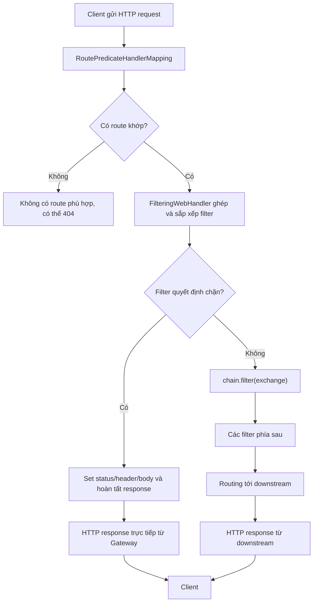

# Kết thúc sớm với phản hồi trực tiếp tại gateway

## 1. Kết thúc sớm là gì?

Trong **SPRING_CLOUD_GATEWAY**, sau khi một HTTP request khớp route predicate, **Spring Cloud Gateway Server WebFlux** thực thi chuỗi `GlobalFilter` và `GatewayFilter` của route đã chọn. Thông thường mỗi filter xử lý rồi gọi `chain.filter(exchange)` để tiếp tục; các filter định tuyến sau đó chuyển request tới downstream service.

**Kết thúc sớm** (*short-circuit*) xảy ra khi một filter quyết định **hoàn tất HTTP response tại Gateway mà không gọi `chain.filter(exchange)`**. Khi filter được thực thi trước bước định tuyến, downstream không nhận request đó.

Ví dụ: `GET /api/catalog/blocked` khớp route `Path=/api/catalog/**` nhưng chính Gateway trả `503 Service Unavailable` vì đang bảo trì một endpoint. Backend không được gọi, trong khi `GET /api/catalog/42` vẫn chuyển tiếp bình thường.



Bài học thuộc chương **Chuỗi bộ lọc**, đi sâu vào cơ chế trả response trực tiếp, quy luật thứ tự pre/post, thời điểm response commit và ảnh hưởng tới kiểm thử. Kiến thức này là nền tảng cho xác thực, rate limiting, circuit breaker, retry, TLS và quan sát request khi vận hành cổng vào microservices an toàn.

### Mục tiêu

Sau bài học, bạn có thể:

1. Viết `GlobalFilter` trả `4xx` hoặc `5xx` và JSON mà không gọi downstream.
2. Giải thích khi nào dùng `response.setComplete()` và khi nào dùng `response.writeWith(...)`.
3. Mô tả điều gì xảy ra với các filter trước/sau khi short-circuit.
4. Phân biệt request không có route, request bị Gateway chặn, và lỗi kết nối upstream.
5. Kiểm thử bằng backend cục bộ để **xác nhận không có request tới backend**.
6. Tránh lỗi ghi response hai lần, sửa header sau commit, chặn event loop hoặc tự xây dựng cơ chế xác thực không an toàn.

> **Phiên bản minh họa:** Spring Boot 3.5.x với Spring Cloud 2025.0.x, Gateway Server WebFlux 4.3.x. Starter là `spring-cloud-starter-gateway-server-webflux`; route YAML dùng prefix `spring.cloud.gateway.server.webflux`. Dùng cặp phiên bản tương thích và bản vá còn được hỗ trợ khi áp dụng vào dự án thực tế.

## 2. Hai nhánh của `GatewayFilterChain`

Giao diện `GlobalFilter` và `GatewayFilter` có cùng mẫu phương thức cốt lõi:

```java
Mono<Void> filter(ServerWebExchange exchange, GatewayFilterChain chain);
```

Trong đó:

- `ServerWebExchange` là ngữ cảnh HTTP request/response hiện tại, gồm path, headers, attributes, route metadata.
- `GatewayFilterChain` đại diện cho các bước xử lý còn lại.
- `Mono<Void>` của Reactor mô tả công việc bất đồng bộ hoàn tất hoặc thất bại; WebFlux sẽ subscribe và điều phối publisher này.

**Cho phép request đi tiếp:**

```java
@Override
public Mono<Void> filter(
        ServerWebExchange exchange, GatewayFilterChain chain) {

    // Kiểm tra và/hoặc biến đổi request.
    return chain.filter(exchange);
}
```

**Kết thúc request ngay tại Gateway:**

```java
@Override
public Mono<Void> filter(
        ServerWebExchange exchange, GatewayFilterChain chain) {

    exchange.getResponse().setStatusCode(HttpStatus.FORBIDDEN);
    return exchange.getResponse().setComplete();
}
```

Ví dụ thứ hai chỉ minh họa cách kết thúc không có body. Trong ứng dụng thực tế cần có **điều kiện quyết định chặn** và dùng HTTP status phản ánh đúng lý do.

Chú ý: nếu một filter trả về publisher hoàn tất response nhưng **vẫn gọi chain**, request có thể đi tiếp hoặc hai thành phần cùng cố ghi response. Ngược lại, nếu chỉ gọi `response.setComplete()` mà không trả về hoặc nối publisher vào pipeline, thao tác hoàn tất chưa chắc được thực thi.

### Kết thúc sớm không dừng toàn bộ Gateway

Một short-circuit chỉ ngắt **nhánh xử lý request đó**:

- Gateway vẫn tiếp tục nhận request khác.
- Các filter chưa được gọi ở phía sau filter chặn không chạy trong nhánh đó.
- Một filter **đã chạy ở phía ngoài** có thể còn phần hậu xử lý `doFinally`, `then` hoặc callback khác sau khi response bên trong hoàn tất.
- Các thành phần ở tầng ngoài Gateway filter chain, như `WebFilter` của Spring WebFlux hay Spring Security, có vòng đời riêng.
- Một `GlobalFilter` của Gateway không đồng nghĩa được gọi cho mọi HTTP request không khớp route.

Những điểm này rất quan trọng khi giải thích log, metrics và trace của request bị từ chối.

## 3. Thứ tự filter và pha pre/post

Sau khi route được chọn, `FilteringWebHandler` kết hợp các `GlobalFilter` với `GatewayFilter` thuộc route rồi sắp xếp theo `Ordered`. **Số order nhỏ hơn có ưu tiên cao hơn**: phần logic trước `chain.filter(exchange)` chạy trước, còn logic hậu xử lý kiểu bao quanh thường chạy sau theo thứ tự ngược lại.

Giả sử một chuỗi minh họa:

| Filter | Order | Vai trò |
| --- | ---: | --- |
| `TraceFilter` | `-200` | Ghi PRE rồi `doFinally` ghi END. |
| `DemoShortCircuitFilter` | `-100` | Nếu endpoint bị tạm dừng, trả 503 tại Gateway. |
| Các route filters khác | Được xếp phía sau trong trường hợp minh họa | Biến đổi path/header. |
| HTTP routing filter | Được xếp phía sau trong trường hợp minh họa | Proxy tới upstream. |

Luồng **không chặn**:

```text
TraceFilter.PRE
  DemoShortCircuitFilter: cho phép
    Các route filters
      Proxy HTTP -> upstream
  Hoàn tất các filter bên trong
TraceFilter.END
```

Luồng **chặn sớm**:

```text
TraceFilter.PRE
  DemoShortCircuitFilter: từ chối
    response.setStatusCode(503)
    response.writeWith(...)
    [không gọi chain.filter(exchange)]
TraceFilter.END
```

`TRACE END` xuất hiện **không chứng minh backend đã được gọi**. Nó chỉ cho biết publisher mà `TraceFilter` theo dõi đã có tín hiệu kết thúc.

Không nên suy luận rằng mọi `GlobalFilter` luôn chạy trước mọi `GatewayFilter`: các filter được sắp xếp chung. Nếu thứ tự ảnh hưởng tới bảo mật, ghi response hay định tuyến, cần kiểm tra order thực tế trong đúng phiên bản và có kiểm thử tích hợp.

## 4. Tạo phản hồi HTTP trực tiếp

HTTP response tối thiểu có status, tùy chọn headers và body.

### 4.1. Trả status mà không có body

```java
ServerHttpResponse response = exchange.getResponse();
response.setStatusCode(HttpStatus.TOO_MANY_REQUESTS);
response.getHeaders().set("Retry-After", "30");
return response.setComplete();
```

Cú pháp trên trả `429 Too Many Requests` với một gợi ý thời gian thử lại. **Đây chỉ là ví dụ về response, không phải một rate limiter hoàn chỉnh**. Để rate limiting thực sự, Gateway cần chính sách quota, bộ đếm và cơ chế đồng bộ nếu chạy nhiều instance.

### 4.2. Trả JSON body

```java
ServerHttpResponse response = exchange.getResponse();
response.setStatusCode(HttpStatus.SERVICE_UNAVAILABLE);
response.getHeaders().setContentType(MediaType.APPLICATION_JSON);
response.getHeaders().setCacheControl("no-store");

byte[] payload = """
        {"code":"MAINTENANCE","message":"Temporarily unavailable"}
        """.getBytes(StandardCharsets.UTF_8);

response.getHeaders().setContentLength(payload.length);

return response.writeWith(
        Mono.just(response.bufferFactory().wrap(payload))
);
```

Code này dùng Java 17 (hỗ trợ text block), đặt bên trong một phương thức `filter(...)` và cần các import `ServerHttpResponse`, `HttpStatus`, `MediaType`, `StandardCharsets` và `Mono`. Khi body đã được ghi xong, response kết thúc. Không gọi `setComplete()` một lần nữa hoặc tiếp tục chain ở nhánh đó.

| API | Dùng để làm gì? | Chú ý |
| --- | --- | --- |
| `setStatusCode(...)` | Đặt mã HTTP trước commit. | Không đảm bảo đổi được sau khi response đã bắt đầu gửi. |
| `getHeaders().setContentType(...)` | Thông báo kiểu body. | JSON trả về nên có kiểu phù hợp. |
| `setComplete()` | Hoàn tất response không body. | Trả về `Mono<Void>`; cần return hoặc compose. |
| `writeWith(Publisher<DataBuffer>)` | Ghi body bất đồng bộ. | Trả publisher tương ứng; tránh ghi hai lần. |
| `beforeCommit(...)` | Đăng ký callback trước commit. | Hữu ích khi thêm headers; không thay thế logic chặn ở giai đoạn phù hợp. |

**Ranh giới commit:** khi response đã commit, việc sửa status, header hoặc body có thể không còn hiệu lực. Vì vậy, filter short-circuit nên quyết định chặn **trước routing/response writing** và trả đúng publisher một lần. Không thêm response header trong `doFinally` với kỳ vọng chắc chắn thành công, vì callback có thể chạy sau commit hoặc sau khi subscription bị hủy.

### 4.3. Chọn status có ý nghĩa

| Status | Khi nào phù hợp | Điểm cần chú ý |
| --- | --- | --- |
| `400 Bad Request` | Gateway xác định request sai cú pháp hoặc đầu vào không hợp lệ. | Không dùng để che lỗi upstream. |
| `401 Unauthorized` | Chưa có chứng thực hợp lệ cho tài nguyên được bảo vệ. | Cần phản hồi `WWW-Authenticate` phù hợp; dùng Spring Security. |
| `403 Forbidden` | Đã xác định request không đủ quyền. | Không suy quyền chỉ từ một header tùy ý của client. |
| `404 Not Found` | Không có route/handler hoặc cố ý không lộ tài nguyên. | Phân biệt với route được chọn rồi bị chặn. |
| `429 Too Many Requests` | Vượt chính sách giới hạn lưu lượng. | Có thể dùng `Retry-After` theo chính sách. |
| `503 Service Unavailable` | Gateway tạm thời không thể phục vụ hoặc chức năng đang bảo trì. | Có thể gửi `Retry-After` nếu có thời gian phù hợp. |

Một filter trả `200 OK` kèm JSON chứa `"error":"forbidden"` sẽ gây hiểu nhầm cho SDK, HTTP client, tracing và metrics. Response nên tuân thủ ngữ nghĩa HTTP.

## 5. Thực hành: chặn một endpoint nhưng vẫn cho endpoint khác đi qua

Ta dùng **một route** với hai URL:

- `GET /api/catalog/blocked` → Gateway trả `503` và JSON trực tiếp.
- `GET /api/catalog/42` → Gateway chuyển tiếp request tới backend Echo ở `127.0.0.1:9001`.

Điều kiện `blocked` được cố định trong mã chỉ để làm rõ short-circuit. Trong production, quyết định bảo trì hoặc chặn thực tế phải dựa trên chính sách/cấu hình được quản lý, không phải ví dụ học tập này.

### 5.1. Cấu hình Maven và ứng dụng

Dùng JDK 17+, Maven, một cặp Spring Boot 3.5.x và Spring Cloud 2025.0.x tương thích. File `pom.xml` minh họa với phiên bản khởi đầu:

```xml
<?xml version="1.0" encoding="UTF-8"?>
<project xmlns="http://maven.apache.org/POM/4.0.0"
         xmlns:xsi="http://www.w3.org/2001/XMLSchema-instance"
         xsi:schemaLocation="http://maven.apache.org/POM/4.0.0
                             https://maven.apache.org/xsd/maven-4.0.0.xsd">
    <modelVersion>4.0.0</modelVersion>

    <parent>
        <groupId>org.springframework.boot</groupId>
        <artifactId>spring-boot-starter-parent</artifactId>
        <version>3.5.0</version>
        <relativePath/>
    </parent>

    <groupId>com.example</groupId>
    <artifactId>short-circuit-gateway</artifactId>
    <version>0.0.1-SNAPSHOT</version>

    <properties>
        <java.version>17</java.version>
    </properties>

    <dependencyManagement>
        <dependencies>
            <dependency>
                <groupId>org.springframework.cloud</groupId>
                <artifactId>spring-cloud-dependencies</artifactId>
                <version>2025.0.0</version>
                <type>pom</type>
                <scope>import</scope>
            </dependency>
        </dependencies>
    </dependencyManagement>

    <dependencies>
        <dependency>
            <groupId>org.springframework.cloud</groupId>
            <artifactId>spring-cloud-starter-gateway-server-webflux</artifactId>
        </dependency>
    </dependencies>

    <build>
        <plugins>
            <plugin>
                <groupId>org.springframework.boot</groupId>
                <artifactId>spring-boot-maven-plugin</artifactId>
            </plugin>
        </plugins>
    </build>
</project>
```

Ví dụ sử dụng cặp Boot 3.5.0/Cloud 2025.0.0 để minh họa tương thích; dự án mới cần tra bảng tương thích và chọn patch phát hành còn được hỗ trợ. Không gắn phiên bản riêng cho starter Gateway và không thêm `spring-boot-starter-web` vào ví dụ WebFlux.

Tạo file `src/main/java/com/example/gateway/GatewayApplication.java`:

```java
package com.example.gateway;

import org.springframework.boot.SpringApplication;
import org.springframework.boot.autoconfigure.SpringBootApplication;

@SpringBootApplication
public class GatewayApplication {
    public static void main(String[] args) {
        SpringApplication.run(GatewayApplication.class, args);
    }
}
```

Cấu hình `src/main/resources/application.yml`:

```yaml
server:
  port: 8080

spring:
  application:
    name: short-circuit-gateway
  cloud:
    gateway:
      server:
        webflux:
          routes:
            - id: catalog-route
              uri: http://127.0.0.1:9001
              predicates:
                - Path=/api/catalog/**
              filters:
                - StripPrefix=2
                - AddRequestHeader=X-Passed-Gateway, yes
```

Route khớp cả `blocked` và `42`. Với request bình thường, `StripPrefix=2` biến `/api/catalog/42` thành `/42`; `AddRequestHeader` thêm header cho downstream. Với request bị chặn sớm, các filter phía sau không được thực thi qua nhánh đó.

### 5.2. Tạo `DemoShortCircuitFilter`

Tạo `src/main/java/com/example/gateway/DemoShortCircuitFilter.java`:

```java
package com.example.gateway;

import java.nio.charset.StandardCharsets;

import org.springframework.cloud.gateway.filter.GatewayFilterChain;
import org.springframework.cloud.gateway.filter.GlobalFilter;
import org.springframework.core.Ordered;
import org.springframework.http.HttpStatus;
import org.springframework.http.MediaType;
import org.springframework.http.server.reactive.ServerHttpResponse;
import org.springframework.stereotype.Component;
import org.springframework.web.server.ServerWebExchange;

import reactor.core.publisher.Mono;

@Component
public class DemoShortCircuitFilter implements GlobalFilter, Ordered {

    @Override
    public int getOrder() {
        return -100;
    }

    @Override
    public Mono<Void> filter(
            ServerWebExchange exchange, GatewayFilterChain chain) {

        String path = exchange.getRequest().getPath().value();

        if (!"/api/catalog/blocked".equals(path)) {
            // Request bình thường: tiếp tục chuỗi.
            return chain.filter(exchange);
        }

        // Request bị chặn: phản hồi tại Gateway.
        ServerHttpResponse response = exchange.getResponse();
        response.setStatusCode(HttpStatus.SERVICE_UNAVAILABLE);
        response.getHeaders().setContentType(MediaType.APPLICATION_JSON);
        response.getHeaders().setCacheControl("no-store");
        response.getHeaders().set("X-Gateway-Decision", "local-short-circuit");

        String json = """
                {"code":"CATALOG_PAUSED",
                 "message":"This catalog endpoint is temporarily unavailable"}
                """;

        byte[] payload = json.getBytes(StandardCharsets.UTF_8);
        response.getHeaders().setContentLength(payload.length);

        return response.writeWith(
                Mono.just(response.bufferFactory().wrap(payload))
        );

        // Không có chain.filter(exchange) ở nhánh chặn.
    }
}
```

Đọc hành vi của code theo thứ tự:

1. `@Component` đăng ký một bean `GlobalFilter`; nó tham gia chuỗi Gateway khi có route được chọn.
2. `Ordered` cho filter order `-100`; trong ví dụ này đặt sớm hơn các bước proxy thông thường. Khi phối hợp nhiều filter, phải kiểm tra order thực tế.
3. Với path khác `/api/catalog/blocked`, filter **trả nguyên** `chain.filter(exchange)`, cho phép route tiếp tục.
4. Với path `/api/catalog/blocked`, filter đặt `503`, headers, JSON body và trả `Mono<Void>` do `writeWith` tạo.
5. Không có `chain.filter(exchange)` trong nhánh chặn, nên phần route/proxy phía sau không được chạy qua nhánh này.

Response có `X-Gateway-Decision: local-short-circuit` để dễ phân biệt trong demo. Header này không phải chuẩn HTTP bắt buộc, không được dùng làm bằng chứng bảo mật từ bên ngoài.

### 5.3. Thêm filter quan sát chạy phía ngoài

Để thấy rằng callback của filter trước vẫn được thực thi, thêm `src/main/java/com/example/gateway/TraceFilter.java`:

```java
package com.example.gateway;

import org.slf4j.Logger;
import org.slf4j.LoggerFactory;
import org.springframework.cloud.gateway.filter.GatewayFilterChain;
import org.springframework.cloud.gateway.filter.GlobalFilter;
import org.springframework.core.Ordered;
import org.springframework.stereotype.Component;
import org.springframework.web.server.ServerWebExchange;

import reactor.core.publisher.Mono;

@Component
public class TraceFilter implements GlobalFilter, Ordered {

    private static final Logger log =
            LoggerFactory.getLogger(TraceFilter.class);

    @Override
    public int getOrder() {
        return -200;
    }

    @Override
    public Mono<Void> filter(
            ServerWebExchange exchange, GatewayFilterChain chain) {

        String path = exchange.getRequest().getPath().value();
        log.info("TRACE PRE path={}", path);

        return chain.filter(exchange)
                .doFinally(signal ->
                        log.info("TRACE END path={} signal={}", path, signal));
    }
}
```

`-200` là order nhỏ hơn `-100`, vì vậy `TraceFilter` nằm phía ngoài filter chặn trong ví dụ. `doFinally` chạy khi publisher kết thúc hoặc bị hủy, **không bảo đảm** response đã gửi thành công hay backend đã được gọi.

### 5.4. Tạo backend Echo để xác minh có/không có request

Tạo `EchoBackend.java` bên ngoài source của Gateway (JDK 17 có sẵn `HttpServer`):

```java
import com.sun.net.httpserver.HttpServer;
import java.net.InetSocketAddress;
import java.nio.charset.StandardCharsets;

public class EchoBackend {
    public static void main(String[] args) throws Exception {
        HttpServer server = HttpServer.create(
                new InetSocketAddress("127.0.0.1", 9001), 0);

        server.createContext("/", exchange -> {
            String path = exchange.getRequestURI().getPath();
            System.out.println("UPSTREAM RECEIVED " + path);

            String passed = exchange.getRequestHeaders()
                    .getFirst("X-Passed-Gateway");

            byte[] body = ("upstream-path=" + path + "\n"
                    + "passed-gateway=" + passed + "\n")
                    .getBytes(StandardCharsets.UTF_8);

            exchange.getResponseHeaders().set(
                    "Content-Type", "text/plain; charset=UTF-8");
            exchange.sendResponseHeaders(200, body.length);

            try (var output = exchange.getResponseBody()) {
                output.write(body);
            }
        });

        server.start();
        System.out.println("Echo backend running at 127.0.0.1:9001");
    }
}
```

Backend này chỉ để test tại loopback. Không dùng làm service production: nó không có xác thực, rate limiting hay TLS.

Chạy trong **terminal A**:

```bash
java EchoBackend.java
```

Chạy trong **terminal B**, ở thư mục dự án có `pom.xml`:

```bash
mvn spring-boot:run
```

Nếu dự án dùng Maven Wrapper, sử dụng `./mvnw spring-boot:run` trên Linux/macOS hoặc `mvnw.cmd spring-boot:run` trên Windows.

### 5.5. Gọi một request được cho qua

Trong **terminal C**:

```bash
curl -i http://127.0.0.1:8080/api/catalog/42
```

Kỳ vọng:

```http
HTTP/1.1 200 OK
Content-Type: text/plain; charset=UTF-8

upstream-path=/42
passed-gateway=yes
```

Backend in `UPSTREAM RECEIVED /42`. Kết quả này chứng minh route match, filter path/header hoạt động và request tới downstream.

### 5.6. Gọi request dừng sớm

```bash
curl -i http://127.0.0.1:8080/api/catalog/blocked
```

Kỳ vọng (các header HTTP khác có thể thay đổi):

```http
HTTP/1.1 503 Service Unavailable
Content-Type: application/json
Cache-Control: no-store
X-Gateway-Decision: local-short-circuit

{"code":"CATALOG_PAUSED",
 "message":"This catalog endpoint is temporarily unavailable"}
```

Ở Gateway, cả `TRACE PRE` và `TRACE END` vẫn có thể xuất hiện. Ở backend, **không được xuất hiện** dòng `UPSTREAM RECEIVED /blocked`.

Bạn có thể dừng backend `9001` bằng `Ctrl+C` rồi gọi lại request `blocked`: response local `503` vẫn có thể được tạo ra. Với `/api/catalog/42`, Gateway lúc này cố proxy rồi gặp lỗi kết nối, thường trả nhóm 5xx. **Hai lỗi có thể cùng mang mã 503 nhưng khác nguồn gốc**; marker response và log/trace giúp phân biệt.

Thử request không khớp route:

```bash
curl -i http://127.0.0.1:8080/no-route
```

Nếu không có handler khác, request thường nhận `404 Not Found`. Đây là tình huống không chọn được route, khác với request khớp route nhưng bị filter chủ động kết thúc.

## 6. Nếu chỉ một route cần chặn thì sao?

`GlobalFilter` được đăng ký một lần và có khả năng ảnh hưởng đến nhiều route đã match. Khi logic chỉ áp dụng cho một route, có thể tạo **`GatewayFilter` riêng** qua Java DSL hoặc `GatewayFilterFactory`.

Ví dụ bên trong một class cấu hình Spring với các import tương ứng:

```java
@Bean
RouteLocator demoRoutes(RouteLocatorBuilder builder) {

    GatewayFilter denyDisabled = (exchange, chain) -> {
        String path = exchange.getRequest().getPath().value();

        if (!path.endsWith("/disabled")) {
            return chain.filter(exchange);
        }

        ServerHttpResponse response = exchange.getResponse();
        response.setStatusCode(HttpStatus.FORBIDDEN);
        return response.setComplete();
    };

    return builder.routes()
            .route("limited-route", spec -> spec
                    .path("/limited/**")
                    .filters(f -> f.filter(denyDisabled))
                    .uri("http://127.0.0.1:9001"))
            .build();
}
```

Đây là **minh họa cấu trúc**, không phải một class độc lập có thể biên dịch ngay khi thiếu import và `@Configuration`. Nếu dùng route Java DSL ở trên, tránh đăng ký thêm route YAML trùng predicate rồi mặc định đoán thứ tự route.

| Đặc điểm | `GlobalFilter` | `GatewayFilter` gắn route |
| --- | --- | --- |
| Phạm vi | Các request khớp route Gateway; code quyết định chính sách. | Chỉ route được gắn filter. |
| Khai báo | Spring bean, thường `@Component`. | `RouteLocatorBuilder` hoặc filter factory trong route. |
| Có thể short-circuit? | Có. | Có. |
| Thứ tự | `Ordered` và cơ chế sắp xếp của Gateway. | Tham gia chuỗi kết hợp, có thể được gán order. |
| Rủi ro | Điều kiện quá rộng ảnh hưởng nhiều route. | Quên gắn filter ở route cần bảo vệ. |

Không nên dùng một `GatewayFilter` tự viết kiểm tra header đơn giản thay cho hệ thống bảo mật chuẩn.

## 7. Áp dụng đúng cơ chế trong các tính năng Gateway

### Xác thực và phân quyền

Ở WebFlux, Spring Security thường dùng các `WebFilter` ở tầng WebFlux. Một request thiếu token hợp lệ có thể bị chặn trước khi chạy Gateway filter chain. Cần sử dụng OAuth2 Resource Server/JWT hoặc phương án được hỗ trợ, kiểm chứng chữ ký, issuer, audience, thời hạn token và quyền truy cập. **Kiểm tra rằng header `Authorization` tồn tại không đồng nghĩa đã xác thực**.

Khi trả `401`, cần tuân thủ yêu cầu `WWW-Authenticate` tương ứng; `403` thường diễn tả đã nhận diện request nhưng không đủ quyền. Kiểm soát việc chuyển tiếp token/header xuống upstream và không ghi token vào log.

### Giới hạn lưu lượng

`RequestRateLimiter` là filter có sẵn của Spring Cloud Gateway, thường trả `429 Too Many Requests` khi vượt chính sách. Cơ chế limiter phải có `KeyResolver`, bộ đếm/trạng thái phù hợp và chính sách khi không xác định được key. Nếu nhiều Gateway instance, cần xét khả năng phối hợp trạng thái của limiter. Ví dụ `return response.setComplete()` chỉ biểu diễn **cách trả response**, chưa phải hệ thống giới hạn lưu lượng.

### Circuit breaker và fallback

Circuit breaker có thể từ chối gọi downstream khi đang open, hoặc chuyển sang fallback đã cấu hình. Fallback có thể trả response do Gateway tạo ra, nhưng trạng thái breaker và xử lý lỗi của upstream cần được cấu hình/đo lường đúng. Trả `200` từ fallback không chứng minh request ban đầu đã thành công ở backend.

### Retry

Filter retry có thể thực thi lại một phần chuỗi downstream; cần biết vị trí filter để tránh ghi log sai số attempt hoặc tăng tác dụng phụ. Với `POST`/ `PATCH` ghi dữ liệu, retry mù quáng có thể tạo thao tác trùng lặp. Short-circuit trước retry thường không kích hoạt retry của các bước bên dưới, nhưng filter nằm ở vị trí khác có thể cho kết quả khác.

### TLS, headers và observability

TLS ở kết nối client–Gateway và Gateway–upstream có cấu hình riêng. Một response short-circuit tại Gateway có thể không hề thực hiện TLS handshake tới upstream. Khi dùng `Forwarded`, `X-Forwarded-*` hoặc `Host` để quyết định policy, xác định rõ trusted proxies; các header client có thể giả mạo.

Để quan sát request, ghi route ID, HTTP status, latency, trace ID và nhãn an toàn thể hiện response do Gateway trả. Tránh log token, cookie hoặc body nhạy cảm. Một dòng `TRACE END` không chứng minh upstream được gọi, và status 503 tự nó không xác định nguồn lỗi.

## 8. Lỗi thường gặp và cách sửa

| Triệu chứng | Nguyên nhân thường gặp | Hướng xử lý |
| --- | --- | --- |
| Dù muốn chặn, backend vẫn nhận request | Filter vẫn gọi `chain.filter(exchange)`. | Mỗi nhánh trả riêng: phản hồi local hoặc chain. |
| `response.setComplete()` không có tác dụng | Gọi rồi bỏ qua `Mono<Void>`. | `return response.setComplete();`. |
| `response already committed` | Status/header/body được thay đổi sau khi ghi response, hoặc có hai bên cùng ghi. | Quyết định trước commit; chỉ một publisher ghi response. |
| JSON body bị rỗng hoặc Content-Type sai | Trả `setComplete` thay vì `writeWith`, quên header, hoặc xử lý DataBuffer sai. | Dùng `writeWith`, đặt status/header trước, kiểm tra byte length. |
| Log `TRACE END` nhưng backend không có request | Filter phía trong đã short-circuit. | Quan sát route/marker và log backend; không suy từ END. |
| Filter chặn không áp dụng | Path không khớp, request không vào Gateway route, hoặc order làm logic chạy quá muộn. | Xem route predicate, mapping, chain order và precondition. |
| Request hợp lệ cũng bị chặn | Điều kiện `GlobalFilter` quá rộng. | Giới hạn theo route ID/path/chính sách và test các route khác. |
| Gateway chậm khi nhiều request | Gọi `block()`, I/O đồng bộ hoặc `Thread.sleep` trong filter reactive. | Dùng API reactive và timeout phù hợp. |
| Client nhận 200 kèm body lỗi | Đặt status sai hoặc handler khác ghi response. | Trả đúng 4xx/5xx theo tình huống. |
| Mã 503 không phân biệt bảo trì và lỗi upstream | Chỉ xem status. | Dùng marker an toàn, tracing, metrics và backend logs. |

**Sai:**

```java
response.setStatusCode(HttpStatus.FORBIDDEN);
response.setComplete();       // Mono bị bỏ qua.
return chain.filter(exchange); // Request vẫn đi tiếp!
```

**Đúng:**

```java
response.setStatusCode(HttpStatus.FORBIDDEN);
return response.setComplete();
```

**Không nên:**

```java
response.writeWith(Mono.just(dataBuffer));
return chain.filter(exchange); // Hai luồng xử lý có thể cùng ghi response.
```

Không tự gọi `subscribe()` hoặc `block()` để ép response gửi sớm: để Spring WebFlux subscribe vào `Mono<Void>` được trả về.

## 9. Checklist kiểm thử

| Tình huống | Đầu vào | Kết quả xác nhận |
| --- | --- | --- |
| Request chặn | `GET /api/catalog/blocked` | 503/JSON/marker; backend **không nhận** request. |
| Request cho phép | `GET /api/catalog/42` | 200; backend nhận `/42` và header đã thêm. |
| Không có route | `GET /no-route` | Thường 404, không đi qua chuỗi của route catalog. |
| Backend tắt khi chặn | `GET /api/catalog/blocked` | Vẫn trả response local. |
| Backend tắt khi cho phép | `GET /api/catalog/42` | Lỗi kết nối/proxy, được phân biệt với response local. |
| Log pre/post | Các request có route | Filter phía ngoài vẫn có thể log END khi short-circuit. |
| Response commit | Tình huống có filter cùng sửa header/body | Không có double-write; đúng status/header. |
| Tải đồng thời | Nhiều request cho phép và bị chặn | Không dùng trạng thái mutable dùng chung hoặc blocking I/O. |

Với test tự động, nên dùng một HTTP test server có bộ đếm request. Kiểm tra bộ đếm **không tăng** khi Gateway short-circuit là bằng chứng mạnh hơn việc chỉ quan sát status 503. Khi triển khai production, bổ sung test cho HEAD, body streaming, client hủy kết nối, timeout, retry và trường hợp nhiều route.

## 10. Câu hỏi tự kiểm tra

**1. Tại sao đặt `response.setStatusCode(403)` chưa đủ để ngắt chuỗi?**

Vì cần trả về publisher hoàn tất response, ví dụ `return response.setComplete();`, và không gọi `chain.filter(exchange)` trong nhánh chặn.

**2. Nếu `TraceFilter` có order `-200` và filter chặn có order `-100`, tại sao vẫn có log `TRACE END` khi backend không nhận request?**

Bởi filter `TraceFilter` đã đi vào chuỗi trước, và callback của nó được kích hoạt khi nhánh reactive phía trong kết thúc.

**3. `setComplete()` và `writeWith(...)` khác nhau khi nào?**

`setComplete()` dùng để kết thúc response không body; `writeWith` dùng để phát body qua publisher dữ liệu. Cả hai trả `Mono<Void>`.

**4. Có thể dùng một header tùy ý do client gửi để khẳng định người gọi đã được xác thực không?**

Không. Cần cơ chế xác thực/ủy quyền chuẩn như Spring Security WebFlux/OAuth2; dữ liệu header đơn thuần có thể bị giả mạo.

**5. Vì sao response 503 không chứng minh Gateway đã short-circuit?**

503 có thể là phản hồi local, lỗi backend, lỗi LoadBalancer hoặc tầng hạ tầng khác. Cần thêm log/trace/metric và kiểm tra backend có nhận request hay không.

**6. Có nên gọi `block()` hoặc `subscribe()` trong filter để ghi JSON ngay lập tức?**

Không. Filter phải trả publisher reactive, để Spring WebFlux điều phối việc thực thi.

**7. `GlobalFilter` có luôn chạy cho request không match route không?**

Không. `GlobalFilter` nằm trong chuỗi của route Gateway đã được chọn; `WebFilter` ở tầng WebFlux có phạm vi khác.

**8. Filter short-circuit có thể được dùng cho circuit breaker hoặc rate limiter không?**

Có thể có cùng kết quả là không gọi backend, nhưng chính sách breaker/limiter phải được triển khai bằng cơ chế đúng, đo lường và kiểm thử; ví dụ chặn path ở bài này chỉ mô tả kỹ thuật.

## Kết luận

Trong Spring Cloud Gateway Server WebFlux, **kết thúc sớm** là việc một filter trả `Mono<Void>` để hoàn tất HTTP response của Gateway **mà không gọi `chain.filter(exchange)`**. Đây là cơ chế quan trọng để từ chối request, trả lỗi bảo trì, giới hạn lưu lượng hoặc xử lý fallback trước khi cần gọi upstream. Tính đúng đắn phụ thuộc vào status/header/body, thời điểm commit, thứ tự filter và việc bảo đảm một response chỉ do một nhánh ghi. Khi vận hành Gateway an toàn, hãy bổ sung xác thực chuẩn, chính sách rate limit/circuit breaker phù hợp và kiểm thử rằng request bị chặn thực sự không đi tới microservice.

### Tài liệu tham khảo

- [Spring Cloud Gateway Server WebFlux 4.3 — How It Works](https://docs.spring.io/spring-cloud-gateway/reference/4.3/spring-cloud-gateway-server-webflux/how-it-works.html)
- [Spring Cloud Gateway Server WebFlux 4.3 — Global Filters](https://docs.spring.io/spring-cloud-gateway/reference/4.3/spring-cloud-gateway-server-webflux/global-filters.html)
- [Spring Cloud Gateway Server WebFlux 4.3 — GatewayFilter Factories](https://docs.spring.io/spring-cloud-gateway/reference/4.3/spring-cloud-gateway-server-webflux/gatewayfilter-factories.html)
- [Spring Cloud Gateway Server WebFlux 4.3 — RequestRateLimiter](https://docs.spring.io/spring-cloud-gateway/reference/4.3/spring-cloud-gateway-server-webflux/gatewayfilter-factories/requestratelimiter-factory.html)
- [Spring Framework — ServerHttpResponse](https://docs.spring.io/spring-framework/docs/current/javadoc-api/org/springframework/http/server/reactive/ServerHttpResponse.html)
- [Spring Security — WebFlux Security](https://docs.spring.io/spring-security/reference/reactive/configuration/webflux.html)
- [Spring Cloud — phiên bản và release train](https://spring.io/projects/spring-cloud/)
