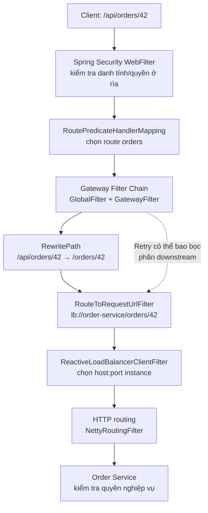
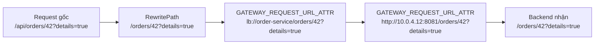
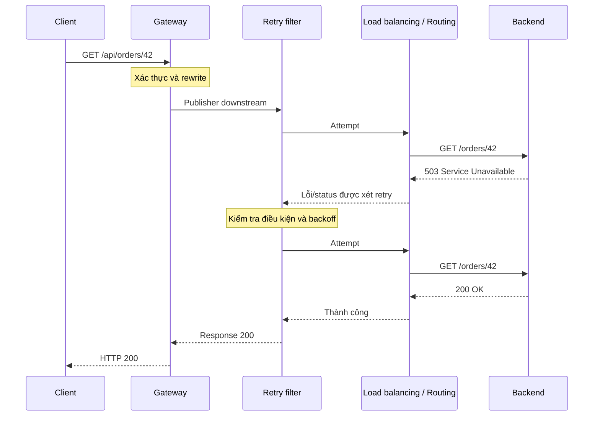

# Tương tác thứ tự giữa rewrite, load balancing, retry và bảo mật

## Mục tiêu bài học

Trong chương **Chuỗi bộ lọc**, chúng ta xét một vấn đề dễ gây lỗi trong **Spring Cloud Gateway**: cùng một request có thể phải đi qua **xác thực**, **rewrite đường dẫn/header**, **load balancing**, **retry**, **circuit breaker** và cuối cùng mới được gửi đến microservice. Các chức năng có vẻ độc lập nhưng kết quả phụ thuộc vào **thứ tự thực thi** và **vùng publisher mà mỗi filter bao bọc**.

Sau bài học, bạn có thể:

- Giải thích cách Spring Cloud Gateway Server WebFlux kết hợp `GlobalFilter` với `GatewayFilter`, sắp thứ tự và thực hiện pha **pre/post**.
- Xác định vì sao sửa path cần diễn ra trước khi dựng URL đích và trước khi routing.
- Theo dõi URI qua `GATEWAY_ROUTE_ATTR`, `GATEWAY_REQUEST_URL_ATTR`, bước resolve `lb://` và HTTP routing.
- Phân tích retry bao bọc những filter nào, ảnh hưởng đến số lần kiểm tra bảo mật, rate limit, load balancing và request body.
- Đặt xác thực/ủy quyền ở lớp thích hợp, tránh tin cậy thông tin header do client tự gửi.
- Đọc log, kiểm thử end-to-end và xử lý lỗi do thứ tự filter trong môi trường microservices.

> Bài này tập trung **Spring Cloud Gateway Server WebFlux** dùng `GlobalFilter`, `GatewayFilterChain` và `ServerWebExchange`. Cách tổ chức filter của **Spring Cloud Gateway Server MVC** khác. Các hằng số thứ tự và chi tiết từng factory cần đối chiếu với phiên bản dependency đang triển khai.

## 1. Bức tranh toàn cảnh của một request

Giả sử client gửi:

```http
GET /api/orders/42?details=true HTTP/1.1
Host: api.example.com
Authorization: Bearer <access-token>
```

Gateway cần xác thực request, chọn route `orders`, đổi `/api/orders/42` thành `/orders/42`, tìm một instance của `order-service`, gửi HTTP request đến instance đó và có thể retry khi gặp lỗi tạm thời.



Đây là **mô hình logic**, không phải sơ đồ bảo đảm tất cả ứng dụng sẽ có đúng các filter trên. Chẳng hạn, hệ thống dùng URI tĩnh `https://backend.example.com` không cần bước `lb://`; dự án không cấu hình retry thì request chỉ có một lần thử gửi thông thường.

Điểm đáng chú ý: trong WebFlux, Spring Security thường thực thi qua **`WebFilter` của WebFlux** trước giai đoạn route matching của Gateway. Một custom `GlobalFilter` chỉ được gọi khi request đã đi tới chuỗi Gateway cho route tương ứng. Vì vậy không thể gộp toàn bộ xác thực, rewrite, retry và routing vào một danh sách filter rồi giả định mọi thành phần cùng được sắp thứ tự bởi một comparator.

## 2. Hai cấp filter và nguyên tắc pre/post

### 2.1. `GlobalFilter` và `GatewayFilter`

Spring Cloud Gateway Server WebFlux sử dụng hai loại filter chính trong **Gateway filter chain**:

| Thành phần | Phạm vi | Ví dụ |
| --- | --- | --- |
| `GlobalFilter` | Áp dụng chung cho các request được xử lý bởi Gateway filter chain | Filter đo thời gian, `RouteToRequestUrlFilter`, filter load balancing, routing |
| `GatewayFilter` | Gắn với route, thường được tạo bởi `GatewayFilterFactory` | `RewritePath`, `StripPrefix`, `SetRequestHeader`, `Retry`, `RequestRateLimiter` |
| `WebFilter` của WebFlux | Thuộc WebFlux server chain; có thể chạy trước route mapping | `SecurityWebFilterChain`, CORS/web exchange concerns theo cấu hình |

Sau khi một route khớp, `FilteringWebHandler` kết hợp các **`GlobalFilter`** với **`GatewayFilter`** của route đó thành một chuỗi, rồi sắp xếp theo thứ tự `Ordered`. Một filter có `order` **nhỏ hơn** được ưu tiên **sớm hơn trong pha pre**. Khi các filter lồng nhau theo kiểu `chain.filter(exchange)`, phần post chạy theo hướng ngược lại.

Ví dụ giả định:

| Filter | `order` | Pha pre | Pha post |
| --- | ---: | ---: | ---: |
| A: Audit đầu vào | `-100` | 1 | 3 |
| B: Rewrite | `1` | 2 | 2 |
| C: Retry | `2` | 3 | 1 |

Các số thứ tự ở bảng trên chỉ minh họa ba filter, không mô tả toàn bộ filter mặc định nằm giữa chúng. Nếu filter A bao bọc B và C, luồng sẽ có dạng:

```text
A.pre
  B.pre
    C.pre
      ... downstream ...
    C.post
  B.post
A.post
```

Từ góc nhìn kỹ thuật, phần *post* thường được thể hiện bằng các operator Reactor như `then`, `doOnSuccess`, `doOnError` hoặc `doFinally`. Không phải mọi filter đều có một bước post riêng, và thứ tự tín hiệu callback có thể phụ thuộc operator. Nhưng nguyên tắc quan trọng là **filter phía ngoài bao bọc phần xử lý phía trong**.

> Khi cùng một `order` hoặc trộn `default-filters`, filter của route và custom filter có `Ordered` riêng, đừng dựa vào giả định thứ tự khai báo trong YAML là tất cả. Hãy kiểm tra chuỗi filter hiệu lực và đặt order rõ ràng khi hành vi phụ thuộc vào thứ tự.

### 2.2. Thứ tự pre không phải là “một danh sách chạy một lần”

Một `GatewayFilter` thường trả về `Mono<Void>` từ `chain.filter(exchange)`. Filter **bọc publisher trả về** có thể tác động đến thời điểm downstream được subscribe, số lần phát tín hiệu, lỗi và cancellation. Riêng `Retry` có thể **đăng ký lại phần publisher downstream** khi điều kiện retry phù hợp.

Vì vậy, cần phân biệt:

- **Thứ tự gọi filter:** filter nào tạo/điều khiển publisher trước.
- **Thứ tự tác động khi subscription chạy:** bước nào thực sự được thực hiện trước khi gửi HTTP.
- **Phạm vi retry:** phần xử lý nào được tạo hoặc được subscribe lại trong lần thử kế tiếp.
- **Thứ tự phản hồi:** filter bao bọc bên ngoài thường nhận tín hiệu hoàn tất/lỗi sau các bước sâu hơn.

Không nên tự tạo `subscribe()` bên trong filter để “chạy trước” hay “đợi hoàn thành”; cách đó tách subscription khỏi HTTP exchange và làm sai xử lý lỗi.

## 3. Rewrite phải tương thích với bước tạo URL đích

Một route có thể được cấu hình:

```yaml
spring:
  cloud:
    gateway:
      routes:
        - id: orders
          uri: lb://order-service
          predicates:
            - Path=/api/orders/**
          filters:
            - name: RewritePath
              args:
                regexp: '^/api/(?<remaining>.*)$'
                replacement: '/$\{remaining}'
```

Với request `/api/orders/42?details=true`, filter `RewritePath` dự kiến đổi path thành `/orders/42`. Dấu `$` trong replacement được viết thành `$\{remaining}` theo cách escape placeholder thường dùng trong YAML cấu hình Gateway để Spring không diễn giải nhầm `${...}`; cần kiểm tra cú pháp tương ứng với phiên bản cụ thể.

**Trình tự dữ liệu cần hiểu:**

1. **Route matching** kiểm tra `Path=/api/orders/**` đối với request đến Gateway. Chọn route xong mới tới các route filters.
2. **RewritePath** sửa URI của request trong `ServerWebExchange` được truyền vào chain.
3. **`RouteToRequestUrlFilter`** xây URI định tuyến từ URI request hiện tại và URI cấu hình của route, rồi đặt vào `GATEWAY_REQUEST_URL_ATTR`.
4. Nếu route dùng `lb://`, bước **load balancing** dùng service name để chọn instance và cập nhật URI đích.
5. **HTTP routing** dùng URI đích đó để gửi request đến backend.



IP và cổng trong sơ đồ là **giá trị minh họa**, không phải instance có thật. Query string được giữ lại trong ví dụ vì `RewritePath` chỉ thay path; các filter khác có thể chủ động đổi query.

### 3.1. Các attributes hữu ích khi kiểm tra

| Attribute / API | Diễn giải |
| --- | --- |
| `exchange.getRequest().getURI()` | URI của request **ở thời điểm đọc**, có thể đã bị rewrite |
| `GATEWAY_ROUTE_ATTR` | Đối tượng `Route` đã chọn; `route.getUri()` vẫn có thể là `lb://order-service` |
| `GATEWAY_REQUEST_URL_ATTR` | URI **đích hiện tại** của Gateway, có thể đổi từ `lb://` sang HTTP instance |
| `GATEWAY_ORIGINAL_REQUEST_URL_ATTR` | `Set<URI>` ghi các URI cũ mà một số filter chủ động lưu lại; không bảo đảm luôn có hoặc có thứ tự thời gian |

Các hằng số `GATEWAY_*` được khai báo trong `org.springframework.cloud.gateway.support.ServerWebExchangeUtils`. Chỉ đọc chúng sau khi thành phần tương ứng đã thiết lập; đọc `GATEWAY_REQUEST_URL_ATTR` quá sớm có thể trả `null`.

### 3.2. Khi rewrite chạy quá muộn

Các bản Spring Cloud Gateway Server WebFlux thông dụng có thứ tự nội bộ:

- `RouteToRequestUrlFilter`: `ROUTE_TO_URL_FILTER_ORDER = 10000`.
- `ReactiveLoadBalancerClientFilter`: thường ở thứ tự `10150`.
- Routing HTTP chạy sau khi URI đích cần thiết đã được tạo.

Đây là các **mốc tham khảo của pipeline WebFlux**, cần xác minh theo phiên bản và filter khác đang cấu hình. Route filters thông thường như `RewritePath` được áp dụng trước bước dựng URL đích.

Nếu một custom filter sửa `exchange.getRequest().getURI()` **sau khi** `GATEWAY_REQUEST_URL_ATTR` đã được tính, HTTP routing có thể vẫn sử dụng **URI đích cũ**. Kết quả điển hình là 404 ở backend hoặc request đi sai path dù log của một custom filter cho thấy request URI đã thay đổi.

**Cách xử lý:** ưu tiên `RewritePath`, `SetPath` hoặc `StripPrefix` theo contract; đặt custom path rewrite trước `RouteToRequestUrlFilter`. Đừng sửa `GATEWAY_REQUEST_URL_ATTR` bằng dữ liệu client chưa xác thực để “vá” việc sắp thứ tự: có thể bỏ qua routing policy, tạo SSRF hoặc phá load balancing.

## 4. Load balancing: chọn instance sau khi biết URI logic

Route URI:

```yaml
uri: lb://order-service
```

không phải địa chỉ IP/cổng của backend. Nó yêu cầu Spring Cloud Gateway dùng cơ chế load balancing thích hợp, thường qua **Spring Cloud LoadBalancer** và nguồn danh sách instance dịch vụ đã cấu hình.

Với URI logic `lb://order-service/orders/42`, load balancing có thể tìm instance, ví dụ:

```text
Service name: order-service
Selected instance: 10.0.4.12:8081
Gateway target: http://10.0.4.12:8081/orders/42
```

Trách nhiệm của những thành phần này khác nhau:

| Bước | Quyết định điều gì? | Điều nó không tự làm |
| --- | --- | --- |
| Route predicate | Chọn route `orders` theo `Path`, `Method`, `Host`... | Không chọn một instance HTTP cụ thể |
| Rewrite | Chuyển URI/path theo hợp đồng backend | Không xác minh token, không chọn server |
| `RouteToRequestUrlFilter` | Tạo URL đích từ route URI và request URI hiện tại | Không biến `lb://` thành một instance thật |
| Load balancing | Resolve service name thành instance, đặt URI HTTP(S) đích | Không tự bảo đảm instance đáp ứng thành công |
| HTTP routing | Gửi request tới URI đã resolve | Không thay thế ủy quyền nghiệp vụ của backend |

Nếu không tìm thấy instance, Gateway có thể trả **503** hoặc **404** tùy cấu hình fail-on-empty; nếu kết nối đến instance thất bại có thể phát sinh lỗi khác. Một route match thành công không chứng minh upstream đang khỏe.

### 4.1. Retry không đồng nghĩa chuyển sang node khác

Đây là điểm rất dễ suy luận sai: **retry** lặp lại một lần xử lý downstream trong điều kiện đã cấu hình, còn **load balancing** chọn instance theo cơ chế riêng. Chúng có thể phối hợp, nhưng không nên mặc định mỗi retry chắc chắn chọn node mới.

Một lần thử lại có thể vẫn nhắm cùng instance do cache, cách triển khai filter, URI đã được resolve, trạng thái exchange hoặc chiến lược chọn instance. Muốn bảo đảm chính sách thử lại ở instance khác, phải đánh giá cơ chế hiện dùng, khả năng tương thích của load balancer và retry, rồi kiểm tra bằng nhiều backend stub. Không lấy sự tồn tại của `Retry` và URI `lb://` làm bằng chứng có failover sang node khác.

## 5. Retry là filter bao bọc downstream

Giả sử request `GET /api/orders/42` được xác thực, rewrite và định tuyến tới Order Service, nhưng upstream trả về lỗi tạm thời `502` hoặc `503`. `Retry` có thể thực hiện thêm một số lần thử dựa trên điều kiện HTTP method, status, status series hoặc exception.



Sơ đồ chỉ mô tả ý tưởng **thử lại phần downstream**; nó không khẳng định lần 2 bắt buộc dùng instance khác. Trong mã thực, cơ chế retry dựa trên tín hiệu reactive và kết quả status/exception; chính sách chi tiết phụ thuộc cấu hình/phiên bản.

### 5.1. Cấu hình retry có giới hạn rõ ràng

Ví dụ dành cho các request đọc idempotent:

```yaml
spring:
  cloud:
    gateway:
      routes:
        - id: orders-read
          order: 0
          uri: lb://order-service
          predicates:
            - Path=/api/orders/**
            - Method=GET
          filters:
            - name: RewritePath
              args:
                regexp: '^/api/(?<remaining>.*)$'
                replacement: '/$\{remaining}'
            - name: Retry
              args:
                retries: 2
                methods:
                  - GET
                statuses:
                  - BAD_GATEWAY
                  - SERVICE_UNAVAILABLE
                backoff:
                  firstBackoff: 100ms
                  maxBackoff: 400ms
                  factor: 2
                  basedOnPreviousValue: false
```

Điều cần đọc kỹ:

- `retries: 2` thường nghĩa là **tối đa hai lần thử lại ngoài lần đầu** (tối đa ba attempts nếu điều kiện tiếp tục cho phép).
- `methods: GET` giới hạn method được retry theo thiết kế ví dụ. Route còn có `Method=GET` để các method khác không đi vào route đọc này.
- `statuses` đặt hai status quan tâm; **mặc định của status series và exception** có thể vẫn ảnh hưởng các trường hợp retry khác. Nếu cần chính sách chỉ chính xác hai status, phải kiểm tra và cấu hình cả `series`/`exceptions` theo khả năng của phiên bản đang dùng.
- Backoff tránh gửi lại lập tức; tổng thời gian phải phù hợp latency budget và timeout của Gateway/backend/client.
- Nếu thêm các route khác cho `POST`/`PATCH`, không nên sao chép retry của GET một cách máy móc.

Tuy có `RewritePath` ở trước `Retry` trong ví dụ, thứ tự hiệu lực còn phụ thuộc các global/default filters có `Ordered` riêng. Với một tuyến WebFlux thông thường, các route filter được tạo tuần tự nên rewrite áp dụng trước retry và trước giai đoạn dựng URL.

### 5.2. Đặt Retry ở đâu so với Rewrite?

Xét hai cấu trúc logic:

```text
Phương án A:
  RewritePath
    └─ Retry
         └─ RouteToRequestUrl → LoadBalance → Routing

Phương án B:
  Retry
    └─ RewritePath
         └─ RouteToRequestUrl → LoadBalance → Routing
```

Ở **A**, retry bao bọc publisher downstream **sau bước rewrite**. Điều này thường phù hợp hơn khi muốn giữ path đích ổn định qua các attempts.

Ở **B**, retry đặt bên ngoài rewrite. Khi một phần downstream được đăng ký lại/thực thi lại, rewrite có thể chạy lại trên exchange đã mutate; một custom rewrite không idempotent dễ tạo path sai. Vì mức độ tái thực thi tùy cách filter tạo publisher, không được giả định chỉ nhìn thứ tự trong YAML là đã biết chính xác tác dụng trên từng attempt. Hãy đo request backend nhận ở tất cả attempts.

Đối với các phép biến đổi lặp lại, nên thiết kế tính **idempotent**: áp dụng nhiều lần vẫn cho cùng kết quả. Ví dụ biến đổi có điểm đầu neo rõ ràng và không tự thêm `/api` mỗi lần sẽ an toàn hơn phép nối chuỗi path vô điều kiện.

### 5.3. Request body và HTTP response có ranh giới

Retry với request có body như `POST /payments` nguy hiểm hơn GET:

1. Backend có thể đã tạo giao dịch nhưng Gateway không nhận được response.
2. Retry có thể tạo **giao dịch trùng lặp** nếu backend không hỗ trợ idempotency.
3. Để phát lại body, Gateway có thể phải **cache body trong bộ nhớ**, làm tăng tài nguyên và rủi ro quá tải khi body lớn.
4. Khi response đã commit/đã gửi dữ liệu cho client, không thể tùy tiện rút lại rồi gửi một HTTP response khác.

Nếu buộc phải retry thao tác ghi, cần thiết kế **idempotency key** hoặc cơ chế khử trùng lặp ở backend, xét tính an toàn của request body, và kiểm tra hành vi response commit. Retry không biến một thao tác không idempotent thành idempotent.

### 5.4. Retry và circuit breaker

Circuit breaker là một filter/cơ chế khác, có thể bao bọc retry hoặc được retry bao bọc tùy vị trí:

```text
CircuitBreaker → Retry → Routing
```

Có thể tính cả nhóm attempts như một kết quả đối với circuit breaker, tùy cách đo và tín hiệu lỗi.

```text
Retry → CircuitBreaker → Routing
```

Có thể để các attempts gặp trạng thái circuit breaker khác nhau và tính lỗi theo một cách khác.

Không có một thứ tự luôn đúng cho mọi ứng dụng. Cần quyết định dựa trên **ngân sách attempts**, timeout, cách tính thất bại, chính sách fallback và rủi ro làm tăng tải khi backend đang lỗi. Đối với thanh toán, fallback trả “thành công” giả là nguy hiểm.

## 6. Bảo mật nằm ở đâu so với retry?

### 6.1. Tách xác thực đầu vào khỏi quyền nghiệp vụ

Một request từ Internet thường cần ba lớp suy nghĩ:

1. **Rìa hệ thống:** TLS, reverse proxy/ingress, chính sách network và header tin cậy.
2. **Gateway:** xác thực/ủy quyền chung cho API, từ chối request trái phép và có thể điều tiết lưu lượng.
3. **Backend:** kiểm tra quyền truy cập **tài nguyên cụ thể** và ràng buộc nghiệp vụ; không dựa hoàn toàn vào việc request từng đi qua Gateway.

Ví dụ: Gateway biết JWT hợp lệ và token có scope `orders.read`, nhưng backend mới biết đơn hàng `42` có thuộc về người dùng đó hay không. Gateway không nên dùng query parameter `?role=admin` làm bằng chứng phân quyền.

Trong Server WebFlux, một cấu hình Spring Security có thể xử lý request **trước Gateway route matching**:

```java
import org.springframework.context.annotation.Bean;
import org.springframework.http.HttpMethod;
import org.springframework.security.config.Customizer;
import org.springframework.security.config.web.server.ServerHttpSecurity;
import org.springframework.security.web.server.SecurityWebFilterChain;

@Bean
SecurityWebFilterChain securityWebFilterChain(ServerHttpSecurity http) {
    return http
        .authorizeExchange(exchanges -> exchanges
            .pathMatchers(HttpMethod.GET, "/api/orders/**")
                .hasAuthority("SCOPE_orders.read")
            .pathMatchers("/api/orders/**")
                .hasAuthority("SCOPE_orders.write")
            .anyExchange().authenticated()
        )
        .oauth2ResourceServer(oauth -> oauth.jwt(Customizer.withDefaults()))
        .build();
}
```

Đoạn mã chỉ minh họa các quy tắc access control của **Spring Security WebFlux**; muốn chạy thật, ứng dụng cần dependency, issuer/JWK hoặc cấu hình xác minh JWT phù hợp, HTTPS và quyết định CSRF/CORS theo loại client. Không tắt bảo vệ khác một cách mặc định.

Các path matcher trên xem **path request đầu vào**, trước route rewrite ở Gateway. Việc `RewritePath` biến `/api/orders/42` thành `/orders/42` khi chuyển tiếp **không làm đổi ngược** điều kiện mà Spring Security đã đánh giá trước đó.

### 6.2. Thứ tự an toàn khi dùng custom Gateway security filter

Nếu dự án có custom `GlobalFilter` kiểm tra API key hoặc chính sách chung, nên sắp thứ tự **trước phần retry** để một request bên ngoài được đánh giá theo một contract rõ ràng:

```text
Gateway Security/Policy Filter (pre, order nhỏ)
    │
    └─ RewritePath
         │
         └─ Retry
              │
              └─ Routing đến backend
```

Khi filter bảo mật đứng **ngoài** Retry, nó không mặc nhiên bị thử lại mỗi khi một attempt HTTP tới backend lỗi. Nếu Retry đứng ngoài filter bảo mật, một số hoạt động trong filter có thể bị lặp theo attempts; việc này có thể tăng số lần gọi identity provider, tạo log sai hoặc thay đổi ngữ nghĩa đếm quota.

**Ngoại lệ có chủ đích:** đôi khi muốn kiểm tra một thông tin cho từng attempt, ví dụ credential đến upstream phải được làm mới khi cần. Hãy thiết kế một bước chuyên biệt cho nhu cầu đó, tránh đặt toàn bộ xác thực client vào vùng retry chỉ vì trùng nhiệm vụ.

Một custom `GlobalFilter` chỉ chạy sau route matching nên không bảo vệ những request đến handler khác trong cùng ứng dụng. Với yêu cầu an toàn ở ranh giới HTTP, phải xét thêm `SecurityWebFilterChain`, kiểm soát actuator/management endpoints và việc truy cập thẳng vào backend.

### 6.3. Header và token qua các bước biến đổi

Các filter như `SetRequestHeader`, `AddRequestHeader`, `RemoveRequestHeader` hay `TokenRelay` (nếu đã cài đủ dependency và cấu hình) có thể thay đổi những gì backend nhận được. Cần phân biệt:

- **Request client gửi:** có thể chứa `Authorization`, `Cookie`, `X-Forwarded-*` hoặc header tùy ý.
- **Thông tin đã xác thực trong security context:** kết quả xử lý của framework, không tương đương một header tự do của client.
- **Header Gateway chuyển tới backend:** phải tuân theo trust boundary; chỉ truyền danh tính đã được chứng thực theo giao thức và chính sách được định nghĩa.

Không cho client tự gửi `X-User-Id` rồi tin rằng header đó là danh tính đã xác thực. Nếu Gateway cần chuyển định danh nội bộ, phải loại bỏ/ghi đè giá trị không tin cậy, bảo vệ kết nối tới backend và hạn chế backend được truy cập bỏ qua Gateway.

Nếu backend dùng bearer token, quyết định rõ dùng **token forwarding**, **token exchange** hay xác thực service-to-service; bảo đảm audience/scope đúng và không ghi token vào log. Cấu hình TLS từ client đến Gateway và TLS/mTLS từ Gateway đến backend là hai đường kết nối khác nhau.

## 7. Rate limiting và retry: đếm request hay đếm attempt?

Một client gửi **một request** có thể kích hoạt **nhiều HTTP attempts** tới backend do Retry. Vì vậy, giới hạn lưu lượng và metric phải ghi rõ đang đếm loại nào.

| Thứ tự logic | Tác động có thể xảy ra | Khi nào phù hợp |
| --- | --- | --- |
| `RateLimiter → Retry → Routing` | Rate limiter ở ngoài vùng retry, thường quyết định quota **một lần cho request client** | Hạn mức theo user/API key/request bên ngoài |
| `Retry → RateLimiter → Routing` | Phần giới hạn nằm trong vùng có thể được chạy lại; một request có thể dùng nhiều lượt quota | Chỉ khi thật sự muốn chính sách tính theo attempts |

Thường nên xử lý **xác thực + quota client** trước retry, còn hệ thống vẫn cần giới hạn tải thực tế ở backend. Ví dụ 1.000 request/giây vào Gateway, mỗi request có tối đa hai retries thì số lần gọi backend **có thể** cao hơn 1.000/giây nhiều lần trong lúc lỗi; quota theo client chưa đủ để ngăn request amplification.

Chính sách nên xem xét:

- Giới hạn retries, backoff và tổng timeout.
- Metrics đo riêng **incoming requests** và **outbound attempts**.
- Circuit breaker và các giới hạn đồng thời để tránh thác lỗi.
- Rate limiting phân tán khi nhiều Gateway replicas dùng cùng một hạn mức, ví dụ Redis nếu sử dụng filter đòi hỏi kho trạng thái dùng chung.

Không đoán số attempts dựa vào `GATEWAY_ORIGINAL_REQUEST_URL_ATTR`: đó là lịch sử URI được filter ghi lại, **không phải bộ đếm retries**.

## 8. Một cấu trúc Gateway có thứ tự minh bạch

Xét kiến trúc ví dụ cho GET Order:

```text
Client
  │
  ▼
TLS ingress / trusted reverse proxy
  │
  ▼
SecurityWebFilterChain (xác thực và chính sách theo path gốc)
  │
  ▼
Route matching: Path=/api/orders/**, Method=GET
  │
  ▼
GlobalFilter audit (order -100)
  │
  ▼
RewritePath: /api/orders/42 → /orders/42
  │
  ▼
Retry (GET; tối đa 2 retries)
  │
  ▼
RouteToRequestUrlFilter: lb://order-service/orders/42
  │
  ▼
ReactiveLoadBalancerClientFilter: instance HTTP/HTTPS cụ thể
  │
  ▼
NettyRoutingFilter: gửi request
  │
  ▼
Order Service (phân quyền theo đơn hàng)
```

Phía response, các bước xử lý **post** được thực hiện theo cấu trúc publisher/chuỗi filter theo chiều quay về client. Chẳng hạn filter audit đặt sớm có thể đo tổng thời gian của các bước downstream, bao gồm thời gian backoff/retry nếu bao bọc publisher phù hợp.

### 8.1. Quan sát thứ tự bằng `GlobalFilter`

```java
import java.net.URI;
import org.slf4j.Logger;
import org.slf4j.LoggerFactory;
import org.springframework.cloud.gateway.filter.GatewayFilterChain;
import org.springframework.cloud.gateway.filter.GlobalFilter;
import org.springframework.cloud.gateway.route.Route;
import org.springframework.core.Ordered;
import org.springframework.stereotype.Component;
import org.springframework.web.server.ServerWebExchange;
import reactor.core.publisher.Mono;

import static org.springframework.cloud.gateway.support.ServerWebExchangeUtils
    .GATEWAY_ROUTE_ATTR;
import static org.springframework.cloud.gateway.support.ServerWebExchangeUtils
    .GATEWAY_REQUEST_URL_ATTR;

@Component
public class GatewayFlowAuditFilter implements GlobalFilter, Ordered {
    private static final Logger log =
        LoggerFactory.getLogger(GatewayFlowAuditFilter.class);

    @Override
    public int getOrder() {
        return -100;
    }

    @Override
    public Mono<Void> filter(ServerWebExchange exchange,
                             GatewayFilterChain chain) {
        Route route = exchange.getAttribute(GATEWAY_ROUTE_ATTR);
        String routeId = route == null ? "unknown" : route.getId();
        long startedAt = System.nanoTime();

        return chain.filter(exchange)
            .doOnSubscribe(subscription ->
                log.info("gateway.start route={}", routeId)
            )
            .doFinally(signal -> {
                URI target =
                    exchange.getAttribute(GATEWAY_REQUEST_URL_ATTR);
                long elapsedMs =
                    (System.nanoTime() - startedAt) / 1_000_000;

                log.info(
                    "gateway.end route={} targetScheme={} "
                      + "durationMs={} terminal={}",
                    routeId,
                    target == null ? "unknown" : target.getScheme(),
                    elapsedMs,
                    signal
                );
            });
    }
}
```

Đây là filter minh họa cách bao bọc downstream bằng reactive operators:

- `getOrder() == -100` nhằm audit ở đầu Gateway chain thông thường, trước phần lớn route filters.
- `GATEWAY_ROUTE_ATTR` đã có khi một request tới Gateway filter chain sau route matching.
- `GATEWAY_REQUEST_URL_ATTR` thường chưa có **ở đầu filter**, nhưng có thể được thiết lập khi các routing filters chạy. Vì thế ví dụ đọc nó trong `doFinally`.
- `signal` từ `doFinally` là loại tín hiệu kết thúc (`ON_COMPLETE`, `ON_ERROR`, `CANCEL`...), **không phải HTTP status**.
- Không ghi nguyên `Authorization`, URI đầy đủ hay query string vào log.

Trong production cần chuẩn hóa metrics/tracing; nếu cần phân biệt latency của từng attempt với latency tổng, đo thêm tại lớp routing/client hoặc instrumentation phù hợp, không chỉ ở một filter ngoài Retry. Tracing phân tán cũng phải truyền trace context qua HTTP để liên kết Gateway với backend.

### 8.2. Vì sao một log “trước retry” chưa đủ?

Nếu `GatewayFlowAuditFilter` bao bọc `Retry`, log bắt đầu/kết thúc có thể xuất hiện **một lần cho request client**, dù có nhiều attempts đến backend. Điều đó là phù hợp để đo latency end-to-end, nhưng không đủ để biết `Retry` đã thực hiện mấy lần hay chọn instance nào. Cần telemetry riêng theo outbound attempt khi điều tra sự cố.

## 9. Sự cố thực tế do thứ tự filter

### Trường hợp A — Route đúng nhưng backend trả 404

Client gọi `/api/orders/42`, nhưng backend chỉ có `/orders/42`. Log Gateway cho thấy route `orders` match. Một custom rewrite chạy sau bước dựng `GATEWAY_REQUEST_URL_ATTR`, nên request thực gửi vẫn là `/api/orders/42`.

**Chẩn đoán:** quan sát request URI sau rewrite, `GATEWAY_REQUEST_URL_ATTR` trước routing và path tại backend; kiểm tra order của custom filter so với `RouteToRequestUrlFilter`. Sửa thứ tự hoặc dùng filter rewrite chuẩn.

### Trường hợp B — Có `lb://` nhưng response 503

Route URI là `lb://order-service`, song service discovery không cung cấp instance khỏe hoặc bước kết nối upstream lỗi.

**Chẩn đoán:** xác nhận route match, URI logic, danh sách instance, kết quả resolve, timeout và kết nối thực tế. Đừng đổi thứ tự rewrite để chữa một lỗi discovery chưa được chứng minh; nếu retry, cần kiểm tra attempts và không giả định mỗi attempt được đưa đến node khác.

### Trường hợp C — Quota bị trừ nhiều lần cho một request

Một `RequestRateLimiter` nằm trong đoạn publisher mà Retry thử lại. Khi backend lỗi, một HTTP request bên ngoài có thể làm hệ thống đếm hạn mức nhiều lần.

**Chẩn đoán:** kiểm tra vị trí rate limiter so với Retry trong chuỗi hiệu lực, metrics quota và attempts. Nếu chính sách muốn đếm mỗi request một lần, đặt limiter ngoài vùng retry và vẫn giám sát tải thực nhận ở backend.

### Trường hợp D — Token hợp lệ nhưng backend trả 401

Gateway xác thực token thành công, nhưng filter thay header xóa `Authorization`; hoặc backend đòi token có audience khác; hoặc Gateway chỉ lưu principal trong Reactor Context mà không truyền thông tin định danh qua giao thức.

**Chẩn đoán:** kiểm tra kết quả xác thực ở Gateway, hợp đồng identity với downstream, thứ tự header filters và header **đã được làm sạch** tại backend. Không bật chuyển tiếp token vô điều kiện để sửa 401; chọn chính sách xác thực service-to-service đúng trust boundary.

### Trường hợp E — Retry gây tạo đơn hàng/thanh toán trùng

Gateway retry một `POST` sau timeout, dù backend có thể đã commit giao dịch trước khi client nhận response.

**Chẩn đoán:** xác định phương thức nào được retry, cấu hình `methods`, `series`, `statuses`, `exceptions`, số attempts và chính sách idempotency. Với thao tác ghi, thiết kế idempotency tại backend trước khi cho phép retry.

### Trường hợp F — Filter audit không thấy URL đích

Một GlobalFilter chạy rất sớm đọc `GATEWAY_REQUEST_URL_ATTR` ngay trước `chain.filter(exchange)` và nhận `null`.

**Chẩn đoán:** đây có thể là hành vi bình thường: route đã được chọn nhưng URL đích chưa được `RouteToRequestUrlFilter` tính. Đọc ở pha phù hợp, đặt probe sau bước dựng URL theo thứ tự filter hoặc quan sát tại `doFinally`. Xử lý trường hợp request bị từ chối trước routing.

## 10. Chiến lược kiểm thử thứ tự, retry và an toàn

Một kiểm thử chỉ xác nhận status 200 **không đủ**. Hãy dùng Gateway thật trong integration test với backend giả lập có khả năng ghi method, path, header, số lần nhận request, instance ID và trả lỗi theo kịch bản.

| Ca kiểm thử | Input / trạng thái | Kết quả cần xác minh |
| --- | --- | --- |
| Xác thực thất bại | Thiếu token hoặc JWT không hợp lệ | Bị chặn ở lớp security; không gọi backend |
| Phân quyền route | Scope không đủ cho endpoint | Bị từ chối theo chính sách; rewrite/retry không vượt qua quyền |
| Rewrite đúng | `GET /api/orders/42?details=true` | Backend nhận `/orders/42?details=true` |
| Load balancing | Hai instances của `order-service` | URI logic được resolve; xác định chính xác instance nhận request |
| Retry thành công | GET lần đầu trả 503, lần tiếp theo trả 200 | Client thấy response cuối; đếm số outbound attempts thực tế |
| Retry bị giới hạn | Backend luôn trả lỗi đủ điều kiện | Tổng số lần gọi không vượt chính sách retries |
| Method không được retry | POST trả lỗi, không có idempotency policy | Không tự retry POST trong cấu hình GET-only |
| Quota và retry | Một request hợp lệ, upstream lỗi tạm thời | Xác minh quota tính theo request hay attempt đúng chủ đích |
| Không có instance | Registry/load balancer không tìm thấy backend | Trả lỗi có kiểm soát, tracing/log chỉ rõ nguồn lỗi |
| Filter order bị đổi | Đảo rewrite với bước dựng URL hoặc retry | Test phát hiện request đi sai path hay số lần áp dụng filter |
| Token/header an toàn | Client gửi header định danh giả | Backend không coi header giả là identity đã xác thực |
| Timeout và cancellation | Upstream chậm hoặc client ngắt kết nối | Không tiếp tục retry vô hạn; tài nguyên được giải phóng |

### 10.1. Suy luận trên số lần thử

Với cấu hình `retries: 2`, nếu các điều kiện retry cho phép:

```text
Attempt 1: GET /orders/42 → 503
Backoff
Attempt 2: GET /orders/42 → 503
Backoff
Attempt 3: GET /orders/42 → 200
Kết quả cuối cho client: 200
```

Nếu attempt đầu tiên trả 200 thì **không có lý do retry**, chỉ một outbound attempt. Nếu response đã commit hoặc điều kiện không nằm trong policy, kết quả cũng có thể kết thúc sớm. Đừng kiểm thử bằng cách đếm số lần chạy một filter ngoài Retry; cần đếm số request mà backend thực nhận.

### 10.2. Quan sát production

Nên có:

- Metrics **request client** theo route ID, status, latency p50/p95/p99 và saturation.
- Metrics **outbound attempts**, số retries, lỗi load balancing, timeout, circuit breaker mở và backend error rate.
- Trace liên kết Gateway với downstream bằng trace context qua HTTP; log có correlation/trace ID được kiểm soát.
- Alert dựa trên SLO của đường request hoàn chỉnh, không chỉ CPU hoặc tính sẵn sàng của process Gateway.
- Quy trình review/rollback cấu hình route và thứ tự filters khi thêm rewrite, retry hoặc policy bảo mật.

Khi ghi log, dùng route ID và tên chính sách ổn định; tránh full URL có token/query, header xác thực hoặc IP nội bộ dưới dạng metric label có cardinality cao. Dữ liệu nhạy cảm phải được xử lý theo trust boundary.

## 11. Bài luyện tập

Cho cấu trúc xử lý:

```text
Security WebFilter
  → Route orders [Path=/api/orders/**, Method=GET]
  → Audit GlobalFilter (-100)
  → RewritePath (route filter)
  → Retry(retries=2; GET; 503 đủ điều kiện)
  → RouteToRequestUrl
  → LoadBalancer
  → Netty routing
```

Client gọi:

```http
GET /api/orders/42?details=true HTTP/1.1
Host: api.example.com
Authorization: Bearer <valid-token>
```

Giả sử:

- Rewrite bỏ tiền tố `/api`, tạo `/orders/42`.
- Route URI là `lb://order-service`.
- Load balancer có instance `10.0.4.12:8081`.
- Backend lần đầu trả 503; lần tiếp theo trả 200, trong khi các điều kiện khác đều hợp lệ.

Hãy trả lời:

1. Path mà Spring Security đánh giá trước rewrite là gì?
2. `GATEWAY_ROUTE_ATTR` chứa thông tin loại nào?
3. `GATEWAY_REQUEST_URL_ATTR` ở giai đoạn sau `RouteToRequestUrlFilter` khác gì so với sau load balancing?
4. Với `retries: 2`, backend được gọi tối đa bao nhiêu attempts nếu không có giới hạn khác?
5. Có chắc attempt thứ hai sử dụng một instance khác không?
6. Nếu đặt limiter bên trong vùng retry, quota có thể được tính thế nào?
7. Nếu đổi GET thành POST tạo thanh toán, nên kiểm tra điều gì trước khi cho retry?

**Đáp án giải thích:**

1. Spring Security đánh giá request ban đầu `/api/orders/42`, trước khi route filter rewrite thành `/orders/42`.
2. Đó là `Route` đã được chọn, gồm route ID, URI cấu hình và các thông tin định tuyến; không phải bằng chứng backend đã xử lý xong.
3. Giai đoạn đầu có thể là `lb://order-service/orders/42?details=true`; sau load balancing có thể thành `http://10.0.4.12:8081/orders/42?details=true`.
4. Tối đa **3 attempts**: một lần đầu và hai retries, khi status/exception/method và lifecycle cho phép.
5. **Không.** Cần kiểm chứng chính sách retry/load balancer và instance đã nhận request.
6. Nếu limiter được thực thi lại trong mỗi attempt, một request client có thể tiêu tốn nhiều lượt quota; dùng đúng thứ tự theo ý định chính sách.
7. Phải đánh giá idempotency, request body replay, trạng thái giao dịch đã commit, timeout/response commit và cơ chế khử trùng lặp ở backend.

## Tổng kết

Trong **Spring Cloud Gateway Server WebFlux**, các filter được ghép thành một pipeline có **thứ tự pre và cấu trúc post tương ứng**. Cách sắp xếp quyết định request path nào được dùng để tạo URL đích, khi nào `lb://` được resolve, những filter nào nằm trong phạm vi retry và policy bảo mật nào có thể bị lặp theo attempt.

Để thiết kế an toàn: **xác thực trước khi định tuyến dữ liệu nhạy cảm, rewrite trước khi dựng URL đích, giới hạn retry theo method/điều kiện rõ ràng, không mặc định retry đổi instance, và giữ quyền nghiệp vụ ở backend**. Hãy đo request client và outbound attempts riêng, kiểm thử bằng backend quan sát được, rồi điều chỉnh order theo hợp đồng API và SLO của hệ thống.
