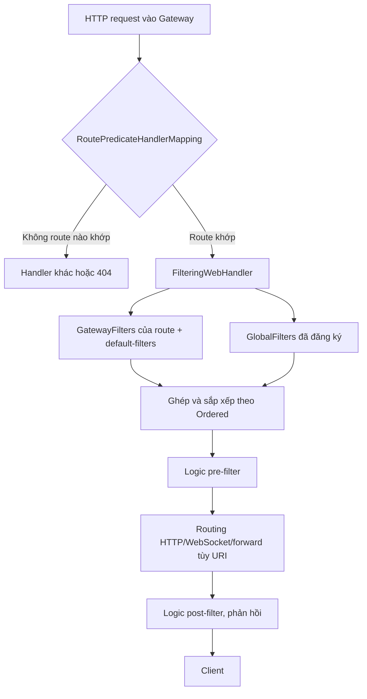
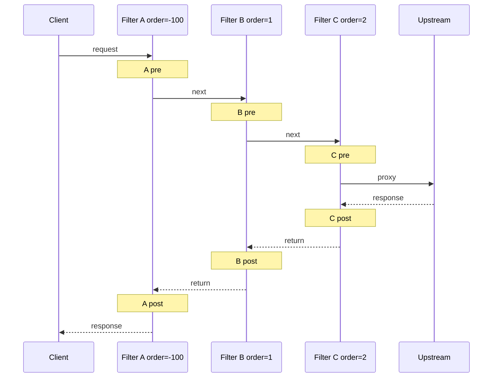

# Đối chiếu chuỗi bộ lọc đang chạy với cấu hình khai báo

## 1. Vấn đề: cấu hình có filter nhưng request có thực sự đi qua filter đó?

Một API Gateway trong hệ thống microservices thường có nhiều lớp xử lý: chọn route bằng predicate, đổi đường dẫn và header, khám phá dịch vụ, xác thực, giới hạn lưu lượng, retry, circuit breaker, TLS và quan sát request. Với **Spring Cloud Gateway**, khi một header không xuất hiện, một request bị từ chối bất ngờ hoặc backend nhận sai path, chỉ mở `application.yml` để đọc `filters` là chưa đủ.

Điều cần xác minh là **route nào được chọn và chuỗi filter nào được tạo cho request đó**, thứ tự chúng được gọi, filter nào thực sự thực hiện công việc và request/response có bị một thành phần khác sửa tiếp hay không.

Bài thuộc chương **Chuỗi bộ lọc** của module **SPRING_CLOUD_GATEWAY**, tập trung vào cách **đối chiếu chuỗi bộ lọc đang chạy với cấu hình khai báo**. Sau bài học, bạn có thể:

1. Phân biệt **route-specific `GatewayFilter`**, **`default-filters`** và **`GlobalFilter`** của Gateway Server WebFlux.
2. Giải thích sự khác nhau giữa **thứ tự chọn route**, **thứ tự chạy filter**, và hai pha *pre/post*.
3. Đọc các endpoint Actuator để kiểm tra route, filter gắn với route, global filter và factory khả dụng.
4. Chứng minh hành vi filter bằng request kiểm thử và log từ chính Gateway/backend.
5. Tìm nguyên nhân khi cấu hình, chuỗi filter được lắp ráp và hành vi quan sát được không khớp nhau.

> **Phạm vi:** Ví dụ chạy trên **Spring Cloud Gateway Server WebFlux 5.0.x**, dùng namespace `spring.cloud.gateway.server.webflux`. Với nhánh 4.x, một số thuộc tính mang tên cũ `spring.cloud.gateway.*`. **Gateway Server Web MVC** dùng Servlet/WebMvc.fn và `HandlerFilterFunction`, `BeforeFilterFunctions`, `AfterFilterFunctions`; không dùng nguyên `GlobalFilter`/Actuator WebFlux để kết luận về MVC. Chọn Spring Boot, Spring Cloud BOM và Gateway starter tương thích theo phiên bản đã khóa.

## 2. Bộ lọc khai báo và bộ lọc đang chạy là hai góc nhìn khác nhau

### 2.1. Ba nguồn filter trong Gateway Server WebFlux

| Nguồn | Nơi khai báo | Phạm vi | Cách kiểm tra |
|---|---|---|---|
| **Route-specific `GatewayFilter`** | `filters` của từng route trong YAML/properties, hoặc `filters(...)` trong Java `RouteLocatorBuilder` | Chỉ route được chọn | `GET /actuator/gateway/routes/{id}` |
| **Default filters** | `spring.cloud.gateway.server.webflux.default-filters` | Được thêm vào **mỗi route**; không áp dụng nếu không có route khớp | Xuất hiện trong danh sách `filters` của các route đã được lắp ráp |
| **`GlobalFilter`** | Bean Spring triển khai `org.springframework.cloud.gateway.filter.GlobalFilter`; gồm các filter hạ tầng do Gateway đăng ký | Được đưa vào chuỗi khi route khớp, có thể chỉ làm việc khi điều kiện nội bộ phù hợp | `GET /actuator/gateway/globalfilters`, cộng log và test |

**Điểm quan trọng:** `default-filters` dù mang tên “default” vẫn được chuyển thành **route filters**, không phải bean `GlobalFilter`. Ngược lại, `GlobalFilter` có thể không xuất hiện trong mảng `filters` của `/actuator/gateway/routes/{id}`. Muốn nhìn đầy đủ, phải đối chiếu **nhiều nguồn**.

### 2.2. Pipeline và thời điểm ghép chuỗi



Một request **không match route** sẽ không chạy chuỗi filter của route đó. Với request đã match, `FilteringWebHandler` kết hợp `GlobalFilter` và `GatewayFilter` rồi sắp xếp theo `org.springframework.core.Ordered`. Một số filter **kết thúc sớm** mà không gọi tiếp `chain.filter(exchange)`, chẳng hạn filter từ chối vượt quota; do đó **“có trong chuỗi” không đồng nghĩa “mọi filter phía sau đã được thực thi”**.

Ngoài chuỗi Gateway còn có những lớp độc lập, ví dụ **Spring Security `WebFilter`**, `WebFilter` chung của WebFlux, lớp xử lý `HttpHeadersFilter` và ingress/reverse proxy trước hoặc sau Gateway. Không suy ra thứ tự hay hành vi của các lớp này chỉ từ danh sách `GatewayFilter`.

## 3. Tạo cấu hình khai báo để so sánh

Giả sử có hai ứng dụng:

- **Gateway WebFlux** lắng nghe tại `localhost:8080`, dùng dependency `spring-cloud-starter-gateway-server-webflux`.
- **Catalog backend** lắng nghe tại `localhost:8081`, cung cấp `GET /products/{id}`.

Để quan sát rõ nguồn filter, ứng dụng Gateway dùng cấu hình **riêng** như sau:

```yaml
# gateway-demo/src/main/resources/application.yml
spring:
  application:
    name: gateway-demo
  cloud:
    gateway:
      server:
        webflux:
          default-filters:
            - AddResponseHeader=X-Default-Filter, enabled
            - RemoveRequestHeader=X-Debug-Secret
          routes:
            - id: catalog-route
              uri: http://localhost:8081
              predicates:
                - Path=/api/catalog/**
                - Method=GET
              filters:
                - StripPrefix=2
                - AddRequestHeader=X-Edge-Route, catalog-route
                - AddResponseHeader=X-Route-Filter, enabled

server:
  port: 8080
```

Hãy đọc cấu hình theo hai lớp:

**Default filters:** `AddResponseHeader` thêm `X-Default-Filter` vào response của mọi route đã khớp; `RemoveRequestHeader` xóa `X-Debug-Secret` trước khi proxy request downstream.

**Route filters:** `StripPrefix=2` biến `/api/catalog/products/42` thành `/products/42`; `AddRequestHeader` thêm `X-Edge-Route` vào request backend; `AddResponseHeader` thêm `X-Route-Filter` vào response client.

Hai predicate `Path` và `Method` phải đồng thời khớp. `POST /api/catalog/products/42` **không** chạy chuỗi filter của `catalog-route` vì `Method=GET` không khớp. Không kết luận “filter lỗi” chỉ từ một request chưa vào đúng route.

**Những gì chưa thể suy ra từ YAML:** Gateway còn những `GlobalFilter` do framework hoặc ứng dụng đăng ký; có thể có route khai báo bằng Java, RouteDefinitionRepository, service discovery, hoặc cấu hình ghi đè theo profile/environment. Cần kiểm tra trạng thái thực của **đúng instance đang nhận traffic**.

## 4. Cách xác định thứ tự filter thực tế

### 4.1. `order` của route không phải `order` của filter

Trong route definition, thuộc tính `order` của route (ví dụ `order: -10`) hỗ trợ **xếp thứ tự ưu tiên khi nhiều route có thể khớp**. Nó **không** có nghĩa `GatewayFilter` của route chạy ở order `-10`.

Filter có thứ tự riêng thông qua `Ordered` hoặc thứ tự được Gateway gán khi chuyển filter definition thành `GatewayFilter`. Trong Gateway Server WebFlux:

- Số **nhỏ hơn** tương ứng **ưu tiên cao hơn**.
- Ở pha **pre**, filter ưu tiên cao đi vào trước.
- Nếu filter có logic **post** bao quanh `chain.filter(exchange)`, filter vào trước thường hoàn thành post **sau** filter vào sau.
- `GlobalFilter` và `GatewayFilter` cùng tham gia một chuỗi được **sắp xếp chung**; không có quy tắc cứng “mọi global luôn trước mọi route”.



Sơ đồ là mô hình **filter có cả pre và post**. Một filter chỉ xử lý trước hoặc chỉ xử lý sau sẽ không có cả hai bước. Nếu filter trả response ngay, nhánh phía sau có thể **không được gọi**. Vì thế đọc mỗi số `order` chưa đủ để xác định thời điểm header/body được sửa.

### 4.2. Vì sao thứ tự khai báo chưa chắc là thứ tự đã sắp?

Với các filter **không tự triển khai `Ordered`**, Gateway gán thứ tự dựa trên vị trí trong danh sách, bắt đầu từ `1`. Default filters và route filters được đánh số **độc lập**, rồi cùng được sắp theo thứ tự ổn định; khi trùng order, default filter được thêm trước route filter cùng mức.

Vì thế, với cấu hình mục 3, **phần các filter khai báo** có thể quan sát như sau:

| Thứ tự tương đối sau khi ghép (minh họa) | Nguồn | Filter | Order của filter không tự đặt `Ordered` |
|---:|---|---|---:|
| 1 | Default | `AddResponseHeader=X-Default-Filter,...` | 1 |
| 2 | Route | `StripPrefix=2` | 1 |
| 3 | Default | `RemoveRequestHeader=X-Debug-Secret` | 2 |
| 4 | Route | `AddRequestHeader=X-Edge-Route,...` | 2 |
| 5 | Route | `AddResponseHeader=X-Route-Filter,...` | 3 |

**Đây mới là phép đối chiếu cho các filter khai báo**, chưa tính `GlobalFilter` của Gateway và không áp đặt order này cho một filter tùy biến đã tự đặt order. **Hãy lấy order từ Actuator của bản đang chạy** để kiểm tra. Nếu phiên bản, Java DSL hoặc filter factory có `Ordered` riêng, thứ tự có thể khác bảng minh họa.

## 5. Dùng Actuator để quan sát trạng thái route đã lắp ráp

### 5.1. Bật khả năng đọc cấu hình Gateway

Thêm `spring-boot-starter-actuator` vào ứng dụng Gateway. Trong **`application.yml` cùng dự án**, bổ sung:

```yaml
management:
  endpoint:
    gateway:
      access: read-only
  endpoints:
    web:
      exposure:
        include: health,info,gateway
```

Trên Gateway 5.0.x, endpoint Gateway Actuator **mặc định không được cho phép truy cập**; cấu hình trên cho phép đọc và xuất bản qua HTTP. `read-only` phù hợp cho kiểm tra vì không mở API tạo/xóa/refresh route. Tại môi trường thật, chỉ cho người vận hành truy cập qua authentication, network policy hoặc cổng quản trị riêng; ngay cả thông tin route/URI cũng có thể tiết lộ cấu trúc nội bộ.

### 5.2. Bộ lệnh quan sát tối thiểu

Khi Gateway đang chạy tại `localhost:8080`, sử dụng các lệnh đọc:

```bash
# Liệt kê route được Gateway đang nắm giữ.
curl -sS 'http://localhost:8080/actuator/gateway/routes'

# Xem một route đã được lắp ráp: predicate, filter, URI, order.
curl -sS 'http://localhost:8080/actuator/gateway/routes/catalog-route'

# Xem danh sách RouteDefinition do nguồn cấu hình cung cấp.
curl -sS 'http://localhost:8080/actuator/gateway/routedefinitions'

# Xem các bean GlobalFilter và order của chúng.
curl -sS 'http://localhost:8080/actuator/gateway/globalfilters'

# Xem các GatewayFilterFactory có sẵn trên instance.
curl -sS 'http://localhost:8080/actuator/gateway/routefilters'
```

Nếu bản Gateway hỗ trợ endpoint `/actuator/gateway/routes/{id}/combinedfilters` như mục liệt kê của tài liệu Actuator, bạn cũng có thể thử:

```bash
curl -i 'http://localhost:8080/actuator/gateway/routes/catalog-route/combinedfilters'
```

**Đừng phụ thuộc vào endpoint phụ này như bằng chứng duy nhất**: mức độ hỗ trợ/định dạng có thể khác giữa bản phát hành. Khi không khả dụng, sử dụng `/routes/{id}`, `/globalfilters` và kiểm thử thực tế.

### 5.3. Đọc đúng ý nghĩa từng endpoint

| Endpoint | Câu hỏi có thể trả lời | Điều **không** chứng minh |
|---|---|---|
| `/gateway/routes` | Instance có những route nào sau khi tạo `Route`? | Chưa biết request cụ thể đã khớp route nào |
| `/gateway/routes/{id}` | Route ID, predicate, URI, các `GatewayFilter` áp vào route và order? | Không phải toàn bộ `GlobalFilter` hay bằng chứng tất cả filter đã chạy |
| `/gateway/routedefinitions` | Những định nghĩa route đến từ nguồn `RouteDefinition` có thể quan sát? | Không bao gồm đầy đủ mọi route được tạo trực tiếp bằng Java `RouteLocator` |
| `/gateway/globalfilters` | Những bean `GlobalFilter` nào được đăng ký, order của chúng? | Chưa chứng minh từng filter xử lý một request, vì filter có điều kiện nội bộ |
| `/gateway/routefilters` | Những `GatewayFilterFactory` nào khả dụng trên instance? | Không chứng minh factory ấy được gắn vào **route này** hay chạy cho request |
| `/gateway/routes/{id}/combinedfilters` *(nếu có)* | Hỗ trợ nhìn chuỗi kết hợp theo route ở một số bản | Không thể thay kiểm thử request, không phải endpoint luôn có ở mọi bản |

**Lưu ý khi đọc `/routefilters`:** tài liệu Spring cho thấy giá trị có thể là `null` vì endpoint chưa thể xác định `order` cho **factory object**. `null` ở đó **không có nghĩa filter lỗi hoặc bị vô hiệu hóa**. Hãy dùng mảng `filters` của **route cụ thể** để xem factory đã thực sự tạo filter cho route.

### 5.4. Ví dụ kết quả đọc từ `/routes/{id}`

Đây là **cấu trúc minh họa**, không phải output đã chạy. Tùy phiên bản, chuỗi mô tả predicate/filter và thứ tự các trường có thể khác:

```json
{
  "route_id": "catalog-route",
  "predicate": "(Paths: [/api/catalog/**] && Methods: [GET])",
  "filters": [
    "[[AddResponseHeader X-Default-Filter = 'enabled'], order = 1]",
    "[[StripPrefix parts = 2], order = 1]",
    "[[RemoveRequestHeader name = 'X-Debug-Secret'], order = 2]",
    "[[AddRequestHeader X-Edge-Route = 'catalog-route'], order = 2]",
    "[[AddResponseHeader X-Route-Filter = 'enabled'], order = 3]"
  ],
  "uri": "http://localhost:8081",
  "order": 0
}
```

Các chuỗi `filters` thực chất thường là `toString()` của filter đã được tạo, **không phải chuỗi YAML nguyên bản**. Khi đối chiếu, nên chuẩn hóa về **tên filter, tham số, order và nguồn**, thay vì so sánh cứng từng ký tự mô tả. Chế độ verbose của Gateway Server WebFlux có thể cấu hình bằng `spring.cloud.gateway.server.webflux.actuator.verbose.enabled` (mặc định bật trong tài liệu 5.0).

## 6. Từ trạng thái route đến bằng chứng filter thực sự chạy

Actuator trả lời “**Gateway đang biết route/filter nào?**”. Muốn trả lời “**request X đã được xử lý thế nào?**” cần thêm phép thử quan sát đầu vào/đầu ra.

### 6.1. Một backend echo nhỏ để chứng minh request đã biến đổi

Tạo ứng dụng **catalog backend** dùng `spring-boot-starter-web`, chạy cổng `8081`, với controller:

```java
package com.example.catalog;

import java.util.Map;
import org.springframework.boot.SpringApplication;
import org.springframework.boot.autoconfigure.SpringBootApplication;
import org.springframework.web.bind.annotation.GetMapping;
import org.springframework.web.bind.annotation.PathVariable;
import org.springframework.web.bind.annotation.RequestHeader;
import org.springframework.web.bind.annotation.RequestParam;
import org.springframework.web.bind.annotation.RestController;

@SpringBootApplication
@RestController
public class CatalogApplication {

    public static void main(String[] args) {
        SpringApplication.run(CatalogApplication.class, args);
    }

    @GetMapping("/products/{id}")
    public Map<String, String> product(
            @PathVariable String id,
            @RequestParam(name = "lang", defaultValue = "default") String lang,
            @RequestHeader(name = "X-Edge-Route", defaultValue = "absent") String route,
            @RequestHeader(name = "X-Debug-Secret", defaultValue = "absent") String secret) {
        return Map.of(
            "id", id,
            "lang", lang,
            "edgeRoute", route,
            "debugSecret", secret
        );
    }
}
```

Backend cần `server.port=8081`; Gateway ở `8080`. Chạy **hai tiến trình riêng** trong môi trường local, đảm bảo `GET http://localhost:8081/products/42` trả về được trước khi thử proxy.

### 6.2. Gửi một request có dấu hiệu quan sát

```bash
curl -i \
  -H 'X-Debug-Secret: should-not-reach-backend' \
  'http://localhost:8080/api/catalog/products/42?lang=vi'
```

Với YAML ở mục 3 và backend đang hoạt động, phản hồi có nội dung tương đương:

```http
HTTP/1.1 200 OK
X-Default-Filter: enabled
X-Route-Filter: enabled
Content-Type: application/json

{"id":"42","lang":"vi","edgeRoute":"catalog-route","debugSecret":"absent"}
```

**Đọc kết quả theo nguồn:**

| Dấu hiệu | Bằng chứng gì? | Thành phần cần đối chiếu |
|---|---|---|
| Backend trả `id=42` | Path `/api/catalog/products/42` đã thành `/products/42` | `StripPrefix=2` |
| Backend trả `lang=vi` | Query `lang=vi` vẫn đi tới backend | Filter path không tự xóa query |
| Backend trả `edgeRoute=catalog-route` | Có header `X-Edge-Route` trên request downstream | `AddRequestHeader` của route |
| Backend trả `debugSecret=absent` | Header thử nghiệm không còn ở request downstream | `RemoveRequestHeader` trong default filters |
| Client nhận `X-Default-Filter: enabled` | Response đã được thêm header default | `AddResponseHeader` trong default filters |
| Client nhận `X-Route-Filter: enabled` | Response đã được thêm header của route | `AddResponseHeader` trên route |

Hai response header chứng minh kết quả biến đổi, nhưng **không tự chứng minh thứ tự tuyệt đối của mọi filter**. Để biết thứ tự, kết hợp thông tin order từ Actuator, log và kiểm thử các tương tác có khả năng thay đổi kết quả.

### 6.3. Test đối chứng nhằm loại trừ kết luận sai

```bash
# Gọi thẳng backend: header X-Edge-Route không được Gateway tự thêm.
curl -i 'http://localhost:8081/products/42?lang=vi'

# Không khớp Path; nếu không có route khác thường trả 404.
curl -i 'http://localhost:8080/api/orders/42'

# Không khớp Method=GET; nếu không có route khác thường trả 404.
curl -i -X POST 'http://localhost:8080/api/catalog/products/42'

# Route khớp nhưng backend không có mapping; thường trả 404 từ backend.
curl -i 'http://localhost:8080/api/catalog/not-found'
```

Cách đối chứng này phân biệt **route chưa khớp**, **filter không hoạt động** và **backend trả lỗi sau khi filter đã chạy**. Đây là **lệnh hướng dẫn tự thực hiện**, không phải kết quả đã được chạy trong tài liệu.

## 7. Log thứ tự pre/post bằng một GlobalFilter chẩn đoán

Khi cần biết *một request* đã vào filter chain ở đâu, hãy thêm tạm một `GlobalFilter` nhỏ vào **ứng dụng Gateway Server WebFlux**:

```java
package com.example.gateway;

import org.slf4j.Logger;
import org.slf4j.LoggerFactory;
import org.springframework.cloud.gateway.filter.GatewayFilterChain;
import org.springframework.cloud.gateway.filter.GlobalFilter;
import org.springframework.cloud.gateway.route.Route;
import org.springframework.cloud.gateway.support.ServerWebExchangeUtils;
import org.springframework.core.Ordered;
import org.springframework.stereotype.Component;
import org.springframework.web.server.ServerWebExchange;
import reactor.core.publisher.Mono;

@Component
public class ChainTraceGlobalFilter implements GlobalFilter, Ordered {

    private static final Logger log =
        LoggerFactory.getLogger(ChainTraceGlobalFilter.class);

    @Override
    public int getOrder() {
        return -100;
    }

    @Override
    public Mono<Void> filter(ServerWebExchange exchange, GatewayFilterChain chain) {
        Route route = exchange.getAttribute(
            ServerWebExchangeUtils.GATEWAY_ROUTE_ATTR);
        String routeId = (route == null) ? "unknown" : route.getId();
        String requestId = exchange.getRequest().getId();
        String path = exchange.getRequest().getURI().getRawPath();

        log.debug("ENTER req={} route={} path={}", requestId, routeId, path);

        return chain.filter(exchange)
            .doFinally(signal -> log.debug(
                "EXIT req={} route={} status={} signal={}",
                requestId, routeId,
                exchange.getResponse().getStatusCode(), signal));
    }
}
```

Bật log **chỉ cho class demo** (dùng đúng package class của bạn):

```yaml
logging:
  level:
    com.example.gateway.ChainTraceGlobalFilter: DEBUG
```

Ý nghĩa phép thử:

- Vì `-100` có ưu tiên cao hơn các filter order `1`, `2`, `3` trong ví dụ, dòng `ENTER` của filter chẩn đoán xuất hiện trước hoạt động của **những filter đó**. Tuy nhiên, các `GlobalFilter` khác có order còn cao hơn vẫn có thể đi vào trước.
- Dòng `EXIT` nằm trong tín hiệu kết thúc của publisher sau `chain.filter(exchange)`, giúp nhìn **status cuối chuỗi và tín hiệu hoàn tất/lỗi/hủy**; đây không phải một bản ghi chứng minh thứ tự từng filter bên trong.
- Chỉ khi route được chọn, `FilteringWebHandler` mới thực thi chuỗi Gateway. Request không khớp route không nhất thiết tạo log của `ChainTraceGlobalFilter`.
- Khi một filter **không gọi tiếp chain** để từ chối sớm, các filter phía sau không được thực hiện. Một outer filter có order cao hơn vẫn có thể ghi `EXIT`.

Để quan sát rõ thứ tự **giữa các filter tùy biến**, đặt log `ENTER/EXIT` trong chính từng filter với request ID giống nhau. Đừng dựa vào thứ tự log của các request khác nhau khi Gateway phục vụ đồng thời. Tránh chèn `Thread.sleep` hoặc các thao tác blocking vào Reactor event loop; log mức DEBUG nên được bật có mục tiêu và tắt khi kết thúc chẩn đoán.

### 7.1. Log framework và metrics hỗ trợ nhưng không thay được test

Khi cần tìm route match và upstream:

```yaml
logging:
  level:
    org.springframework.cloud.gateway: DEBUG
    org.springframework.web.reactive: INFO
```

Spring có thể cung cấp các log bổ sung ở `TRACE` và `reactor.netty`, nhưng bật wiretap hoặc log header/body toàn phần có thể lộ token, cookie và dữ liệu nhạy cảm. Chỉ bật trong môi trường kiểm soát, giới hạn thời gian và khối lượng.

Nếu tích hợp Actuator/Micrometer, metrics Gateway (ví dụ timer `spring.cloud.gateway.requests` ở những bản hỗ trợ) giúp theo dõi `routeId`, `routeUri`, HTTP status, latency và tỉ lệ lỗi. Metrics chứng minh một **route** đã xử lý request ở mức tổng hợp, nhưng không cho biết riêng filter `StripPrefix` hay `RemoveRequestHeader` đã thay nội dung gì. Dùng distributed tracing/request ID và test downstream để bổ sung.

## 8. Quy trình đối chiếu theo ba lớp bằng chứng

Khi nhận một lỗi “filter cấu hình có nhưng không chạy”, làm lần lượt:

| Bước | Kiểm tra | Nguồn bằng chứng | Kết quả cần có |
|---:|---|---|---|
| 1 | Xác nhận **instance** đang nhận traffic, image/version, profile, config từ environment/Config Server | Runtime config, deployment, log khởi động | Không đối chiếu nhầm file của instance khác |
| 2 | Gửi request có `Host`, method, path, header rõ ràng | `curl -i` và request ID | Biết chính xác request đang xét |
| 3 | Kiểm tra **route đã được chọn** | `/routes`, `/routes/{id}`, log route | Route ID, predicate, URI, route order chính xác |
| 4 | So sánh **filter khai báo** và filter được gắn vào route | YAML/properties/Java, `/routes/{id}` | Tên, tham số, số lượng và order phù hợp |
| 5 | Đối chiếu **GlobalFilter** độc lập | `/globalfilters`, code bean | Biết filter hạ tầng và filter tùy biến nào tham gia |
| 6 | Kiểm tra **đường đi và short-circuit** | Log theo request ID, status, upstream access log | Biết request có tới backend không, dừng ở đâu |
| 7 | Xác nhận **hành vi thực** | Backend echo, response header, trace | Path/header/status đúng kỳ vọng |
| 8 | Kiểm tra **các lớp ngoài chuỗi Gateway** | Spring Security, ingress, `HttpHeadersFilter`, backend | Không gán nhầm thay đổi của lớp khác cho GatewayFilter |

### 8.1. Mẫu bảng ghi chênh lệch dành cho một route

| Thuộc tính | Khai báo mong đợi | Quan sát runtime | Kết luận |
|---|---|---|---|
| Route ID | `catalog-route` | Có trong `/routes`? | Đúng instance và route? |
| Predicate | `Path`, `Method=GET` | `/routes/{id}` và request match? | Vì sao request vào/không vào? |
| Default filters | Add response header, remove request header | Có ở route output? | Default filters được áp lên route? |
| Route filters | StripPrefix, add request/response header | Có ở route output? | Có sai tên/args/order? |
| Global filters | Filter built-in và tùy biến | Có ở `/globalfilters`? | Có filter ảnh hưởng response? |
| Path downstream | `/products/42` | Backend đã nhận path nào? | Rewrite được thực hiện? |
| Request headers | Có `X-Edge-Route`, không có `X-Debug-Secret` | Backend báo gì? | Filter request hoạt động? |
| Response headers | Có `X-Default-Filter`, `X-Route-Filter` | `curl -i` báo gì? | Filter response hoạt động? |

Một bảng như vậy hữu ích khi review PR hoặc điều tra sự cố: nó gắn từng kỳ vọng với **một nguồn bằng chứng kiểm được**, tránh tranh luận dựa vào vị trí dòng YAML.

## 9. Nguyên nhân thường gặp khi runtime khác khai báo

| Hiện tượng | Nguyên nhân có thể | Cách xác minh / xử lý |
|---|---|---|
| Không thấy route trong Actuator | Sai namespace, profile, YAML thụt lề sai, route definition bị lỗi hoặc config chưa được nạp | Kiểm tra version, `spring.cloud.gateway.server.webflux.routes`, log startup, profile hoạt động |
| Route tồn tại nhưng request vẫn không qua filter | Predicate `Path`/`Method`/`Host` không match hoặc route khác được ưu tiên | Kiểm tra request thực, `/routes`, route order và log route match |
| Có filter lạ không khai báo trong route | `default-filters`, `GlobalFilter` hoặc filter của Java/discovery | So sánh `/routes/{id}`, `/globalfilters` và nguồn route khác |
| Filter có trong cấu hình nhưng không thấy tác dụng | Request không match route; filter đặt sau filter từ chối; thao tác bị filter khác ghi đè | Log request ID, status, kiểm tra thứ tự và test upstream |
| Thứ tự runtime khác thứ tự YAML | Default filters/route filters đánh số độc lập, custom `Ordered`, global sort chung | Xem `order` thực ở Actuator; kiểm tra Java filter `getOrder()` |
| `/routefilters` hiển thị `null` | Endpoint báo factory object, không có order để gán ở cấp factory | Dùng `/routes/{id}`, không coi `null` là lỗi |
| `/routedefinitions` không đủ route | Một số route tạo trực tiếp bằng Java `RouteLocator` hoặc nguồn khác | Dùng `/routes` để xem `Route` đã lắp ráp, kiểm tra bean `RouteLocator` |
| Header đã thêm ở Gateway nhưng client không thấy | Header bị loại/thay đổi bởi filter khác, security, backend hoặc reverse proxy | Đo ở backend, Gateway và phía ngoài ingress; phân biệt chiều request/response |
| Backend nhận path sai | `StripPrefix`/`RewritePath` bị thiếu hoặc thứ tự biến đổi khác kỳ vọng | Echo path downstream, xem route filters và route URI |
| Filter rate limit xuất hiện nhưng không có `429` khi test | Chưa vượt quota hoặc key resolver/quota không như dự kiến | Kiểm thử đủ tải theo key, kiểm tra dependency Redis/Bucket4j và log |
| Circuit breaker/retry không có tác dụng như mong đợi | Chưa có lỗi/timeout phù hợp, dependency thiếu hoặc thứ tự filter khác | Tạo tình huống lỗi có kiểm soát, đo lần gọi upstream và response |
| Actuator trả `404` hoặc `403` | Endpoint chưa bật/chưa expose, Spring Security chặn, sai base path/port management | Kiểm tra config Actuator và quyền người dùng; không mở public |
| Thay config nhưng kết quả chưa đổi | Chưa restart/reload, route cache chưa được làm mới, nhiều instance dùng config khác | Xác minh phiên bản config trên từng instance; chọn cơ chế reload hợp lệ |

### 9.1. Khi route được tạo động hoặc có nhiều instance

Trong hệ thống dùng **DiscoveryClient**, `RouteDefinitionRepository` hoặc cấu hình phân phối, route runtime có thể được sinh/tải từ **nhiều nguồn**, không chỉ `application.yml`. Một instance Gateway có thể nhận thay đổi trong khi instance khác chưa nạp xong. Vì thế cần:

1. Xác định **instance ID/pod** phục vụ request và truy vấn Actuator của **chính instance ấy**.
2. So sánh `route_id`, URI, predicate/filter, thời điểm nhận cấu hình và phiên bản ứng dụng.
3. Nếu thay đổi động đã được ghi qua API quản lý route, đối chiếu trạng thái **sau khi refresh cache hợp lệ**. Với `management.endpoint.gateway.access=read-only`, không thể gọi `POST /actuator/gateway/refresh`; đó là giới hạn **cố ý**.
4. Không tự ghi đè/xóa route bằng Actuator khi đang chẩn đoán. Route từ YAML hoặc `@Bean` không được xem là route có thể xóa tùy ý bằng API quản trị động.

Một thay đổi hot reload chưa áp dụng **khác** với filter lỗi; phải phân biệt bằng route snapshot trước khi thay đổi và snapshot hiện hành.

### 9.2. Security và các lớp ngoài Gateway filter chain

Trong Gateway Server WebFlux, Spring Security sử dụng **`SecurityWebFilterChain`** của WebFlux. Filter bảo mật có thể chặn request **trước khi Gateway chọn route**, khi đó cả `GatewayFilter` của route lẫn `GlobalFilter` trong `FilteringWebHandler` đều không cần chạy. Header bị xóa/thêm cũng có thể do **`HttpHeadersFilter`** khi xử lý HTTP proxy, hoặc do proxy phía trước/sau Gateway.

Khi bật xác thực, giới hạn lưu lượng, retry, circuit breaker và TLS, cần lập bảng trách nhiệm: **ai trả `401/403`, ai trả `429`, ai retry, ai terminate TLS, ai tạo header tracing**. Không chỉ nhìn một response mà kết luận chắc chắn lỗi thuộc `AddResponseHeader` hay `RewritePath`.

## 10. Bài tập thực hành

**Bài 1 — Dự đoán thứ tự:** Với default filters `A, B, C` và route filters `X, Y`, tất cả không tự khai báo `Ordered`, hãy dự đoán chuỗi sau khi ghép và sắp xếp. Sau đó so sánh với order mà Actuator trả về.

**Bài 2 — Filter không chạy:** Request `POST /api/catalog/products/42` không nhận `X-Route-Filter` trong khi request GET nhận được. Hãy giải thích bằng predicate trước khi sửa filter.

**Bài 3 — Phát hiện default filter:** YAML chỉ có `StripPrefix=2` trong route nhưng `/routes/{id}` hiển thị thêm `RemoveRequestHeader`. Bạn sẽ kiểm tra cấu hình nào?

**Bài 4 — `null` trong Actuator:** Endpoint `/routefilters` hiển thị `AddResponseHeaderGatewayFilterFactory: null`. Có chứng minh filter không chạy không? Cần gọi endpoint nào để biết filter đã gắn vào route?

**Bài 5 — Short-circuit:** Một filter rate limiter trả `429` trước khi proxy. Vì sao backend không nhận request và tại sao `NettyRoutingFilter` có trong `/globalfilters` không mâu thuẫn với kết quả đó?

**Bài 6 — Debug trên Kubernetes:** Hai pod Gateway cùng phiên bản code nhưng trả header khác nhau sau khi cập nhật cấu hình. Hãy lập thứ tự kiểm tra instance, nguồn cấu hình, cache route và request-ID để xác minh.

### Đáp án gợi ý

1. Các filter thông thường được đánh số độc lập từ `1`: mặc định `A(1), B(2), C(3)`; route `X(1), Y(2)`. Sau stable sort thường là **`A, X, B, Y, C`**, chưa tính custom `Ordered` và global filters.
2. `Method=GET` không match POST; route/filter này không được chọn. Việc không có header hoàn toàn phù hợp với cấu hình.
3. Kiểm tra `spring.cloud.gateway.server.webflux.default-filters`, nguồn route khác và các custom filter nếu có.
4. Không. Đây có thể là cách Actuator biểu diễn **factory**; xem `/routes/{id}` và kiểm tra hiệu ứng thực.
5. Một filter được phép kết thúc chain sớm. Danh sách global nói **filter được đăng ký**, không chứng minh mỗi request đã đi tới bước kết nối upstream.
6. So sánh `/routes/{id}` và `/globalfilters` trực tiếp trên mỗi pod, xác minh profile/environment/revision, cơ chế refresh và request trace qua đúng instance.

## 11. Checklist dành cho người vận hành

- [ ] Đang truy vấn **đúng instance**, phiên bản và profile phục vụ request.
- [ ] Route ID, predicate, URI và **route order** khớp với mong đợi.
- [ ] Route filters và default filters có **đủ tên/tham số**, không trùng ngoài ý muốn.
- [ ] `GlobalFilter` đã đăng ký và **filter order** được đối chiếu riêng.
- [ ] Biết nơi nào có thể dừng sớm: Security, rate limit, redirect, circuit breaker hoặc custom filter.
- [ ] Test request đã match route, test không match và test backend lỗi đều có bằng chứng.
- [ ] Đã xác nhận path/query/request header ở **backend**, response header/status ở **client**.
- [ ] Log có request ID/route ID và metrics/tracing phù hợp; dữ liệu nhạy cảm không bị ghi lộ.
- [ ] API quản trị Actuator được bảo vệ và chỉ cấp quyền cần thiết.

## Tài liệu tham khảo chính thức

- [Spring Cloud Gateway Server WebFlux 5.0 — How It Works](https://docs.spring.io/spring-cloud-gateway/reference/5.0/spring-cloud-gateway-server-webflux/how-it-works.html) — route matching, pre/post filter và quá trình proxy.
- [Server WebFlux 5.0 — Global Filters](https://docs.spring.io/spring-cloud-gateway/reference/5.0/spring-cloud-gateway-server-webflux/global-filters.html) — ghép/sắp xếp `GlobalFilter` và `GatewayFilter`, metrics.
- [Server WebFlux 5.0 — Default Filters](https://docs.spring.io/spring-cloud-gateway/reference/5.0/spring-cloud-gateway-server-webflux/gatewayfilter-factories/default-filters.html) — filter áp cho mỗi route và tương tác thứ tự với route filters.
- [Server WebFlux 5.0 — Actuator API](https://docs.spring.io/spring-cloud-gateway/reference/5.0/spring-cloud-gateway-server-webflux/actuator-api.html) — `/routes`, `/routes/{id}`, `/globalfilters`, `/routefilters` và quyền truy cập.
- [Server WebFlux 5.0 — Configuration Properties](https://docs.spring.io/spring-cloud-gateway/reference/5.0/configprops.html) — namespace `spring.cloud.gateway.server.webflux.default-filters`, `routes` và cấu hình runtime.
- [Server WebFlux 5.0 — GatewayFilter Factories](https://docs.spring.io/spring-cloud-gateway/reference/5.0/spring-cloud-gateway-server-webflux/gatewayfilter-factories.html) — các factory và tham số.
- [Server WebFlux 5.0 — Troubleshooting](https://docs.spring.io/spring-cloud-gateway/reference/5.0/spring-cloud-gateway-server-webflux/troubleshooting.html) — log và chẩn đoán.
- [Server Web MVC 5.0 — Gateway Handler Filter Functions](https://docs.spring.io/spring-cloud-gateway/reference/5.0/spring-cloud-gateway-server-webmvc/gateway-handler-filter-functions.html) — so sánh API filter giữa Servlet và reactive.
