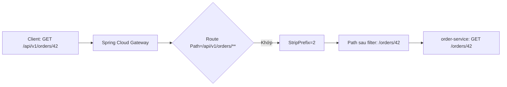
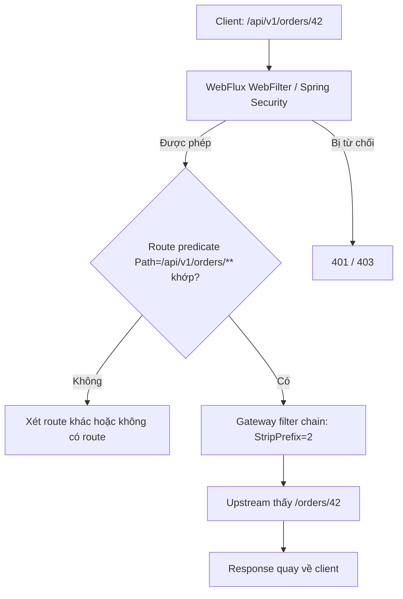
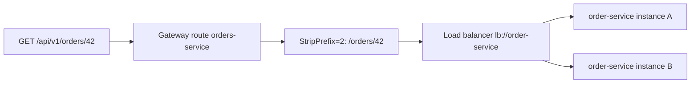

# StripPrefix: bỏ các đoạn đầu đường dẫn

Khi xây dựng **Spring Cloud Gateway**, URL mà client gọi thường được tổ chức theo tên miền API công khai, ví dụ `/api/v1/orders/42`, trong khi microservice phía sau chỉ cung cấp endpoint `/orders/42`. **`StripPrefix` GatewayFilter Factory** giải quyết khác biệt này bằng cách **bỏ một số đoạn (path segment) ở đầu đường dẫn** trước khi Gateway chuyển request đến upstream.

Đây là một filter xử lý **đường dẫn và chuyển hướng**, thường kết hợp với route predicate `Path`, filter xử lý header, `lb://` để khám phá dịch vụ và các chính sách an toàn như xác thực, rate limiting, retry, circuit breaker và TLS. Bài này trình bày chi tiết cách tính số đoạn bị bỏ, cách cấu hình, vị trí của filter trong pipeline, tác động đến URL upstream, các lỗi hay gặp và cách kiểm thử request thực tế.

> **Phạm vi:** Ví dụ dùng **Spring Cloud Gateway Server WebFlux**. Gateway Server MVC có cơ chế filter và API cấu hình riêng; không áp dụng nguyên xi các đoạn Java DSL của WebFlux cho MVC.

## 1. Vấn đề: public path và đường dẫn của microservice khác nhau

Giả sử hệ thống có ba microservice:

| API public của Gateway | Endpoint ở backend | Dịch vụ |
| --- | --- | --- |
| `GET /api/v1/orders/42` | `GET /orders/42` | `order-service` |
| `GET /api/v1/products/sku-01` | `GET /products/sku-01` | `product-service` |
| `GET /api/v1/customers/7` | `GET /customers/7` | `customer-service` |

Client cần một prefix thống nhất `/api/v1` để dễ quản lý phiên bản API, nhưng backend không muốn lặp lại prefix đó ở mọi controller. Khi ấy Gateway có thể:

1. Nhận request theo URL công khai.
2. Dùng **route predicate** chọn đúng service.
3. Dùng **`StripPrefix=2`** để bỏ `api` và `v1`.
4. Chuyển request có path đã sửa đến upstream.



**Điểm mấu chốt:** `StripPrefix` làm việc với **path** của request. Nó không tự chọn route, không tự định danh upstream, không đổi HTTP method và không thực hiện phân quyền.

## 2. `parts` là số đoạn đường dẫn, không phải số ký tự

Cú pháp shortcut:

```yaml
filters:
  - StripPrefix=2
```

Con số `2` là giá trị của tham số `parts`: số **đoạn path đứng đầu** cần bỏ. Đường dẫn được hiểu theo các đoạn phân tách bằng dấu `/`. Ví dụ:

```text
Path ban đầu:  /api/v1/orders/42
               └┬┘ └┬┘ └─┬─┘ └┬┘
                1   2    3   4

StripPrefix=2: bỏ 2 đoạn đầu (api, v1)
Path còn lại:   /orders/42
```

Bảng đối chiếu minh họa cho request đã vào được filter:

| Path ban đầu | Cấu hình | Path chuyển tiếp |
| --- | --- | --- |
| `/api/orders/42` | `StripPrefix=1` | `/orders/42` |
| `/api/v1/orders/42` | `StripPrefix=2` | `/orders/42` |
| `/edge/api/v1/orders/42` | `StripPrefix=3` | `/orders/42` |
| `/api/v1/orders/42` | `StripPrefix=1` | `/v1/orders/42` |
| `/api/v1` | `StripPrefix=2` | `/` |
| `/api/v1/orders/42?expand=items` | `StripPrefix=2` | `/orders/42?expand=items` |

Hai hàng cuối thể hiện những điểm quan trọng:

- Khi bỏ hết những đoạn hiện có, path có thể còn **`/`**. Upstream nhận endpoint gốc, không nhận đường dẫn rỗng.
- `?expand=items` là **query string**, không phải một path segment. `StripPrefix` không xóa query string; filter tập trung sửa path.

Con số này **không** có nghĩa “bỏ hai ký tự đầu” hoặc “bỏ hai dấu gạch chéo”. `StripPrefix=2` trên `/api/v1/orders/42` không tạo `i/v1/orders/42`.

### Các trường hợp biên nên kiểm thử

- Nếu `parts` bằng số đoạn của path, backend có thể nhận `/` — hãy xác minh backend có endpoint root phù hợp.
- Nếu `parts` lớn hơn số đoạn hiện có, phần còn lại không còn segment hữu ích; không nên cấu hình như vậy để “chặn” request. **Chặn request phải do route predicate và bảo mật quyết định.**
- Dấu `/` liên tiếp, slash cuối đường dẫn, percent-encoding như `%2F`, ký tự Unicode và quy tắc chuẩn hóa có thể tương tác với hệ thống HTTP/proxy. Đừng suy diễn chỉ từ ví dụ path đơn giản; hãy gửi request thật và xác nhận URI upstream quan sát được.
- Chọn `parts` dựa trên **cấu trúc public API ổn định**. Nếu API có nhiều dạng prefix khác nhau, cân nhắc tách route hoặc dùng `RewritePath` theo một quy tắc cụ thể.

Không sử dụng `StripPrefix` như công cụ lọc URL nguy hiểm hoặc thay thế xác thực: nó chỉ là phép biến đổi đường dẫn sau khi request đã khớp route.

## 3. Cấu hình YAML cho một route cụ thể

Ví dụ backend quản lý đơn hàng lắng nghe tại `http://localhost:8081` và phục vụ endpoint `/orders/{id}`:

```yaml
spring:
  cloud:
    gateway:
      routes:
        - id: orders-route
          uri: http://localhost:8081
          predicates:
            - Path=/api/v1/orders/**
          filters:
            - StripPrefix=2
            - AddRequestHeader=X-Edge-Source,gateway
```

Với request:

```http
GET /api/v1/orders/42?expand=items HTTP/1.1
Host: localhost:8080
Accept: application/json
```

Gateway chọn route `orders-route` nếu predicate `Path` khớp, rồi thực hiện `StripPrefix=2` trước khi gửi HTTP request đến upstream:

```http
GET /orders/42?expand=items HTTP/1.1
Host: localhost:8081
Accept: application/json
X-Edge-Source: gateway
```

**Lưu ý:** Request upstream ở trên là hình minh họa cho đường dẫn và header. HTTP `Host` thực tế còn phụ thuộc routing filter, URI đích và thiết lập bảo toàn host của Gateway. `StripPrefix` **không tự ý đổi Host**, nhưng tầng HTTP routing vẫn có thể xây dựng Host phù hợp với đích.

### Giải thích từng cấu hình

| Thành phần | Ý nghĩa |
| --- | --- |
| `id: orders-route` | Tên route dùng trong metric, log, kiểm thử |
| `uri: http://localhost:8081` | Upstream nhận request sau khi lọc |
| `Path=/api/v1/orders/**` | Chọn request theo **path công khai tại Gateway** |
| `StripPrefix=2` | Bỏ hai segment `api`, `v1` trước khi proxy |
| `AddRequestHeader=...` | Thêm request header để upstream sử dụng theo hợp đồng tích hợp |

Prefix cấu hình `spring.cloud.gateway.routes` thường gặp trong các phiên bản trước. Một số phiên bản/starter Spring Cloud Gateway Server WebFlux mới dùng `spring.cloud.gateway.server.webflux.routes`. Hãy chọn đúng prefix theo phiên bản ứng dụng và xác minh route được nạp; **thay prefix cấu hình không làm thay đổi ý nghĩa của `StripPrefix`**.

### Nếu chỉ muốn bỏ `/api`

Giả sử public endpoint là `/api/orders/42` và backend nhận `/orders/42`:

```yaml
predicates:
  - Path=/api/orders/**
filters:
  - StripPrefix=1
```

Nếu lại dùng `StripPrefix=2`, Gateway sẽ bỏ cả `api` và `orders`, khiến upstream nhận `/42` — rất dễ dẫn đến `404` dù Gateway đã chọn đúng route.

## 4. Vị trí của StripPrefix trong pipeline

Điểm dễ nhầm nhất là thứ tự giữa **route predicate** và **Gateway filter**:



**`Path` predicate được kiểm tra trước `StripPrefix`.** Vì vậy:

- Route predicate phải khớp URL **phía client gửi vào** (`/api/v1/orders/**`), không khớp URL sau khi bỏ prefix (`/orders/**`).
- `StripPrefix` chỉ chạy **sau khi một Gateway route được chọn**. Một request không khớp bất cứ route nào không thể được “cứu” bằng `StripPrefix` của route đó.
- `GlobalFilter` và `GatewayFilter` trong chuỗi được sắp xếp theo order; nếu có nhiều filter cùng đổi path, **thứ tự thực thi** có thể làm thay đổi kết quả.
- Spring Security WebFlux thường xử lý authentication/authorization ở WebFilter chain **trước** khi route Gateway được chọn. Quy tắc phân quyền theo path phải dựa trên **đường dẫn công khai**, trừ khi ứng dụng được thiết kế đặc biệt khác.

### StripPrefix không tự thay đổi những gì?

| Thuộc tính request | `StripPrefix` |
| --- | --- |
| Path | **Có**: bỏ `parts` segment đầu |
| Query parameters | Không chủ động biến đổi |
| HTTP method | Không đổi (`GET` vẫn là `GET`, `POST` vẫn là `POST`) |
| Request body | Không đọc/sửa body |
| Cookie, Authorization, header khác | Không chủ động sửa |
| Upstream URI / service instance | Không tự thay đổi |
| Quyền truy cập | Không xác thực hoặc phân quyền |

Những tầng khác của Gateway vẫn có thể xử lý header, host, method (nếu có filter chuyên dụng), body, URI đích hoặc response theo cấu hình. Bảng trên chỉ mô tả **trách nhiệm riêng của `StripPrefix`**.

## 5. Cấu hình bằng Java RouteLocator DSL

Thay vì YAML, có thể khai báo route WebFlux bằng Java DSL:

```java
@Configuration
public class OrderGatewayRoutes {

    @Bean
    RouteLocator orderRoutes(RouteLocatorBuilder builder) {
        return builder.routes()
            .route("orders-route", route -> route
                .path("/api/v1/orders/**")
                .filters(filters -> filters
                    .stripPrefix(2)
                    .addRequestHeader("X-Edge-Source", "gateway"))
                .uri("http://localhost:8081"))
            .build();
    }
}
```

Cần import các kiểu tương ứng từ Spring Framework và Spring Cloud Gateway, như `Configuration`, `Bean`, `RouteLocator` và `RouteLocatorBuilder`. Kết quả định tuyến tương đương phần YAML:

```text
GET /api/v1/orders/42
    ├─ Path predicate: /api/v1/orders/** -> match
    ├─ StripPrefix(2): /api/v1/orders/42 -> /orders/42
    └─ Upstream: http://localhost:8081/orders/42
```

Với nhiều route có prefix khác nhau, có thể khai báo `stripPrefix(1)` hoặc `stripPrefix(2)` riêng theo từng route. Khi một quy tắc được áp dụng chung qua `default-filters`, cần thận trọng vì nó sẽ tác động tới nhiều route với cấu trúc URL có thể khác nhau.

## 6. Kết hợp StripPrefix với service discovery và load balancing

Trong kiến trúc microservices, URI đích thường không gắn cố định một host:port. Ví dụ:

```yaml
spring:
  cloud:
    gateway:
      routes:
        - id: orders-service
          uri: lb://order-service
          predicates:
            - Path=/api/v1/orders/**
          filters:
            - StripPrefix=2
```

Khi Gateway nhận `GET /api/v1/orders/42`:

1. `Path` predicate chọn route `orders-service`.
2. `StripPrefix=2` biến path thành `/orders/42`.
3. Cơ chế load balancer/service discovery tìm instance phù hợp cho `order-service`.
4. HTTP routing gửi request đến instance, với path đã biến đổi.
5. Gateway chuyển response về client theo filter chain.

Để `lb://order-service` hoạt động cần cấu hình Spring Cloud LoadBalancer và cơ chế tìm instance phù hợp (service registry hoặc danh sách instance tĩnh, tùy hệ thống). Nếu tên service không tìm được instance, lỗi thường nằm ở **service discovery/load balancing**, không nhất thiết do `StripPrefix`. Vì vậy phải quan sát cả **route ID, path upstream và target instance** khi gỡ lỗi.



## 7. Phân biệt StripPrefix, PrefixPath, RewritePath và SetPath

Bốn filter đều liên quan tới path nhưng giải quyết bài toán khác nhau.

| Filter | Bài toán chính | Ví dụ minh họa |
| --- | --- | --- |
| `StripPrefix=2` | Bỏ **N segment ở đầu** | `/api/v1/orders/42` → `/orders/42` |
| `PrefixPath=/internal` | Thêm một prefix vào path | `/orders/42` → `/internal/orders/42` |
| `RewritePath` | Đổi path theo **biểu thức chính quy**, thường giữ/đổi các nhóm capture | Có thể đổi `/api/v1/orders/42` → `/orders/42` |
| `SetPath` | Đặt một path mới, có thể dựa trên biến template từ route | Có thể đặt `/orders/{id}` theo biến đã match |

**Chọn `StripPrefix` khi số đoạn cần bỏ cố định và rõ ràng.** Nếu phải đổi cấu trúc sâu hơn, chuyển đổi thứ tự segment, đổi tên tài nguyên hoặc giữ lại một phần path theo regex, `RewritePath` hoặc `SetPath` có thể phù hợp hơn.

Ví dụ public API có hai cấu trúc:

```text
/api/v1/orders/42      -> /orders/42
/api/legacy/orders/42  -> /orders/42
```

Có thể dùng hai route, mỗi route `StripPrefix=2`. Nhưng nếu cần chuyển `/api/v1/customers/7/orders` thành `/orders/by-customer/7`, chỉ bỏ prefix là **không đủ**: phải có thêm logic rewrite theo cấu trúc mong muốn.

### Vì sao thứ tự filter quan trọng?

Giả sử trên một route có hai phép biến đổi:

1. `StripPrefix=1` biến `/api/v1/orders/42` thành `/v1/orders/42`.
2. `PrefixPath=/internal` biến path đó thành `/internal/v1/orders/42`.

Nếu thực hiện ngược lại:

1. `PrefixPath=/internal` tạo `/internal/api/v1/orders/42`.
2. `StripPrefix=1` xóa `internal`, trả về `/api/v1/orders/42`.

```text
StripPrefix(1) -> PrefixPath(/internal)
    /api/v1/orders/42 -> /v1/orders/42 -> /internal/v1/orders/42

PrefixPath(/internal) -> StripPrefix(1)
    /api/v1/orders/42 -> /internal/api/v1/orders/42 -> /api/v1/orders/42
```

Hai chuỗi cho **kết quả khác nhau**, dù gồm cùng hai filter. Khi phối hợp với `RewritePath`, `SetPath`, một số `GlobalFilter` hoặc filter do ứng dụng viết, hãy kiểm tra order và kết quả thực tế của từng bước. Đừng giả định mọi filter hoạt động độc lập.

## 8. StripPrefix và các phản hồi redirect

Tên chương “Đường dẫn và chuyển hướng” dễ khiến hai cơ chế bị nhầm lẫn:

- **Path rewriting:** Gateway **thay đổi path của request gửi đến backend**, ví dụ `/api/v1/orders/42` → `/orders/42`.
- **HTTP redirect:** Server trả response `301`, `302`, `303`, `307` hoặc `308` kèm header `Location`; **client** quyết định có gửi request mới tới URL được chỉ dẫn hay không.

`StripPrefix` chỉ làm tác vụ đầu tiên. Nó **không tự sửa header `Location`** trong response từ backend.

Ví dụ:

```http
GET /api/v1/account/login HTTP/1.1
Host: api.example.test
```

Gateway bỏ `api/v1` rồi gọi upstream:

```http
GET /account/login HTTP/1.1
Host: internal-account-service
```

Nếu backend trả:

```http
HTTP/1.1 302 Found
Location: /account/profile
```

thì client có thể tiếp tục truy cập `/account/profile` trên host public, **không có** prefix `/api/v1`. Đường dẫn này có thể không khớp route Gateway. Tương tự, nếu backend tạo redirect tuyệt đối đến hostname nội bộ, client có thể gặp URL không truy cập được hoặc lộ thông tin hạ tầng.

**Cách xử lý:** Thiết kế backend có nhận thức về public base path hoặc cấu hình cơ chế chỉnh sửa `Location` response tại Gateway khi cần, ví dụ filter xử lý `Location` thích hợp hoặc filter custom được kiểm thử. Không kỳ vọng `StripPrefix` giải quyết cả redirect, URL tuyệt đối trong HTML/JSON, cookie `Path` hay WebSocket URL mà backend tự tạo.

Cần xác định rõ đường dẫn public là nguồn chân lý; các response có `Location`, `Set-Cookie` hoặc tài nguyên liên kết tuyệt đối cũng phải tuân thủ hợp đồng public API.

## 9. StripPrefix ở sau reverse proxy hoặc ingress

Nhiều hệ thống chạy theo chuỗi:

```text
Client -> Load Balancer / Ingress -> Spring Cloud Gateway -> Microservice
```

Giả sử client gọi:

```text
https://shop.example.com/edge/api/v1/orders/42
```

Nếu ingress **đã bỏ** `/edge` trước khi request đến Gateway, path mà Gateway thấy là:

```text
/api/v1/orders/42
```

Lúc này `StripPrefix=2` sẽ cho `/orders/42`. Nếu Gateway lại dùng `StripPrefix=3` vì đếm cả `edge` từ public URL ban đầu, nó có thể xóa thêm segment `orders` và khiến upstream nhận `/42`.

**Quy tắc:** Đếm segment từ **path mà Gateway thực sự nhận ở thời điểm route matching**, không nhất thiết từ URL gốc trước tất cả proxy.

Một số hạ tầng sử dụng `Forwarded`, `X-Forwarded-Host`, `X-Forwarded-Proto` hoặc `X-Forwarded-Prefix` để truyền thông tin URL công khai. Những header này có quy tắc trust và cấu hình riêng; **chỉ có header `X-Forwarded-Prefix` không có nghĩa `StripPrefix` tự thay đổi số đoạn cần bỏ**. Không tin các forwarded header do client không đáng tin tự đặt.

Đối với TLS, phải phân biệt scheme/host công khai `https://shop.example.com` với kết nối nội bộ có thể là HTTP hoặc HTTPS. `StripPrefix` không cấu hình chứng chỉ, SNI, xác minh TLS hay chuyển đổi scheme; những việc này thuộc cấu hình proxy/Gateway HTTP client.

## 10. Tương tác với Security, CORS, rate limit và retry

### Spring Security đánh giá đường dẫn công khai

Trong Gateway Server WebFlux, Spring Security reactive thường chạy trong `WebFilter` chain **trước** khi `RoutePredicateHandlerMapping` chọn route và `StripPrefix` chạy. Ví dụ khi public API là `/api/v1/orders/**`, quy tắc security nên nhắm public path đó:

```java
@Bean
SecurityWebFilterChain securityWebFilterChain(ServerHttpSecurity http) {
    return http
        .csrf(ServerHttpSecurity.CsrfSpec::disable)
        .authorizeExchange(exchanges -> exchanges
            .pathMatchers(HttpMethod.GET, "/api/v1/orders/**")
                .hasAuthority("SCOPE_orders.read")
            .pathMatchers(HttpMethod.POST, "/api/v1/orders/**")
                .hasAuthority("SCOPE_orders.write")
            .anyExchange().authenticated())
        .oauth2ResourceServer(oauth2 ->
            oauth2.jwt(Customizer.withDefaults()))
        .build();
}
```

Ví dụ giả định Gateway là OAuth2 Resource Server dùng JWT và scope được ánh xạ thành các authority minh họa. Chỉ tắt CSRF khi phù hợp với API stateless dùng Bearer token thay vì cookie/session trình duyệt; với authentication dựa trên cookie/session, cần cấu hình CSRF theo mô hình thực tế.

**Không** viết authorization rule chỉ cho `/orders/**` rồi mong `StripPrefix` làm security nhìn thấy đường dẫn đó. Security thường đã xử lý request trước khi filter chuyển đổi.

### Rate limiting và circuit breaker

`RequestRateLimiter`, `CircuitBreaker`, `Retry` và các Gateway route filter khác có thể được khai báo cùng route với `StripPrefix`. Đây là những nhiệm vụ riêng:

| Cơ chế | Trách nhiệm |
| --- | --- |
| `StripPrefix` | Chỉnh path gửi đến upstream |
| `RequestRateLimiter` | Từ chối request vượt quota theo khóa/phân loại |
| `CircuitBreaker` | Giới hạn tác động khi upstream lỗi/chậm và có thể dùng fallback |
| `Retry` | Thử lại request lỗi theo chính sách |
| Spring Security | Xác thực, phân quyền ở điểm vào |
| TLS/HTTP client | Thiết lập kết nối bảo mật tới upstream |

Nếu retry request có body, cần kiểm tra khả năng phát lại body và bộ nhớ dùng cho buffer. Với `POST` thực hiện giao dịch, retry có thể tạo hiệu ứng trùng khi upstream đã xử lý nhưng client/Gateway nhận timeout. `StripPrefix` không làm cho request trở nên idempotent. Dùng idempotency key và giới hạn retry khi có side effect.

### CORS preflight

Browser có thể gửi `OPTIONS /api/v1/orders` với `Access-Control-Request-Method: POST`. Nếu route predicate chỉ nhận `Method=POST`, chính preflight `OPTIONS` có thể **không khớp route**. CORS thường được xử lý ở WebFlux/Gateway/Spring Security theo cấu hình riêng. Việc thêm `StripPrefix` không giải quyết quy tắc CORS và không tự bảo đảm preflight được chuyển tiếp.

## 11. Thực hành với curl và upstream giả lập

Giả sử:

- Gateway tại `http://localhost:8080`.
- Backend tại `http://localhost:8081`.
- Route `Path=/api/v1/orders/**` và `StripPrefix=2` như mục 3.
- Backend giả lập có endpoint `GET /orders/42` và trả marker `X-Test-Upstream: orders`.

### Gửi request chính

```bash
curl -i 'http://localhost:8080/api/v1/orders/42?expand=items'
```

Kỳ vọng: Gateway gọi backend theo path `/orders/42`, giữ query `expand=items`. Kết quả HTTP có thể là `200` nếu backend giả lập trả thành công.

### So sánh số prefix

```bash
# Route đã khai báo StripPrefix=2:
curl -i 'http://localhost:8080/api/v1/orders/42'

# Không khớp Path=/api/v1/orders/** của route trên:
curl -i 'http://localhost:8080/orders/42'
```

Request thứ hai có thể nhận `404` nếu không có route/handler khác phù hợp. Nó **không** tự đi vào route đầu tiên để sau đó được cộng lại prefix.

### Kiểm thử request có body

```bash
curl -i -X POST 'http://localhost:8080/api/v1/orders' \
  -H 'Content-Type: application/json' \
  -d '{"customerId":7,"quantity":2}'
```

Nếu route/predicate của Gateway cho phép POST và backend hỗ trợ tạo đơn tại `/orders`, `StripPrefix=2` chỉ đổi path, còn body phải được proxy đúng như một request POST bình thường. Nếu nhận `401`/`403`, hãy kiểm tra Spring Security trước; nếu backend nhận path đúng nhưng trả `405`, hãy kiểm tra method/API contract phía backend.

**Windows PowerShell:** Khi `curl` là alias của PowerShell, sử dụng `curl.exe`. Dấu `\` nối dòng trong ví dụ là cú pháp Bash; trên PowerShell cần chuyển thành một dòng hoặc dùng cú pháp nối dòng phù hợp.

### Đoạn kiểm thử tích hợp với WebTestClient

Giả sử test fixture đã khởi động backend WireMock ở `localhost:8081`, kết nối `WebTestClient` vào Gateway và cấu hình security test cho phép request hợp lệ:

```java
@Test
void stripsTwoLeadingSegmentsAndPreservesQuery() {
    wireMockServer.stubFor(
        get(urlPathEqualTo("/orders/42"))
            .withQueryParam("expand", equalTo("items"))
            .willReturn(okJson("{\"id\":42}")));

    webTestClient.get()
        .uri("/api/v1/orders/42?expand=items")
        .exchange()
        .expectStatus().isOk()
        .expectBody()
        .jsonPath("$.id").isEqualTo(42);

    wireMockServer.verify(1,
        getRequestedFor(urlPathEqualTo("/orders/42"))
            .withQueryParam("expand", equalTo("items")));
}
```

Đây là **phần test minh họa**: dự án cần dependency test phù hợp, khai báo `wireMockServer`, `webTestClient`, route Gateway test và các static import từ WireMock. Kiểm tra request mà backend giả lập **thực sự nhận được** đáng tin hơn chỉ kiểm tra response status, vì cả path đúng và sai đều có thể trả `200` tùy backend.

### Ma trận kiểm thử tối thiểu

| Request client | Cấu hình | Kỳ vọng chính |
| --- | --- | --- |
| `GET /api/v1/orders/42` | `StripPrefix=2` | Upstream nhận `/orders/42` |
| `GET /api/v1/orders/42?x=1` | `StripPrefix=2` | Upstream nhận `/orders/42?x=1` |
| `POST /api/v1/orders` | `StripPrefix=2` | Upstream nhận `POST /orders` và body hợp lệ |
| `GET /api/v1/orders/42` | `StripPrefix=1` | Upstream nhận `/v1/orders/42` |
| `GET /orders/42` | `Path=/api/v1/orders/**` | Route trên không khớp |
| `OPTIONS /api/v1/orders` | Route có `Method=POST` | Có thể đi vào cơ chế CORS; không mặc định chạy filter route POST |
| `GET /api/v1/orders/42` với JWT sai | Security bảo vệ route | Có thể bị chặn trước `StripPrefix` |

## 12. Gỡ lỗi khi upstream nhận sai path

Một số triệu chứng phổ biến:

| Triệu chứng | Nguyên nhân khả dĩ | Hướng xử lý |
| --- | --- | --- |
| Backend nhận `/v1/orders/42` thay vì `/orders/42` | `StripPrefix=1` nhưng cần `2` | Đếm segment từ path Gateway nhận |
| Backend nhận `/42` | Bỏ quá nhiều segment | Giảm `parts`; kiểm tra ingress có đã rewrite trước đó chưa |
| Request không vào route | `Path` predicate không khớp path public, sai method/host/headers hoặc Security chặn | Kiểm tra các predicate và bảo mật trước filter |
| Gateway chọn đúng route, upstream trả `404` | Backend không có endpoint theo path sau rewrite | Kiểm tra log/mock của backend về URI thực nhận |
| Route `lb://` trả `503` | Không có service instance khả dụng hoặc vấn đề load balancing | Kiểm tra discovery, health, tên service |
| Backend trả `302` nhưng client sang URL sai | `Location` không dùng public prefix | Xử lý response redirect/public base URL riêng |
| Đường dẫn đúng local nhưng sai sau ingress | Ingress đã thay đổi path hoặc forwarded headers | Ghi nhận request đầu vào Gateway, rà cấu hình proxy |
| Kết quả khác khi kết hợp `PrefixPath`/`RewritePath` | Thứ tự filter không như dự kiến | Xác minh thứ tự và path sau từng filter |
| YAML đúng nhưng không có hiệu lực | Sai config prefix, profile, route chưa nạp | Kiểm tra danh sách route trong ứng dụng |
| URL chứa `%2F`/slash cuối cho kết quả khó đoán | URL encoding/normalization khác giữa các tầng | Kiểm thử URI thật qua đúng proxy và backend |

### Quan sát đúng bằng route ID và request path

Khi cần chẩn đoán, ghi nhận:

1. **Method, host, path, query** mà Gateway nhận (đã che dữ liệu nhạy cảm).
2. **Route ID** mà `RoutePredicateHandlerMapping` chọn.
3. **Path sau khi sửa** được gửi tới upstream.
4. **Service instance/host đích**, HTTP status và thời gian xử lý.
5. **Response `Location`** nếu có redirect và các tín hiệu timeout/retry.

Spring Cloud Gateway có thể tích hợp Actuator để xem danh sách route đã được nạp khi endpoint Gateway được bật và phân quyền thích hợp, ví dụ `/actuator/gateway/routes` ở các phiên bản hỗ trợ. Endpoint quản trị không nên mở công khai. Trên môi trường test, có thể tăng log có kiểm soát cho `org.springframework.cloud.gateway` và xem access log của upstream; tránh log `Authorization`, cookie hay dữ liệu cá nhân.

**Phân biệt hai loại `404`:** nếu không có route nào khớp, Gateway có thể trả `404` trước khi proxy. Nếu route đã khớp và upstream nhận `/orders/42` nhưng không có endpoint đó, chính upstream có thể trả `404`. Hai trường hợp khác nhau và cần xử lý ở bước khác nhau.

## 13. Bài tập thực hành

Thiết kế Gateway cho ba nhóm API:

| Public API | Upstream cần nhận | Route |
| --- | --- | --- |
| `/api/v2/orders/**` | `/orders/**` | `order-service` |
| `/api/v2/products/**` | `/products/**` | `product-service` |
| `/public/assets/**` | `/assets/**` | `asset-service` |

Dùng `lb://` cho dịch vụ nếu môi trường đã có discovery/load balancer. Mục tiêu là các route không chồng lấn và mỗi route bỏ đúng phần prefix cần thiết.

**Gợi ý YAML:**

```yaml
spring:
  cloud:
    gateway:
      routes:
        - id: orders-v2
          uri: lb://order-service
          predicates:
            - Path=/api/v2/orders/**
          filters:
            - StripPrefix=2

        - id: products-v2
          uri: lb://product-service
          predicates:
            - Path=/api/v2/products/**
          filters:
            - StripPrefix=2

        - id: public-assets
          uri: lb://asset-service
          predicates:
            - Path=/public/assets/**
          filters:
            - StripPrefix=1
```

Với `GET /public/assets/logo.svg`, chỉ bỏ `public`, vì backend cần giữ `/assets/logo.svg`. Nếu cấu hình nhầm `StripPrefix=2`, backend có thể nhận `/logo.svg` và trả `404`.

### Tự kiểm tra

1. `StripPrefix=2` biến `/api/v2/orders/42` thành path nào? Query `?detail=full` có bị mất không?
2. Vì sao `Path=/orders/**` không khớp `GET /api/v2/orders/42` chỉ vì route có `StripPrefix=2`?
3. Nếu phía trước Gateway có ingress đã bỏ `/api`, cần đếm `parts` theo URL nào?
4. `StripPrefix` có tự xử lý response `Location: /orders/42` để biến nó thành `/api/v2/orders/42` không?
5. Khi `POST /api/v2/orders` thất bại sau retry, có thể kết luận chưa tạo đơn chỉ vì client nhận timeout không?
6. Vì sao cần kiểm tra **path mà backend thật sự nhận** thay vì chỉ dựa vào HTTP status?

**Ghi nhớ:** `StripPrefix` bỏ **một số đoạn ở đầu path** sau khi route được chọn, giúp tách URL public của API Gateway khỏi URL nội bộ của microservice. Đếm đúng `parts`, hiểu rõ path thực sự đi vào Gateway, kiểm tra thứ tự filter và kiểm thử URI gửi đến upstream là chìa khóa để tránh chuyển tiếp sai; redirect, xác thực, TLS, rate limiting và retry vẫn cần cơ chế riêng.

