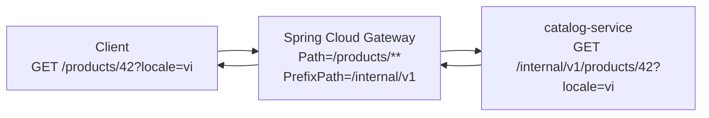
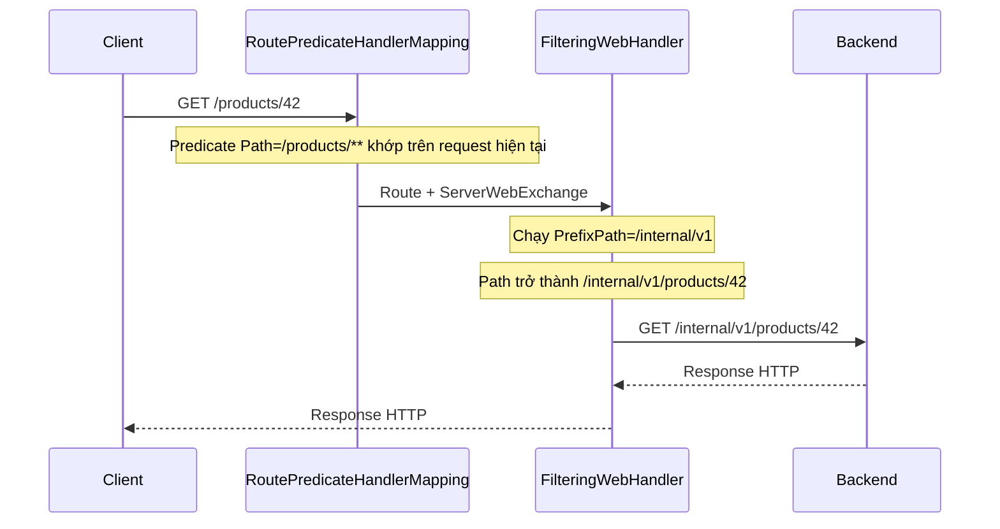
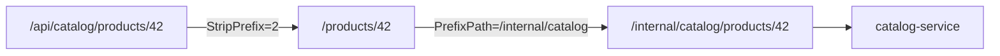
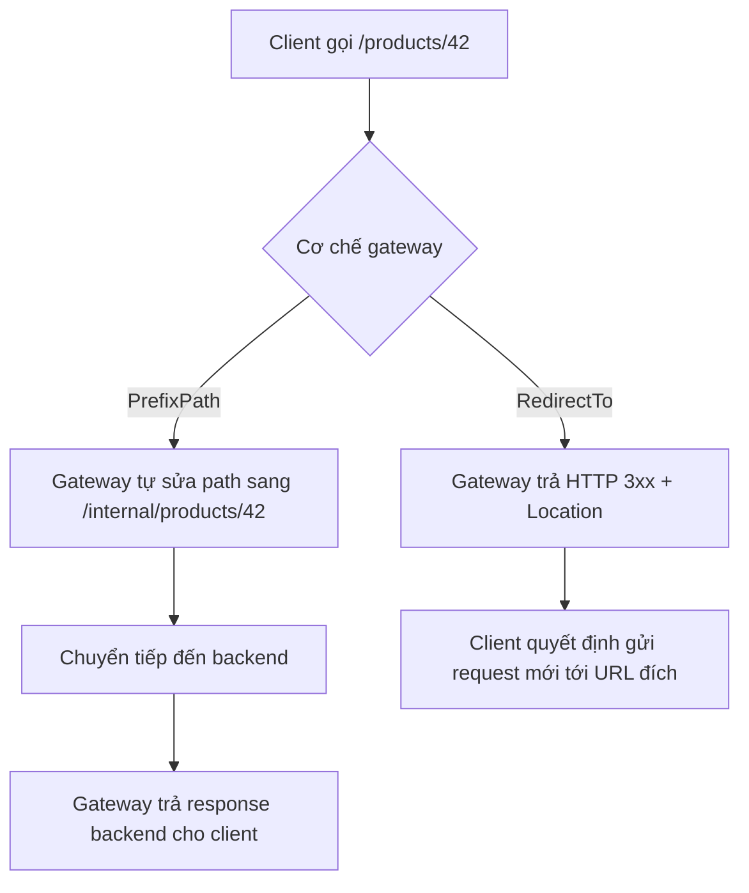
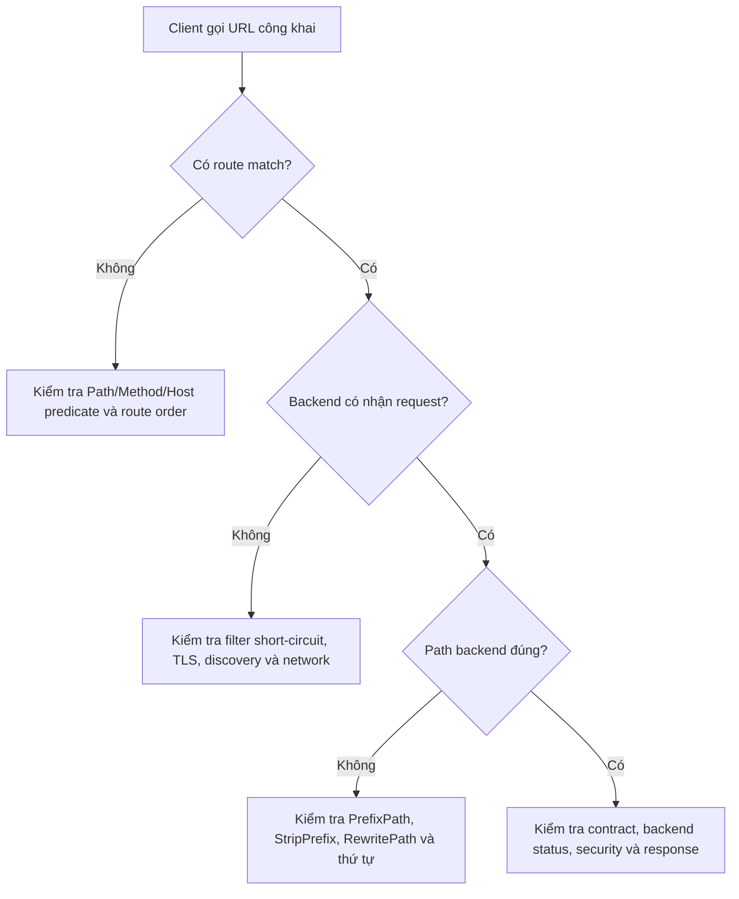

# PrefixPath: thêm tiền tố cho yêu cầu phía sau

Giả sử một ứng dụng bán hàng công bố API `GET /products/42` cho client, nhưng dịch vụ danh mục ở phía sau Spring Cloud Gateway chỉ xử lý URL `GET /internal/v1/products/42`. Ta muốn giữ URL công khai gọn và ổn định, đồng thời chuyển tiếp request tới đường dẫn mà backend thực sự hiểu. **`PrefixPath`** là một gateway filter dành cho bài toán này: nó **thêm một tiền tố vào đường dẫn của request** trước khi gửi đến upstream.

Đây là kỹ thuật **biến đổi đường dẫn bên trong API Gateway**, không phải lệnh chuyển hướng trình duyệt. Client vẫn gửi request tới URL công khai; gateway thay đổi path của request chuyển tiếp. Với các hệ thống microservices, `PrefixPath` hữu ích khi backend có base path, context path hoặc version prefix khác với hợp đồng API công khai.

Bài thuộc chương **Đường dẫn và chuyển hướng** của module **SPRING_CLOUD_GATEWAY**. Ta sẽ đi từ cơ chế hoạt động của `PrefixPath` đến cách khai báo YAML/Java DSL, phối hợp với route predicate và những filter khác, kiểm tra query/header, bảo mật, discovery, retry, TLS và observability.

> **Phạm vi:** Những ví dụ cấu hình `PrefixPathGatewayFilterFactory` và `RouteLocatorBuilder` bên dưới dành cho **Spring Cloud Gateway Server WebFlux**. Spring Cloud Gateway Server Web MVC có hệ route/filter và tài liệu riêng. Khi triển khai, cần chọn starter và đường dẫn property đúng với phiên bản Spring Boot/Spring Cloud/Gateway đang dùng.

## 1. PrefixPath giải quyết vấn đề nào?

Một URL thường gồm các phần:

```text
https://api.example.com/products/42?locale=vi
|------- authority ----|-- path ---|-- query --|
```

`PrefixPath` tác động lên **path** (đường dẫn) của request được chuyển tiếp. Khi cấu hình tiền tố `/internal/v1`:

| Thành phần | Giá trị |
| --- | --- |
| URL công khai client gọi | `https://api.example.com/products/42?locale=vi` |
| Path ban đầu | `/products/42` |
| Tiền tố cấu hình | `/internal/v1` |
| Path sau `PrefixPath` | `/internal/v1/products/42` |
| Query string | `locale=vi` |
| Ví dụ upstream | `http://catalog-service:8080/internal/v1/products/42?locale=vi` |

Ở ví dụ này, gateway cần một route khớp `/products/**` và có filter `PrefixPath=/internal/v1`. URL upstream là kết quả **giả định** khi route trỏ đến `catalog-service` và không có filter khác tiếp tục biến đổi đường dẫn.



Điểm quan trọng: client **không cần biết** đường dẫn `/internal/v1`. Khi backend đổi context path, nhóm vận hành có thể cập nhật route/filter trong gateway để giữ hợp đồng công khai ổn định, với điều kiện thay đổi đó không làm phá vỡ ngữ nghĩa API.

### Các trường hợp áp dụng phổ biến

1. **Thêm context path nội bộ:** public `/products/**` → backend `/app/products/**`.
2. **Thêm version prefix cho backend:** public `/catalog/**` → backend `/v2/catalog/**`.
3. **Kết hợp bỏ prefix công khai và thêm prefix nội bộ:** public `/api/catalog/products` → backend `/internal/catalog/products`.
4. **Giữ contract cho client trong lúc di chuyển backend:** backend mới cần path bắt đầu bằng `/service-a`, còn client vẫn gọi URL cũ.

`PrefixPath` chỉ giải quyết sự khác biệt **đường dẫn**. Nếu backend còn yêu cầu xác thực, TLS, header đặc biệt, service discovery hoặc giới hạn lưu lượng, những trách nhiệm đó cần cấu hình và kiểm thử riêng.

## 2. Hiểu chính xác “thêm tiền tố”

Với `PrefixPath=/internal`, ý tưởng cơ bản là:

```text
path sau lọc = tiền tố + path hiện tại

/internal + /products/42 = /internal/products/42
```

Filter hoạt động trên **request path hiện tại ở thời điểm nó thực thi**, vì vậy kết quả còn phụ thuộc các bước biến đổi path khác trong filter chain.

### Bảng chuyển đổi path cơ bản

| Path khi vào `PrefixPath` | Tiền tố | Path mong muốn sau filter |
| --- | --- | --- |
| `/products` | `/internal` | `/internal/products` |
| `/products/42` | `/internal/v1` | `/internal/v1/products/42` |
| `/orders/123/items` | `/backend` | `/backend/orders/123/items` |
| `/` | `/internal` | `/internal/` |

Các ví dụ sử dụng tiền tố **bắt đầu bằng dấu `/` và không kết thúc bằng dấu `/`** để tránh mơ hồ về cách nối path. Trong môi trường thật, cần thử các trường hợp dấu gạch chéo đôi, trailing slash và đường dẫn gốc với đúng phiên bản thư viện.

**Không phải thao tác “thay thế” path.** Với `PrefixPath=/v1`, request `/catalog/products` trở thành `/v1/catalog/products`, chứ không phải `/v1/products`. Muốn bỏ đoạn `/catalog`, cần thêm filter như `StripPrefix` hoặc `RewritePath` theo hợp đồng backend.

### Query string, method, body và header thì sao?

`PrefixPath` được thiết kế để đổi **path**. Nó không có nhiệm vụ tự thay:

- HTTP method (`GET`, `POST`, `PATCH`, ...).
- Query string, ví dụ `?page=2&sort=price`.
- Request body JSON hoặc dữ liệu nhị phân.
- Thông tin xác thực trong `Authorization` hoặc cookie.
- HTTP status và body phản hồi của backend.

Ví dụ `POST /orders?source=mobile` có JSON body sẽ giữ ngữ nghĩa POST/body khi chỉ dùng `PrefixPath`, trong khi path chuyển tiếp có thể là `/internal/orders`. Cần kiểm thử encoding, query string và header vì các filter khác, proxy trước gateway hoặc backend có thể tiếp tục biến đổi request.

## 3. PrefixPath nằm ở đâu trong request-processing pipeline?

Spring Cloud Gateway Server WebFlux có các bước chính:



**Predicate chọn route trước; `PrefixPath` chạy sau khi route đã được chọn.** Vì vậy, trong cấu hình route có:

```yaml
predicates:
  - Path=/products/**
filters:
  - PrefixPath=/internal/v1
```

Predicate `Path` so với đường dẫn mà request mang tới bước ghép route, ví dụ `/products/42`. Không viết predicate `Path=/internal/v1/products/**` chỉ vì đó là path backend cần nhận, trừ khi client thực sự gọi path đó hoặc có thành phần tiền xử lý thay đổi path trước route matching.

### Thứ tự các bước có tác dụng gì?

Trong chuỗi lọc Gateway WebFlux, các `GlobalFilter` và `GatewayFilter` của route được kết hợp rồi sắp xếp theo thứ tự áp dụng. `PrefixPath` là filter gắn với route, được tạo từ cấu hình qua `PrefixPathGatewayFilterFactory`.

Do đó:

- Filter chạy **trước `PrefixPath`** có thể quan sát path công khai.
- Filter chạy **sau `PrefixPath`** có thể quan sát path đã được thêm tiền tố.
- Nếu có thêm `StripPrefix`, `RewritePath` hoặc filter tự viết, kết quả path phụ thuộc **thứ tự thực tế**.
- Sau khi chọn route, các filter định tuyến tích hợp sẽ dùng request/URI đã qua những bước xử lý tương ứng để chuyển tiếp đến backend.

Đừng nhầm **route order** với **filter order**: route order quyết định ưu tiên xét các route, còn filter order quyết định thứ tự xử lý khi một route đã được chọn.

## 4. Cấu hình PrefixPath bằng YAML

### 4.1. Khai báo ngắn gọn

Ví dụ dành cho **Server WebFlux với nhánh cấu hình `spring.cloud.gateway.server.webflux.routes`** của các phiên bản có hỗ trợ:

```yaml
spring:
  cloud:
    gateway:
      server:
        webflux:
          routes:
            - id: catalog-prefix-route
              uri: http://localhost:8081
              predicates:
                - Path=/products/**
              filters:
                - PrefixPath=/internal/v1
```

Với backend thử nghiệm chạy ở `http://localhost:8081` và có endpoint `GET /internal/v1/products/42`, kết quả:

```text
Client:
  GET http://localhost:8080/products/42

Gateway:
  route  = catalog-prefix-route
  filter = PrefixPath=/internal/v1

Backend:
  GET http://localhost:8081/internal/v1/products/42
```

Để ví dụ chạy được, cần một ứng dụng Spring Cloud Gateway Server WebFlux thực sự khởi động trên cổng 8080 và backend trên cổng 8081. Đây là **ví dụ cấu hình route**, không tự tạo backend hoặc HTTP endpoint.

### 4.2. Cú pháp đầy đủ `name/args`

`PrefixPath` cũng có thể khai báo với tên factory và tham số:

```yaml
filters:
  - name: PrefixPath
    args:
      prefix: /internal/v1
```

Ý nghĩa tương đương dạng `- PrefixPath=/internal/v1` trong ngữ cảnh cùng factory. Dạng đầy đủ hữu ích khi đội ngũ muốn trình bày rõ trường cấu hình hoặc dùng linter kiểm tra YAML.

Lưu ý phân biệt:

| Cấu hình | Ý nghĩa |
| --- | --- |
| `PrefixPath=/internal` | Thêm `/internal` vào trước path. |
| `StripPrefix=2` | Xóa hai phân đoạn đầu của path. |
| `SetPath=/internal/products` | Đặt path theo mẫu cấu hình. |
| `RewritePath=...` | Viết lại path theo biểu thức chính quy/mẫu thay thế. |

Các tên filter trên là của **Gateway Server WebFlux** ở dòng hỗ trợ tương ứng. Không suy ra tất cả đều có tên tham số hoặc cách bind giống nhau trong biến thể Web MVC.

### 4.3. Khác biệt property giữa các phiên bản

Nhiều tài liệu và dự án dùng những bản Spring Cloud Gateway WebFlux cũ khai báo route trong:

```yaml
spring:
  cloud:
    gateway:
      routes:
        - id: catalog-prefix-route
          uri: http://localhost:8081
          predicates:
            - Path=/products/**
          filters:
            - PrefixPath=/internal/v1
```

Các dòng tài liệu Gateway mới hơn phân biệt rõ Server WebFlux với Server Web MVC trong property prefix. **Không tự trộn hai dạng trong một dự án**. Trước khi copy cấu hình, kiểm tra phiên bản Gateway đã được Spring Cloud BOM chọn, starter đang chạy và tài liệu Configuration Properties tương ứng.

Nếu ứng dụng khởi động nhưng route không xuất hiện, cần kiểm tra **cấu hình có được bind vào đúng property của phiên bản đó không** trước khi kết luận filter không hoạt động.

## 5. Cấu hình PrefixPath bằng Java DSL

Trong Gateway Server WebFlux, có thể tạo route trực tiếp bằng `RouteLocatorBuilder`:

```java
import org.springframework.cloud.gateway.route.RouteLocator;
import org.springframework.cloud.gateway.route.builder.RouteLocatorBuilder;
import org.springframework.context.annotation.Bean;
import org.springframework.context.annotation.Configuration;

@Configuration
public class GatewayRouteConfiguration {

    @Bean
    RouteLocator catalogRoutes(RouteLocatorBuilder builder) {
        return builder.routes()
            .route("catalog-prefix-route", route -> route
                .path("/products/**")
                .filters(filters -> filters
                    .prefixPath("/internal/v1"))
                .uri("http://localhost:8081"))
            .build();
    }
}
```

`prefixPath("/internal/v1")` mô tả cùng phép biến đổi trong DSL. Nếu có Java DSL định nghĩa route `catalog-prefix-route`, không cần lặp lại cùng route ID và path trong YAML. Trùng route giữa nhiều nguồn có thể dẫn đến hành vi khó dự đoán khi theo dõi hoặc chỉnh sửa cấu hình.

### Java DSL hay YAML?

| Khía cạnh | YAML/Properties | Java DSL |
| --- | --- | --- |
| Phù hợp | Route có thể mô tả gọn, ít logic tùy biến | Route có nhiều cấu hình phụ thuộc mã và kiểm thử |
| Cập nhật | Thay nguồn cấu hình, cần cơ chế nạp/refresh/deploy tương ứng | Thay mã thường cần build và deploy lại |
| Review | Dễ thấy path/URI/filter bằng cấu hình | Dễ tổ chức logic có kiểu và tái sử dụng |
| Kiểm chứng | Kiểm tra binding, route runtime và filter factory | Kiểm tra bean `RouteLocator`, ID và thứ tự route |

Hai cách đều tạo ra route phục vụ quá trình xử lý HTTP. Điểm cần xác minh trong mọi trường hợp là **route runtime đã nạp chính xác các filter**, chứ không chỉ file cấu hình trông đúng.

## 6. Kết hợp StripPrefix với PrefixPath

Trong thực tế, path công khai thường có tiền tố `/api/{service}`, trong khi backend dùng một tiền tố khác. `PrefixPath` **không tự xóa** phần tiền tố công khai.

Giả sử hợp đồng:

```text
Client:  GET /api/catalog/products/42
Backend: GET /internal/catalog/products/42
```

Cần hai phép biến đổi:

1. `StripPrefix=2` bỏ hai phân đoạn đầu `api` và `catalog`.
2. `PrefixPath=/internal/catalog` thêm tiền tố backend trước path còn lại.

### Khai báo route

```yaml
spring:
  cloud:
    gateway:
      server:
        webflux:
          routes:
            - id: catalog-api-route
              uri: http://localhost:8081
              predicates:
                - Path=/api/catalog/**
              filters:
                - StripPrefix=2
                - PrefixPath=/internal/catalog
```

Luồng logic:



| Đầu vào | Sau StripPrefix | Sau PrefixPath |
| --- | --- | --- |
| `/api/catalog/products` | `/products` | `/internal/catalog/products` |
| `/api/catalog/products/42` | `/products/42` | `/internal/catalog/products/42` |
| `/api/catalog/categories/7` | `/categories/7` | `/internal/catalog/categories/7` |

Đây là **ý nghĩa mong muốn** của thứ tự filter vừa khai báo. Với custom filters hoặc khi hành vi order tác động đến kết quả, cần kiểm tra filter chain trên đúng phiên bản. Không được mặc định mọi loại filter đều xử lý đúng theo vị trí văn bản mà không xét thứ tự runtime.

### Có thể dùng PrefixPath rồi StripPrefix không?

Không nên coi việc hoán đổi hai bước là tương đương.

Ví dụ lý thuyết với `/api/catalog/products/42`:

```text
Đúng mục đích:
  StripPrefix=2
  /api/catalog/products/42 -> /products/42
  PrefixPath=/internal/catalog
  /products/42 -> /internal/catalog/products/42

Nếu đổi thứ tự:
  PrefixPath=/internal/catalog
  /api/catalog/products/42 -> /internal/catalog/api/catalog/products/42
  StripPrefix=2
  ... -> /api/catalog/products/42
```

Trong trường hợp hoán đổi này, `StripPrefix=2` xóa `internal` và `catalog` vừa được thêm vào, khiến kết quả không đúng yêu cầu ban đầu. Điều đó cho thấy cần thiết kế **chuỗi biến đổi path** như một phép chuyển đổi có đầu vào/đầu ra rõ ràng.

### Khi nào chỉ cần một RewritePath?

Nếu quy tắc là “từ `/api/catalog/{phần-còn-lại}` sang `/internal/catalog/{phần-còn-lại}`”, có thể cân nhắc một `RewritePath` dùng regex để thực hiện tương đương. Tuy nhiên, cú pháp regex, biến nhóm và dấu escape trong YAML/property dễ sai hơn; tổ hợp `StripPrefix` + `PrefixPath` thường dễ đọc nếu chỉ cần bỏ một số phân đoạn đầu rồi thêm prefix cố định.

## 7. Phân biệt PrefixPath với các filter điều chỉnh URL

| Kỹ thuật | Tác động chính | Ví dụ với request `/api/products/42` |
| --- | --- | --- |
| **`PrefixPath=/v2`** | Thêm tiền tố cố định vào path | `/v2/api/products/42` |
| **`StripPrefix=1`** | Bỏ một phân đoạn đầu | `/products/42` |
| **`SetPath=/products/current`** | Đặt lại path theo template | `/products/current` |
| **`RewritePath`** | Thay đổi path bằng quy tắc regex | Có thể thay `/api` thành `/internal` |
| **`RedirectTo`** | Tạo phản hồi HTTP 3xx với header `Location` | Client được yêu cầu gọi URL khác |

### PrefixPath không phải RedirectTo

Hai hành vi khác nhau ở nơi thay đổi URL:



| Tiêu chí | PrefixPath | RedirectTo |
| --- | --- | --- |
| Gateway tự gọi upstream? | Có thể, thông qua các bước routing tiếp theo. | Thông thường trả redirect thay vì proxy request như tuyến bình thường. |
| Client có thấy path nội bộ không? | Không chỉ vì filter `PrefixPath`. | Có thể thấy URL trong `Location`. |
| HTTP status 301/302/307/308? | Không tự sinh vì chỉ thêm path. | Do cấu hình redirect quyết định. |
| Dùng khi | Backend cần một base path khác | Client cần chuyển sang URL bên ngoài hoặc URL canonical |

Một response `3xx` do **backend tự trả** vẫn có thể đi qua gateway khi route dùng `PrefixPath`. `PrefixPath` **không mặc nhiên sửa header `Location`** do backend phát sinh. Nếu backend trả `Location: http://internal-host/...`, cần xem xét cấu hình URL công khai, reverse proxy headers hoặc cơ chế sửa response header riêng, đồng thời tránh lộ hostname nội bộ.

## 8. Biến thể ứng dụng: URI cố định và service discovery

### URI cố định khi phát triển local

```yaml
routes:
  - id: catalog-local
    uri: http://localhost:8081
    predicates:
      - Path=/products/**
    filters:
      - PrefixPath=/internal/v1
```

Đây là **đoạn route rút gọn**, cần đặt dưới property prefix WebFlux tương ứng với phiên bản. Nó hữu ích khi backend chạy trực tiếp trên máy local.

### URI theo tên dịch vụ khi triển khai microservices

```yaml
routes:
  - id: catalog-discovered
    uri: lb://catalog-service
    predicates:
      - Path=/products/**
    filters:
      - PrefixPath=/internal/v1
```

Hai phần đảm nhiệm hai nhiệm vụ độc lập:

- **`PrefixPath=/internal/v1`** sửa path trước bước chuyển tiếp.
- **`lb://catalog-service`** cho biết đích là tên dịch vụ logic, cần Spring Cloud LoadBalancer và nguồn instance phù hợp.

Nếu gateway không tìm thấy instance backend, lỗi nằm ở service discovery/load balancing hoặc hạ tầng. `PrefixPath` không thể tự khắc phục trường hợp không có instance, cũng không tự thay đổi hostname, port, giao thức hoặc TLS.

### Có nên đặt sẵn path trong URI backend?

Đừng giả định `uri: http://localhost:8081/internal/v1` là cách thay thế tương đương cho `PrefixPath=/internal/v1` ở mọi phiên bản. Spring Cloud Gateway xử lý URI route, request URL và filter chuyển tiếp theo quy tắc của chính nó; **base path của URI đích có thể không hoạt động theo cách phép nối chuỗi trực quan gợi ý**.

Để hợp đồng chuyển tiếp rõ ràng, ưu tiên khai báo route URI đến host/port và dùng filter path có chủ đích, rồi kiểm tra chính xác URL mà backend nhận. Khi dùng `lb://`, cách viết này cũng tách việc tìm instance ra khỏi việc biến đổi path.

## 9. Các trường hợp biên cần kiểm thử

Thêm path prefix tưởng đơn giản nhưng những vấn đề sau thường xuất hiện khi triển khai:

### 9.1. Dấu gạch chéo đầu/cuối

Nếu prefix viết `/internal/` và path có `/products`, cần kiểm tra gateway tạo path thế nào và backend có chấp nhận dấu `//` hay không. Quy ước an toàn để dễ hiểu là khai báo prefix dạng `/internal` (có dấu `/` đầu, không có dấu `/` cuối), rồi test request path kết thúc bằng `/`.

Tránh dựa vào giả định “gateway tự chuẩn hóa mọi dấu gạch chéo” vì chuẩn hóa path có thể tác động đến quy tắc bảo mật hoặc route matching.

### 9.2. Query string và URL encoding

Ví dụ:

```http
GET /products/search?q=coffee%20machine&sort=price HTTP/1.1
```

Sau `PrefixPath=/internal/v1`, đường dẫn logic là `/internal/v1/products/search` và query vẫn mô tả `q=coffee%20machine&sort=price`. Tuy nhiên, cần test thực tế với percent-encoding, ký tự Unicode, dấu `%2F` và nhiều dấu `?`/`&` để xác định toàn bộ proxy chain bảo toàn ngữ nghĩa.

**Không sử dụng các path được giải mã, chuẩn hóa khác nhau ở gateway và backend để đưa ra quyết định bảo mật**. Ví dụ, path chứa các dạng biểu diễn phân đoạn đặc biệt hoặc slash đã mã hóa có thể được diễn giải khác nhau ở các tầng. Kiểm tra policy từ biên đến backend theo cùng chuẩn đường dẫn.

### 9.3. Path rỗng, đường dẫn gốc và trailing slash

Kiểm tra những URL như:

```text
/
/products
/products/
/products/42
```

Nếu dùng `Path=/products/**`, việc `/products` có khớp không tùy đặc điểm predicate và cách xử lý tùy chọn trailing separator của phiên bản. Đừng chỉ kiểm tra trường hợp có nhiều phân đoạn; hãy ghi rõ contract của path và test từng route theo yêu cầu thực tế.

### 9.4. Path predicate và request đã biến đổi

Gateway chọn route trước khi chạy `PrefixPath`. Nếu yêu cầu đến `/admin/orders` nhưng predicate route chỉ khớp `/orders/**`, việc có filter `PrefixPath=/admin` không khiến request được chọn route đó. Prefix là thao tác **sau lựa chọn tuyến**, không phải cách mở rộng phạm vi predicate.

### 9.5. WebSocket, streaming và nâng cấp giao thức

Nếu ứng dụng cần WebSocket hoặc streaming, không suy luận mọi filter HTTP xử lý giống nhau trên tất cả loại route và phiên bản. Cần kiểm tra route URI scheme, handshake, path thực tế của backend, timeout và hỗ trợ của biến thể Gateway đang chạy.

## 10. Tác động đến xác thực, phân quyền và bảo vệ API

Thêm prefix là thao tác kỹ thuật nhưng có thể ảnh hưởng đến **ranh giới bảo mật** của hệ thống.

### Chính sách gateway thường xét đường dẫn công khai

Một API công khai:

```text
GET /api/orders/123
```

có thể được chuyển tiếp thành:

```text
GET /internal/order-service/orders/123
```

Nếu Spring Security bảo vệ `/api/orders/**` ở gateway, chính sách này thường được đánh giá theo request ở lớp security trước khi các `GatewayFilter` của route đổi path. Đừng tưởng rằng bảo vệ `/internal/order-service/**` trên gateway luôn tương đương; cần hiểu chính xác **tầng nào đọc path tại thời điểm nào**.

Ở backend, việc kiểm tra người dùng có được xem đơn hàng 123 hay không vẫn thuộc trách nhiệm dịch vụ đơn hàng. Gateway xác thực token hoặc kiểm tra quyền gọi API không thay thế được kiểm tra quyền sở hữu tài nguyên.

### Tránh mở nhầm endpoint nội bộ

Giả sử backend có cả:

```text
/internal/catalog/products
/internal/catalog/admin/reindex
```

Nếu gateway route `Path=/catalog/**` cộng `PrefixPath=/internal` mà không kiểm soát danh sách endpoint được công bố, client có thể thử URL công khai ánh xạ vào một endpoint quản trị phía sau.

Biện pháp cần cân nhắc:

1. Chỉ công bố path/method thực sự cần thiết bằng predicate và security policy.
2. Giữ các API quản trị trên cổng/mạng khác hoặc không cho gateway công khai truy cập.
3. Backend tự bảo vệ các endpoint nhạy cảm; không dựa vào việc path “trông nội bộ”.
4. Test các trường hợp path nhập nhằng, encoded slash và khác biệt chuẩn hóa URL.
5. Hạn chế quyền sửa route/filter, vì một thay đổi prefix sai có thể chuyển traffic sang tài nguyên không mong muốn.

### Header danh tính và nguồn tin cậy

`PrefixPath` không xác thực `Authorization`, không tạo danh tính người dùng và không sửa các header proxy tin cậy. Nếu backend dựa vào header như `X-Forwarded-*` hoặc `X-User-Id`, cần xác định nguồn tạo header đáng tin cậy, kiểm soát proxy ở trước gateway, và loại bỏ header giả mạo do client tự gửi khi thích hợp.

## 11. PrefixPath trong filter chain có Retry, CircuitBreaker và rate limiting

Một route thương mại điện tử có thể cần:

| Yêu cầu | Cơ chế liên quan | Vai trò của PrefixPath |
| --- | --- | --- |
| Chọn API danh mục | `Path` predicate | Không tham gia ghép route; chạy sau khi đã chọn. |
| Thêm path nội bộ | `PrefixPath` | Biến đổi đường dẫn request gửi backend. |
| Giới hạn lưu lượng | `RequestRateLimiter` | Không tự giới hạn quota; cần cấu hình limiter và khóa nhận diện. |
| Ngăn backend quá tải | `CircuitBreaker`, timeout | Không điều khiển trạng thái breaker; cần policy resilience. |
| Thử lại khi lỗi | `Retry` | Kết quả path cần nhất quán trên mỗi lần thử. |
| Tìm instance | `lb://...`, LoadBalancer | Không thay tên dịch vụ hay chiến lược chọn instance. |
| Kết nối HTTPS tới backend | HTTP client TLS | Không thay TLS, certificate hoặc hostname xác thực. |
| Đo độ trễ theo route | Micrometer/Actuator/tracing | Không tự tạo metric; có thể ảnh hưởng đến path thấy trong log nếu ghi sau khi rewrite. |

### Retry và biến đổi path

Khi có retry, một request có thể đi qua một số phần của downstream filter chain nhiều lần tùy vị trí filter. Nếu có custom filter ghép prefix bằng cách tự nối chuỗi và không đảm bảo tính nhất quán, request được thử lại có thể bị thêm prefix nhiều lần.

Với `PrefixPath` tích hợp, vẫn nên kiểm tra **thứ tự thực tế của các filter** khi kết hợp retry và những filter tự viết, bảo đảm backend nhận path kỳ vọng ở mọi lần gọi. Quan sát số lần upstream nhận request, path, timeout tổng và phản hồi khi lỗi.

Đặc biệt tránh bật retry tùy tiện cho `POST /orders` hoặc `POST /payments` khi backend không có idempotency key và cơ chế chống ghi trùng. Path rewrite không làm những thao tác đó trở thành an toàn để retry.

### Circuit breaker và timeout

Nếu `PrefixPath` dẫn request vào endpoint có thời gian phản hồi khác hẳn API cũ, cần kiểm tra lại timeout và circuit breaker theo route. Timeout tại gateway, ingress và backend có thể khác nhau. Không xem việc prefix path đúng là bằng chứng chức năng đã vận hành ổn định; phải đo latency, lỗi và khả năng phục hồi dưới tải.

## 12. Quan sát request trước và sau khi thêm prefix

Một gateway thường cần trả lời:

- Client đã gọi **đường dẫn công khai** nào?
- Route ID nào được chọn?
- Gateway đã chuyển tiếp đến **path phía sau** nào?
- Upstream instance nào phản hồi, HTTP status và độ trễ bao nhiêu?
- Lỗi xuất hiện ở route matching, filter chain, TLS/discovery hay backend?

Trong WebFlux, các bước xử lý có thể sử dụng `ServerWebExchange`. Khi route được chọn, `GATEWAY_ROUTE_ATTR` có thể cung cấp route ID. Một filter tự viết có thể quan sát path trước và sau khi xử lý, nhưng phải chú ý vị trí của nó trong filter chain và việc request có thể bị thay đổi qua một `ServerWebExchange` wrapper.

### Mẫu dấu vết mong muốn

```text
traceId:   [id tương quan]
routeId:   catalog-api-route
clientPath: /api/catalog/products/42
backendPath: /internal/catalog/products/42
upstream:   catalog-service
status:     200
elapsedMs:  [số đo thực tế]
```

Đây là **mẫu thông tin cần quan sát**, không phải log tự sinh của `PrefixPath`. Muốn có hai trường path, ứng dụng cần instrument phù hợp và kiểm tra việc giữ path gốc trước khi mutate request. Đừng đưa header `Authorization`, cookie, token hay body thanh toán vào log. Tránh dùng những path chứa ID người dùng/đơn hàng làm nhãn metric có cardinality quá cao; ưu tiên route ID hoặc template path.

### Lỗi thường bị chẩn đoán sai

Một request `/products/42` nhận `404` không nhất thiết do route predicate:

1. Gateway có thể đã chọn route thành công.
2. `PrefixPath` có thể đã chuyển path thành `/internal/v1/products/42`.
3. Backend lại chỉ xử lý `/internal/products/42`.
4. Backend trả `404` và gateway chuyển phản hồi về client.

Cần xem **route ID + path mà backend thực sự nhận**, không tự động gọi refresh route mỗi khi gặp `404`.

## 13. Bài thực hành: thêm prefix và xác minh toàn bộ HTTP request

### 13.1. Chuẩn bị

Giả sử bạn có:

- Spring Cloud Gateway Server WebFlux ở `http://localhost:8080`.
- Một backend giả lập tại `http://localhost:8081` có thể echo request method, path, query và một số header an toàn.
- Route cấu hình như mục 4: `Path=/products/**`, `PrefixPath=/internal/v1`.

Backend cần thực sự công bố endpoint kiểm thử như `GET /internal/v1/products/42`. Nếu backend có path khác, hãy chỉnh backend hoặc prefix để hai bên thống nhất.

### 13.2. Kiểm tra GET

```bash
curl -i "http://localhost:8080/products/42?locale=vi&page=2"
```

**Kỳ vọng:** backend nhận `GET /internal/v1/products/42?locale=vi&page=2`. Mã status và body phụ thuộc backend; `PrefixPath` không tự tạo JSON sản phẩm hoặc mã `200`.

### 13.3. Kiểm tra phương thức và body

Nếu backend thử nghiệm hỗ trợ POST ở path đã prefix:

```bash
curl -i -X POST \
  -H "Content-Type: application/json" \
  -d '{"name":"Notebook"}' \
  "http://localhost:8080/products"
```

**Kỳ vọng:** backend nhận method POST, path `/internal/v1/products` và JSON body tương ứng, khi route không giới hạn method bằng predicate. Với ứng dụng thật, cần kiểm soát quyền ghi và idempotency của endpoint.

### 13.4. Kiểm tra route không khớp

```bash
curl -i "http://localhost:8080/orders/123"
```

Request này không khớp `Path=/products/**` của route minh họa. Nếu không có route/handler khác, gateway có thể trả `404`; `PrefixPath` của route `products` không được chạy.

### 13.5. Kiểm tra phối hợp StripPrefix + PrefixPath

Đổi sang route trong mục 6 (hoặc triển khai route mới không chồng lấn) và gọi:

```bash
curl -i "http://localhost:8080/api/catalog/products/42?locale=vi"
```

**Kỳ vọng:** backend nhận `/internal/catalog/products/42?locale=vi`, không nhận `/internal/catalog/api/catalog/products/42`.

### 13.6. Kiểm tra response redirect của backend

Cho backend trả `302` với header `Location`. Xem client nhận URL nào:

- Nếu backend trả một `Location` sử dụng địa chỉ nội bộ, `PrefixPath` không tự giải quyết nguy cơ lộ địa chỉ đó.
- Nếu backend sinh URL tương đối, xác minh nó có phù hợp với URL công khai hay không.
- Khi cần chỉnh `Location`, dùng chiến lược URL/public base path ở backend hoặc filter sửa response header phù hợp và test ở đúng phiên bản.

### 13.7. Bảng kết quả kiểm chứng

| Test | Request từ client | Path backend mong đợi | Cần quan sát |
| --- | --- | --- | --- |
| P01 | `GET /products/42` | `/internal/v1/products/42` | Route ID, path, status |
| P02 | `GET /products/42?page=2` | `/internal/v1/products/42?page=2` | Query không bị mất |
| P03 | `POST /products` | `/internal/v1/products` | Method/body giữ nguyên |
| P04 | `GET /orders/123` | Không gửi qua products route | Predicate được áp dụng |
| P05 | `GET /api/catalog/products/42` với hai filter | `/internal/catalog/products/42` | Thứ tự StripPrefix/PrefixPath |
| P06 | Backend trả 302 | Theo path upstream đã gọi | `Location` có an toàn/công khai không |
| P07 | Path có dấu `/` cuối hoặc encoded slash | Theo contract đã xác nhận | Chuẩn hóa và bảo mật |
| P08 | Upstream chết/không có instance | Không có response bình thường | Phân biệt lỗi routing và lỗi backend |

## 14. Xử lý sự cố PrefixPath

| Triệu chứng | Nguyên nhân khả dĩ | Hướng kiểm tra |
| --- | --- | --- |
| Prefix không xuất hiện ở backend | Route không khớp, filter chưa được gắn hoặc route chưa nạp | Kiểm tra predicate, route ID, cấu hình YAML/DSL và route runtime. |
| Backend nhận path còn nguyên prefix công khai | Chỉ có `PrefixPath`, chưa có `StripPrefix` | Xác định path đích; thêm thao tác bỏ prefix nếu cần. |
| Backend nhận path sai sau khi thêm hai filter | Thứ tự biến đổi không phù hợp hoặc filter khác sửa path | Quan sát path sau từng bước và filter order thực tế. |
| Backend trả 404 dù gateway route khớp | Backend không công bố endpoint sau khi prefix | Dùng mock/echo để kiểm tra path backend nhận. |
| URL có dấu `//` | Prefix hoặc path chứa slash đầu/cuối không thống nhất | Chuẩn hóa quy ước cấu hình và test case biên. |
| Đổi YAML nhưng hành vi không đổi | Sai prefix property, config chưa reload hoặc route cache chưa refresh | Kiểm tra phiên bản, runtime route, cơ chế restart/refresh và từng replica. |
| Chỉ một số gateway instance chạy đúng | Các replica nạp cấu hình khác nhau | So revision và route runtime của từng instance. |
| `lb://service` không chuyển tiếp | LoadBalancer/discovery thiếu instance | Kiểm tra registry, health và dependency, không quy lỗi cho PrefixPath. |
| Client thấy hostname nội bộ trong redirect | Backend trả `Location` nội bộ và gateway không rewrite response | Chỉnh public URL/response header theo policy đã kiểm thử. |
| API công khai truy cập được endpoint quản trị backend | Route và policy quá rộng | Thu hẹp path/method, bảo vệ backend và kiểm tra auth. |
| Token hợp lệ nhưng 401/403 | Security chain/backend không chấp nhận thông tin xác thực | Kiểm tra token, audience/scope và authorization; không đổi prefix bừa. |

### Trình tự debug đề xuất



## 15. Checklist trước khi đưa vào production

- [ ] Đã chốt URL công khai và **path backend mong đợi** cho từng endpoint.
- [ ] Đã chọn chính xác **Server WebFlux hay Server Web MVC** và bộ phiên bản Spring Boot/Spring Cloud/Gateway tương thích.
- [ ] Route predicate xét đúng path/method/host ở phía client.
- [ ] Prefix bắt đầu bằng `/`, không có trailing slash ngoài chủ đích và được test với path gốc/trailing slash.
- [ ] Các biến đổi `StripPrefix`, `PrefixPath`, `RewritePath` được khai báo và kiểm tra theo đúng thứ tự.
- [ ] Query string, URL encoding, method, header và body được bảo toàn theo hợp đồng API.
- [ ] Backend không bị công bố nhầm endpoint quản trị hoặc endpoint nội bộ nhạy cảm.
- [ ] Gateway và backend kiểm tra xác thực/phân quyền ở đúng tầng.
- [ ] URI `lb://` có LoadBalancer/discovery tương ứng; TLS và hostname upstream được kiểm chứng riêng.
- [ ] Nếu có retry/circuit breaker, đã kiểm tra path qua các lần thử, timeout và tính idempotent.
- [ ] Log/metrics/tracing cho phép lần theo route ID, path công khai và path backend mà không lộ secret.
- [ ] Đã thử backend trả `3xx`, xem `Location` và cách client xử lý redirect.
- [ ] Có quy trình làm mới/deploy cấu hình và rollback đồng nhất trên nhiều gateway instance.

## 16. Câu hỏi tự kiểm tra

1. Với `PrefixPath=/internal/v2`, request `GET /products/42?currency=VND` sẽ có path backend là gì? Query string có tự đổi không?
2. Vì sao `PrefixPath=/internal` không làm predicate `Path=/internal/products/**` khớp với client gọi `/products/42`?
3. Làm thế nào chuyển `/api/catalog/products/42` thành `/internal/catalog/products/42` bằng `StripPrefix` và `PrefixPath`?
4. Nếu đảo thứ tự hai filter của câu 3, kết quả path có còn đúng không? Giải thích.
5. Khi backend trả `302 Location: http://internal-host/login`, `PrefixPath` có tự sửa `Location` thành URL công khai không?
6. Vì sao không nên kết luận path rewrite gây lỗi khi `lb://catalog-service` không tìm thấy instance?
7. Khi nâng cấp Gateway WebFlux hoặc chuyển sang Server Web MVC, những phần cấu hình và test nào phải xem lại?
8. Một route thêm tiền tố dẫn đến endpoint quản trị backend: bạn cần kiểm soát gì ở gateway và backend?

## 17. Nguồn tham khảo theo phiên bản

Để triển khai và kiểm tra cú pháp theo đúng bộ dependency, tra cứu:

- [Spring Cloud Gateway — PrefixPath GatewayFilter Factory (Server WebFlux)](https://docs.spring.io/spring-cloud-gateway/reference/spring-cloud-gateway-server-webflux/gatewayfilter-factories/prefixpath-factory.html)
- [Spring Cloud Gateway — StripPrefix GatewayFilter Factory](https://docs.spring.io/spring-cloud-gateway/reference/spring-cloud-gateway-server-webflux/gatewayfilter-factories/stripprefix-factory.html)
- [Spring Cloud Gateway — RewritePath GatewayFilter Factory](https://docs.spring.io/spring-cloud-gateway/reference/spring-cloud-gateway-server-webflux/gatewayfilter-factories/rewritepath-factory.html)
- [Spring Cloud Gateway — Route Predicate Factories](https://docs.spring.io/spring-cloud-gateway/reference/spring-cloud-gateway-server-webflux/route-predicate-factories.html)
- [Spring Cloud Gateway — Configuration Properties](https://docs.spring.io/spring-cloud-gateway/reference/configprops.html)
- [Spring Cloud Gateway Server Web MVC — How It Works](https://docs.spring.io/spring-cloud-gateway/reference/spring-cloud-gateway-server-webmvc/how-it-works.html)

**Ghi nhớ:** `PrefixPath` là **filter thêm một tiền tố vào path của request đã khớp route trước khi chuyển tiếp đến backend**. Nó không xóa các phân đoạn đầu, không đổi host và không tạo HTTP redirect. Khi phối hợp với `StripPrefix`, `RewritePath`, discovery, bảo mật và các filter vận hành, hãy xác định rõ path đầu vào/đầu ra, kiểm thử thứ tự thực thi và dùng cấu hình đúng phiên bản để giữ cổng vào microservices ổn định, an toàn.
