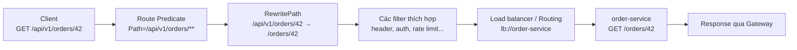

# RewritePath: thay thế đường dẫn bằng biểu thức chính quy

Trong một hệ thống microservices, URL mà client gọi thường cần ổn định, còn đường dẫn mà service nội bộ nhận có thể thay đổi theo cấu trúc triển khai. Ví dụ, client gọi `GET /api/v1/orders/42` trên `api.example.com`, trong khi `order-service` chỉ cung cấp endpoint `GET /orders/42`. **`RewritePath` GatewayFilter Factory** của Spring Cloud Gateway giúp chuyển đổi phần **path** trước khi request được gửi tới backend bằng một **biểu thức chính quy (regular expression, regex)** và một **chuỗi thay thế (replacement)**.

Bài thuộc chương **Đường dẫn và chuyển hướng** của module **SPRING_CLOUD_GATEWAY**. Trong việc xây dựng API Gateway với route predicate, filter chain, biến đổi đường dẫn/header và khám phá dịch vụ, `RewritePath` giải quyết bài toán chuẩn hóa URL ở lớp biên. Khi triển khai thực tế, nó phải phối hợp đúng với xác thực, giới hạn lưu lượng, circuit breaker, retry, TLS và quan sát request để không làm sai hợp đồng API hoặc tạo lỗ hổng định tuyến.

Mục tiêu sau bài học:

1. Viết được filter `RewritePath=regexp, replacement` để biến đổi đường dẫn với Java regex.
2. Dùng **nhóm bắt (capture group)** có tên và biết vì sao phải escape ký tự `$` trong cấu hình YAML của Spring Cloud Gateway.
3. Dự đoán chính xác kết quả cho đường dẫn có/không có dấu gạch chéo cuối, tham số truy vấn, regex khớp hoặc không khớp.
4. Phân biệt `RewritePath` với `StripPrefix`, `PrefixPath`, `SetPath`, `RedirectTo` và thay đổi response `Location`.
5. Kiểm thử đường dẫn trước/sau gateway, phát hiện lỗi thường gặp và kiểm soát rủi ro bảo mật ở lớp proxy.

> **Phạm vi:** Nội dung tập trung vào **Spring Cloud Gateway Server WebFlux** dùng Spring WebFlux và Reactor Netty. Dạng cấu hình `spring.cloud.gateway.routes` thường gặp ở Gateway 4.x; với Gateway Server WebFlux 5.x, ví dụ chính thức dùng `spring.cloud.gateway.server.webflux.routes`. Hai nhánh đều có `RewritePath` nhưng phải dùng đúng starter, phiên bản và prefix của ứng dụng. Spring Cloud Gateway Server MVC có cơ chế filter riêng; không áp dụng máy móc giải thích nội bộ của WebFlux sang MVC.

## 1. RewritePath nằm ở đâu trong vòng đời request?

Một route của Gateway gồm **predicate** để chọn tuyến và **filter** để thay đổi request/response theo tuyến đã chọn. `RewritePath` là **GatewayFilter** được gắn vào route. Nó thực hiện thay đổi request path **sau khi route đã được match** và **trước khi proxy HTTP tới upstream** trong cấu hình route thông thường.



Một request có hai **địa chỉ cần phân biệt**:

| Góc nhìn | Ví dụ | Vai trò |
| --- | --- | --- |
| URL phía client | `https://api.example.com/api/v1/orders/42` | Contract công khai, dùng cho request từ client |
| Path được predicate kiểm tra | `/api/v1/orders/42` | Dùng để quyết định có chọn route hay không |
| Path sau `RewritePath` | `/orders/42` | Đường dẫn HTTP gửi tới upstream |
| URI backend của route | `lb://order-service` | Xác định service đích qua discovery/load balancer |
| URL HTTP cuối cùng | `http://10.0.0.15:8080/orders/42` (minh họa) | Instance và path mà HTTP client của Gateway gọi |

`RewritePath` **không phải HTTP redirect**. Client không nhận `301`/`302` chỉ vì filter đổi path và thanh địa chỉ trình duyệt không tự đổi. Gateway âm thầm proxy request đã được biến đổi. Nếu cần yêu cầu trình duyệt đi đến URL mới, phải dùng cơ chế redirect như `RedirectTo` ở route thích hợp.

## 2. Cấu trúc RewritePath và hai tham số bắt buộc

Dạng ngắn của filter:

```yaml
filters:
  - RewritePath=<regexp>, <replacement>
```

Trong đó:

- **`regexp`** là Java regular expression để tìm đoạn cần thay thế trên request path.
- **`replacement`** là chuỗi thay thế theo cú pháp `java.util.regex.Matcher`, có thể dùng nhóm bắt như `$1` hoặc `${segment}`.
- Một route có thể chứa nhiều filter; thứ tự filter và route matching quyết định chuỗi biến đổi thực tế.

Ví dụ đơn giản theo cách trình bày của tài liệu Spring Cloud Gateway:

```yaml
spring:
  cloud:
    gateway:
      routes:
        - id: rewrite-red
          uri: http://localhost:8081
          predicates:
            - Path=/red/**
          filters:
            - RewritePath=/red/?(?<segment>.*), /$\{segment}
```

Khi client gọi `/red/blue`, backend nhận path `/blue`.

Phân tích regex `/red/?(?<segment>.*)`:

| Thành phần | Ý nghĩa |
| --- | --- |
| `/red` | Phần chuỗi cần tìm |
| `/?` | Dấu `/` có thể xuất hiện hoặc không |
| `(?<segment>.*)` | Nhóm bắt có tên `segment`, nhận 0 hoặc nhiều ký tự |
| `/$\{segment}` trong YAML | Replacement tạo path có dấu `/` đầu, lấy nội dung của nhóm `segment` |

Ví dụ này theo mẫu chính thức. Trong hệ thống yêu cầu matching prefix nghiêm ngặt, nên cân nhắc thêm dấu neo `^`, `$` (cuối regex) và ranh giới giữa các đoạn path, như mục 4.

## 3. Nhóm bắt và cú pháp replacement trong Java regex

Java regex hỗ trợ **nhóm bắt đánh số** và **nhóm bắt có tên**:

```text
Pattern:     ^/api/v1/orders/(?<remaining>.*)$
Request:     /api/v1/orders/42/items
Group name:  remaining
Group value: 42/items
Replacement: /orders/${remaining}
Result:      /orders/42/items
```

Trong regex:

- `^` chỉ đầu chuỗi, `$` chỉ cuối chuỗi.
- `(?<remaining>.*)` bắt phần còn lại của path và đặt tên là `remaining`.
- `.` khớp một ký tự bất kỳ trong chế độ regex thông thường, ngoại trừ các ký tự ngắt dòng nếu không bật chế độ thích hợp; `*` cho phép lặp **0 lần trở lên**.
- `+` chỉ lặp **1 lần trở lên**; `.*` có thể bắt chuỗi rỗng, còn `.+` thì không.
- `(?:...)` là nhóm **không bắt**, thích hợp gom lựa chọn mà không tạo capture group mới.
- `$1` tham chiếu nhóm bắt số 1; `${remaining}` tham chiếu nhóm bắt có tên khi dùng trong chuỗi replacement mà Java `Matcher` thực sự nhận.

**Lưu ý:** `RewritePath` dùng biểu thức chính quy của **Java**, không phải cú pháp glob của `Path` predicate. Ví dụ `Path=/api/**` là mẫu Path của Spring; ký hiệu `**` không có cùng ý nghĩa trong Java regex. Không bê nguyên glob pattern sang `regexp`.

### Named group so với nhóm đánh số

Hai cách sau có thể cho cùng kết quả:

```text
Regex:       ^/legacy/(.*)$
Replacement: /$1

Regex:       ^/legacy/(?<tail>.*)$
Replacement: /${tail}
```

Nhóm có tên thường dễ đọc hơn khi biểu thức có nhiều phần. Nhóm đánh số `$1`, `$2` có thể hữu ích với biểu thức ngắn nhưng dễ sai khi thêm một nhóm bắt ở vị trí trước đó.

**Trong Java source code**, ví dụ trực tiếp với `Pattern` và `Matcher` không có lớp YAML/Spring property binding:

```java
import java.util.regex.Pattern;

Pattern p = Pattern.compile("^/legacy/(?<tail>.*)$");

String result = p.matcher("/legacy/orders/42")
    .replaceAll("/${tail}");

System.out.println(result);  // /orders/42
```

Đoạn này minh họa **ngữ nghĩa Java regex**: replacement `/${tail}` lấy giá trị của named group. Cách viết trong `application.yml` của Gateway cần thêm quy tắc escape riêng.

## 4. Ký tự $, dấu gạch chéo và cách escape trong application.yml

Đây là lỗi thường gặp nhất khi bắt đầu dùng `RewritePath`. Trong phần **replacement** của Java regex, `${segment}` có nghĩa “chèn nhóm có tên `segment`”. Nhưng trong `application.yml` của Spring Cloud Gateway, giá trị có thể đi qua cơ chế **property placeholder** trước khi tới regex replacement.

Vì thế, tài liệu Spring Cloud Gateway hướng dẫn viết:

```yaml
filters:
  - RewritePath=/red/?(?<segment>.*), /$\{segment}
```

Dấu gạch chéo ngược nằm giữa `$` và `{` là cú pháp escape **trong cấu hình**:

| Nơi biểu diễn | Giá trị cần viết |
| --- | --- |
| Replacement của Java regex trực tiếp | `/${segment}` |
| Dạng ngắn trong `application.yml` của Gateway | `/$\{segment}` |
| Kết quả khi group là `blue` | `/blue` |

**Không nhầm** `/$\{segment}` với path có ký tự `\`. Ký tự escape phục vụ giai đoạn nạp cấu hình; nó không yêu cầu backend nhận thêm gạch chéo ngược. Cũng không nên cho rằng chỉ cần bọc giá trị bằng dấu nháy là đã loại bỏ toàn bộ bước giải quyết placeholder của Spring.

Dạng đối số đặt tên có thể làm cấu hình dễ đọc hơn:

```yaml
filters:
  - name: RewritePath
    args:
      regexp: "^/red/(?<segment>.*)$"
      replacement: '/$\{segment}'
```

Ở đây, dấu nháy **đơn** của YAML cho phép giữ nguyên dấu `\` trong chuỗi scalar. Với nháy **kép**, cách diễn giải escape của YAML khác đi; chẳng hạn `\{` không phải một escape YAML double-quoted hợp lệ. Nếu chọn double-quoted string, cần escape thêm dấu `\` theo quy tắc YAML và kiểm tra giá trị nạp thực tế.

**Đừng nhầm ba lớp cú pháp:**

1. **Java regex**: `^`, `$`, `(?<segment>.*)`, `(.*)`.
2. **Regex replacement**: `$1`, `${segment}`.
3. **Spring/YAML configuration**: cần bảo toàn replacement qua bước nạp property, do đó ví dụ Gateway dùng `$\{segment}`.

Nếu đổi cách cấu hình sang Java DSL, cách escape có thể khác vì không còn lớp YAML:

```java
// Ví dụ khi khai báo RouteLocator bằng Java DSL:
.route("rewrite-red-java", r -> r
    .path("/red/**")
    .filters(f -> f.rewritePath(
        "^/red/(?<segment>.*)$",
        "/${segment}"))
    .uri("http://localhost:8081"))
```

Đoạn Java trên là **mảnh cấu hình** bên trong builder `RouteLocatorBuilder.Builder`; cần đặt trong bean và import tương ứng để sử dụng. Nó cho thấy ý tưởng chính: Java source dùng `/${segment}`, còn YAML ở các ví dụ trên dùng `/$\{segment}`.

## 5. Mẫu regex an toàn cho thay đổi prefix

Ví dụ phổ biến: Client gọi `/api/v1/orders/...` nhưng backend muốn `/orders/...`.

### Cấu hình với ranh giới path rõ ràng

```yaml
spring:
  cloud:
    gateway:
      routes:
        - id: orders-public
          uri: lb://order-service
          predicates:
            - Path=/api/v1/orders,/api/v1/orders/**
          filters:
            - name: RewritePath
              args:
                regexp: "^/api/v1(?<rest>/orders(?:/.*)?)$"
              replacement: '$\{rest}'
```

Ý nghĩa:

- Route match `/api/v1/orders` hoặc các path nằm bên dưới `/api/v1/orders/...`.
- `regexp` chỉ nhận path theo prefix `/api/v1`, sau đó bắt phần còn lại bắt đầu bằng `/orders`.
- `replacement` tạo path bằng toàn bộ group `rest`.
- URI `lb://order-service` sẽ được Spring Cloud LoadBalancer giải quyết thành service instance nếu các dependency và nguồn instance đã cấu hình phù hợp.

Bảng dự đoán:

| Path client | Group `rest` | Path backend |
| --- | --- | --- |
| `/api/v1/orders` | `/orders` | `/orders` |
| `/api/v1/orders/` | `/orders/` | `/orders/` |
| `/api/v1/orders/42` | `/orders/42` | `/orders/42` |
| `/api/v1/orders/42/items` | `/orders/42/items` | `/orders/42/items` |
| `/api/v1/products/8` | Không match route | Không được route này gửi đi |

Cách trên chủ ý giữ nguyên dấu `/` ở cuối nếu request gốc có. Nếu backend phân biệt `/orders` với `/orders/`, việc giữ nguyên hay chuẩn hóa cần được xác định trong contract và test.

### Mẫu tổng quát bỏ tiền tố /public

Để loại bỏ `/public` và cho phép cả root `/public`, ta có thể dùng ranh giới:

```yaml
predicates:
  - Path=/public,/public/**
filters:
  - RewritePath=^/public(?:/|$)(?<tail>.*)$, /$\{tail}
```

| Input | Output |
| --- | --- |
| `/public` | `/` |
| `/public/` | `/` |
| `/public/catalog/42` | `/catalog/42` |
| `/publicish/catalog` | Không match pattern; cũng không match route trên |

Mẫu `(?:/|$)` buộc sau `public` là dấu slash hoặc kết thúc path, tránh rewrite nhầm prefix `/publicish`. Dù vậy, sau khi route predicate đã match, regex không bắt buộc phải match; `RewritePath` **không tự trả lỗi 404** nếu pattern không phù hợp (xem mục 7).

### Bản rút gọn khi không cần regex

Nếu mục tiêu chỉ là loại bỏ **đúng một đoạn đầu của path**, `StripPrefix=1` thường dễ đọc hơn:

```yaml
filters:
  - StripPrefix=1
```

Với `/api/orders/42`, kết quả thường là `/orders/42`. Chỉ dùng `RewritePath` khi thật sự cần lựa chọn, bắt nhóm hoặc đổi cấu trúc URL phức tạp.

## 6. Nâng cao: đổi tên resource và tái cấu trúc URL

`RewritePath` có thể chuyển một API legacy sang hợp đồng path nội bộ mới mà không yêu cầu tất cả client đổi URL cùng lúc.

### 6.1. Đổi /legacy/order/{id} thành /orders/{id}

```yaml
predicates:
  - Path=/legacy/order/**
filters:
  - RewritePath=^/legacy/order/(?<id>[^/]+)$, /orders/$\{id}
```

Trong regex `[^/]+` có nghĩa là một hoặc nhiều ký tự **không phải** dấu `/`. Như vậy, group `id` không vô tình nuốt thêm một tầng path.

| Request | Kết quả mong đợi |
| --- | --- |
| `/legacy/order/42` | `/orders/42` |
| `/legacy/order/abc-123` | `/orders/abc-123` |
| `/legacy/order/42/items` | Không match regex đầy đủ; filter không đổi path |

**Điểm quan trọng:** Route predicate `Path=/legacy/order/**` vẫn có thể cho `/legacy/order/42/items` đi qua. Nếu regex không match, filter thường giữ nguyên path; backend có thể nhận URL không mong muốn. Vì vậy, khi chỉ muốn đúng một segment, cũng cần **thu hẹp predicate** hoặc thêm rule/test xử lý request có segment dư.

### 6.2. Đổi hai group theo thứ tự khác nhau

Ví dụ công khai `/tenant/acme/order/42`, nội bộ `/orders/42/tenants/acme`:

```yaml
predicates:
  - Path=/tenant/{tenant}/order/{id}
filters:
  - name: RewritePath
    args:
      regexp: "^/tenant/(?<tenant>[^/]+)/order/(?<id>[^/]+)$"
      replacement: '/orders/$\{id}/tenants/$\{tenant}'
```

Bắt nhiều group giúp đổi vị trí trong path. Tuy nhiên **tenant từ URL là dữ liệu do client chọn**. Backend phải kiểm tra tenant này có thuộc quyền của người dùng đã xác thực và đơn hàng có thực sự thuộc tenant đó. Việc URL chuyển đúng không tạo ra quyền đọc dữ liệu.

### 6.3. Đổi theo nhóm thay thế

Khi có nhiều alias cũ cùng trỏ một tài nguyên:

```yaml
predicates:
  - Path=/old-products/**,/legacy-products/**
filters:
  - RewritePath=^/(?:old-products|legacy-products)/(?<tail>.*)$, /products/$\{tail}
```

Ở đây `(?:A|B)` chọn một trong hai tiền tố và không tạo nhóm bắt thêm. Cấu hình vẫn phải kiểm tra đường dẫn trống sau tiền tố, ví dụ `/old-products/`, và quyết định backend có endpoint `/products/` hay không.

## 7. Nếu regexp không khớp thì chuyện gì xảy ra?

Một điểm rất quan trọng: `Path` predicate và `RewritePath` có thể dùng **hai dạng pattern khác nhau**. Route predicate quyết định request có vào route hay không; filter rewrite sau đó thử regex trên path.

Trong cách triển khai thông thường, `RewritePath` dùng cơ chế thay thế regex của Java. **Nếu regex không tìm được đoạn khớp, path được giữ nguyên**; request vẫn có thể tiếp tục qua filter chain tới backend. RewritePath không phải validator, firewall hoặc nguồn sinh `404`.

Ví dụ cấu hình không nhất quán:

```yaml
predicates:
  - Path=/api/orders/**
filters:
  - RewritePath=^/internal/(?<tail>.*)$, /$\{tail}
```

Client gọi `/api/orders/42`:

1. `Path` predicate match.
2. Regex `^/internal/...` không match `/api/orders/42`.
3. Path vẫn là `/api/orders/42`.
4. Gateway có thể tiếp tục forward path đó, khiến backend trả `404` nếu chỉ hỗ trợ `/orders/42`.

Để tránh, hãy viết **bảng input/output** cho từng route và kiểm thử bằng một backend có thể ghi lại URL nhận được.

### Tính chất match của Java regex

`RewritePath` là *thay thế regex*, không nên ngầm coi nó là thao tác “bỏ prefix” thuần túy. Mẫu thiếu `^` và `$` có thể match một phần path; các ký hiệu lặp tham lam như `.*` có thể ăn nhiều hơn dự kiến. Hãy dùng:

- Dấu neo `^` và `$` khi cần kiểm tra toàn bộ path.
- Ranh giới segment `/`, nhóm không bắt `(?:...)`.
- `[^/]+` để bắt đúng một segment.
- `.*` khi muốn cho phép phần đuôi có nhiều segment hoặc rỗng; `.+` khi yêu cầu không rỗng.

Không cần làm regex phức tạp hơn bài toán. Với vài tiền tố cố định, `StripPrefix` hoặc `SetPath` có thể dễ bảo trì hơn.

## 8. RewritePath khác các filter liên quan như thế nào?

| Filter | Thay đổi điều gì? | Ví dụ | Khi phù hợp |
| --- | --- | --- | --- |
| **`RewritePath`** | Request path dựa trên Java regex và replacement | `/old/42` → `/orders/42` | Đổi cấu trúc URL có capture group |
| **`StripPrefix`** | Bỏ một số segment đầu của request path | `/api/orders/42` → `/orders/42` | Bỏ prefix đơn giản |
| **`PrefixPath`** | Gắn prefix phía trước path | `/orders/42` → `/internal/orders/42` | Thêm đoạn nền nội bộ cố định |
| **`SetPath`** | Đặt request path theo template mới, thường có biến từ predicate | `/service/{id}` → `/orders/{id}` | Dùng biến template đã match mà không cần Java regex |
| **`RedirectTo`** | Trả response redirect `3xx` có `Location` | `/old` → `https://.../new` | Muốn **client thực hiện request mới** |
| **`RewriteLocationResponseHeader`** | Điều chỉnh `Location` mà upstream trả về | `Location` trỏ host nội bộ → host public | Backend phát redirect đến URL nội bộ |
| **`RewriteResponseHeader`** | Sửa giá trị một response header bằng regex | Điều chỉnh header phản hồi | Cần thay đổi header, không phải request path |

Đặc biệt, **`RewritePath` chỉ sửa request path**. Nó **không tự thay**:

- HTTP method như `GET` hoặc `POST`.
- Query parameter, ví dụ `?sort=desc`, khi chỉ sửa path theo cơ chế chuẩn.
- Request body hoặc định dạng JSON.
- URI host/port upstream được chọn bởi route, load balancer và cơ chế routing.
- Header `Host` mà backend nhận theo chính sách proxy.
- Response header `Location`, URL tuyệt đối trong HTML/JSON, cookie path hoặc JavaScript URL của ứng dụng phía client.

Nếu backend trả:

```http
HTTP/1.1 302 Found
Location: http://order-service:8080/orders/42
```

`RewritePath` không tự đổi `Location` thành URL công khai `https://api.example.com/api/v1/orders/42`. Cần xem xét filter xử lý response header và cấu hình proxy/forwarded headers theo đúng topology nếu muốn giải quyết trường hợp này.

## 9. Tương tác với các filter khác và thứ tự thực thi

Filter của một route được ghép vào chuỗi có thứ tự cùng các `GlobalFilter` của Gateway Server WebFlux. Rewrite cần xảy ra **trước khi HTTP client của Gateway gửi request**. Các phép biến đổi path liên tiếp làm thay đổi đầu vào của nhau.

Ví dụ:

```yaml
filters:
  - StripPrefix=1
  - RewritePath=^/orders/(?<id>[^/]+)$, /api/orders/$\{id}
```

Với `/public/orders/42`, sau `StripPrefix=1` path thành `/orders/42`; `RewritePath` sau đó đổi thành `/api/orders/42`. Nếu hoán đổi hai filter:

1. Regex `^/orders/...` không match path ban đầu `/public/orders/42`.
2. `StripPrefix=1` bỏ `public`.
3. Backend có thể nhận `/orders/42`, khác với kết quả trước.

Đừng suy ra “có filter nào ở route thì cứ đặt thứ tự tùy ý”. Hãy ưu tiên cấu hình rõ ràng, ít filter chồng lấn, test thực tế và kiểm tra order khi trộn `GlobalFilter`/filter tùy biến.

### Filter và predicate nhìn thấy path nào?

- **`Path` route predicate** thường match request path **trước các route filter**. Vì vậy, nếu muốn match `/api/v1/orders/**`, predicate phải dùng path công khai, không phải `/orders/**` sau rewrite.
- **GatewayFilter** đứng trước hoặc sau `RewritePath` có thể nhìn thấy path khác nhau nếu chúng đọc request path.
- **Spring Security WebFlux WebFilter** thường hoạt động trong lớp xử lý bảo mật WebFlux riêng; các matcher bảo mật ở biên cần cấu hình theo request public thực tế. Không nên giả định đường dẫn sau rewrite luôn là đường dẫn được security dùng để quyết định rule.
- **Backend** nhận path đã rewrite, nhưng vẫn tự kiểm tra authentication/authorization và hợp đồng API của nó.

Với circuit breaker, retry và timeout, hiểu rõ filter nào đang bao quanh phần HTTP routing giúp phân tích lỗi. Retry có thể làm **một request client thành nhiều lần gửi upstream**, đặc biệt rủi ro với request ghi như thanh toán hoặc tạo đơn. RewritePath không đảm bảo idempotency; trách nhiệm đó cần được xử lý tại dịch vụ và giao thức request.

## 10. Query string, mã hóa ký tự và dấu gạch chéo cuối

Xét request:

```http
GET /api/v1/orders/42?include=items&sort=desc HTTP/1.1
Host: api.example.com
```

Nếu filter biến đổi `/api/v1/orders/42` thành `/orders/42`, query `?include=items&sort=desc` thường **được giữ nguyên** trong URI outbound, vì `RewritePath` tập trung vào phần path.

Kết quả mong muốn:

```text
Client:  /api/v1/orders/42?include=items&sort=desc
Backend: /orders/42?include=items&sort=desc
```

Tuy nhiên, cần xử lý cẩn thận các trường hợp sau:

| Trường hợp | Vì sao quan trọng? | Cách kiểm thử |
| --- | --- | --- |
| `/api/v1/orders` và `/api/v1/orders/` | Backend có thể phân biệt có/không có slash cuối | Test cả hai, đừng chỉ test `/42` |
| `/api/v1/orders/42/items` | Regex `.*` có thể nuốt nhiều segment | Test nested resource |
| `/api/v1/orders/42?x=1&x=2` | Query có tham số lặp | Backend echo query và so sánh |
| `/api/v1/orders/a%20b` | Mã hóa URI và xử lý dấu cách | Test URL encoded, kiểm tra backend không bị double-encode |
| `/api/v1/orders/a%2Fb` | Encoded slash có thể được hạ tầng xử lý/giải mã khác nhau | Kiểm tra ingress, Gateway, backend; đừng dựa vào giả định |
| `/api/v1/orders/../admin` | Normalization và segment traversal có thể có kết quả bất ngờ | Kiểm tra reject/normalize nhất quán trên tất cả tầng |
| Path rất dài / nhiều ký tự đặc biệt | Regex hoặc giới hạn server có thể bị khai thác | Test giới hạn kích thước và độ trễ |

**Không ép một quy tắc URL encoding chung cho mọi hệ thống.** Reverse proxy, WebFlux và backend có thể xử lý raw/decoded/normalized path theo các điểm khác nhau. Quan trọng là test **đường dẫn backend thực sự nhận** đối với các giá trị biên mà hệ thống cho phép.

## 11. RewritePath, bảo mật và ranh giới tin cậy

RewritePath giúp thay đổi URL nhưng **không cung cấp authentication hoặc authorization**. Một cấu hình URL có vẻ đúng vẫn có thể làm lộ API nội bộ nếu filter mở quá rộng.

### 11.1. Tránh cho phép rewrite tùy ý thành endpoint quản trị

Ví dụ rủi ro:

```yaml
predicates:
  - Path=/public/**
filters:
  - RewritePath=^/public/(?<rest>.*)$, /internal/$\{rest}
```

Mọi request tới `/public/...` đều được gửi tới `/internal/...`. Nếu backend tin rằng `/internal/*` chỉ có thể đến từ mạng tin cậy và bỏ qua xác thực, client bên ngoài có thể vô tình được tiếp cận endpoint quản trị.

Thiết kế an toàn cần:

1. Chỉ cho phép route public tới những endpoint có chủ đích.
2. Kiểm soát authentication/authorization ở gateway theo path public và ở backend theo tài nguyên thực tế.
3. Sử dụng network policy/service-to-service authentication khi cần; backend không chỉ dựa vào tên đường dẫn `/internal` để tin request.
4. Test các đường dẫn tương tự như `/public/admin`, `/public/%2e%2e/admin`, dấu slash lặp và encoded slash theo stack đang dùng.

### 11.2. Không dùng group regex để xây host tùy ý

`RewritePath` **chỉ thay path**, không biến request thành một proxy tới host tùy ý. Tuy nhiên, nếu viết thêm custom filter tự ghép URI đích từ group regex hoặc query parameter do client nhập, nguy cơ **SSRF / open proxy** xuất hiện. Hãy giới hạn backend trong tập route/discovery cho phép và validate mọi nguồn nhập.

### 11.3. Tránh regex gây tiêu tốn CPU

Regex như các cấu trúc lồng nhau có nhiều nhánh lặp hoặc lượng backtracking lớn có thể làm CPU tăng mạnh trên path dài do client kiểm soát. Event loop của WebFlux phải giữ xử lý nhẹ; không đưa vào route filter regex phức tạp không được test hiệu năng.

Dùng `^`, `$`, giới hạn số segment, `[^/]+` và các lựa chọn rõ ràng khi có thể. Đặt giới hạn kích thước request target ở ingress/server phù hợp và benchmark khi dùng regex phức tạp.

### 11.4. Header nhận diện và tenant phải được kiểm tra riêng

Nếu rewrite từ `/tenants/acme/orders/42` thành `/orders/42`, backend có thể cần metadata tenant. Một biến từ path **không phải bằng chứng** người dùng có quyền với tenant `acme`. Gateway cần xác thực, còn service phải đối chiếu principal với tenant/đơn hàng thực tế. Không mặc nhiên tin các header `X-User-Id`, `X-Tenant-Id` do client tự đặt.

## 12. Thực hành: xây dựng route đổi prefix cho order-service

**Bối cảnh:** API công khai dùng `/api/v1/orders/**`. Backend `order-service` triển khai `/orders/**`. Gateway chạy tại `http://localhost:8080`, backend thử nghiệm tại `http://localhost:8081`. Khi có service discovery, ta có thể chuyển URI tới `lb://order-service` sau khi cấu hình instance và LoadBalancer; bài thực hành đầu tiên dùng HTTP tĩnh cho dễ kiểm tra.

### 12.1. Cấu hình application.yml

Ví dụ cho **Gateway Server WebFlux 4.x**:

```yaml
spring:
  cloud:
    gateway:
      routes:
        - id: orders-rewrite
          uri: http://localhost:8081
          predicates:
            - Path=/api/v1/orders,/api/v1/orders/**
          filters:
            - name: RewritePath
              args:
                regexp: "^/api/v1(?<rest>/orders(?:/.*)?)$"
                replacement: '$\{rest}'
```

Nếu dùng Gateway WebFlux 5.x, giữ nguyên route definition nhưng đặt danh sách routes dưới `spring.cloud.gateway.server.webflux.routes` theo namespace phiên bản đó.

### 12.2. Backend echo để quan sát

Dùng backend thử nghiệm có endpoint nhận path bất kỳ và trả path + query nhận được. Nếu muốn làm nhanh, một controller Spring WebFlux có thể log request URI:

```java
@RestController
class EchoController {

    @RequestMapping("/**")
    Mono<Map<String, String>> echo(ServerHttpRequest request) {
        URI uri = request.getURI();
        return Mono.just(Map.of(
            "path", uri.getRawPath(),
            "query", uri.getRawQuery() == null ? "" : uri.getRawQuery()
        ));
    }
}
```

Đây là snippet minh họa, cần import các lớp như `URI`, `Map`, `Mono`, `RestController`, `RequestMapping` và `ServerHttpRequest`. Tạo backend này **chỉ trong môi trường phát triển/test**; không công khai endpoint echo toàn bộ dữ liệu request trong production.

### 12.3. Chạy các trường hợp kiểm thử

```bash
# Thay path; query được giữ nguyên
curl -i "http://localhost:8080/api/v1/orders/42?include=items"

# Path không có id
curl -i "http://localhost:8080/api/v1/orders"

# Slash cuối
curl -i "http://localhost:8080/api/v1/orders/"

# Tài nguyên lồng nhau
curl -i "http://localhost:8080/api/v1/orders/42/items"

# Không match route orders
curl -i "http://localhost:8080/api/v1/catalog/1"
```

Kỳ vọng backend thấy:

| Request public | Path backend | Query backend |
| --- | --- | --- |
| `/api/v1/orders/42?include=items` | `/orders/42` | `include=items` |
| `/api/v1/orders` | `/orders` | Rỗng |
| `/api/v1/orders/` | `/orders/` | Rỗng |
| `/api/v1/orders/42/items` | `/orders/42/items` | Rỗng |
| `/api/v1/catalog/1` | Không do route `orders-rewrite` chuyển tiếp | Không áp dụng |

Trong trường hợp cuối, status cuối cùng phụ thuộc route/handler khác trong ứng dụng. Không khẳng định chắc chắn `404` chỉ vì route này không match.

### 12.4. Kiểm tra khi thêm service discovery

Chuyển:

```yaml
uri: lb://order-service
```

Rồi xác minh Spring Cloud LoadBalancer và nguồn service instance đã cấu hình; gateway phải chọn được backend `order-service`. `RewritePath` không tự phát hiện service, và `lb://` không tự hoạt động chỉ nhờ URI.

Nếu gặp `503`, kiểm tra có instance khả dụng, kết nối/timeout và trạng thái circuit breaker trước khi kết luận regex sai. Nếu backend trả `404`, đối chiếu **path thực tế** mà backend nhận và route ID đã match.

## 13. Chẩn đoán các lỗi thường gặp

| Triệu chứng | Nguyên nhân khả dĩ | Cách kiểm tra / sửa |
| --- | --- | --- |
| Route khớp nhưng backend nhận prefix cũ | Regex không match, thiếu dấu `^` hoặc pattern sai | Log an toàn path public/backend; thử regex với bộ test |
| Không có route được chọn | `Path` predicate sai đường dẫn công khai; route chưa nạp | Kiểm tra config, route ID, predicate và namespace |
| Backend nhận literal `${segment}` hoặc config báo lỗi placeholder | Escape replacement không đúng trong YAML | Dùng dạng tài liệu `/$\{segment}`, kiểm tra giá trị nạp thực tế |
| Path mất/nhân đôi dấu slash | Group bắt đã chứa `/` nhưng replacement lại thêm `/`, hoặc ngược lại | Kiểm tra nhóm `rest` và ma trận path với/không slash |
| `/api/orders/42` thành `/orders/42` nhưng endpoint vẫn 404 | Backend endpoint khác hợp đồng, method không hỗ trợ | Kiểm tra backend path, method và base path |
| Query parameter biến mất bất ngờ | Filter/custom URI mutation khác đụng tới query | Kiểm tra toàn bộ chain, backend echo raw query |
| `RedirectTo` và `RewritePath` không tương đương | Một cái trả redirect 3xx, một cái proxy path mới | Chọn theo mục tiêu client hay upstream |
| Client được trả `Location` nội bộ | RewritePath không đổi response header | Dùng cơ chế response header/location phù hợp |
| Request lỗi sau khi bật `lb://` | Không có service instance/LoadBalancer hoặc lỗi TLS upstream | Kiểm tra discovery, service ID, kết nối |
| Một số path encoded dẫn đến truy cập sai tài nguyên | Khác biệt normalization/decoding giữa các tầng | Test tại ingress, gateway, backend; chặn input bất thường |
| p99 tăng do rewrite | Regex gây backtracking/CPU hoặc filter khác blocking | Profile, tối giản regex và quan sát event loop |
| Custom filter áp dụng rewrite trước/sau không như dự định | Filter ordering hoặc filter chồng lấn | Kiểm tra order, route config và test path backend |

### Quy trình debug ngắn

1. Xác nhận client gửi **path, method, query** nào.
2. Xác định **route ID** đã chọn bằng metrics/traces/log hoặc endpoint quản trị được bảo vệ trong môi trường thử nghiệm.
3. Kiểm tra giá trị `regexp` và `replacement` **sau khi** application.yml được nạp.
4. So sánh path backend nhận với bảng input/output kỳ vọng.
5. Sau khi path đúng, điều tra backend response, discovery, TLS, header forwarding và chính sách bảo mật nếu vẫn gặp lỗi.

Tránh ghi request body, token, cookie, số định danh nhạy cảm hoặc raw URL có query bí mật vào log; dùng trace ID, route ID và các trường đã che dữ liệu để chẩn đoán.

## 14. Bài tập củng cố

### Bài 1: Chuyển tên resource

Client gọi `/old/customers/99`. Backend muốn `/customers/99`. Hãy dùng regex với named capture group.

**Một lời giải:**

```yaml
predicates:
  - Path=/old/customers/**
filters:
  - RewritePath=^/old/customers/(?<id>[^/]+)$, /customers/$\{id}
```

Với path có thêm `/orders` sau `99`, route predicate rộng vẫn match nhưng regex neo `$` không match; vì vậy cần thu hẹp predicate hoặc có quy tắc trả lỗi phù hợp nếu API không cho phép các segment dư.

### Bài 2: Giữ nguyên nhiều cấp path

Với `/external/products/a/b`, backend cần `/catalog/products/a/b`. Hãy thay `/external/` bằng `/catalog/` và giữ tất cả segment phía sau.

**Một lời giải:**

```yaml
predicates:
  - Path=/external/**
filters:
  - RewritePath=^/external/(?<rest>.*)$, /catalog/$\{rest}
```

### Bài 3: Phân biệt rewrite và redirect

- Client truy cập `/old-docs`, trình duyệt **cần đổi địa chỉ** sang website tài liệu mới: chọn `RedirectTo`.
- Client gọi API `/api/v2/orders/42` nhưng backend chỉ có `/orders/42`, **không yêu cầu client đổi URL**: chọn `RewritePath`.
- Backend trả `Location` chứa địa chỉ nội bộ: cần xử lý **response header Location**, không chỉ `RewritePath`.

### Tự kiểm tra nhanh

**Câu 1.** Vì sao `RewritePath` không nên dùng làm lớp phân quyền?

> Nó chỉ thay request path. Client vẫn có thể chủ động chọn URL; authentication, authorization và kiểm tra ownership tài nguyên phải được thực hiện ở các lớp phù hợp.

**Câu 2.** Trong YAML, vì sao viết `/$\{segment}` thay vì `/${segment}`?

> Để giữ đúng tham chiếu named group qua bước nạp cấu hình/property placeholder, theo quy tắc tài liệu Spring Cloud Gateway. Trong Java regex replacement trực tiếp là `/${segment}`.

**Câu 3.** Một route match `Path=/api/**` nhưng regex filter `^/admin/.*$` không match. Filter có tự trả `404` không?

> Không. Regex không match thường khiến path giữ nguyên rồi request tiếp tục theo chain. Cần sửa pattern hoặc bổ sung cơ chế giới hạn request rõ ràng.

**Câu 4.** `/api/v1/orders/42?sort=desc` sẽ mất tham số `sort` sau RewritePath không?

> Nếu chỉ sửa path bằng `RewritePath` theo cách thông thường, query được giữ lại. Vẫn cần test khi có các filter/custom URI rewrite khác.

**Câu 5.** Vì sao một đường dẫn `/tenants/acme/orders/42` được rewrite đúng vẫn chưa đủ để đọc đơn hàng?

> Tenant và ID trong path là dữ liệu client chọn. Backend phải xác minh principal có quyền trên tenant và đơn hàng thực tế.

## 15. Checklist trước khi đưa RewritePath vào production

- [ ] Đúng module **Gateway Server WebFlux**, dependency/starter và prefix cấu hình của phiên bản đang chạy.
- [ ] `Path` predicate dùng **URL public trước rewrite**; regex dùng Java regex, không lẫn glob `**` của predicate.
- [ ] `regexp` và `replacement` có nhóm bắt đúng, ranh giới segment rõ, escape `$\{name}` đúng trong YAML.
- [ ] Có test cho path root, có/không trailing slash, resource lồng nhau, segment dư, query và đường dẫn không match.
- [ ] Nếu nhiều filter biến đổi path, thứ tự được tài liệu hóa và test bằng path **backend thực sự nhận**.
- [ ] Ưu tiên `StripPrefix`, `PrefixPath` hoặc `SetPath` cho biến đổi đơn giản; tránh regex phức tạp gây tốn CPU.
- [ ] Phân biệt proxy rewrite với `RedirectTo` và response `Location`; không mong trình duyệt đổi URL khi chỉ rewrite nội bộ.
- [ ] Kiểm tra URL encoding, slash mã hóa, path traversal/normalization ở cả ingress, gateway, backend.
- [ ] Không dựa vào URL đã rewrite để cấp quyền; xác thực và kiểm tra dữ liệu nghiệp vụ tại service.
- [ ] Route `lb://` có discovery/load balancer và instance phù hợp; outbound TLS được cấu hình đúng khi dùng HTTPS.
- [ ] Timeout, rate limit, retry, circuit breaker có chính sách phù hợp; thao tác ghi yêu cầu idempotency, không retry mù quáng.
- [ ] Có metrics/traces theo route ID, latency, lỗi upstream; log đủ để debug mà không tiết lộ dữ liệu nhạy cảm.

## Kết luận

**`RewritePath`** là GatewayFilter cho phép Spring Cloud Gateway **thay đổi request path bằng Java regex** trước khi gửi tới microservice. Cốt lõi gồm một `regexp` để tìm đoạn cần thay và một `replacement` có thể tham chiếu nhóm bắt, chẳng hạn `(?<segment>.*)` và `${segment}`. Khi viết trong `application.yml` của Spring Cloud Gateway, cần giữ đúng quy tắc escape tham chiếu nhóm như `$\{segment}`.

Hiểu rõ thứ tự **predicate trước rewrite**, ranh giới giữa URL public và path backend, và sự khác biệt giữa **rewrite nội bộ** với **redirect 3xx** sẽ giúp chuyển đổi API path an toàn hơn. Kết hợp kiểm thử các trường hợp biên, xác thực/phân quyền, quan sát request, discovery và các chính sách chịu lỗi giúp gateway duy trì hợp đồng ổn định cho client trong khi các service phía sau tiếp tục phát triển.

## Tài liệu tham khảo

- [Spring Cloud Gateway Server WebFlux 5.x — RewritePath GatewayFilter Factory](https://docs.spring.io/spring-cloud-gateway/reference/spring-cloud-gateway-server-webflux/gatewayfilter-factories/rewritepath-factory.html)
- [Spring Cloud Gateway Server WebFlux 4.3.x — RewritePath GatewayFilter Factory](https://docs.spring.io/spring-cloud-gateway/reference/4.3/spring-cloud-gateway-server-webflux/gatewayfilter-factories/rewritepath-factory.html)
- [Spring Cloud Gateway Server WebFlux — GatewayFilter Factories](https://docs.spring.io/spring-cloud-gateway/reference/spring-cloud-gateway-server-webflux/gatewayfilter-factories.html)
