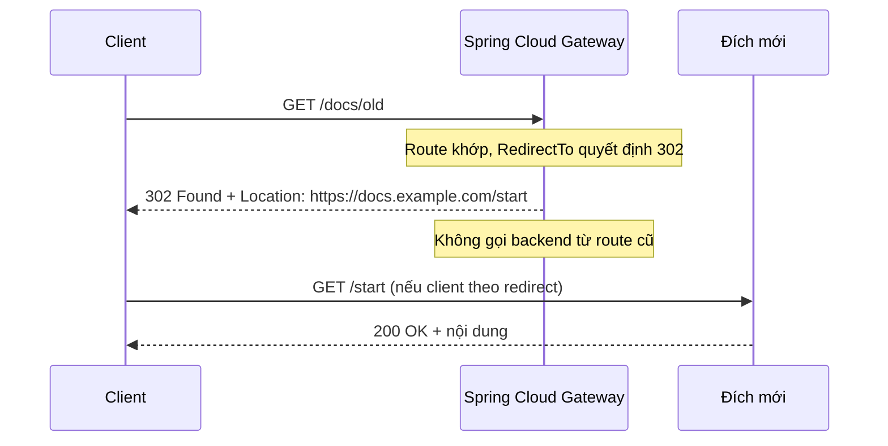
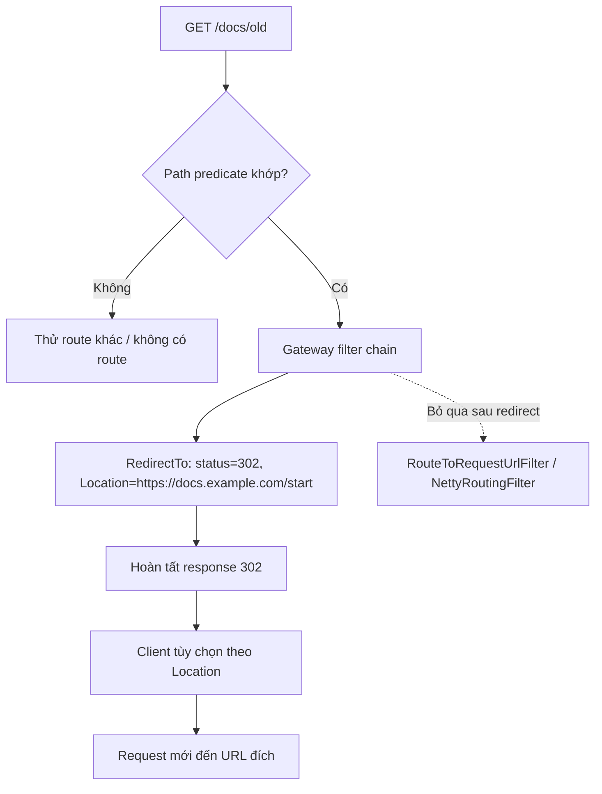

# RedirectTo trong Spring Cloud Gateway: chuyển hướng client và lựa chọn mã HTTP

Trong hệ thống microservices, đôi khi một API đã đổi địa chỉ nhưng client vẫn đang gọi đường dẫn cũ; một trang tài liệu chuyển sang hostname mới; hoặc một endpoint chỉ cần thông báo cho client sử dụng URL khác. Khi đó, **chuyển hướng HTTP** (*redirect*) là một lựa chọn, bên cạnh việc Gateway tự viết lại đường dẫn trước khi chuyển tiếp.

Trong **Spring Cloud Gateway Server WebFlux**, `RedirectTo` là một **GatewayFilter Factory** giúp route trả về HTTP status thuộc nhóm **3xx** cùng header **`Location`**. Client nhìn thấy phản hồi chuyển hướng và có thể gửi **request mới** tới URL được chỉ ra. Hiểu đúng cơ chế này đặc biệt quan trọng với lựa chọn **301, 302, 303, 307, 308** vì mỗi mã có ý nghĩa riêng về tính lâu dài, HTTP method và request body.

Bài thuộc chương **Đường dẫn và chuyển hướng** của module `SPRING_CLOUD_GATEWAY`. Kiến thức về `RedirectTo` bổ sung cho route predicate, filter chain, đổi path/header và khám phá dịch vụ; đồng thời giúp thiết kế cổng vào microservices an toàn khi kết hợp xác thực, giới hạn lưu lượng, circuit breaker, retry, TLS và quan sát request.

> **Phạm vi:** Nội dung áp dụng cho **Spring Cloud Gateway Server WebFlux**. Namespace cấu hình và API cần tương thích với phiên bản Spring Boot/Spring Cloud thực tế. Đừng mặc định hành vi của Spring Cloud Gateway Server MVC và Server WebFlux giống hệt nhau.

## 1. Chuyển hướng HTTP là gì?

Một phản hồi chuyển hướng thông báo rằng client nên truy cập một URL khác. Phản hồi thường chứa:

- **Status 3xx:** ví dụ `302 Found` hoặc `308 Permanent Redirect`.
- **`Location`:** URI/URL đích mà client có thể gửi request mới tới.
- **Các header khác:** chẳng hạn `Cache-Control`, tùy yêu cầu về bộ nhớ đệm và bảo mật.

Ví dụ client gọi tài liệu cũ:

```http
GET /docs/old HTTP/1.1
Host: gateway.example.com
```

Gateway trả:

```http
HTTP/1.1 302 Found
Location: https://docs.example.com/start
```

Trình duyệt thường tự truy cập `https://docs.example.com/start`. Một số HTTP client, script, SDK hoặc công cụ kiểm thử chỉ trả về response 302 mà **không tự theo dõi redirect**; cách xử lý phụ thuộc cấu hình client.



**Điểm mấu chốt:** Gateway kết thúc request đầu tiên bằng 3xx. **Client** quyết định có gửi request thứ hai hay không. Hai request này có thể đi qua hai server khác nhau và tạo hai dấu vết quan sát riêng.

## 2. `RedirectTo` nằm ở đâu trong pipeline Gateway?

Spring Cloud Gateway xử lý request thông qua những bước chính:

1. `RoutePredicateHandlerMapping` kiểm tra `Path`, `Method` và các predicate khác để chọn route.
2. `FilteringWebHandler` hợp nhất `GlobalFilter` với `GatewayFilter` của route đã chọn và sắp xếp theo thứ tự.
3. `RedirectTo` chạy như một `GatewayFilter` của route được cấu hình.
4. Filter đặt HTTP status và header `Location` lên `ServerHttpResponse`, rồi hoàn tất response.
5. Vì không tiếp tục gọi phần chain phía sau, request **không được chuyển tiếp tới upstream** qua các routing filter ở phía sau điểm redirect.



Filter có thể chặn luồng xử lý sớm (*short-circuit*). Vì thế:

- `RedirectTo` **không tự kết nối đến URL đích**, không gọi backend trước khi trả 3xx.
- `uri` vẫn là một phần của cấu hình route theo cấu trúc Gateway, nhưng **không dùng để gửi request** nếu `RedirectTo` đã short-circuit thành công trước bước routing.
- Những `GlobalFilter` chạy **trước** redirect có thể ghi metrics/log và nhận tín hiệu hoàn tất; những filter đặt **sau** redirect có thể không chạy.
- Khi client gửi request mới tới URL đích, request đó lại trải qua quy trình route matching, bảo mật, rate limiting và filter chain của nơi nhận.

Không nên xem redirect là một loại circuit breaker, retry hoặc load balancing. Nó là một quyết định **trả URL khác cho client**.

## 3. Cấu hình `RedirectTo` cơ bản

### 3.1. Cú pháp rút gọn

Ví dụ dùng kiểu cấu hình Spring Cloud Gateway Server WebFlux ở các nhánh phiên bản mới:

```yaml
spring:
  cloud:
    gateway:
      server:
        webflux:
          routes:
            - id: docs-redirect
              uri: http://localhost:8081
              predicates:
                - Path=/docs/old
                - Method=GET,HEAD
              filters:
                - RedirectTo=302, https://docs.example.com/start
```

Đọc cấu hình:

| Khai báo | Vai trò |
| --- | --- |
| `id: docs-redirect` | Tên route để quản lý và theo dõi. |
| `uri: http://localhost:8081` | URI route theo cấu trúc Gateway; ví dụ này không gọi nó vì filter trả redirect. |
| `Path=/docs/old` | Chỉ chọn route khi path khớp. |
| `Method=GET,HEAD` | Giới hạn method của route để hành vi redirect có chủ đích. |
| `RedirectTo=302, https://docs.example.com/start` | Trả status 302 và header `Location` chứa URL đích. |

Ở những phiên bản WebFlux cũ hơn, namespace cấu hình route thường là `spring.cloud.gateway.routes`. Hãy chọn **đúng một namespace** cho phiên bản đang dùng. Việc đặt tên starter và namespace không đúng có thể khiến route không được nạp dù YAML hợp lệ về cú pháp.

### 3.2. Cú pháp khai báo đầy đủ

Cùng một filter có thể khai báo với tên và tham số tách riêng:

```yaml
filters:
  - name: RedirectTo
    args:
      status: "302"
      url: https://docs.example.com/start
```

Hai tham số cốt lõi:

- `status`: HTTP status 3xx được Gateway hỗ trợ, ví dụ `301`, `302`, `303`, `307` hoặc `308`.
- `url`: URL được đưa vào header `Location`. Với ví dụ nhập môn, nên dùng **URL tuyệt đối** có scheme và host rõ ràng.

Cấu hình static như trên **không tự lấy path hoặc query từ request rồi nối vào URL đích**. Nếu nhiều đường dẫn cũ cùng khớp một route, một khai báo `RedirectTo` đơn giản thường trả **cùng một Location** cho các đường dẫn ấy.

### 3.3. Quan sát bằng curl

Khi Gateway chạy trên cổng `8080`:

```bash
# Chỉ xem response 302 do gateway trả về.
curl -i "http://localhost:8080/docs/old"

# Xem riêng các header, không yêu cầu tải body.
curl -I "http://localhost:8080/docs/old"

# Thử theo redirect (chỉ khi URL đích là nơi bạn muốn truy cập).
curl -i -L --max-redirs 3 "http://localhost:8080/docs/old"
```

Kỳ vọng với lệnh đầu:

```http
HTTP/1.1 302 Found
Location: https://docs.example.com/start
```

`curl -i` thông thường không tự theo redirect. `curl -L` yêu cầu theo redirect và có thể tạo nhiều request; `--max-redirs` giới hạn số lần chuyển hướng để phát hiện vòng lặp. Đối với endpoint `HEAD`, hãy kiểm tra cách client và backend xử lý method này.

## 4. Chọn mã HTTP nào: 301, 302, 303, 307 hay 308?

Không phải tất cả mã 3xx đều cho cùng một hành vi. Hai câu hỏi phải trả lời trước khi chọn:

1. **Chuyển hướng tạm thời hay lâu dài?**
2. **Client cần giữ nguyên method và body hay chuyển sang truy vấn lấy thông tin (thường là GET)?**

| Status | Tên thông dụng | Tính lâu dài | Hành vi method/body khi theo redirect | Trường hợp nên cân nhắc |
| --- | --- | --- | --- | --- |
| **301** | `Moved Permanently` | Lâu dài | Với `POST`, nhiều user agent **có thể đổi thành GET** theo quy tắc tương thích lịch sử. | Chuyển địa chỉ lâu dài của trang/GET API khi không đòi hỏi giữ method. |
| **302** | `Found` | Tạm thời | Với `POST`, nhiều user agent **có thể đổi thành GET**. | Di chuyển tạm thời trang hoặc GET endpoint. |
| **303** | `See Other` | Chuyển sang tài nguyên khác để lấy kết quả | Client thường gửi **GET** (hoặc retrieval request phù hợp) tới `Location`. | Mẫu *Post/Redirect/Get* sau khi thao tác tạo/ghi đã hoàn tất. |
| **307** | `Temporary Redirect` | Tạm thời | **Giữ method và body** nếu client theo redirect. | Dời tạm endpoint khi request cần giữ đúng phương thức, payload. |
| **308** | `Permanent Redirect` | Lâu dài | **Giữ method và body** nếu client theo redirect. | Di chuyển endpoint lâu dài và cần giữ semantics của method. |

### 4.1. `301` và `308`: chuyển hướng lâu dài

`301` và `308` đều báo đích mới có tính **lâu dài**. Điểm khác quan trọng: `308` giữ method/body khi thực hiện request mới; `301` vẫn có trường hợp client đổi `POST` thành `GET`.

Hãy đặc biệt thận trọng khi thử nghiệm 301/308 trên địa chỉ public: trình duyệt, proxy hoặc cache có thể ghi nhớ chuyển hướng này. Khi thay đổi cấu hình để trỏ lại địa chỉ cũ, một số client vẫn tiếp tục truy cập URL đã được cache.

Nếu chưa xác nhận đây là quyết định di chuyển lâu dài, dùng mã tạm thời (302/307) để thử và quan sát hành vi trước.

### 4.2. `302` và `307`: chuyển hướng tạm thời

Ví dụ bạn cần dời API chỉ trong một giai đoạn bảo trì:

- Nếu request là `GET`, `302` thường phù hợp cho chuyển hướng tạm.
- Nếu yêu cầu phải giữ nguyên `POST`, `PUT`, `PATCH` hoặc request body, nên xem xét `307` và kiểm tra client có khả năng gửi lại body sang URL đích hay không.

Đừng dựa vào nhận định “mọi HTTP client đều tự chuyển POST thành GET khi thấy 302”: cách xử lý khác nhau theo client và phương thức. Khi hợp đồng API cần sự rõ ràng, dùng status thể hiện đúng ý đồ.

### 4.3. `303` và Post/Redirect/Get

Sau khi backend **đã xử lý xong** một `POST` tạo dữ liệu, backend có thể trả:

```http
HTTP/1.1 303 See Other
Location: /orders/9001
```

Client theo `Location` bằng một request đọc (thông thường `GET /orders/9001`). Đây là mẫu **Post/Redirect/Get (PRG)** giúp tránh việc tải lại trang khiến người dùng vô tình gửi lại biểu mẫu.

Tuy nhiên, nếu đặt `RedirectTo=303, ...` **ngay trên route POST của Gateway**, filter sẽ trả redirect **trước khi gọi backend**, nên **chưa có thao tác tạo dữ liệu nào được thực thi** qua route đó. Vì thế:

- `RedirectTo` có thể dùng để hướng request từ một endpoint POST cũ sang tài nguyên hướng dẫn hoặc URL khác theo chủ đích.
- Đối với PRG sau một giao dịch vừa tạo, **backend xử lý giao dịch** thường là nơi trả status 303 và Location động dựa trên tài nguyên thực sự được tạo.
- Không dùng `RedirectTo` để giả định Gateway đã gửi POST sang backend, chờ tạo đơn hàng, rồi mới phát redirect.

### 4.4. Những mã 3xx khác

Nhóm 3xx còn có `300 Multiple Choices` và `304 Not Modified`. **`304` dùng cho điều kiện bộ nhớ đệm**, không phải yêu cầu client chuyển sang URL khác bằng `Location`. Trong bài toán chọn một URL đích cho client, hãy ưu tiên các status chuyển hướng được thiết kế rõ ràng như 301/302/303/307/308.

## 5. So sánh RedirectTo với RewritePath, SetPath và StripPrefix

Cùng liên quan đến đường dẫn, nhưng **chuyển hướng client** và **viết lại đường dẫn bên trong Gateway** giải quyết hai nhu cầu khác nhau.

| Tiêu chí | `RedirectTo` | `RewritePath` / `SetPath` / `StripPrefix` |
| --- | --- | --- |
| Client nhìn thấy gì? | Nhận **response 3xx + Location**, có thể gửi request mới. | Thường vẫn thấy response của backend dưới URL công khai đã gọi. |
| Ai truy cập URL mới? | **Client** nếu quyết định theo redirect. | **Gateway** chuyển tiếp tới backend sau khi biến đổi request. |
| Số lần HTTP round-trip từ góc nhìn client | Có thể phát sinh **request bổ sung**. | Thường chỉ một request client tới Gateway. |
| URL trên thanh địa chỉ trình duyệt | Có thể thay đổi khi browser theo redirect. | Thường không đổi do internal rewrite. |
| Method/body | Phụ thuộc 301/302/303/307/308 và hành vi client. | Gateway không yêu cầu client gửi lại request chỉ vì đổi path. |
| Discovery và load balancing | Không sử dụng cho response redirect vừa trả nếu chain đã dừng. | Có thể dùng `lb://service-id` ở bước routing. |
| Mục đích tiêu biểu | Công bố URL mới, di chuyển domain, canonical URL. | Đổi API public `/api/**` sang endpoint nội bộ của backend. |

Ví dụ request:

```text
GET /api/products/42
```

**Internal rewrite**:

```yaml
uri: lb://product-service
predicates:
  - Path=/api/products/**
filters:
  - StripPrefix=1
```

Gateway gửi `GET /products/42` đến một instance `product-service`; client không nhận 3xx chỉ vì thao tác `StripPrefix`.

**Redirect**:

```yaml
uri: http://localhost:8081
predicates:
  - Path=/api/products/42
filters:
  - RedirectTo=308, https://api.example.com/v2/products/42
```

Client nhận `308` và `Location`; URL đích có thể đi qua một Gateway khác hoặc đi thẳng tới service khác, tùy tên miền và hạ tầng.

**Quy tắc lựa chọn:** Nếu muốn giữ nguyên hợp đồng URL công khai và chỉ thay đổi đường dẫn bên trong microservices, ưu tiên rewrite. Nếu muốn **thông báo chính thức URL mới cho client**, cân nhắc redirect với status phù hợp.

## 6. Ví dụ hoàn chỉnh: chuyển từ endpoint cũ sang endpoint mới

Giả sử bạn đang di chuyển trang catalog từ `/v1/catalog` sang `/v2/catalog`. Gateway ở `localhost:8080`; Catalog Service ở `localhost:8081` có endpoint nội bộ `GET /catalog`.

Cấu hình minh họa:

```yaml
server:
  port: 8080

spring:
  application:
    name: edge-gateway
  cloud:
    gateway:
      server:
        webflux:
          routes:
            - id: catalog-v1-redirect
              order: -10
              uri: http://localhost:8081
              predicates:
                - Path=/v1/catalog
                - Method=GET,HEAD
              filters:
                - RedirectTo=302, http://localhost:8080/v2/catalog

            - id: catalog-v2
              order: 0
              uri: http://localhost:8081
              predicates:
                - Path=/v2/catalog
                - Method=GET,HEAD
              filters:
                - SetPath=/catalog
```

Luồng xử lý:

```mermaid
sequenceDiagram
    participant C as Client
    participant G as Gateway :8080
    participant B as Catalog Service :8081
    C->>G: GET /v1/catalog
    Note over G: catalog-v1-redirect khớp
    G-->>C: 302 Location: http://localhost:8080/v2/catalog
    C->>G: GET /v2/catalog (client theo redirect)
    Note over G: catalog-v2 khớp; SetPath=/catalog
    G->>B: GET /catalog
    B-->>G: 200 + danh mục
    G-->>C: 200 + danh mục
```

Chạy kiểm thử khi hai ứng dụng đã hoạt động:

```bash
# Lần gọi đầu: chỉ thấy HTTP 302 và Location.
curl -i "http://localhost:8080/v1/catalog"

# Theo tối đa ba bước redirect: dự kiến nhận response Catalog Service.
curl -i -L --max-redirs 3 "http://localhost:8080/v1/catalog"

# Kiểm tra URL mới: route thứ hai chuyển tiếp trực tiếp.
curl -i "http://localhost:8080/v2/catalog"
```

Địa chỉ `localhost` ở header `Location` chỉ dùng để thử nghiệm **trên cùng máy**. Nếu client ở máy khác, `localhost:8080` sẽ trỏ về chính máy client. Trong production cần dùng tên miền public có thể truy cập, ví dụ `https://api.example.com/v2/catalog`.

Khi xác định việc di chuyển là vĩnh viễn, có thể cân nhắc đổi `302` thành `301` hoặc `308`. Với GET/HEAD, cả hai thường đáp ứng mục đích, nhưng `308` thể hiện tường minh chính sách giữ nguyên method; hãy đánh giá caching và khả năng hỗ trợ của client trước khi thay.

### 6.1. Vì sao phải có route cho URL mới?

`RedirectTo` chỉ trả `Location`, **không tự tạo route hay endpoint** tại URL đích. Trong ví dụ, sau khi client theo redirect tới `/v2/catalog`, Gateway cần có route `catalog-v2` để đưa request đến backend.

Nếu redirect từ `/v1/catalog` về chính `/v1/catalog` hoặc route mới lại chuyển hướng về cũ, client có thể mắc **redirect loop**. Công cụ `curl -L --max-redirs 3` giúp phát hiện một số trường hợp; trên browser có thể gặp lỗi “quá nhiều lần chuyển hướng”.

### 6.2. Query string có tự đi theo không?

Giả sử client gọi:

```text
GET /v1/catalog?lang=vi&sort=name
```

Trong ví dụ với `RedirectTo=302, http://localhost:8080/v2/catalog`, header `Location` vẫn chỉ chứa:

```http
Location: http://localhost:8080/v2/catalog
```

**Không giả định Gateway tự nối `?lang=vi&sort=name` vào Location.** URL đích là giá trị đã cấu hình. Nếu yêu cầu nghiệp vụ bắt buộc giữ query parameter, cần giải pháp chuyển hướng động có kiểm soát hoặc điều chỉnh hợp đồng endpoint; không nên mặc nhiên dùng một `RedirectTo` static cho mọi request.

Đặc biệt, không tự sao chép nguyên query string sang một domain khác nếu query có token, mã truy cập hoặc thông tin nhạy cảm.

## 7. Chuyển hướng POST/PUT và rủi ro method/body

Với GET hoặc HEAD, việc theo redirect thường tương đối đơn giản. Với request có body và tác dụng phụ, lựa chọn status ảnh hưởng đến ý nghĩa nghiệp vụ.

Ví dụ một client gửi:

```http
POST /api/v1/events HTTP/1.1
Host: gateway.example.com
Content-Type: application/json

{"type":"inventory_updated","itemId":42}
```

Route tạm thời:

```yaml
- id: events-temporary-redirect
  uri: http://localhost:8081
  predicates:
    - Path=/api/v1/events
    - Method=POST
  filters:
    - RedirectTo=307, https://api.example.com/api/v2/events
```

Nếu client hỗ trợ theo `307` và request body có thể gửi lại, nó phải **giữ nguyên POST** cùng payload khi gửi sang URL mới. Gateway không tự đẩy JSON đến endpoint đích trong request ban đầu.

So sánh:

| Status trong trường hợp POST | Điều cần trông đợi/cẩn trọng |
| --- | --- |
| `301` / `302` | Một số client có thể đổi POST sang GET; rất dễ sai hợp đồng API ghi dữ liệu. |
| `303` | Dùng để hướng client sang một tài nguyên truy xuất sau thao tác, không giữ ý nghĩa “gửi lại POST đến đích”. |
| `307` / `308` | Giữ method/body khi theo redirect; vẫn cần kiểm tra khả năng replay body của HTTP client và an toàn của đích mới. |

**Ba lưu ý về an toàn:**

1. **Không đảm bảo mọi client tự theo 307/308.** SDK, client cũ hoặc request body streaming có thể không tự gửi lại. Kiểm thử bằng đúng thư viện HTTP của client thực tế.
2. **Không redirect bừa một POST nhạy cảm sang origin khác.** Các policy của client đối với `Authorization`, cookie, CORS, proxy và body khi đổi host có thể khác nhau. Phải xác lập quan hệ tin cậy và yêu cầu bảo mật cho URL đích.
3. **Không nhầm redirect với retry.** Một client theo `307` tạo request tới URL mới; một filter `Retry` tại Gateway có thể tạo các lần thử đến upstream trong cùng quá trình xử lý. Cả hai có thể dẫn đến tác dụng phụ lặp lại nếu nghiệp vụ không thiết kế idempotency.

Với thao tác tạo đơn hàng, thanh toán hoặc cập nhật trạng thái quan trọng, cần xác định rõ cơ chế idempotency, timeout và xử lý trường hợp client không chắc request trước đó đã được backend nhận hay chưa.

## 8. Route predicate và thứ tự route quyết định lúc nào RedirectTo chạy

Một `RedirectTo` filter chỉ được áp dụng nếu **route chứa nó đã khớp**. Vì vậy predicate có thể được dùng để giới hạn redirect theo path, method hoặc host.

Ví dụ chỉ redirect phiên bản cũ của API dành cho GET:

```yaml
- id: legacy-read-redirect
  order: -20
  uri: http://localhost:8081
  predicates:
    - Path=/api/v1/catalog
    - Method=GET
  filters:
    - RedirectTo=302, https://api.example.com/api/v2/catalog
```

Nếu client gửi `POST /api/v1/catalog`, route trên **không khớp** vì `Method=GET`. Request có thể đi vào route khác hoặc nhận 404 nếu không có route phù hợp.

### 8.1. Route chồng lấn

Giả sử có hai route:

- `Path=/api/v1/**`: redirect sang tài liệu migration.
- `Path=/api/v1/orders/**`: tiếp tục hỗ trợ một nhóm endpoint order trong giai đoạn chuyển đổi.

Một request `GET /api/v1/orders/7` có thể khớp cả hai. Hãy dùng predicate rõ ràng và `order` có chủ đích. **Route order** ưu tiên route nào được chọn; nó khác với **filter order** trong chuỗi của route đã chọn.

Không nên tin rằng route có path dài hơn sẽ luôn thắng nếu cả hai cùng khớp. Cấu hình không rõ thứ tự có thể làm một số API bắt đầu trả 3xx ngoài ý muốn.

### 8.2. Pattern rộng và Location tĩnh

Cấu hình:

```yaml
predicates:
  - Path=/legacy/**
filters:
  - RedirectTo=301, https://api.example.com/new
```

sẽ gửi **cùng một Location** cho những đường dẫn như `/legacy/products/1`, `/legacy/orders/2` và `/legacy/users/3`. Nó **không tự bảo toàn** phần path sau `/legacy/`.

Nếu cần ánh xạ:

```text
/legacy/products/1 -> /v2/products/1
/legacy/products/2 -> /v2/products/2
```

thì cần giải pháp tạo `Location` động hoặc chỉ định các route một cách chính xác. `RewritePath` có thể thực hiện biến đổi nội bộ, nhưng không tự biến thành HTTP redirect. Tránh hứa với client một redirect bảo toàn path khi cấu hình thực tế chỉ chứa URL tĩnh.

## 9. Chuyển hướng động: khi nào RedirectTo không đủ?

Bộ lọc tích hợp `RedirectTo` rất tiện nếu nhiều request được phép chuyển tới **một đích cố định**. Khi URL đích phụ thuộc `{id}`, query, tenant hoặc kết quả xử lý nghiệp vụ, cần xác định trách nhiệm rõ ràng.

Ví dụ:

```text
GET /old/products/42  ->  Location: https://api.example.com/v2/products/42
GET /old/products/99  ->  Location: https://api.example.com/v2/products/99
```

Không nên mặc định `RedirectTo=308, https://api.example.com/v2/products/{id}` sẽ thay `{id}` như `SetPath`. Hỗ trợ biến URI trong template của **các filter khác** không có nghĩa `RedirectTo` tự động thực hiện phép thế biến giống hệt.

Các hướng giải quyết:

1. **Đổi path nội bộ:** nếu client không cần thấy URL mới, dùng `RewritePath` hoặc `SetPath` với URI route đích phù hợp.
2. **Ứng dụng/backend trả redirect động:** handler xác định tài nguyên đích, trả status 3xx và `Location` dựa trên dữ liệu hợp lệ. Phù hợp khi URL mới chỉ biết sau xử lý nghiệp vụ.
3. **Custom filter có kiểm soát:** chỉ khi thật sự cần logic redirect tại Gateway; kiểm tra template, URL encoding, scheme/host được phép và vòng đời reactive.

Nếu tự viết filter trả redirect, về nguyên tắc cần đặt status và `Location` trên `ServerHttpResponse`, rồi trả publisher hoàn tất:

```java
import java.net.URI;

import org.springframework.http.HttpHeaders;
import org.springframework.http.HttpStatus;
import org.springframework.web.server.ServerWebExchange;
import reactor.core.publisher.Mono;

// Đoạn minh họa phần cuối của một GatewayFilter đã xác minh URL đích.
private Mono<Void> redirect(ServerWebExchange exchange, URI trustedTarget) {
    exchange.getResponse().setStatusCode(HttpStatus.TEMPORARY_REDIRECT);
    exchange.getResponse().getHeaders()
        .setLocation(trustedTarget);
    return exchange.getResponse().setComplete();
}
```

`trustedTarget` phải được dựng từ **cấu hình tin cậy hoặc allowlist**; ví dụ chỉ minh họa bước ghi response sau khi đã kiểm tra. Nó chưa phải một `GlobalFilter` hoặc `GatewayFilterFactory` hoàn chỉnh. Không nên nhận chuỗi `url` từ query parameter rồi chuyển trực tiếp thành `Location` vì sẽ tạo nguy cơ **open redirect**.

## 10. Bảo mật khi trả Location

Chuyển hướng là một cơ chế bảo mật cần kiểm soát: client có thể gửi request tiếp theo ra khỏi Gateway và sang một domain khác. Một vài vấn đề đặc biệt quan trọng:

### 10.1. Open redirect

Một thiết kế nguy hiểm là:

```text
GET /login?next=https://attacker.example/collect
-> 302 Location: https://attacker.example/collect
```

Nếu ứng dụng lấy trực tiếp `next` từ client làm `Location`, kẻ tấn công có thể lợi dụng hostname đáng tin cậy để dẫn người dùng sang site khác, thậm chí lợi dụng luồng đăng nhập hoặc dữ liệu trên URL.

Khuyến nghị:

- Ưu tiên các URL đích **tĩnh** đã được kiểm duyệt trong cấu hình.
- Nếu cần URL động, kiểm tra **scheme, host, port, path và allowlist**; tránh các URL có thông tin xác thực nhúng.
- Cẩn thận với dấu `//` đầu URL, percent-encoding, Unicode domain, userinfo (`user@host`) và khác biệt chuẩn hóa URL.
- Không sao chép access token, session ID hoặc mã bảo mật vào `Location`, nhất là khi chuyển sang domain khác.

### 10.2. HTTPS, proxy và vòng lặp redirect

Một tình huống phổ biến: client truy cập `https://api.example.com` qua reverse proxy kết thúc TLS, nhưng request từ proxy tới Gateway dùng HTTP nội bộ. Nếu logic redirect dựa sai vào scheme nội bộ, hệ thống có thể liên tục phát redirect tới cùng URL public.

Để triển khai HTTPS an toàn:

- Cấu hình TLS, chứng chỉ và HTTP→HTTPS policy đúng lớp (load balancer, ingress, reverse proxy, web server hoặc cấu hình phù hợp).
- Nếu dùng `Forwarded` / `X-Forwarded-Proto`, chỉ tin các header được tạo bởi **proxy đáng tin cậy**; không để client tự quyết định scheme/host công khai.
- Tránh hard-code `http://localhost` hoặc hostname nội bộ trong `Location` ở môi trường production.
- Kiểm thử cả truy cập trực tiếp, truy cập qua proxy, HTTP và HTTPS để phát hiện vòng lặp.

`RedirectTo` không tự tạo chứng chỉ TLS, không kiểm tra trust store và không thay thế cấu hình mTLS giữa Gateway với backend.

### 10.3. Authorization, cookie và CORS

Khi redirect sang một origin khác:

- Việc client giữ hay bỏ header `Authorization` phụ thuộc chính sách bảo mật của thư viện và trình duyệt; **không trông chờ tự động chuyển thông tin đăng nhập**.
- Cookie phụ thuộc domain, path, `Secure`, `SameSite` và chính sách của trình duyệt.
- Request `fetch`/XHR có thể chịu **CORS** và hạn chế đối với redirect hoặc preflight; việc browser điều hướng trang thành công không chứng minh API AJAX sẽ thành công.
- Nếu method/body được giữ theo `307`/`308`, payload có thể được gửi tới server đích; phải chắc chắn server đó được phép nhận dữ liệu.

**Redirect không tự cấp quyền.** Tại URL mới, Gateway hoặc backend vẫn phải áp dụng xác thực, phân quyền nghiệp vụ và kiểm soát lưu lượng phù hợp.

## 11. Bộ nhớ đệm, khả năng tương thích và tác động vận hành

### 11.1. Redirect vĩnh viễn khó thu hồi hơn

`301` và `308` có thể được browser, CDN và các bộ đệm lưu lại theo quy tắc HTTP. Điều này hữu ích khi di chuyển tài nguyên lâu dài, nhưng gây rủi ro khi đổi đích sai.

Trong giai đoạn thử nghiệm hoặc triển khai tăng dần:

1. Dùng `302`/`307` nếu thực sự là thay đổi tạm thời.
2. Kiểm tra status, `Location`, method/body và request mà backend mới nhận.
3. Xác nhận URL mới hoạt động, có TLS hợp lệ và chính sách bảo mật tương đương.
4. Khi quyết định lâu dài, mới cân nhắc `301`/`308`.

Nếu đã phát redirect vĩnh viễn sai, chỉ sửa cấu hình Gateway có thể không đủ vì một số client không còn gọi đường dẫn cũ. Kế hoạch rollback phải tính đến cache phía client và CDN.

### 11.2. Quan sát hai request

Với một redirect về **chính Gateway**:

```text
Request #1: /v1/catalog -> 302 Location: /v2/catalog
Request #2: /v2/catalog -> 200 từ Catalog Service
```

Bạn có thể thấy **một metric 3xx trên route cũ** và **một metric 2xx trên route mới**, nếu client theo redirect. Không nên đếm request #1 là backend call thành công; nó chỉ chứng minh Gateway đã phát URL mới.

Nếu đích nằm ngoài hạ tầng, tracing xuyên domain không tự duy trì; trace header có được chuyển tiếp hay không phụ thuộc client và quy tắc an toàn. Nên quan sát tối thiểu route ID, HTTP status, số lượng redirect, độ trễ, đích được phép và dấu hiệu vòng lặp, đồng thời tránh log đầy đủ query/token.

### 11.3. Rate limiting và circuit breaker

`RedirectTo` trả kết quả **trước khi backend được gọi** từ route cũ, nên:

- Một circuit breaker bảo vệ backend cũ thường không có cơ hội đánh giá lời gọi backend nếu chain bị cắt trước bước routing.
- Request mới sau redirect được xét theo rate limiter/chính sách của đích mới.
- Nếu client theo nhiều redirect, số request HTTP toàn hệ thống có thể tăng; cần tính đến khi thiết kế quota hoặc giám sát.
- `Retry` của gateway và hành vi tự theo redirect của client là hai cơ chế khác nhau; không dùng chúng thay thế nhau.

Điều này càng quan trọng khi một endpoint cũ vẫn nhận lưu lượng cao trong quá trình di chuyển API.

## 12. Ma trận kiểm thử thực tế

Giả sử cấu hình:

```yaml
- id: legacy-docs
  uri: http://localhost:8081
  predicates:
    - Path=/docs/old
    - Method=GET,HEAD
  filters:
    - RedirectTo=302, https://docs.example.com/start
```

Hãy kiểm tra:

| Request | Route `legacy-docs` khớp? | Kết quả từ filter |
| --- | --- | --- |
| `GET /docs/old` | Có | `302` + `Location: https://docs.example.com/start`. |
| `HEAD /docs/old` | Có | `302` + `Location`; body thông thường không được trả cho HEAD. |
| `POST /docs/old` | Không | Không do filter này quyết định; có thể khớp route khác. |
| `GET /docs/new` | Không | Không do filter này quyết định; có thể khớp route khác. |
| `GET /docs/old?lang=vi` | Có | `Location` vẫn là URL tĩnh đã cấu hình, không tự thêm query. |
| `GET /docs/old/` | Phụ thuộc pattern/slash policy cụ thể | Không suy đoán; kiểm thử hoặc khai báo rõ điều kiện dấu slash cuối. |

Với bất kỳ trường hợp nào không khớp, nếu **không có route khác**, Gateway thường trả 404. Nếu có route khác cùng khớp, thứ tự route có thể dẫn đến một kết quả khác.

### 12.1. Kiểm tra status và Location

```bash
curl -sS -D - -o /dev/null "http://localhost:8080/docs/old"
```

Trên môi trường thử nghiệm, cần xác nhận **cả mã 3xx lẫn header Location**. Trả 302 mà Location sai hoặc thiếu không đáp ứng hợp đồng redirect.

### 12.2. Kiểm tra theo redirect có giới hạn

```bash
curl -i -L --max-redirs 3 "http://localhost:8080/docs/old"
```

Hãy dùng URL test do bạn quản lý để tránh vô tình gửi credentials/cookie ra domain ngoài ý muốn. Khi thử POST với 307/308, sử dụng một endpoint thử nghiệm không có tác dụng phụ và xác minh method/body tại đích, thay vì chỉ nhìn status cuối.

### 12.3. Kiểm tra vòng lặp và cache

Kiểm thử ít nhất ba tình huống:

- URL đích trỏ lại route cũ hoặc route khác cũng redirect ngược lại.
- Đổi từ redirect tạm thời sang vĩnh viễn trong môi trường thử nghiệm có cache.
- Browser hoặc client đã lưu redirect cũ rồi truy cập lại sau khi cấu hình thay đổi.

Với API quan trọng, nên bổ sung kiểm thử tích hợp dùng mock backend và client HTTP tương ứng với hệ thống thật để xác minh số lượt gọi, route ID, Location và khả năng không gọi upstream trên route redirect.

## 13. Các lỗi dễ gặp

| Triệu chứng | Nguyên nhân có thể | Cách xử lý |
| --- | --- | --- |
| Gateway trả 404 thay vì 302. | `Path`/`Method` không khớp hoặc route chưa được nạp vì sai namespace. | Kiểm tra route/predicate, phiên bản cấu hình, route order. |
| Nhận 302 nhưng trình duyệt không tới đích mong muốn. | `Location` sai, DNS/TLS của đích lỗi, hoặc client chặn theo redirect. | Kiểm tra header và gọi thử URL đích độc lập. |
| `curl -i` chỉ in 302. | `curl` mặc định không theo redirect. | Thêm `-L` khi thật sự muốn theo; giới hạn bằng `--max-redirs`. |
| POST bị đổi thành GET. | Dùng 301/302 hoặc 303 trong khi cần giữ method. | Xem 307/308, kiểm thử client và hợp đồng idempotency. |
| Endpoint tạo đơn hàng không được gọi. | `RedirectTo` đã short-circuit trước backend. | Đưa xử lý nghiệp vụ tới backend; backend tự phát 303 nếu cần PRG. |
| URL cũ và URL mới chuyển qua lại vô hạn. | Các route redirect tạo thành vòng lặp. | Kiểm tra Location/route matching và giới hạn số redirect khi test. |
| Mọi `/legacy/{id}` về cùng một URL. | `RedirectTo` được khai báo với Location tĩnh. | Dùng redirect động an toàn hoặc từng route cụ thể. |
| Query parameter biến mất. | Không được tự động nối vào Location. | Thiết kế quy tắc chuyển query rõ ràng, tránh sao chép token. |
| Client từ máy khác truy cập `localhost`. | Location dùng hostname phát triển cục bộ. | Đổi thành hostname public đúng môi trường. |
| Đã sửa route về cũ nhưng client vẫn dùng URL mới. | 301/308 đã được cache. | Xem chính sách cache và kế hoạch rollback/đổi URL. |
| Chuyển HTTP sang HTTPS gây vòng lặp sau reverse proxy. | Xác định sai scheme public hoặc tin forwarded header sai nguồn. | Cấu hình proxy/TLS/trust phù hợp, kiểm thử cả hai chặng. |
| Client truy cập trang đích được nhưng `fetch` báo lỗi. | CORS, preflight, policy credential khi redirect khác origin. | Kiểm tra chính sách CORS và auth ở đúng đích. |
| Có 302 nhưng không có metric backend. | Gateway đã trả response trước bước routing. | Theo dõi 3xx theo route và request thứ hai nếu client thực hiện. |

## 14. Bài tập áp dụng có đáp án

### Bài 1 — Chọn status cho tài liệu chuyển tên miền

Trang tài liệu chỉ phục vụ GET được chuyển hẳn từ `https://old.example.com/guide` sang `https://docs.example.com/guide`. Đội ngũ đã xác nhận URL mới là lâu dài.

**Gợi ý:** `301` hoặc `308` có thể phù hợp. `308` bảo đảm không đổi method; `301` được hỗ trợ rộng và rất phổ biến cho URL tài liệu. Cần chuẩn bị xử lý cache, TLS, link và truy cập của client cũ.

### Bài 2 — Chuyển POST tạm thời mà giữ JSON

Client gửi `POST /api/v1/events` với JSON. Endpoint mới tạm thời đặt ở `/api/v2/events`; hợp đồng bắt buộc giữ method/body.

**Đáp án:** Cân nhắc `307 Temporary Redirect`. Xác minh thư viện client có thể replay body và gửi request tới đích mới an toàn; đồng thời bảo vệ tác dụng phụ/idempotency.

### Bài 3 — Chuyển hướng sau khi backend tạo đơn hàng

Backend vừa tạo đơn `9001` sau `POST /orders`. Client cần mở trang `GET /orders/9001`.

**Đáp án:** Backend có thể trả `303 See Other` và `Location: /orders/9001` sau khi xử lý thành công. Không đặt `RedirectTo=303` trên route POST như thể Gateway đã tự gọi backend, vì filter sẽ trả 3xx trước khi xử lý giao dịch.

### Bài 4 — So sánh rewrite và redirect

Gateway công bố `GET /api/products/42` nhưng Product Service chỉ có `GET /products/42`. Không muốn thay URL client.

**Đáp án:** Dùng `StripPrefix=1` hoặc `SetPath` để biến đổi đường dẫn trước khi routing; không cần `RedirectTo`. Client tiếp tục sử dụng URL public ban đầu.

### Bài 5 — Kiểm tra query string

Route có `RedirectTo=302, https://docs.example.com/start`. Client gọi `GET /docs/old?lang=vi`. Location nào được trả trong ví dụ?

**Đáp án:** `https://docs.example.com/start`. Query `lang=vi` không tự được ghép thêm. Nếu phải giữ query, cần cơ chế tạo Location có kiểm tra và encoding đúng.

### Bài 6 — Phân biệt route matching và redirect

Cấu hình route có `Path=/old`, `Method=GET`, `RedirectTo=302, ...`. Client gửi `POST /old`. Gateway có tự đổi POST thành GET rồi redirect không?

**Đáp án:** Không. Route không khớp `Method=GET` nên filter redirect của route đó không chạy. Chuyển đổi method chỉ là khả năng của **client khi đã nhận một response redirect phù hợp**, không phải cách Gateway chọn route.

### Bài 7 — Phát hiện open redirect

Một filter tự tạo `Location` từ tham số query `next` mà không kiểm tra host. Vì sao nguy hiểm?

**Đáp án:** Client có thể cung cấp URL tới website tấn công khiến người dùng bị chuyển hướng khỏi domain đáng tin. Phải dùng URL đích cấu hình sẵn hoặc allowlist và quy tắc kiểm tra URI chặt chẽ.

## 15. Checklist triển khai an toàn

- [ ] Route redirect chỉ khớp đúng path, method và host dự kiến; không bị route khác chiếm ưu tiên.
- [ ] Status lựa chọn đúng tính lâu dài: **301/308** hay **302/307**.
- [ ] Hành vi giữ method/body của **307/308**, chuyển sang GET của **303**, và tương thích 301/302 được hiểu rõ.
- [ ] `Location` là URL được phép, hợp lệ và sử dụng hostname public/TLS phù hợp.
- [ ] URL đích tồn tại, có route/endpoint và chính sách auth/rate limit riêng.
- [ ] Redirect không tạo vòng lặp và có giới hạn kiểm thử số lần chuyển hướng.
- [ ] Đã kiểm tra query parameter, path động, dấu slash cuối và URL encoding.
- [ ] Không có open redirect; không đưa token hoặc thông tin nhạy cảm vào Location.
- [ ] Với POST/PUT/PATCH, đã kiểm thử khả năng client replay body và ranh giới idempotency.
- [ ] Với 301/308, đã đánh giá cache của browser/CDN và phương án rollback.
- [ ] Khi chạy qua reverse proxy, đã xác định đúng scheme/host từ proxy đáng tin cậy.
- [ ] Metrics/log ghi được response 3xx theo route, không nhầm với backend success.
- [ ] Đã thử cả client tự theo redirect lẫn client chỉ đọc status/Location.

## 16. Tổng kết

**`RedirectTo` trong Spring Cloud Gateway** giúp một route trả **HTTP 3xx và header `Location`** để **client** truy cập URL mới. Filter có thể kết thúc request ngay tại Gateway; đích chuyển hướng chỉ được gọi nếu client quyết định gửi một request tiếp theo.

Khi chọn mã, hãy xét đồng thời **tạm thời hay lâu dài** và **giữ method/body hay chuyển sang request đọc**: `301/302` có hành vi tương thích lịch sử, `303` phù hợp mẫu Post/Redirect/Get sau xử lý, còn `307/308` giữ method/body khi client theo redirect. Hãy phân biệt redirect với `RewritePath`/`SetPath`/`StripPrefix`, chú ý caching, query/path động, TLS, CORS và open redirect.

Một thiết kế rõ ràng về status, Location, route predicate và trách nhiệm của client giúp việc di chuyển API an toàn, giảm lỗi khi tích hợp microservices và duy trì được khả năng quan sát trên cổng vào `SPRING_CLOUD_GATEWAY`.
