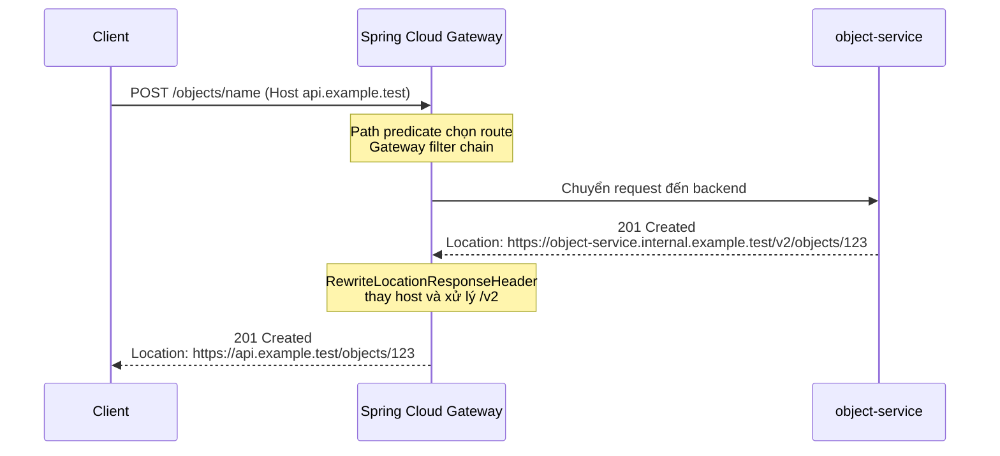

# RewriteLocationResponseHeader: sửa Location từ dịch vụ phía sau

Một API Gateway có thể che tên miền và cổng nội bộ của các microservice trong **request**, nhưng vẫn vô tình để lộ chúng trong **response**. Chẳng hạn, client gọi `https://api.example.test/objects/name` để tạo một tài nguyên, dịch vụ phía sau xử lý xong và trả header:

```http
HTTP/1.1 201 Created
Location: https://object-service.internal.example.test/v2/objects/123
```

Ứng dụng khách có thể lấy URL trong `Location` để mở tài nguyên vừa tạo hoặc làm đích điều hướng. Tuy nhiên, địa chỉ trên lại chứa **hostname nội bộ** và tiền tố phiên bản `/v2` mà API công khai không sử dụng. Đường dẫn đó có thể không truy cập được từ Internet, khiến client lỗi hoặc tiết lộ chi tiết triển khai.

**`RewriteLocationResponseHeader`** là một **GatewayFilter Factory** của **Spring Cloud Gateway Server WebFlux** giúp điều chỉnh giá trị header phản hồi `Location`, đặc biệt là phần **host:port** và cách xử lý đoạn phiên bản URL. Trong ví dụ minh họa, mục tiêu là trả về địa chỉ phù hợp với tên miền client đang dùng:

```http
HTTP/1.1 201 Created
Location: https://api.example.test/objects/123
```

Bài thuộc chương **Đường dẫn và chuyển hướng** của module **SPRING_CLOUD_GATEWAY**. Nó liên hệ trực tiếp với route predicate, filter chain, thay đổi path/header và service discovery; đồng thời giúp tránh lỗi bảo mật hoặc vận hành khi gateway có xác thực, giới hạn lưu lượng, circuit breaker, retry, TLS và quan sát request.

> **Phạm vi phiên bản:** Nội dung sử dụng **Spring Cloud Gateway Server WebFlux**. Ví dụ YAML chính theo namespace `spring.cloud.gateway.server.webflux.routes` trong tài liệu phiên bản mới. Các phiên bản 4.x trước đây có thể dùng `spring.cloud.gateway.routes`, và một số tên tham số khai báo dạng dài đã thay đổi. Luôn đối chiếu Spring Cloud Gateway và Spring Boot BOM thực tế trước khi đưa cấu hình vào ứng dụng.

## 1. Header Location có vai trò gì?

`Location` là một HTTP response header dùng để chỉ định URI liên quan đến response:

- Với phản hồi **`201 Created`**, nó thường cho biết URL của tài nguyên vừa được tạo.
- Với phản hồi **chuyển hướng `3xx`** như `301`, `302`, `303`, `307` hoặc `308`, nó thường là URL đích mà trình duyệt/HTTP client có thể tiếp tục truy cập tùy loại status và chính sách của client.
- Một số ứng dụng sử dụng `Location` trong các tình huống khác; ý nghĩa cần tuân theo ngữ nghĩa HTTP của mã phản hồi và API contract.

Ví dụ hai luồng riêng biệt:

```http
POST /objects/name HTTP/1.1
Host: api.example.test
Content-Type: application/json

{"name":"example"}

HTTP/1.1 201 Created
Location: https://api.example.test/objects/123
```

```http
GET /old-path HTTP/1.1
Host: api.example.test

HTTP/1.1 302 Found
Location: https://api.example.test/new-path
```

**Không nhầm:** `201 Created` không có nghĩa client phải tự động điều hướng; trong khi trình duyệt hoặc HTTP client có thể **theo** `Location` của mã 3xx. Gateway chỉ sửa header, **không tự tạo status 301/302** và không tự yêu cầu client gửi request tiếp.

### 1.1. Vì sao Location từ backend dễ sai?

Một hệ thống microservices thường có ít nhất hai góc nhìn về URL:

| Góc nhìn | Ví dụ | Ai cần sử dụng? |
| --- | --- | --- |
| **URL công khai** | `https://api.example.test/objects/123` | Ứng dụng web/mobile/đối tác |
| **URL dịch vụ nội bộ** | `https://object-service.internal.example.test/v2/objects/123` | Các thành phần trong private network |
| **Đích logic service discovery** | `lb://object-service` | Gateway để phân giải backend instance |
| **URI thực tế của một instance** | `https://10.0.4.15:8443` | HTTP client của gateway, sau load balancing |

Backend có thể tự tạo URL theo `Host` mà nó nhận, dựa vào hostname nội bộ hoặc cố định tiền tố version `/v2`. Vì vậy, dù request đi vào gateway bằng URL công khai, response có thể vẫn chứa URI không phù hợp với client.

Đây là vấn đề **chuẩn hóa URL phản hồi**. Nó khác với việc gateway **chọn route** hay **biến đổi request path** ở chiều đi.

## 2. Vị trí của RewriteLocationResponseHeader trong luồng xử lý

Trong Server WebFlux, `RoutePredicateHandlerMapping` chọn route từ `RouteLocator` dựa trên predicates. Sau đó, `FilteringWebHandler` chạy `GlobalFilter` và các `GatewayFilter` của route đã chọn. `RewriteLocationResponseHeader` là filter trong chuỗi đó, xử lý **header response** khi dữ liệu trả về từ downstream.



**Thứ tự trách nhiệm cần phân biệt:**

1. **Route predicate** quyết định request thuộc route nào.
2. **Request filters** như `StripPrefix`, `SetPath`, `RewritePath` hoặc `AddRequestHeader` có thể thay đổi request trước khi gửi downstream.
3. **Load balancing/service discovery**, nếu route dùng `lb://...`, chọn instance thực tế.
4. **Backend** trả response với status và `Location` của nó.
5. **`RewriteLocationResponseHeader`** điều chỉnh header phản hồi trước khi client nhận response.

Việc filter được gọi theo vòng đời reactive không có nghĩa mỗi bước là một thread riêng. Điều quan trọng là `Location` cuối cùng phải được xử lý trước khi HTTP response được commit/gửi tới client.

## 3. Cấu hình cơ bản

Ví dụ sau theo dạng rút gọn được hướng dẫn bởi Spring Cloud Gateway Server WebFlux:

```yaml
spring:
  cloud:
    gateway:
      server:
        webflux:
          routes:
            - id: objects-api
              uri: https://object-service.internal.example.test
              predicates:
                - Path=/objects/**
              filters:
                - RewriteLocationResponseHeader=AS_IN_REQUEST, Location, ,
```

Trong môi trường minh họa:

- Request công khai: `POST https://api.example.test/objects/name`.
- Backend trả: `Location: https://object-service.internal.example.test/v2/objects/123`.
- Filter với `AS_IN_REQUEST` và `Location` hướng tới phản hồi công khai: `Location: https://api.example.test/objects/123`.

Các dấu phẩy trong:

```yaml
- RewriteLocationResponseHeader=AS_IN_REQUEST, Location, ,
```

biểu thị **bốn vị trí tham số**: chế độ bỏ version, tên header, giá trị host thay thế tùy chọn và regex protocol tùy chọn. Hai vị trí cuối để trống nghĩa là dùng cơ chế mặc định. Đây là cú pháp chính thức trong tài liệu Spring Cloud Gateway; không nên tự xóa dấu phẩy khiến các tham số bị hiểu sai vị trí.

**Lưu ý chạy thử:** hostname trong ví dụ là địa chỉ minh họa, không phải một backend thực đang hoạt động. Muốn thực thi, cần thay bằng backend có thể gọi được, cấu hình TLS/truststore phù hợp và kiểm tra đường đi response.

### 3.1. Namespace trong các phiên bản

Ở nhiều bản Spring Cloud Gateway Server WebFlux 4.x, có thể gặp cấu hình:

```yaml
spring:
  cloud:
    gateway:
      routes:
        - id: objects-api
          uri: https://object-service.internal.example.test
          predicates:
            - Path=/objects/**
          filters:
            - RewriteLocationResponseHeader=AS_IN_REQUEST, Location, ,
```

Ví dụ mới hơn dùng `spring.cloud.gateway.server.webflux.routes`. Chọn **một** namespace đúng phiên bản và starter đang dùng; không khai báo đồng thời hai danh sách chỉ để “chắc chắn”. Tài liệu **Server MVC** có cơ chế route/filter khác, dù có tính năng tương tự.

## 4. Bốn tham số quan trọng

`RewriteLocationResponseHeader` nhận các đối số theo thứ tự sau:

```text
RewriteLocationResponseHeader=
  <mode>, <locationHeaderName>, <hostValue>, <protocolsRegex>
```

| Tham số | Mục đích | Ví dụ |
| --- | --- | --- |
| **Chế độ xử lý phiên bản** | Quyết định có loại bỏ segment version trong `Location` hay không. | `AS_IN_REQUEST`, `NEVER_STRIP`, `ALWAYS_STRIP` |
| **Tên header** | Header response chứa URI cần sửa; thường là `Location`. | `Location` |
| **`hostValue`** | Khi cung cấp, dùng thay phần `host:port` của URI trong `Location`. | `api.example.test` hoặc `api.example.test:8443` |
| **Regex protocol** | Chọn loại URI theo scheme có thể được rewrite; scheme không khớp sẽ bỏ qua. | `https?` |

Trong các tài liệu/API phiên bản cũ, tên tham số có thể xuất hiện là `stripVersionMode` và `protocolsRegex`; tài liệu mới có thể viết ngắn thành `Mode` và `protocols`. **Thứ tự đối số của cú pháp rút gọn** trong tài liệu chính thức vẫn là khái niệm cần hiểu; nếu cấu hình dạng `name/args`, phải dùng đúng khóa mà phiên bản framework cung cấp.

### 4.1. Tham số chế độ phiên bản

Ba giá trị:

| Mode | Quy tắc |
| --- | --- |
| **`NEVER_STRIP`** | Giữ version trong `Location`, dù request gốc không có segment version. |
| **`AS_IN_REQUEST`** | Mặc định. Chỉ loại bỏ version trong `Location` khi đường dẫn request gốc không có version. |
| **`ALWAYS_STRIP`** | Luôn loại bỏ version mà factory nhận diện trong `Location`, kể cả request gốc có version. |

Ví dụ so sánh về mặt ý nghĩa, giả sử backend trả URI có segment version `/v2` mà factory nhận diện:

| Request đến gateway | Backend `Location` | `NEVER_STRIP` | `AS_IN_REQUEST` | `ALWAYS_STRIP` |
| --- | --- | --- | --- | --- |
| `POST /objects/name` | `https://internal.example.test/v2/objects/123` | `/v2/objects/123` | `/objects/123` | `/objects/123` |
| `POST /v2/objects/name` | `https://internal.example.test/v2/objects/123` | `/v2/objects/123` | `/v2/objects/123` | `/objects/123` |

Bảng rút gọn **chỉ hiển thị path kết quả** để dễ so sánh. Với URI tuyệt đối phù hợp, phần host có thể được thay tương ứng theo các tham số khác.

**Chọn mode theo API contract công khai**, không theo sở thích:

- Nếu public API **không bao giờ** chứa segment version, `ALWAYS_STRIP` có thể phù hợp khi backend luôn thêm version kỹ thuật.
- Nếu public API hỗ trợ cả URL có và không có version, `AS_IN_REQUEST` thường thuận tiện vì dựa vào request gốc.
- Nếu version là một phần của URL công khai, `NEVER_STRIP` giúp không bỏ nó chỉ vì request hiện tại có một path khác.

Khái niệm “version” ở đây gắn với **quy tắc nhận diện version của factory**, không phải một cơ chế regex tùy ý để loại bỏ mọi đoạn đường dẫn. Đừng kỳ vọng nó tự xóa `/internal/`, `/backend/` hay tiền tố bất kỳ. Với đường dẫn khác quy ước, cần thiết kế giải pháp rewrite phù hợp.

### 4.2. `locationHeaderName`: thay header nào?

Giá trị thường dùng là `Location`. Nếu response không chứa header đã cấu hình, filter không có URI ở header đó để sửa.

Không nhầm `Location` với `Content-Location`, cookie, header `Refresh` hoặc URL được nhúng trong JSON/HTML. Factory được cấu hình để xử lý **header được chỉ định**, không quét và sửa mọi URL bên trong response.

Khi ứng dụng dùng header vị trí tùy biến, chỉ thay tên header nếu API contract thật sự cần. Với chuyển hướng HTTP thông thường, giữ `Location`.

### 4.3. `hostValue`: host cố định hay lấy từ request?

Theo tài liệu Spring Cloud Gateway:

- Nếu **cung cấp `hostValue`**, filter dùng giá trị đó thay cho phần **`host:port`** của URI trong `Location`.
- Nếu **để trống**, filter sử dụng giá trị HTTP `Host` trong **request đi vào**.

Ví dụ cấu hình host tường minh:

```yaml
- RewriteLocationResponseHeader=AS_IN_REQUEST, Location, api.example.test, https?
```

Giả sử backend trả:

```http
Location: https://object-service.internal.example.test/v2/objects/123
```

và request công khai không có version, địa chỉ mong đợi sẽ dùng hostname `api.example.test` và path `/objects/123`.

Nếu public service dùng cổng khác mặc định, ví dụ `8443`, host công khai có thể cần bao gồm `host:port` trong giá trị phù hợp; hãy kiểm tra URL thực tế mà client nhận.

**Rất quan trọng về bảo mật:** `Host` có thể bị client điều khiển nếu gateway hoặc proxy phía trước không giới hạn hostname được phép. Nếu dùng giá trị `Host` đầu vào để sinh `Location` công khai, phải cấu hình **trusted proxy/host validation**, tránh phản chiếu một hostname không đáng tin cậy vào response. Với một hostname public cố định, `hostValue` tường minh thường dễ dự đoán hơn. Với nhiều hostname public hợp lệ, cần thiết kế chính sách xác thực nguồn và mapping hostname phù hợp.

**`hostValue` thay phần host:port, không phải thiết lập toàn bộ URI.** Không nên giả định tham số này tự:

- Đổi `http` thành `https`.
- Thêm tiền tố path `/api` mà gateway đã loại khỏi request.
- Sửa query parameter tùy ý.
- Biến một URL độc hại thành URL an toàn trong mọi trường hợp.

### 4.4. Regex protocol: URI nào được xử lý?

Tham số cuối là một **regular expression** được so với **scheme/protocol** của URI phản hồi. Tài liệu Spring Cloud Gateway mô tả giá trị mặc định tương đương với các scheme HTTP/HTTPS và FTP/FTPS; ví dụ dạng regex:

```text
https?|ftps?
```

Ví dụ chỉ cho phép scheme HTTP hoặc HTTPS:

```yaml
- RewriteLocationResponseHeader=AS_IN_REQUEST, Location, api.example.test, https?
```

Ý nghĩa:

- `https?` khớp `http` hoặc `https`.
- URI dùng scheme không khớp regex sẽ **không được rewrite bởi filter này**.
- Regex này là **điều kiện chọn protocol**, không phải tên protocol mới để “ép đổi scheme”.

Đừng dùng regex quá rộng như `.*` mà không có yêu cầu rõ. Những URI có `javascript:`, `data:` hoặc scheme đặc biệt cần được backend/chính sách bảo mật xử lý theo đúng contract; một filter sửa hostname không phải bộ kiểm tra an toàn URL tổng quát.

## 5. Thực hành với ba chế độ version

Giả sử API công khai dùng `/objects/**` và backend nội bộ dùng `/v2/objects/**`. Backend phản hồi:

```http
HTTP/1.1 201 Created
Location: https://object-service.internal.example.test/v2/objects/123
```

### Trường hợp 1 — Public API không có version

Client gọi `POST https://api.example.test/objects/name`. Nếu muốn đáp ứng public API không có `/v2`:

```yaml
- RewriteLocationResponseHeader=AS_IN_REQUEST, Location, api.example.test, https?
```

Kết quả dự kiến:

```http
Location: https://api.example.test/objects/123
```

### Trường hợp 2 — Giữ version trong URL công khai

Client gọi `POST https://api.example.test/v2/objects/name`. Nếu client phải tiếp tục truy cập URL có version:

```yaml
- RewriteLocationResponseHeader=NEVER_STRIP, Location, api.example.test, https?
```

Kết quả dự kiến:

```http
Location: https://api.example.test/v2/objects/123
```

### Trường hợp 3 — Luôn ẩn version nội bộ

Ngay cả khi request hiện tại có version, bạn muốn `Location` phản hồi **không có** đoạn version:

```yaml
- RewriteLocationResponseHeader=ALWAYS_STRIP, Location, api.example.test, https?
```

Kết quả dự kiến:

```http
Location: https://api.example.test/objects/123
```

Chỉ dùng `ALWAYS_STRIP` nếu URL đó **thực sự tồn tại và được route đến đúng backend**. Xóa version trong `Location` có thể làm client theo một đường dẫn không hỗ trợ. Cần kiểm tra route predicate cho URL mà client sẽ gọi tiếp.

## 6. Tương tác với StripPrefix, SetPath và RewritePath

Đây là một khác biệt quan trọng và thường gây lỗi khó nhận ra:

| Filter | Chiều tác động | Ví dụ |
| --- | --- | --- |
| **`StripPrefix`** | Thay đổi **request path** trước backend. | `/api/objects/name` → `/objects/name` |
| **`SetPath`** | Đặt request path mới dựa trên template. | Backend nhận một path mong muốn. |
| **`RewritePath`** | Viết lại **request path** bằng regex. | `/legacy/objects/name` → `/objects/name` |
| **`RewriteLocationResponseHeader`** | Thay đổi **response Location header**. | Host nội bộ → host công khai; xử lý segment version. |
| **`RewriteResponseHeader`** | Viết lại giá trị **response header** bằng regex tổng quát. | Tùy biến một header khi factory chuyên dụng không đáp ứng yêu cầu. |

### 6.1. Sai lầm phổ biến: nghĩ rằng RewriteLocation tự khôi phục tiền tố public

Giả sử gateway công bố `/api/objects/**` nhưng dùng `StripPrefix=1` để gửi backend path `/objects/**`:

```yaml
spring:
  cloud:
    gateway:
      server:
        webflux:
          routes:
            - id: objects-api
              uri: https://object-service.internal.example.test
              predicates:
                - Path=/api/objects/**
              filters:
                - StripPrefix=1
                - RewriteLocationResponseHeader=AS_IN_REQUEST, Location, api.example.test, https?
```

Backend nhận:

```http
POST /objects/name HTTP/1.1
```

và trả:

```http
Location: https://object-service.internal.example.test/v2/objects/123
```

Filter có thể biến giá trị trên thành:

```http
Location: https://api.example.test/objects/123
```

**Nhưng URL công khai đúng theo route lại là `https://api.example.test/api/objects/123`.** Factory chỉ biết thay host:port và xử lý version, không có một bước tổng quát tự thêm lại `/api` đã bị `StripPrefix` loại bỏ.

Nếu client đi theo URL thiếu `/api`, có thể gặp `404` hoặc vô tình khớp route khác. Những cách giải quyết gồm:

1. **Thiết kế backend sinh URL công khai chuẩn**, sử dụng thông tin gateway/proxy tin cậy hoặc cấu hình external base URL phù hợp.
2. **Đồng nhất path công khai và path backend** nếu có thể, để không cần ghép lại tiền tố trong response.
3. **Dùng `RewriteResponseHeader` hoặc response filter chuyên dụng** để ánh xạ path theo một quy tắc đã kiểm thử. Cần xử lý cẩn thận escaping, query string, encoding và các trường hợp URL không thuộc domain mong đợi.
4. **Thử hành trình hai bước**: request tạo tài nguyên trả `Location`, rồi client gọi đúng URL đó và xác nhận gateway đưa tới cùng tài nguyên.

Đây là lý do không nên đánh giá thành công chỉ vì hostname trong response đã đúng.

### 6.2. Thứ tự filter và response commit

Gateway filters có thể thực hiện hành động ở chiều đi và chiều về. Filter sửa response header cần chạy **trước khi response được commit**; nếu có nhiều filter cùng sửa `Location`, thứ tự thực thi có thể quyết định giá trị cuối cùng.

Khi có các filters như `RedirectTo`, `RewriteResponseHeader` hoặc logic trả response sớm từ bảo mật/rate limiter, hãy kiểm tra xem response có thực sự đi qua `RewriteLocationResponseHeader` của route hay không. Một response bị chặn ở `WebFilter` trước giai đoạn chọn route sẽ không tự đi qua filter gắn riêng trên route đó.

## 7. RewriteLocationResponseHeader không thay thế RedirectTo

Hai filter liên quan đến URL nhưng mang mục đích khác nhau:

**`RewriteLocationResponseHeader`**:

- Xử lý một `Location` đã tồn tại trong **response** của backend.
- Không tự tạo response `302` hoặc `301`.
- Không tự thay đổi route predicate hoặc lựa chọn backend.

**`RedirectTo`**:

- Được cấu hình để gateway trả về **response chuyển hướng** với status 3xx và URL đích.
- Có thể kết thúc request tại gateway mà không cần backend tự phát sinh một `Location`.
- Thích hợp khi gateway chủ động chuyển client từ URL cũ sang URL mới theo chính sách định tuyến.

Ví dụ tổng quát:

```yaml
filters:
  - RedirectTo=302, https://api.example.test/new-path
```

Đừng áp dụng `RedirectTo` để giải quyết một backend tạo `Location` sai trong phản hồi `201 Created`: hai trường hợp có hành vi HTTP khác nhau. Tương tự, `RewriteLocationResponseHeader` không thay toàn bộ nhiệm vụ của `RewriteResponseHeader` khi cần sửa các mẫu URI phức tạp.

## 8. Kiểm thử bằng HTTP request và response

Để kiểm tra hành vi, cần một backend/stub có thể **chủ động trả Location**. Chỉ gọi GET đến endpoint trả `200 OK` mà không có `Location` sẽ không chứng minh filter hoạt động.

### 8.1. Phép thử tối thiểu

Trong môi trường kiểm thử, cấu hình backend để `POST /objects/name` trả:

```http
HTTP/1.1 201 Created
Location: https://object-service.internal.example.test/v2/objects/123
Content-Length: 0
```

Sau đó gọi qua Gateway:

```bash
curl -i -X POST https://api.example.test/objects/name \
  -H 'Content-Type: application/json' \
  -d '{"name":"example"}'
```

Trên Windows PowerShell, cú pháp xuống dòng Bash với dấu `\` không hoạt động nguyên dạng. Có thể viết lệnh trên một dòng hoặc dùng công cụ HTTP client phù hợp. Lệnh chỉ minh họa trên môi trường thử nghiệm; POST có thể tạo dữ liệu thật nếu gọi vào production.

Kiểm tra **cùng lúc**:

- Response có mã `201` đúng như backend cung cấp.
- Header `Location` **không còn host nội bộ**.
- Path công khai **không chứa version ngoài ý muốn**.
- Protocol, port và URL cuối cùng hoạt động theo cấu hình công khai.
- Nếu client gọi tiếp `Location` đó, gateway chọn được route và backend trả tài nguyên vừa tạo.

Với redirect `302`, hãy gọi **không kèm `-L`** để xem nguyên header `Location` đầu tiên; `curl -L` có thể tự đi tiếp, làm che mất URL mà backend/gateway đã trả ra ban đầu.

### 8.2. Ma trận kiểm thử

| Đầu vào/tình huống | Kỳ vọng | Gợi ý kiểm tra |
| --- | --- | --- |
| Backend trả URI HTTP/HTTPS tuyệt đối với host nội bộ | Host được đổi đúng theo `hostValue` hoặc `Host` request | So sánh `Location` nguyên văn trước/sau gateway |
| Request không có version, backend Location có `/v2`, mode `AS_IN_REQUEST` | Version được bỏ theo quy tắc factory | So path phản hồi với public API contract |
| Request có version, backend Location có `/v2`, mode `AS_IN_REQUEST` | Version được giữ | Đối chiếu URI request trước gateway |
| Mode `NEVER_STRIP` | Không loại bỏ version | Test với request có và không có version |
| Mode `ALWAYS_STRIP` | Loại bỏ version mà factory nhận diện | Kiểm tra client vẫn gọi được URL mới |
| Backend response **không có Location** | Không có giá trị Location để rewrite | Xác nhận status/body khác không bị thay ngoài ý muốn |
| Scheme của Location không khớp regex protocol | Không áp dụng rewrite | Thử một scheme nằm ngoài danh sách và kiểm tra hành vi thực tế |
| Location là URI tương đối | Không giả định nó được xử lý như URI tuyệt đối | Test riêng; nếu cần hỗ trợ, thiết kế quy tắc phù hợp |
| Backend Location có path không tương ứng với public prefix `/api` | Có thể thiếu tiền tố public sau rewrite | Thử GET theo chính URL mà Location trả ra |
| Response phát sinh trước khi route filter chạy | Route-specific filter có thể không xử lý được | Kiểm tra security/WebFilter, CORS, rate limiter |
| Proxy phía trước sửa Host hoặc scheme | Location có thể không phản ánh public URL | Kiểm tra trusted proxies/hostValue/TLS |

### 8.3. Integration test bằng WebTestClient

Một integration test có thể khởi chạy gateway cùng backend HTTP giả để backend trả `201 Created` và `Location` giả. Mẫu assert dưới đây chỉ minh họa **bước kiểm tra response**, giả định môi trường test đã nạp route phù hợp và backend stub đã chạy:

```java
webTestClient.post()
    .uri("/objects/name")
    .header("Host", "api.example.test")
    .bodyValue("{\"name\":\"example\"}")
    .exchange()
    .expectStatus().isCreated()
    .expectHeader()
    .valueEquals(
        "Location",
        "https://api.example.test/objects/123"
    );
```

Để bài test có giá trị thực tế, backend stub phải **trả đúng header nội bộ** và test phải kiểm tra backend được gọi đúng path. Không chỉ mock kết quả trực tiếp tại gateway, vì như thế chưa chứng minh header đã thực sự được rewrite trong filter chain.

### 8.4. Test ở phía sau reverse proxy/TLS termination

Nếu client → load balancer (HTTPS) → gateway (HTTP) → backend, cần kiểm tra:

1. Request thực tế mà gateway nhận có `Host` nào?
2. Proxy đã bảo vệ/sanitize các header `Forwarded` và `X-Forwarded-*` chưa?
3. Location đã rewrite dùng **hostname và cổng public** chưa?
4. Scheme trong Location có đúng HTTPS không? `hostValue` chỉ thay host:port, nên nếu scheme sai phải xử lý nguyên nhân bằng cấu hình URL, proxy hoặc biến đổi header có chủ đích.
5. Client có thể truy cập URL đó qua chính TLS và routing public không?

Đừng cho phép client tự đưa một `Host` tùy ý rồi để gateway phản hồi `Location` trỏ tới tên miền của kẻ khác. Cần kiểm soát hostname hợp lệ tại điểm vào tin cậy.

## 9. Các lỗi thường gặp và phương án xử lý

### Lỗi 1 — Filter gắn vào nhầm route

Nếu request không khớp route có `RewriteLocationResponseHeader`, filter đó không chạy. Hãy xác nhận route predicate, ưu tiên route và ID đã chọn trước khi kết luận factory bị lỗi.

### Lỗi 2 — Nhầm response Location với request header

`Location` ở ví dụ là **response header**. `AddRequestHeader` hoặc `SetRequestHeader` chỉ sửa request đi xuống, không tác động trực tiếp đến `Location` backend trả về. Ngược lại, `RewriteLocationResponseHeader` không thay đổi path của request gửi đến backend.

### Lỗi 3 — Đặt mode sai

Nếu backend luôn thêm `/v2` nhưng public URL cần giữ version, `ALWAYS_STRIP` có thể khiến URL trả ra không còn route hợp lệ. Nếu public API không có version nhưng dùng `NEVER_STRIP`, client có thể nhận `/v2` ngoài ý muốn. Xác định rõ contract URL công khai và kiểm thử đủ các trường hợp.

### Lỗi 4 — Nghĩ rằng filter luôn tự chuyển HTTP sang HTTPS

`hostValue` mô tả **host:port**. Nếu backend gửi `http://...` nhưng client chỉ có thể truy cập `https://...`, cần kiểm tra cách backend tạo URL hoặc giải pháp rewrite phù hợp. Không dựa vào factory như một cơ chế ép giao thức TLS.

### Lỗi 5 — Regex protocol không khớp scheme phản hồi

Nếu bạn giới hạn regex `https?`, URI dùng một scheme khác sẽ không được rewrite. Cần lựa chọn protocol được phép theo API contract. Không mở rộng regex vô điều kiện để ép xử lý mọi loại URI.

### Lỗi 6 — Location không có dạng URL mong đợi

Backend có thể trả URI tương đối, URI sai định dạng hoặc nhiều kiểu URL theo loại response. Một số trường hợp không được factory xử lý giống URI HTTP/HTTPS tuyệt đối trong ví dụ. Kiểm tra header gốc, loại URI và hành vi cụ thể của phiên bản đang chạy trước khi thêm một filter mới.

### Lỗi 7 — Chỉ sửa hostname, quên URL path công khai

Nếu client vào `/api/objects/**` nhưng backend phục vụ `/objects/**`, việc đổi host và bỏ `/v2` không tự bổ sung `/api`. Kiểm thử URL được trả ra, không chỉ so hostname.

### Lỗi 8 — Thay đổi Host theo đầu vào không đáng tin cậy

Nếu giá trị `Host` do client kiểm soát được dùng để sinh Location, response có thể bị chuyển hướng đến một hostname ngoài ý muốn. Chỉ tin các forwarded host/proto từ proxy được phép và hạn chế danh sách hostname public hợp lệ; không lấy URL nội bộ từ dữ liệu client tùy ý.

### Lỗi 9 — Hai filter cùng sửa Location không có thứ tự được kiểm chứng

Nếu `RewriteResponseHeader` và `RewriteLocationResponseHeader` đều sửa `Location`, kết quả cuối tùy chuỗi xử lý và thời điểm commit response. Hãy xác định rõ một nơi chịu trách nhiệm chuẩn hóa hoặc kiểm thử thứ tự thực tế để tránh áp dụng hai lần.

### Lỗi 10 — Chỉ xem 2xx mà bỏ qua các response khác

`Location` có thể xuất hiện ở `201` và `3xx`; một số bộ lọc auth hoặc backend cũng có thể trả các response khác. Cần kiểm thử theo **loại response và route**, không chỉ mã `200 OK`. Tránh tự động theo redirect khi đang chẩn đoán.

## 10. Vận hành an toàn và quan sát

Một gateway an toàn cần coi URL phản hồi là một phần của **hợp đồng API công khai**:

| Mối quan tâm | Cách xử lý |
| --- | --- |
| **Đúng route** | Quan sát route ID và backend đích để chắc chắn filter được áp dụng cho đúng request. |
| **Bảo mật Host** | Dùng hostname công khai đã kiểm soát; xác thực forwarded headers từ proxy tin cậy. |
| **TLS** | Kiểm tra cả client–gateway và gateway–backend, cùng scheme URI mà client thực sự sử dụng. |
| **Service discovery** | Chọn instance đúng bằng `lb://...` và load balancer; không trả hostname instance nội bộ cho client. |
| **Rate limiting/auth** | Áp dụng trên route/ở tầng phù hợp; rewrite Location không thay kiểm soát truy cập. |
| **Retry/circuit breaker** | Xử lý lỗi downstream có kiểm soát; không để redirect trở thành cách che lỗi hoặc retry POST không an toàn. |
| **Observability** | Theo dõi route ID, status, độ trễ, tỷ lệ response 201/3xx và các Location sai domain, không log dữ liệu nhạy cảm. |

**Không ghi toàn bộ header Location vào log sản xuất một cách vô điều kiện.** URL có thể chứa định danh tài nguyên, query parameter, token một lần hoặc dữ liệu nhạy cảm. Khi cần phát hiện sai host, có thể ghi **hostname đã chuẩn hóa** hoặc một chỉ báo “public/internal” và gắn correlation ID, thay vì lưu mọi đường dẫn/query.

Nếu có service mesh hoặc reverse proxy khác nằm giữa các lớp, hãy xác định **chặng nào chịu trách nhiệm sinh hoặc sửa Location**. Nhiều lớp cùng rewrite có thể tạo URL vòng lặp, sai scheme hoặc double prefix. Một contract rõ ràng giữa backend, gateway và proxy giúp giảm lỗi này.

## 11. Bài tập tình huống

### Tình huống A — Tạo tài nguyên, backend lộ hostname

Client gọi `POST https://api.example.test/objects/name`, backend trả `Location: https://internal.example.test/v2/objects/7`. Public API không dùng version.

**Hỏi:** Filter nào phù hợp và mode nào có thể dùng?

**Gợi ý:** `RewriteLocationResponseHeader` với `AS_IN_REQUEST` và `Location`. Đặt `hostValue` rõ nếu hostname public cố định; kiểm tra URL nhận được thực tế. Khi dùng mode này, đường dẫn request gốc không có version nên phần version của Location được loại theo quy tắc factory.

### Tình huống B — Cần giữ version công khai

Client gọi `POST https://api.example.test/v2/objects/name`; backend trả `Location: https://internal.example.test/v2/objects/7`.

**Hỏi:** Nên dùng mode nào để chắc chắn không bỏ version?

**Gợi ý:** `NEVER_STRIP`; `AS_IN_REQUEST` cũng có thể giữ nếu request có version được factory nhận diện, nhưng `NEVER_STRIP` biểu thị rõ ý định luôn giữ.

### Tình huống C — Có StripPrefix=1

Client vào `/api/objects/name`, gateway gửi backend `/objects/name` và backend trả `/v2/objects/7` với host nội bộ.

**Hỏi:** Vì sao sau filter vẫn có thể nhận `https://api.example.test/objects/7` thay vì `https://api.example.test/api/objects/7`?

**Gợi ý:** RewriteLocationResponseHeader không phải cơ chế đảo ngược toàn bộ `StripPrefix`. Cần bổ sung ánh xạ public path hoặc cho backend sinh Location theo base URL công khai.

### Tình huống D — Redirect trỏ đến hostname lạ

Gateway không cấu hình `hostValue`, còn proxy cho phép client gửi `Host` tùy ý.

**Hỏi:** Có rủi ro nào?

**Gợi ý:** Filter có thể dùng Host không đáng tin cậy để thay host:port của Location, dẫn đến URL phản hồi trỏ về hostname ngoài ý muốn. Giới hạn hostname đầu vào hoặc dùng host public được kiểm soát.

### Tình huống E — Backend gửi URI tương đối

Backend trả `Location: /v2/objects/7`, không có scheme/hostname.

**Hỏi:** Có thể kết luận filter sẽ tạo `https://api.example.test/objects/7` không?

**Gợi ý:** Không. Cần kiểm tra cách factory xử lý URI tương đối trong phiên bản đang dùng và xác định yêu cầu chuẩn hóa của API. Không tự suy luận từ ví dụ URI tuyệt đối.

### Tình huống F — Không thấy filter hoạt động với 302

Client nhận redirect nhưng không thấy hostname thay đổi. Request thực tế đi vào một route khác với route đã gắn filter.

**Hỏi:** Bước kiểm tra đầu tiên?

**Gợi ý:** Xác nhận route đã chọn, header Location nguyên gốc, scheme, và filter chain của route đó; đừng chỉ chỉnh regex khi filter có thể không hề được gọi.

## 12. Ghi nhớ

1. **`RewriteLocationResponseHeader` sửa URI trong header phản hồi `Location`** do backend trả, thường để bỏ chi tiết host nội bộ và xử lý version path.
2. **Bốn tham số** theo thứ tự là mode, tên header, host thay thế tùy chọn và regex protocol tùy chọn.
3. **`NEVER_STRIP`** giữ version; **`AS_IN_REQUEST`** bỏ version khi request gốc không có version; **`ALWAYS_STRIP`** bỏ version ngay cả khi request có version.
4. **`hostValue` tác động đến host:port**; nếu bỏ trống, filter sử dụng Host của request. Vì vậy cần xử lý hostname và forwarded headers theo ranh giới tin cậy.
5. **Filter không tự sửa request path, thêm lại public prefix hoặc ép HTTP thành HTTPS.** Đừng nhầm với `StripPrefix`, `RewritePath` hoặc `RedirectTo`.
6. **Test cả Location và khả năng theo URL trả về**. So sánh response `201`, `3xx`, trường hợp không có header, phiên bản URL, URI tương đối và luồng proxy/TLS.

**Nguyên tắc thực hành:** Một `Location` đúng phải trỏ đến **URL công khai mà client thực sự truy cập được**. Dùng `RewriteLocationResponseHeader` khi vấn đề là hostname và version trong Location từ downstream; nếu còn khác biệt về tiền tố path hoặc scheme, hãy thiết kế thêm quy tắc chuẩn hóa phù hợp và kiểm thử request tiếp theo. Điều này giúp Spring Cloud Gateway giữ hợp đồng API ổn định trong khi các microservice thay đổi địa chỉ, version và hạ tầng triển khai.

### Tài liệu tham khảo

- [Spring Cloud Gateway — RewriteLocationResponseHeader GatewayFilter Factory (Server WebFlux)](https://docs.spring.io/spring-cloud-gateway/reference/spring-cloud-gateway-server-webflux/gatewayfilter-factories/rewritelocationresponseheader-factory.html): cú pháp factory, ba chế độ version, `hostValue` và regex protocol.
- [Spring Cloud Gateway 4.2 — RewriteLocationResponseHeader GatewayFilter Factory](https://docs.spring.io/spring-cloud-gateway/reference/4.2/spring-cloud-gateway/gatewayfilter-factories/rewritelocationresponseheader-factory.html): ví dụ namespace cấu hình ở dòng 4.2.
