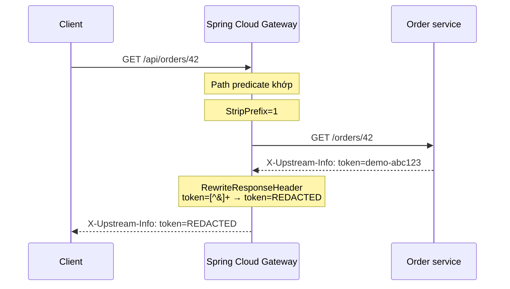

# RewriteResponseHeader: sửa giá trị header bằng biểu thức chính quy trong Spring Cloud Gateway

Trong **Spring Cloud Gateway**, các gateway filter có thể thay đổi request trước khi proxy đến microservice và thay đổi response trước khi trả cho client. **`RewriteResponseHeader`** là filter dùng **biểu thức chính quy (regular expression, regex)** để thay thế một phần hoặc toàn bộ **giá trị của một response header được chỉ định**. Nó hữu ích khi backend trả một header có định dạng cũ, chứa URL nội bộ cần chuẩn hóa, hoặc một đoạn dữ liệu cần biến đổi theo hợp đồng API công khai.

Bài này thuộc chương **Đường dẫn và chuyển hướng** của module `SPRING_CLOUD_GATEWAY`. Dù nằm cạnh các chủ đề viết lại đường dẫn và redirect, `RewriteResponseHeader` tác động lên **response header**, không phải request path, URL đích hay nội dung response body. Kiến thức về **route predicate**, **filter chain** và thứ tự xử lý response giúp bạn đặt filter đúng tuyến, giữ lại header quan trọng và vận hành gateway microservices ổn định.

> **Phạm vi:** Ví dụ chính dùng **Spring Cloud Gateway Server WebFlux 5.0.x**, tiền tố `spring.cloud.gateway.server.webflux.routes` trên dòng Spring Cloud 2025.1.x / Spring Boot 4.x. Các nhánh cũ, chẳng hạn Gateway 4.2, có tiền tố cấu hình khác; **Server Web MVC** có bộ API filter riêng. Luôn đối chiếu bản starter, BOM và reference đúng phiên bản trước khi sao chép.

## 1. Mục tiêu học tập

Sau bài này, bạn có thể:

1. Nêu được sự khác nhau giữa **đổi giá trị response header**, **đổi request header**, **rewrite path** và **HTTP redirect**.
2. Cấu hình `RewriteResponseHeader` bằng ba đối số `name`, `regexp`, `replacement`, ở cả dạng shortcut và dạng `name`/`args`.
3. Giải thích cách Java regex tìm đoạn khớp, cách replacement được áp dụng và khi nào một header được giữ nguyên.
4. Thực hành với Spring Cloud Gateway, một backend HTTP nhỏ và `curl` để nhìn thấy header **trước/sau**.
5. Hiểu các trường hợp nâng cao như nhóm bắt giữ (*capture groups*), dấu `$` trong YAML, nhiều giá trị header và thứ tự filter.
6. Tránh dùng regex để che giấu lỗi thiết kế bảo mật, chuyển hướng không an toàn hoặc làm hỏng cấu trúc header.

## 2. Một HTTP response qua gateway

Giả sử client gọi:

```http
GET /api/orders/42 HTTP/1.1
Host: localhost:8080
```

Gateway chọn route đơn hàng và proxy tới `http://localhost:9001/orders/42`. Backend trả:

```http
HTTP/1.1 200 OK
Content-Type: text/plain; charset=utf-8
X-Upstream-Info: /orders/42?user=an&token=demo-abc123&trace=ok

order=42
```

Ta muốn client vẫn nhận status `200`, body `order=42` và các phần không liên quan của header, nhưng thay đoạn `token=demo-abc123` thành `token=REDACTED`:

```http
HTTP/1.1 200 OK
Content-Type: text/plain; charset=utf-8
X-Upstream-Info: /orders/42?user=an&token=REDACTED&trace=ok

order=42
```

Một route có filter `RewriteResponseHeader` thực hiện được phép biến đổi đó.



Vì phép thay thế xảy ra **trên đường response**, thông tin backend đã nhận trên request **không bị filter này thay đổi**. Trong ví dụ, `StripPrefix` là một filter **khác** chịu trách nhiệm sửa request path.

> Giá trị `token=demo-abc123` chỉ là dữ liệu giả dùng cho thực hành. Trong hệ thống thật, backend nên **ngừng phát tán bí mật ngay tại nguồn**; đổi header bằng regex không phải cơ chế bảo vệ bí mật toàn diện.

## 3. Ba tham số của `RewriteResponseHeader`

Filter nhận các tham số sau:

| Tham số | Vai trò | Ví dụ |
|---|---|---|
| `name` | Tên **response header** cần sửa | `X-Upstream-Info` |
| `regexp` | Java regex tìm phần giá trị cần thay | `token=[^&]+` |
| `replacement` | Chuỗi dùng để thay phần regex đã khớp | `token=REDACTED` |

Để hiểu biểu thức `token=[^&]+`, tách nó thành:

- `token=`: khớp chính xác dãy ký tự này.
- `[^&]`: khớp một ký tự **khác dấu `&`**.
- `+`: lặp lại nhóm vừa nêu **một hoặc nhiều lần**.

Vì thế, với giá trị:

```text
/orders/42?user=an&token=demo-abc123&trace=ok
```

regex chỉ khớp:

```text
token=demo-abc123
```

và thay thành `token=REDACTED`, bảo toàn `/orders/42?user=an&` và `&trace=ok`.

### 3.1. Điều gì xảy ra nếu không có header hoặc regex không khớp?

Hai tình huống khác nhau:

- **Response không có header tên `X-Upstream-Info`:** filter không có giá trị tương ứng để rewrite; nó không tự tạo header từ `replacement`.
- **Response có `X-Upstream-Info` nhưng giá trị không chứa chuỗi khớp `token=[^&]+`:** phép thay thế không tìm thấy đoạn nào; phần giá trị ấy giữ nguyên.

`name` là tên header, mà theo ngữ nghĩa HTTP được tra cứu không phân biệt hoa/thường; regex áp dụng cho **giá trị** lại thường phân biệt hoa/thường nếu bạn không bật chế độ khác. Ví dụ `token` không tự khớp `TOKEN`.

Filter này không tự đổi HTTP status, xóa body, thay header khác tên hoặc thực hiện request thứ hai. Những hành vi như retry, circuit breaker, rewrite URL và xác thực nằm ở những thành phần khác.

## 4. Cấu hình route đầy đủ trong `application.yml`

Giả sử gateway chạy cổng `8080`, backend cổng `9001`. Ví dụ Server WebFlux 5.0.x:

```yaml
server:
  port: 8080

spring:
  application:
    name: response-header-gateway
  cloud:
    gateway:
      server:
        webflux:
          routes:
            - id: orders-sanitized-header
              uri: http://localhost:9001
              predicates:
                - Path=/api/orders/**
                - Method=GET
              filters:
                - StripPrefix=1
                - name: RewriteResponseHeader
                  args:
                    name: X-Upstream-Info
                    regexp: 'token=[^&]+'
                    replacement: 'token=REDACTED'
```

**Đọc cấu hình từ trên xuống:**

1. `Path=/api/orders/**` và `Method=GET` là các **route predicate**. Request không thỏa cả hai không được đưa vào route này.
2. `uri: http://localhost:9001` là địa chỉ backend.
3. `StripPrefix=1` xóa segment `api` đầu tiên, nên `/api/orders/42` gửi sang backend thành `/orders/42`.
4. `RewriteResponseHeader` được đăng ký **trên route đã chọn**. Khi backend có response, filter sửa phần giá trị `X-Upstream-Info` khớp regex.
5. Response trả client giữ status/body như backend, trừ khi có filter khác can thiệp.

Các khóa `name` nằm ở **hai cấp khác nhau** trong ví dụ: dòng `- name: RewriteResponseHeader` chỉ **tên filter factory**, còn `args.name: X-Upstream-Info` là **tên header đích**.

### 4.1. Dạng shortcut

Đoạn `filters` trên cũng có thể viết gọn:

```yaml
filters:
  - StripPrefix=1
  - RewriteResponseHeader=X-Upstream-Info, token=[^&]+, token=REDACTED
```

Shortcut dùng thứ tự `name, regexp, replacement`, phân cách bằng dấu phẩy. Với regex hoặc replacement phức tạp có dấu phẩy, khoảng trắng đặc biệt hoặc dấu `$`, hãy ưu tiên **dạng `name`/`args`** để tránh nhầm đối số và tăng khả năng đọc.

Hai dạng là **các phương án thay thế**. Không khai báo trùng một filter nếu không chủ đích muốn xử lý nhiều lượt.

### 4.2. Giới hạn của phiên bản và web stack

Trên Gateway Server WebFlux 5.0.x, route properties nằm dưới `spring.cloud.gateway.server.webflux.routes`. Một số tài liệu cũ dùng `spring.cloud.gateway.routes`; nếu dùng prefix không đúng phiên bản, route có thể không được nạp như mong muốn.

Với **Server Web MVC**, tên filter và ba đối số tương tự, nhưng runtime Servlet và API mở rộng dạng WebMvc.fn khác với WebFlux. Không chuyển nguyên custom `GatewayFilter` reactive sang MVC mà không chỉnh code.

## 5. Regex: khớp một phần hay thay toàn bộ giá trị?

Java regex cho phép tìm **một đoạn** trong giá trị header và thay đoạn đó, thay vì phải viết lại cả header.

| Header đầu vào | `regexp` | `replacement` | Header đầu ra |
|---|---|---|---|
| `user=an&token=abc&mode=full` | `token=[^&]+` | `token=REDACTED` | `user=an&token=REDACTED&mode=full` |
| `version=v1; region=ap` | `version=v[0-9]+` | `version=v2` | `version=v2; region=ap` |
| `env=internal` | `internal` | `public` | `env=public` |
| `env=internal` | `^internal$` | `public` | Không đổi vì toàn bộ giá trị không phải `internal` |
| `token=; trace=ok` | `token=[^&;]+` | `token=REDACTED` | Không đổi nếu không có ký tự giữa `=` và `;` |
| `TOKEN=abc&mode=full` | `token=[^&]+` | `token=REDACTED` | Không đổi vì regex phân biệt hoa/thường |

Dùng `^` và `$` khi bạn **muốn khớp toàn bộ giá trị header**, ví dụ:

```yaml
filters:
  - name: RewriteResponseHeader
    args:
      name: X-Service-Tier
      regexp: '^(legacy|old)$'
      replacement: 'standard'
```

Header `X-Service-Tier: legacy` được đổi thành `standard`, nhưng `X-Service-Tier: legacy-extra` không đổi.

### 5.1. Dấu phân tách phải phù hợp định dạng header

Regex `[^&]+` trong ví dụ giả định giá trị có các phần ngăn bằng dấu `&` giống query string. Không áp dụng nó máy móc cho chuỗi có dấu `;`, dấu phẩy, JSON hoặc URI đã mã hóa.

Nếu backend gửi:

```text
token=abc; version=v1
```

`token=[^&]+` có thể khớp luôn cả `; version=v1` vì chuỗi **không chứa dấu `&`**. Khi dữ liệu dạng danh sách ngăn bằng chấm phẩy, có thể chọn `token=[^;]+`. Nếu định dạng header thật có escape hoặc nhiều biến thể, hãy kiểm thử đầy đủ, hoặc dùng một parser có cấu trúc thay vì regex.

**Không dùng các regex quá rộng như `.*` hoặc `.+` trên header mà bạn chỉ muốn sửa một trường con.** Thay đổi toàn bộ header có thể làm mất thông tin mà client cần.

### 5.2. Nhóm bắt giữ (*capture groups*) và `replacement`

Java regex có thể giữ lại một phần giá trị nhờ nhóm bắt giữ:

```text
Header: X-Release: version=7; region=apac
regexp: version=([0-9]+)
replacement: release-$1
Kết quả: X-Release: release-7; region=apac
```

Trong Java, `$1` trong replacement tham chiếu **nhóm thứ nhất**; `$2` tham chiếu nhóm thứ hai nếu có. Nhóm có tên thường được tham chiếu bằng `$\{groupName}` trong cú pháp replacement regex.

**Lưu ý rất quan trọng khi đưa vào `application.yml`:** Spring có cú pháp placeholder `$\{...}`, vì vậy tài liệu Gateway hướng dẫn escape dấu `$` thành `$\` khi viết replacement có cú pháp này. Ví dụ với nhóm tên `id`:

```yaml
filters:
  - name: RewriteResponseHeader
    args:
      name: X-Next-Path
      regexp: '^/old/(?<id>[0-9]+)$'
      replacement: '/new/$\{id}'
```

Nếu backend trả `X-Next-Path: /old/42`, kết quả mong muốn là `X-Next-Path: /new/42`. Dùng **nháy đơn YAML** để giữ dấu gạch chéo ngược đúng nghĩa chuỗi; không viết `'/new/$\{id}'` thành `"/new/$\{id}"` một cách tùy tiện, vì YAML nháy kép có quy tắc escape riêng.

Khi triển khai, kiểm thử trên bản Gateway đang chạy để xác nhận placeholder/capture được xử lý đúng. Với bài tập mới học, replacement **chuỗi cố định** như `token=REDACTED` đơn giản và ít lỗi hơn.

### 5.3. Khi nào nên tránh regex?

- Header có cấu trúc phức tạp: `Set-Cookie`, `Content-Security-Policy`, `Cache-Control` hay `Link` có nhiều chỉ thị và quy tắc cú pháp riêng.
- Header phải được mã hóa/ký số: sửa nội dung có thể khiến chữ ký hoặc mã kiểm tra không còn hợp lệ.
- Header quan trọng cho giao thức: `Content-Length`, `Transfer-Encoding`, `Content-Encoding`, `Content-Range`, `ETag`… nếu bị thay tùy ý sẽ gây sai cách đọc body, cache hoặc streaming.

Với các trường hợp này, chọn filter/codec chuyên dụng hoặc chỉnh ngay backend sẽ an toàn và dễ bảo trì hơn.

## 6. Thực hành từ đầu đến cuối

Bài thực hành dùng một backend nhỏ trả response header chủ động, rồi đi qua gateway để xem header được biến đổi. Không cần service registry, Redis hay hệ thống phân tán.

### 6.1. Chuẩn bị ứng dụng Spring Cloud Gateway

Tạo dự án Spring Boot phù hợp với release train của Spring Cloud, chọn **Spring Cloud Gateway Server WebFlux** và các dependencies cần thiết trên [Spring Initializr](https://start.spring.io/). Nếu chỉnh Maven bằng tay, starter chính là:

```xml
<dependency>
    <groupId>org.springframework.cloud</groupId>
    <artifactId>spring-cloud-starter-gateway-server-webflux</artifactId>
</dependency>
```

Dự án còn cần Spring Boot parent/plugin và **Spring Cloud BOM tương thích**; snippet trên không phải `pom.xml` hoàn chỉnh. Gateway Server WebFlux chạy theo mô hình Reactor Netty. Tránh thêm Servlet MVC starter một cách vô ý.

Class khởi động:

```java
import org.springframework.boot.SpringApplication;
import org.springframework.boot.autoconfigure.SpringBootApplication;

@SpringBootApplication
public class GatewayApplication {
    public static void main(String[] args) {
        SpringApplication.run(GatewayApplication.class, args);
    }
}
```

Đặt cấu hình YAML đầy đủ ở **mục 4** vào `src/main/resources/application.yml`.

### 6.2. Backend trả header thử nghiệm

Nếu chưa có order service tại `localhost:9001`, tạo file `ResponseHeaderBackend.java` trong một thư mục thực hành:

```java
import com.sun.net.httpserver.HttpServer;
import java.net.InetSocketAddress;
import java.nio.charset.StandardCharsets;

public class ResponseHeaderBackend {
    public static void main(String[] args) throws Exception {
        HttpServer server = HttpServer.create(
                new InetSocketAddress("127.0.0.1", 9001), 0);

        server.createContext("/", exchange -> {
            String path = exchange.getRequestURI().getRawPath();

            if (!"/orders/no-header".equals(path)) {
                String info = "/orders/42?user=an&token=demo-abc123&trace=ok";
                if ("/orders/no-match".equals(path)) {
                    info = "region=apac&version=v1";
                }
                exchange.getResponseHeaders().set("X-Upstream-Info", info);
            }

            exchange.getResponseHeaders().set(
                    "Content-Type", "text/plain; charset=utf-8");

            String content = "backend-path=" + path + "\n";
            byte[] body = content.getBytes(StandardCharsets.UTF_8);
            exchange.sendResponseHeaders(200, body.length);
            try (var output = exchange.getResponseBody()) {
                output.write(body);
            }
        });

        server.start();
        System.out.println("Backend listening at http://localhost:9001");
    }
}
```

Java source-file mode với JDK 17+:

```bash
java --add-modules jdk.httpserver ResponseHeaderBackend.java
```

Backend này cố ý trả `200` cho mọi path, không làm nghiệp vụ thật; nó tạo ba kịch bản:

| Path backend | Response header `X-Upstream-Info` |
|---|---|
| `/orders/42` | `/orders/42?user=an&token=demo-abc123&trace=ok` |
| `/orders/no-match` | `region=apac&version=v1` |
| `/orders/no-header` | Không phát header này |

Trong terminal khác, xác nhận backend trả header **gốc**:

```bash
curl -i http://localhost:9001/orders/42
```

Một phần phản hồi:

```http
HTTP/1.1 200 OK
X-Upstream-Info: /orders/42?user=an&token=demo-abc123&trace=ok
Content-Type: text/plain; charset=utf-8

backend-path=/orders/42
```

### 6.3. Khởi động Gateway và quan sát header đã sửa

Chạy Gateway tại thư mục dự án Spring Boot:

```bash
# Linux/macOS
./mvnw spring-boot:run

# Windows PowerShell
.\mvnw.cmd spring-boot:run
```

Gọi **qua Gateway**:

```bash
curl -i http://localhost:8080/api/orders/42
```

Phản hồi mong đợi là:

```http
HTTP/1.1 200 OK
X-Upstream-Info: /orders/42?user=an&token=REDACTED&trace=ok
Content-Type: text/plain; charset=utf-8

backend-path=/orders/42
```

Những điểm cần đối chiếu:

- Backend trực tiếp (`9001`) vẫn trả giá trị gốc `token=demo-abc123`.
- Client gọi Gateway (`8080`) nhìn thấy `token=REDACTED`.
- `StripPrefix=1` đã chuyển request path từ `/api/orders/42` thành `/orders/42`; đó **không phải tác dụng của `RewriteResponseHeader`**.
- Status và body không đổi trong bài thử vì filter chỉ rewrite header. Các header khác và thứ tự header trên thực tế có thể khác giữa môi trường.

### 6.4. Thử regex không khớp

```bash
curl -i http://localhost:8080/api/orders/no-match
```

Backend trả `X-Upstream-Info: region=apac&version=v1`. Không có đoạn `token=...` nên filter không tìm thấy nội dung để thay; client vẫn thấy giá trị `region=apac&version=v1`.

### 6.5. Thử response không có header

```bash
curl -i http://localhost:8080/api/orders/no-header
```

Không có `X-Upstream-Info` từ backend, nên `RewriteResponseHeader` **không tự thêm header mới**. Nếu cần thêm header bắt buộc, cân nhắc `AddResponseHeader` hoặc `SetResponseHeader` tùy ý định.

### 6.6. Lệnh kiểm thử trên Windows

Trong PowerShell 5.1, `curl` có thể là alias của `Invoke-WebRequest`. Dùng `curl.exe -i ...` nếu muốn cùng cú pháp với các ví dụ. Kiểm tra cả header của backend và gateway để tránh nhầm lỗi route, filter hay backend.

## 7. Đổi response header khi có HTTP redirect

HTTP redirect được báo bằng **mã status 3xx** (ví dụ `301`, `302`, `307`, `308`) và thường có header `Location`. `RewriteResponseHeader` có thể sửa **giá trị của `Location`** vì nó cũng là một response header.

Ví dụ backend nội bộ trả:

```http
HTTP/1.1 302 Found
Location: https://internal.example.test/orders/42
```

Một ứng dụng có thể cần hiển thị URL công khai cho client:

```http
HTTP/1.1 302 Found
Location: https://api.example.com/orders/42
```

Ví dụ minh họa filter:

```yaml
filters:
  - name: RewriteResponseHeader
    args:
      name: Location
      regexp: '^https://internal\.example\.test'
      replacement: 'https://api.example.com'
```

Biểu thức `^` giới hạn điểm bắt đầu, dấu `\.` làm rõ ký tự dấu chấm của hostname. Phần path phía sau vẫn được giữ lại. **Filter không tự đổi status `302` thành status khác**, và không tự quyết định backend nào được gọi.

### 7.1. Khi nào dùng `RewriteLocationResponseHeader`?

Nếu mục tiêu là xử lý `Location` của backend đi qua reverse proxy — nhất là thay host/port, scheme và loại bỏ phần version trong đường dẫn theo chính sách — Spring Cloud Gateway còn có **`RewriteLocationResponseHeader`** chuyên cho trường hợp này. Nó có các tham số/chính sách riêng và thường dễ diễn đạt ý định xử lý redirect hơn một regex quá tổng quát.

Đặc biệt, cần kiểm tra các vấn đề sau trước khi thay `Location` trên production:

- Chỉ cho phép hostname và scheme mong muốn. Rewrite không kiểm soát có thể gây **open redirect** hoặc điều hướng tới host sai.
- Không lấy host công khai từ `X-Forwarded-Host` không tin cậy mà chưa cấu hình trusted proxies.
- Phân biệt URL tương đối (`/orders/42`) và URL tuyệt đối (`https://...`): regex neo vào `https://internal.example.test` không đụng tới URL tương đối.
- Kiểm tra mã 301/302/303/307/308 và semantics HTTP method, đặc biệt khi redirect `POST`; filter sửa header không tự xử lý quy tắc redirect của client.
- Nếu Gateway dùng TLS termination, hostname công khai và giao thức HTTPS phải phản ánh đúng topology.

Trong bài này, các ví dụ `X-Upstream-Info` vẫn là cách an toàn nhất để học filter: chúng giúp quan sát regex mà không tạo redirect thật.

## 8. Phân biệt với các filter dễ nhầm

| Filter | Đối tượng được sửa | Ví dụ mục đích |
|---|---|---|
| **`RewriteResponseHeader`** | Giá trị response header có tên chỉ định theo regex | `X-Upstream-Info: token=abc` → `token=REDACTED` |
| `SetResponseHeader` | Thay toàn bộ giá trị header có tên chỉ định bằng một giá trị cấu hình | Buộc `X-Env: production` |
| `AddResponseHeader` | Bổ sung giá trị response header | Thêm `X-Gateway: scg` |
| `RemoveResponseHeader` | Xóa response header có tên chỉ định | Không chuyển tiếp `X-Internal-Debug` |
| `RewriteLocationResponseHeader` | Xử lý đặc thù header `Location` | Đổi URL nội bộ sang public URL khi redirect |
| `RewritePath` | **Request path** trước khi chuyển tiếp tới backend | `/api/orders/42` → `/orders/42` |
| `SetPath` / `StripPrefix` | **Request path** trước khi proxy | Đặt path theo template hoặc bỏ segment |
| `RewriteRequestParameter` | Giá trị query parameter của **request** | `campaign=old` → `campaign=new` |
| `ModifyResponseBody` | **Response body** theo API/codec tương ứng | Chuyển đổi dữ liệu body có cấu trúc |

**Tình huống quyết định:**

- Muốn chỉnh một phần header hiện có, giữ các phần khác → `RewriteResponseHeader`.
- Muốn ép header thành một chuỗi cố định → `SetResponseHeader`.
- Muốn bỏ header nhạy cảm không cần thiết → `RemoveResponseHeader`.
- Muốn thay đổi path mà backend nhận → `RewritePath`, `StripPrefix` hoặc `SetPath`.
- Muốn thay host/port cho redirect sau reverse proxy → xem `RewriteLocationResponseHeader` trước.

## 9. Thứ tự filter và thời điểm response được ghi

Gateway Server WebFlux xây **filter chain** bằng cách kết hợp route filters và global filters rồi sắp xếp theo `Ordered`. Trên đường thành công, filter có priority cao ở pha **pre** thường chạy phần **post** sau các filter nằm trong. `RewriteResponseHeader` can thiệp trên chiều response khi header đã có để xử lý.

Bạn cần ghi nhớ:

1. Filter được khai báo **trên route cụ thể** chỉ ảnh hưởng response của request đi qua route ấy.
2. Nếu có các filter khác cũng sửa `X-Upstream-Info` — như `SetResponseHeader` hoặc một custom `GlobalFilter` — **thứ tự thực tế** có thể quyết định giá trị cuối client nhìn thấy.
3. Response header phải được sửa **trước khi response commit**. Một custom filter cố viết header quá muộn có thể không còn tác dụng; filter Gateway chuyên dụng xử lý việc này trong pipeline.
4. Short-circuit, fallback, timeout, lỗi kết nối hoặc một global filter độc lập có thể khiến request không đi qua các bước bạn dự đoán. Hãy kiểm tra **route được chọn** và filter chain đã nạp.

Ví dụ dễ nhầm:

```yaml
filters:
  - name: RewriteResponseHeader
    args:
      name: X-Upstream-Info
      regexp: 'token=[^&]+'
      replacement: 'token=REDACTED'
  - SetResponseHeader=X-Upstream-Info, forced-value
```

Hai filter cùng sửa một header. Đừng suy luận đơn giản rằng "RewriteResponseHeader chắc chắn chạy cuối" chỉ vì đọc từ trên xuống hoặc vì nó xử lý response. Nếu cả hai cần thiết, phải thiết kế thứ tự rõ ràng, quan sát output thực tế và tránh cấu hình trùng nhiệm vụ.

### 9.1. Quan sát route bằng Actuator

Nếu ứng dụng có `spring-boot-starter-actuator`, trong Gateway 5.0.x có thể bật chế độ chỉ đọc:

```yaml
management:
  endpoint:
    gateway:
      access: read-only
  endpoints:
    web:
      exposure:
        include: health,info,gateway
```

Thêm `management` vào cấp gốc của **cùng** `application.yml`, khởi động lại, rồi:

```bash
curl -i http://localhost:8080/actuator/gateway/routes
curl -i http://localhost:8080/actuator/gateway/routes/orders-sanitized-header
```

Kiểm tra route ID, URI, predicates và filters đã được nạp. Actuator hiển thị **cấu hình/route runtime**, chưa thay thế phép thử request thực tế. Không đưa endpoint quản trị ra public không kiểm soát; thông tin backend, filter và policy có thể nhạy cảm.

## 10. Bảo mật và tính toàn vẹn của response headers

Một header có thể chứa thông tin vận hành, cơ chế cache hoặc dữ liệu bảo mật. Regex trên header là công cụ biến đổi **theo hợp đồng**, cần chọn đúng đối tượng và kiểm thử. Đặc biệt:

### 10.1. Không dùng regex làm lớp bảo vệ bí mật duy nhất

Ví dụ `token=[^&]+` chỉ bắt được chuỗi trông giống `token=...` trong đúng header đã chỉ định. Nó **không** loại bỏ token xuất hiện trong:

- Header có tên khác, response body hoặc log.
- Biến thể viết hoa `TOKEN=...` hoặc cách mã hóa khác.
- Giá trị ngăn bằng dấu khác mà regex không nhận biết.
- Thông báo lỗi từ backend khác hoặc route khác chưa có filter.

Vì vậy, tốt nhất backend **không phát secret**, Gateway không log bừa `Authorization`/`Cookie`/`Set-Cookie` và mọi API phải được xác thực/phân quyền đúng nghĩa. `RewriteResponseHeader` không thay thế Spring Security, TLS hoặc cơ chế kiểm soát truy cập.

### 10.2. `Set-Cookie` và nhiều giá trị header

Một response có thể có **nhiều trường header trùng tên**. `Set-Cookie` đặc biệt quan trọng: mỗi cookie thường có một trường `Set-Cookie` riêng và có các thuộc tính như `Path`, `Domain`, `Secure`, `HttpOnly`, `SameSite` và thời hạn sử dụng.

Không ép nhiều `Set-Cookie` thành một chuỗi duy nhất rồi regex tùy tiện; thao tác đó có thể làm browser hiểu sai cookie. Nếu cần thay domain/path cookie, ưu tiên cơ chế riêng của gateway hoặc backend và kiểm tra trên các trình duyệt thật. Với những header nhiều giá trị khác, phải test toàn bộ các giá trị để đảm bảo filter trên phiên bản triển khai xử lý đúng ý định.

### 10.3. Bảo toàn HTTP semantics

- Không đổi `Content-Length` nếu không đổi body và không tự tính lại kích thước đúng.
- Không tự xóa `Content-Encoding` khi body vẫn được nén.
- Không sửa `ETag`, `Cache-Control` hoặc `Vary` tùy tiện vì có thể phá cache.
- Không thêm/chỉnh `Access-Control-Allow-Origin` bằng regex tùy ý khi chưa kiểm tra logic CORS và credentials.
- Với `Location` của redirect, đảm bảo hostname công khai hợp lệ và không gây open redirect.

Khi áp dụng filter vào toàn bộ route bằng `default-filters`, tác động có thể rộng hơn mong đợi. Hãy bắt đầu với route cụ thể, kiểm thử nhiều tình huống rồi mới mở rộng.

## 11. Lỗi thường gặp và cách chẩn đoán

| Triệu chứng | Nguyên nhân cần xem | Cách kiểm tra / khắc phục |
|---|---|---|
| Gateway khởi động nhưng header không đổi | Route không khớp hoặc dùng sai prefix cấu hình | Kiểm tra `Path`/`Method`, route ID và Actuator |
| Header vẫn nguyên giá trị | `regexp` không khớp giá trị thực | `curl -i` trực tiếp backend, so sánh chính xác dấu phân cách/chữ hoa |
| Không thấy header mong muốn | Backend không phát header | Dùng `curl -i` tới backend; `RewriteResponseHeader` không tự thêm |
| Giá trị bị mất phần sau | Regex quá rộng, ví dụ `token=.*` | Đổi thành mẫu giới hạn như `token=[^&;]+` theo định dạng thật |
| Ký tự `$` làm cấu hình không hoạt động | Placeholder/capture group chưa escape đúng | Dùng YAML nháy đơn, quy tắc `$\` cho `$\{name}` và kiểm thử |
| Shortcut bị tách đối số sai | Regex hoặc replacement có dấu phẩy | Chuyển sang `name`/`args` |
| Header bị ghi đè lần nữa | Nhiều filter hoặc global filter sửa cùng tên | Xem filter chain và output, loại bỏ cấu hình trùng |
| Redirect về hostname nội bộ | `Location` chưa được sửa phù hợp | Xem `RewriteLocationResponseHeader` hoặc regex có scope chặt |
| Header chuẩn HTTP bị lỗi | Sửa `Set-Cookie`/`Content-Length`/`ETag` tùy tiện | Dùng cơ chế chuyên dụng; giữ nguyên semantics giao thức |
| Backend có `5xx` nhưng không thấy kết quả thử | Lỗi xảy ra trước khi backend trả header, fallback hoặc filter bị short-circuit | Quan sát status, log/tracing và từng route |
| Ứng dụng chạy trong Docker không tìm thấy `localhost:9001` | `localhost` của container là container gateway | Dùng hostname/service DNS thực sự truy cập được |
| Vẫn lộ bí mật ở body/log | Rewrite chỉ tác động một response header | Loại bỏ bí mật tại nguồn; kiểm soát log và quyền truy cập |

**Quy trình kiểm lỗi:** (1) gọi backend trực tiếp; (2) xác nhận header gốc; (3) gọi đúng path/method qua Gateway; (4) kiểm tra route và filter đã nạp; (5) thử regex trên một giá trị mẫu; (6) rà soát filter khác có sửa cùng header hoặc response đã commit hay không.

## 12. Vận dụng vào API Gateway cho microservices

Trong hệ thống có `identity-service`, `catalog-service`, `order-service`, Gateway có thể thống nhất một số **header công khai** từ các backend. Ví dụ:

| Nhu cầu | Cách triển khai | Ranh giới cần nhớ |
|---|---|---|
| Chuẩn hóa `X-Service-Version` từ định dạng cũ | `RewriteResponseHeader` với regex định dạng version | Giới hạn giá trị cho phép, tránh làm mất thông tin cần tương thích |
| Thay domain nội bộ ở `Location` | `RewriteLocationResponseHeader` hoặc rewrite regex cụ thể | Cấu hình public host và trusted proxy chặt chẽ |
| Bỏ `X-Internal-Trace-Details` | `RemoveResponseHeader` | Không để lọt dữ liệu nhạy cảm từ upstream |
| Thêm mã định danh route để debug local | `AddResponseHeader` | Không nhất thiết công khai cấu trúc mạng nội bộ ở production |
| Giữ một số header phản hồi nhất quán | Default filters hoặc policy riêng | Kiểm tra mọi route và các giá trị header trùng |
| Giới hạn request, chống quá tải | RateLimiter / CircuitBreaker / Retry phù hợp | Không phải nhiệm vụ của rewrite response header |
| Theo dõi request qua các service | Actuator, Micrometer, tracing/correlation ID | Tránh log raw token, cookie hay PII |

Các kỹ thuật định tuyến, biến đổi path/header, discovery `lb://`, xác thực, rate limiting, circuit breaker/retry và TLS cần phối hợp trong kiến trúc Gateway. `RewriteResponseHeader` giải quyết một bước rất cụ thể: **biến đổi giá trị response header có tên đã biết**. Tách đúng trách nhiệm này giúp giảm side effect và dễ debug khi hệ thống phân tán gặp sự cố.

## 13. Bài tập tự kiểm tra

**Câu 1.** `RewriteResponseHeader` đọc dữ liệu từ chiều nào của request/response?

**Đáp án:** Nó xử lý **header ở response** sau khi backend tạo response; không trực tiếp sửa request header hay path.

**Câu 2.** Ba đối số cần khai báo là gì?

**Đáp án:** `name` (tên header), `regexp` (mẫu Java regex), `replacement` (chuỗi thay thế).

**Câu 3.** Với header `X-Info: user=an&token=abc&mode=full` và regex `token=[^&]+`, replacement `token=REDACTED`, giá trị cuối là gì?

**Đáp án:** `user=an&token=REDACTED&mode=full`.

**Câu 4.** Nếu backend không trả `X-Info` nhưng route có `RewriteResponseHeader=X-Info, token=[^&]+, token=REDACTED` thì client nhận được header đó không?

**Đáp án:** Không tự động. Filter chỉ rewrite header hiện có; để tạo header, dùng filter khác.

**Câu 5.** Vì sao `regexp: 'token=.*'` dễ gây lỗi với giá trị `token=abc&trace=ok`?

**Đáp án:** `.*` có thể khớp tới hết chuỗi, xóa luôn `&trace=ok`. Nên giới hạn regex theo định dạng thực tế.

**Câu 6.** Muốn thay request path `/api/orders/42` thành `/orders/42`, có dùng `RewriteResponseHeader` không?

**Đáp án:** Không. Dùng `StripPrefix`, `RewritePath` hoặc `SetPath` ở chiều request.

**Câu 7.** `RewriteResponseHeader` có tự biến `302` thành `200` khi sửa `Location` không?

**Đáp án:** Không. Nó chỉ thay giá trị header, không đổi HTTP status.

**Câu 8.** Có nên áp dụng regex đơn giản lên `Set-Cookie` để sửa hàng loạt cookie không?

**Đáp án:** Không nên. Cookie có nhiều header và thuộc tính đặc thù; cần cơ chế xử lý chuyên dụng hoặc sửa backend.

**Bài thực hành mở rộng:** Đổi `regexp` của route sang `'version=v[0-9]+'` và `replacement: 'version=v2'`. Gọi `/api/orders/no-match` để thấy header `region=apac&version=v1` chuyển thành `region=apac&version=v2`; sau đó gọi `/api/orders/42` và giải thích vì sao filter mới không che `token=demo-abc123` nữa. Khôi phục cấu hình trước khi đưa vào môi trường khác.

## 14. Tài liệu chính thức

- [Spring Cloud Gateway Server WebFlux 5.0 — RewriteResponseHeader GatewayFilter Factory](https://docs.spring.io/spring-cloud-gateway/reference/5.0/spring-cloud-gateway-server-webflux/gatewayfilter-factories/rewriteresponseheader-factory.html).
- [Spring Cloud Gateway Server WebFlux 5.0 — Configuring Route Predicate Factories and Gateway Filter Factories](https://docs.spring.io/spring-cloud-gateway/reference/5.0/spring-cloud-gateway-server-webflux/configuring-route-predicate-factories-and-filter-factories.html).
- [Spring Cloud Gateway Server WebFlux 5.0 — How It Works](https://docs.spring.io/spring-cloud-gateway/reference/5.0/spring-cloud-gateway-server-webflux/how-it-works.html).
- [Spring Cloud Gateway Server WebFlux 5.0 — RewriteLocationResponseHeader](https://docs.spring.io/spring-cloud-gateway/reference/5.0/spring-cloud-gateway-server-webflux/gatewayfilter-factories/rewritelocationresponseheader-factory.html).
- [Spring Cloud Gateway Server WebFlux 5.0 — Actuator API](https://docs.spring.io/spring-cloud-gateway/reference/5.0/spring-cloud-gateway-server-webflux/actuator-api.html).
- [Java SE — `Pattern` (regex)](https://docs.oracle.com/en/java/javase/21/docs/api/java.base/java/util/regex/Pattern.html).
- [Java SE — `Matcher` (replaceAll, replacement groups)](https://docs.oracle.com/en/java/javase/21/docs/api/java.base/java/util/regex/Matcher.html).
- [MDN — HTTP response headers](https://developer.mozilla.org/en-US/docs/Glossary/Response_header).

**Ghi nhớ:** `RewriteResponseHeader` chỉ nhắm đến **response header có tên cụ thể** và áp dụng **regex + replacement** trên giá trị của nó. Hãy viết regex đủ hẹp, xử lý đúng cú pháp YAML và kiểm chứng bằng `curl` ở cả backend lẫn Gateway. Với redirect, bảo mật, đa giá trị header và giao thức HTTP, cần thêm chính sách và công cụ chuyên dụng để tránh thay đổi ngoài ý muốn.
