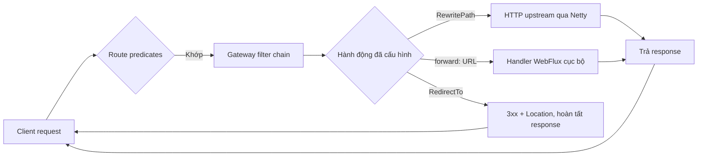
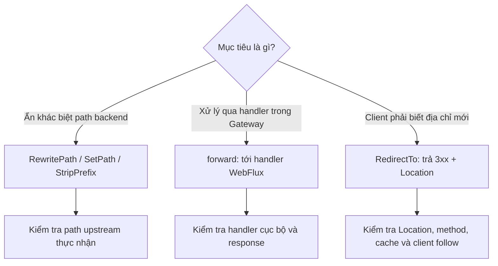

# Phân biệt rewrite nội bộ, forward nội bộ và redirect ra client

## 1. Bối cảnh: cùng là thay đổi đường đi nhưng khác hoàn toàn về cơ chế

Trong kiến trúc microservices, **Spring Cloud Gateway** là điểm vào chung cho các request HTTP. Gateway chọn route bằng predicate, áp dụng filter chain, có thể thay đổi đường dẫn/header và chuyển request đến dịch vụ phù hợp. Khi API chuyển phiên bản hoặc cần xử lý lỗi, ta thường gặp ba nhu cầu rất giống nhau về tên gọi:

1. Client gọi `/api/v1/orders/42`, nhưng `order-service` chỉ cung cấp `/orders/42`. Gateway cần **viết lại đường dẫn nội bộ (rewrite)**.
2. Client gọi một URL do Gateway tiếp nhận, nhưng yêu cầu cần được một **handler nằm trong chính ứng dụng Gateway** xử lý. Ta cần **forward nội bộ**.
3. Client gọi URL cũ `/docs-old` và cần được hướng dẫn truy cập URL mới `https://docs.example.test/gateway`. Ta cần **HTTP redirect ra client**.

Cả ba đều có thể thay đổi nơi request được xử lý, nhưng **ai gửi request tiếp theo**, **client có biết URL mới hay không**, **có phản hồi HTTP 3xx hay không** và **có tạo thêm một lượt kết nối HTTP từ client hay không** khác nhau.

Bài thuộc chương **Đường dẫn và chuyển hướng** trong module **SPRING_CLOUD_GATEWAY**. Nắm rõ ba cơ chế là điều kiện để cấu hình route predicate, filter, service discovery, xác thực, rate limiting, retry, circuit breaker, TLS và quan sát request mà không chuyển traffic sai nơi hoặc tạo vòng lặp chuyển hướng.

> **Phạm vi:** các ví dụ tập trung vào **Spring Cloud Gateway Server WebFlux**, dùng cấu hình route dạng `spring.cloud.gateway.routes` phổ biến ở nhánh 4.x. Namespace, starter, API và hành vi chi tiết có thể đổi ở bản Spring Cloud Gateway mới hoặc khi dùng biến thể Server MVC. Cần đối chiếu tài liệu đúng phiên bản của dự án trước khi đưa cấu hình lên production.

## 2. So sánh tổng quan

| Tiêu chí | Rewrite đường dẫn nội bộ | Forward đến handler nội bộ | Redirect ra client |
| --- | --- | --- | --- |
| Cơ chế tiêu biểu trong Gateway | `RewritePath`, `SetPath`, `StripPrefix` | URI có scheme `forward:` | Filter `RedirectTo` |
| Mục đích | Thay đổi **path** dùng cho bước chuyển tiếp | Chuyển xử lý tới handler **trong cùng ứng dụng** | Yêu cầu **client** sử dụng một URL khác |
| Client có đổi URL đang gọi? | Không | Không | Có thể có, khi client theo `Location` |
| Mặc định sinh HTTP 3xx? | Không | Không | Có; ví dụ 302, 307, 308 |
| Client có phải gửi request thứ hai? | Không | Không | Có, nếu client chọn theo redirect |
| Thành phần xử lý tiếp | Thường là upstream HTTP hoặc tuyến đã định | `DispatcherHandler`/handler WebFlux cục bộ | Client, trình duyệt hoặc HTTP client |
| Có thể chuyển sang service từ xa? | Có, nhờ URI route như `http://`, `https://`, `lb://` | Bản thân `forward:` dùng handler nội bộ; handler có thể tự gọi service khác nếu được lập trình | URL trong `Location` có thể thuộc một host khác |
| Độ trễ | Thường cùng một lượt request phía client | Xử lý nội bộ trong cùng lượt request | Có thể thêm RTT, DNS/TLS và kết nối cho lần gọi tiếp |
| Trường hợp sử dụng | API alias, bỏ prefix, đổi cấu trúc path của backend | Fallback, endpoint xử lý ngay tại Gateway | URL canonical, di chuyển tài liệu/trang, endpoint được chuyển hẳn |

**Điểm dễ nhầm nhất:** Trong ngôn ngữ đời thường, “gateway forward request đến order-service” thường chỉ hoạt động **reverse proxy** bình thường. Nhưng **`forward:` trong Spring Cloud Gateway là một scheme định tuyến đặc biệt để xử lý trong ứng dụng WebFlux hiện tại**, không đồng nghĩa chuyển HTTP request tới một microservice chạy ở địa chỉ mạng khác.

### Sơ đồ ai là người tạo HTTP request tiếp theo

```mermaid
flowchart TB
    subgraph R["Rewrite: cùng HTTP request phía client"]
      RC["Client GET /api/v1/orders/42"] --> RG["Gateway: RewritePath"]
      RG --> RU["Upstream GET /orders/42"]
      RU --> RG2["Gateway: upstream response"]
      RG2 --> RC2["Client nhận response; URL yêu cầu ban đầu không đổi"]
    end
    subgraph F["Forward: chuyển tới handler cùng ứng dụng"]
      FC["Client GET /status"] --> FG["Gateway: forward:///internal/status"]
      FG --> FH["WebFlux handler nội bộ"]
      FH --> FC2["Client nhận response; không có redirect"]
    end
    subgraph D["Redirect: client chọn có theo Location hay không"]
      DC["Client GET /docs-old"] --> DG["Gateway: RedirectTo"]
      DG --> DR["HTTP 308 + Location"]
      DR --> DC2["Client quyết định gửi GET URL mới"]
      DC2 --> DS["Máy chủ của URL mới"]
    end
```



Trong thực tế, client **không bắt buộc** tuân theo redirect; nhiều thư viện HTTP chỉ tự động theo redirect khi tính năng đó được bật. Một số trình duyệt có thể cache permanent redirect nên việc kiểm thử cần lưu ý.

## 3. Request đi qua Gateway ở giai đoạn nào?

Một request ở Spring Cloud Gateway Server WebFlux thường đi qua các bước chính:

1. Reactor Netty/WebFlux nhận request và chọn route dựa trên **route predicates** như `Path`, `Host`, `Method`.
2. `FilteringWebHandler` thực thi các `GlobalFilter` và `GatewayFilter` của route theo thứ tự hiệu lực.
3. Filter biến đổi request có thể sửa path, header hoặc thuộc tính định tuyến.
4. Một filter định tuyến/handler phù hợp sẽ tiếp tục xử lý request; phản hồi quay về qua filter chain.



**Predicate được đánh giá để chọn route trước những filter route đó.** Vì vậy, nếu request ban đầu là `/api/v1/orders/42`, predicate có thể khớp path này, trong khi `RewritePath` sau đó khiến upstream nhận `/orders/42`. Việc sửa path trong filter không mặc nhiên làm Gateway chạy lại toàn bộ predicate để chọn một route mới.

Tính năng như `RequestRateLimiter`, xác thực Spring Security, circuit breaker, retry và timeout chỉ hoạt động nếu ứng dụng có dependency/chính sách được cấu hình. Ba thao tác rewrite, forward, redirect **không tự sinh ra** xác thực hoặc khả năng chịu lỗi.

## 4. Rewrite nội bộ: đổi path nhưng giữ nguyên giao tiếp phía client

### 4.1. Cách RewritePath hoạt động

`RewritePath` là GatewayFilter sử dụng **biểu thức chính quy (regular expression)** để thay đổi đường dẫn trước khi request tới upstream. Nó rất hữu ích khi URL API công khai không trùng URL mà service đích hiểu.

Giả sử:

```text
Client gọi:     GET /api/v1/orders/42?include=items
Gateway route:  order-v1
RewritePath:    /api/v1/orders/42 -> /orders/42
Upstream nhận:  GET /orders/42?include=items
```

Ví dụ file `application.yml` (đặt route trong Gateway Server WebFlux):

```yaml
spring:
  cloud:
    gateway:
      routes:
        - id: order-v1
          uri: http://localhost:8081
          predicates:
            - Path=/api/v1/orders/*
            - Method=GET
          filters:
            - 'RewritePath=^/api/v1/orders/(?<orderId>[^/]+)$, /orders/$\{orderId}'
```

Giải thích kỹ:

- `Path=/api/v1/orders/*` chọn request có một segment phía sau `/api/v1/orders/`; `Method=GET` giới hạn method.
- `^/api/v1/orders/(?<orderId>[^/]+)$` chỉ khớp path tương ứng, dùng nhóm tên `orderId` để bắt giá trị `42`.
- `/orders/$\{orderId}` là chuỗi thay thế khi viết trong cấu hình YAML; **dấu gạch chéo ngược trước ngoặc nhọn** bảo vệ placeholder của regex replacement khỏi cách phân giải placeholder cấu hình.
- `uri: http://localhost:8081` là nơi Gateway gửi request sau khi sửa path. Trong môi trường thực tế, URI này thường được đưa ra cấu hình riêng theo profile, hoặc dùng `lb://ORDER-SERVICE` khi có service discovery và load balancing.
- `include=items` thuộc query string; thao tác `RewritePath` thông thường thay **path**, không chủ động viết lại toàn bộ query/header. Filter khác có thể thay đổi chúng nếu được cấu hình.

Đối với biểu thức replacement trong **Java code**, dấu `${orderId}` của Java regular-expression replacement không cần cách escape YAML như file trên. Tránh trộn cú pháp Java literal, Spring placeholder và regex replacement: chúng được diễn giải ở những lớp khác nhau.

> Ví dụ trên chỉ định dạng path có đúng một `orderId`. Đường dẫn `/api/v1/orders/42/items` không phù hợp cùng mẫu; nếu cần nhiều segment, thiết kế lại cả Path predicate lẫn regex replacement, sau đó kiểm thử URL-encoded segments.

### 4.2. StripPrefix và SetPath có phải rewrite không?

Trong nghĩa rộng, **cả `StripPrefix` và `SetPath` đều là các dạng biến đổi đường dẫn nội bộ**. Chúng phù hợp với yêu cầu đơn giản hơn `RewritePath`.

| Filter | Ví dụ | Kết quả |
| --- | --- | --- |
| `StripPrefix=2` | `/api/v1/orders/42` | `/orders/42` |
| `SetPath=/orders/{id}` với predicate `Path=/api/v1/orders/{id}` | `/api/v1/orders/42` | `/orders/42` |
| `RewritePath` kèm regex | `/api/v1/orders/42` | `/orders/42` |

Nếu mọi endpoint đều chỉ cần bỏ `/api/v1`, cấu hình ngắn hơn:

```yaml
spring:
  cloud:
    gateway:
      routes:
        - id: orders-strip
          uri: http://localhost:8081
          predicates:
            - Path=/api/v1/orders/**
          filters:
            - StripPrefix=2
```

Nếu muốn ánh xạ template rõ ràng:

```yaml
spring:
  cloud:
    gateway:
      routes:
        - id: order-by-id
          uri: http://localhost:8081
          predicates:
            - Path=/api/v1/orders/{id}
          filters:
            - SetPath=/orders/{id}
```

Đây là **những cách cấu hình thay thế**, không phải ba route nên khai báo cùng lúc trong một ứng dụng mẫu: các predicate của chúng có thể chồng lấn và khiến việc xác định route được chọn thiếu rõ ràng. Hãy chọn cách đơn giản nhất diễn đạt đúng hợp đồng API.

### 4.3. Rewrite không phải redirect

Sau rewrite, nếu upstream trả `200 OK`, Gateway thông thường chuyển lại `200 OK`; **không có response `301/302/307/308` chỉ vì path thay đổi**. Client vẫn gửi request tới URL ban đầu `/api/v1/orders/42` trong cùng giao dịch.

Nếu cần khiến trình duyệt đổi URL hiển thị, hoặc muốn client chủ động sử dụng URL chuẩn mới ở những lần gọi tiếp theo, một filter rewrite **không đạt mục tiêu đó**. Khi ấy cần redirect ra client hoặc thay đổi hợp đồng API.

## 5. Forward nội bộ: chuyển request cho handler trong chính Gateway

### 5.1. Scheme forward: làm việc gì?

Khi route có URI bắt đầu bằng `forward:`, **`ForwardRoutingFilter`** sử dụng cơ chế handler của Spring WebFlux (qua `DispatcherHandler`) để tiếp tục xử lý request **trong cùng ứng dụng**. Nó không mở một HTTP connection mới từ client và không mặc định phát `Location`.

Ví dụ, Gateway cần cung cấp nội dung tại `GET /status` bằng một controller nội bộ ở `/internal/status`.

```yaml
spring:
  cloud:
    gateway:
      routes:
        - id: local-status
          uri: forward:///internal/status
          predicates:
            - Path=/status
            - Method=GET
```

Một handler mẫu nằm trong **chính ứng dụng Gateway**:

```java
import java.util.Map;
import org.springframework.web.bind.annotation.GetMapping;
import org.springframework.web.bind.annotation.RestController;
import reactor.core.publisher.Mono;

@RestController
class GatewayStatusController {

    @GetMapping("/internal/status")
    Mono<Map<String, String>> status() {
        return Mono.just(Map.of("source", "gateway", "state", "ok"));
    }
}
```

Dòng xử lý:

```text
Client       GET /status
Gateway      Khớp route local-status
Forward      forward:///internal/status
WebFlux      Gọi GatewayStatusController tại /internal/status
Client       Nhận 200 + JSON (giả sử handler chạy thành công)
```

Đường dẫn trong `forward:///internal/status` được dùng cho bước dispatch tới handler nội bộ. **Địa chỉ mà client đã gọi vẫn là `/status`**, không có lượt gọi HTTP mới tới `/internal/status` trên trình duyệt.

**Ranh giới:** forward ở đây chỉ phù hợp nếu ứng dụng Gateway thật sự có một handler khớp đích. Nếu `/internal/status` thuộc một microservice khác, `forward:` không tự tìm đến service đó; hãy dùng URI `http(s)://...` hoặc `lb://SERVICE-ID` cho việc proxy đến upstream.

### 5.2. Dùng forward cho fallback của circuit breaker

Một use case phổ biến của `forward:` là **fallback handler nội bộ** khi một request đến upstream thất bại theo chính sách của circuit breaker:

```yaml
spring:
  cloud:
    gateway:
      routes:
        - id: inventory
          uri: http://localhost:8082
          predicates:
            - Path=/api/inventory/**
          filters:
            - name: CircuitBreaker
              args:
                name: inventoryBreaker
                fallbackUri: forward:/internal/inventory-fallback
```

Khi filter CircuitBreaker quyết định dùng fallback, nó có thể chuyển xử lý sang handler WebFlux `/internal/inventory-fallback`. **Không có redirect 3xx tới client**; HTTP status/body cuối cùng phụ thuộc handler fallback và cách Gateway xử lý lỗi.

Để ví dụ này hoạt động, dự án phải có **Spring Cloud CircuitBreaker** integration/dependency và cấu hình phù hợp, cùng một handler nội bộ thực sự tồn tại. Nếu muốn fallback chỉ cho một số lỗi HTTP hoặc loại exception, phải quy định thêm chính sách tương ứng. Việc khai báo `fallbackUri` không biến mọi response 4xx thành fallback.

Đừng lạm dụng forward để nhét logic nghiệp vụ vào Gateway. Các nghiệp vụ kiểm tra quyền sở hữu đơn hàng, thanh toán và cập nhật tồn kho vẫn nên nằm ở microservice tương ứng.

### 5.3. Forward khác với “proxy request” bình thường

So sánh hai URI route:

```yaml
# Chuyển HTTP request đến một backend thực sự:
uri: http://localhost:8081

# Dispatch đến handler thuộc cùng ứng dụng WebFlux:
uri: forward:///internal/status
```

Ở dòng đầu, Spring Cloud Gateway sử dụng HTTP client/transport cho request đi đến backend. Ở dòng thứ hai, `forward:` là chỉ thị **dispatch cục bộ**. Nếu handler cục bộ tiếp tục gọi `WebClient` đến microservice, đó là **lời gọi do handler lập trình thêm**, không phải tác dụng tự động của forward.

## 6. Redirect ra client: phản hồi 3xx và Location

### 6.1. RedirectTo gửi gì?

`RedirectTo` là GatewayFilter gửi response với **HTTP status chuyển hướng** và header **`Location`**. Gateway kết thúc xử lý response cho request hiện tại; client có thể tự tạo request mới đến URL trong `Location`.

Ví dụ, tài liệu cũ đã chuyển sang địa chỉ mới:

```yaml
spring:
  cloud:
    gateway:
      routes:
        - id: docs-redirect
          uri: http://localhost:8081
          predicates:
            - Path=/docs-old
          filters:
            - RedirectTo=308, https://docs.example.test/gateway
```

Giả sử filter chạy bình thường, response mong đợi:

```http
HTTP/1.1 308 Permanent Redirect
Location: https://docs.example.test/gateway
```

Trong route này, `uri` là trường cấu hình route bắt buộc trong ví dụ, nhưng **`RedirectTo` hoàn tất response trước khi proxy HTTP đến địa chỉ đó**. Không nên thiết kế upstream thật dựa trên việc request redirect vẫn được gửi sang backend. Chỉ các request khớp `Path=/docs-old` mới được redirect bởi route trên.

Giá trị `Location` có thể chỉ đến cùng host hoặc host khác. “Redirect ra client” nghĩa là **quyết định đi tới URL mới thuộc về client**, không nhất thiết URL đích phải nằm ngoài tổ chức.

### 6.2. Mã 301, 302, 303, 307, 308 khác nhau như thế nào?

| HTTP status | Ý nghĩa thường gặp | Điều cần nhớ về method |
| --- | --- | --- |
| `301 Moved Permanently` | Chuyển địa chỉ có tính lâu dài | Client lịch sử có thể đổi `POST` thành `GET` |
| `302 Found` | Chuyển địa chỉ tạm thời | Client lịch sử có thể đổi `POST` thành `GET` |
| `303 See Other` | Hướng dẫn xem tài nguyên khác, thường sau thao tác ghi | Client thường dùng `GET` cho request tiếp theo (trừ `HEAD`) |
| `307 Temporary Redirect` | Chuyển tạm và giữ ngữ nghĩa method | Client tuân chuẩn giữ method và body khi theo redirect |
| `308 Permanent Redirect` | Chuyển lâu dài và giữ ngữ nghĩa method | Client tuân chuẩn giữ method và body khi theo redirect |

Đối với API có `POST`, `PUT` hoặc payload lớn, lựa chọn mã 3xx không chỉ là vấn đề URL. Nếu client thực hiện lại request, **method/body và thông tin xác thực** cần được xử lý đúng, tránh lặp side effect hoặc làm rò token qua domain khác. `307` và `308` bảo toàn method/body khi được tuân theo, nhưng không khiến một lần gửi lại trở nên idempotent.

**Tránh redirect vĩnh viễn khi chưa chắc endpoint mới là hợp đồng lâu dài:** client và proxy có thể cache `301`/`308`, làm việc hoàn tác chuyển hướng trở nên khó hơn. Với quá trình thử nghiệm, có thể cân nhắc `302`/`307` kết hợp chính sách cache phù hợp.

### 6.3. RedirectTo tĩnh không tự ghép path/query

Ví dụ:

```yaml
predicates:
  - Path=/old/**
filters:
  - RedirectTo=308, https://new.example.test/
```

Không được mặc định suy luận:

```text
GET /old/orders/42?view=full
-> Location: https://new.example.test/orders/42?view=full
```

`RedirectTo` với URL tĩnh chỉ định **giá trị Location được cấu hình**, không tự sao chép path/query gốc thành URL động. Muốn preserve/migrate path hoặc query sang địa chỉ mới, cần một cơ chế phù hợp có kiểm thử (chẳng hạn redirect handler riêng có kiểm soát), đồng thời validate điểm đến. Không tự ghép giá trị chưa tin cậy thành `Location`.

## 7. Ba hành vi với cùng URL đầu vào: so sánh từng bước

Giả sử client gửi:

```http
GET /api/v1/orders/42 HTTP/1.1
Host: api.example.test
```

Tùy chính sách, ba cách xử lý sẽ dẫn đến ba kết quả khác nhau:

| Bước | Rewrite | Forward | Redirect |
| --- | --- | --- | --- |
| 1. Chọn route | Predicate khớp URL gốc | Predicate khớp URL gốc | Predicate khớp URL gốc |
| 2. Biến đổi | Sửa path trong request Gateway | Dùng URI `forward:` để dispatch handler | Tạo status 3xx và `Location` |
| 3. Bên xử lý tiếp | Upstream `order-service` qua HTTP | Handler bên trong tiến trình Gateway | Client tự quyết định request tiếp theo |
| 4. URL client đang dùng | `/api/v1/orders/42` | `/api/v1/orders/42` | Có thể đổi sang URL đích |
| 5. Status mặc định chỉ vì cơ chế | Không bắt buộc 3xx | Không bắt buộc 3xx | Có 3xx |
| 6. Phụ thuộc thêm | URI service và filter, có thể discovery | Handler nội bộ và logic handler | Hành vi redirect của client, DNS/TLS URL mới |

**Lưu ý:** HTTP status cuối cùng với rewrite/forward được quyết định bởi upstream hoặc handler, cũng như error handler/filter. `RewritePath` không bảo đảm `200`; `forward:` cũng không bảo đảm có handler hợp lệ.

### Quy tắc lựa chọn nhanh



## 8. Java DSL và phối hợp trong một ứng dụng

Để minh họa việc khai báo route bằng Java DSL, ví dụ sau tạo hai tuyến: tuyến rewrite đến upstream và tuyến redirect. Mỗi tuyến có predicate và filter riêng:

```java
import org.springframework.cloud.gateway.route.RouteLocator;
import org.springframework.cloud.gateway.route.builder.RouteLocatorBuilder;
import org.springframework.context.annotation.Bean;
import org.springframework.context.annotation.Configuration;
import org.springframework.http.HttpMethod;

@Configuration
class GatewayRoutesConfig {

    @Bean
    RouteLocator routes(RouteLocatorBuilder builder) {
        return builder.routes()
            .route("orders-rewrite", r -> r
                .path("/api/v1/orders/*")
                .and().method(HttpMethod.GET)
                .filters(f -> f.rewritePath(
                    "^/api/v1/orders/(?<orderId>[^/]+)$",
                    "/orders/${orderId}"))
                .uri("http://localhost:8081"))

            .route("docs-redirect", r -> r
                .path("/docs-old")
                .filters(f -> f.redirectTo(
                    308, "https://docs.example.test/gateway"))
                .uri("http://localhost:8081"))
            .build();
    }
}
```

Ở Java code, regex replacement `"/orders/${orderId}"` mang ý nghĩa nhóm tên `orderId` của Java regex; **không cần ký tự escape trước `${orderId}` như khi viết YAML**. Với các bản Spring Cloud Gateway có API Java DSL khác, kiểm tra chữ ký `GatewayFilterSpec.rewritePath(...)` và `GatewayFilterSpec.redirectTo(...)` đang có.

`forward:` cũng có thể được đặt làm URI route qua Java DSL nếu cần:

```java
.route("local-status", r -> r
    .path("/status")
    .uri("forward:///internal/status"))
```

Các ví dụ là **phương án thay thế để học cú pháp**. Đừng khai báo lại cùng route ID/path qua cả YAML và Java trong một ứng dụng mà không chủ động quản lý trùng lặp/thứ tự route.

## 9. Tương tác với filter order, route predicate và lỗi

### 9.1. Filter order có thể làm kết quả thay đổi

Ví dụ, `RewritePath` phải được áp dụng trước khi filter định tuyến HTTP gửi request đến upstream. Spring Cloud Gateway có thứ tự filter nội bộ để thực hiện việc này; khi tự viết `GlobalFilter` hoặc `OrderedGatewayFilter`, developer cần chú ý khi đọc/ghi path:

- Filter đọc path **trước rewrite** có thể thấy `/api/v1/orders/42`.
- Filter đọc path **sau rewrite** có thể thấy `/orders/42`, nếu được đặt đúng vị trí và nhận đúng `ServerWebExchange` đã mutate.
- Phần xử lý **post** chạy khi chain trả về tín hiệu; response có thể đã commit nên không nên tùy ý đổi header ở bước đó.
- Cần phân biệt request URI, request path đã biến đổi và thuộc tính URL dùng cho bước routing của Gateway.

Một lỗi phổ biến là cho custom filter cố chuyển host/path bằng cách sửa header ở pha post: lúc đó upstream đã nhận request, thay đổi không còn tác dụng đối với request vừa gửi.

### 9.2. Không kết hợp forward và redirect theo giả định sai

`forward:` không tự gửi `Location`. Nếu handler nội bộ muốn phản hồi redirect, **handler ấy** phải tạo response 3xx và `Location` rõ ràng. Ngược lại, route chỉ có `RedirectTo` thường hoàn tất response mà không chạy HTTP request tới upstream.

Một request có thể đi qua nhiều filter, nhưng không nên cấu hình redirect và rewrite cho cùng route nếu không có mục đích rõ ràng: redirect trả response sớm nên path rewrite có thể không được dùng để gọi backend như bạn tưởng. Khi cần URL mới, chọn giải pháp theo bên phải thực hiện request tiếp.

### 9.3. Route chồng lấn và vòng lặp

Hãy chú ý các tình huống:

- Route `/api/**` và route `/api/v1/orders/**` đều có thể khớp một request; đặt `order` phù hợp và kiểm tra tuyến thực sự được chọn.
- Redirect `/old` sang `/new` nhưng proxy/ứng dụng ở `/new` lại redirect về `/old`: client có thể gặp **redirect loop**.
- Forward từ một handler tới path lại kích hoạt chính quy tắc forward trước đó: cần tránh **internal dispatch loop**.
- Một custom filter rewrite sang path không thuộc backend đích có thể tạo `404` ở upstream, dù predicate của Gateway đã khớp.
- Nếu Gateway đứng sau load balancer kết thúc TLS, redirect xây dựng từ scheme/host không chính xác có thể làm client lặp `http -> https` hoặc rò địa chỉ nội bộ. Cần cấu hình xử lý proxy headers đúng ranh giới tin cậy.

Đừng dùng `Host` hoặc header tùy ý của client để tự tạo redirect target mà không xác thực. Điều này có thể tạo **open redirect**, khiến domain uy tín của API bị lợi dụng để chuyển người dùng sang website giả mạo.

## 10. Bảo mật, TLS, CORS và kiểm soát tính đúng đắn

### 10.1. Rewrite/forward không vượt qua authorization

Vì client vẫn gọi URL công khai khi rewrite/forward, các chính sách Spring Security phải kiểm soát API công khai và quyền truy cập tới handler/endpoint tương ứng. Một số trường hợp cần xem xét:

- Gateway xác thực JWT nhưng service vẫn phải kiểm tra quyền sở hữu đơn hàng.
- Forward tới endpoint nội bộ có thể khiến handler ấy bị truy cập trực tiếp nếu không có chính sách bảo vệ path và network phù hợp.
- Rewrite đến path backend “nội bộ” không khiến endpoint ấy tự trở nên an toàn; service cần kiểm tra quyền và giới hạn truy cập.
- Header `X-User-Id` hoặc `X-Role` do client cung cấp không thể được coi là danh tính đáng tin chỉ vì chúng đi qua Gateway.

Rate limiting, circuit breaker, retry và timeout nên được cấu hình đúng chỗ trong filter chain. Với request ghi như `POST /payments`, retry có thể lặp side effect dù rewrite path không đổi. Cancellation trong forward không bảo đảm hoàn tác hành động đã thực hiện ở downstream.

### 10.2. Redirect có ranh giới HTTP mới

Redirect sang host khác thường tạo một lượt kết nối mới, với các hệ quả:

- Trình duyệt có thể áp dụng lại quy tắc **CORS**, cookie domain, SameSite và cách cấp credentials ở URL đích.
- HTTP client có thể quyết định **có giữ Authorization header hoặc cookie khi đổi host** hay không theo chính sách bảo mật.
- Chuyển hướng tới `http://` từ API `https://` có thể làm giảm bảo mật đường truyền; nên dùng đích HTTPS phù hợp.
- Redirect tĩnh có thể được cache; kiểm tra mã 3xx, `Cache-Control` và tính lâu dài của URL.
- Redirect đến host khác có thể làm thay đổi cơ chế xác thực, rate limiting và observability của request tiếp theo.

Không ghi secret vào URL redirect, nhất là query string, vì URL có thể xuất hiện trong history, access log hoặc `Referer` tùy chính sách trình duyệt.

### 10.3. Phân tích URL có mã hóa và query

Khi dùng regex rewrite, cần kiểm thử:

- Slash cuối URL: `/api/v1/orders/42/` có khớp cùng regex hay không?
- Path có ký tự Unicode, URL-encoded slash, dấu chấm hoặc ký tự đặc biệt.
- Phân biệt path với query: `/orders/42?format=csv` có path `/orders/42`, query `format=csv`.
- Regex quá rộng có thể biến đổi nhầm những endpoint khác.
- `StripPrefix` bỏ **segment**, không xóa số lượng ký tự tùy ý.

Một regex gắn `^...\$` thường giúp giới hạn đúng cấu trúc path; nhưng nếu muốn bắt nested path hay optional trailing slash cần khai báo tường minh. Không ghép path được cung cấp từ input chưa được kiểm tra thành URL đến host tùy ý.

## 11. Thực hành kiểm chứng bằng curl

Giả sử Gateway chạy trên `http://localhost:8080`; các ví dụ dưới **độc lập**, nên bật từng cấu hình đúng trường hợp cần thử. Upstream hoặc handler cần thực sự chạy để xác minh nội dung response.

### 11.1. Rewrite: xác nhận upstream nhận path mới

Với route `order-v1` của mục 4:

```bash
curl -i "http://localhost:8080/api/v1/orders/42?include=items"
```

Dự kiến:

```text
Client gọi Gateway: /api/v1/orders/42?include=items
Gateway gửi upstream: /orders/42?include=items
HTTP response: tùy order-service, không mặc nhiên là 3xx
```

Để xác minh chính xác, dùng một upstream mock/echo HTTP server ghi lại path và query nhận được. `200 OK` phía client **chưa đủ chứng minh rewrite đúng** nếu service có nhiều endpoint tương tự; cần xem log upstream hoặc request recording.

### 11.2. Forward: xác nhận handler Gateway xử lý

Với route `local-status` và `GatewayStatusController` của mục 5:

```bash
curl -i "http://localhost:8080/status"
```

Khi handler hoạt động bình thường, response có thể là:

```http
HTTP/1.1 200 OK
Content-Type: application/json

{"source":"gateway","state":"ok"}
```

Không có header `Location` chỉ vì dùng `forward:`. Nếu `/internal/status` không có handler, hoặc route forward không được áp dụng như mong muốn, có thể nhận 404 hoặc một lỗi khác tùy cấu hình. Việc thử cả `GET /internal/status` còn giúp kiểm tra liệu endpoint nội bộ có bị truy cập trực tiếp và có cần khóa quyền hay không.

### 11.3. Redirect: xem 3xx trước khi client theo URL mới

Với route `docs-redirect`:

```bash
# Hiển thị status + Location, không tự động theo redirect:
curl -i "http://localhost:8080/docs-old"

# Chỉ dùng với URL đích bạn kiểm soát:
curl -v -L --max-redirs 3 "http://localhost:8080/docs-old"
```

Lệnh đầu tiên cần cho thấy status `308` và `Location: https://docs.example.test/gateway`. Lệnh thứ hai (`-L`) **yêu cầu curl theo redirect**, giúp quan sát lượt HTTP mới; hãy thay domain minh họa bằng địa chỉ đích hợp lệ và đáng tin khi thử thật.

Nếu dùng `curl -I`, bạn đang gửi **HEAD**, có thể không khớp một route chỉ cho `GET`; để so sánh hành vi route, ưu tiên `curl -i` trừ khi chủ động kiểm thử HEAD.

### 11.4. Bảng kiểm thử kỳ vọng

| Ca kiểm thử | Input | Kỳ vọng |
| --- | --- | --- |
| R1 | GET `/api/v1/orders/42` | Rewrite sang upstream `/orders/42`, không tự sinh redirect |
| R2 | GET `/api/v1/orders/42?include=items` | Path được rewrite, query vẫn có nếu không có filter khác sửa |
| R3 | GET `/api/v1/orders/42/items` | Không khớp route một-segment trong ví dụ |
| F1 | GET `/status` | Handler WebFlux tại `/internal/status` xử lý trong Gateway |
| F2 | Không tồn tại handler forward | Không nhận được response mong muốn; kiểm tra mapping |
| D1 | GET `/docs-old` | `308` + `Location` cố định |
| D2 | Client không follow redirect | Không có request thứ hai tới URL mới |
| D3 | Client follow redirect | Request tiếp theo đến URL ở `Location`, theo chính sách client |
| D4 | Redirect target trỏ ngược về URL cũ | Có nguy cơ vòng lặp, cần chặn/test |

## 12. Troubleshooting: nhìn status để đoán đúng lớp lỗi

| Hiện tượng | Nguyên nhân có thể | Cách xác minh |
| --- | --- | --- |
| Gateway trả `404`, không thấy upstream request | Route predicate không khớp; handler forward không tồn tại | Kiểm tra route ID, path/method, mapping WebFlux |
| Upstream trả `404` sau rewrite | Regex không khớp hoặc path backend không tồn tại | Log path gốc và path upstream, kiểm tra `StripPrefix` |
| Regex `RewritePath` giữ nguyên `$\{orderId}` hoặc lỗi placeholder | Sai cách escape replacement trong YAML | Dùng cú pháp replacement theo đúng phiên bản, đọc cấu hình hiệu lực |
| Client nhận `308` thay vì dữ liệu backend | Đang dùng `RedirectTo` chứ không phải rewrite | Kiểm tra status/`Location`, route filters |
| Client không đổi URL dù backend đã nhận path khác | Đó là rewrite/forward, không phải redirect | Xác định mục tiêu cần URL mới ở phía client hay không |
| `forward:` không gọi microservice như mong đợi | Forward chỉ dispatch handler nội bộ | Dùng `http(s)://` hoặc `lb://SERVICE` để proxy đến service |
| Redirect vô hạn | Đích redirect trả về vị trí gốc hoặc proxy xử lý scheme sai | Dùng `curl -v -L --max-redirs`, xem chuỗi Location |
| Redirect quay về HTTP sau TLS termination | Proxy headers/scheme được hiểu sai | Kiểm tra Forwarded/X-Forwarded có giới hạn nguồn tin cậy |
| Sau rewrite bị `401/403` | Chính sách xác thực/authorization của Gateway hoặc upstream | Kiểm tra Spring Security và quyền trên resource |
| Dùng `lb://` rồi gặp 503 | Không có instance khả dụng, discovery/load balancing chưa cấu hình | Kiểm tra registry, load balancer, health và service ID |
| Redirect URL chứa host bất kỳ do client kiểm soát | Nguy cơ open redirect | Dùng allowlist/URL đích cố định, không phản chiếu input thô |

Với observability, nên ghi route ID, trace/request ID, HTTP status và thời gian xử lý; khi debug rewrite có thể ghi **path đã làm sạch thông tin nhạy cảm**. Không ghi access token, private data hoặc query chứa credential vào log.

## 13. Tình huống thiết kế: chuyển API v1 sang v2

Đội phát triển muốn đổi API công khai từ `/api/v1/orders/{id}` sang `/api/v2/orders/{id}`. Có ba cách tiếp cận tùy mục tiêu:

**Phương án A — giữ tương thích client cũ bằng rewrite.** Gateway nhận `/api/v1/orders/42` và sửa thành path mà backend v2 hỗ trợ. Client vẫn sử dụng URL v1; đội backend có thể tái cấu trúc đường dẫn nội bộ mà chưa buộc client nâng cấp. Cần kiểm soát schema/semantics, vì rewrite path không tự chuyển đổi JSON, mã lỗi hoặc quyền truy cập của phiên bản API.

**Phương án B — xử lý đặc biệt ở chính Gateway bằng forward.** Chỉ nên chọn khi có handler local thật sự cần tiếp nhận request, ví dụ fallback được thiết kế riêng. `forward:` không phải chiến lược thay thế chung cho một microservice mới nằm ở máy khác.

**Phương án C — công bố URL mới bằng redirect.** Gateway trả `308 Location: https://api.example.test/api/v2/orders/42` để client chuyển sang API mới, sau khi xác nhận client hỗ trợ redirect và duy trì method/body/auth đúng cách. Với API máy-máy và request ghi dữ liệu, nhiều hệ thống ưu tiên thông báo thay đổi hợp đồng API qua tài liệu/SDK và duy trì route tương thích thay vì dựa hoàn toàn vào auto redirect.

Một kế hoạch migration thực tế có thể **kết hợp nhiều giai đoạn**: tiếp tục rewrite v1 để client cũ hoạt động, bổ sung metrics theo route để xem lưu lượng còn lại, cập nhật tài liệu API và công bố lộ trình loại bỏ URL cũ. Redirect là một công cụ có thể cân nhắc khi phù hợp với loại tài nguyên và hành vi client.

## 14. Câu hỏi tự kiểm tra

1. Gateway nhận `GET /api/v1/orders/42` nhưng backend chỉ biết `/orders/42`; client không cần đổi URL. Bạn chọn filter nào? Vì sao?
2. Vì sao `forward:///internal/fallback` không tự chuyển request tới service `fallback-service` ở một container khác?
3. Khác nhau giữa `RewritePath` và `RedirectTo=308` ở góc nhìn số request HTTP và header `Location`?
4. Vì sao `RedirectTo` với URL cố định không tự giữ `{id}` hoặc query string từ request gốc?
5. Tại sao `307`/`308` giữ method vẫn chưa đủ để bảo đảm an toàn khi retry/chuyển hướng request thanh toán?
6. Một route đã khớp predicate nhưng upstream trả 404 sau rewrite; bạn cần quan sát những thông tin nào?
7. Những dữ liệu nào cần kiểm tra khi redirect từ domain cũ sang domain mới có xác thực JWT/cookie và TLS?

**Tự làm:** tạo ba route độc lập trong môi trường thử nghiệm, sử dụng một mock HTTP upstream và một handler WebFlux local. Gửi `curl -i` tới từng URL, ghi lại **URL gốc**, **path phía upstream hoặc handler**, **status**, **Location** và **số request HTTP do client thực hiện**. Sự khác biệt giữa các kết quả sẽ giúp tránh nhầm ba cơ chế.

## 15. Tổng kết

Trong **Spring Cloud Gateway Server WebFlux**:

- **Rewrite** bằng `RewritePath`, `SetPath` hoặc `StripPrefix` thay đường dẫn **bên trong lần xử lý request hiện tại**; client không nhận URL mới chỉ vì rewrite.
- **Forward** bằng scheme `forward:` chuyển xử lý đến **handler WebFlux trong chính ứng dụng**; không tự tạo HTTP redirect hoặc tự gọi microservice ở máy khác.
- **Redirect** bằng `RedirectTo` trả **HTTP 3xx + Location** để client quyết định thực hiện **request mới**; cách theo redirect phụ thuộc HTTP client/trình duyệt.

Khi thiết kế Gateway cho microservices, hãy bắt đầu từ câu hỏi: **“Ai phải thực hiện bước tiếp theo: Gateway, handler nội bộ hay client?”** Câu trả lời giúp chọn cơ chế đúng, đặt filter chain phù hợp và kiểm tra riêng các ranh giới xác thực, giới hạn lưu lượng, circuit breaker, retry, TLS và observability.

Tài liệu để đối chiếu theo phiên bản:

- [Spring Cloud Gateway Server WebFlux — GatewayFilter Factories](https://docs.spring.io/spring-cloud-gateway/reference/spring-cloud-gateway-server-webflux/gatewayfilter-factories.html).
- [Spring Cloud Gateway Server WebFlux — Global Filters và Forward Routing](https://docs.spring.io/spring-cloud-gateway/reference/spring-cloud-gateway-server-webflux/global-filters.html).
- [MDN — HTTP Redirections](https://developer.mozilla.org/en-US/docs/Web/HTTP/Redirections).
