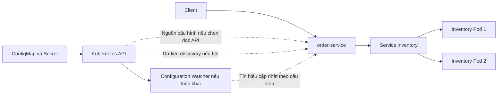

# Spring Cloud Kubernetes là gì và giải quyết những vấn đề nào

## Mục tiêu bài học

Sau bài này, bạn có thể giải thích vai trò của Spring Cloud Kubernetes, phân biệt nó với các khả năng sẵn có của Kubernetes và chọn cách tiếp cận phù hợp cho một ứng dụng Spring. Bạn cũng sẽ hiểu vì sao tích hợp discovery, cấu hình và theo dõi thay đổi luôn đi kèm các quyết định về phân quyền, vòng đời ứng dụng và khả năng vận hành.

Bài thuộc chương **Tổng quan** của module **SPRING_CLOUD_KUBERNETES**. Phạm vi module là tích hợp ứng dụng Spring với Kubernetes qua DiscoveryClient, ConfigMap, Secret, Spring Cloud LoadBalancer và Configuration Watcher; đồng thời thực hành RBAC, cập nhật cấu hình và theo dõi sức khỏe Pod.

## 1. Từ ứng dụng Spring đến môi trường Kubernetes

Giả sử hệ thống bán hàng có hai ứng dụng Spring Boot:

- `order-service` tiếp nhận yêu cầu đặt hàng.
- `inventory` cung cấp thông tin tồn kho.

Khi phát triển trên máy cá nhân, `order-service` có thể gọi một địa chỉ cố định như `http://localhost:8081`. Khi đưa lên Kubernetes, một ứng dụng thường có nhiều Pod. Pod có thể bị thay thế khi triển khai phiên bản mới, khi node gặp lỗi hoặc khi hệ thống thay đổi số bản sao. Địa chỉ IP của một Pod vì thế không phải một hợp đồng ổn định để ghi cứng trong mã nguồn.

Kubernetes đã cung cấp nhiều thành phần để giải quyết việc triển khai này: Service tạo điểm truy cập ổn định, DNS phân giải tên Service, ConfigMap và Secret cung cấp dữ liệu cấu hình, còn các probe hỗ trợ đánh giá sức khỏe container.

Tuy vậy, ứng dụng Spring vẫn có thể cần những khả năng ở cấp framework:

- Dùng giao diện `DiscoveryClient` của Spring Cloud để tra cứu dịch vụ trong Kubernetes.
- Đưa dữ liệu từ ConfigMap hoặc Secret vào hệ thống cấu hình của Spring theo cơ chế tích hợp được lựa chọn.
- Dùng Spring Cloud LoadBalancer khi ứng dụng cần quyết định đích gọi ở phía client.
- Phát hiện thay đổi cấu hình và kích hoạt một quy trình cập nhật phù hợp.
- Cung cấp thông tin sức khỏe phục vụ vận hành các thành phần tích hợp.

**Spring Cloud Kubernetes là tập hợp các thành phần tích hợp giữa hệ sinh thái Spring Cloud và Kubernetes.** Nó giúp ứng dụng Spring sử dụng một số tài nguyên, thông tin dịch vụ và sự kiện từ Kubernetes thông qua các mô hình quen thuộc của Spring.

Một ứng dụng Spring Boot có thể chạy tốt trên Kubernetes mà không dùng Spring Cloud Kubernetes. Điểm bắt đầu nên là nhu cầu cụ thể của ứng dụng, sau đó mới chọn thành phần tích hợp.

## 2. Phân biệt trách nhiệm của từng lớp

| Thành phần | Trách nhiệm chính | Ví dụ trong hệ thống bán hàng |
| --- | --- | --- |
| Spring Boot | Khởi tạo, cấu hình và vận hành ứng dụng Spring | Chạy API nhận đơn hàng, expose health endpoint khi được cấu hình |
| Kubernetes | Điều phối container và tài nguyên triển khai | Quản lý Deployment, Pod, Service, ConfigMap, Secret và probe |
| Spring Cloud | Cung cấp các abstraction và thành phần cho ứng dụng phân tán | `DiscoveryClient`, Spring Cloud LoadBalancer, cơ chế refresh tương ứng |
| Spring Cloud Kubernetes | Tích hợp các khả năng Spring Cloud với Kubernetes | Tra cứu dịch vụ Kubernetes qua discovery provider, tích hợp nguồn cấu hình Kubernetes |

Ví dụ, Kubernetes Service có thể đưa lưu lượng đến các backend của dịch vụ. Spring Cloud LoadBalancer lại cung cấp cơ chế chọn một đích gọi trong tiến trình ứng dụng. Hai cách có thể tạo ra hành vi khác nhau; cần hiểu đường đi thực tế của request thay vì xem chúng là hai tên gọi cho cùng một chức năng.

Tương tự, Spring Cloud Kubernetes không thay thế Deployment controller, không tự triển khai container và không tự tạo một chính sách bảo mật phù hợp cho cluster. Các công việc đó vẫn thuộc quy trình triển khai và vận hành Kubernetes.

## 3. Vấn đề thứ nhất: tìm dịch vụ khi Pod liên tục thay đổi

### 3.1. Cách dùng Kubernetes Service và DNS

Trong cùng namespace, `order-service` có thể gọi:

```text
http://inventory/api/stocks/SKU-001
```

Giả sử Service `inventory` công bố cổng HTTP 80, ứng dụng không cần biết có bao nhiêu Pod tồn kho đang hoạt động. Với tên miền cluster mặc định là `cluster.local`, một tên đầy đủ có thể là:

```text
inventory.team-a.svc.cluster.local
```

Trong đó `team-a` là namespace của Service. Tên miền cluster có thể được cấu hình khác, vì vậy không nên mặc định chuỗi đầy đủ này đúng với mọi môi trường.

Đây là cách tích hợp cơ bản thường đã đáp ứng việc gọi API nội bộ. Ứng dụng sử dụng HTTP client thông thường; DNS và tầng mạng Kubernetes cung cấp đường đến Service.

### 3.2. Khi nào cần DiscoveryClient?

`DiscoveryClient` là một abstraction của Spring Cloud để truy vấn danh sách dịch vụ hoặc các instance của dịch vụ. Spring Cloud Kubernetes cung cấp khả năng discovery dựa trên thông tin của Kubernetes theo implementation và cấu hình được chọn.

Ví dụ minh họa việc tra cứu trong mã Java:

```java
import java.net.URI;
import java.util.List;

import org.springframework.cloud.client.discovery.DiscoveryClient;
import org.springframework.stereotype.Service;

@Service
public class InventoryDirectory {

    private final DiscoveryClient discoveryClient;

    public InventoryDirectory(DiscoveryClient discoveryClient) {
        this.discoveryClient = discoveryClient;
    }

    public List<URI> inventoryInstances() {
        return discoveryClient.getInstances("inventory").stream()
                .map(instance -> instance.getUri())
                .toList();
    }
}
```

Ví dụ cần Java hỗ trợ `Stream.toList()`, thư viện Spring Cloud phù hợp và một discovery provider đã được cấu hình. Nó chỉ minh họa cách lấy URI, chưa thực hiện gọi HTTP, cân bằng tải, retry hay xử lý lỗi mạng.

Discovery hữu ích khi mã nguồn hoặc thư viện trong ứng dụng đã dựa trên `DiscoveryClient`, hoặc khi ứng dụng cần metadata dịch vụ để đưa ra quyết định. Ngược lại, việc chỉ gọi một Service có tên đã biết không mặc nhiên đòi hỏi discovery ở cấp ứng dụng.

### 3.3. Những điều cần quyết định trước khi bật discovery

- **Phạm vi namespace:** ứng dụng chỉ cần nhìn thấy dịch vụ trong namespace của mình hay có nhu cầu liên namespace đã được xác định?
- **Địa chỉ và cổng:** dịch vụ có nhiều cổng, nhiều giao thức hoặc metadata yêu cầu cách chọn riêng hay không?
- **Độ mới của dữ liệu:** cache, cơ chế theo dõi và thời điểm cập nhật ảnh hưởng thế nào khi Pod được thêm hoặc xóa?
- **Quyền đọc tài nguyên:** implementation cụ thể cần truy cập những tài nguyên Kubernetes nào?

Danh sách instance là thông tin được quan sát tại một thời điểm. Một instance có thể ngừng phục vụ ngay sau khi được chọn. Vì vậy, discovery không loại bỏ nhu cầu đặt timeout và xử lý lỗi khi gọi dịch vụ.

## 4. Vấn đề thứ hai: tách cấu hình khỏi bản build

### 4.1. Vì sao cấu hình nên nằm ngoài image?

Cùng một phiên bản `order-service` có thể chạy ở môi trường phát triển, thử nghiệm và production với các giá trị khác nhau: mức log, giới hạn nghiệp vụ hoặc thông tin kết nối hệ thống khác. Đóng gói các giá trị môi trường vào image khiến mỗi lần đổi cấu hình có thể phải tạo lại image.

Kubernetes cung cấp hai loại tài nguyên thường dùng:

| Tài nguyên | Mục đích thường gặp | Ví dụ |
| --- | --- | --- |
| ConfigMap | Dữ liệu cấu hình không nhạy cảm | Giới hạn số dòng trong đơn hàng, cờ tính năng, cấu hình log |
| Secret | Dữ liệu cần quản lý truy cập chặt chẽ | Mật khẩu, token, thông tin xác thực |

Secret không trở nên an toàn chỉ vì dữ liệu được biểu diễn bằng Base64. Việc bảo vệ dữ liệu còn phụ thuộc RBAC, bảo vệ dữ liệu lưu trữ, quy trình cấp phát và cách tránh đưa dữ liệu nhạy cảm vào log hoặc endpoint chẩn đoán.

### 4.2. Các con đường đưa cấu hình vào ứng dụng

Có nhiều cách để ứng dụng nhận dữ liệu từ ConfigMap và Secret:

1. Kubernetes đưa giá trị vào biến môi trường của container.
2. Kubernetes mount dữ liệu thành file; ứng dụng đọc file bằng cơ chế cấu hình phù hợp.
3. Một thành phần tích hợp của Spring Cloud Kubernetes đọc tài nguyên và đưa dữ liệu vào hệ thống cấu hình Spring, khi cách này được hỗ trợ và bật cho phiên bản sử dụng.

Hai cách đầu không yêu cầu ứng dụng tự gọi Kubernetes API để lấy dữ liệu đó. Cách thứ ba tạo thêm nhu cầu cấu hình client, quyền truy cập và chính sách khi nguồn cấu hình không sẵn sàng.

Ví dụ một ConfigMap lưu file cấu hình ứng dụng:

```yaml
apiVersion: v1
kind: ConfigMap
metadata:
  name: order-service-config
  namespace: team-a
data:
  application.yaml: |
    orders:
      max-items: 20
      allow-backorder: false
```

Manifest này chỉ tạo dữ liệu trong Kubernetes. Nó chưa chỉ ra Deployment mount dữ liệu ở đâu và cũng chưa cấu hình ứng dụng đọc dữ liệu đó. Tên `order-service-config` không tự biến tài nguyên thành nguồn cấu hình đang được ứng dụng sử dụng.

Trong bài thực hành sau, cần chọn rõ một cơ chế nạp cấu hình và nối đầy đủ các thành phần: tài nguyên Kubernetes, tên hoặc vị trí nguồn dữ liệu, thời điểm nạp và cách ứng dụng bind giá trị vào mã Java.

### 4.3. Tính nhất quán và thứ tự ưu tiên

Một khóa cấu hình có thể đồng thời xuất hiện trong file đóng gói cùng ứng dụng, file bên ngoài, biến môi trường và nguồn cấu hình bổ sung. Trước khi vận hành, cần xác định nguồn nào có ưu tiên cao hơn trong cấu hình thực tế của phiên bản đang dùng.

Ví dụ, ConfigMap chứa `orders.max-items=20` nhưng nguồn có ưu tiên cao hơn đang đặt giá trị thành `50`. Việc sửa ConfigMap không bảo đảm giá trị hiệu lực sẽ trở thành `20`.

Đối với cấu hình bắt buộc, cần quyết định ứng dụng sẽ dừng khởi động khi không đọc được nguồn hay dùng giá trị dự phòng. Không nên để việc thiếu mật khẩu hoặc địa chỉ hệ thống quan trọng bị che giấu bởi một giá trị mặc định không phù hợp.

## 5. Vấn đề thứ ba: cân bằng tải ở phía ứng dụng

Spring Cloud LoadBalancer cung cấp khả năng chọn đích gọi ở phía client. Khi kết hợp với discovery hoặc nguồn instance phù hợp, ứng dụng có thể dùng một tên dịch vụ logic thay vì ghi cứng địa chỉ đích.

Ví dụ minh họa với `RestTemplate`:

```java
import org.springframework.cloud.client.loadbalancer.LoadBalanced;
import org.springframework.context.annotation.Bean;
import org.springframework.context.annotation.Configuration;
import org.springframework.web.client.RestTemplate;

@Configuration
public class HttpClientConfiguration {

    @Bean
    @LoadBalanced
    RestTemplate inventoryRestTemplate() {
        return new RestTemplate();
    }
}
```

Sau đó, mã gọi có thể dùng:

```java
String url = "http://inventory/api/stocks/SKU-001";
String response = inventoryRestTemplate.getForObject(url, String.class);
```

Bean `RestTemplate` được đánh dấu `@LoadBalanced` cần có Spring Cloud LoadBalancer và nguồn cung cấp instance được cấu hình phù hợp. Trong trường hợp này, `inventory` được xử lý như tên dịch vụ logic của cơ chế cân bằng tải. Ví dụ chưa cấu hình timeout và các thiết lập cần thiết cho production.

Cùng một chuỗi URL có thể xuất hiện trong hai đường đi khác nhau:

```text
HTTP client thông thường
  -> phân giải DNS inventory
  -> địa chỉ Service
  -> backend được tầng mạng Kubernetes định tuyến

HTTP client có tích hợp LoadBalancer
  -> xử lý service ID inventory
  -> lấy danh sách đích theo cấu hình
  -> chọn đích rồi gửi request
```

Đích do load balancer chọn có thể liên quan đến endpoint của workload hoặc địa chỉ Service, tùy chế độ và implementation. Không nên khẳng định rằng bật Spring Cloud LoadBalancer luôn làm request đi thẳng đến Pod.

Trước khi thêm cơ chế này, hãy xác định điều cần đạt được: tương thích với abstraction đang có, chọn đích theo metadata hay một chính sách lựa chọn ở client. Nếu nhu cầu chỉ là gọi một Service ổn định, Kubernetes Service và DNS có thể đã đủ.

Cân bằng tải cũng không thay thế timeout, circuit breaker hay tính đúng đắn của retry. Đặc biệt, tự động gọi lại một thao tác tạo đơn hàng có thể gây tác dụng phụ nếu API không bảo đảm tính idempotent.

## 6. Vấn đề thứ tư: phản ứng khi cấu hình thay đổi

### 6.1. Lưu cấu hình mới chưa có nghĩa là ứng dụng đã dùng giá trị mới

Một thay đổi cấu hình thường đi qua nhiều bước:

```text
Sửa ConfigMap hoặc Secret
  -> thành phần theo dõi nhận biết thay đổi
  -> ứng dụng nhận tín hiệu cập nhật
  -> nguồn cấu hình được đọc lại theo cơ chế đã thiết lập
  -> các đối tượng sử dụng cấu hình nhận hoặc áp dụng giá trị mới
```

Chỉ một bước không hoạt động cũng có thể khiến ứng dụng tiếp tục dùng giá trị cũ.

Ví dụ, một bean đọc giá trị cấu hình đúng một lần trong constructor rồi lưu vào một trường. Ngay cả khi dữ liệu cấu hình đã được nạp lại, trường đó không tự thay đổi nếu không có cơ chế cập nhật hoặc tái tạo bean phù hợp.

### 6.2. Configuration Watcher đóng vai trò gì?

Configuration Watcher là thành phần theo dõi thay đổi cấu hình trong hệ sinh thái Spring Cloud Kubernetes. Theo phiên bản và cách triển khai, nó có thể gửi tín hiệu tới ứng dụng hoặc phối hợp với cơ chế thông báo cập nhật được hỗ trợ.

Watcher cần được cấu hình để biết tài nguyên nào cần theo dõi, ứng dụng nào liên quan và sử dụng cách thông báo nào. Bản thân việc triển khai Watcher không bảo đảm mọi ConfigMap, Secret hoặc mọi ứng dụng đều được cập nhật tự động.

Thiết kế đầy đủ cần trả lời:

- Tài nguyên nào được theo dõi và thuộc namespace nào?
- Những ứng dụng hoặc instance nào phải nhận thông báo?
- Endpoint hoặc kênh nhận thông báo được bảo vệ ra sao?
- Nhóm thuộc tính nào có thể áp dụng động an toàn?
- Làm sao xác nhận các replica đang sử dụng cùng một phiên bản cấu hình?

Không nên mở công khai endpoint refresh chỉ để việc cập nhật cấu hình thuận tiện hơn. Quyền cập nhật cấu hình có thể làm thay đổi hành vi ứng dụng và cần được giới hạn tương ứng.

### 6.3. Refresh hay rollout?

| Tình huống | Hướng xử lý cần cân nhắc |
| --- | --- |
| Cờ nghiệp vụ được thiết kế để đọc động | Refresh với cơ chế bind và vòng đời bean đã được kiểm chứng |
| Thông tin được thư viện đọc một lần khi khởi tạo | Tái tạo thành phần theo cơ chế thư viện hỗ trợ hoặc khởi động lại |
| Thay đổi mật khẩu của connection pool | Lập kế hoạch cập nhật credential và tái tạo kết nối phù hợp |
| Cấu hình được đưa vào biến môi trường | Tạo lại Pod hoặc rollout để tiến trình nhận giá trị mới |
| Cần kiểm soát thay đổi đồng bộ cùng một bản triển khai | Rollout có theo dõi trạng thái và kế hoạch rollback |

Với dữ liệu mount thành file, Kubernetes có thể cập nhật nội dung theo cơ chế đồng bộ của volume, nhưng ứng dụng vẫn phải biết cách đọc lại. Không nên giả định file thay đổi sẽ tự làm các bean thay đổi; một số cách mount như `subPath` còn có hành vi cập nhật khác.

Refresh là một khả năng vận hành cần thiết kế và kiểm chứng. Với nhiều hệ thống, rollout có kiểm soát là lựa chọn dễ quan sát hơn, dù thời gian áp dụng dài hơn cập nhật động.

## 7. RBAC: ứng dụng được phép nhìn thấy những gì?

Nếu một thành phần gọi Kubernetes API, nó cần danh tính và quyền phù hợp. Trong cluster, ứng dụng thường sử dụng ServiceAccount, còn RBAC quy định các thao tác danh tính đó được phép thực hiện.

Các thành phần chính gồm:

- **ServiceAccount:** danh tính của workload.
- **Role:** tập quyền trong một namespace.
- **RoleBinding:** gán Role cho danh tính.
- **ClusterRole và ClusterRoleBinding:** phục vụ các nhu cầu quyền rộng hơn; không nên dùng quyền toàn cluster chỉ vì cấu hình nhanh hơn.

Ví dụ dưới đây chỉ minh họa quyền đọc một ConfigMap có tên xác định bằng thao tác `get`:

```yaml
apiVersion: v1
kind: ServiceAccount
metadata:
  name: order-service
  namespace: team-a
---
apiVersion: rbac.authorization.k8s.io/v1
kind: Role
metadata:
  name: order-config-reader
  namespace: team-a
rules:
  - apiGroups: [""]
    resources: ["configmaps"]
    resourceNames: ["order-service-config"]
    verbs: ["get"]
---
apiVersion: rbac.authorization.k8s.io/v1
kind: RoleBinding
metadata:
  name: order-config-reader-binding
  namespace: team-a
subjects:
  - kind: ServiceAccount
    name: order-service
    namespace: team-a
roleRef:
  apiGroup: rbac.authorization.k8s.io
  kind: Role
  name: order-config-reader
```

Để workload sử dụng danh tính này, Pod template của Deployment phải chỉ định:

```yaml
spec:
  template:
    spec:
      serviceAccountName: order-service
```

Đoạn trên là phần trích của Deployment, không phải manifest triển khai đầy đủ.

Role minh họa không đủ cho một discovery client hoặc watcher cần `list` hay `watch`, và không cấp quyền đọc Secret. Quyền thực tế phải khớp với các lời gọi API của thành phần được bật; việc giới hạn tài nguyên theo tên cũng phải phù hợp với cách client truy vấn.

Nguyên tắc thực hành là bắt đầu từ phạm vi nhỏ nhất, xác định quyền cần thiết rồi mở rộng có căn cứ. Không cấp `cluster-admin` cho ứng dụng nghiệp vụ để xử lý nhanh lỗi `403 Forbidden`.

Nếu ứng dụng chỉ gọi Service qua DNS và nhận cấu hình từ môi trường hoặc volume, nó có thể không cần gọi Kubernetes API. Đây là một lý do quan trọng để chọn tính năng theo nhu cầu thay vì bật toàn bộ tích hợp.

## 8. Sức khỏe Pod và khả năng quan sát

### 8.1. Phân biệt các loại probe

| Probe | Câu hỏi được trả lời | Ảnh hưởng khi liên tục thất bại theo cấu hình |
| --- | --- | --- |
| Startup | Ứng dụng đã vượt qua giai đoạn khởi động chưa? | Container có thể bị khởi động lại; liveness và readiness chờ startup thành công khi có startup probe |
| Readiness | Instance này đã sẵn sàng nhận lưu lượng chưa? | Pod bị đánh dấu chưa sẵn sàng; thường không còn được chọn cho lưu lượng Service |
| Liveness | Tiến trình có còn ở trạng thái cần tiếp tục chạy không? | Container bị khởi động lại |

Spring Boot Actuator có thể cung cấp health endpoint và các nhóm health cho probe khi được cấu hình phù hợp. Spring Cloud Kubernetes có thể bổ sung các thông tin hoặc health contributor liên quan đến tích hợp được sử dụng, nhưng việc cấu hình probe vẫn phải được thực hiện ở phía Kubernetes.

Ví dụ một phần cấu hình container, giả sử Actuator đã cung cấp probe endpoint trên cùng cổng HTTP 8080:

```yaml
ports:
  - name: http
    containerPort: 8080
readinessProbe:
  httpGet:
    path: /actuator/health/readiness
    port: http
  initialDelaySeconds: 5
  periodSeconds: 5
livenessProbe:
  httpGet:
    path: /actuator/health/liveness
    port: http
  initialDelaySeconds: 15
  periodSeconds: 10
```

Các thông số thời gian chỉ để minh họa. Ứng dụng khởi động chậm có thể cần startup probe và các ngưỡng phù hợp. Nếu Actuator dùng cổng quản trị riêng, cần điều chỉnh cách kiểm tra để phản ánh đúng khả năng phục vụ của ứng dụng.

### 8.2. Không biến một sự cố bên ngoài thành vòng khởi động lại

Giả sử Kubernetes API tạm thời không truy cập được nhưng `order-service` vẫn có thể phục vụ từ cấu hình đã nạp. Nếu đưa tình trạng API này vào liveness một cách máy móc, nhiều container có thể bị khởi động lại cùng lúc mà không khắc phục được nguyên nhân.

Tương tự, readiness cần phản ánh khả năng nhận lưu lượng thực tế. Việc đưa mọi dịch vụ phụ thuộc vào readiness có thể khiến một sự cố lan rộng và loại bỏ toàn bộ các replica khỏi đường phục vụ.

Khi bật tích hợp, nên quan sát ít nhất:

- Lỗi xác thực hoặc phân quyền khi gọi Kubernetes API.
- Thời điểm nạp cấu hình và phiên bản cấu hình hiệu lực theo cách biểu diễn an toàn.
- Số lượng instance hoặc đích gọi mà ứng dụng nhìn thấy.
- Lần thông báo refresh gần nhất và kết quả áp dụng trên các replica.
- Readiness, liveness, số lần restart và độ trễ của lời gọi dịch vụ.

Không ghi giá trị Secret vào log để chứng minh rằng cấu hình đã được nạp. Có thể ghi trạng thái nạp thành công hoặc một định danh phiên bản cấu hình không chứa dữ liệu nhạy cảm.

## 9. Một kiến trúc minh họa và hai lựa chọn triển khai



Sơ đồ minh họa đường gọi nghiệp vụ qua Service và các tích hợp API tùy chọn. Nếu ứng dụng dùng load balancer chọn trực tiếp endpoint, đường đi request có thể thay đổi so với nhánh qua Service trên sơ đồ. Các mũi tên đọc API mô tả luồng thông tin, không mặc định rằng mọi kết nối được API Server chủ động gửi đến ứng dụng.

### Lựa chọn A: dùng khả năng Kubernetes cơ bản

`order-service` gọi `http://inventory`, nhận cấu hình qua biến môi trường hoặc volume và áp dụng thay đổi bằng rollout có kiểm soát. Spring Boot Actuator cung cấp các endpoint sức khỏe để Kubernetes kiểm tra.

Lựa chọn này phù hợp khi không có nhu cầu sử dụng abstraction discovery trong mã nguồn hoặc refresh động. Ứng dụng có ít thành phần tích hợp cần cấu hình và ít lý do để truy cập Kubernetes API.

### Lựa chọn B: bổ sung Spring Cloud Kubernetes theo nhu cầu

Ứng dụng sử dụng `DiscoveryClient`, nguồn cấu hình tích hợp hoặc Spring Cloud LoadBalancer theo các yêu cầu đã xác định. Configuration Watcher được bổ sung khi có thiết kế cập nhật cấu hình động rõ ràng. Các ServiceAccount được cấp quyền cho đúng phạm vi công việc.

Lựa chọn này phù hợp khi giá trị ở cấp ứng dụng đủ rõ, chẳng hạn hệ thống đã sử dụng `DiscoveryClient` hoặc cần một luồng cập nhật cấu hình có thông báo. Đổi lại, nhóm phát triển phải quản lý thêm dependency, quyền API, hành vi khi API lỗi và cơ chế cập nhật trên nhiều replica.

Hai lựa chọn có thể được kết hợp từng phần. Ví dụ, ứng dụng có thể nhận cấu hình qua volume nhưng dùng discovery; hoặc đọc cấu hình qua API nhưng vẫn gọi dịch vụ bằng DNS thông thường.

## 10. Chọn tính năng nào cho một yêu cầu cụ thể?

| Yêu cầu | Điểm bắt đầu phù hợp | Câu hỏi trước khi bổ sung tích hợp |
| --- | --- | --- |
| Gọi một API nội bộ có tên ổn định | Kubernetes Service và DNS | Có cần sử dụng `DiscoveryClient` hoặc metadata trong ứng dụng không? |
| Tái sử dụng mã đang phụ thuộc `DiscoveryClient` | Discovery của Spring Cloud Kubernetes | Namespace, cổng và quyền đọc nào cần thiết? |
| Tách cấu hình khỏi image | ConfigMap hoặc Secret qua môi trường, file hay nguồn tích hợp | Ứng dụng nạp dữ liệu bằng cách nào và nguồn nào có ưu tiên? |
| Chọn đích ở phía client | Spring Cloud LoadBalancer khi có yêu cầu rõ | Đích là Service hay endpoint, và hành vi khi không có instance là gì? |
| Áp dụng cấu hình mà không chờ rollout | Thiết kế refresh, có thể dùng Configuration Watcher | Bean nào hỗ trợ cập nhật và làm sao xác nhận các replica đã áp dụng? |
| Đưa Pod lỗi ra khỏi luồng phục vụ | Readiness probe | Kiểm tra này có phản ánh đúng khả năng phục vụ không? |
| Xử lý tiến trình bị kẹt | Liveness probe phù hợp | Khởi động lại container có xử lý được tình trạng này không? |

Chọn một tính năng cũng đồng nghĩa chọn cách kiểm chứng giá trị của nó. Ví dụ, nếu bật discovery để thích nghi khi scale, cần quan sát việc danh sách đích thay đổi và cách lời gọi xử lý instance không còn hoạt động. Chỉ thấy ứng dụng khởi động thành công chưa chứng minh tích hợp đã đúng.

## 11. Những hiểu nhầm thường gặp

**“Chạy Spring Boot trong Kubernetes thì phải cài Spring Cloud Kubernetes.”** Không có yêu cầu như vậy. Chỉ thêm thành phần nào giải quyết được một nhu cầu cụ thể của ứng dụng.

**“Discovery thay thế DNS của cluster.”** DNS vẫn là cơ chế phân giải tên của Kubernetes. Discovery cung cấp một cách truy vấn thông tin dịch vụ cho ứng dụng Spring Cloud.

**“Thêm LoadBalancer thì có thể bỏ Service và không cần quan tâm mạng.”** Đường đi phụ thuộc cấu hình và implementation; chính sách mạng, timeout và khả năng truy cập đích vẫn có ý nghĩa quyết định.

**“Sửa ConfigMap là mọi bean lập tức dùng giá trị mới.”** Cần phân biệt thay đổi tài nguyên, nạp lại nguồn cấu hình và áp dụng giá trị vào đối tượng đang chạy. Mỗi bước có thể có độ trễ hoặc ràng buộc riêng.

**“Secret đã được mã hóa vì nội dung nhìn giống Base64.”** Base64 là cách biểu diễn dữ liệu, không phải bảo đảm bí mật. Phải kiểm soát quyền và bảo vệ dữ liệu trên toàn bộ vòng đời.

**“Cấp quyền rộng sẽ làm tích hợp ổn định hơn.”** Quyền rộng làm tăng phạm vi dữ liệu và thao tác có thể bị truy cập. Quyền phải được xác định theo đúng tài nguyên, động từ và namespace cần dùng.

**“Health endpoint trả UP thì chắc chắn request nghiệp vụ thành công.”** Health là tín hiệu được định nghĩa theo các kiểm tra đã cấu hình. Nó không chứng minh mọi đường xử lý, dữ liệu và dịch vụ phụ thuộc đều hoạt động đúng.

## 12. Chuẩn bị cho các bài thực hành tiếp theo

Trước khi bắt đầu cấu hình chi tiết, hãy ghi rõ các quyết định sau cho ứng dụng mẫu:

1. Phiên bản Java, Spring Boot, Spring Cloud và Spring Cloud Kubernetes tương thích với nhau; dependency được quản lý qua BOM phù hợp thay vì ghép phiên bản ngẫu nhiên.
2. Implementation Kubernetes client hoặc cơ chế discovery được chọn cho release đang dùng; không thêm nhiều starter có cùng vai trò khi chưa có lý do.
3. Namespace chạy ứng dụng và ServiceAccount mà Pod thực sự sử dụng.
4. Cách gọi `inventory`: DNS thông thường hay client có tích hợp LoadBalancer.
5. Cách nhận ConfigMap, Secret; hành vi khi thiếu dữ liệu và thứ tự ưu tiên nguồn cấu hình.
6. Cách áp dụng thay đổi: rollout, refresh có kiểm soát hoặc một cơ chế được thư viện hỗ trợ.
7. Probe, log và tín hiệu quan sát đủ để phát hiện lỗi quyền API, discovery và cập nhật cấu hình.

Các tên starter, thuộc tính cấu hình, cách khai báo nguồn cấu hình và tính năng reload có thể khác giữa các thế hệ phiên bản. Các đoạn mã trong bài nhằm giải thích vai trò từng thành phần; việc ghép thành một ứng dụng chạy được cần sử dụng bộ phiên bản thống nhất và cấu hình cụ thể tương ứng.

## 13. Tự kiểm tra mức độ hiểu

**Câu 1: `order-service` chỉ cần gọi `inventory` trong cùng namespace. Có bắt buộc bật discovery không?**

Không. Có thể bắt đầu với Kubernetes Service và DNS. Discovery chỉ cần thiết khi ứng dụng có nhu cầu sử dụng thông tin hoặc abstraction dịch vụ ở cấp Spring Cloud.

**Câu 2: Đã cập nhật ConfigMap nhưng ứng dụng vẫn đọc giá trị cũ. Có thể kết luận Watcher bị lỗi không?**

Chưa thể. Cần xác định ứng dụng có thực sự dùng ConfigMap đó không, nguồn khác có ghi đè giá trị không, thông báo có đến không, nguồn cấu hình có được đọc lại không và đối tượng sử dụng có hỗ trợ cập nhật không.

**Câu 3: Chỉ cần cấp quyền đọc ConfigMap bằng `get` là đủ cho mọi tích hợp?**

Không. Discovery và watcher có thể cần tài nguyên và động từ khác. Phải cấp quyền theo hành vi của thành phần và release được sử dụng, không suy rộng từ một manifest minh họa.

**Câu 4: Nếu một hệ thống phụ thuộc tạm thời lỗi, có nên luôn làm liveness thất bại?**

Không. Cần cân nhắc liệu khởi động lại tiến trình có xử lý được lỗi hay chỉ tạo thêm gián đoạn. Readiness và liveness phục vụ những quyết định vận hành khác nhau.

**Câu 5: Spring Cloud Kubernetes mang lại giá trị lớn nhất ở đâu?**

Ở chỗ nối các mô hình quen thuộc của Spring Cloud với dịch vụ và cấu hình Kubernetes khi ứng dụng thực sự cần sự tích hợp đó. Giá trị phụ thuộc vào nhu cầu, quyền truy cập và cách vận hành được thiết kế rõ ràng.

## Kết luận

Spring Cloud Kubernetes giúp ứng dụng Spring tiếp cận discovery, cấu hình và một số cơ chế tích hợp với Kubernetes trong hệ sinh thái Spring Cloud. Khi kết hợp với Spring Cloud LoadBalancer, Configuration Watcher, RBAC và các tín hiệu sức khỏe phù hợp, nó hỗ trợ xây dựng những luồng vận hành có kiểm soát.

Để lựa chọn đúng, hãy bắt đầu từ khả năng sẵn có của Kubernetes, xác định nhu cầu ở cấp ứng dụng rồi bổ sung từng thành phần. Mỗi tích hợp cần có nguồn dữ liệu rõ ràng, quyền tối thiểu, hành vi khi lỗi và cách xác nhận kết quả trên các Pod đang chạy.
