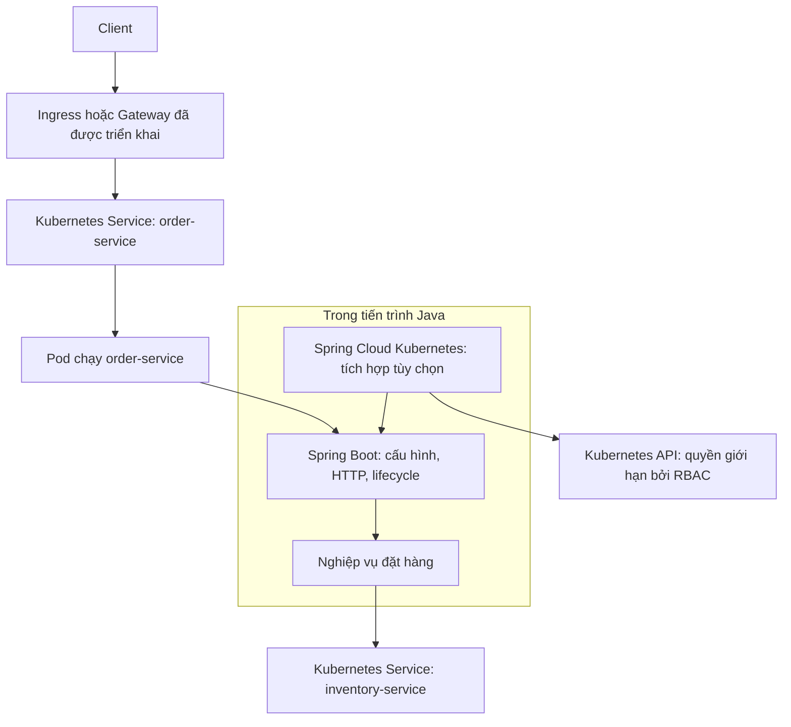

# Ranh giới giữa Spring Cloud Kubernetes, Spring Boot và Kubernetes

## 1. Ba lớp cùng tham gia, ba nhóm trách nhiệm

Một ứng dụng Spring Boot có thể chạy trên Kubernetes mà không cài Spring Cloud Kubernetes. Điều kiện đầu tiên là ứng dụng được đóng gói để chạy trong container, nhận cấu hình phù hợp và có các tài nguyên Kubernetes cần thiết. Spring Cloud Kubernetes chỉ trở nên cần thiết khi ứng dụng cần kết nối những cơ chế của Spring Cloud với tài nguyên hoặc sự kiện của Kubernetes.

Để hiểu đúng phạm vi module **SPRING_CLOUD_KUBERNETES**, hãy phân biệt ba lớp:

- **Spring Boot** giúp xây dựng và vận hành tiến trình ứng dụng Java: khởi tạo Spring ApplicationContext, tự động cấu hình thành phần, liên kết cấu hình vào đối tượng và cung cấp các khả năng quản trị khi dùng Actuator.
- **Kubernetes** quản lý việc chạy workload trong cluster: điều phối Pod, duy trì số replica theo tài nguyên điều khiển, cung cấp Service, phân phối cấu hình và quản lý quyền truy cập API.
- **Spring Cloud Kubernetes** là lớp tích hợp: đưa khả năng như khám phá dịch vụ, đọc cấu hình Kubernetes hoặc theo dõi thay đổi cấu hình vào hệ sinh thái Spring Cloud.

Ví dụ, một dịch vụ `order-service` cần gọi `inventory-service` và đọc giới hạn đặt hàng từ ConfigMap. Kubernetes có thể cung cấp địa chỉ Service và đưa cấu hình vào container. Spring Boot sử dụng địa chỉ và cấu hình đó để chạy nghiệp vụ. Chỉ khi muốn dùng `DiscoveryClient`, lựa chọn instance qua Spring Cloud LoadBalancer hoặc phản ứng với thay đổi cấu hình theo cơ chế tích hợp, nhóm phát triển mới cần xem xét Spring Cloud Kubernetes.

Mục tiêu của bài là xác định nơi mỗi lớp bắt đầu và kết thúc, từ đó lựa chọn đúng cách khám phá dịch vụ, phân phối cấu hình, phân quyền RBAC và theo dõi sức khỏe Pod.

## 2. Mô hình trách nhiệm nhìn từ một yêu cầu HTTP



Sơ đồ thể hiện ranh giới logic. Đường dữ liệu cụ thể từ Service tới Pod phụ thuộc cách cluster triển khai mạng; Service không nhất thiết là một tiến trình proxy độc lập nằm giữa mọi request. Ingress hoặc Gateway cũng cần thành phần điều khiển tương ứng; thêm Spring Cloud Kubernetes không tự tạo chúng.

Những thao tác khác nhau trong luồng này thuộc các chủ thể khác nhau:

| Nhu cầu | Spring Boot | Kubernetes | Spring Cloud Kubernetes |
| --- | --- | --- | --- |
| Khởi tạo controller, service và repository Java | Xây dựng ApplicationContext và tự động cấu hình | Khởi chạy container chứa ứng dụng | Không thay thế cơ chế khởi tạo của Boot |
| Duy trì ba replica | Mỗi tiến trình phục vụ một instance | Deployment và các controller liên quan duy trì trạng thái mong muốn | Không phải bộ điều phối replica |
| Cung cấp địa chỉ ổn định cho dịch vụ | HTTP client gọi địa chỉ được cấu hình | Service và DNS trong cluster | Có thể bổ sung mô hình khám phá dịch vụ cho Spring Cloud |
| Liên kết cấu hình vào bean | Đọc Environment, dùng `@ConfigurationProperties` | Cấp dữ liệu bằng ConfigMap, Secret, biến môi trường hoặc volume | Có thể nạp dữ liệu Kubernetes vào nguồn cấu hình Spring theo cơ chế tích hợp |
| Cập nhật cấu hình lúc chạy | Bean và tài nguyên phải hỗ trợ cách áp dụng tương ứng | Phân phối thay đổi tài nguyên hoặc thực hiện rollout | Có thể tham gia phát hiện thay đổi và kích hoạt refresh khi được cấu hình |
| Quyết định Pod nhận lưu lượng | Cung cấp tín hiệu readiness phù hợp | Thực hiện probe và cập nhật điều kiện, endpoint phục vụ | Không thay thế readiness probe |
| Cấp quyền đọc ConfigMap qua API | Dùng danh tính mà môi trường cung cấp | ServiceAccount, Role và RoleBinding xác lập quyền | Client tích hợp sử dụng các quyền đã được cấp |

Một tính năng có thể cần cả ba lớp phối hợp. Điều đó không có nghĩa cả ba cùng sở hữu một trách nhiệm. Chẳng hạn Boot cung cấp endpoint readiness, còn Kubernetes mới là bên gọi endpoint và quyết định cách sử dụng kết quả probe.

## 3. Spring Boot sở hữu những gì bên trong ứng dụng?

### 3.1. Khởi tạo và cấu hình tiến trình

Spring Boot tổ chức việc khởi động ứng dụng Spring, áp dụng auto-configuration theo dependency và điều kiện cấu hình, đồng thời hỗ trợ externalized configuration. Ứng dụng có thể nhận dữ liệu từ tệp cấu hình, biến môi trường và những nguồn được tích hợp thêm.

Ví dụ một thuộc tính nghiệp vụ:

```java
import org.springframework.boot.context.properties.ConfigurationProperties;

@ConfigurationProperties(prefix = "orders")
public record OrderProperties(int maxItems) {
}
```

Để Spring Boot tạo bean này, ứng dụng cần đăng ký qua `@ConfigurationPropertiesScan` hoặc `@EnableConfigurationProperties(OrderProperties.class)`. Giá trị `orders.max-items` có thể đến từ cấu hình ứng dụng; khi đưa vào biến môi trường theo quy tắc liên kết của Boot, tên tương ứng có thể là `ORDERS_MAXITEMS`.

Đoạn mã không biết giá trị gốc được khai báo trong ConfigMap, do pipeline triển khai cung cấp hay do người vận hành đặt trực tiếp. Đây là ranh giới hữu ích: code nghiệp vụ phụ thuộc thuộc tính có ý nghĩa với nghiệp vụ, còn cách phân phối thuộc tính là quyết định triển khai.

Spring Boot cũng không tự tạo ConfigMap hoặc đọc Kubernetes API chỉ vì tên thuộc tính xuất hiện trong đó. Muốn dùng dữ liệu ConfigMap, cần có một đường đưa dữ liệu vào ứng dụng, chẳng hạn `env`, volume cộng với cấu hình đọc tệp, hoặc lớp tích hợp phù hợp.

### 3.2. Endpoint quản trị và vòng đời ứng dụng

Khi dùng Spring Boot Actuator và cấu hình phù hợp, ứng dụng có thể cung cấp health, metrics và các endpoint quản trị. Những endpoint này mô tả trạng thái hoặc cho phép thao tác trong phạm vi ứng dụng.

Việc có endpoint `/actuator/health` không tự tạo Kubernetes probe. Ngược lại, khai báo probe vào một đường dẫn không tồn tại cũng không làm Boot tự sinh endpoint đó. Định nghĩa workload và cấu hình Actuator phải thống nhất.

Spring Boot có thể hỗ trợ graceful shutdown. Để có hiệu quả trong Kubernetes, thời gian chờ của ứng dụng, thời gian xử lý request và `terminationGracePeriodSeconds` phải phối hợp. Kubernetes gửi tín hiệu kết thúc và quản lý vòng đời Pod; ứng dụng chịu trách nhiệm phản ứng với tín hiệu, hoàn tất công việc trong thời hạn và đóng tài nguyên của mình.

### 3.3. Những việc Boot không tự làm thay cluster

Spring Boot không tự quyết định Pod chạy trên node nào, không duy trì số replica của Deployment và không tự tạo Service, Ingress hay chính sách mạng cho ứng dụng. Việc một ứng dụng khởi động thành công chỉ chứng minh tiến trình đã chạy được đến một trạng thái nhất định; chưa chứng minh đường truy cập từ ngoài cluster hoạt động.

## 4. Kubernetes sở hữu những gì bên ngoài tiến trình?

### 4.1. Trạng thái mong muốn và việc chạy container

Người triển khai mô tả workload bằng tài nguyên như Deployment. Các controller làm việc để đưa trạng thái thực tế về trạng thái mong muốn, còn scheduler và kubelet đảm nhiệm các phần việc điều phối và chạy Pod/container tương ứng.

Cần phân biệt hai tình huống:

- Container trong một Pod lỗi có thể được kubelet khởi động lại theo chính sách restart áp dụng cho Pod đó.
- Khi Pod mất hoặc bị thay thế, controller quản lý workload có thể tạo Pod mới; scheduler chọn node cho Pod mới khi cần.

Spring Cloud Kubernetes không thực hiện những công việc này. Thư viện chạy bên trong ứng dụng cũng không thể bảo đảm tính sẵn sàng nếu Deployment, tài nguyên node hoặc thiết kế workload không đáp ứng yêu cầu.

### 4.2. Service, DNS và khả năng định tuyến

Kubernetes Service cung cấp một cách truy cập ổn định tới nhóm endpoint phù hợp. Với Service thông thường, DNS giúp client tìm địa chỉ Service, còn cơ chế mạng của cluster chuyển kết nối tới endpoint theo cấu hình hiện hành.

Một ứng dụng trong cùng namespace có thể gọi:

```text
http://inventory-service:8080/api/stock/SKU-001
```

Nếu dịch vụ nằm ở namespace `catalog`, một địa chỉ thường dùng là:

```text
http://inventory-service.catalog.svc:8080/api/stock/SKU-001
```

Các ví dụ giả định DNS của cluster hoạt động và Service công bố cổng `8080`. Cổng Service và cổng container có thể khác nhau vì Service có ánh xạ `port` sang `targetPort`.

Cách gọi này không yêu cầu `DiscoveryClient`. Một HTTP client thông thường có thể dùng DNS để tìm Service. Nếu dùng headless Service hoặc cơ chế mạng khác, hành vi phân giải và chọn đích sẽ khác; không nên áp dụng nguyên xi mô hình ClusterIP cho mọi loại Service.

### 4.3. Phân phối cấu hình và danh tính

Kubernetes lưu ConfigMap và Secret dưới dạng tài nguyên API. Pod có thể tham chiếu chúng để nhận biến môi trường hoặc tệp được mount. Kubernetes cũng cung cấp danh tính ServiceAccount và cơ chế RBAC để kiểm soát truy cập tài nguyên API.

Có tài nguyên trong cluster chưa đủ để ứng dụng dùng được. Pod phải tham chiếu đúng tài nguyên, ứng dụng phải đọc đúng nguồn và mọi truy cập API phải có quyền thích hợp.

Secret không trở nên an toàn chỉ vì giá trị trong manifest dùng base64. Việc bảo vệ còn phụ thuộc phân quyền, cấu hình mã hóa lưu trữ, cách phân phối và cách ứng dụng xử lý dữ liệu nhạy cảm. Tránh đưa giá trị Secret vào log hoặc trả về qua endpoint quản trị.

## 5. Spring Cloud Kubernetes nằm ở đâu?

Spring Cloud Kubernetes kết nối ứng dụng Spring với khả năng có sẵn của Kubernetes. Phạm vi đáng quan tâm trong module này gồm:

- Đưa thông tin dịch vụ Kubernetes vào mô hình `DiscoveryClient` của Spring Cloud.
- Tích hợp ConfigMap và Secret với cấu hình ứng dụng theo cách được phiên bản và thành phần đã chọn hỗ trợ.
- Phối hợp với Spring Cloud LoadBalancer khi ứng dụng cần chọn đích ở phía client.
- Theo dõi thay đổi cấu hình bằng cơ chế phù hợp, bao gồm Configuration Watcher trong các kiến trúc sử dụng thành phần này.

Đây là danh sách khả năng để lựa chọn, không phải danh sách thành phần phải bật cùng lúc. Dependency, client triển khai, tên thuộc tính và cách nạp cấu hình cần khớp với bộ phiên bản Spring Boot, Spring Cloud và Spring Cloud Kubernetes của dự án. Bài này tập trung vào ranh giới trách nhiệm nên không ấn định phiên bản hoặc một bộ tên starter dùng cho mọi dự án.

### 5.1. `DiscoveryClient` là một giao diện cho ứng dụng

`DiscoveryClient` cho phép code hoặc thành phần Spring Cloud hỏi về dịch vụ và các instance theo một mô hình chung. Khi dùng tích hợp Kubernetes, dữ liệu đó có nguồn từ Kubernetes theo cơ chế của implementation đang dùng.

Có thể hình dung hai đường truy cập khác nhau:

```text
Đường A: HTTP client → DNS → Kubernetes Service → endpoint phục vụ

Đường B: Spring Cloud LoadBalancer → DiscoveryClient tích hợp Kubernetes
       → danh sách instance → đích mà client đã chọn
```

Đường B là mô hình khi LoadBalancer được cấu hình để chọn các instance do discovery cung cấp. Một số cấu hình tích hợp có thể hướng tới Service thay vì trực tiếp tới địa chỉ Pod, nên cần xác định rõ đích thực tế. Không nên suy luận rằng cứ có Spring Cloud LoadBalancer là request luôn đi thẳng tới Pod.

Việc thêm dependency discovery không tự biến mọi lời gọi HTTP thành lời gọi có cân bằng tải. HTTP client, cơ chế xử lý tên dịch vụ và Spring Cloud LoadBalancer phải được kết nối đúng với nhau.

### 5.2. API và RBAC là chi phí kiến trúc cần nhìn thấy

Một ứng dụng chỉ gọi Service bằng DNS không cần quyền liệt kê Pod chỉ để thực hiện lời gọi đó. Nếu chuyển sang khám phá dịch vụ bằng API, thành phần thực hiện discovery cần được cấp các quyền phù hợp.

Tương tự, nhận ConfigMap bằng biến môi trường không đòi hỏi tiến trình Java phải tự đọc ConfigMap qua API. Nếu tích hợp được cấu hình để đọc API, quyền truy cập phải được cấp cho danh tính thực hiện thao tác. Khi Configuration Watcher chạy riêng, quyền theo dõi có thể nằm ở ServiceAccount của Watcher, còn ứng dụng nhận thông báo cần được bảo vệ theo mô hình kết nối đã chọn.

Quyền cần cấp phụ thuộc đường truy cập thực tế: namespace nào, loại tài nguyên nào, chỉ đọc một tài nguyên hay cần liệt kê và theo dõi thay đổi. Không cấp quyền đọc mọi Secret trong cluster chỉ để giải quyết một lỗi discovery. Cũng không cấp `cluster-admin` cho ứng dụng chỉ để làm mất lỗi `403 Forbidden`.

## 6. Chọn một cơ chế chính cho khám phá dịch vụ và cân bằng tải

### 6.1. Khi Service và DNS đã đủ

Giả sử `order-service` chỉ cần gọi API của `inventory-service`, không cần biết danh sách instance và không có yêu cầu chọn instance riêng. Cấu hình URL bằng địa chỉ Service thường là lựa chọn hợp lý:

```yaml
inventory:
  base-url: http://inventory-service:8080
```

Ứng dụng dùng một HTTP client thông thường để gọi URL này. Kubernetes quản lý các endpoint phía sau Service theo tài nguyên và điều kiện liên quan.

Ưu điểm của cách này là ứng dụng ít phụ thuộc Kubernetes API hơn và tận dụng hạ tầng khám phá dịch vụ đã có. Tuy nhiên, cân bằng tải qua Service không đồng nghĩa mỗi request HTTP luôn được chia đều giữa các Pod. Kết nối giữ lâu, HTTP keep-alive và connection pool có thể ảnh hưởng phân bố lưu lượng.

### 6.2. Khi có lý do dùng Spring Cloud LoadBalancer

Có thể cần mô hình Spring Cloud khi ứng dụng dùng abstraction discovery thống nhất, có chính sách lựa chọn instance ở phía client hoặc cần tích hợp với các thành phần Spring Cloud khác.

Lúc này, nhóm triển khai phải trả lời được:

1. Danh sách instance đến từ đâu, và được cập nhật theo cơ chế nào?
2. Client chọn địa chỉ Pod, Service hay một đích khác?
3. Pod nào được coi là đủ điều kiện phục vụ, và thông tin readiness ảnh hưởng kết quả discovery ra sao?
4. Ai có quyền đọc tài nguyên Kubernetes, trong những namespace nào?
5. Khi Kubernetes API tạm thời không truy cập được, client xử lý dữ liệu đã có và lỗi discovery như thế nào?

Việc thêm một lớp cân bằng tải làm tăng số thành phần phải quan sát và cấu hình. Nếu client đã chọn trực tiếp Pod, chính sách của client có ảnh hưởng khác với trường hợp client chỉ chọn một Service rồi để mạng cluster chọn endpoint. Phải xác định đường đi cụ thể trước khi phân tích retry, phân bố tải hoặc lỗi kết nối.

Retry, timeout và circuit breaker cũng cần cấu hình riêng theo client và thư viện được dùng. Discovery không tự bảo đảm các hành vi này.

## 7. Cấu hình: phân phối dữ liệu, nạp giá trị và áp dụng thay đổi

Một nhầm lẫn phổ biến là cho rằng sửa ConfigMap đồng nghĩa mọi bean trong ứng dụng lập tức dùng giá trị mới. Cần tách ba bước:

1. **Phân phối:** giá trị mới có được đưa tới môi trường hoặc filesystem của container hay được thành phần tích hợp đọc lại không?
2. **Nạp lại:** nguồn cấu hình trong tiến trình Spring có được cập nhật không?
3. **Áp dụng:** bean hoặc tài nguyên đang chạy có được tạo lại, liên kết lại hoặc xử lý thay đổi theo cách phù hợp không?

Chỉ hoàn thành bước đầu chưa đủ để thay đổi hành vi ứng dụng.

| Cách cấp dữ liệu | Điều xảy ra khi nguồn thay đổi | Việc ứng dụng hoặc quy trình triển khai cần làm |
| --- | --- | --- |
| ConfigMap/Secret qua biến môi trường | Giá trị trong tiến trình đang chạy không tự thay đổi theo tài nguyên nguồn | Tạo lại Pod hoặc rollout khi muốn nhận giá trị mới |
| ConfigMap/Secret dạng volume thông thường | Tệp có thể được cập nhật sau một khoảng trễ; cách mount và cấu hình cluster ảnh hưởng hành vi | Ứng dụng vẫn cần cơ chế đọc lại và áp dụng dữ liệu |
| Tệp mount qua `subPath` | Không nhận cơ chế cập nhật tự động như volume ConfigMap/Secret thông thường | Có kế hoạch triển khai lại hoặc cách phân phối khác |
| Đọc qua tích hợp cấu hình Kubernetes | Lần nạp ban đầu và việc phát hiện thay đổi phụ thuộc cấu hình tích hợp | Chọn cơ chế refresh hoặc restart phù hợp và xác định bean nào áp dụng được |

Nếu tài nguyên được đánh dấu immutable, quy trình đổi cấu hình còn phải xử lý ràng buộc đó. Không dùng mô hình cập nhật tài nguyên mutable để suy luận cho mọi trường hợp.

### 7.1. Ví dụ cấu hình qua biến môi trường

Đây là các manifest minh họa cho cách Kubernetes cấp giá trị cho Spring Boot mà không cần tiến trình Java đọc ConfigMap qua API:

```yaml
apiVersion: v1
kind: ConfigMap
metadata:
  name: order-settings
data:
  max-items: "20"
---
apiVersion: apps/v1
kind: Deployment
metadata:
  name: order-service
spec:
  replicas: 2
  selector:
    matchLabels:
      app: order-service
  template:
    metadata:
      labels:
        app: order-service
    spec:
      containers:
        - name: order-service
          image: example.invalid/order-service:replace-me
          ports:
            - containerPort: 8080
          env:
            - name: ORDERS_MAXITEMS
              valueFrom:
                configMapKeyRef:
                  name: order-settings
                  key: max-items
```

Image là placeholder, cần thay bằng image thực của ứng dụng. Ví dụ chưa bao gồm Service, probe hoặc các thiết lập triển khai khác; mục đích là chỉ ra đường đi của một giá trị cấu hình. ConfigMap và Deployment trong ví dụ phải được tạo trong cùng namespace.

Kubernetes lấy khóa `max-items` và đưa vào biến môi trường `ORDERS_MAXITEMS`. Spring Boot liên kết giá trị đó vào thuộc tính `orders.max-items`, nếu `OrderProperties` đã được đăng ký như phần trước. Nếu đổi ConfigMap từ `20` thành `30`, hai Pod đang chạy không tự đổi biến môi trường. Quy trình triển khai phải tạo Pod mới để nhận giá trị mới.

### 7.2. Configuration Watcher phát hiện thay đổi, còn ứng dụng áp dụng thay đổi

Trong kiến trúc dùng Configuration Watcher, một thành phần theo dõi các tài nguyên được chọn và thực hiện cơ chế thông báo hoặc refresh phù hợp với cấu hình. Cách chọn tài nguyên, tìm ứng dụng đích và truyền thông báo phải khớp với phiên bản và mô hình triển khai.

Ngay cả khi sự kiện đã tới ứng dụng, cần xem xét:

- Thuộc tính đó có nằm trong nguồn cấu hình mà ứng dụng sẽ nạp lại không?
- Bean sử dụng giá trị có hỗ trợ cơ chế refresh hoặc liên kết lại đang chọn không?
- Một giá trị đã được chép vào trường, cache hoặc cấu trúc nội bộ có còn giữ bản cũ không?
- Thay đổi có đòi hỏi đóng và tạo lại tài nguyên như connection pool không?

`@Value` không bảo đảm một bean đã tồn tại sẽ tự đổi giá trị sau mọi loại sự kiện cấu hình. `@RefreshScope` cũng không phải cam kết rằng mọi trạng thái trong tiến trình sẽ tự chuyển đổi an toàn. Tương tự, ví dụ `OrderProperties` phía trên chỉ minh họa việc liên kết giá trị, chưa thiết kế hành vi refresh.

Với cấu hình nhạy cảm hoặc ảnh hưởng cách khởi tạo tài nguyên, rollout có kiểm soát có thể dễ dự đoán hơn refresh nóng. Chọn refresh khi biết rõ cách áp dụng và quan sát kết quả; chọn rollout khi cần một vòng đời khởi động mới để bảo đảm trạng thái nhất quán.

### 7.3. Thứ tự ưu tiên là quyết định của hệ cấu hình

Nếu cùng một khóa xuất hiện trong nhiều nguồn, giá trị có hiệu lực phụ thuộc thứ tự ưu tiên của Spring Boot và cách nguồn tích hợp được đưa vào Environment. Không mặc định rằng ConfigMap luôn thắng biến môi trường hoặc ngược lại trong mọi cấu hình.

Khi xử lý một giá trị sai, cần xác định nguồn thực sự cung cấp giá trị có hiệu lực. Không mở rộng quyền truy cập Kubernetes để giải quyết một vấn đề thực chất nằm ở thứ tự ưu tiên nguồn cấu hình.

## 8. Sức khỏe Pod: tín hiệu ứng dụng và quyết định của nền tảng

### 8.1. Phân biệt startup, readiness và liveness

| Probe | Câu hỏi chính | Tác động điển hình khi thất bại theo ngưỡng |
| --- | --- | --- |
| Startup | Ứng dụng đã hoàn tất giai đoạn khởi động đủ để kiểm tra tiếp chưa? | Kubelet có thể khởi động lại container; khi startup probe đang bảo vệ giai đoạn khởi động, readiness và liveness chờ startup thành công |
| Readiness | Instance này đã sẵn sàng nhận lưu lượng qua Service chưa? | Pod được đánh dấu chưa sẵn sàng; việc sử dụng endpoint chịu tác động của cấu hình Service và cơ chế liên quan |
| Liveness | Tiến trình còn ở trạng thái có thể tiếp tục chạy hữu ích không? | Kubelet có thể khởi động lại container |

Readiness thất bại tự nó không yêu cầu khởi động lại container. Liveness thất bại theo ngưỡng không có nghĩa Kubernetes sửa được nguyên nhân trong code; nền tảng chỉ thực hiện hành động theo probe và chính sách restart.

Actuator có thể cung cấp health group dành cho readiness và liveness khi được cấu hình, với các đường dẫn thường gặp là `/actuator/health/readiness` và `/actuator/health/liveness`. Manifest probe cần khớp với đường dẫn, cổng và cơ chế bảo vệ thực tế của ứng dụng.

Nếu management server chạy ở cổng riêng, việc endpoint quản trị hoạt động chưa chứng minh cổng phục vụ nghiệp vụ còn hoạt động tốt. Thiết kế probe cần phản ánh đường phục vụ mà nhóm vận hành muốn bảo vệ.

### 8.2. Không gộp mọi phụ thuộc vào liveness

Nếu cơ sở dữ liệu tạm thời ngừng hoạt động và tất cả Pod đều thất bại liveness, cluster có thể khởi động lại hàng loạt container mà không sửa được cơ sở dữ liệu. Hệ thống còn chịu thêm tải khởi động, mất cache và thời gian phục hồi.

Nên xác định liveness quanh trạng thái sống còn của chính tiến trình. Có đưa phụ thuộc vào readiness hay không là quyết định theo nghiệp vụ: một Pod có thể vẫn phục vụ được một phần API hoặc trả lời theo cơ chế suy giảm. Quyết định đó thuộc thiết kế ứng dụng, còn Kubernetes thực thi theo tín hiệu nhận được.

Spring Cloud Kubernetes không thay thế Actuator, kubelet hoặc probe. Thư viện có thể cung cấp thông tin hoặc tích hợp bổ sung, nhưng trách nhiệm cung cấp tín hiệu đúng và khai báo probe đúng vẫn phải được thiết kế rõ.

## 9. Đi theo ranh giới để chẩn đoán lỗi

Khi có sự cố, bắt đầu bằng câu hỏi “lớp nào đang chịu trách nhiệm cho hành vi thất bại?” rồi kiểm tra giả thuyết ở lớp đó.

| Hiện tượng | Ranh giới nên kiểm tra trước | Không nên kết luận vội |
| --- | --- | --- |
| Container liên tục restart | Trạng thái container, lỗi tiến trình, giới hạn tài nguyên, probe và chính sách restart | Discovery có lỗi nên phải thêm một starter |
| Pod chạy nhưng không nhận request qua Service | Readiness, selector của Service, endpoint, cổng và đường mạng | Khởi động Boot thành công nghĩa là Service chắc chắn đúng |
| DNS gọi Service hoạt động nhưng `DiscoveryClient` không trả instance | Cấu hình discovery, namespace, quyền API và bộ lọc của implementation | Service đã hỏng vì discovery không có kết quả |
| Đọc API báo `403 Forbidden` | Danh tính ServiceAccount và quyền RBAC đúng tài nguyên, đúng phạm vi | Cần cấp quyền quản trị toàn cluster |
| ConfigMap đã đổi, giá trị trong ứng dụng vẫn cũ | Đường phân phối, cơ chế nạp lại, nguồn có ưu tiên cao hơn và bean sử dụng | Kubernetes bắt buộc cập nhật mọi bean ngay lập tức |
| Chỉ một số replica áp dụng cấu hình mới | Trạng thái rollout hoặc thông báo refresh của từng instance | Một replica đổi được thì toàn hệ thống đã đồng bộ |
| Lưu lượng không đều giữa các Pod | Đường chọn đích, pool kết nối, kết nối dài và chiến lược cân bằng tải | Thêm một lớp load balancer chắc chắn sẽ giải quyết |

Cách phân tích này giúp tránh sửa nhầm tầng. Ví dụ một lỗi selector của Service thuộc manifest Kubernetes; bật DiscoveryClient không sửa selector. Một bean giữ cấu hình cũ thuộc đường áp dụng cấu hình trong tiến trình; cấp thêm quyền watch không tự làm bean đổi trạng thái.

## 10. Áp dụng vào một hệ thống đặt hàng

Giả sử hệ thống có `order-service`, `inventory-service` và ConfigMap chứa giới hạn số mặt hàng. Có thể đi từ nhu cầu nhỏ nhất rồi bổ sung từng khả năng:

**Phương án ban đầu:** Spring Boot chạy trong Deployment, nhận cấu hình qua biến môi trường, gọi `inventory-service` bằng DNS của Service và công bố readiness/liveness qua Actuator. Kubernetes duy trì replica, định tuyến tới endpoint và thực hiện probe. Đổi giới hạn mặt hàng được áp dụng bằng rollout. Phương án này chưa cần Spring Cloud Kubernetes.

**Khi cần cấu hình thay đổi trong lúc chạy:** Chọn cơ chế tích hợp cấu hình và theo dõi thay đổi, xác định giá trị nào được refresh, cách refresh tới mọi replica và quyền truy cập cần có. Ứng dụng phải chứng minh được giá trị mới đã tác động tới hành vi. Một sự kiện watch thành công chưa phải bằng chứng cuối cùng.

**Khi cần chính sách chọn instance ở phía client:** Bổ sung Spring Cloud LoadBalancer cùng nguồn discovery phù hợp, xác định rõ địa chỉ đích và quyền đọc tài nguyên. Đo khả năng phân bố tải, hành vi khi instance biến mất và tác động của các kết nối đã mở. Không coi việc thêm dependency là hoàn tất thiết kế.

**Khi cần đổi thông tin đăng nhập:** Phân tích cách Secret tới ứng dụng và cách tài nguyên đang dùng thông tin đó được tạo lại. Một Secret được cập nhật trong cluster không tự làm các kết nối đang mở đăng nhập lại. Có thể cần refresh với cơ chế đóng/mở tài nguyên rõ ràng hoặc rollout ứng dụng.

Ở mỗi bước, giữ một bản mô tả ngắn: nhu cầu nào khiến phải thêm thành phần, thành phần đó đọc tài nguyên gì, ai cấp quyền và tín hiệu nào cho thấy hệ thống hoạt động đúng. Nếu chưa chỉ ra được nhu cầu, chưa có cơ sở để bật thêm tích hợp.

## 11. Tự kiểm tra cách hiểu

### Một ứng dụng Boot gọi được Service bằng DNS có cần DiscoveryClient không?

Không bắt buộc. Service và DNS đã cung cấp một đường truy cập. DiscoveryClient có ý nghĩa khi ứng dụng cần mô hình khám phá dịch vụ của Spring Cloud hoặc các thành phần dựa trên mô hình đó.

### Bật Spring Cloud Kubernetes có tự tạo Deployment và Service không?

Không. Tài nguyên triển khai do manifest, công cụ triển khai hoặc controller tương ứng quản lý. Thư viện tích hợp trong ứng dụng không thay thế việc khai báo và vận hành workload.

### ConfigMap đã cập nhật có bảo đảm mọi request dùng giá trị mới không?

Không. Cần xét đường phân phối, cách nạp lại và cách bean áp dụng thay đổi. Với nhiều replica, còn phải xác minh từng instance đã nhận và áp dụng trạng thái mong muốn.

### Ai quyết định khởi động lại container khi liveness thất bại?

Kubelet thực hiện hành động dựa trên kết quả probe và chính sách liên quan. Spring Boot cung cấp tín hiệu ở phía ứng dụng; Spring Cloud Kubernetes không phải bộ thực thi restart.

### Cách chọn tính năng Spring Cloud Kubernetes là gì?

Bắt đầu từ một yêu cầu cụ thể chưa được cách triển khai hiện tại đáp ứng. Chọn đúng tích hợp cần thiết, cấp quyền tối thiểu theo đường truy cập thực tế và xác định cách quan sát kết quả. Spring Boot quản lý hành vi của tiến trình, Kubernetes quản lý môi trường chạy, còn Spring Cloud Kubernetes kết nối hai phía khi yêu cầu ứng dụng cần đến sự kết nối đó.