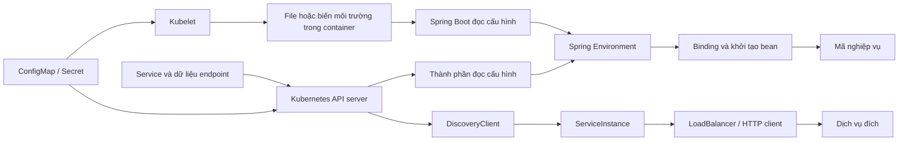
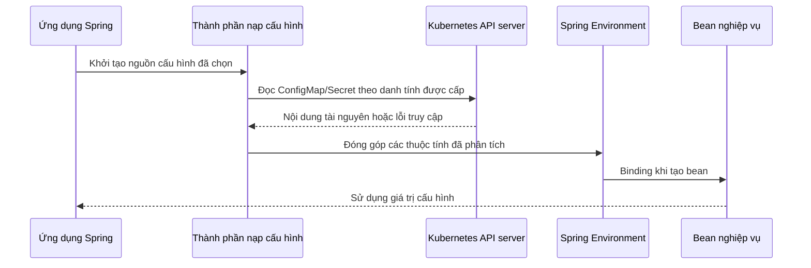

# Luồng dữ liệu từ tài nguyên Kubernetes vào ứng dụng Spring

Trong một ứng dụng Spring chạy trên Kubernetes, cấu hình, thông tin khám phá dịch vụ và trạng thái Pod không tự đi vào các bean Java chỉ vì ứng dụng đã được triển khai lên cluster. Mỗi loại dữ liệu cần một đường đi cụ thể: ai tạo tài nguyên, thành phần nào đọc tài nguyên, dữ liệu được chuyển đổi ở đâu, và lúc nào ứng dụng sử dụng giá trị đó.

Bài học thuộc chương **Tổng quan** của **Spring Cloud Kubernetes** (`SPRING_CLOUD_KUBERNETES`). Mục tiêu là hiểu luồng tích hợp trước khi lựa chọn DiscoveryClient, cấu hình từ ConfigMap/Secret, Spring Cloud LoadBalancer hoặc Configuration Watcher. Khi nắm được đường đi này, bạn có thể phân biệt lỗi quyền truy cập, lỗi nạp cấu hình, lỗi cập nhật bean và lỗi kết nối dịch vụ.

## 1. Bản đồ tổng thể: có nhiều đường đi vào ứng dụng

Hãy xét dịch vụ `catalog-service` chạy trong namespace `shop`. Ứng dụng cần một lời chào cấu hình được, thông tin xác thực để gọi hệ thống khác và địa chỉ của `inventory-service`.

| Nhu cầu | Dữ liệu trong Kubernetes | Cách dữ liệu đến ứng dụng | Thành phần sử dụng cuối cùng |
|---|---|---|---|
| Cấu hình nghiệp vụ | ConfigMap | Đọc qua Kubernetes API hoặc đưa vào container dưới dạng file/biến môi trường | Spring `Environment`, bean cấu hình, mã nghiệp vụ |
| Thông tin nhạy cảm | Secret | Mount file, đưa vào biến môi trường hoặc đọc qua API khi được cho phép | Thành phần xác thực, client kết nối |
| Khám phá dịch vụ | Service và dữ liệu endpoint liên quan | DiscoveryClient đọc qua Kubernetes API | Danh sách `ServiceInstance`, thành phần chọn đích gọi |
| Phát hiện thay đổi cấu hình | Thay đổi ConfigMap/Secret | Watch, polling hoặc cơ chế thông báo phù hợp | Luồng refresh hoặc khởi động lại được cấu hình |
| Kiểm tra sức khỏe | Kết quả probe của container | Kubelet thực hiện probe và cập nhật trạng thái Pod | Kubernetes quản lý readiness, restart và tập đích phục vụ |

Các dòng trên có liên quan nhưng không thay thế nhau. Ví dụ, Pod đã sẵn sàng không có nghĩa bean cấu hình đã nhận giá trị mới; ConfigMap đã cập nhật cũng không có nghĩa client HTTP đã đổi địa chỉ đích.



Sơ đồ mô tả các đường đi có thể chọn, không yêu cầu ứng dụng bật đồng thời tất cả. Với biến môi trường, dữ liệu được thiết lập khi container khởi động; với file volume, kubelet có thể cập nhật nội dung theo cơ chế volume, nhưng Spring còn cần một cơ chế riêng để đọc và áp dụng lại.

## 2. Tài nguyên Kubernetes là nguồn dữ liệu, chưa phải thuộc tính Spring

Một ConfigMap là đối tượng Kubernetes có metadata và các cặp khóa–giá trị. Spring không tự hiểu mọi ConfigMap trong namespace là cấu hình của ứng dụng.

Ví dụ:

```yaml
apiVersion: v1
kind: ConfigMap
metadata:
  name: catalog-settings
  namespace: shop
data:
  application.yaml: |
    training:
      catalog:
        message: "Chào mừng đến với danh mục sản phẩm"
        page-size: 20
```

Có hai tầng biểu diễn cần phân biệt:

1. Ở tầng Kubernetes, `application.yaml` là tên một khóa trong `data`; giá trị của khóa là một chuỗi nhiều dòng.
2. Sau khi một bộ đọc cấu hình phân tích chuỗi YAML, Spring mới có thể nhận các thuộc tính như `training.catalog.message` và `training.catalog.page-size`.

Nếu chỉ lấy chuỗi từ API rồi giữ trong một biến Java, chuỗi đó chưa trở thành thuộc tính của `Environment`. Cần một thành phần nạp cấu hình và chuyển đổi đúng định dạng. Ngược lại, khi mount ConfigMap thành file, khóa `application.yaml` có thể trở thành tên file để Spring Boot đọc bằng cơ chế cấu hình ngoài ứng dụng.

Các thông tin như `metadata.name`, `metadata.namespace`, label và annotation phục vụ định danh hoặc lựa chọn tài nguyên. Chúng không mặc nhiên được biến thành toàn bộ thuộc tính cấu hình của ứng dụng.

## 3. Đường thứ nhất: Kubernetes API → nguồn thuộc tính → bean Spring

Khi sử dụng tích hợp cấu hình qua API của Spring Cloud Kubernetes, luồng khái niệm gồm các bước sau:

1. Ứng dụng xác định namespace và tên nguồn cấu hình cần đọc.
2. Kubernetes client sử dụng thông tin kết nối và danh tính phù hợp. Trong cluster, danh tính thường gắn với ServiceAccount của Pod.
3. API server xác thực yêu cầu và kiểm tra quyền RBAC.
4. Thành phần cấu hình lấy ConfigMap hoặc Secret được chọn.
5. Nội dung được chuyển thành nguồn thuộc tính mà Spring có thể đọc.
6. Spring hợp nhất các nguồn vào `Environment` theo quy tắc của cơ chế nạp cấu hình đang dùng.
7. Các bean được tạo và binding các thuộc tính tương ứng.



### 3.1. Namespace và tên tài nguyên là một phần của địa chỉ dữ liệu

`shop/catalog-settings` và `test/catalog-settings` là hai nguồn khác nhau. Nếu ứng dụng đọc sai namespace, ConfigMap đúng tên ở nơi khác không giúp yêu cầu thành công.

Không nên suy luận rằng tên Deployment luôn là tên ConfigMap mà thư viện sẽ đọc. Tên ứng dụng, danh sách nguồn cấu hình, namespace và profile có thể tham gia quy tắc lựa chọn tùy cấu hình tích hợp. Hãy xác định rõ nguồn mong đợi trước khi chẩn đoán binding.

### 3.2. Khai báo nguồn phải phù hợp với phiên bản tích hợp

Các dòng Spring Boot, Spring Cloud và Spring Cloud Kubernetes có thể dùng cơ chế khởi tạo cấu hình khác nhau, chẳng hạn Config Data hoặc cơ chế bootstrap ở các cấu hình tích hợp tương ứng. Tên starter, thuộc tính kích hoạt và khả năng đọc ConfigMap/Secret phải khớp với bộ phiên bản của dự án.

Vì vậy, luồng API ở đây mô tả kiến trúc, không phải một khối cấu hình có thể sao chép cho mọi phiên bản. Chỉ thêm dependency chưa đủ để kết luận ứng dụng đã đọc đúng tài nguyên. Cần kiểm tra cơ chế nạp thực tế có chạy trước khi bean cần cấu hình được tạo hay không.

### 3.3. Một thuộc tính có thể xuất hiện trong nhiều nguồn

Ví dụ, `training.catalog.page-size` có thể nằm trong file đóng gói, ConfigMap, biến môi trường hoặc tham số khởi động. Giá trị cuối cùng phụ thuộc thứ tự ưu tiên thực tế của các nguồn thuộc tính.

Không có quy tắc chung rằng ConfigMap luôn thắng mọi nguồn khác. Khi giá trị khác dự kiến, cần tìm nguồn đã cung cấp giá trị có hiệu lực, thay vì chỉ kiểm tra rằng ConfigMap có chứa khóa đó.

Trong môi trường kiểm thử, có thể ghi log một giá trị không nhạy cảm sau binding để đối chiếu. Tránh dump toàn bộ `Environment`, vì một số nguồn có thể chứa mật khẩu hoặc token.

## 4. Đường thứ hai: kubelet → file/biến môi trường → Spring Boot

Kubernetes cũng có thể đưa dữ liệu vào container mà tiến trình Java không trực tiếp gọi API để lấy cấu hình. Đây là lựa chọn phù hợp khi chỉ cần cấu hình ngoài ứng dụng và không cần thêm tính năng khám phá hoặc theo dõi tài nguyên từ thư viện.

### 4.1. Mount ConfigMap thành file

Đoạn Pod minh họa dưới đây dùng ConfigMap đã tạo ở phần trước. Namespace `shop` và image ứng dụng phải tồn tại khi triển khai thực tế.

```yaml
apiVersion: v1
kind: Pod
metadata:
  name: catalog-demo
  namespace: shop
spec:
  containers:
    - name: catalog
      image: example.invalid/catalog-service:demo
      env:
        - name: SPRING_CONFIG_ADDITIONAL_LOCATION
          value: "optional:file:/etc/catalog-config/"
      volumeMounts:
        - name: catalog-config
          mountPath: /etc/catalog-config
          readOnly: true
  volumes:
    - name: catalog-config
      configMap:
        name: catalog-settings
```

`example.invalid/catalog-service:demo` là image minh họa, cần thay bằng image của dự án. Luồng dữ liệu trong ví dụ là:

```text
ConfigMap shop/catalog-settings
  → kubelet đưa khóa application.yaml vào volume
  → /etc/catalog-config/application.yaml trong container
  → Spring Boot đọc thư mục cấu hình bổ sung khi khởi động
  → Environment
  → bean ứng dụng
```

Dấu `/` cuối đường dẫn cho biết đây là một thư mục cấu hình. Tiền tố `optional:` cho phép vị trí cấu hình có thể không tồn tại; chỉ dùng khi ứng dụng thực sự chấp nhận điều đó. Nếu cấu hình là bắt buộc, cần thiết kế cách phát hiện thiếu cấu hình và dừng khởi động phù hợp.

Đường đi này sử dụng khả năng mount tài nguyên của Kubernetes và cấu hình ngoài của Spring Boot. Riêng thao tác đọc file không yêu cầu tiến trình Java gọi Kubernetes API và không cần một starter Spring Cloud Kubernetes chỉ để đọc file đó.

### 4.2. Đưa một khóa vào biến môi trường

Nếu ConfigMap có khóa đơn `CATALOG_MESSAGE`, một container có thể tham chiếu như sau:

```yaml
env:
  - name: TRAINING_CATALOG_MESSAGE
    valueFrom:
      configMapKeyRef:
        name: catalog-env
        key: CATALOG_MESSAGE
```

Đây là đoạn trích cấu hình container, giả định ConfigMap `catalog-env` đã tồn tại trong cùng namespace. `TRAINING_CATALOG_MESSAGE` có thể được Spring ánh xạ tới thuộc tính `training.catalog.message` theo quy tắc binding phù hợp.

Biến môi trường được thiết lập khi container khởi động. Sửa ConfigMap sau đó không thay đổi biến môi trường của tiến trình Java đang chạy; cần tạo lại container/Pod để nhận giá trị môi trường mới.

### 4.3. File thay đổi chưa có nghĩa ứng dụng đã đọc lại

Với volume ConfigMap thông thường, nội dung chiếu vào volume có thể được kubelet cập nhật sau một khoảng trễ. Mount bằng `subPath` không nhận cơ chế cập nhật ConfigMap như mount volume thông thường.

Ngay cả khi file trên đĩa đã có nội dung mới, Spring Boot không mặc nhiên nạp lại toàn bộ cấu hình và dựng lại các bean. Phải xác định cách ứng dụng phản ứng: đọc file theo nhu cầu, refresh bằng cơ chế được hỗ trợ hoặc thay Pod bằng một lần rollout.

## 5. Từ Environment đến giá trị được mã Java sử dụng

`Environment` là nơi tra cứu thuộc tính. Bean nghiệp vụ mới là nơi sử dụng giá trị trong hành vi cụ thể.

Ví dụ Java minh họa binding khi khởi tạo:

```java
import org.springframework.boot.context.properties.ConfigurationProperties;
import org.springframework.boot.context.properties.EnableConfigurationProperties;
import org.springframework.context.annotation.Configuration;
import org.springframework.stereotype.Service;

@ConfigurationProperties(prefix = "training.catalog")
public class CatalogProperties {
    private String message = "Xin chào";
    private int pageSize = 10;

    public String getMessage() {
        return message;
    }

    public void setMessage(String message) {
        this.message = message;
    }

    public int getPageSize() {
        return pageSize;
    }

    public void setPageSize(int pageSize) {
        this.pageSize = pageSize;
    }
}

@Configuration
@EnableConfigurationProperties(CatalogProperties.class)
class CatalogConfiguration {
}

@Service
class CatalogService {
    private final CatalogProperties properties;

    CatalogService(CatalogProperties properties) {
        this.properties = properties;
    }

    public String welcomeMessage() {
        return properties.getMessage();
    }
}
```

Đặt lớp `public CatalogProperties` trong `CatalogProperties.java`; các lớp còn lại có thể tách thành file riêng trong package ứng dụng được quét. Ví dụ tập trung vào binding ban đầu, không khai báo cơ chế refresh.

Khi nguồn cấu hình được nạp đúng, `page-size` được binding vào `pageSize`. Nếu thiếu giá trị, các giá trị mặc định trong lớp có thể được giữ lại. Trong ứng dụng thực tế, thuộc tính bắt buộc nên được kiểm tra bằng cơ chế validation hoặc kiểm tra khởi động thích hợp, tránh vận hành âm thầm với cấu hình sai.

Cần phân biệt ba tình huống:

- Bean giữ tham chiếu tới một đối tượng cấu hình; đối tượng đó có được cập nhật hay tạo lại hay không phụ thuộc cơ chế refresh.
- Bean sao chép một giá trị sang trường khác trong constructor; thay đổi nguồn cấu hình không tự viết lại bản sao đó.
- Bean tạo tài nguyên ngoài từ cấu hình, chẳng hạn connection pool; đổi thuộc tính không tự tái tạo pool nếu không có cơ chế quản lý vòng đời tương ứng.

Bởi vậy, “đã có giá trị mới trong `Environment`” và “mọi chức năng đã sử dụng giá trị mới” là hai mốc khác nhau.

## 6. Secret đi theo luồng tương tự nhưng cần kiểm soát riêng

Secret có thể được đưa vào ứng dụng qua file, biến môi trường hoặc Kubernetes API, tùy cách triển khai và tính năng được bật. Quyền đọc ConfigMap không mặc nhiên bao gồm quyền đọc Secret; khả năng đọc Secret qua API cũng không nên được coi là luôn bật.

Một giá trị nằm trong trường `data` của Secret dùng biểu diễn base64. Base64 là cách mã hóa biểu diễn dữ liệu, không phải mã hóa bảo mật. Bảo vệ Secret còn phụ thuộc quyền truy cập, cấu hình bảo vệ dữ liệu lưu trữ và cách ứng dụng xử lý giá trị sau khi đọc.

Với Secret mount thành file, ứng dụng phải thực sự đọc file đó. Một file chứa token không tự trở thành thuộc tính Spring chỉ vì tồn tại trong container; cần dùng cơ chế cấu hình phù hợp hoặc mã đọc file rõ ràng. Nếu đưa Secret vào biến môi trường, vòng đời cập nhật vẫn gắn với lần khởi động container.

Khi token được thay mới, hãy kiểm tra toàn bộ chuỗi:

```text
Secret được cập nhật
  → dữ liệu mới tới nơi đọc
  → thành phần đọc nhận giá trị mới
  → bean/client áp dụng giá trị mới
  → yêu cầu tiếp theo dùng thông tin xác thực mới
```

Không ghi giá trị Secret ra log để chứng minh chuỗi này. Có thể đối chiếu thời điểm cập nhật, phiên bản cấu hình nghiệp vụ hoặc kết quả xác thực bằng một yêu cầu kiểm thử có kiểm soát.

## 7. Luồng cập nhật: tài nguyên đổi → phát hiện → áp dụng

Configuration Watcher phục vụ việc phát hiện thay đổi và khởi phát cách cập nhật ứng dụng được cấu hình. Nó không phải là thành phần tự biến mọi bean Java thành bean cập nhật động.

Tách luồng cập nhật thành bốn giai đoạn sẽ dễ quan sát hơn:

| Giai đoạn | Điều phải xảy ra | Bằng chứng phù hợp |
|---|---|---|
| Nguồn đổi | ConfigMap/Secret đã lưu nội dung mới | Metadata cập nhật và giá trị không nhạy cảm được kiểm soát |
| Phát hiện | Watcher hoặc thành phần theo dõi thấy thay đổi liên quan | Log/sự kiện xử lý đúng tài nguyên |
| Kích hoạt | Cơ chế thông báo, refresh hoặc khởi động lại được gọi | Log tiếp nhận, trạng thái tiến trình hoặc rollout |
| Áp dụng | Bean và tài nguyên phụ thuộc dùng cấu hình mới | Kết quả hành vi của ứng dụng sau cập nhật |

Tùy mô hình, thành phần theo dõi có thể ở ngoài ứng dụng, còn ứng dụng phải có cơ chế tiếp nhận thông báo phù hợp. Không nên gộp Configuration Watcher triển khai riêng với mọi cơ chế theo dõi cấu hình trong tiến trình thành một tính năng giống nhau. Khả năng hỗ trợ, đường thông báo và cách xác định ứng dụng đích cần khớp với phiên bản tích hợp đã chọn.

Các chiến lược thường cần cân nhắc là:

- **Refresh cấu hình:** phù hợp khi thuộc tính và bean liên quan hỗ trợ cập nhật; phải xác nhận hành vi của từng thành phần.
- **Khởi động lại ứng dụng hoặc thay Pod:** nạp lại theo vòng đời khởi động; cần tính tới readiness, số replica và quá trình chuyển lưu lượng.
- **Giữ cấu hình cố định trong vòng đời Pod:** phù hợp khi muốn kiểm soát mọi thay đổi bằng một lần triển khai mới.

Sửa ConfigMap đơn lẻ không mặc nhiên làm Deployment rollout. Nếu chọn thay Pod, quy trình triển khai phải chủ động tạo thay đổi hoặc thực hiện rollout phù hợp.

Watch là kênh thông báo thay đổi tài nguyên, không phải cam kết rằng mọi replica đã áp dụng cấu hình cùng thời điểm. Kết nối có thể gián đoạn và cần được thiết lập lại; cơ chế theo dõi phải có cách lấy lại trạng thái hiện tại khi cần. Không dùng thông báo cấu hình như một giao dịch đồng bộ xuyên nhiều Pod.

## 8. Luồng khám phá dịch vụ: Service → DiscoveryClient → lời gọi mạng

Cấu hình trả lời “ứng dụng nên hoạt động thế nào”. Khám phá dịch vụ trả lời “có thể tìm dịch vụ đích ở đâu”. Hai luồng này cùng có thể đọc Kubernetes API nhưng tạo ra hai loại kết quả khác nhau.

Một luồng tích hợp điển hình:

```text
Service inventory-service và dữ liệu endpoint liên quan
  → Kubernetes API
  → Spring Cloud Kubernetes DiscoveryClient
  → danh sách ServiceInstance
  → Spring Cloud LoadBalancer / client được tích hợp
  → yêu cầu tới đích đã chọn
```

Chi tiết tài nguyên được đọc và dạng địa chỉ trả về phụ thuộc triển khai, chế độ và cấu hình: có thể liên quan Service, Endpoints hoặc EndpointSlice. Không nên mặc định mọi `ServiceInstance` đều là một địa chỉ Pod hoặc mọi client đều đọc cùng một loại tài nguyên.

`DiscoveryClient` cung cấp thông tin khám phá; nó không tự chuyển mọi lời gọi HTTP thành lời gọi cân bằng tải. HTTP client cần được tích hợp với cơ chế load balancing và sử dụng cách định danh dịch vụ phù hợp.

Có hai mô hình cần nhận diện:

| Mô hình | Nơi chọn đích phục vụ | Điều cần kiểm tra |
|---|---|---|
| Gọi tên DNS của Service | Hạ tầng Service của Kubernetes xử lý việc chuyển tiếp tới backend theo cấu hình | DNS, port của Service, selector, backend và mạng cluster |
| Client chọn instance từ dữ liệu khám phá | Thành phần load balancing trong ứng dụng chọn địa chỉ instance; đường mạng sau đó phụ thuộc loại địa chỉ được trả về | Dữ liệu discovery, cache, bộ lọc, port và khả năng truy cập địa chỉ |

Kubernetes API server cung cấp dữ liệu điều khiển. Nó không mặc nhiên nằm trên đường truyền của mọi yêu cầu nghiệp vụ giữa hai ứng dụng. Sau khi chọn đích, lưu lượng đi theo cơ chế mạng của cluster và loại đích đang sử dụng.

Nếu ứng dụng chỉ cần gọi `inventory-service` qua DNS và Service của Kubernetes, hãy đánh giá xem có cần thêm DiscoveryClient và load balancing phía client hay không. Chỉ bật các thành phần giải quyết một nhu cầu cụ thể.

## 9. RBAC nằm ở đâu trong luồng dữ liệu?

Với đường đọc API, quyền truy cập được kiểm tra trước khi dữ liệu tới Spring. Một lỗi `Forbidden` không phải lỗi binding YAML; không có dữ liệu đầu vào hợp lệ để binding nếu yêu cầu đã bị từ chối.

Ví dụ Role sau chỉ minh họa quyền cho một thành phần cần đọc và theo dõi ConfigMap trong namespace `shop`:

```yaml
apiVersion: rbac.authorization.k8s.io/v1
kind: Role
metadata:
  name: catalog-config-reader
  namespace: shop
rules:
  - apiGroups: [""]
    resources: ["configmaps"]
    verbs: ["get", "list", "watch"]
---
apiVersion: rbac.authorization.k8s.io/v1
kind: RoleBinding
metadata:
  name: catalog-config-reader
  namespace: shop
subjects:
  - kind: ServiceAccount
    name: catalog-app
    namespace: shop
roleRef:
  apiGroup: rbac.authorization.k8s.io
  kind: Role
  name: catalog-config-reader
```

RoleBinding không tạo ServiceAccount. Cần có ServiceAccount `catalog-app` và Pod phải sử dụng nó qua `spec.serviceAccountName: catalog-app`. Ví dụ này cho phép đọc mọi ConfigMap trong namespace, nên vẫn cần xem lại phạm vi khi áp dụng; nó không cấp quyền đọc Secret hoặc dữ liệu khám phá dịch vụ.

Các thao tác có ý nghĩa khác nhau:

- `get`: đọc một tài nguyên cụ thể.
- `list`: lấy tập tài nguyên mà yêu cầu được phép truy cập.
- `watch`: theo dõi các thay đổi tương ứng.

Quyền cần thiết phụ thuộc thao tác mà client thực hiện. Cấp `get` có thể chưa đủ cho một triển khai khởi tạo bằng `list` rồi `watch`. Ngược lại, tiến trình chỉ đọc file đã mount không cần Role đọc ConfigMap qua API chỉ vì file có nguồn gốc từ ConfigMap.

Nếu Configuration Watcher chạy riêng, hãy xét quyền của ServiceAccount của watcher và quyền của ServiceAccount ứng dụng một cách độc lập. Tương tự, chỉ cấp quyền đọc tài nguyên phục vụ discovery khi ứng dụng thực sự dùng discovery qua API; không lấy quyền rộng làm cách sửa chung cho mọi lỗi.

## 10. Sức khỏe Pod và độ trễ dữ liệu ảnh hưởng đến hành vi thế nào?

Kubernetes có thể dùng probe HTTP, TCP, lệnh hoặc cơ chế probe được hỗ trợ phù hợp để đánh giá container. Với ứng dụng Spring, các endpoint sức khỏe có thể cung cấp tín hiệu cho probe khi được cấu hình tương ứng.

Luồng readiness điển hình là:

```text
Kubelet thực hiện readiness probe
  → cập nhật trạng thái sẵn sàng của Pod
  → dữ liệu backend của Service được cập nhật
  → cơ chế chọn đích sử dụng tập backend và điều kiện phù hợp
```

Readiness thất bại thường làm Pod không còn là đích sẵn sàng cho lưu lượng Service thông thường. Readiness không tự khởi động lại container; liveness và startup probe có vai trò khác. Ngoài ra, ứng dụng lấy địa chỉ qua discovery vẫn phải dùng cách lọc trạng thái và cập nhật cache phù hợp; không nên suy luận rằng mọi client đều loại một Pod ngay lập tức.

Các luồng trên có độ trễ riêng. Trong một khoảng ngắn, một Pod có thể đã đổi readiness trong khi một client còn giữ danh sách instance cũ, hoặc file cấu hình đã đổi trong khi bean còn giữ giá trị cũ. Hệ thống cần xử lý lỗi kết nối và chuyển tiếp trạng thái theo thiết kế của ứng dụng.

Không nên buộc liveness thất bại chỉ vì một dịch vụ phụ thuộc tạm thời không sẵn sàng, nếu khởi động lại ứng dụng không giải quyết được nguyên nhân. Hãy chọn tín hiệu sức khỏe theo hành vi phục hồi mong muốn.

## 11. Chẩn đoán theo từng chặng của dữ liệu

Thay vì hỏi chung “Spring Cloud Kubernetes không hoạt động”, hãy xác định chặng đầu tiên không có bằng chứng thành công.

| Hiện tượng | Chặng cần kiểm tra trước | Hướng đối chiếu |
|---|---|---|
| Không đọc được ConfigMap qua API | Định danh và quyền | Namespace, tên tài nguyên, ServiceAccount, kết quả yêu cầu API |
| File cấu hình không có trong container | Chiếu dữ liệu vào volume | Tham chiếu ConfigMap, volume, mountPath, tên khóa |
| File có giá trị đúng nhưng bean dùng mặc định | Nạp cấu hình và binding | Vị trí đọc, tên file, prefix, đăng ký bean, nguồn ghi đè |
| ConfigMap đã đổi nhưng ứng dụng giữ giá trị cũ | Phát hiện và áp dụng thay đổi | Env hay file, watcher có hoạt động, refresh có hỗ trợ bean đó |
| Một replica dùng cấu hình khác replica còn lại | Trạng thái của từng tiến trình | Thời điểm khởi động, lần cập nhật, thông báo đã nhận, giá trị đang dùng |
| Discovery không tìm thấy dịch vụ | Lựa chọn nguồn discovery | Namespace, Service, nhãn lọc, port, dữ liệu endpoint và quyền API |
| Discovery có instance nhưng gọi thất bại | Chọn đích và kết nối | Địa chỉ, port, readiness, cache, mạng và chính sách truy cập |
| Ứng dụng có quyền đọc API nhưng thiếu Secret | Nguồn Secret cụ thể | Đường nạp, khả năng đọc Secret đã bật, namespace và quyền riêng |

Quyền đọc qua API, khả năng mount file, khả năng binding và khả năng gọi mạng là các điều kiện khác nhau. Chẩn đoán theo từng chặng giúp tránh sửa RBAC khi nguyên nhân thật nằm ở đường dẫn file hoặc một bean giữ bản sao cấu hình cũ.

## 12. Tự kiểm tra bằng một tình huống nhỏ

Giả sử `catalog-service` có hai replica, dùng `training.catalog.message` từ ConfigMap mount thành file. Mỗi replica binding `CatalogProperties` lúc khởi động, không có cơ chế refresh.

Khi đổi lời chào trong ConfigMap:

1. Kubernetes lưu tài nguyên mới.
2. File volume của từng Pod có thể được cập nhật sau một khoảng trễ.
3. `CatalogProperties` đã khởi tạo vẫn có thể giữ giá trị cũ, vì chưa có lần nạp và binding lại.
4. Khi thực hiện rollout thay Pod, tiến trình mới đọc cấu hình tại thời điểm khởi động.
5. Trong quá trình rollout, replica cũ và mới có thể tạm trả về hai lời chào khác nhau.

Nếu chuyển sang biến môi trường, bước cập nhật file không còn áp dụng; giá trị môi trường mới chỉ đến container mới. Nếu chuyển sang đọc qua API và Configuration Watcher, cần kiểm tra thêm đường phát hiện, thông báo và cơ chế áp dụng, chứ không chỉ thêm thư viện.

Một cách thực hành là dùng một thuộc tính không nhạy cảm để quan sát riêng ba mốc: **tài nguyên đã đổi**, **tiến trình đã đọc giá trị mới**, **hành vi đã sử dụng giá trị mới**. Ba mốc này cũng là nền tảng để kiểm tra việc xoay vòng Secret hoặc thay đổi cấu hình có tài nguyên phụ thuộc.

## 13. Chọn tính năng từ đường đi thực sự cần

Trước khi bật một thành phần Spring Cloud Kubernetes, hãy mô tả được nguồn, bộ đọc, nơi tiêu thụ và cách cập nhật dữ liệu của nó:

| Nhu cầu cụ thể | Lựa chọn cần đánh giá |
|---|---|
| Nạp cấu hình khi khởi động, cập nhật qua triển khai mới | File/biến môi trường của Kubernetes và cấu hình ngoài Spring Boot |
| Đọc nguồn cấu hình qua Kubernetes API | Tích hợp cấu hình Spring Cloud Kubernetes và RBAC tương ứng |
| Lấy thông tin instance theo dữ liệu cluster | Spring Cloud Kubernetes DiscoveryClient |
| Chọn instance ở phía ứng dụng | Spring Cloud LoadBalancer với client và chế độ discovery phù hợp |
| Phát hiện thay đổi và khởi phát cập nhật ứng dụng | Configuration Watcher cùng đường thông báo và chiến lược áp dụng |
| Điều phối lưu lượng theo trạng thái sẵn sàng | Probe, readiness và cấu hình Service/backend phù hợp |

Điểm cần ghi nhớ là dữ liệu đi qua nhiều ranh giới: từ tài nguyên Kubernetes tới file hoặc API client, từ đó tới `Environment`, rồi tới bean và hành vi nghiệp vụ. Mỗi ranh giới có quyền truy cập, thời điểm cập nhật và cách kiểm chứng riêng. Hiểu các ranh giới này giúp tích hợp Spring với Kubernetes có chủ đích và chỉ chọn những tính năng mà ứng dụng thực sự cần.
