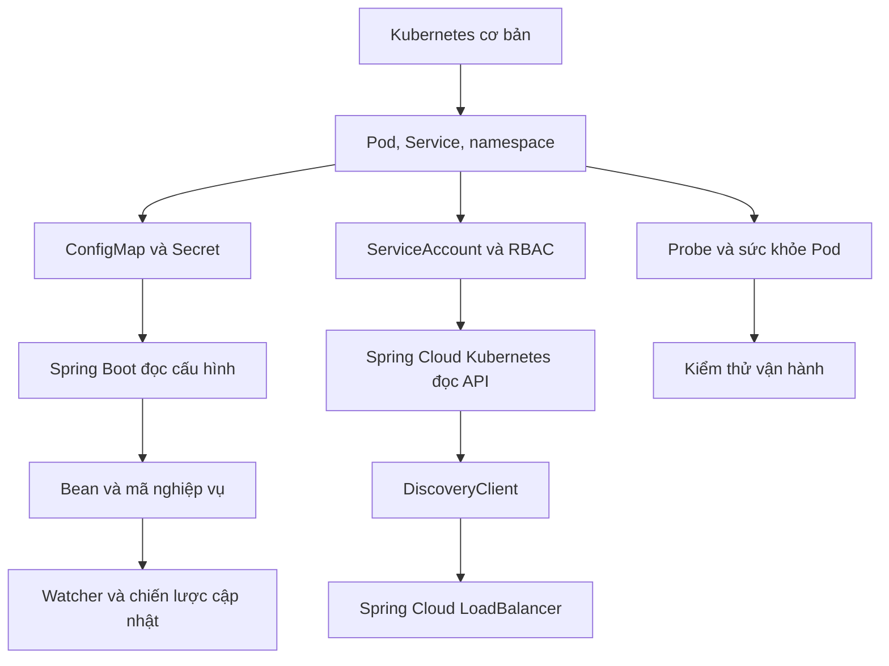
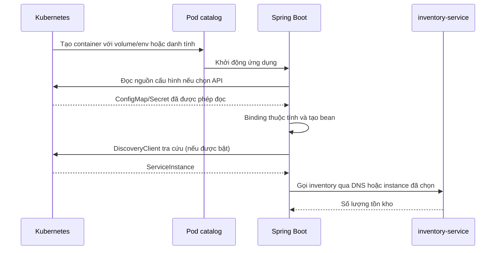

# Lộ trình học và mô hình ứng dụng thực hành

Spring Cloud Kubernetes là tập hợp các tích hợp giúp ứng dụng Spring làm việc với các khả năng của Kubernetes. Một lộ trình học tốt không bắt đầu bằng việc bật tất cả starter, mà bắt đầu từ một ứng dụng nhỏ, xác định rõ dữ liệu nào cần lấy từ cluster, dịch vụ nào cần gọi, cấu hình nào cần thay đổi và trạng thái nào cần quan sát.

Bài học này thuộc chương **Tổng quan** của module **Spring Cloud Kubernetes** (`SPRING_CLOUD_KUBERNETES`). Module tập trung vào việc tích hợp ứng dụng Spring với Kubernetes qua `DiscoveryClient`, `ConfigMap`, `Secret`, Spring Cloud LoadBalancer và Configuration Watcher; đồng thời thực hành RBAC, cập nhật cấu hình, theo dõi sức khỏe Pod và lựa chọn đúng tính năng cần cho triển khai.

Mục tiêu của bài là biến một yêu cầu triển khai thành lộ trình có thể kiểm chứng. Sau khi học xong, bạn có thể dựng một mô hình `catalog-service` gọi `inventory-service`, nạp cấu hình theo cách phù hợp, phân quyền tối thiểu và biết khi nào nên dùng DNS của Kubernetes thay cho discovery phía ứng dụng.

## 1. Bắt đầu từ bài toán, không bắt đầu từ thư viện

Giả sử nhóm xây dựng một hệ thống cửa hàng gồm hai ứng dụng:

- `catalog-service` trả danh sách sản phẩm và cần thông điệp hiển thị, số lượng trang mặc định cùng thông tin kết nối tới dịch vụ tồn kho.
- `inventory-service` trả số lượng còn lại của sản phẩm.

Hai ứng dụng chạy trong namespace `shop`. Ứng dụng cần các khả năng sau:

| Nhu cầu | Câu hỏi cần trả lời | Khả năng nên đánh giá |
|---|---|---|
| Nạp cấu hình | Giá trị đến từ đâu và có đổi trong lúc Pod chạy không? | Spring Boot Config Data, ConfigMap, Secret, volume hoặc biến môi trường |
| Gọi dịch vụ | Ứng dụng có cần tự lấy danh sách instance không? | DNS của Service hoặc `DiscoveryClient` |
| Chọn instance | Ai chọn backend cho mỗi yêu cầu? | Service của Kubernetes hoặc Spring Cloud LoadBalancer |
| Cập nhật | Sau khi ConfigMap đổi, bean nào phải nhận giá trị mới? | Rollout, refresh, Configuration Watcher hoặc đọc theo nhu cầu |
| Phân quyền | Thành phần nào cần gọi Kubernetes API và cần quyền gì? | ServiceAccount, Role, RoleBinding |
| Sức khỏe | Pod chỉ nhận lưu lượng khi nào? | Startup, readiness và liveness probe |

Mỗi câu hỏi là một quyết định riêng. `ConfigMap` giải quyết việc cung cấp cấu hình; nó không tự giải quyết việc bean đã tạo có nhận lại giá trị hay chưa. `DiscoveryClient` lấy thông tin dịch vụ; nó không tự biến một HTTP client bất kỳ thành client cân bằng tải. Watcher phát hiện thay đổi; nó không tự bảo đảm mọi bean đều cập nhật an toàn.

## 2. Mô hình học theo từng lớp

Nên học theo thứ tự từ nền tảng triển khai tới tích hợp phía ứng dụng. Thứ tự này tạo ra một chuỗi nguyên nhân và kết quả rõ ràng:



### Giai đoạn 1: Hiểu tài nguyên Kubernetes

Trước khi thêm dependency, cần hiểu các đối tượng mà ứng dụng sẽ gặp:

- **Pod** là nơi tiến trình Java chạy. Pod có vòng đời hữu hạn và có thể được thay thế.
- **Deployment** quản lý các bản sao Pod và quá trình rollout.
- **Service** cung cấp một tên mạng ổn định và chọn các Pod phù hợp qua selector.
- **ConfigMap** chứa cấu hình không nhạy cảm.
- **Secret** chứa dữ liệu cần kiểm soát chặt hơn, chẳng hạn mật khẩu hoặc token.
- **Namespace** tạo phạm vi tên và thường là phạm vi của Role.
- **ServiceAccount** là danh tính mà Pod sử dụng khi gọi Kubernetes API từ trong cluster.

Một lỗi thường gặp là nhầm Service với Pod. Nếu mục tiêu chỉ là gọi một dịch vụ nội bộ ổn định, tên DNS của Service thường đã đủ. Nếu mục tiêu là để ứng dụng nhận danh sách instance và tự chọn đích, lúc đó mới đánh giá discovery phía client.

### Giai đoạn 2: Chọn đường đưa cấu hình vào ứng dụng

Có ba hướng thường gặp:

1. Kubernetes đưa dữ liệu vào biến môi trường.
2. Kubernetes mount dữ liệu thành file, Spring Boot đọc file khi khởi động.
3. Ứng dụng hoặc thành phần Spring Cloud Kubernetes đọc ConfigMap/Secret qua Kubernetes API.

Không có hướng nào luôn tốt nhất. Biến môi trường đơn giản nhưng thay đổi thường gắn với vòng đời container. File giúp tách cấu hình khỏi image nhưng việc file đổi không đồng nghĩa bean đã refresh. API cho phép tích hợp sâu hơn và theo dõi thay đổi, nhưng kéo theo RBAC, khả năng kết nối API server và yêu cầu vận hành.

### Giai đoạn 3: Thêm discovery và cân bằng tải khi có nhu cầu

Nếu `catalog-service` gọi `inventory-service` bằng DNS của Service, Kubernetes chịu trách nhiệm chọn backend theo cơ chế mạng của Service. Nếu ứng dụng cần lọc instance theo metadata, chọn phía client hoặc có yêu cầu discovery riêng, hãy thêm `DiscoveryClient` và cơ chế load balancing tương ứng.

### Giai đoạn 4: Thiết kế cập nhật và quan sát

Sau khi luồng khởi động chạy được, mới mô phỏng thay đổi ConfigMap, thay đổi Secret, Pod chưa sẵn sàng và mất quyền API. Đây là lúc xác định watcher, refresh, rollout và probe có thực sự phù hợp với vòng đời ứng dụng hay không.

## 3. Mô hình ứng dụng thực hành

Mô hình minh họa sử dụng `catalog-service` làm ứng dụng Spring chính. Nó có một endpoint trả lời lời chào cấu hình được và một endpoint gọi `inventory-service`.

```text
namespace shop
├── catalog-service Deployment
│   ├── catalog-app ServiceAccount
│   ├── ConfigMap catalog-settings
│   └── Secret catalog-credentials
└── inventory-service Service
    └── các Pod inventory
```

Luồng dữ liệu lúc khởi động có thể được mô tả như sau:



Điểm quan trọng là hai đường đọc cấu hình và khám phá dịch vụ có thể cùng dùng Kubernetes API nhưng chúng có mục đích khác nhau. Việc cấp quyền cho một đường không tự cấp quyền cho đường còn lại.

## 4. Bước thực hành 1: dựng Service và kiểm tra DNS

Trước khi dùng `DiscoveryClient`, hãy chứng minh rằng ứng dụng có thể gọi Service bằng tên mạng. Một Service minh họa:

```yaml
apiVersion: v1
kind: Service
metadata:
  name: inventory-service
  namespace: shop
spec:
  selector:
    app: inventory
  ports:
    - name: http
      port: 8080
      targetPort: 8080
```

`selector` phải khớp label của Pod backend. `port` là cổng của Service; `targetPort` là cổng mà container lắng nghe. Khi gọi trong cùng namespace, ứng dụng thường có thể dùng tên `http://inventory-service:8080`. Từ namespace khác, tên đầy đủ có thể bao gồm namespace và hậu tố DNS của cluster tùy môi trường.

Kiểm tra cơ bản cần trả lời được:

- Service có tồn tại trong đúng namespace không?
- Selector có tìm thấy Pod backend không?
- Backend có sẵn sàng nhận lưu lượng không?
- Cổng ứng dụng, cổng Service và cổng container có khớp không?
- Chính sách mạng có cho phép lưu lượng giữa hai Pod không?

Nếu DNS của Service hoạt động và yêu cầu của bài toán chỉ là gọi một dịch vụ ổn định, đây là mô hình đơn giản đáng ưu tiên. Không nên thêm `DiscoveryClient` chỉ vì ứng dụng chạy trên Kubernetes.

## 5. Bước thực hành 2: nạp ConfigMap và Secret

### 5.1. ConfigMap dạng file

Một ConfigMap có thể chứa file cấu hình Spring:

```yaml
apiVersion: v1
kind: ConfigMap
metadata:
  name: catalog-settings
  namespace: shop
data:
  application.yaml: |
    training:
      catalog:
        welcome-message: "Chào mừng đến với cửa hàng"
        page-size: 20
```

Pod có thể mount ConfigMap vào thư mục cấu hình ngoài:

```yaml
spec:
  containers:
    - name: catalog
      image: example.invalid/catalog-service:demo
      env:
        - name: SPRING_CONFIG_ADDITIONAL_LOCATION
          value: "optional:file:/etc/catalog-config/"
      volumeMounts:
        - name: catalog-settings
          mountPath: /etc/catalog-config
          readOnly: true
  volumes:
    - name: catalog-settings
      configMap:
        name: catalog-settings
```

Đây là một luồng dữ liệu hoàn chỉnh:

```text
ConfigMap shop/catalog-settings
  → volume /etc/catalog-config
  → application.yaml
  → Spring Boot đọc cấu hình ngoài lúc khởi động
  → Environment
  → CatalogProperties
  → endpoint của catalog-service
```

Tên image trong ví dụ là placeholder. Trong triển khai thật, cần thay bằng image đã build và registry phù hợp.

### 5.2. Secret và ranh giới bảo mật

Secret có thể được mount thành file hoặc tham chiếu vào biến môi trường. Ví dụ mount một Secret:

```yaml
apiVersion: v1
kind: Secret
metadata:
  name: catalog-credentials
  namespace: shop
type: Opaque
stringData:
  inventory-api-key: thay-bang-gia-tri-quan-ly-an-toan
```

```yaml
spec:
  containers:
    - name: catalog
      env:
        - name: INVENTORY_API_KEY_FILE
          value: /etc/catalog-secret/inventory-api-key
      volumeMounts:
        - name: catalog-credentials
          mountPath: /etc/catalog-secret
          readOnly: true
  volumes:
    - name: catalog-credentials
      secret:
        secretName: catalog-credentials
```

Ứng dụng phải đọc đúng file và truyền giá trị cho client gọi inventory. Việc file tồn tại không tự tạo ra thuộc tính Spring. Cũng không ghi Secret vào log để kiểm tra. Base64 trong trường `data` chỉ là biểu diễn; việc bảo vệ còn phụ thuộc RBAC, chính sách lưu trữ và cách ứng dụng sử dụng dữ liệu.

### 5.3. Binding vào bean

Một lớp cấu hình có thể nhận các thuộc tính từ `Environment`:

```java
@ConfigurationProperties(prefix = "training.catalog")
public class CatalogProperties {
    private String welcomeMessage = "Xin chào";
    private int pageSize = 10;

    public String getWelcomeMessage() {
        return welcomeMessage;
    }

    public void setWelcomeMessage(String welcomeMessage) {
        this.welcomeMessage = welcomeMessage;
    }

    public int getPageSize() {
        return pageSize;
    }

    public void setPageSize(int pageSize) {
        this.pageSize = pageSize;
    }
}
```

Các thuộc tính `welcome-message` và `page-size` được ánh xạ theo quy tắc relaxed binding của Spring Boot vào `welcomeMessage` và `pageSize`. Bean cần được đăng ký bằng `@EnableConfigurationProperties` hoặc cơ chế scan tương ứng của ứng dụng.

Khi chẩn đoán giá trị sai, hãy kiểm tra theo thứ tự:

1. File hoặc API có thật sự chứa khóa mong đợi không?
2. Spring có đọc đúng vị trí và tên file không?
3. Prefix có khớp với lớp binding không?
4. Có nguồn cấu hình khác ghi đè không?
5. Bean được tạo khi nào và có giữ bản sao giá trị không?

## 6. Bước thực hành 3: hiểu và cấp RBAC tối thiểu

Khi ứng dụng đọc tài nguyên qua Kubernetes API, ServiceAccount của Pod phải có quyền tương ứng. Một Role giới hạn trong namespace `shop` có thể bắt đầu như sau:

```yaml
apiVersion: v1
kind: ServiceAccount
metadata:
  name: catalog-app
  namespace: shop
---
apiVersion: rbac.authorization.k8s.io/v1
kind: Role
metadata:
  name: catalog-config-reader
  namespace: shop
rules:
  - apiGroups: [""]
    resources: ["configmaps"]
    verbs: ["get", "list", "watch"]
---
apiVersion: rbac.authorization.k8s.io/v1
kind: RoleBinding
metadata:
  name: catalog-config-reader
  namespace: shop
subjects:
  - kind: ServiceAccount
    name: catalog-app
    namespace: shop
roleRef:
  apiGroup: rbac.authorization.k8s.io
  kind: Role
  name: catalog-config-reader
```

Deployment phải chỉ rõ danh tính này:

```yaml
spec:
  template:
    spec:
      serviceAccountName: catalog-app
```

`get`, `list` và `watch` có ý nghĩa khác nhau. Cấu hình khởi tạo có thể cần đọc một tài nguyên cụ thể; cơ chế theo dõi thường cần `watch`, đôi khi cần `list` để lấy trạng thái ban đầu. Không cấp quyền đọc Secret nếu luồng cấu hình không cần đọc Secret qua API. Không cấp quyền cluster-wide khi Role trong namespace đã đủ.

Nếu ứng dụng chỉ dùng ConfigMap đã mount thành file, nó không cần gọi API để đọc ConfigMap chỉ vì volume có nguồn gốc từ Kubernetes. Nếu Configuration Watcher là một thành phần riêng, phải xem xét danh tính và quyền của watcher riêng với danh tính của ứng dụng.

## 7. Bước thực hành 4: thêm DiscoveryClient và LoadBalancer có chủ đích

Khi nhu cầu đã vượt quá DNS của Service, có thể đưa discovery phía ứng dụng vào mô hình. Luồng khái quát là:

```text
Service và dữ liệu endpoint
  → Kubernetes API
  → Spring Cloud Kubernetes DiscoveryClient
  → ServiceInstance
  → Spring Cloud LoadBalancer
  → HTTP client
  → inventory-service
```

`DiscoveryClient` trả thông tin instance mà nó khám phá được. Spring Cloud LoadBalancer chọn một instance theo chiến lược và danh sách đã nhận. HTTP client cần được tích hợp đúng với load balancer; chỉ có bean `DiscoveryClient` chưa đủ để mọi URL tự cân bằng tải.

Ví dụ mã gọi theo tên dịch vụ cần phù hợp với client và starter mà dự án đang sử dụng. Tên dependency, annotation và cơ chế tạo client thay đổi theo dòng Spring Boot/Spring Cloud; vì vậy hãy khóa bộ phiên bản tương thích trước khi triển khai.

Bảng quyết định sau giúp chọn mô hình:

| Tình huống | Mô hình phù hợp để bắt đầu | Lý do |
|---|---|---|
| Gọi một Service nội bộ theo tên ổn định | DNS của Kubernetes | Ít thành phần, routing do Service đảm nhiệm |
| Cần lấy danh sách dịch vụ theo namespace hoặc bộ lọc | `DiscoveryClient` | Ứng dụng cần dữ liệu khám phá |
| Cần chọn instance ở phía client | Discovery + Spring Cloud LoadBalancer | Có logic chọn đích trong ứng dụng |
| Cần chuyển lưu lượng theo quy tắc ngoài ứng dụng | Service, gateway hoặc mesh phù hợp | Tránh đưa mọi routing vào bean nghiệp vụ |

Discovery cũng kéo theo quyền đọc và vấn đề cache. Khi Service, Endpoint hoặc readiness thay đổi, danh sách trong client có thể chưa cập nhật ngay. Client vẫn phải xử lý lỗi kết nối và thời điểm dữ liệu cũ.

## 8. Bước thực hành 5: thiết kế cập nhật cấu hình

Hãy tách cập nhật thành bốn mốc:

```text
1. ConfigMap/Secret được lưu giá trị mới
2. Thành phần đọc phát hiện hoặc nhận giá trị mới
3. Cơ chế refresh/rollout khởi động
4. Bean hoặc client thực sự sử dụng giá trị mới
```

Ví dụ, biến môi trường trong container thường cố định trong vòng đời tiến trình. Đổi ConfigMap không sửa biến môi trường của JVM đang chạy. Với volume ConfigMap, nội dung file có thể được kubelet cập nhật sau độ trễ; ứng dụng vẫn cần đọc lại hoặc khởi động lại để bean nhận giá trị mới. Với API watcher, cần kiểm tra quyền `watch`, kết nối theo dõi, cơ chế thông báo và cách áp dụng vào bean.

Configuration Watcher nên được xem như một mắt xích phát hiện và khởi phát cập nhật. Nó không biến mọi thuộc tính thành thuộc tính động. Một bean sao chép giá trị trong constructor vẫn giữ bản sao cũ nếu không có chiến lược tái tạo bean hoặc đọc giá trị theo mỗi lần sử dụng.

Có ba chiến lược thực tế:

| Chiến lược | Phù hợp khi | Rủi ro cần kiểm soát |
|---|---|---|
| Rollout thay Pod | Cấu hình đọc lúc khởi động, muốn trạng thái nhất quán theo Pod | Trong lúc rollout có thể tồn tại phiên bản cũ và mới |
| Refresh bean | Bean và dependency hỗ trợ cập nhật an toàn | Pool, client hoặc giá trị sao chép có thể không tự thay đổi |
| Đọc theo nhu cầu | Giá trị thay đổi thường xuyên và chi phí đọc chấp nhận được | Cần cache, xử lý lỗi và quy định nhất quán |

Với Secret xoay vòng, hãy kiểm tra đường đi từ giá trị mới tới client xác thực. Không coi log “đã nhận sự kiện” là bằng chứng rằng yêu cầu tiếp theo đã dùng token mới.

## 9. Bước thực hành 6: đưa sức khỏe Pod vào mô hình

Ứng dụng có thể mở các endpoint sức khỏe để Kubernetes kiểm tra, nhưng mỗi probe trả lời một câu hỏi khác nhau:

| Probe | Câu hỏi | Hành động thường liên quan |
|---|---|---|
| Startup | Ứng dụng đã khởi động xong chưa? | Cho phép thời gian khởi động dài trước khi đánh giá các probe khác |
| Readiness | Pod đã sẵn sàng nhận lưu lượng chưa? | Thêm hoặc loại Pod khỏi tập backend phục vụ |
| Liveness | Tiến trình có bị kẹt cần khởi động lại không? | Restart container khi tín hiệu thất bại theo ngưỡng |

Ví dụ probe HTTP:

```yaml
startupProbe:
  httpGet:
    path: /actuator/health/liveness
    port: 8080
  failureThreshold: 30
  periodSeconds: 10
readinessProbe:
  httpGet:
    path: /actuator/health/readiness
    port: 8080
  periodSeconds: 10
livenessProbe:
  httpGet:
    path: /actuator/health/liveness
    port: 8080
  periodSeconds: 20
```

Đây là ví dụ khung; endpoint, cổng và nhóm health indicator phải khớp với cấu hình ứng dụng. Không nên để liveness thất bại chỉ vì một dịch vụ phụ thuộc tạm thời bị gián đoạn nếu restart không khắc phục nguyên nhân. Readiness có thể phù hợp hơn cho quyết định tạm dừng nhận lưu lượng.

Khi kết hợp readiness với discovery, cần nhớ rằng Kubernetes cập nhật trạng thái backend và client discovery cập nhật cache theo các cơ chế có độ trễ khác nhau. Ứng dụng nên có timeout, retry có giới hạn và xử lý lỗi đích đã biến mất.

## 10. Một bài lab hoàn chỉnh

Có thể chia bài lab thành các checkpoint sau:

### Checkpoint A: chạy được ứng dụng tối thiểu

Triển khai `catalog-service` và `inventory-service` trong cùng namespace. Gọi `inventory-service` bằng DNS của Service. Xác minh response, port và selector trước khi thêm tích hợp Spring Cloud Kubernetes.

### Checkpoint B: đọc cấu hình không nhạy cảm

Tạo `catalog-settings`, mount thành file `application.yaml`, binding vào `CatalogProperties` và kiểm tra endpoint trả `welcome-message` đúng. Thay đổi ConfigMap để ghi nhận rằng file volume, bean và response có thể cập nhật ở những thời điểm khác nhau.

### Checkpoint C: xử lý Secret

Đưa API key vào Secret, mount vào container hoặc đọc qua cơ chế đã chọn. Kiểm tra yêu cầu xác thực mà không in giá trị bí mật. Xác minh Pod không thể đọc Secret ngoài phạm vi được cấp.

### Checkpoint D: kiểm tra RBAC

Gắn ServiceAccount tối thiểu cho Pod. Thử tách quyền `get`, `list`, `watch` theo đúng cơ chế đọc đã chọn. Phân biệt lỗi `Forbidden` với lỗi file không tồn tại và lỗi binding.

### Checkpoint E: quyết định discovery

Chạy cùng một lời gọi qua DNS của Service. Sau đó đánh giá discovery phía client bằng tiêu chí cụ thể, chẳng hạn cần lấy instance theo label hoặc cần chọn đích trong ứng dụng. Ghi lại quyền API và thành phần load balancing mới được thêm.

### Checkpoint F: mô phỏng thay đổi và Pod lỗi

Đổi một thuộc tính không nhạy cảm, làm một Pod chưa ready và kiểm tra response trong lúc rollout. Quan sát riêng các mốc: tài nguyên đổi, ứng dụng phát hiện, bean áp dụng và lưu lượng chuyển sang backend sẵn sàng.

## 11. Ma trận lỗi theo đường đi

Khi lab thất bại, hãy tìm chặng đầu tiên không có bằng chứng thành công:

| Triệu chứng | Chặng nghi ngờ | Kiểm tra tiếp theo |
|---|---|---|
| Pod không khởi động vì thiếu cấu hình | Vị trí hoặc tên nguồn cấu hình | Volume, key, đường dẫn, profile, log khởi động |
| File có nội dung nhưng bean dùng mặc định | Spring đọc hoặc binding | Tên file, prefix, đăng ký `ConfigurationProperties`, nguồn ghi đè |
| API trả `Forbidden` | ServiceAccount/RBAC | `serviceAccountName`, namespace, RoleBinding và verb |
| Secret không được đọc | Nguồn Secret hoặc quyền riêng | Tên Secret, key, mount path, quyền đọc Secret |
| Discovery không trả instance | Nguồn discovery hoặc dữ liệu backend | Service, endpoint, namespace, selector và quyền API |
| Discovery trả instance nhưng gọi lỗi | Địa chỉ, port hoặc cache | Port mapping, readiness, network policy, timeout |
| Đổi ConfigMap nhưng response không đổi | Chiến lược cập nhật | Env/file/API, watcher, refresh, rollout và bean lifecycle |
| Probe thất bại khi ứng dụng vẫn đang khởi động | Thiết kế probe | Startup delay, failure threshold, endpoint và dependency |

Đừng sửa RBAC khi ứng dụng đang đọc file; cũng đừng thêm watcher khi vấn đề là Deployment đang dùng sai ConfigMap. Phân loại lỗi theo đường đi giúp thay đổi nhỏ và có thể kiểm chứng.

## 12. Nguyên tắc chọn tính năng cho triển khai thật

Trước khi đưa một thành phần vào image hoặc manifest, hãy ghi rõ bốn câu trả lời:

1. Nguồn dữ liệu là ConfigMap, Secret, Service, Endpoint hay thông tin khác?
2. Ai đọc dữ liệu: kubelet, Spring Boot, Kubernetes client hay watcher riêng?
3. Bean hoặc thành phần nào tiêu thụ dữ liệu?
4. Khi dữ liệu đổi, ứng dụng cần refresh, rollout hay giữ cố định tới lần triển khai sau?

Sau đó đối chiếu với mô hình tối thiểu:

```text
Chỉ cần cấu hình lúc khởi động
  → ConfigMap/Secret dạng file hoặc biến môi trường

Cần đọc cấu hình qua API
  → Spring Cloud Kubernetes configuration + RBAC phù hợp

Chỉ cần gọi một Service ổn định
  → DNS của Kubernetes

Cần dữ liệu instance phía ứng dụng
  → DiscoveryClient

Cần chọn instance ở phía client
  → DiscoveryClient + Spring Cloud LoadBalancer

Cần phát hiện thay đổi
  → Watcher hoặc cơ chế theo dõi phù hợp + chiến lược áp dụng rõ ràng
```

Một thiết kế tốt cũng phải xác định quyền theo thành phần. Pod ứng dụng, watcher và công cụ triển khai có thể cần các ServiceAccount khác nhau. Giới hạn phạm vi theo namespace và tài nguyên giúp lỗi dễ khoanh vùng, giảm tác động khi credential bị lộ và làm manifest dễ review hơn.

## 13. Kết quả cần đạt sau lộ trình

Bạn hoàn thành bài thực hành khi có thể giải thích bằng sơ đồ và kiểm chứng bằng log hoặc trạng thái cluster các luồng sau:

- ConfigMap hoặc Secret đi vào file, biến môi trường hay API client như thế nào.
- Dữ liệu cấu hình trở thành thuộc tính Spring và được binding vào bean ở thời điểm nào.
- Service được gọi qua DNS khác gì với discovery bằng `DiscoveryClient`.
- Spring Cloud LoadBalancer chọn instance ở đâu và cần client tích hợp nào.
- RBAC cấp quyền cho đúng ServiceAccount và vì sao từng verb cần thiết.
- Thay đổi cấu hình được phát hiện, kích hoạt và áp dụng ra sao.
- Readiness, liveness và startup ảnh hưởng tới lưu lượng và vòng đời Pod thế nào.

Khi trả lời được các câu hỏi này, bạn có thể lựa chọn tính năng Spring Cloud Kubernetes theo nhu cầu triển khai cụ thể. Giá trị của module nằm ở việc nối được tài nguyên Kubernetes, vòng đời Spring và hành vi vận hành thành một mô hình có thể quan sát, giới hạn quyền và kiểm chứng từng bước.
