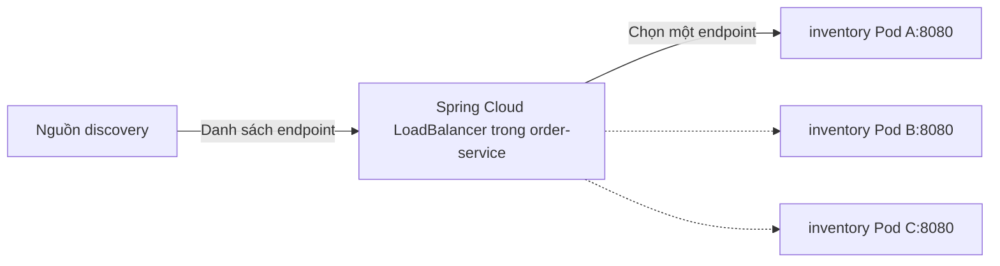
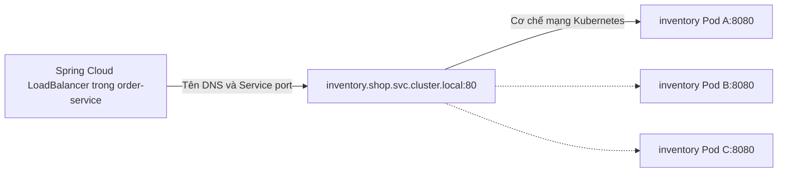

# Cân bằng tải qua địa chỉ Pod và qua Kubernetes Service

> Chương: Cân bằng tải — Module: SPRING_CLOUD_KUBERNETES.

Ứng dụng `order-service` cần gọi `inventory` có ba Pod đang phục vụ. Có hai cách chọn đích phổ biến: client chọn một địa chỉ endpoint cụ thể rồi gọi trực tiếp, hoặc client gọi địa chỉ Kubernetes Service và để cơ chế mạng của cluster chuyển kết nối tới backend.

Spring Cloud Kubernetes hỗ trợ hai chế độ tương ứng là `POD` và `SERVICE`. Quyết định này ảnh hưởng tới nơi lựa chọn backend, cổng được sử dụng, chính sách định tuyến có hiệu lực và cách theo dõi lỗi khi Pod thay đổi.

Bài học dùng Service thông thường kiểu `ClusterIP`, có selector chọn Pod trong namespace `shop`. Headless Service, ExternalName, gateway và service mesh có thể làm đường đi khác đi; cần xét riêng khi triển khai các trường hợp đó.

## 1. Nhìn đúng nơi thực hiện lựa chọn

### Chế độ POD: client chọn endpoint



Danh sách ứng viên có thể gồm địa chỉ các Pod đang đứng sau Service. LoadBalancer phía ứng dụng chọn một `ServiceInstance`; HTTP client dùng host và port tương ứng.

“Gọi trực tiếp” trong bài nghĩa là đích do client chọn là địa chỉ endpoint thay vì địa chỉ ảo ClusterIP. Lưu lượng vẫn đi qua mạng của cluster và có thể chịu NetworkPolicy, routing hoặc thành phần mesh đang được triển khai.

Service vẫn có vai trò mô tả nhóm backend, cổng và thông tin discovery. Chế độ POD không có nghĩa là ứng dụng tự quét mọi Pod trong namespace để cân bằng tải.

### Chế độ SERVICE: client chọn Service



Ở đây, đích được phía Spring chọn là một Kubernetes Service. Với Service ClusterIP thông thường, DNS phân giải về địa chỉ Service; cơ chế mạng chuyển kết nối tới một backend phù hợp.

Sơ đồ biểu diễn vai trò logic. Kubernetes Service không nhất thiết là một tiến trình proxy riêng mà mọi gói tin phải đi qua. Cách thực hiện phụ thuộc dataplane của cluster, như mô tả trong [Virtual IPs and Service Proxies](https://kubernetes.io/docs/reference/networking/virtual-ips/).

## 2. Ba khái niệm có tên gần nhau

| Khái niệm | Ý nghĩa |
| --- | --- |
| Spring Cloud LoadBalancer | Thành phần phía ứng dụng chọn một instance từ tập ứng viên |
| Kubernetes Service | Abstraction mạng đại diện cho một nhóm endpoint theo cấu hình Service |
| Kubernetes Service `type: LoadBalancer` | Kiểu Service có tích hợp cung cấp bộ cân bằng tải theo hạ tầng của cluster |

Không cần đổi Service sang `type: LoadBalancer` để sử dụng chế độ SERVICE của Spring Cloud Kubernetes. Service ClusterIP nội bộ là đủ cho ví dụ trong bài.

Ngoài ra, chọn địa chỉ Pod hay Service là quyết định về **đích của request nghiệp vụ**. Việc discovery đọc Kubernetes API trực tiếp hay qua Discovery Server là quyết định về **nguồn dữ liệu discovery**. Cần xác định rõ cả hai khi thiết kế, thay vì coi chúng là cùng một tùy chọn.

## 3. Ví dụ Service port khác backend port

Giả sử ba Pod `inventory` có label `app: inventory`, ứng dụng trong container lắng nghe cổng 8080. Service công bố cổng 80:

```yaml
apiVersion: v1
kind: Service
metadata:
  name: inventory
  namespace: shop
spec:
  type: ClusterIP
  selector:
    app: inventory
  ports:
    - name: http
      protocol: TCP
      port: 80
      targetPort: 8080
```

Manifest tạo Service; nó không tự tạo Deployment hoặc Pod. Các backend phải được triển khai và đạt điều kiện sẵn sàng phù hợp.

Ví dụ dữ liệu mạng minh họa:

| Đối tượng | Địa chỉ | Cổng |
| --- | --- | --- |
| Service `inventory` | ClusterIP do cluster cấp, ví dụ `10.96.20.30` | 80 |
| Pod A | `10.244.1.10` | 8080 |
| Pod B | `10.244.2.11` | 8080 |
| Pod C | `10.244.3.12` | 8080 |

Các IP chỉ phục vụ giải thích, không phải giá trị để chép vào cấu hình.

Theo [Kubernetes Service](https://kubernetes.io/docs/concepts/services-networking/service/), `port` là cổng Service công bố, còn `targetPort` xác định cổng backend. Với đường endpoint của ví dụ, client gọi endpoint port 8080. Với đường Service, client gọi Service port 80 rồi cơ chế Service chuyển tới backend port 8080.

```text
POD:
    http://10.244.2.11:8080/internal/whoami

SERVICE:
    http://inventory.shop.svc.cluster.local:80/internal/whoami
        → backend được chọn, ví dụ 10.244.2.11:8080
```

Hai địa chỉ có thể dẫn tới cùng một Pod nhưng qua hai cách lựa chọn khác nhau. Gọi `PodIP:80` không tự được đổi thành 8080 chỉ vì Service có `port: 80`. Ngược lại, dùng `ServiceIP:8080` sẽ không đúng với hợp đồng cổng của Service trên.

Việc khai báo `containerPort: 8080` cũng không làm ứng dụng tự lắng nghe cổng đó. Cấu hình tiến trình ứng dụng và Service phải thống nhất.

## 4. Cấu hình hai chế độ trong Spring Cloud Kubernetes

Tài liệu [LoadBalancer for Kubernetes](https://docs.spring.io/spring-cloud-kubernetes/reference/load-balancer.html) công bố hai chế độ `POD` và `SERVICE`, với mặc định là `POD`. Trong bài, luôn ghi rõ chế độ để kết quả không phụ thuộc việc người đọc nhớ mặc định.

Dự án Spring Boot cần quản lý dependency bằng Spring Cloud BOM tương thích. Chọn một starter phù hợp với Kubernetes client đang sử dụng, ví dụ Fabric8:

```xml
<dependency>
    <groupId>org.springframework.cloud</groupId>
    <artifactId>spring-cloud-starter-kubernetes-fabric8-loadbalancer</artifactId>
</dependency>
```

Nếu dự án chọn Kubernetes Java Client, starter tương ứng là `spring-cloud-starter-kubernetes-client-loadbalancer`. Không thêm đồng thời hai implementation chỉ để “đủ dependency”.

### 4.1. POD

```yaml
spring:
  application:
    name: order-service
  cloud:
    kubernetes:
      discovery:
        enabled: true
        all-namespaces: false
        namespaces:
          - shop
        use-endpoint-slices: true
        include-not-ready-addresses: false
        primary-port-name: http
      loadbalancer:
        mode: POD
```

Trong chế độ này, LoadBalancer dùng DiscoveryClient để lấy các instance theo service ID. Vì vậy, phạm vi namespace, đường endpoint, bộ lọc và quy tắc discovery có ảnh hưởng tới tập ứng viên.

Theo [DiscoveryClient for Kubernetes](https://docs.spring.io/spring-cloud-kubernetes/reference/discovery-client.html), tên cổng chính có thể được cấu hình để tránh chọn nhầm khi dịch vụ có nhiều cổng. Cần đối chiếu `ServiceInstance.getHost()` và `getPort()` thực tế, đặc biệt khi dùng starter hoặc phiên bản khác.

Ví dụ chủ động chọn EndpointSlice; cluster, implementation và RBAC phải hỗ trợ đường đó. Không chỉ bật thuộc tính rồi mặc định mọi quyền đã có sẵn.

### 4.2. SERVICE

```yaml
spring:
  application:
    name: order-service
  cloud:
    kubernetes:
      discovery:
        all-namespaces: false
        namespaces:
          - shop
      loadbalancer:
        mode: SERVICE
        port-name: http
        cluster-domain: cluster.local
```

Với Service `inventory` trong bài, ứng viên phía Spring có đích dạng:

```text
inventory.shop.svc.cluster.local:80
```

`cluster-domain` phải khớp cluster thực tế. Khi Service có nhiều cổng, đặt `port-name` rõ ràng; không dựa vào thứ tự cổng trong manifest.

Hai thuộc tính cần phân biệt:

| Thuộc tính | Ngữ cảnh cần xét |
| --- | --- |
| `spring.cloud.kubernetes.discovery.primary-port-name` | Chọn cổng khi tạo instance từ discovery ở đường POD |
| `spring.cloud.kubernetes.loadbalancer.port-name` | Chọn Service port ở đường SERVICE |

Ví dụ sử dụng duy nhất namespace `shop`. Nếu mở rộng phạm vi và tồn tại nhiều Service cùng tên ở các namespace, tập ứng viên có thể thay đổi. Phải quyết định rõ client có được chọn qua nhiều namespace hay không.

## 5. Gọi bằng service ID qua HTTP client đã tích hợp

Thêm dependency WebFlux cho ví dụ WebClient:

```xml
<dependency>
    <groupId>org.springframework.boot</groupId>
    <artifactId>spring-boot-starter-webflux</artifactId>
</dependency>
```

Ứng dụng chính đặt trong package cha, có `@SpringBootApplication` và `@EnableDiscoveryClient` theo cấu hình discovery của dự án.

Khai báo builder có tích hợp LoadBalancer:

```java
package example.balancing;

import org.springframework.cloud.client.loadbalancer.LoadBalanced;
import org.springframework.context.annotation.Bean;
import org.springframework.context.annotation.Configuration;
import org.springframework.web.reactive.function.client.WebClient;

@Configuration(proxyBeanMethods = false)
public class InventoryHttpConfiguration {

    @Bean
    @LoadBalanced
    WebClient.Builder inventoryWebClientBuilder() {
        return WebClient.builder();
    }
}
```

Controller của `order-service` dùng builder đó:

```java
package example.balancing;

import org.springframework.cloud.client.loadbalancer.LoadBalanced;
import org.springframework.web.bind.annotation.GetMapping;
import org.springframework.web.bind.annotation.RestController;
import org.springframework.web.reactive.function.client.WebClient;
import reactor.core.publisher.Mono;

@RestController
public class InventoryCallerController {

    private final WebClient inventoryClient;

    public InventoryCallerController(
            @LoadBalanced WebClient.Builder inventoryWebClientBuilder) {
        this.inventoryClient = inventoryWebClientBuilder
                .baseUrl("http://inventory")
                .build();
    }

    @GetMapping("/demo/whoami")
    public Mono<String> whoami() {
        return inventoryClient.get()
                .uri("/internal/whoami")
                .retrieve()
                .bodyToMono(String.class);
    }
}
```

Ở `http://inventory`, `inventory` là service ID để LoadBalancer xử lý. Client chọn host/port đích theo chế độ đang chạy. Không hardcode `:8080` vào URL logic để cố dùng chung cho hai đường cổng khác nhau.

Tài liệu [Spring Cloud LoadBalancer](https://docs.spring.io/spring-cloud-commons/reference/spring-cloud-commons/loadbalancer.html) mô tả các tích hợp với WebClient, RestClient và RestTemplate. Cần sử dụng HTTP client đã được tích hợp; chỉ thêm dependency không tự biến mọi lời gọi HTTP thành lời gọi cân bằng tải.

Nếu dùng một WebClient thông thường với `http://inventory`, tên đó được xử lý như hostname của HTTP request. Trong cluster, nó có thể vẫn hoạt động nhờ DNS theo namespace, khiến người học nhầm rằng Spring đang chọn Pod. Phải quan sát client và đích thực tế để phân biệt.

Ví dụ giữ request theo dạng reactive, không gọi `.block()` trong controller. Timeout, retry và chính sách xử lý lỗi cần được bổ sung theo yêu cầu ứng dụng khi triển khai thực tế.

## 6. Chỉ gọi DNS Service có cần Spring Cloud LoadBalancer không?

Một ứng dụng có thể dùng HTTP client thông thường để gọi trực tiếp:

```text
http://inventory.shop.svc.cluster.local:80/internal/whoami
```

Theo [DNS for Services and Pods](https://kubernetes.io/docs/concepts/services-networking/dns-pod-service/), Service ClusterIP thông thường có tên DNS đại diện cho địa chỉ Service. Nếu ứng dụng chỉ cần hợp đồng mạng này, có thể chưa cần thư viện client-side discovery hoặc LoadBalancer.

Có ba lựa chọn cần phân biệt:

| Lựa chọn | Ứng dụng dùng gì làm đích? | Có lựa chọn phía Spring không? |
| --- | --- | --- |
| HTTP client thông thường gọi DNS Service | Tên DNS Service và Service port do ứng dụng cấu hình | Không |
| Spring Cloud Kubernetes chế độ SERVICE | Service được supplier tìm và cung cấp cho LoadBalancer | Có, ở mức Service |
| Spring Cloud Kubernetes chế độ POD | Instance endpoint được DiscoveryClient cung cấp | Có, ở mức endpoint |

SERVICE mode của thư viện vẫn cần cơ chế tìm Service theo implementation và cấu hình. Không suy ra việc đổi `mode: SERVICE` tự loại bỏ mọi truy cập Kubernetes API hoặc mọi nhu cầu RBAC.

Ngược lại, chỉ gọi DNS Service bằng client thông thường không đòi ứng dụng tự liệt kê Service qua Kubernetes API cho thao tác đó. Đây là điểm khác biệt quan trọng khi mục tiêu là giảm thành phần và quyền cần quản lý.

## 7. Ai quyết định phân bố request?

### POD: ứng dụng có góc nhìn theo endpoint

Ứng dụng có thể quan sát tập ứng viên và lựa chọn một instance. Nếu muốn dùng metadata để ưu tiên vùng, phiên bản hoặc nhóm backend, phải có chính sách supplier hoặc thuật toán thực sự đọc các thông tin đó.

Một label như `track: canary` không tự tạo tỷ lệ canary. Bật POD cũng không tự bảo đảm mọi request có độ trễ thấp hơn hay mọi Pod nhận tải bằng nhau.

Mỗi replica của `order-service` có trạng thái lựa chọn riêng. Dù từng replica sử dụng round-robin, toàn bộ hệ thống không có một bộ đếm chung bắt buộc phân phối chính xác theo thứ tự A–B–C.

### SERVICE: cluster chọn backend cho đường Service

Nếu chỉ có một Service `inventory` trong phạm vi khám phá, phía Spring có thể chỉ thấy một đích Service dù Service đó có ba Pod. Lựa chọn Pod nằm ở cơ chế mạng phía sau Service.

Với TCP, việc ánh xạ kết nối và tái sử dụng kết nối có vai trò lớn. Nhiều request HTTP/1.1 keep-alive hoặc nhiều stream HTTP/2 trên cùng kết nối có thể tiếp tục tới cùng backend. Không nên kỳ vọng một Service thông thường sẽ đổi Pod sau mỗi request HTTP.

Các yếu tố như session affinity, traffic policy, topology và dataplane cụ thể còn ảnh hưởng đường Service. Không mặc định mọi cluster dùng cùng thuật toán hoặc phân bố giống nhau.

### Hai tầng lựa chọn khi có nhiều Service

Giả sử cùng service ID có ứng viên là Service `inventory` ở hai namespace được cho phép. SERVICE mode có thể có một bước chọn Service ở phía client, sau đó mỗi Service có tập backend riêng.

Đây là bài toán hai tầng. Phân bố đều giữa hai Service không nhất thiết phân bố đều trên tổng số Pod nếu một Service có hai Pod còn Service kia có tám Pod. Cũng không được coi đó là cơ chế chuyển vùng hoặc failover hoàn chỉnh nếu chưa có thiết kế tương ứng.

## 8. So sánh theo tiêu chí vận hành

| Tiêu chí | Qua địa chỉ Pod | Qua Service ClusterIP |
| --- | --- | --- |
| Đích do client chọn | Host/port endpoint cụ thể | Tên DNS và cổng Service |
| Góc nhìn của ứng dụng | Có thể thấy từng instance backend | Thường thấy đích Service ở tầng lựa chọn đó |
| Nơi lựa chọn Pod | Phía client theo danh sách instance | Cơ chế mạng Service |
| Phụ thuộc dữ liệu thay đổi Pod | Client cần nhận tập endpoint mới đủ kịp thời | Địa chỉ Service ổn định; backend cập nhật ở tầng cluster |
| Chính sách theo metadata từng instance | Có thể thiết kế ở phía client | Không tự quyết định Pod phía sau một đích Service |
| Cổng trong ví dụ | 8080 của endpoint | 80 của Service |
| Session affinity của Service | Không tự áp dụng chỉ vì endpoint thuộc Service | Có thể tác động khi đi qua đường Service |
| Yêu cầu mạng | Client tới được địa chỉ endpoint | Client phân giải và tới được đường Service |
| Quan sát sự cố | Theo instance được chọn và cache discovery | Theo đích Service, DNS, dataplane và backend cuối |

Bảng mô tả vị trí trách nhiệm trong phạm vi bài, không khẳng định chế độ nào luôn nhanh hơn hoặc an toàn hơn. Mesh, policy và cấu hình nền tảng có thể bổ sung các lớp xử lý cho cả hai.

## 9. Readiness, cập nhật backend và cache

### POD cần cập nhật góc nhìn của client

Khi một Pod bị thay thế, địa chỉ cũ có thể còn trong một tầng dữ liệu của ứng dụng trong một khoảng thời gian. Cần xác định những tầng thực sự đang dùng: dữ liệu Kubernetes client, cache DiscoveryClient, cache LoadBalancer hoặc supplier tùy chỉnh.

Không phải cứ gọi `getInstances()` là có một lần đọc mới đồng bộ từ API server. Cũng không được mặc định mọi implementation có cùng TTL hay cơ chế watch.

Một chuỗi phân tích có thể là:

```text
Pod thay đổi readiness hoặc bị thay thế
    → dữ liệu endpoint được cập nhật
    → discovery nhận thay đổi
    → supplier/cache đang dùng nhận tập ứng viên mới
    → lần chọn tiếp theo dùng tập mới
```

Chỉ tính các tầng hiện diện trong cấu hình thật. Tắt cache hoặc giảm một khoảng thời gian tùy tiện có thể làm tăng tải mà không sửa được tầng đang giữ dữ liệu cũ.

### SERVICE giữ ổn định đích logic

Service có thể giữ nguyên tên và ClusterIP khi tập backend thay đổi. Ứng dụng không phải thay URL theo từng Pod mới.

Tuy nhiên, điều đó không có nghĩa việc chuyển backend luôn tức thời. Dataplane có thời gian đồng bộ; kết nối đang mở còn có vòng đời riêng; backend đang kết thúc cần xử lý request đang chạy.

Nếu Service vẫn tồn tại nhưng không có backend sử dụng được, phía client có thể vẫn chọn được Service và sau đó gặp lỗi kết nối hoặc timeout. Có một đích Service không chứng minh có một backend khỏe.

### Readiness không thay cơ chế chịu lỗi

Giữ `include-not-ready-addresses: false` phù hợp với ví dụ gọi nghiệp vụ. Không bật chế độ bao gồm địa chỉ chưa ready chỉ để làm danh sách hết rỗng.

Cả hai đường vẫn cần timeout, quan sát lỗi và chính sách retry phù hợp với tính idempotent của thao tác. Không tự retry một thao tác ghi nghiệp vụ chỉ vì backend đã được cân bằng tải.

## 10. Quyền, đường mạng và TLS

### Quyền đọc Kubernetes

Với starter Fabric8 trong ví dụ, thành phần tương ứng phải có quyền đọc những tài nguyên nó sử dụng tại `shop`. POD cần nguồn dữ liệu endpoint; SERVICE cần nguồn dữ liệu Service. Quyền cụ thể phụ thuộc các informer và tính năng được khởi tạo.

Không gỡ toàn bộ RBAC chỉ vì SERVICE mode sử dụng DNS cho đích nghiệp vụ. Ngược lại, không cấp quyền đọc Secret chỉ để làm cân bằng tải.

Việc đọc ConfigMap, Secret hoặc dùng Configuration Watcher là nhu cầu riêng. Chuyển chế độ cân bằng tải không tự thay quyền của các tính năng đó.

### NetworkPolicy

Với POD, cần kiểm tra đường tới endpoint port 8080. Với SERVICE, request nhắm Service port 80 nhưng đích sau chuyển đổi có thể là Pod port 8080.

Cách NetworkPolicy áp dụng khi có Service và NAT phụ thuộc cơ chế mạng thực tế. Hãy kiểm chứng bằng plugin mạng của cluster thay vì chỉ nhìn cổng trong URL. Quyền RBAC không tự mở đường kết nối nghiệp vụ.

### TLS

Khi đổi từ hostname Service sang Pod IP, cách xác minh tên server có thể bị ảnh hưởng. Chứng chỉ chỉ có tên DNS Service không mặc nhiên hợp lệ khi client kết nối theo địa chỉ IP.

Nếu dùng TLS hoặc mTLS, cần kiểm tra cách HTTP client, hostname verification, SNI và hạ tầng đang triển khai phối hợp với đích được chọn. Không tắt kiểm tra chứng chỉ để che một mô hình định danh chưa phù hợp.

## 11. Thực hành quan sát đúng hai chế độ

Mục tiêu là xác nhận **đích client chọn** và **Pod thực sự trả lời**, thay vì chỉ đếm số response.

### 11.1. Chuẩn bị dấu hiệu nhận diện backend

Backend `inventory` có thể cung cấp endpoint nội bộ:

```java
package example.inventory;

import java.util.Map;

import org.springframework.beans.factory.annotation.Value;
import org.springframework.web.bind.annotation.GetMapping;
import org.springframework.web.bind.annotation.RestController;

@RestController
public class WhoAmIController {

    private final String podName;
    private final String podIp;

    public WhoAmIController(
            @Value("${POD_NAME:unknown}") String podName,
            @Value("${POD_IP:unknown}") String podIp) {
        this.podName = podName;
        this.podIp = podIp;
    }

    @GetMapping("/internal/whoami")
    public Map<String, String> whoami() {
        return Map.of("podName", podName, "podIp", podIp);
    }
}
```

Trong container backend đã tồn tại, thêm biến môi trường qua Downward API:

```yaml
ports:
  - name: http
    containerPort: 8080
env:
  - name: POD_NAME
    valueFrom:
      fieldRef:
        fieldPath: metadata.name
  - name: POD_IP
    valueFrom:
      fieldRef:
        fieldPath: status.podIP
```

Đây là đoạn cấu hình container, không phải manifest độc lập. Backend phải thực sự lắng nghe 8080 và endpoint chỉ được mở cho phạm vi quan sát phù hợp.

### 11.2. Kiểm tra dữ liệu nền

Người vận hành có quyền phù hợp chạy trong môi trường thử nghiệm:

```bash
kubectl get service inventory --namespace shop -o yaml

kubectl get pods --namespace shop --selector app=inventory -o wide

kubectl get endpointslices --namespace shop   --selector kubernetes.io/service-name=inventory -o yaml
```

Đối chiếu Service port 80, endpoint port 8080, selector, địa chỉ và điều kiện readiness. Một Service có thể có nhiều EndpointSlice; không lấy một slice rồi mặc định đó là toàn bộ backend.

### 11.3. Chạy POD và ghi lại hai loại thông tin

Chạy `order-service` với cấu hình POD. Gọi `/demo/whoami` nhiều lần từ vị trí được phép và lưu:

- Đích `ServiceInstance` LoadBalancer đã chọn ở từng lần cần quan sát.
- `podName` và `podIp` backend trả về.
- Thời gian, lỗi và số request đang chạy đồng thời.

Có thể sử dụng cơ chế quan sát lifecycle/logging phù hợp với phiên bản LoadBalancer. Không chỉ log URL trước khi nó được LoadBalancer xử lý, vì URL đó vẫn có thể là `http://inventory`.

Kết quả dự kiến về loại đích là địa chỉ endpoint với port 8080. Thứ tự Pod trả lời không phải hợp đồng A–B–C bắt buộc.

### 11.4. Chuyển SERVICE, giữ nguyên code gọi

Đổi cấu hình sang SERVICE, giữ nguyên Service, backend và code WebClient. Khi cấu hình không được hỗ trợ đổi động, khởi động lại hoặc rollout ứng dụng để sử dụng chế độ mới.

Đích phía Spring cần được đối chiếu là tên Service với port 80. Backend cuối cùng vẫn trả danh tính Pod của nó.

Không dùng `DiscoveryClient.getInstances("inventory")` làm bằng chứng duy nhất cho SERVICE mode: API discovery có thể vẫn mô tả các endpoint, trong khi supplier của LoadBalancer đang dùng đích Service. Cần quan sát đúng thành phần thực hiện lựa chọn.

### 11.5. Thử thay đổi backend

Trong môi trường thử nghiệm, thay đổi số replica hoặc readiness rồi đo:

```text
T0: thay đổi trạng thái backend
T1: endpoint nguồn phản ánh thay đổi
T2: ứng dụng quan sát hoặc sử dụng tập đích mới
T3: lần cuối request còn đến backend cũ, nếu có
```

Phân biệt request mới với request đã chạy hoặc kết nối đã mở trước thay đổi. Giữ cùng điều kiện tải và connection pool khi so sánh hai chế độ.

### 11.6. Đánh giá phân bố

Một phép thử ít request, dùng một kết nối, không đủ chứng minh thuật toán Service sai. Cần ghi rõ giao thức, số kết nối, mức đồng thời, affinity, số client replica và thời lượng thử.

Không tắt keep-alive trong production chỉ để làm biểu đồ phân bố nhìn đều hơn. Nếu mục tiêu là phân phối theo từng request, phải chọn cơ chế đáp ứng mục tiêu đó và đánh giá chi phí tương ứng.

## 12. Chẩn đoán những kết quả dễ gây nhầm

| Hiện tượng | Điểm cần kiểm tra |
| --- | --- |
| Chạy được `http://inventory` dù builder chưa tích hợp LoadBalancer | Có thể đang gọi DNS Service bằng HTTP client thông thường |
| POD chọn `PodIP:80` trong ví dụ backend lắng nghe 8080 | Đối chiếu instance được tạo, tên cổng, endpoint port và implementation |
| SERVICE chọn cổng quản trị | Kiểm tra Service có nhiều cổng và `loadbalancer.port-name` |
| SERVICE có đích nhưng request timeout | Kiểm tra Service endpoint, DNS, dataplane, policy và backend |
| POD lỗi sau rollout trong khi Service vẫn gọi được | Kiểm tra dữ liệu endpoint cũ, cache và đường mạng tới Pod mới |
| Nhiều request SERVICE đều về một Pod | Kiểm tra connection reuse, HTTP/2, affinity và điều kiện thử |
| Đổi mode mà hành vi không đổi | Kiểm tra profile/cấu hình có hiệu lực, lần khởi tạo context và builder thực sự được dùng |
| Client ở ngoài cluster không gọi được | Kiểm tra route tới Pod hoặc Service và khả năng phân giải DNS nội bộ |
| Chỉ gọi được qua Service khi TLS bật | Kiểm tra hostname, SAN và cấu hình TLS cho đích endpoint |

Một response backend thành công chỉ chứng minh đường gọi đó hoạt động. Nó chưa xác nhận chế độ cân bằng tải nếu không biết đích đã được chọn bởi thành phần nào.

## 13. Chọn chế độ theo nhu cầu ứng dụng

POD có ý nghĩa khi ứng dụng thực sự cần lựa chọn hoặc quan sát từng backend và có khả năng quản lý độ mới của discovery, route tới endpoint và chính sách lỗi. Các quy tắc theo instance cần được triển khai rõ ràng; metadata chỉ là dữ liệu đầu vào.

SERVICE có ý nghĩa khi muốn sử dụng hợp đồng mạng ổn định của Service và để cơ chế mạng Kubernetes quyết định backend. Cần hiểu các ảnh hưởng của kết nối, traffic policy và điều kiện sẵn sàng thay vì kỳ vọng cân bằng từng request HTTP.

Nếu chỉ cần gọi một Service bằng tên DNS và không cần chức năng lựa chọn phía Spring, hãy đánh giá HTTP client thông thường trước. Việc thêm DiscoveryClient, LoadBalancer hay Discovery Server cần giải quyết một nhu cầu cụ thể.

Khi ghi lại quyết định triển khai, nêu rõ service ID, namespace, đích được chọn, cổng tương ứng, nguồn dữ liệu discovery, tầng cache thực sự dùng và cách quan sát backend cuối. Những thông tin này giúp giữ đường gọi nhất quán khi scale Pod, rollout hoặc thay đổi cấu hình.
